<div align="center">

# 课件精讲（第 1 / 11 卷）

[📚 总目录](README.md)　·　[下一卷 ➡](02_%E8%AF%BE%E4%BB%B6%E7%B2%BE%E8%AE%B2.md)

**本卷内容**：第 1 部分

</div>

> [!NOTE]
> 单文件体积超出 GitHub 渲染上限会导致整页不显示，故全文拆卷。**总目录、材料覆盖表与自检清单见 [README.md](README.md)**。

## 📑 本卷目录

- [📘 一、《2026 中级信息安全工程师 课件合集（全 40 讲）》精讲要点 · 第 1 部分](#-一2026-中级信息安全工程师-课件合集全-40-讲精讲要点--第-1-部分)
  - [2026 中级信息安全工程师·课件合集（全40讲）— 精讲笔记 · Part 01](#2026-中级信息安全工程师课件合集全40讲-精讲笔记--part-01)
    - [🧭 导学课：课程介绍与学习方法](#-导学课课程介绍与学习方法)
    - [📗 01 信息安全工程师考试简介](#-01-信息安全工程师考试简介)
    - [📗 02 课程主要内容介绍](#-02-课程主要内容介绍)
    - [📗 03 学习方法及时间安排](#-03-学习方法及时间安排)
  - [📕 第1章 网络信息安全概述](#-第1章-网络信息安全概述)
    - [📌 本章目录与命题规律（Page 58）](#-本章目录与命题规律page-58)
    - [01 网络发展现状与重要性认识【了解】](#01-网络发展现状与重要性认识了解)
    - [02 网络信息安全现状与问题【了解】](#02-网络信息安全现状与问题了解)
    - [03 网络信息安全基本属性【必考，掌握】](#03-网络信息安全基本属性必考掌握)
    - [04 网络信息安全目标与功能【熟悉】](#04-网络信息安全目标与功能熟悉)
    - [05 网络信息安全基本技术需求【了解】](#05-网络信息安全基本技术需求了解)
    - [06 网络信息安全管理内容与方法【了解 / 有时考】](#06-网络信息安全管理内容与方法了解--有时考)
    - [07 网络信息安全法律与政策文件【熟悉】](#07-网络信息安全法律与政策文件熟悉)
    - [08 网络信息安全科技信息获取【了解】](#08-网络信息安全科技信息获取了解)
    - [09 第1章 课堂练习（Page 72）](#09-第1章-课堂练习page-72)
  - [📕 第2章 网络攻击原理与常用方法](#-第2章-网络攻击原理与常用方法)
    - [📌 本章目录与命题规律（Page 75）](#-本章目录与命题规律page-75)
    - [01 网络攻击概述](#01-网络攻击概述)
    - [02 网络攻击一般过程【了解】](#02-网络攻击一般过程了解)
    - [03 网络攻击常见技术方法【必考，掌握】](#03-网络攻击常见技术方法必考掌握)
    - [04 黑客常用工具【熟悉，有时考】](#04-黑客常用工具熟悉有时考)
    - [05 网络攻击案例分析（Page 90）](#05-网络攻击案例分析page-90)
    - [06 第2章 课堂练习（Page 91）](#06-第2章-课堂练习page-91)
  - [📕 第3章 密码学基本理论](#-第3章-密码学基本理论)
    - [📌 本章目录与命题规律（Page 94）](#-本章目录与命题规律page-94)
    - [01 密码学概况【有时考】](#01-密码学概况有时考)
    - [02 密码体制分类【常考】](#02-密码体制分类常考)
    - [03 常见密码算法【必考，掌握】](#03-常见密码算法必考掌握)
    - [04 Hash 函数与数字签名](#04-hash-函数与数字签名)
    - [05 密码管理与数字证书【熟悉，有时考】](#05-密码管理与数字证书熟悉有时考)
    - [06 安全协议【熟悉，有时考】](#06-安全协议熟悉有时考)
    - [07 密码学网络安全应用【偶尔考】](#07-密码学网络安全应用偶尔考)
    - [08 第3章 课堂练习（Page 114）](#08-第3章-课堂练习page-114)
  - [📕 第4章 网络安全体系与网络安全模型](#-第4章-网络安全体系与网络安全模型)
    - [📌 本章目录与命题规律（Page 117）](#-本章目录与命题规律page-117)
    - [01 网络安全体系概述【了解】](#01-网络安全体系概述了解)
    - [02 网络安全体系相关安全模型【必考，掌握】](#02-网络安全体系相关安全模型必考掌握)
    - [03 网络安全体系建设原则与安全策略【有时考，熟悉】](#03-网络安全体系建设原则与安全策略有时考熟悉)
    - [04 网络安全体系框架主要组成和建设内容【偶尔考】](#04-网络安全体系框架主要组成和建设内容偶尔考)
    - [05 网络安全体系建设参考案例【等保常考，其他不看】](#05-网络安全体系建设参考案例等保常考其他不看)
    - [06 第4章 课堂练习（Pages 128–129）](#06-第4章-课堂练习pages-128129)
  - [📕 第5章 物理与环境安全技术](#-第5章-物理与环境安全技术)
    - [📌 本章目录与命题规律（Page 132）](#-本章目录与命题规律page-132)
    - [01 物理安全概念与要求【偶尔考】](#01-物理安全概念与要求偶尔考)
    - [02 物理环境安全分析与防护【不考】](#02-物理环境安全分析与防护不考)
    - [03 机房安全分析与防护【熟悉】](#03-机房安全分析与防护熟悉)
    - [04 网络通信线路安全分析与防护【不考】](#04-网络通信线路安全分析与防护不考)
    - [05 设备实体安全分析与防护【偶尔考】](#05-设备实体安全分析与防护偶尔考)
    - [06 存储介质安全分析与防护【偶尔考】](#06-存储介质安全分析与防护偶尔考)
    - [07 第5章 课堂练习（Page 146）](#07-第5章-课堂练习page-146)
  - [📕 第6章 认证技术原理与应用](#-第6章-认证技术原理与应用)
    - [📌 本章目录与命题规律（Page 149）](#-本章目录与命题规律page-149)
    - [01 认证概述【常考】](#01-认证概述常考)
    - [02 认证类型与认证过程【熟悉】](#02-认证类型与认证过程熟悉)
    - [03 认证技术方法【掌握】](#03-认证技术方法掌握)
    - [04 认证主要产品与技术指标【了解】](#04-认证主要产品与技术指标了解)
    - [05 认证技术应用【了解】](#05-认证技术应用了解)
    - [06 第6章 课堂练习（Page 161）](#06-第6章-课堂练习page-161)
  - [📕 第7章 访问控制技术原理与应用](#-第7章-访问控制技术原理与应用)
    - [📌 本章目录与命题规律（Page 164）](#-本章目录与命题规律page-164)
    - [01 访问控制概述【了解】](#01-访问控制概述了解)
    - [02 访问控制模型](#02-访问控制模型)
    - [03 访问控制类型【掌握】](#03-访问控制类型掌握)
    - [04 访问控制策略设计与实现【熟悉】](#04-访问控制策略设计与实现熟悉)
    - [05 访问控制过程与安全管理【了解】](#05-访问控制过程与安全管理了解)
    - [06 访问控制主要产品与技术指标【了解】](#06-访问控制主要产品与技术指标了解)
    - [07 访问控制技术应用【常考，掌握】](#07-访问控制技术应用常考掌握)
    - [08 第7章 课堂练习（Page 176）](#08-第7章-课堂练习page-176)
  - [📕 第8章 防火墙技术原理与应用](#-第8章-防火墙技术原理与应用)
    - [📌 本章目录与命题规律（Page 179）](#-本章目录与命题规律page-179)
    - [01 防火墙概述【熟悉】](#01-防火墙概述熟悉)
    - [02 防火墙类型与实现技术【常考，掌握】](#02-防火墙类型与实现技术常考掌握)
    - [03 防火墙主要产品和技术指标【了解】](#03-防火墙主要产品和技术指标了解)
    - [04 防火墙防御体系结构类型【常考，掌握】](#04-防火墙防御体系结构类型常考掌握)
    - [05 防火墙技术应用](#05-防火墙技术应用)
    - [06 第8章 课堂练习（Page 199）](#06-第8章-课堂练习page-199)
  - [📕 第9章 VPN技术原理与应用](#-第9章-vpn技术原理与应用)
    - [📌 本章目录与命题规律（Page 202）](#-本章目录与命题规律page-202)
    - [01 VPN 概述【有时考，了解】](#01-vpn-概述有时考了解)
    - [02 VPN 类型和实现技术【常考，熟悉】](#02-vpn-类型和实现技术常考熟悉)
    - [03 VPN 主要产品与技术指标【了解】](#03-vpn-主要产品与技术指标了解)
    - [04 VPN 技术应用【了解】](#04-vpn-技术应用了解)
    - [05 第9章 课堂练习（Page 213）](#05-第9章-课堂练习page-213)
  - [📕 第10章 入侵检测技术原理与应用](#-第10章-入侵检测技术原理与应用)
    - [📌 本章目录与命题规律（Page 216）](#-本章目录与命题规律page-216)
    - [01 入侵检测概述【有时考，熟悉】](#01-入侵检测概述有时考熟悉)
    - [02 入侵检测技术【有时考，熟悉】](#02-入侵检测技术有时考熟悉)
    - [03 入侵检测系统组成与分类【有时考，熟悉】](#03-入侵检测系统组成与分类有时考熟悉)
    - [04 入侵检测系统主要产品与技术指标【不考，了解】](#04-入侵检测系统主要产品与技术指标不考了解)
    - [05 入侵检测系统应用【常考，掌握；注意 snort，其他了解】](#05-入侵检测系统应用常考掌握注意-snort其他了解)
    - [06 第10章 课堂练习（Page 229）](#06-第10章-课堂练习page-229)
  - [📕 第11章 网络物理隔离技术原理与应用](#-第11章-网络物理隔离技术原理与应用)
    - [📌 本章目录与命题规律（Page 232）](#-本章目录与命题规律page-232)
    - [01 网络物理隔离概述【了解】](#01-网络物理隔离概述了解)
    - [02 网络物理隔离系统与类型【了解】](#02-网络物理隔离系统与类型了解)
    - [03 网络物理隔离机制与实现技术【常考、熟悉】](#03-网络物理隔离机制与实现技术常考熟悉)
    - [04 网络物理隔离主要产品与技术指标【了解】](#04-网络物理隔离主要产品与技术指标了解)
    - [05 网络物理隔离应用【了解】](#05-网络物理隔离应用了解)
    - [06 第11章 课堂练习（Pages 242–243）](#06-第11章-课堂练习pages-242243)
  - [📕 第12章 网络安全审计技术原理与应用（起始部分）](#-第12章-网络安全审计技术原理与应用起始部分)
    - [📌 本章目录与命题规律（Page 246）](#-本章目录与命题规律page-246)
    - [01 网络安全审计概述【了解】](#01-网络安全审计概述了解)
  - [⚠️ 疑点](#-疑点)

---

## 📘 一、《2026 中级信息安全工程师 课件合集（全 40 讲）》精讲要点 · 第 1 部分

### 2026 中级信息安全工程师·课件合集（全40讲）— 精讲笔记 · Part 01

> [!NOTE]
> 本文件由 PDF 原始提取文本（Pages 1–248 / 共 919 页）**完整整理**而成，涵盖：
> **导学课**、**第1章 网络信息安全概述**、**第2章 网络攻击原理与常用方法**、**第3章 密码学基本理论**、
> **第4章 网络安全体系与网络安全模型**、**第5章 物理与环境安全技术**、**第6章 认证技术原理与应用**、
> **第7章 访问控制技术原理与应用**、**第8章 防火墙技术原理与应用**、**第9章 VPN技术原理与应用**、
> **第10章 入侵检测技术原理与应用**、**第11章 网络物理隔离技术原理与应用**、
> **第12章 网络安全审计技术原理与应用（起始部分）**。
> 已去除每页重复的水印/广告（"至强老师信息安全工程师精讲课程""考点清晰、专业高效""版权所有，翻录必究"等），**未删减任何知识点**。
> 文末「⚠️ 疑点」小节列出原文疑似错误处（原样保留 + 修正建议）。

---

#### 🧭 导学课：课程介绍与学习方法

##### 📌 课程基本信息（Page 1）

| 项目 | 要点 |
| --- | --- |
| 课程 | 信息安全工程师 2026 考期 · 导学课 |
| 主题 | 课程介绍与学习方法 |
| 讲师 | 至强老师 |
| QQ | `2976033` |
| 交流Q群 | `297744872` |
| 公众号 | 至立软考 |
| TB店 | 至立学院 |

##### 📌 目录（Page 2）

1. `01.` 信息安全工程师考试简介
2. `02.` 课程主要内容介绍
3. `03.` 学习方法及时间安排

---

#### 📗 01 信息安全工程师考试简介

##### 📌 考试基本问题（Page 3）

| 项目 | 要点 |
| --- | --- |
| 信息安全工程师是什么考试？ | 由**人社部、工信部**领导的国家级考试，属**软考中级科目**。`2016年`开设，`2020年`改版，官方教程为**第二版** |
| 信息安全工程师的职位定义是什么？ | 遵照管理体系和标准**防范黑客入侵并进行分析防范**，运用各种安全产品和技术，设置**防火墙、IDS、防病毒、攻防技术**等。进行**安全制度建设、技术规划、日常维护、检查与审计**等工作的专业技术人员 |
| 证书含金量怎么样？ | **国家部委联合发证**，考试难度较大，因此含金量高，是个人能力的有力证明，显著提升职场竞争力 |
| 考试次数与报名时间 | 每年安排**一次**，通常在 **10月底** 举行。报名一般在**考前两个月**，建议关注公众号或交流群，会有提醒通知 |

##### 📌 常见问题（Page 4）

| 项目 | 要点 |
| --- | --- |
| 专业与就业方向 | 适合**信息技术、信息安全、网络工程、软件开发**等专业。就业面向**政府机关、国企、事业单位、集成商、运营商及网安厂商**，从事**安全设计、开发、集成与服务** |
| 报名条件 | **无学历、年龄限制**。零基础可考，但需投入精力构建知识体系，建议报班学习以提升效率 |
| 考试通过率 | 整体通过率约 **20%**。对个人而言：系统学习认真备考 → 通过率 **80–100%**；三天打鱼两天晒网、碰运气 → 通过率 **0–50%**。`21年`难、`22年`易、`23年`偏题但改卷宽松、`24年`难度适中、`25年`偏简单，需扎实掌握知识点 |
| 案例题学习方法 | 案例题虽灵活，但 **1/3 为基础**，近几年命题方向稳定。需通过**例题、真题强化训练**，并结合**实验**加深理解，掌握解题思路 |

> [!IMPORTANT]
> 历年难度走势（必记）：**21 难 → 22 易 → 23 偏题但改卷宽松 → 24 适中 → 25 偏简单**。

##### 📌 报考流程（Page 5）

| 步骤 | 内容 |
| --- | --- |
| Step 1 | 考试报名 → **考前两周**测试平台 → **考前一周**打印准考证 |
| Step 2 | 参加全国统一考试（**10月**） |
| Step 3 | 考后 **1个月** 查成绩 → 合格领证 |

> [!WARNING]
> 温馨提示：建议在日历标记关键节点，**切勿错过报名和准考证打印时间**，以免耽误考试。

##### 📌 适合报考人群（Page 5）

- 相关专业**在校大学生**（求职加分）
- **企业安全从业者**（项目控标 / 资质）
- **网络 / 运维 / 开发**等 IT 技术从业者
- **体制内 / 国企员工**（评职级职称）
- **技术人才**（积分入户 / 落户加分 / 补贴抵税）
- **评标专家库申请 / 人才补贴**享受者
- 系统学习理论知识

##### 📌 官方信息与费用（Page 5）

| 项目 | 要点 |
| --- | --- |
| 报名系统 | `bm.ruankao.org.cn` |
| 软考官网 | `ruankao.org.cn` |
| 考试时间 | `2026年10月`（每年一次） |
| 考试费用 | 单科约 `60–80元` |

##### 📌 历次考试特点与科目（Page 6）

| 项目 | 要点 |
| --- | --- |
| 考试次数 | 自 `2016年` 起共举行 **10次**，考试由**两门科目**组成，且采取**连续考试**形式 |
| ① 基础知识 | **120分钟**机考，客观选择题（**75题 / 75分**）。可**挪出30分钟**到案例答题 |
| ② 应用技术 | **120分钟**机考，主观案例分析（**4–5题 / 75分**） |
| 合格标准 | 两门科目需**同次考试均 ≥ 45分**方可获证，**单科成绩不保留** |

> [!IMPORTANT]
> **两科同时 ≥45 分，单科成绩不保留** —— 高频必考点。

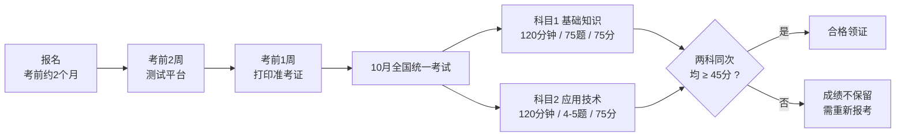

> [!NOTE]
> Page 6 末尾标题「2025年具体考试时间参考」在原 PDF 中为图表，本片段无对应文字。

---

#### 📗 02 课程主要内容介绍

##### 📌 考试目标（Page 7）

| 项目 | 要点 |
| --- | --- |
| 核心知识掌握 | 熟练掌握**网络信息安全的基础知识与技术原理**，筑牢理论根基 |
| 安全方案规划 | 依据**法规与业务要求**，规划设计信息系统**整体安全方案** |
| 设备运维配置 | 独立完成常见**网络安全设备及系统的配置部署与日常维护** |
| 风险应急处置 | 开展**风险监测、审计调查**，并具备网络安全事件**应急响应**能力 |

##### 📌 考试大纲（Page 8）

| 序号 | 大纲条目 | 具体要求 |
| --- | --- | --- |
| 01 | 基础概念 | 熟悉网络信息安全的**机密性、可用性、完整性**等基本知识，了解**个人信息隐私保护**的概念 |
| 02 | 安全机制 | 熟悉**身份认证、访问控制、日志审计、安全监控**的工作机制和技术原理 |
| 03 | 密码应用 | 掌握**密码体制与算法**，熟悉**数据加密、SSL VPN、数字签名、PKI** 等原理 |
| 04 | 安全威胁 | 掌握**端口扫描、病毒、蠕虫、木马、DoS、SQL注入**等网络安全威胁原理 |
| 05 | 防护技术 | 掌握**防火墙、IDS/IPS、VPN、安全审计、风险评估**等技术原理及应用 |
| 06 | 风险评估 | 了解**物理、系统、云计算、物联网**等多领域风险，能提出安全解决方案 |
| 07 | 等级保护 | 能够阅读并理解**网络信息安全等级保护标准**和相关规范要求 |
| 08 | 法律法规 | 能够阅读和理解网络信息安全相关的**法律法规、管理规定** |
| 09 | 技术资料 | 熟练阅读**英文技术资料**，了解**物联网、AI**等新兴技术安全风险 |

---

#### 📗 03 学习方法及时间安排

##### 📌 培训讲师介绍（Page 9）

**讲师：王至强**

| 项目 | 要点 |
| --- | --- |
| 从业背景 | 二十年 IT 行业从业经验，十年售前及技术管理经验，**政府采购评审专家、综合评标专家** |
| 授课背景 | 知名网安公司**技术总监、资深顾问、金牌讲师**，多年软考授课经验，培训学员数千人 |
| 国家级证书 | **系统规划与管理师（高级）、信息系统项目管理师（高级）**；**信息系统监理师、信息安全工程师、网络工程师（中级）** |
| 行业专业证书 | **CISP**：注册信息安全专业人员<br/>**CISAW**：信息安全保障人员（集成/运维/应急等）<br/>**CIIPT**：国家重要信息系统保护人员认证<br/>**工业互联网安全**：工业互联网安全工程师认证<br/>**IT服务管理**：ITSS 信息技术服务项目经理<br/>厂商认证：若干 |

##### 📌 直播（录播）课程体系（Page 10）

| 类别 | 内容 | 形式 |
| --- | --- | --- |
| 基础夯实 | 基础课 **27节** ｜ 案例专题 **10节** ｜ 考前冲刺 **2节** | 直播授课 |
| 巩固拓展 | 真题讲解 **14节** ｜ 扩展/实验课 **5节** | 高清录播 |

##### 📌 VIP 专属备考资料（Page 10）

| 类别 | 资料 |
| --- | --- |
| 刷题类 | 《至强全练》题库 ｜ 历年真题集 ｜ 专属刷题小程序 |
| 辅导类 | 全册 PPT 课件 ｜ 彩色思维导图 ｜ 高频考点总结 |
| 冲刺类 | 独家速记手册 ｜ 考前预测卷 ｜ 冲刺串讲包 |

##### 📌 全方位学习辅导服务（Page 10）

- **全程督学**：刷题指导 + 阶段测验
- **实操保障**：实验作业检查
- **答疑解惑**：一对一在线答疑
- **定制计划**：个性化备考方案
- "至立学院" 咨询报名

##### 📌 核心学习资料展示（Pages 11–14）

| 项目 | 要点 |
| --- | --- |
| 核心资料 | 至强全练、历年真题 |
| 刷题 APP | 随时随地高效练习，利用碎片化时间巩固核心考点，**错题自动归集**便于复盘 |
| 案例专题 | 深入拆解**下午场考试题型**，针对性突破案例分析难关，掌握解题思路与技巧 |
| 课件展示 | 内容详实，重点突出，直击考点 |
| 思维导图 | 构建知识体系，理清思路，学习更高效 |
| 部分资料 | 实验手册、考点速记 |

##### 📌 上届学员情况（Pages 15、32–51）

| 项目 | 要点 |
| --- | --- |
| 2025年考试风格 | 继续延续 `24年` 风格：**选择题考得比较细，案例题比较稳定**，通过的同学很多 |
| 案例备考经验 | 如果按照学习要求做了（听完所有课程 + 练历年真题），基本没问题；**特别是冲刺卷，都有案例题的原题**，头天看了就得分 |

> [!NOTE]
> Pages 16–31、32–51 在原 PDF 中均为「学员好评 — 通关喜悦 — 接好运」「上届学员情况 — 部分成绩展示」的**图片展示页**，提取文本中无新增知识点，故不重复罗列。

##### 📌 上届通关学员经验分享（Page 51）

| 项目 | 要点 |
| --- | --- |
| 通关经验 | 软考备考是持久战，**心态和方法同样重要**。看前辈经验，避坑高效通关 |
| 特别提示 | 关注课程配套**公众号**，获取真实备考心得与高分秘籍 |

##### 📌 学习的方法（Page 52）

> [!TIP]
> **方法不对，努力白费。**

| 方法 | 说明 |
| --- | --- |
| 坚持听课，勾重点 | 跟随老师节奏梳理知识框架，精准定位高频考点 |
| 刷题三遍，其义自见 | 通过反复练习强化记忆，熟悉题型与解题思路 |
| 动手实验 | 理论结合实操，在动手过程中理解底层逻辑 |
| 扩展学习 | 阅读专业书籍、参与实战，分析真实案例 |

##### 📌 学习的程度分级（Page 52）

| 程度 | 含义 | 对应题型 |
| --- | --- | --- |
| **了解** | 仅需知道基本概念，无需深入研究 | 非核心考点 |
| **熟悉** | 能建立逻辑关联，在提示下分辨对错 | 应对**选择题** |
| **掌握** | 需专项研究，能独立分析案例 | 应对**案例/计算题** |
| **精通** | 理论与实践融会贯通，灵活运用解决复杂问题 | — |

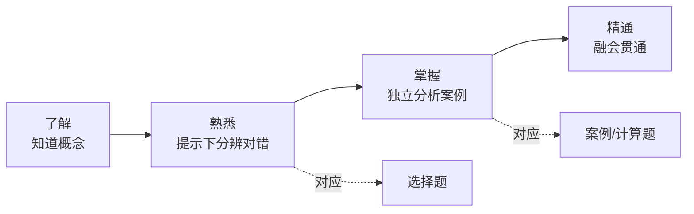

##### 📌 第一阶段：基础夯实（Page 53）

| 项目 | 要点 |
| --- | --- |
| 建议时长 | **30天** |
| 目标 | 熟悉教材框架，确保**选择题历年真题正确率稳定在 85% 以上** |
| 行动1 | 系统听课：**27节课**（含前导），每日 1 节，掌握核心知识点 |
| 行动2 | 章节刷题：每章学完即练（**20–40分钟**），薄弱点及时回看巩固 |

##### 📌 第二阶段：真题突破（Page 53）

| 项目 | 要点 |
| --- | --- |
| 建议时长 | **30天** |
| 目标 | 把握高频考点，串联知识网络，深化核心考点记忆 |
| 行动1 | 真题精讲课：每日 1 节（约 **20节**），剖析考点逻辑 |
| 行动2 | 复盘扩展：针对真题复盘基础点，横向扩展练习，**拒绝就题论题** |

##### 📌 第三阶段：案例专题学习（Page 54）

| 项目 | 要点 |
| --- | --- |
| 建议时长 | **30–60天** |
| 目标 | 熟悉案例考察相关知识点，常考案例方向达到**掌握** |
| 行动1 | 听课：案例专题课程 + 案例真题讲解共 **20节课左右**，每节课 **1–1.5小时**，建议每天学习 1 节 |
| 行动2 | 刷题：《至强全练》案例历年真题**至少刷3遍**，理解掌握 |
| 行动3 | 练习实验：结合听课主题复习对应知识点，并严格参照**实验手册**进行实操练习 |

##### 📌 第四阶段：总复习冲刺（Page 54）

| 项目 | 要点 |
| --- | --- |
| 建议时长 | **10天** |
| 目标 | 系统性查漏补缺，完成最后冲刺 |
| 行动1 | 高频考点：学习 **2节冲刺卷课程**（每节 1–1.5小时），快速巩固高频易考点 |
| 行动2 | 自主查漏：每天投入 **2–3小时**，通过专项刷题、重做重点实验来补齐薄弱环节 |

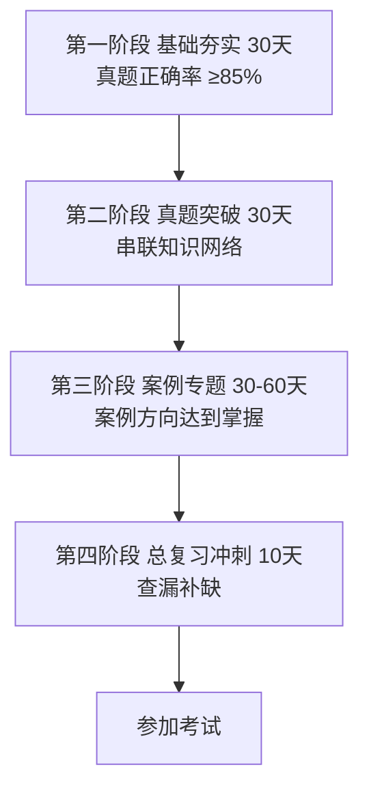

##### 📌 王国维《人间词话》做学问三重境界（Page 55）

| 层次 | 原文 |
| --- | --- |
| 第一层次 | 昨夜西风凋碧树，独上高楼，望尽天涯路。 |
| 第二层次 | 衣带渐宽终不悔，为伊消得人憔悴。 |
| 第三层次 | 蓦然回首，那人却在，灯火阑珊处。 |

> [!TIP]
> **道阻且长，行则将至**：把不断学习、提升认知作为习惯，愿您的人生因此而不同。

---

### 📕 第1章 网络信息安全概述

#### 📌 本章目录与命题规律（Page 58）

| 序号 | 小节 | 考频标注 |
| --- | --- | --- |
| 1 | 网络发展现状与重要性认识 | 【不考】 |
| 2 | 网络信息安全现状与问题 | 【不考】 |
| 3 | 网络信息安全基本属性 | 【必考】 |
| 4 | 网络信息安全目标与功能 | 【常考】 |
| 5 | 网络信息安全基本技术需求 | 【偶尔考】 |
| 6 | 网络信息安全管理内容与方法 | 【有时考】 |
| 7 | 网络信息安全法律与政策文件 | 【必考】 |
| 8 | 网络信息安全科技信息获取 | 【不考】 |

> [!IMPORTANT]
> **命题规律：选择 3–4 分，案例 0–2 分。**

---

#### 01 网络发展现状与重要性认识【了解】

##### 📌 网络信息安全相关概念（Page 59）

| 项目 | 要点 |
| --- | --- |
| 网络空间 | 计算机网络演变成人类活动的新空间，即**网络空间**，它是国家继**陆、海、空、天**四个疆域之后的**第五疆域** |
| **狭义** | 特指网络信息系统的各组成要素符合安全属性要求，即**机密性、完整性、可用性、抗抵赖性、可控性** |
| **广义** | 涉及**国家安全、城市安全、经济安全、社会安全、生产安全、人身安全**等在内的"大安全"体系。通常简称为"**网络安全**" |
| **定义** | 通过采取必要措施，防范对网络的**攻击、侵入、干扰、破坏和非法使用及意外事故**，保障网络稳定可靠运行，以及保障网络数据的**完整性、保密性、可用性**的能力 |

##### 📌 网络信息安全重要性认识（Page 59）

**新变化三方面：**

1. 保障内容从**单维向多维**转变；
2. 保障措施从**单一技术手段**向"**法律 + 政策 + 技术 + 管理 + 产业 + 教育**"综合体系演变；
3. 保障**贯穿全生命周期**，无"平时/战时"之分，需**全天候响应**。

**国家行动：**

| 项目 | 要点 |
| --- | --- |
| 网络安全法 | 《中华人民共和国网络安全法》`2017年6月1日`起正式实施 |
| 学科建设 | "**网络空间安全**"增设为**一级学科** |
| 宣传周 | 自 `2014年` 起每年举办"**国家网络安全宣传周**"，全面提升全民网络安全意识 |

##### 📌 补充：网络安全法修订（Page 59）

| 项目 | 要点 |
| --- | --- |
| 修订通过 | `2025年10月28日`，**第十四届全国人民代表大会常务委员会第十八次会议**通过《关于修改〈中华人民共和国网络安全法〉的决定》 |
| 新增内容 | 此次修改新增的**第二十条**对**人工智能安全与发展**作出专门规定 |
| 施行日期 | 修改后的《网络安全法》于 `2026年1月1日` 正式施行 |
| 新增表述1 | "国家支持**人工智能基础理论研究和算法等关键技术研发**，推进**训练数据资源、算力等基础设施建设**，完善**人工智能伦理规范**，加强**风险监测评估和安全监管**，促进人工智能应用和健康发展" |
| 新增表述2 | "国家支持**创新网络安全管理方式**，运用**人工智能等新技术**，提升网络安全保护水平" |

---

#### 02 网络信息安全现状与问题【了解】

##### 📌 网络信息安全状况（Page 60）

| 项目 | 要点 |
| --- | --- |
| 状况 | 当前网络环境中充斥着**多种威胁、多种攻击手段**，且有多个 **APT（高级持续威胁）组织**活跃，对信息安全构成严重挑战 |

##### 📌 网络信息安全面临的主要问题（Page 60）

| 项目 | 要点 |
| --- | --- |
| 问题 | 在当前的网络信息安全工作中，主要面临**十二个方面**的核心问题，涵盖**供应链、技术滥用、建设与管理不平衡、数据安全、安全意识、地下黑产、间谍战网络战**等多个维度，需系统梳理并针对性解决 |

---

#### 03 网络信息安全基本属性【必考，掌握】

##### 📌 五大基本属性（Page 61）

| 属性 | 英文 | 定义 | 对应威胁 |
| --- | --- | --- | --- |
| **机密性** | Confidentiality | 网络信息**不泄露给非授权的用户、实体或程序**，能够防止非授权者获取信息 | 泄密 |
| **完整性** | Integrity | 网络信息或系统**未经授权不能进行更改**的特性 | 篡改 |
| **可用性** | Availability | **合法许可的用户**能够**及时获取**网络信息或服务的特性 | 破坏 |
| **抗抵赖性** | — | 防止网络信息系统相关用户**否认其活动行为**的特性 | — |
| **可控性** | — | 网络信息系统**责任主体**对其具有**管理、支配能力**的属性，能够根据授权规则对系统进行有效掌握和控制，使得管理者有效地控制系统的行为和信息的使用，符合系统运行目标 | — |

> [!IMPORTANT]
> 记忆口诀（对应威胁）：**机密性 → 泄密；完整性 → 篡改；可用性 → 破坏**。三大属性 + **抗抵赖性 + 可控性** = 五属性（狭义网络信息安全概念）。

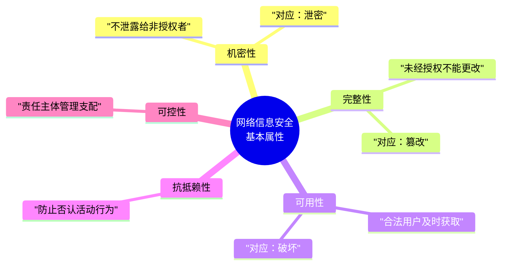

---

#### 04 网络信息安全目标与功能【熟悉】

##### 📌 网络信息安全基本目标（Page 62）

| 项目 | 要点 |
| --- | --- |
| **宏观目标** | 根据《**国家网络空间安全战略**》，以**总体国家安全观**为指导，实现**建设网络强国**的战略目标 |
| **具体目标** | 保障网络信息及相关信息系统**免受各类网络安全威胁**，维护网络空间的安全与稳定 |

##### 📌 网络信息安全基本功能（Page 62）

> 为达成上述安全目标，网络系统需具备**四大核心功能**：

| 功能 | 说明 |
| --- | --- |
| ➊ 防御 | 构建**主动防御体系**，实现威胁的早期规避与拦截 |
| ➋ 监测 | 建立**持续监测机制**，及时发现并识别潜在的安全异常 |
| ➌ 应急 | 制定**快速应急响应流程**，有效遏制攻击并减少危害扩散 |
| ➍ 恢复 | 具备**完整的数据与系统恢复能力**，保障业务连续性 |

> [!TIP]
> ★常考点提示：**防御、监测、应急、恢复**（口诀：**房间积灰**），被称为网络安全保障的"**四大支柱**"。


---

#### 05 网络信息安全基本技术需求【了解】

##### 📌 核心技术需求体系（Page 63）

| 领域 | 具体内容 |
| --- | --- |
| **基础环境** | **物理环境安全**（环境安全、设备安全、存储介质安全） |
| **身份与访问** | 网络信息安全**认证**、**访问控制** |
| **主动防御** | **安全保密**、**漏洞扫描**、**恶意代码防护** |
| **内容与动态响应** | 网络信息**内容安全**、**安全监测与预警**、**应急响应** |

---

#### 06 网络信息安全管理内容与方法【了解 / 有时考】

##### 📌 网络信息安全管理概念（Page 64）

| 项目 | 要点 |
| --- | --- |
| **定义** | 网络信息安全管理是指对**网络资产采取合适的安全措施**，以确保网络资产的**可用性、完整性、可控性和抗抵赖性**等，不致因**网络设备、网络通信协议、网络服务、网络管理**受到人为和自然因素的危害，而导致**网络中断、信息泄露或破坏** |

##### 📌 网络信息安全管理方法（Page 64）

> 网络安全管理方法主要有：**风险管理、等级保护、纵深防御、层次化保护、应急响应**以及 **PDCA（Plan-Do-Check-Act）** 方法等。

##### 📌 网络信息安全管理依据与要素（Page 64）

| 项目 | 要点 |
| --- | --- |
| **管理依据** | 网络安全**法律法规**、网络安全相关**政策文件**、网络安全**技术标准规范**、网络安全管理标准规范等 |
| **管理要素** | 网络**管理对象**、网络**威胁**、网络**脆弱性**、网络**风险**、网络**保护措施** |
| 管理对象 | 有价值的资产，如**硬件、软件、文档、系统**等 |
| 网络威胁 | **自然威胁**（地震、火灾等）和**人为威胁**（黑客、商业竞争对手等） |

##### 📌 网络脆弱性、风险与控制方法（Page 65）【有时考】

| 项目 | 要点 |
| --- | --- |
| 网络脆弱性 | 与**安全策略相冲突的状态或错误**、**资源有限**等 |
| **网络信息安全风险** | 特定的**威胁**利用网络管理对象所存在的**脆弱性**，导致网络管理对象的**价值受到损害或丢失的可能性**。网络安全管理实际上是对网络系统中网管对象的**风险进行控制** |

**风险控制方法（7 种，必记举例）：**

| 方法 | 原文举例 |
| --- | --- |
| **避免风险** | 例如，通过**物理隔离设备**将内部网和外部网分开，避免受到外部网的攻击 |
| **转移风险** | 例如，购买**商业保险计划**或**安全外包** |
| **减少威胁** | 例如，安装**防病毒软件包**，防止病毒攻击 |
| **消除脆弱点** | 例如，给**操作系统打补丁**或**强化工作人员的安全意识** |
| **减少威胁的影响** | 例如，采取**多条通信线路进行备份**或**制定应急预案** |
| **风险监测** | 例如，定期对网络系统中的安全状况进行**风险分析**，监测潜在的威胁行为 |
| **网络保护措施** | 应对威胁，减少脆弱性，限制意外事件影响，监测意外事件并促进**灾难恢复**而实施的各种**实践、规程和机制**的总称。如**访问控制机制、加密机制、安全审计机制、防病毒软件**等 |

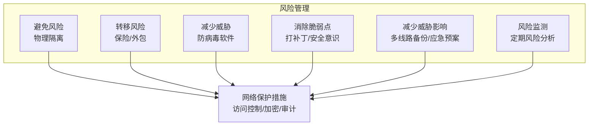

##### 📌 网络信息安全管理流程（Page 66）【表格各阶段内容有时考】

> 网络信息安全管理一般遵循如下工作流程：

| 步骤 | 内容 |
| --- | --- |
| 步骤1 | 确定网络信息安全管理**对象** |
| 步骤2 | **评估**网络信息安全管理对象的**价值** |
| 步骤3 | **识别**网络信息安全管理对象的**威胁** |
| 步骤4 | **识别**网络信息安全管理对象的**脆弱性** |
| 步骤5 | **确定**网络信息安全管理对象的**风险级别** |
| 步骤6 | **制定**网络信息安全**防范体系及防范措施** |
| 步骤7 | **实施和落实**网络信息安全防范措施 |
| 步骤8 | **运行/维护**网络信息安全设备、配置 |

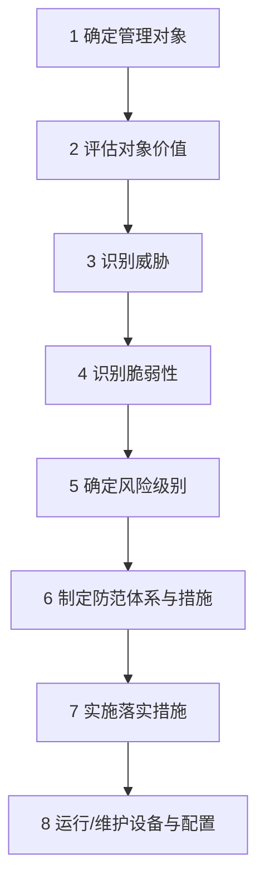

##### 📌 网络信息安全管理工具（Page 67）

| 项目 | 要点 |
| --- | --- |
| 说明 | 网络信息安全管理涉及的管理要素繁多，**单独依赖人工难以满足**网络信息系统的安全保障要求。为此，管理人员通常借助相应的工具对目标系统进行有效管理 |
| 常见工具 | 网络安全管理平台（简称 **SOC**）、**IT资产管理系统**、**网络安全态势感知系统**、**网络安全漏洞扫描器**、**网络安全协议分析器**、**上网行为管理**等各种类型 |

##### 📌 网络信息安全管理评估（Page 67）

| 项目 | 要点 |
| --- | --- |
| 定义 | 网络信息安全管理评估是指对网络信息安全管理**能力及管理工作是否符合规范**进行评价 |
| 常见评估 | **网络安全等级保护测评**、**信息安全管理体系认证**（简称 **ISMS**）、**系统安全工程能力成熟度模型**（简称 **SSE-CMM**）等 |

---

#### 07 网络信息安全法律与政策文件【熟悉】

##### 📌 网络信息安全基本法律与国家战略（Page 68）

| 项目 | 要点 |
| --- | --- |
| 主要文件 | 《中华人民共和国**国家安全法**》、〈中华人民共和国**网络安全法**〉、《全国人大关于**加强网络信息保护的决定**》、《**国家网络空间安全战略**》、《网络空间**国际合作战略**》等 |

> [!IMPORTANT]
> ★重要施行时间（**常考点**）：

| 法律法规 | 施行日期 |
| --- | --- |
| **网络安全法** | `2017/06/01` |
| **网络安全法（修订版）** | `2026/01/01` |
| **密码法** | `2020/01/01` |
| **数据安全法、关基条例** | `2021/09/01` |
| **个人信息保护法** | `2021/11/01` |
| **网络安全审查办法** | `2022/02/15` |

##### 📌 网络安全等级保护制度（Page 68）

**法定义务（《网络安全法》第 21 条规定）：**

| 序号 | 义务内容 |
| --- | --- |
| ① | 制定**内部管理制度与规程**，确定负责人落实责任 |
| ② | 防范**病毒、攻击、侵入**等技术措施 |
| ③ | **监测记录**运行状态与安全事件，**日志留存 ≥ 6个月** |
| ④ | **数据分类**、重要数据**备份与加密** |
| ⑤ | 其他法定/行政法规义务 |

> [!IMPORTANT]
> **核心工作流程（掌握）：定级 → 备案 → 建设整改 → 等级测评 → 运营维护（监督检查）**


##### 📌 国家密码管理制度（Page 69）【掌握】

| 项目 | 要点 |
| --- | --- |
| 管理主体 | 根据《**密码法**》，**国家密码管理部门**负责管理全国的密码工作，**县级以上地方各级密码管理部门**负责管理本行政区域的密码工作 |
| 分类管理 | 国家对密码实行分类管理，分为**三大类：核心密码、普通密码和商用密码** |

##### 📌 网络产品和服务审查（Page 69）

| 项目 | 要点 |
| --- | --- |
| 依据 | 为防范网络安全风险、维护国家安全，依据《**国家安全法**》《**网络安全法**》等，有关部门制定了《**网络产品和服务安全审查办法**》 |
| 审查重点 | 评估采购相关产品和服务可能带来的**国家安全风险** |
| 实施机构 | **中国网络安全审查技术与认证中心（CCRC）** 是实施审查和认证的专门机构 |

##### 📌 网络安全产品管理（Pages 69–70）

| 项目 | 要点 |
| --- | --- |
| 管理方式 | 主要由**专业测评机构**依据**国家标准**对网络安全产品进行严格测评，产品满足测评要求后，测评机构将向企业颁发**产品合格证书**，以此规范和提升网络安全产品的质量与合规性 |

##### 📌 其他制度（Page 70）

| 制度 | 要点 |
| --- | --- |
| **互联网域名安全管理** | 域名服务是**网络基础服务**。域名系统出现网络与信息安全事件时，应在 **24小时** 内向**电信管理机构**报告。政府网站域名相关模块**都不得放在境外** |
| **工业控制信息安全制度** | （原文仅列标题） |
| **个人信息和重要数据保护制度** | （原文仅列标题） |
| **网络安全标准规范与测评** | **全国信息安全标准化技术委员会**是从事信息安全标准化工作的技术工作组织，负责制定相关标准规范，为网络安全测评提供依据 |
| **网络安全事件与应急响应制度** | **国家计算机网络应急技术处理协调中心**（简称"**国家互联网应急中心**"，英文缩写为 **CNCERT** 或 **CNCERT/CC**）是中国计算机网络应急处理体系中的**牵头单位**，也是**国家级**的网络安全应急响应协调机构，负责协调处置重大网络安全事件 |

---

#### 08 网络信息安全科技信息获取【了解】

##### 📌 网络信息安全会议（Page 71）

| 类别 | 会议 |
| --- | --- |
| **四大顶级学术会议** | **S&P、CCS、NDSS、USENIX Security** |
| 国外知名会议 | **RSA Conference、DEF CON、Black Hat** |
| 国内知名会议 | **中国网络安全年会**、**互联网安全大会**（简称 **ISC**）、**信息安全漏洞分析与风险评估大会** |

##### 📌 网络信息安全期刊（Page 71）

| 类别 | 期刊 |
| --- | --- |
| 国际顶级期刊 | 《**IEEE Transactions on Information Forensics and Security**》《**ACM Transactions on Privacy and Security**》等 |
| 国内核心期刊 | 《**通信学报**》《**计算机工程**》等 |

##### 📌 网络信息安全网站（Page 71）

> **计算机安全应急响应组（CERT）**、**开放Web应用程序安全项目（OWASP）**、网络安全会议 **Black Hat** 等国际组织的官方网站，会提供**漏洞通报、安全工具、技术白皮书、会议视频**等各类网络信息安全服务与学习资源。

##### 📌 网络信息安全术语（Page 71）

| 术语类别 | 举例 |
| --- | --- |
| **基础技术类** | 密码 |
| **风险评估技术类** | 拒绝服务、网页篡改、垃圾邮件、恶意代码等 |
| **防护技术类** | 访问控制、防火墙、入侵防御等 |
| **检测技术类** | 入侵检测、漏洞扫描 |
| **响应/恢复技术类** | 应急响应、灾难恢复、备份等 |
| **测评技术类** | 黑盒测试、白盒测试、灰盒测试、渗透测试、模糊测试 |

---

#### 09 第1章 课堂练习（Page 72）

> [!NOTE]
> 以下为原文课堂练习题目（原文未附答案），已完整保留。

**1. 要实现网络信息安全基本目标，网络应具备（）等基本功能。**
- A. 预警、认证、控制、响应
- B. 防御、监测、应急、恢复
- C. 延缓、阻止、检测、限制
- D. 可靠、可用、可信

**2. 所有资源只能由授权方或以授权的方式进行修改，即信息未经授权不能进行改变的特性是指信息的（）。**
- A. 完整性
- B. 可用性
- C. 保密性
- D. 不可抵赖性

**3. 域名服务是网络服务的基础，该服务主要是指从事域名根服务器运行和管理、顶级域名运行和管理、域名注册、域名解析等活动。《互联网域名管理办法》规定，域名系统出现网络与信息安全事件时，应当在（）内向电信管理机构报告。**
- A. 6小时
- B. 12小时
- C. 24小时
- D. 3天

**4. 网络信息系统的整个生命周期包括网络信息系统规划、网络信息系统设计、网络信息系统集成与实现、网络信息系统运行和维护、网络信息系统废弃5个阶段。网络信息安全风险评估属于（）阶段。**
- A. 网络信息系统规划
- B. 网络信息系统设计
- C. 网络信息系统集成与实现
- D. 网络信息系统运行和维护

**5. 根据网络安全等级保护制度，国家要求评测机构对使用单位的定级对象进行（ ）**
- A. 定级
- B. 备案
- C. 整改建设
- D. 等级评测

---

### 📕 第2章 网络攻击原理与常用方法

#### 📌 本章目录与命题规律（Page 75）

| 序号 | 小节 | 考频标注 |
| --- | --- | --- |
| 1 | 网络攻击概述 | 【有时考】 |
| 2 | 网络攻击一般过程 | 【偶尔考】 |
| 3 | 网络攻击常见技术方法 | 【必考】 |
| 4 | 黑客常用工具 | 【偶尔考】 |
| 5 | 网络攻击案例分析 | 【偶尔考】 |

> [!IMPORTANT]
> **选择题 5–10 分，案例不考。**

---

#### 01 网络攻击概述

##### 📌 网络攻击概念（Page 76）【了解】

| 项目 | 要点 |
| --- | --- |
| 定义 | 网络攻击是指**损害网络系统安全属性的危害行为**。危害行为导致网络系统的**机密性、完整性、可用性、可控性、真实性、抗抵赖性**等受到不同程度的破坏 |

**常见的危害行为主要分为以下四类：**

| 类别 | 说明 |
| --- | --- |
| ❶ **信息泄露攻击** | 攻击者**未经授权获取或泄露敏感数据**，破坏数据**机密性** |
| ❷ **完整性破坏攻击** | **恶意篡改、删除或替换**数据内容，破坏数据的**真实性和完整性** |
| ❸ **拒绝服务攻击（DoS）** | 通过**耗尽系统资源或干扰服务**，使合法用户**无法正常访问**系统 |
| ❹ **非法使用攻击** | 攻击者**未经授权擅自使用系统资源、服务或权限**，进行违规操作 |

> [!NOTE]
> 原文 Page 76 末尾标注"**补充：主动/被动攻击**"，但本页无展开文字（应为图片/口述内容）；对应考点见 Page 91 课堂练习第 1 题。

##### 📌 网络攻击模型（Page 77）【熟悉，常考】

> 掌握网络攻击模型有助于更好地理解分析网络攻击活动，以便对目标系统的**抗攻击能力**进行测评。目前，常见的网络攻击模型主要如下：

| 模型 | 要点 |
| --- | --- |
| **1. 攻击树模型** | **优点**：头脑风暴、**费效分析**、可对复杂场景进行建模分析。<br/>**缺点**：无法建模**多重尝试**、**时间依赖**、**访问控制**与**循环事件**，在处理大规模网络时逻辑会变得特别复杂 |
| **2. MITRE ATT&CK 模型** | （**真实数据抽象形成**） |
| **3. 网络杀伤链（Kill Chain）模型** | （**分七个阶段**） |

##### 📌 网络攻击发展（Page 77）【了解】

> 呈现 **智能化、自动化、多样化、普适化、持续化、组织化** 等特点。

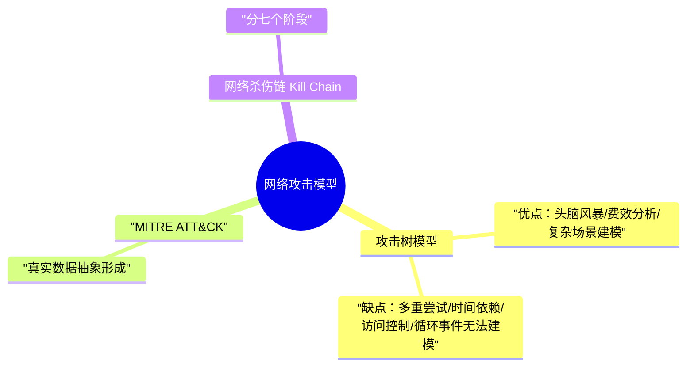

---

#### 02 网络攻击一般过程【了解】

##### 📌 网络攻击的 8 个步骤（Page 78）

> 网络攻击过程归纳为下面几个步骤：（偶尔考，把教材举例看一下）

| 步骤 | 内容 | 补充说明 |
| --- | --- | --- |
| (1) | **隐藏攻击源** | 隐藏黑客主机位置使得系统管理无法追踪 |
| (2) | **收集攻击目标信息** | 确定攻击目标并收集目标系统的有关信息 |
| (3) | **挖掘漏洞信息** | 从收集到的目标信息中提取可使用的漏洞信息 |
| (4) | **获取目标访问权限** | 获取目标系统的**普通或特权账户**的权限 |
| (5) | **隐藏攻击行为** | 隐藏在目标系统中的操作，防止入侵行为被发现（**连接隐藏、进程隐藏、文件隐藏**的举例） |
| (6) | **实施攻击** | 进行破坏活动或者以目标系统为**跳板**向其他系统发起新的攻击 |
| (7) | **开辟后门** | 在目标系统中开辟后门，方便以后入侵 |
| (8) | **清除攻击痕迹** | 避免安全管理员的发现、追踪以及法律部门取证 |

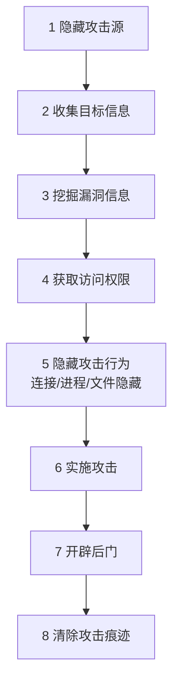

---

#### 03 网络攻击常见技术方法【必考，掌握】

##### 📌 端口扫描：定义与原理（Page 79）

| 项目 | 要点 |
| --- | --- |
| 定义 | 端口扫描是攻击者的**侦察手段**，旨在找出目标系统**开放的服务列表** |
| 原理 | 扫描程序尝试与目标主机的 **TCP/UDP 端口逐一建立连接**，根据端口与服务的**映射关系**及**服务器响应**，推断服务运行情况，以此获取系统信息并寻找入侵突破口 |

##### 📌 TCP 标志位（FLAGS）解析（Page 79）

| 标志位 | 含义 |
| --- | --- |
| **SYN** | 建立连接 |
| **FIN** | 关闭连接 |
| **ACK** | 确认响应 |
| **PSH** | 推送数据传输 |
| **RST** | 重置连接 |
| **URG** | 紧急数据 |

> [!TIP]
> TCP 头部包含 FLAGS 字段，常见标识共 6 种；**分析端口扫描时，前五种标志位是核心依据**。

##### 📌 几种端口扫描技术（Pages 79–81）

| 编号 | 扫描技术 | 原理与判定 |
| --- | --- | --- |
| **1** | **完全连接扫描（Connect Scan）** | 基于 **TCP 三次握手**机制，完成源端与目标端口的**完整连接**。若**握手成功**，则判定**端口开放**；若**失败**，则判定**端口关闭**。该方法**容易被日志记录** |
| **2** | **半连接扫描（Half-open Scan）** | 在源主机和目的主机的三次握手连接过程中，**只完成前两次握手**，**不建立一次完整的连接** |
| **3** | **SYN 扫描** | 首先向目标主机**发送连接请求**，当目标主机返回响应后，**立即切断连接过程**，并查看响应情况。若目标主机返回 **ACK 信息**，表示该**端口开放**；若返回 **RESET 信息**，表示该**端口没有开放** |
| **4** | **ID头信息扫描** | 见下方详解 |
| **5** | **隐蔽扫描** | 能够成功**绕过 IDS、防火墙和网络监视系统**等安全机制，从而获取目标主机端口开放信息的一种**高级扫描方式** |
| **6** | **SYN/ACK 扫描** | 由源主机向目标主机的特定端口**直接发送 SYN/ACK 数据包**，而不遵循 TCP 三次握手的第一步（发送 SYN 包）。目标主机收到此类异常数据包后，会判定为错误的连接尝试并做出响应：若**端口未开放**，会**直接返回 RST 数据包**；若端口处于**监听状态（LISTENING）**，则**不会回复任何信息**，而是**直接丢弃**该异常数据包 |
| **7** | **FIN 扫描** | 源主机向目标主机 B 发送 **FIN 数据包**，然后查看反馈信息。若端口**返回 RESET 信息**，则说明该端口**关闭**；若端口**没有返回任何信息**，则说明该端口**开放** |
| **8** | **ACK 扫描**（教材写法有问题） | 首先由主机 A 向目标主机 B 发送 **FIN 数据包**，然后查看反馈数据包的 **TTL 值**和 **WIN 值**。开放端口所返回的数据包的 TTL 值**一般小于 64**，而关闭端口的返回值**一般大于 64**。开放端口所返回的数据包的 WIN 值**一般大于 0**，而关闭端口的返回值**一般等于 0** |
| **9** | **NULL 扫描** | 将源主机发送的数据包中的 **ACK、FIN、RST、SYN、URG、PSH 等标志位全部置空**。若目标主机**无反馈**，则**端口开放**；若**返回 RST 信息**，则**端口关闭** |
| **10** | **XMAS 扫描** | 原理与 NULL 扫描相同，但需将 **ACK、FIN、RST、SYN、URG、PSH 等标志位全部置为 1**。若目标主机**无反馈**，则**端口开放**；若**返回 RST 信息**，则**端口关闭** |

> [!WARNING]
> **2 和 3 的区别**：二者本质上是**同一种技术**，**没有区别**（或者几乎没有区别），只是在不同语境下的两种叫法。如果非要像教材这样分成两种，或者应付考试，就注意上面标红的关键词，能够进行选择题的区分就可以了。

> [!NOTE]
> **NULL 扫描注释**：标志位全部置空表示数据包**仅含数据信息**，**不包含任何控制信息**，也**不会触发 TCP 连接的建立、终止或其他控制操作**，仅做简单数据传输。

##### 📌 ID 头信息扫描详解（Page 80）

| 步骤 | 内容 |
| --- | --- |
| 前提 | 需要用一台**第三方机器**配合扫描，并且这台机器的网络通信量要非常少，即 **dumb 主机** |
| 第一步 | 由源主机 **A** 向 dumb 主机 **B** 发出**连续的 PING 数据包**，并查看主机 B 返回数据包的 **ID 头信息**。通常，**顺序数据包的 ID 头值会增加 1** |
| 第二步 | 源主机 A **假冒主机 B 的地址**，向目的主机 **C** 的**任意端口（1~65535）** 发送 **SYN 数据包** |
| 结果① | 若主机 C 返回 **SYN/ACK**，说明该端口处于**监听状态** |
| 结果② | 若主机 C 返回 **RST/ACK**，说明该端口处于**非监听状态** |
| 判定 | 若主机 C 的**端口开放**，主机 B 返回给 A 的数据包 **ID 头值不是递增 1，而是大于 1**；若**端口非开放**，主机 B 返回的 ID 头值则**规律地递增 1** |

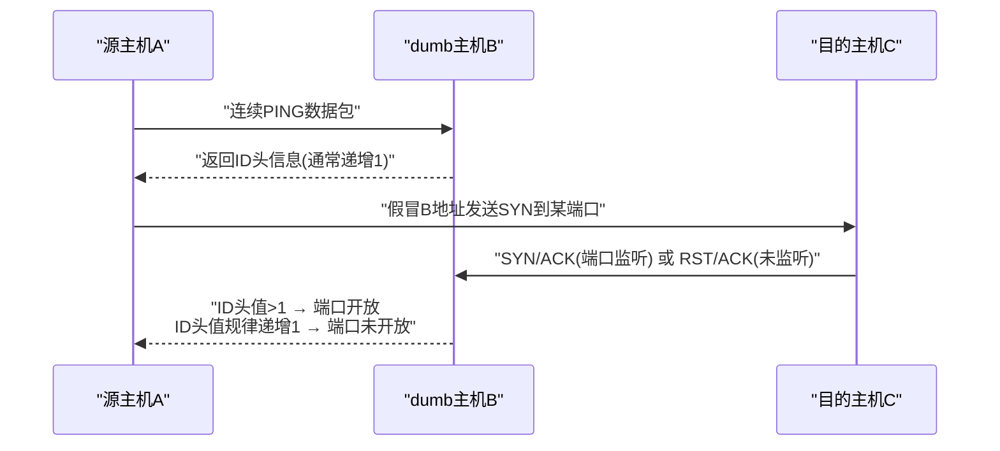

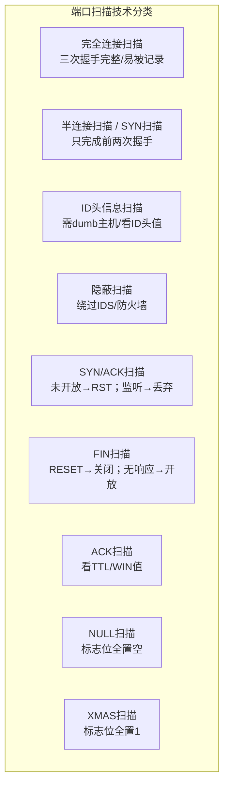

##### 📌 口令破解（Page 82）

| 项目 | 要点 |
| --- | --- |
| 地位 | 口令机制是**资源访问控制的第一道屏障**。网络攻击者常常以**破解用户的弱口令**为突破口，获取系统的访问权限 |

**远程猜测网络服务口令的主要工作流程：**

| 步骤 | 内容 |
| --- | --- |
| 第一步 | 建立与**目标网络服务的网络连接** |
| 第二步 | 选取一个**用户列表文件**及**字典文件** |
| 第三步 | 在用户列表文件及字典文件中，选取**一组用户和口令**，按网络服务协议规定，将用户名及口令发送给目标网络服务端口 |
| 第四步 | 检测**远程服务返回信息**，确定口令尝试是否成功 |
| 第五步 | 再取另一组用户和口令，**重复循环试验**，直至口令用户列表文件及字典文件选取完毕 |

##### 📌 缓冲区溢出（Page 83）

| 项目 | 要点 |
| --- | --- |
| 危害 | 缓冲区溢出攻击可以使攻击者有机会获得一台主机的**部分或全部的控制权** |
| 占比 | 据统计，缓冲区溢出攻击占**远程网络攻击的绝大多数** |
| 成为主要方式的原因 | 缓冲区溢出漏洞会给予攻击者**控制程序执行流程**的机会。攻击者将**特意构造的攻击代码**植入有缓冲区溢出漏洞的程序之中，**改变漏洞程序的执行过程**，就可以得到被攻击主机的控制权 |

##### 📌 恶意代码（Page 84）

> 常见的恶意代码类型有**计算机病毒、网络蠕虫、特洛伊木马、后门、逻辑炸弹、僵尸网络**等。

| 项目 | 要点 |
| --- | --- |
| **网络蠕虫** | `1988年`由**小莫里斯**编制，感染 **UNIX** 主机 |
| 典型代表 | **红色代码**（利用微软 **IIS** 中的 **index 服务**）；**震网**（**首个攻击真实世界基础设施**） |

##### 📌 拒绝服务（Page 84）

| 项目 | 要点 |
| --- | --- |
| 定义 | 拒绝服务攻击是指攻击者利用系统的缺陷，执行一些恶意的操作，使得**合法的系统用户不能及时得到应得的服务或系统资源**，如 **CPU 处理时间、存储器、网络带宽**等 |

**拒绝服务攻击常见类型（8 种）：**

| 序号 | 类型 |
| --- | --- |
| 1 | 同步包风暴（**SYN Flood**） |
| 2 | UDP 洪水（**UDP Flood**） |
| 3 | **Smurf** 攻击 |
| 4 | 垃圾邮件 |
| 5 | 消耗 **CPU 和内存资源**的攻击 |
| 6 | 死亡之 Ping（**Ping of Death**） |
| 7 | 泪滴攻击（**Teardrop Attack**） |
| 8 | 分布式拒绝服务（**DDoS**） |

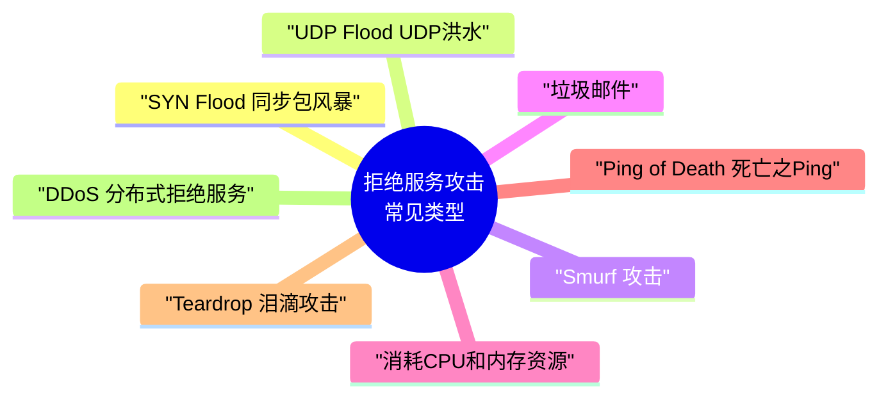

##### 📌 网络钓鱼（Phishing）（Page 85）

| 项目 | 要点 |
| --- | --- |
| 定义 | 是一种通过**假冒可信方**（知名银行、在线零售商和信用卡公司等可信的品牌）提供网上服务，以欺骗手段获取**敏感个人信息**（如**口令、信用卡详细信息**等）的攻击方式 |
| 手段 | 网络钓鱼综合利用**社会工程攻击技巧**和现代多种网络攻击手段，以达到欺骗意图 |
| 典型方法 | 网络钓鱼者利用**欺骗性的电子邮件**和**伪造的网站**来进行诈骗活动，诱骗访问者提供一些个人信息，如**信用卡号、账户和口令、社保编号**等内容，以谋求不正当利益 |

##### 📌 其他常见攻击技术方法（Page 86，了解）

| 方法 | 要点 |
| --- | --- |
| **网络窃听** | 是指利用网络通信技术缺陷，使得攻击者能够获取到其他人的网络通信信息。常见技术手段主要有**网络嗅探、中间人攻击**。网络攻击者将主机网络接口的方式设成"**杂乱（混杂）**"模式，就可以接收整个网络上的信息包，从而可以获取敏感的口令，甚至将其重组，还原为用户传递的文件 |
| **SQL 注入** | 在 Web 服务中，一般采用**三层架构**模式：**浏览器 + Web 服务器 + 数据库**。其中，**Web 脚本程序**负责处理来自浏览器端提交的信息，如用户登录名和密码、查询请求等。但由于 Web 脚本程序的**编程漏洞**，对来自浏览器端的信息**缺少输入安全合法性检查**，网络攻击者利用这种类型的漏洞，把 **SQL 命令**插入 Web 表单的输入域或页面的请求查找字符串，欺骗服务器执行恶意的 SQL 命令 |
| **社交工程** | 网络攻击者通过一系列的**社交活动**，获取需要的信息。例如**伪造系统管理员的身份**，给特定的用户发电子邮件骗取他的密码口令 |
| **电子监听** | 网络攻击者采用**电子设备远距离地监视电磁波的传送过程**。灵敏的无线电接收装置能够在远处看到计算机操作者输入的字符或屏幕显示的内容 |
| **会话劫持** | 会话劫持是指攻击者在**初始授权之后**建立一个连接，在会话劫持以后，攻击者**具有合法用户的特权权限**。例如，一个合法用户登录一台主机，当工作完成后，**没有切断主机**。然后，攻击者乘机接管，因为主机并不知道合法用户的连接已经断开。于是，攻击者能够使用合法用户的所有权限。典型的实例是"**TCP 会话劫持**" |
| **漏洞扫描** | 漏洞扫描是一种**自动检测**远程或本地主机安全漏洞的软件，通过漏洞扫描器可以自动发现系统的安全漏洞。网络攻击者利用漏洞扫描来搜集目标系统的漏洞信息，为下一步的攻击做准备 |
| **代理技术** | 网络攻击者通过**免费代理服务器**进行攻击，其目的是以代理服务器为"**攻击跳板**"，即使攻击目标的网络管理员发现了，也难以追踪到网络攻击者的真实身份或 IP 地址 |
| **数据加密** | 有网络攻击者常常采用**数据加密技术**来逃避网络安全管理人员的追踪。加密使网络攻击者的数据得到保护，即使网络安全管理人员得到这些加密的数据，**没有密钥也无法读懂**，这样就实现了攻击者的自身保护。攻击者的安全原则是，**任何与攻击有关的内容都必须加密或者立刻销毁** |

---

#### 04 黑客常用工具【熟悉，有时考】

> 网络攻击者常常采用的工具，主要包括**扫描器、远程监控、密码破解、网络嗅探器、安全渗透工具箱**等。（熟悉举例的工具名称，能区分什么工具属于哪一类）

##### 📌 扫描器（Scanners）（Page 87）

| 项目 | 要点 |
| --- | --- |
| 作用 | 扫描器正如黑客的"**眼睛**"，通过自动化扫描程序，攻击者可以快速探测攻击目标的 **IP 地址、开放端口号、服务器系统与应用版本、以及程序中可能存在的安全漏洞**等关键信息 |
| 分类 | 按扫描目的可分为三类：**地址扫描器、端口扫描器、漏洞扫描器** |

**经典扫描软件介绍：**

| 软件 | 要点 |
| --- | --- |
| ① **Nmap**（Network Mapper） | 也被称为"**网络地图**"。是一款功能强大的**免费网络扫描工具**，核心功能包括：探测网络上的**存活主机**、检测主机**开放的端口**、识别**操作系统类型及版本**、发现目标提供的**网络服务及版本**等。是渗透测试人员的**必备工具** |
| ② **Nessus** | 全球广泛使用的**漏洞扫描器**之一。早期为**开源且免费**，主要运行在 **Linux** 平台，支持**多线程扫描**和**插件扩展机制**以更新漏洞库。目前已发展为成熟的**商业化安全产品**，提供更全面的漏洞评估能力 |
| ③ **SuperScan** | 一款轻量级的 **Windows 平台端口扫描工具**。操作简单直观，集成了 **TCP Connect 全连接端口扫描、Ping 探测主机存活、域名解析**等功能，适合对指定 IP 段进行快速的基础扫描 |

##### 📌 远程监控（Page 88）

| 项目 | 要点 |
| --- | --- |
| 原理 | 远程监控实际上是在**受害机器上运行一个代理软件**，而在**黑客的电脑中运行管理软件**，受害机器受控于黑客的管理软件 |
| 术语 | 受害机器通常被称为"**肉鸡**"，其经常被用于发起 **DoS 拒绝服务攻击**或作为**攻击跳板** |
| 常见工具 | **冰河、网络精灵、Netcat** |

##### 📌 密码破解（Page 88）

| 项目 | 要点 |
| --- | --- |
| 地位 | 密码破解是**安全渗透常用的手段** |
| 常见破解方式 | **口令猜测、穷举搜索、撞库**等 |

| 破解方式 | 说明 |
| --- | --- |
| **口令猜测** | 主要针对用户的**弱口令** |
| **穷举搜索** | 针对用户密码的**选择空间**，使用**高性能计算机逐个尝试**可能的密码，直至成功 |
| **撞库** | 利用**已泄露的用户密码数据集**，通过**关键词匹配**与目标系统信息碰撞以获取密码 |

**密码破解的常见工具：**

| 工具 | 要点 |
| --- | --- |
| **John the Ripper** | 用于检查 **Unix/Linux** 系统的**弱口令**，支持几乎所有 Unix 平台上经 **crypt 函数**加密后的口令哈希类型，是审计系统密码强度的常用工具 |
| **LOphtCrack** | 常被称为"**LC5**"，主要用于破解 **Windows** 系统口令，集成了**词典攻击、组合攻击、强行攻击**等多种猜解方法，能高效分析 **SAM 数据库**中的密码哈希值 |

##### 📌 网络嗅探器（Network Sniffer）（Page 89）

| 项目 | 要点 |
| --- | --- |
| 定义 | 网络嗅探器是一种黑客攻击工具，通过**截获网络中的信息包**，对**加密数据包进行破解并分析内部数据**，从而窃取系统关键信息 |
| 常见工具 | **Tcpdump、DSniff、WireShark** 等 |

##### 📌 安全渗透工具箱（Page 89）

| 工具 | 要点 |
| --- | --- |
| **1. Metasploit** | 一款**开源**的渗透测试工具，提供**漏洞查找、漏洞利用、漏洞验证**等全流程服务。它支持超过 **1500 个漏洞**的挖掘与利用，可用于 **OWASP TOP10** 漏洞的专业测试，是渗透测试领域的核心工具之一 |
| **2. BackTrack5（BT5）** | 集成了海量安全工具的 **Linux 发行版**，覆盖**信息收集、漏洞评估、漏洞利用、提权、维持访问、逆向工程及压力测试**等全攻击链路场景。该版本已于 `2013年` **停止维护**，目前主流的替代升级版本为 **Kali Linux** |

```mermaid
mindmap
  root(("黑客常用工具"))
    扫描器
      Nmap
      Nessus
      SuperScan
    远程监控
      "冰河"
      "网络精灵"
      Netcat
    密码破解
      "John the Ripper"
      "LOphtCrack (LC5)"
    网络嗅探器
      Tcpdump
      DSniff
      WireShark
    安全渗透工具箱
      Metasploit
      "BackTrack5 → Kali Linux"
```

---

#### 05 网络攻击案例分析（Page 90）

| 案例 | 要点 |
| --- | --- |
| **DDoS 攻击** | **DDoS**（Distributed Denial of Service）是**分布式拒绝服务攻击**的简称，通过**大量请求**使目标服务器**资源耗尽**，无法向合法用户提供服务 |
| **W32.Blaster.Worm 冲击波蠕虫** | 这是一种利用 **Windows 系统 DCOM RPC 漏洞**进行快速传播的网络蠕虫。它不仅会导致受感染计算机**运行不稳定、频繁重启**，还会对 **windowsupdate.com** 发起**拒绝服务攻击**，阻碍受害用户下载并安装补丁以修复漏洞 |
| **2015 年乌克兰电网网络攻击事件** | `2015年12月23日`，乌克兰多个地区的电力系统遭受了针对性的网络攻击，导致**大面积、同时停电**，**数百万人**受到影响。调查确认此次停电并非技术故障，而是攻击者通过**恶意软件破坏了关键的电力基础设施控制系统**所致，这是公认的**首个导致大规模物理停电的网络攻击事件** |

---

#### 06 第2章 课堂练习（Page 91）

**1. 网络攻击分为主动攻击和被动攻击，主动攻击一般是指攻击者对被攻击信息的修改，而被动攻击主要是收集信息而不进行修改等操作，被动攻击更具有隐蔽性。以下网络攻击中，属于被动攻击的是（ ）。**
- A. 重放攻击
- B. 假冒攻击
- C. 拒绝服务攻击
- D. 窃听

**2. 拒绝服务攻击是指攻击者利用系统的缺陷，执行一些恶意的操作，使得合法的系统用户不能及时得到应得的服务或系统资源。以下给出的攻击方式中，不属于拒绝服务攻击的是（ ）。**
- A. SYN Flood
- B. DNS 放大攻击
- C. SQL 注入
- D. 泪滴攻击

**3. 网络攻击者经常采用的工具主要包括：扫描器、远程监控、密码破解、网络嗅探器、安全渗透工具箱等。以下属于网络嗅探器工具的是（ ）。**
- A. SuperScan
- B. LOphtCrack
- C. Metasploit
- D. WireShark

**4. SYN 扫描首先向目标主机发送连接请求，当目标主机返回响应后，立即切断连接过程，并查看响应情况。如果目标主机返回（），表示目标主机的该端口开放。**
- A. SYN/ACK
- B. RESET 信息
- C. RST/ACK
- D. ID 头信息

**5. 关于攻击树模型的描述，错误的是（ ）。**
- A. 能做费效分析和概率分析
- B. 不能建模多重尝试攻击
- C. 不能建模循环事件
- D. 不能建模复杂攻击场景

---

### 📕 第3章 密码学基本理论

#### 📌 本章目录与命题规律（Page 94）

| 序号 | 小节 | 考频标注 |
| --- | --- | --- |
| 1 | 密码学概况 | 【有时考】 |
| 2 | 密码体制分类 | 【常考】 |
| 3 | 常见密码算法 | 【必考】 |
| 4 | Hash 函数与数字签名 | 【常考】 |
| 5 | 密码管理与数字证书 | 【有时考】 |
| 6 | 安全协议 | 【有时考】 |
| 7 | 密码学网络安全应用 | 【偶尔考】 |

> [!IMPORTANT]
> **命题规律：选择 5 分左右，案例 3–5 分或大题。**

---

#### 01 密码学概况【有时考】

##### 📌 密码学发展简况（Page 95）【了解】

| 时间/阶段 | 要点 |
| --- | --- |
| 学科定位 | 密码学是一门研究**信息安全保护**的科学，以实现信息的**保密性、完整性、可用性及抗抵赖性**。密码学主要由**密码编码**和**密码分析**两个部分组成 |
| `1949年` | **香农**发表了著名的论文《**保密系统的通信理论**》，提出交替使用**换位和置换**以抵御统计分析，增加了**混乱（Confusion）** 和**扩散（Diffusion）** 的密码技术新方法，奠定了**现代密码学的理论基础** |
| `20世纪70年代` | 密码技术出现重大创新：一是 **Diffie-Hellman 算法、RSA 算法**的提出开辟了**公钥密码学新纪元**；二是美国发布了**数据加密标准（DES）**。这些成果标志着**现代密码学的诞生**，其中 **RSA 及 Diffie-Hellman 算法的发明者均获得了计算机领域的图灵奖** |
| 我国里程碑 | `2005年` 《**电子签名法**》施行；`2006年` 公布**国产商用密码算法**；`2020年1月1日` 《中华人民共和国**密码法**》正式施行，标志着密码工作进入**法治化轨道** |

##### 📌 密码学基本概念（Page 96）【熟悉】

| 概念 | 定义 |
| --- | --- |
| **密码学** | 主要目的是**保持明文的秘密**以防止攻击者获知 |
| **密码分析学** | 在**不知道密钥**的情况下，**识别出明文**的科学 |
| **明文** | 需要采用密码技术进行保护的消息 |
| **密文** | 用密码技术处理过明文的结果，通常称为**加密消息** |
| **加密** | 将明文变换成密文的过程 |
| **解密** | 由密文恢复出明文的过程（加密的逆过程） |
| **加密算法** | 加密过程所使用的一组操作运算规则 |
| **解密算法** | 解密过程所使用的一组操作运算规则 |
| **密钥** | 加密和解密算法的操作通常都是在**密钥控制**下进行的，分别称为**加密密钥**和**解密密钥** |

**符号约定：**

| 符号 | 含义 |
| --- | --- |
| **M** | Message 消息（明文） |
| **K** | Key 密钥 |
| **E** | Encryption 加密 |
| **D** | Decryption 解密 |
| **C** | Ciphertext 密文 |

##### 📌 密码安全性分析（Page 97）【偶尔考】

> 根据密码分析者在破译时已具备的**前提条件**，人们通常将密码分析攻击类型分为**五种**：

| 序号 | 攻击类型 | 定义 | 原文举例 |
| --- | --- | --- | --- |
| 1 | **唯密文攻击**（Ciphertext-Only Attack） | 密码分析者**只拥有一个或多个用同一个密钥加密的密文**，没有其他可利用的信息。这是对攻击者**最为不利**的情况 | 攻击者仅截获密文"`7g4#32f`"，无任何其他线索 |
| 2 | **已知明文攻击**（Known-Plaintext Attack） | 密码分析者仅知道当前密钥下的**一些明文及所对应的密文** | 攻击者知道明文"`hello`"对应的密文是"`7g4#32f`"，试图以此推导密钥 |
| 3 | **选择明文攻击**（Chosen-Plaintext Attack） | 密码分析者能够得到当前密钥下**自己选定的明文所对应的密文**。这通常发生在攻击者可以**部分控制加密过程**时 | 攻击者向加密服务发送自定义明文并获取密文，分析算法模式 |
| 4 | **密文验证攻击**（Ciphertext-Verification Attack） | 密码分析者对于**任何选定的密文**，能够得到该密文**是否合法的判断** | 攻击者尝试提交密文"`7g4#3!2j`"并得知它是有效的；然后尝试提交修改过的版本"`7g4#3!2k`"得知它是无效的。通过这种方式，攻击者可以测试不同的修改，以了解加密算法的验证机制 |
| 5 | **选择密文攻击**（Chosen-Ciphertext Attack） | 除了挑战密文外，密码分析者能够得到**任何选定的密文所对应的明文**。这种方式对攻击者**最有利**，常针对**公钥密码体制**，特别是攻击**数字签名** | 攻击者截获了密文"`7g4#3!2j`"，并能够请求解密得到明文"`hello`"。然后他们可以修改这个密文比如改为"`7g4#3!2h`"并再次请求解密，以观察结果的变化 |

> [!TIP]
> 攻击者有利程度排序（记忆）：**唯密文**（最不利） < 已知明文 < 选择明文 < 密文验证 < **选择密文**（最有利）。


---

#### 02 密码体制分类【常考】

> 根据**密钥特点**，密码体制分为**私钥**和**公钥**密码体制两种，而介于两者之间的称为**混合密码体制**。

##### 📌 私钥密码体制（对称密码体制）（Page 98）

| 项目 | 要点 |
| --- | --- |
| 1. 核心特点 | 又称为**对称密码体制**，其核心特征是**加密和解密使用相同的密钥**。这是目前**应用最广泛**的密码体制 |
| 2. 密钥分配与管理 | 密钥的安全性至关重要，必须通过**安全途径**（如**专人护送**）分配。在网络环境中，若有 **n 个用户两两通信**，则需要维护 **n(n-1)/2** 个密钥，管理成本极高 |
| 3. 优势 | 算法**逻辑简单**，**处理速度快**，适合对**大量数据**进行加密处理 |
| 3. 缺陷 | 存在**三大难题**：**密钥分配困难**、**密钥管理复杂**、以及**无法认证信息来源（不可否认性差）** |
| 4. 典型算法 | **DES / 3DES / AES / RC4 / RC5 / IDEA / SM1 / SM4** |

> [!IMPORTANT]
> 对称密码 **n 个用户两两通信所需密钥数 = `n(n-1)/2`** —— 计算必考公式。

##### 📌 公钥密码体制（非对称密码体制）（Page 99）

| 项目 | 要点 |
| --- | --- |
| 基本原理 | 公钥密码体制又称为**非对称密码体制**，其基本原理是在加密和解密过程中**使用不同的密钥**处理方式。其中，**加密密钥可以公开**，只需把**解密密钥安全存放**即可 |

**主要技术优点：**

| 优点 | 说明 |
| --- | --- |
| **密钥分发方便** | 能以**公开方式**分配加密密钥，解决了对称密码的密钥分发难题 |
| **密钥保管量少** | 用户只需保管**自己的私钥**，降低了密钥管理成本 |
| **功能扩展强** | **天然支持数字签名**，可用于**身份认证和完整性校验** |

> **典型代表算法：RSA 算法、椭圆曲线密码（ECC）、SM2 国密算法等。**

##### 📌 混合密码体制（Page 100）

| 项目 | 要点 |
| --- | --- |
| 原理 | 混合密码体制利用**公钥密码体制**分配**私钥密码体制的密钥**，消息的收发双方**共用这个密钥**，然后按照**私钥密码体制**的方式，进行加密和解密运算 |

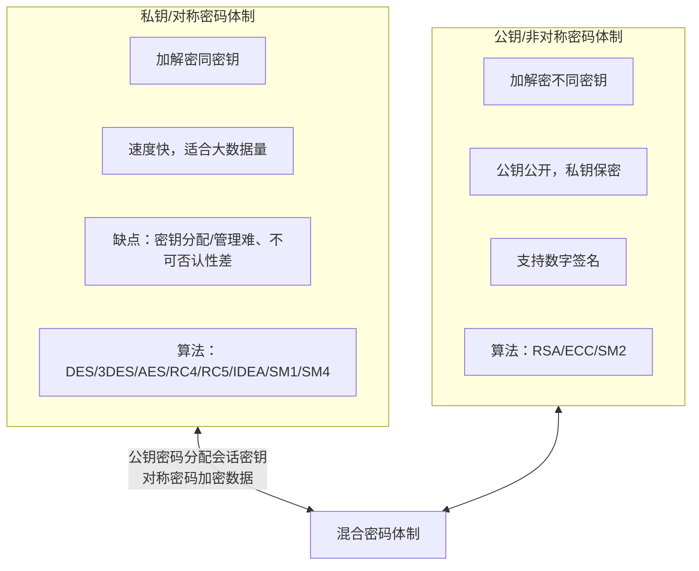

---

#### 03 常见密码算法【必考，掌握】

##### 📌 DES 算法概述（Page 101）

| 项目 | 要点 |
| --- | --- |
| 全称 | **DES**（Data Encryption Standard）是**数据加密标准**的简称，由 **IBM 公司**研制 |
| 类型 | DES 是一个**分组加密算法**，支持 **64 比特**的明文块加密，密钥长 **64 位**，但**实际有效长度为 56 比特**（8 位为校验位） |
| 地位 | 是世界上应用最广泛的密码算法之一 |

##### 📌 加密模式分类（Page 101）

| 模式 | 说明 | 典型算法 |
| --- | --- | --- |
| **分组加密**（块加密） | 将数据分成**固定长度的组**，按组进行计算 | **DES、AES、RC5** 等 |
| **序列加密**（流加密） | 对数据**按位或字节逐个**进行加密处理 | **RC4、ZUC** 等 |

##### 📌 DES 算法入口参数（Page 101）

| 参数 | 说明 |
| --- | --- |
| **1. 数据** | **8 个字节**（共 64 位），是需要被加密或解密的核心数据块 |
| **2. 秘钥** | **8 个字节**（共 64 位），**实际起作用的为 56 位**，是加解密的关键凭证 |
| **3. 模式** | 指定操作类型，分为**加密模式**和**解密模式**两种 |

##### 📌 典型考题：S8 盒结构与补全（Page 102）

| 项目 | 要点 |
| --- | --- |
| S 盒结构 | S 盒是一个 **4 行 16 列**的矩阵，**行号由输入的第 1、6 位**决定，**列号由中间 4 位**决定 |

**常见考法提示：**

1. 给定输入计算输出值
2. 补全 S 盒中的空缺项（**0-15 缺谁填谁**）

**计算案例：输入 `110011` 的 S8 盒置换过程**

| Step | 内容 |
| --- | --- |
| **Step 1：确定行列坐标** | 输入数据：`110011`（6 位二进制）<br/>**行号（Row）**：取第 1、6 位 → `11`（二进制）= **3**（十进制）<br/>**列号（Col）**：取中间 4 位 → `1001`（二进制）= **9**（十进制）<br/>注：图示为通用逻辑，具体数值依 S 盒定义为准 |
| **Step 2：S 盒映射查找** | **定位**：在 S8 盒中查找第 **3 行**，第 **9 列**的数值<br/>查得十进制值为：**12**<br/>**转换规则**：将十进制转换为 **4 位二进制**表示 |
| **Step 3：最终输出结果** | 十进制 **12** 转换为二进制：**1100**<br/>最终用 `1100` 替代原始输入 `110011`，完成一轮 S 盒置换 |

> [!TIP]
> S 盒查表口诀：**首尾两位定行，中间四位定列**；输出为 4 位二进制（0–15）。

##### 📌 3DES、IDEA、AES 算法（Page 103）

| 算法 | 要点 |
| --- | --- |
| **3DES** | 随着计算机运算速度的提升，DES 的 **56 比特**密钥已不再安全。**NIST 于 `1999年`** 采用**三重 DES** 作为**过渡标准**，以增强安全性。注意：**3DES 并非加密三次**，而是"**加密-解密-加密**"，其**有效密钥长度为 112 位** |
| **IDEA** | 国际数据加密算法（IDEA）是一种**分组加密算法**，明文和密文分组均为 **64 比特**，密钥长度为 **128 比特**。该算法设计思想独特，**混合使用了不同代数群中的运算**，兼具**加密与解密**功能 |
| **AES** | **Rijndael 算法**因在**安全性、性能和灵活性**上表现最佳，被 **NIST** 选定为**高级加密标准（AES）** |

**AES 核心要求：**

| 序号 | 要求 |
| --- | --- |
| 1 | 算法必须**公开**，**无密级限制**，可**全球免费使用** |
| 2 | 支持至少 **128 比特**长的分组 |
| 3 | 支持的密钥长度至少为 **128、192 和 256 比特** |

##### 📌 RSA 算法概述（Page 104）

| 项目 | 要点 |
| --- | --- |
| 定位 | 是一种典型的**非对称加密算法**。在 RSA 体系中，**公钥和私钥都可用于加密消息**，用于加密的密钥与解密的密钥不同 |
| 保障属性 | 能有效保障数据传输的**机密性、完整性、真实性和不可否认性** |
| 核心数学基础 | 理解 RSA 需掌握以下概念：**因数、素数、余数、模运算、逆元、欧拉函数、欧几里得算法（辗转求余）** |

**RSA 密钥生成步骤（基于大整数因子分解困难性）：**

| 步骤 | 内容 |
| --- | --- |
| 1. 生成素数 | 随机选择两个**足够大的素数 p 和 q** |
| 2. 计算模数 | 计算这两个素数的乘积 **n = p * q**。**n 的长度即为密钥的长度**（如 2048 位） |
| 3. 计算欧拉函数 | 计算小于 n 且与 n **互素的整数个数**，即欧拉函数 **φ(n) = (p-1)(q-1)** |
| 4. 选择公钥指数 | 选取随机数 **e**，满足 **1 < e < φ(n)**，且 **e 与 φ(n) 互素**（`gcd(e, φ(n)) = 1`）。通常 e 取 **65537**，但考计算给出的数字通常较小 |
| 5. 计算私钥指数 | 计算 **d**，使得 **d ≡ e⁻¹ (mod φ(n))**，即 d 是 e 在模 φ(n) 下的**乘法逆元** |
| 6. 密钥分配 | **保密 d、p 和 q**（私钥核心），**公开 n 和 e**（公钥） |

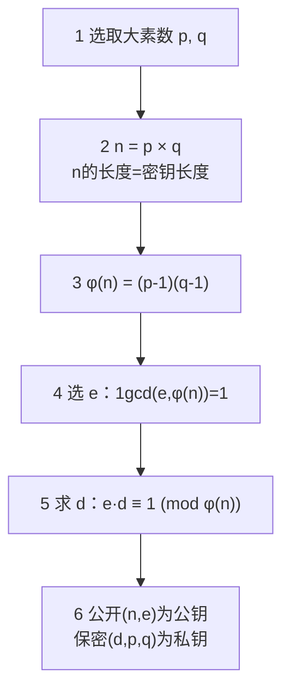

##### 📌 【RSA 计算实例】p=3, q=17, e=13（Page 105）

| Step | 计算过程 |
| --- | --- |
| **Step 1：计算公钥模数 n** | n = p × q = 3 × 17 = **51**<br/>此时，公开密钥为 **(e=13, n=51)** |
| **Step 2：计算欧拉函数 φ(n) 与私钥 d** | 欧拉函数 φ(n) = (p-1)(q-1) = 2 × 16 = **32**<br/>根据公式 **d = e⁻¹ mod φ(n)**，计算得 **d = 5**（因为 `13 × 5 mod 32 = 1`）<br/>【教材解法：因为 d = e⁻¹ mod φ(n)，所以 d = (kφ(n)+1) / e，其中 k 是 **p-1 和 q-1 的最大公约数**。由此算出 d = (2 × 32 + 1) / 13 = **5**】<br/>此时，私有密钥为 **d=5** |
| **Step 3：加解密运算演示（明文 M=2）** | ① **加密过程（Alice → Bob）**：使用公钥加密：`C = M^e mod n`<br/>`C = 2^13 mod 51 = 8192 mod 51 = 32`<br/>② **解密过程（Bob 接收后）**：使用私钥解密：`M = C^d mod n`<br/>`M = 32^5 mod 51 = 33554432 mod 51 = 2` |
| **结论** | 解密后还原出原始明文"**2**"，验证了 RSA 算法的正确性 |

##### 📌 RSA 算法综合计算实例解析（Page 106）

| 问题 | 解答 |
| --- | --- |
| **【Q1】对于 RSA 参数 p、q、φ(n)、e、d，哪些可以公开？** | **公钥 (n, e) 可以公开。p、q、φ(n) 及私钥 d 必须严格保密。** 核心原理基于**大素数分解难题**，公开公钥不影响私钥安全 |
| **【Q2】已知公钥 (55, 3)，求对应的私钥。** | ① 分解模数：n=55=**5×11**，故 p=5, q=11；② 计算欧拉函数：φ(n)=(5-1)(11-1)=**40**；③ 求解私钥 d：满足 **(3×d) mod 40 = 1**，`3d=41` 时，d 非整数，`3d=81` 时，**d=27**。解得 **d=27**；④ 结论：私钥为 **(55, 27)** |
| **【Q3】使用公钥 (55, 3) 对小王的年龄 18 进行加密的密文结果。** | 计算：密文 `c = m^e mod n = 18^3 mod 55 = 5832 mod 55 = 2`。即加密后的结果为 **2** |
| **【Q4】在 RSA 公钥算法中，公钥和私钥的关系是什么？** | 原理：在 RSA 算法中，公钥指数 e 与私钥指数 d 满足数学关系：**(e × d) mod φ(n) = 1**。这是加解密能够逆运算的数学基础 |
| **【Q5】在 RSA 中，消息 m 的取值有什么限制？** | RSA 算法的明文空间限制为 **0 < m < n**，即只能加密**小于模数 n** 的整数。对于大于 n 的明文，解决方案有两种：① **分组加密**：将明文分割成若干个短块，每块分别加密；② **数字信封**：使用 RSA 加密对称密钥，而实际的明文由对称密钥算法加密，这是目前的主流应用方式 |
| **【Q6】是否可以直接使用 RSA 密码进行数字签名？如果可以，请给出消息 m 的数字签名方法。如果不可以，请给出原因？** | 解答：**不可以直接使用原始 RSA 进行数字签名**。核心原因在于**身份绑定问题**：单纯的 RSA 密钥对本身没有与用户身份信息进行强关联。如果没有**数字证书**（如 **X.509**）对私钥持有者的身份进行认证，攻击者可能**伪造密钥对进行假冒**，从而破坏签名的不可否认性。实际应用中，RSA 签名通常会结合**哈希算法和数字证书体系**使用。**可以，`M = C^d mod n`。** |

> [!WARNING]
> Q6 原文前后存在矛盾：先答"不可以直接使用"，末尾又写"可以，M = C^d mod n"。此处**原样保留**，详见文末「⚠️ 疑点」。

##### 📌 国产密码算法概览（Page 107）【考试常考重点】

> 目前，我国已公布的国产密码算法主要包括：**SM1 分组密码算法、SM2 椭圆曲线公钥密码算法、SM3 密码杂凑算法、SM4 分组密码算法、SM9 标识密码算法**。这些算法在我国信息安全建设中具有核心地位。

| 序号 | 算法 | 类型与要点 |
| --- | --- | --- |
| 1 | **SM1 分组密码算法** | 算法**未公开**，属于**国家秘密**。通常以**硬件形式集成在芯片**中，用于**金融、政务**等关键领域的加密保护 |
| 2 | **SM2 椭圆曲线公钥密码算法** | 基于**椭圆曲线密码体制**。由于 **1024 位 RSA 算法**安全性面临挑战，我国正式采用 **SM2 算法作为替代**，用于**数字签名和密钥交换** |
| 3 | **SM3 密码杂凑（哈希）算法** | 主要用于**数字签名及验证、消息认证码生成及验证、随机数生成**等，是保障**数据完整性**的核心算法 |
| 4 | **SM4 分组密码算法** | **无线局域网标准**的分组加密算法，属于**对称密码算法**，其安全强度和运算性能与国际标准 **AES 算法相当** |
| 5 | **SM9 标识密码算法** | 主要用于**身份认证**。其加密强度等同于 **3072 位密钥的 RSA** 加密算法，适用于**大规模、分布式**的身份鉴别场景 |

> [!TIP]
> 国密速记：**SM1** 分组（未公开/硬件）｜**SM2** 公钥/椭圆曲线（替代 1024 位 RSA）｜**SM3** 杂凑（完整性）｜**SM4** 分组对称（对标 AES，无线局域网）｜**SM9** 标识（身份认证，等同 3072 位 RSA）。

```mermaid
mindmap
  root(("国产密码算法"))
    SM1
      "分组密码"
      "算法未公开/国家秘密"
      "硬件芯片/金融政务"
    SM2
      "椭圆曲线公钥密码"
      "替代1024位RSA"
      "数字签名+密钥交换"
    SM3
      "密码杂凑(哈希)"
      "数据完整性"
      "签名/消息认证码/随机数"
    SM4
      "分组密码(对称)"
      "无线局域网标准"
      "对标AES"
    SM9
      "标识密码"
      "身份认证"
      "等同3072位RSA"
```

---

#### 04 Hash 函数与数字签名

##### 📌 Hash 函数（Page 108）【了解】

| 项目 | 要点 |
| --- | --- |
| 定义 | 杂凑函数简称 **Hash 函数**，它能够将**任意长度的信息**转换成**固定长度的哈希值**（又称**数字摘要**或**消息摘要**），并且**任意不同消息或文件所生成的哈希值是不一样的** |

##### 📌 Hash 算法（Page 108）【常考】

> 常见的 Hash 算法有 **MD5、SHA 和 SM3**。

| 算法 | 要点 |
| --- | --- |
| **MD5**（Message Digest Algorithm-5） | 以 **512 位**数据块为单位来处理输入，产生 **128 位**的消息摘要，即 MD5 能产生 **128 比特**长度的哈希值。MD5 使用广泛，常用在**文件完整性检查** |
| **SHA**（Secure Hash Algorithm） | 与 MD5 的设计原理类似，同样也以 **512 位**数据块为单位来处理输入，产生 **160 位**的哈希值，具有比 MD5 **更强的安全性**。SHA 算法的安全性不断改进，已发布的版本有 **SHA-2、SHA-3**。SHA 算法产生的哈希值长度有 **SHA-224、SHA-256、SHA-384、SHA-512** 等 |
| **SM3** | 国家密码管理局于 `2010年` 公布的**商用密码杂凑算法标准**。该算法消息**分组长度为 512 比特**，输出**杂凑值长度为 256 比特**，采用 **Merkle-Damgard 结构** |

> [!IMPORTANT]
> 数字速记：**MD5 → 128 位**；**SHA（SHA-1）→ 160 位**；**SM3 → 256 位**（分组均为 512 位）。

##### 📌 数字签名（Page 109）【常考核心概念】

| 项目 | 要点 |
| --- | --- |
| **定义** | 数字签名（Digital Signature）是指签名者使用**私钥**对待签名数据的**杂凑值**做密码运算得到的结果。该结果只能用签名者的**公钥**进行验证，主要用于确认待签名数据的**完整性**、签名者**身份的真实性**和签名行为的**抗抵赖性** |

**数字签名至少应满足以下三个基本条件：**

| 序号 | 条件 | 说明 |
| --- | --- | --- |
| (1) | **非否认性** | 签名者事后**不能否认**自己的签名，保证行为的**不可抵赖性** |
| (2) | **真实性** | 接收者能**验证签名的合法性**，而任何**其他人不能伪造签名**，确保身份真实 |
| (3) | **可鉴别性** | 当双方关于签名的真伪发生争执时，**第三方（如仲裁机构）能解决**双方之间发生的争执 |

| 项目 | 要点 |
| --- | --- |
| 组成 | 一个完整的数字签名方案一般由**签名算法**和**验证算法**组成。签名算法密钥是**秘密的**，只有签名人掌握；而验证算法则是**公开的**，以便他人验证 |
| 典型方案 | **RSA、Rabin、ElGamal 签名体制和 DSS 标准** |
| **签名与加密的核心区别** | **加密**的目的是**保护信息不被非授权用户访问**，侧重**保密性**；而**签名**是使消息接收者**确信信息的发送者是谁**，以及信息**是否被他人篡改**，侧重**真实性和完整性** |

##### 📌 签名步骤（Page 110）

| 步骤 | 内容 |
| --- | --- |
| **第一步（Hash 摘要）** | Alice 使用 **Hash 函数**将电子合同文件生成一个唯一的**消息摘要**，确保摘要与文件一一对应 |
| **第二步（私钥加密）** | Alice 使用**自己的私钥**，对**消息摘要**进行加密处理，形成**数字签名**。注意：此数字签名**不可改变**，否则即视为无效 |
| **第三步（发送）** | Alice 将**原始电子合同文件**与生成的**数字签名**一同发送给 Bob，完成交付 |

##### 📌 验证步骤（Page 110）

| 步骤 | 内容 |
| --- | --- |
| **第一步（重新计算）** | Bob 收到文件后，使用与 Alice **相同的 Hash 算法**，**独立计算**所收到电子合同文件的消息摘要 |
| **第二步（解密恢复）** | Bob 使用 **Alice 的公钥**，对收到的数字签名进行**解密**，恢复出 Alice 当初生成的**原始消息摘要** |
| **第三步（比对校验）** | Bob 将自己计算的摘要与恢复的摘要进行**比对**。若**一致**，证明文件**真实未篡改**；若**不一致**，则表明文件**已被篡改或签名伪造** |

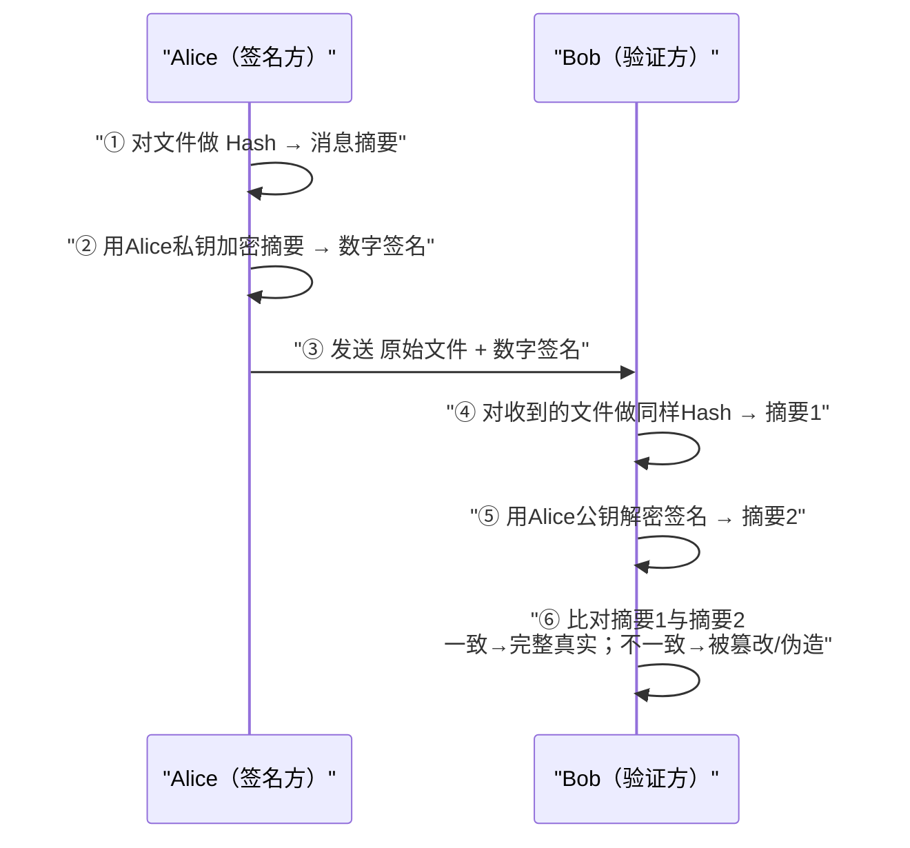

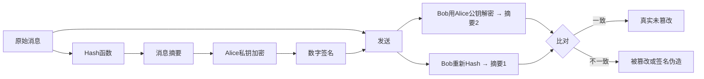

---

#### 05 密码管理与数字证书【熟悉，有时考】

##### 📌 密码管理（Page 111）【有时考】

| 项目 | 要点 |
| --- | --- |
| 法律规定 | 《中华人民共和国**密码法**》明确规定，密码分为**核心密码、普通密码和商用密码** |
| 认证制度 | **商用密码产品**与使用**网络关键设备和网络安全专用产品**的**商用密码服务**实行**强制检测认证制度** |

##### 📌 数字证书体系（Page 111）

| 项目 | 要点 |
| --- | --- |
| **核心定义** | 数字证书（Digital Certificate）也称**公钥证书**，是由**证书认证机构（CA）签名**的包含**公开密钥拥有者信息、公开密钥、签发者信息、有效期以及扩展信息**的一种数据结构 |
| **证书分类** | 按**类别**可分为**个人证书、机构证书和设备证书**；按**用途**可分为**签名证书和加密证书** |
| **管理架构** | 基于 **PKI 技术**建立数字证书认证系统（CA），提供证书的**申请、审核、签发、查询、发布以及证书吊销等全生命周期管理**。系统构成主要包括**目录服务器、OCSP 服务器**（互联网协议，查询证书状态）、**注册服务器、签发服务器**等 |

---

#### 06 安全协议【熟悉，有时考】

##### 📌 Diffie-Hellman 密钥交换协议（Page 112）

| 项目 | 要点 |
| --- | --- |
| 定义 | Diffie-Hellman 密钥交换协议是一种安全的**密钥协商方案** |
| 安全性基础 | 其安全性基于求解**离散对数问题的困难性** |

##### 📌 SSH（Secure Shell）安全外壳协议（Page 112）

| 项目 | 要点 |
| --- | --- |
| 定位 | SSH 是**基于公钥**的安全应用协议 |
| 子协议 | 主要由**三个子协议**组成 |

| 子协议 | 功能 |
| --- | --- |
| **SSH 传输层协议** | **算法协商和密钥交换**，并实现**服务器的认证** |
| **SSH 用户认证协议** | 建立连接，使用**口令认证、公钥认证、主机认证**等多种机制**认证用户** |
| **SSH 连接协议** | 将认证连接**分解为多种逻辑通道**，提供**流控及通道参数协商**机制 |

| 项目 | 要点 |
| --- | --- |
| 综合 | 各协议分工合作，实现**加密、认证、完整性检查**等多种安全服务，广泛用于**替代不安全的 Telnet 协议** |
| 实际应用 | SSH 支持**远程登录、文件传输（scp/sftp）** 等服务。**Linux 系统通常默认提供 SSH 服务**，其服务进程**默认监听端口为 22** |
| 风险 | 注意：尽管 SSH 安全性较高，但在**配置不当或缺乏防护**的情况下，仍可能面临**中间人攻击（MITM）** 和**拒绝服务攻击（DoS）** 的风险 |

---

#### 07 密码学网络安全应用【偶尔考】

##### 📌 密码技术核心应用场景（Page 113）

| 序号 | 场景 | 要点 |
| --- | --- | --- |
| 01 | **网络用户安全** | **身份鉴别与访问控制**基石 |
| 02 | **物理和环境安全** | 设施防护与监控**数据加密存储** |
| 03 | **网络和通信安全** | **传输通道加密**，防**窃听与篡改** |
| 04 | **设备和计算安全** | 终端**固件防护**与**系统完整性校验** |
| 05 | **应用和数据安全** | 数据库**敏感字段加密与脱敏** |
| 06 | **业务应用创新** | 支撑**区块链、数字签名**等新场景 |

##### 📌 核心应用一：路由器安全防范体系（Page 113）

| 序号 | 措施 |
| --- | --- |
| 1 | **口令管理**：实施**高强度的加密存储与定期轮换**机制 |
| 2 | **远程访问**：采用 **SSH** 等加密协议**替代 Telnet**，确保管理会话安全 |
| 3 | **路由认证**：启用 **OSPF/BGP** 等动态路由协议的**报文认证**功能，防止**路由欺骗** |

##### 📌 其他应用（Page 113）

| 应用 | 要点 |
| --- | --- |
| **Web 网站安全应用** | **HTTPS 强制加密传输**、敏感数据 **POST 提交**与后端**加密存储** |
| **电子邮件安全应用** | 利用**数字签名**确认发件人身份，利用**邮件加密算法**防止内容泄露，典型方案如 **PGP** |

##### 📌 重点案例：PGP（Pretty Good Privacy）电子邮件加密体系（Page 113）

| 项目 | 要点 |
| --- | --- |
| 定义与作用 | 一种广泛用于**电子邮件安全**的加密软件，通过**数字签名和内容加密**，确保邮件**不被非授权者阅读**，并**验证发信人身份** |
| 核心技术栈 | 采用**混合加密机制**，密钥管理选用 **RSA 算法**，数据正文加密使用高效的 **IDEA 算法**，完整性检测与数字签名结合了 **MD5 哈希算法与 RSA 签名**以及**随机数生成器**，确保了安全性与效率的平衡 |

---

#### 08 第3章 课堂练习（Page 114）

**1. 发送方使用的加密密钥和接收方使用的解密密钥不相同，并且从其中一个密钥难以推导出另一个密钥，这样的加密算法称为（ ）。**
- A. 非对称密码
- B. 单密钥密码
- C. 对称密码
- D. 序列密码

**2. Hash 算法是指产生哈希值或杂凑值的计算方法。MD5 算法以 512 比特数据块为单位处理输入，产生（ ）的哈希值。**
- A. 64 比特
- B. 128 比特
- C. 256 比特
- D. 512 比特

**3. 已知 DES 算法 S 盒的输入为 `010001`，其二进制输出为（ ）。**
- A. `0110`
- B. `1001`
- C. `0100`
- D. `0101`

**4. 以下国产密码算法中，属于分组密码算法的是（ ）。**
- A. SM2
- B. SM3
- C. SM4
- D. SM9

**5. SSH 协议中，负责进行算法协商和密钥交换的子协议是（ ）。**
- A. SSH 传输层协议
- B. SSH 连接协议
- C. SSH 用户认证协议
- D. SSH 报警协议

---

### 📕 第4章 网络安全体系与网络安全模型

#### 📌 本章目录与命题规律（Page 117）

| 序号 | 小节 | 考频标注 |
| --- | --- | --- |
| 1 | 网络安全体系概述 | 【不考】 |
| 2 | 网络安全体系相关安全模型 | 【必考】 |
| 3 | 网络安全体系建设原则与安全策略 | 【有时考】 |
| 4 | 网络安全体系框架主要组成和建设内容 | 【偶尔考】 |
| 5 | 网络安全体系建设参考案例 | 【常考】 |

> [!IMPORTANT]
> **命题规律：上午选择 3–4 分，下午案例小概率 2–3 分。**

---

#### 01 网络安全体系概述【了解】

##### 📌 网络安全体系概念（Page 118）

| 项目 | 要点 |
| --- | --- |
| 基本思路 | 要保障网络系统的安全，应当把相应的**安全策略、各种安全技术和安全管理**融合在一起，建立**网络安全防御体系**，使之成为一个**有机的整体安全屏障** |
| 组成 | 网络安全体系是由各种**网络安全单元**按照一定的规则组成的，包括**法律法规政策文件、安全策略、组织管理、技术措施、标准规范、安全建设与运营、人员队伍、教育培训、产业生态、安全投入**等多种要素 |

**网络安全体系的主要特征：**

| 序号 | 特征 |
| --- | --- |
| (1) | **整体性** |
| (2) | **协同性** |
| (3) | **过程性** |
| (4) | **全面性** |
| (5) | **适应性** |

**网络安全体系的作用和意义主要体现为：**

- ✓ 有利于**系统性化解网络安全风险**；
- ✓ 有利于**强化工作人员的网络安全意识**；
- ✓ 有利于对组织的**网络资产进行全面系统的保护**；
- ✓ 有利于组织的**商业合作**；
- ✓ 有利于组织的**网络安全管理体系认证**。

---

#### 02 网络安全体系相关安全模型【必考，掌握】

##### 📌 BLP 机密性模型（下读上写）（Page 119）

> [!TIP]
> ★口诀：**为了保密，小肚上写**（下读上写）。

| 项目 | 要点 |
| --- | --- |
| 两大特性 | BLP 模型有两个特性：**简单安全特性（读）**、**＊特性（写）** |
| **简单安全特性** | 主体对客体进行**读访问**的必要条件是**主体的安全级别不小于客体的安全级别**，**主体的范畴集合包含客体的全部范畴**，即主体只能**向下读**，**不能向上读** |
| **＊特性** | 一个主体对客体进行**写访问**的必要条件是**客体的安全级支配主体的安全级**，即**客体的保密级别不小于主体的保密级别**，**客体的范畴集合包含主体的全部范畴**，即主体只能**向上写**，**不能向下写** |

**访问类的组成：**

| 组成 | 说明 |
| --- | --- |
| **安全级** | 对应诸如**公开、秘密、机密和绝密**等名称；安全级的顺序一般规定为：**公开 ＜ 秘密 ＜ 机密 ＜ 绝密** |
| **范畴集** | 指安全级的**有效领域或信息所归属的领域**，如**人事处、财务处**等。两个范畴集之间的关系是**包含、被包含或无关** |

**原文举例：**

| 对象 | 访问类 |
| --- | --- |
| 文件 F | ｛**机密**：人事处，财务处｝ |
| 用户 A | ｛**绝密**：人事处｝ |
| 用户 B | ｛**绝密**：人事处，财务处，科技处｝ |

> 用户 **B 可以阅读文件 F**，因为用户 B 的**级别高**，**涵盖了文件的范畴**。而用户 **A 的安全级虽然高，但不能读文件 F**，因为用户 A **缺少了"财务处"范畴**。

```mermaid
flowchart LR
    subgraph BLP["BLP 机密性模型（下读上写）"]
        direction TB
        Lo["低安全级客体"] -->|"向上写（＊特性）"| Hi["高安全级主体/客体"]
        Hi -->|"向下读（简单安全特性）"| Lo
    end
```

##### 📌 BiBa 完整性模型（上读下写）（Page 120）

> [!TIP]
> ★口诀：**吃了 biba，上吐下泻**（上读下写）。

| 项目 | 要点 |
| --- | --- |
| 目的 | BiBa 模型主要用于**防止非授权修改系统信息**，以保护系统的**信息完整性** |
| 三大特性 | BiBa 具有三个安全特性：**简单安全特性、＊特性、调用特性** |
| **简单安全特性** | 主体对客体进行**修改访问**的必要条件是**主体的完整性级别不小于客体的完整性级别**，**主体的范畴集合包含客体的全部范畴**，即主体**不能向下读** |
| **＊特性** | 主体的**完整性级别小于客体的完整性级别**，**不能修改客体**，即主体**不能向上写** |
| **调用特性** | 主体的**完整性级别小于另一个主体的完整性级别**，**不能调用另一个主体** |

##### 📌 信息流模型（Page 120）【了解】

| 项目 | 要点 |
| --- | --- |
| 用途 | 用于分析系统的**隐蔽通道**，防止**敏感信息通过隐蔽通道泄露** |

##### 📌 信息保障模型（Page 121）

**美国国防部 PDRR 模型：**改进了传统的**只有保护**的单一安全防御思想，强调信息安全保障的**四个重要环节**。

| 环节 | 内容 |
| --- | --- |
| **防护（Protection）** | **加密机制、数据签名机制、访问控制机制、认证机制、信息隐藏、防火墙技术**等 |
| **检测（Detection）** | **入侵检测、系统脆弱性检测、数据完整性检测、攻击性检测**等 |
| **恢复（Recovery）** | **数据备份、数据修复、系统恢复**等 |
| **响应（Response）** | **应急策略、应急机制、应急手段、入侵过程分析及安全状态评估**等 |

**P2DR 模型：**美国 **ISS 公司**提出的动态网络安全体系的代表模型。P2DR 模型的要素由**策略（Policy）、防护（Protection）、检测（Detection）、响应（Response）** 构成。

**WPDRRC 模型：**要素由**预警、保护、检测、响应、恢复和反击**构成。模型蕴涵的网络安全能力主要是**预警能力、保护能力、检测能力、响应能力、恢复能力和反击能力**。

> [!WARNING]
> **区分**：第1章"网络应具备的基本功能"是 **防御 / 监测 / 应急 / 恢复**；本章 **PDRR** 是 **防护 / 检测 / 恢复 / 响应**。两者容易混淆，务必区分。

```mermaid
flowchart LR
    P["防护 Protection"] --> D["检测 Detection"]
    D --> R["恢复 Recovery"]
    R --> Res["响应 Response"]
    Res -.->|"回到防护"| P
```

```mermaid
mindmap
  root(("信息保障模型"))
    PDRR
      "防护 Protection"
      "检测 Detection"
      "恢复 Recovery"
      "响应 Response"
    P2DR
      "策略 Policy"
      "防护 Protection"
      "检测 Detection"
      "响应 Response"
    WPDRRC
      "预警"
      "保护"
      "检测"
      "响应"
      "恢复"
      "反击"
```

##### 📌 能力成熟度模型（Page 122）

| 项目 | 要点 |
| --- | --- |
| **CMM 定义** | 能力成熟度模型（简称 **CMM**）是对一个组织机构的**能力进行成熟度评估**的模型 |
| **五级（通用）** | **1 级－非正式执行**、**2 级－计划跟踪**、**3 级－充分定义**、**4 级－量化控制**、**5 级－持续优化**。其中，**级别越大，表示能力成熟度越高** |
| SSE-CMM | 【了解】 |
| 数据安全能力成熟度模型 | 【了解】 |

**软件安全能力成熟度模型分成五级：【常考】**

| 级别 | 内容 |
| --- | --- |
| **CMM1 级** | **补丁修补** |
| **CMM2 级** | **渗透测试、安全代码评审** |
| **CMM3 级** | **漏洞评估、代码分析、安全编码标准** |
| **CMM4 级** | **软件安全风险识别、SDLC 实施不同安全检查点** |
| **CMM5 级** | **改进软件安全风险覆盖率、评估安全差距** |

##### 📌 其他安全模型（Page 123）

| 模型 | 要点 |
| --- | --- |
| **纵深防御模型** | 基本思路是将信息网络安全防护措施**有机组合**起来，形成**多道保护线**。**安全保护**是网络的**第一道防线**；**安全监测**是网络的**第二道防线**；**实时响应**是网络的**第三道防线**；**恢复**是网络的**第四道防线** |
| **分层防护模型** | 以 **OSI 7 层模型**为参考，对保护对象进行**层次化保护** |
| **等级保护模型** | 根据网络信息系统的**重要程度**，将其划分成不同的**安全保护等级**，采取相应的安全保护措施，以保障信息和信息系统的安全 |
| **网络生存模型** | 网络生存性是指在网络信息系统**遭受入侵的情形下**，仍然能够**持续提供必要服务**的能力。遵循"**3R**"的建立方法。首先将系统划分成**不可攻破的安全核**和**可恢复部分**。然后对一定的攻击模式，给出相应的 **3R 策略**，即**抵抗（Resistance）、识别（Recognition）和恢复（Recovery）**。最后，定义网络信息系统应具备的**正常服务模式**和可能被黑客利用的**入侵模式**，给出系统需要重点保护的**基本功能服务和关键信息**等 |

```mermaid
flowchart TD
    L1["第一道防线：安全保护"] --> L2["第二道防线：安全监测"]
    L2 --> L3["第三道防线：实时响应"]
    L3 --> L4["第四道防线：恢复"]
```

---

#### 03 网络安全体系建设原则与安全策略【有时考，熟悉】

##### 📌 网络安全原则（Page 124）

| 序号 | 原则 |
| --- | --- |
| 1 | **系统性和动态性原则**（整体安全性的**木桶原则**） |
| 2 | **纵深防护与协作性原则** |
| 3 | **网络安全风险和分级保护原则** |
| 4 | **标准化与一致性原则** |
| 5 | **技术与管理相结合原则** |
| 6 | **安全第一，预防为主原则** |
| 7 | **安全与发展同步，业务与安全等同** |
| 8 | **人机物融合和产业发展原则** |
| 9 | **分权制衡原则** |

> [!NOTE]
> 网络安全策略（规则和要求的概念，可以不用看）—— 原文标注。

---

#### 04 网络安全体系框架主要组成和建设内容【偶尔考】

##### 📌 框架与建设内容（Page 125）

| 项目 | 要点 |
| --- | --- |
| 网络安全体系框架 | 整体了解一下 |
| 网络安全策略建设内容 | 各种**策略的制订**及周边支持 |
| **网络安全组织体系构建内容** | **领导层、管理层、执行层、外部协作层** |
| **网络安全管理体系构建内容** | **网络安全管理策略**；**第三方安全管理**；**网络系统资产分类与控制** |
| 资产分类 | **硬件、软件、介质、信息、业务系统、保障系统** |
| **人员安全三原则** | **多人负责原则**；**任期有限原则**；**职责分离原则** |

> [!NOTE]
> 原文标注"后面的可以不看"。

---

#### 05 网络安全体系建设参考案例【等保常考，其他不看】

##### 📌 网络安全法第二十一条与等保 2.0 体系框架（Page 126）

| 项目 | 要点 |
| --- | --- |
| 法律依据 | 《中华人民共和国网络安全法》**第二十一条**规定，国家实行**网络安全等级保护制度** |
| 标准 | 国家**等级保护制度 2.0** 标准已执行 |
| 体系框架 | 包括**风险管理体系、安全管理体系、安全技术体系、网络信任体系、法律法规体系、政策标准体系**等 |

##### 📌 网络安全等级保护工作五阶段与五个等级（Page 127）

| 项目 | 要点 |
| --- | --- |
| **五阶段** | 网络安全等级保护工作主要包括**定级、备案、建设整改、等级测评、监督检查**五个阶段 |
| **五个等级** | 第一级（**用户自主保护级**）、第二级（**系统保护审计级**）、第三级（**安全标记保护级**）、第四级（**结构化保护级**）、第五级（**访问验证保护级**） |

> [!TIP]
> ★口诀：**自系安结访**（自主 / 系统审计 / 安全标记 / 结构化 / 访问验证）。

##### 📌 网络安全等级保护 2.0 的主要变化（Page 127）

| 变化 | 要点 |
| --- | --- |
| **一是扩大了对象范围** | 将**云计算、移动互联、物联网、工业控制系统**等列入标准范围，构成了"**网络安全通用要求 ＋ 新型应用的网络安全扩展要求**"的要求内容 |
| **二是提出三重防护体系架构** | 提出了在"**安全通信网络**""**安全区域边界**""**安全计算环境**"和"**安全管理中心**"支持下的**三重防护体系架构** |
| **三是强化可信计算技术要求** | 等级保护 2.0 新标准强化了**可信计算技术**使用的要求，各级增加了"**可信验证**"控制点 |

**各级"可信验证"要求：**

| 级别 | 可信验证要求 |
| --- | --- |
| **一级** | 要求设备的**系统引导程序、系统程序**等进行可信验证 |
| **二级** | 增加**重要配置参数和应用程序**进行可信验证，并将验证结果**形成审计记录送至安全管理中心** |
| **三级** | 增加**应用程序的关键执行环节**进行**动态可信验证** |
| **四级** | 增加**应用程序的所有执行环节**进行**动态可信验证** |

```mermaid
flowchart TD
    A["定级"] --> B["备案"] --> C["建设整改"] --> D["等级测评"] --> E["监督检查"]
    L1["第一级 用户自主保护级"] --> L2["第二级 系统保护审计级"]
    L2 --> L3["第三级 安全标记保护级"]
    L3 --> L4["第四级 结构化保护级"]
    L4 --> L5["第五级 访问验证保护级"]
```

```mermaid
flowchart LR
    subgraph Triple["等保2.0 三重防护体系架构"]
        C["安全通信网络"] 
        B["安全区域边界"]
        E["安全计算环境"]
        M["安全管理中心（支撑）"]
    end
    M --- C
    M --- B
    M --- E
```

---

#### 06 第4章 课堂练习（Pages 128–129）

**1. BLP 机密性模型中，安全级的顺序一般规定为：公开 ＜ 秘密 ＜ 机密 ＜ 绝密。两个范畴集之间的关系是包含、被包含或无关。如果一个 BLP 机密性模型系统访问类下：**

- 文件 E 访问类：｛机密：财务处，科技处｝；
- 文件 F 访问类：｛机密：人事处，财务处｝；
- 用户 A 访问类：｛绝密：人事处｝；
- 用户 B 访问类：｛绝密：人事处，财务处，科技处｝。

**则以下表述中，正确的是（ ）。**
- A. 用户 A 不能读文件 F
- B. 用户 B 不能读文件 F
- C. 用户 A 能读文件 E
- D. 用户 B 不能读文件 E

**2. BiBa 模型主要用于防止非授权修改系统信息，以保护系统的信息完整性，该模型提出的"主体不能向上写"指的是（ ）。**
- A. 简单安全特性
- B. 保密特性
- C. 调用特性
- D. *特性

**3. PDRR 模型由防护（Protection）、检测（Detection）、恢复（Recovery）、响应（Response）四个重要环节组成。数据备份对应的环节是（ ）。**
- A. 防护
- B. 检测
- C. 恢复
- D. 响应

**4. 为了达到信息安全的目标，各种信息安全技术的使用必须遵守一些基本原则，其中在信息系统中，应该对所有权限进行适当地划分，使每个授权主体只能拥有其中的一部分权限，使它们之间相互制约、相互监督，共同保证信息系统安全的是（ ）。**
- A. 最小化原则
- B. 安全隔离原则
- C. 纵深防御原则
- D. 分权制衡原则

**5. 对信息进行均衡、全面的防护，提高整个系统"安全最低点"的全性能，这种安全原则被称为（ ）。**
- A. 最小特权原则
- B. 木桶原则
- C. 等级化原则
- D. 最小泄露原则

---

### 📕 第5章 物理与环境安全技术

#### 📌 本章目录与命题规律（Page 132）

| 序号 | 小节 | 考频标注 |
| --- | --- | --- |
| 1 | 物理安全概念与要求 | 【偶尔考】 |
| 2 | 物理环境安全分析与防护 | 【不考】 |
| 3 | 机房安全分析与防护 | 【常考】 |
| 4 | 网络通信线路安全分析与防护 | 【不考】 |
| 5 | 设备实体安全分析与防护 | 【不考】 |
| 6 | 存储介质安全分析与防护 | 【偶尔考】 |

> [!IMPORTANT]
> **命题规律：上午选择题 1–3 分。**

---

#### 01 物理安全概念与要求【偶尔考】

##### 📌 物理安全概念（Page 133）

| 项目 | 要点 |
| --- | --- |
| **传统（实体安全）** | 传统上的物理安全也称为**实体安全**，是指包括**环境、设备和记录介质**在内的所有支持网络信息系统运行的**硬件的总体安全** |
| **广义** | 广义的物理安全则指由**硬件，软件，操作人员，环境**组成的**人、机、物融合的网络信息物理系统的安全** |

##### 📌 物理安全威胁（Page 134）

| 序号 | 威胁 |
| --- | --- |
| 1 | **硬件木马**：在**集成电路芯片（IC）** 中被植入的**恶意电路** |
| 2 | **硬件协同恶意代码** |
| 3 | **硬件安全漏洞利用**：**熔断、幽灵** CPU 漏洞 |
| 4 | **基于软件漏洞攻击硬件实体**（**震网病毒**） |
| 5 | **基于环境攻击计算机实体**（**电磁波、磁场、温度**等） |

##### 📌 基于供应链的物理攻击（Page 135）

| 项目 | 要点 |
| --- | --- |
| 事件 | `2024年9月` **黎巴嫩多处发生通信设备爆炸事故**，造成 **37 人死亡、2931 人受伤** |
| 初步调查 | 爆炸的通信设备在**抵达该国之前就已被植入炸药**，并通过**发送电子信息进行引爆**，犹如"**特洛伊木马**" |
| 定性 | 该事件整体上是一起基于**供应链侧作业**，将**爆炸物和通讯设备相结合**，利用**远程信号激活控制机理**，实现**批量触发爆炸**的严重地缘安全事件，是组合了**供应链预置、电磁频谱攻击、情报搜集、人力作业**等在内复杂**杀伤链**过程，是精心策划的跨越**物理域、网空和信号频谱域与认知域**的联合作业 |

##### 📌 震网病毒（Page 136）

**伊朗核电站震网病毒事件 —— 病毒特点：**

| 序号 | 特点 |
| --- | --- |
| 1 | **目标明确**，针对特定场景 |
| 2 | **结构复杂**，隐藏、掩饰手段高明 |
| 3 | **多种伪装**，**盗用数字签名**，逃避查杀，同时利用**多个 0day 漏洞**，不惜代价 |
| 4 | **7 个**已知和未知漏洞，其中至少 **4 个 0day 漏洞**（其中**五个 windows 系统漏洞**和 **2 个西门子 SIMATIC WinCC 漏洞**） |
| 5 | **修改 PLC 的程序逻辑**，造成物理过程的故障 |
| 6 | **传播途径：U 盘、共享网络、打印机** |

##### 📌 物理安全保护（Page 137）【偶尔考】

| 类别 | 安全技术要素 |
| --- | --- |
| **设备物理安全** | 设备的**标志和标记**、**防止电磁信息泄漏**、**抗电磁干扰**、**电源保护**以及设备**振动、碰撞、冲击适应性**等方面 |
| **环境物理安全** | **机房场地选择、机房屏蔽、防火、防水、防雷、防鼠、防盗、防毁、供配电系统、空调系统、综合布线和区域防护**等方面 |
| **系统物理安全** | **存储介质安全、灾难备份与恢复、物理设备访问、设备管理和保护、资源利用**等 |

> [!NOTE]
> 物理安全规范（了解）—— 原文标注。

---

#### 02 物理环境安全分析与防护【不考】

##### 📌 九类防护（Page 138）

> 物理环境安全防护，主要包括**防火、防水、防震、防盗、防鼠虫害、防雷、防电磁、防静电和安全供电**。

| 类别 | 措施 |
| --- | --- |
| **防火** | 消除火灾隐患、设置**火灾报警系统**、配置**灭火设备**、加强**防火管理和操作规范** |
| **防水** | 机房内**不得铺设水管和蒸汽管道**；机房墙壁、天花板、地面应有**防水、防潮性能**；通有水管的地方应设置**止水阀和排水沟**；不要把机房设置在**楼房底层或地下室**；机房的**电缆沟**，要防止下雨时电缆沟进水漫到机房 |
| **防震** | 建筑物应具有**抗地震能力**、**机柜和设备要固定牢靠**、加强**安全操作管理** |
| **防盗** | 设置**报警器、锁定装置、摄像监控**、严格**物理访问控制**、**安全监控** |
| **防鼠虫害** | 封堵**鼠虫出口洞口**、**超声波驱鼠**、**药物**、**搜鼠工具捕鼠** |
| **防雷** | 安装**避雷针**、**安全接地**、安装**专用防雷设施** |
| **防电磁** | **接地、屏蔽、远离电磁干扰源** |
| **防静电** | **衣料材料**；控制机房**温、湿度**；**防静电手套** |
| **安全供电** | **专用供电线路**、**不间断电源（UPS）**、**备用发电机** |

---

#### 03 机房安全分析与防护【熟悉】

##### 📌 机房功能区域组成（Page 139）【常考】

| 类别 | 房间 | 口诀 |
| --- | --- | --- |
| **主要工作房间** | **主机房、终端室**等 | 【**祖宗**】 |
| **第一类辅助房间** | **低压配电间、不间断电源室、蓄电池室、空调机室、发电机室、气体钢瓶室、监控室**等 | 【**电气空监**】 |
| **第二类辅助房间** | **资料室、维修室、技术人员办公室** | 【**资修办**】 |
| **第三类辅助房间** | **储藏室、缓冲间、技术人员休息室、盟洗室**等 | — |

##### 📌 机房安全等级划分（Page 139）

> 根据《**计算机场地安全要求（GB/T 9361—2011）**》，计算机机房的安全等级分为 **A 级、B 级、C 级**三个基本级别。

| 等级 | 判定与要求 |
| --- | --- |
| **A 级** | 计算机系统运行中断后，会对**国家安全、社会秩序、公共利益造成严重损害**的；对计算机机房的安全有**严格的要求**，有**完善的**计算机机房安全措施 |
| **B 级** | 计算机系统运行中断后，会对**国家安全、社会秩序、公共利益造成较大损害**的；对计算机机房的安全有**较严格的要求**，有**较完善的**计算机机房安全措施 |
| **C 级** | **不属于 A、B 级**的情况；对计算机机房的安全有**基本的要求**，有**基本的**计算机机房安全措施 |

> [!NOTE]
> 根据计算机系统的**规模、用途**，计算机机房安全可按**某一级执行**，也可按**某些级综合执行**。

##### 📌 机房场地选择要求（Page 140）【有时考】

| 要求 | 内容 |
| --- | --- |
| **环境安全性** | 避开**危险来源区**、避开**环境污染区**、避开**盐雾区**、避开**落雷区域** |
| **地质可靠性** | 建立在**稳固的地质区域**上、避开**地质不牢靠的区域**、避开**采矿崩落区**、应避开**低洼、潮湿区域** |
| **场地抗电磁干扰性** | 避开或远离**无线电干扰源**和**微波线路的强电磁场干扰**场所、在频率为 **0.15~1000MHz** 时不大于 **126dBuV**（分贝毫伏）、**磁场干扰场强不大于 800A/m**（安培每米）；避开**强电流冲击和强电磁干扰**的场所（**200 米以上**） |
| **避开强振动源和强噪声源** | 避开振动源；避开**机场、火车站和车辆往来比较频繁的区域**以及噪声区；远离主要通道，**避免机房窗户直接临街** |
| **应避免设在建筑物的高层** | 以及**用水设备的下层或隔壁** |

##### 📌 数据中心建设与设计要求（Page 140）

> 按照**规模大小**可将数据中心分为三类：

| 类型 | 规模 |
| --- | --- |
| **超大型数据中心** | **大于等于 10000 个标准机架** |
| **大型数据中心** | **大于等于 3000 个小于 10000 个标准机架** |
| **中小型数据中心** | **小于 3000 个标准机架**的数据中心 |

##### 📌 数据中心设计规范强制性条文（Page 141）

| 序号 | 强制条文 |
| --- | --- |
| 1 | 数据中心内所有设备的**金属外壳、各类金属管道、金属线槽、建筑物金属结构**必须进行**等电位联结并接地** |
| 2 | 数据中心的**耐火等级不应低于二级** |
| 3 | 当数据中心与其他功能用房在同一个建筑内时，数据中心与建筑内其他功能用房之间应采用**耐火极限不低于 2.0h 的防火隔墙**和 **1.5h 的楼板**隔开，隔墙上开门应采用**甲级防火门** |
| 4 | 采用**管网式气体灭火系统或细水雾灭火系统**的主机房，应同时设置**两组独立的火灾探测器**，火灾报警系统应与**灭火系统和视频监控系统联动** |
| 5 | 设置**气体灭火系统**的主机房，应配置**专用空气呼吸器或氧气呼吸器** |

##### 📌 互联网数据中心（Page 142）

| 项目 | 要点 |
| --- | --- |
| 分级 | 分为 **R1（可用性 99.5%）、R2（可用性 99.9%）、R3（可用性 99.99%）** |
| 强制条文 | **抗震设防烈度 7 度及以上** |

##### 📌 CA 机房物理安全控制（Page 142）

| 序号 | 控制要求 |
| --- | --- |
| 1 | **每五年**进行一次**屏蔽室检测** |
| 2 | CA 机房及办公场地**所有人员都应佩戴标识身份的证明**。进出 CA 机房人员的**物理权限应经安全管理人员**根据安全策略予以批准 |
| 3 | 所有进出 CA 机房内的人员都应**留有记录**，并妥善、安全地保存和管理记录。**确认这些记录无安全用途后**，才可进行专项销毁 |
| 4 | 建立并执行**人员访问制度及程序**，并进行监督和监控。定期对 CA 设施的**访问权限进行内审和更新**，并及时跟进违规事件 |
| 5 | 采取有效措施保护设备免于**电源故障或网络通信异常**影响 |
| 6 | 在处理或再利用包含**存储介质（如硬盘）** 的设备之前，检查是否含有**敏感数据**，并对敏感数据应**物理销毁或进行安全覆盖** |
| 7 | 制定相关**安全检查、监督策略** |

---

#### 04 网络通信线路安全分析与防护【不考】

##### 📌 网络通信线路安全分析（Page 143）

**常见的物理安全威胁：**

| 序号 | 威胁 |
| --- | --- |
| 1 | 网络通信线路**被切断** |
| 2 | 网络通信线路**被电磁干扰** |
| 3 | 网络通信线路**泄露信息** |

**安全防护措施（两个方面）：**

| 方面 | 措施 |
| --- | --- |
| 一是**网络通信设备** | 对重要的核心网络设备，一般采取**设备冗余**，即设备之间**互为备份** |
| 二是**网络通信线路** | 网络通信线路的安全措施也是采取**多路通信**的方式 |

---

#### 05 设备实体安全分析与防护【偶尔考】

##### 📌 设备常见的物理安全威胁（Page 144）

| 序号 | 威胁 |
| --- | --- |
| 1 | 设备实体**环境关联**安全威胁 |
| 2 | 设备实体**被盗取或损害** |
| 3 | 设备实体受到**电磁干扰** |
| 4 | 设备**供应链条中断或延缓** |
| 5 | 设备实体的**固件部分遭受攻击** |
| 6 | 设备遭受**硬件攻击** |
| 7 | 设备实体的**控制组件**安全威胁 |
| 8 | 设备**非法外联** |

##### 📌 设备实体安全防护（Page 144）

| 序号 | 措施 |
| --- | --- |
| 1 | 设备的**标志和标记** |
| 2 | 设备**电磁辐射防护** |
| 3 | 设备**静电及用电安全防护** |
| 4 | 设备**磁场抗扰** |
| 5 | 设备**环境安全保护** |
| 6 | 设备**适应性与可靠性保护** |

##### 📌 设备硬件攻击防护（Page 144）

| 序号 | 措施 | 说明 |
| --- | --- | --- |
| 1 | **硬件木马检测** | 硬件木马检测方法有**反向分析法、功耗分析法、侧信道分析法** |
| 2 | **硬件漏洞处理** | （原文仅列标题） |

---

#### 06 存储介质安全分析与防护【偶尔考】

##### 📌 存储介质及存储设备系统的安全威胁（Page 145）

| 序号 | 威胁 |
| --- | --- |
| 1 | **存储管理失控** |
| 2 | **存储数据泄密** |
| 3 | 存储介质及存储设备**故障** |
| 4 | 存储介质数据**非安全删除** |
| 5 | **恶意代码攻击** |

##### 📌 常用的存储介质安全防护措施（Page 145）

| 序号 | 措施 |
| --- | --- |
| 1 | **强化存储安全管理** |
| 2 | **数据存储加密保存** |
| 3 | **容错容灾存储技术** |

---

#### 07 第5章 课堂练习（Page 146）

**1. 按照《计算机场地通用规范（GB/T2887-2011）》的规定，计算机机房分为四类：主要工作房间、第一类辅助房间、第二类辅助房间和第三类辅助房间。以下属于第一类辅助房间的是（ ）。**
- A. 终端室
- B. 监控室
- C. 资料室
- D. 储藏室

**2. 数据中心耐火等级不低于（ ）。**
- A. 一级
- B. 二级
- C. 三级
- D. 四级

**3. 不属于物理安全威胁的是（ ）。**
- A. 电源故障
- B. 物理攻击
- C. 自然灾害
- D. 字典攻击

**4. 不可信 EDA 软件设计 IC 芯片可能导致（ ）。**
- A. 设计时植入硬件木马
- B. 制造阶段污染
- C. 供应链劫持
- D. 后门漏洞

**5. 通过物理特性检测硬件木马的手段是（ ）。**
- A. 侧信道分析
- B. 形式化验证
- C. 功能测试
- D. 代码审计

---

### 📕 第6章 认证技术原理与应用

#### 📌 本章目录与命题规律（Page 149）

| 序号 | 小节 | 考频标注 |
| --- | --- | --- |
| 1 | 认证概述 | 【常考】 |
| 2 | 认证类型与认证过程 | 【不怎么考】 |
| 3 | 认证技术方法 | 【必考】 |
| 4 | 认证主要产品与技术指标 | 【不考】 |
| 5 | 认证技术应用 | 【不考】 |

> [!IMPORTANT]
> **命题规律：上午选择题 3 分，下午案例题 2–4 分。**

---

#### 01 认证概述【常考】

##### 📌 认证概念（Page 150）

| 项目 | 要点 |
| --- | --- |
| **定义** | 认证是一个实体向另外一个实体**证明其所声称的身份**的过程。需要被证实的实体是**声称者**，负责检查确认声称者的实体是**验证者** |
| **组成** | 认证一般由**标识（Identification）** 和**鉴别（Authentication）** 两部分组成 |
| **标识** | 用来代表实体对象（如**人员、设备、数据、服务、应用**）的**身份标志**，确保实体的**唯一性和可辨识性**，同时与实体存在**强关联** |
| **鉴别** | 一般是利用**口令、电子签名、数字证书、令牌、生物特征、行为表现**等相关**数字化凭证**对实体所声称的属性进行**识别验证**的过程 |

**常见的认证依据主要有四类：**

| 序号 | 类型 | 说明 | 举例 |
| --- | --- | --- | --- |
| 1 | **所知道的秘密信息** | 实体（声称者）所掌握的**秘密信息** | **用户口令、验证码**等 |
| 2 | **所拥有的实物凭证** | 实体（声称者）所持有的**不可伪造的物理设备** | **智能卡、U 盾**等 |
| 3 | **所具有的生物特征** | 实体（声称者）所具有的**生物特征** | **指纹、声音、虹膜、人脸**等 |
| 4 | **所表现的行为特征** | 实体（声称者）所表现的**行为特征** | **鼠标使用习惯、键盘敲键力度、地理位置**等 |

> [!TIP]
> 速记：**所知（口令）／所有（令牌）／所是（生物特征）／所为（行为特征）**。

##### 📌 认证原理（Page 151）

| 项目 | 要点 |
| --- | --- |
| **认证机制构成** | 认证机制由**验证对象、认证协议、鉴别实体**构成 |
| **按凭据类型数量分类** | 按照对验证对象要求提供的**认证凭据的类型数量**，认证可以分成**单因素认证、双因素认证、多因素认证** |
| **按时间长度分类** | 根据认证依据所利用的**时间长度**，认证可分成**一次性口令（OTP）、持续认证** |
| **OTP** | OTP 用于**保护口令安全**，防止**口令重用攻击**，OTP 常见实例如使用**短消息验证码** |
| **持续认证** | 持续认证是指**连续提供身份确认**，其技术原理是对用户**整个会话过程中的特征行为**进行**连续地监测**，**不间断地验证**用户所具有的特性。持续认证是一种**新兴的认证方法**，其标志是将**对事件的身份验证转变为对过程的身份验证** |

**持续认证所使用的鉴定因素：**

| 因素 | 英文 |
| --- | --- |
| **认知因素** | Cognitive factors |
| **物理因素** | Physiological factors |
| **上下文因素** | Contextual factors |

> [!NOTE]
> 认证发展（了解）—— 原文标注。

---

#### 02 认证类型与认证过程【熟悉】

##### 📌 认证类型（Page 152）

> 认证类型可分成**单向认证、双向认证和第三方认证**。

| 类型 | 定义 |
| --- | --- |
| **单向认证** | 在认证过程中，**验证者对声称者进行单方面的鉴别**，而**声称者不需要识别验证者的身份** |
| **双向认证** | 在认证过程中，验证者对声称者进行单方面的鉴别，**同时，声称者也对验证者的身份进行确认**。参与认证的**实体双方互为验证者** |
| **第三方认证** | 两个实体在鉴别过程中通过**可信的第三方（TTP）** 来实现 |

**单向认证的实现技术方法有两种：基于共享秘密、基于挑战响应。**

| 方法 | 认证过程 |
| --- | --- |
| **基于共享秘密** | 设验证者和声称者共享一个秘密 **KAB**，**IDA** 为实体 A 的标识，则认证过程如下：<br/>**第一步**，A 产生并向 B 发送消息 **(IDA, KAB)**。<br/>**第二步**，B 收到 (IDA, KAB) 的消息后，B **检查 IDA 和 KAB 的正确性**。若正确，则**确认 A 的身份**。<br/>**第三步**，B 回复 A **验证结果消息** |
| **基于挑战响应** | 设验证者 B 生成一个随机数 **RB**，IDA 为实体 A 的标识，IDB 为实体 B 的标识，则认证过程如下：<br/>**第一步**，B 产生一个**随机数 RB**，并向 A 发送消息 **(IDB, RB)**。<br/>**第二步**，A 收到 (IDB, RB) 消息后，安全生成包含随机数 RB 的秘密 **KAB**，并发送消息 **(IDA, KAB)** 到 B。<br/>**第三步**，B 收到 (IDA, KAB) 的消息后，**解密 KAB，检查 RB 是否正确**。若正确，则**确认 A 的身份**。<br/>**第四步**，B 回复 A **验证结果消息** |

##### 📌 第三方认证（基于第三方挑战响应）（Page 153）

> 实体 A 和实体 B 基于第三方的认证方案有多种形式，选取一种**基于第三方挑战响应**的技术方案进行阐述。设 A 和 B 各生成随机数为 **RA、RB**，**IDA** 为实体 A 的标识，**IDB** 为实体 B 的标识，则认证过程简要描述如下：

| 步骤 | 内容 |
| --- | --- |
| **第一步** | 实体 A 向第三方 P 发送加密消息 **KPA (IDB, RA)** |
| **第二步** | 第三方收到 KPA (IDB, RA) 的消息后，**解密获取实体 A 消息**。生成消息 **KPA (RA, KAB)** 和 **KPB (IDA, KAB)**，发送到实体 A |
| **第三步** | 实体 A 发送 **KPB (IDA, KAB)** 到实体 B |
| **第四步** | 实体 B 解密消息 KPB (IDA, KAB)，生成消息 **KAB (IDA, RB)**，然后发送给实体 A |
| **第五步** | 实体 A 解密 KAB (IDA, RB)，生成消息 **KAB (IDB, RB)** 发送给实体 B |
| **第六步** | 实体 B 解密消息 KAB (IDB, RB)，**检查 RB 的正确性**，若正确，则**实体 A 认证通过** |
| **第七步** | B 回复 A 验证结果消息 |

```mermaid
sequenceDiagram
    participant A as "实体A"
    participant P as "第三方P (TTP)"
    participant B as "实体B"
    A->>P: "① KPA(IDB, RA)"
    P-->>A: "② KPA(RA, KAB) 和 KPB(IDA, KAB)"
    A->>B: "③ KPB(IDA, KAB)"
    B->>A: "④ KAB(IDA, RB)"
    A->>B: "⑤ KAB(IDB, RB)"
    B->>B: "⑥ 解密检查RB正确性 → A认证通过"
    B-->>A: "⑦ 回复验证结果"
```

---

#### 03 认证技术方法【掌握】

> 认证技术方法主要有**口令认证技术、智能卡技术、基于生物特征认证技术、Kerberos 认证技术**等实现方式。

##### 📌 口令认证技术（Page 154）

| 项目 | 要点 |
| --- | --- |
| 原理 | 口令认证是基于用户**所知道的秘密**而进行的认证技术 |
| 安全要求 | 一般安全要求把**口令进行加密变换后存储**，口令**非明文传输** |
| **优点** | **简单，易于实现** |
| **不足** | 口令信息**容易泄露、容易受到攻击**，主要攻击方式有**窃听、重放、中间人攻击、口令猜测**等 |

##### 📌 智能卡技术（Page 154）

| 项目 | 要点 |
| --- | --- |
| 定义 | 智能卡是一种带有**存储器和微处理器**的**集成电路卡**，能够**安全存储认证信息**，并具有一定的**计算能力** |
| 依据 | 智能卡认证根据用户**所拥有的实物**进行 |
| **缺点** | 可能**丢失或被伪造** |

##### 📌 基于生物特征认证技术（Page 154）

| 项目 | 要点 |
| --- | --- |
| 原理 | 基于生物特征认证就是利用**人类生物特征**来进行验证 |
| 可用特征 | 目前，**指纹、人脸、视网膜、语音**等生物特征信息可用来进行身份认证 |

##### 📌 Kerberos 认证技术（Page 155）

| 项目 | 要点 |
| --- | --- |
| 来源 | Kerberos 是由美国**麻省理工学院（MIT）** 研制实现的一个**网络认证协议**（目前**第五版**） |
| 目标 | 其目标是**使用密钥加密为客户端／服务器应用程序提供强身份认证** |
| 技术原理 | 利用**对称密码技术**，使用**可信的第三方**来为应用服务器提供认证服务，并在用户和服务器之间**建立安全信道** |

**一个 Kerberos 系统涉及四个基本实体：**

| 序号 | 实体 | 说明 |
| --- | --- | --- |
| (1) | **Kerberos 客户机** | 用户用来**访问服务器设备** |
| (2) | **AS**（Authentication Server，**认证服务器**） | **识别用户身份**并提供 **TGS 会话密钥** |
| (3) | **TGS**（Ticket Granting Server，**票据发放服务器**） | 为申请服务的用户**授予票据（Ticket）** |
| (4) | **应用服务器**（Application Server） | 为用户提供服务的**设备或系统** |

| 项目 | 要点 |
| --- | --- |
| **KDC** | **AS 和 TGS 统称为 KDC（秘钥分配中心）** |
| **票据（Ticket）** | 是用于安全的传递用户身份所需要的信息的集合，主要包括**客户方 Principal（主体）、目的服务方 Principal、客户方 IP 地址、时间戳（分发该 Ticket 的时间）、Ticket 的生存期、以及会话密钥**等内容 |

##### 📌 Kerberos 两重认证（AS + TGS）的优点与不足（Page 156）

**优点主要有两点：**

| 序号 | 优点 |
| --- | --- |
| （1） | 可以显著**减少用户密钥的密文的暴露次数**，这样就可以减少攻击者对有关用户密钥的**密文的积累** |
| （2） | Kerberos 认证过程具有**单点登录（Single Sign On, SSO）** 的优点，只要用户拿到了 **TGT** 并且该 TGT **没有过期**，那么用户就可以使用该 TGT 通过 TGS 完成到**任一服务器**的认证过程而**不必重新输入密码** |

**不足之处：**

| 项目 | 要点 |
| --- | --- |
| 时间同步 | Kerberos 认证系统要求解决**主机节点时间同步问题**和**抵御拒绝服务攻击** |
| 后果 | 如果某台主机的**时间被更改**，那么这台主机就**无法使用 Kerberos 认证协议**了；如果**服务器的时间发生了错误**，那么**整个 Kerberos 认证系统将会瘫痪** |
| 支持 | **Windows 系统和 Hadoop** 都支持 Kerberos 认证 |

```mermaid
flowchart LR
    C["Kerberos客户机"] -->|"① 请求身份认证"| AS["AS 认证服务器"]
    AS -->|"② 返回TGT + TGS会话密钥"| C
    C -->|"③ 用TGT请求服务票据"| TGS["TGS 票据发放服务器"]
    TGS -->|"④ 返回服务票据Ticket"| C
    C -->|"⑤ 用Ticket访问"| APP["应用服务器"]
    AS -.->|"统称"| KDC["KDC 密钥分配中心"]
    TGS -.->|"统称"| KDC
```

##### 📌 公钥基础设施（PKI）技术（Page 157）

| 项目 | 要点 |
| --- | --- |
| **定义** | PKI 公开密钥基础设施是一个包括**硬件、软件、人员、策略和规程**的集合，用来实现基于公钥密码体制的**密钥和证书的产生、管理、存储、分发和撤销**等功能 |
| **标准格式** | **X.509** 是公钥基础设施（PKI）的**标准格式** |
| **主要安全服务** | 基于 PKI 的主要安全服务有**身份认证、完整性保护、数字签名、会话加密管理、密钥恢复** |
| **产生原因** | 公钥密码体制实现**加密、识别和认证**服务。但直接使用公钥密码算法存在较为严重的安全问题，即**公钥的真实性和所有权问题**。针对这些问题采用"**公钥证书**"来解决 |
| **公钥证书** | 公钥证书是将**实体和一个公钥绑定**，并让其他实体能够**验证这种绑定关系** |
| **CA** | PKI 需要一个**可信第三方**来担保实体的身份，简称 **CA（证书授权机构）**。CA 证书中含有**实体名、公钥以及实体的其他身份信息** |

**PKI 各实体的功能：**

| 实体 | 功能 |
| --- | --- |
| **CA**（Certification Authority） | **证书授权机构**，主要进行证书的**颁发、废止和更新**；认证机构负责**签发、管理和撤销**一组终端用户的证书 |
| **RA**（Registration Authority） | **证书登记权威机构**，将**公钥和对应的证书持有者的身份及其他属性联系起来**，进行**注册和担保**；RA 可以充当 **CA 和它的终端用户之间的中间实体**，辅助 CA 完成其他绝大部分的证书处理功能 |
| **目录服务器** | CA 通常使用一个目录服务器，提供**证书管理和分发**的服务 |
| **终端实体**（End Entity） | 指需要认证的对象，例如**服务器、打印机、E-mail 地址、用户**等 |
| **客户端**（Client） | 指需要基于 **PKI 安全服务的使用者**，包括**用户、服务进程**等 |

##### 📌 其他认证技术方法（Page 158）

| 技术 | 要点 |
| --- | --- |
| **单点登录（Single Sign On）** | 是指用户访问**使用不同的系统**时，只需要进行**一次身份认证**，就可以根据这次登录的认证身份**访问授权资源** |
| **基于人机识别认证** | 利用**计算机求解问题的困难性**以区分**计算机和人的操作**，防止计算机程序恶意操作，如**恶意注册、暴力猜解口令**等 |
| **多因素认证技术** | 使用**多种鉴别信息进行组合**，以提升认证的**安全强度** |
| **基于行为的身份鉴别** | 根据用户**行为和风险大小**而进行的身份鉴别技术。基本信息**获取用户个体画像**，进而**动态监控用户状态**以判定用户身份 |
| **快速在线认证（FIDO）** | **Fast IDentity Online**，使用**标准公钥加密技术**来提供**强身份验证**。FIDO 的设计目标是**保护用户隐私**，**不提供跟踪用户的信息**，用户**生物识别信息不离开用户的设备**。FIDO 支持客户端不同的身份验证方法，如**安全 PIN、生物识别（人脸、语音、虹膜、指纹识别）** 以及符合 FIDO 标准要求的**认证设备**等 |

---

#### 04 认证主要产品与技术指标【了解】

##### 📌 认证技术主要产品类型（Page 159）

> 认证技术主要产品类型包括**系统安全增强、生物认证、电子认证服务、网络准入控制和身份认证网关** 5 类。

| 序号 | 类型 | 要点 |
| --- | --- | --- |
| 1 | **系统安全增强** | 利用**多因素认证技术**增强**操作系统、数据库系统、网站**等的认证安全强度。采用的多因素认证技术通常是 **U 盘＋口令、智能卡＋口令、生物信息＋口令**等 |
| 2 | **生物认证** | 利用**指纹、人脸、语音**等生物信息对人的身份进行鉴别。目前市场上的产品有**人证核验智能终端、指纹 U 盘、人脸识别门禁、指纹采集仪、指纹比对引擎、人脸自动识别平台** |
| 3 | **电子认证服务** | 电子认证服务机构采用 **PKI 技术、密码算法**等提供**数字证书申请、颁发、存档、查询、废止**等服务，以及基于数字证书为电子活动提供**可信身份、可信时间和可信行为**综合服务。目前国内电子认证服务产品有**数字证书认证系统、证书管理服务器、可信网络身份认证、SSL 证书、数字证书服务、时间戳公共服务平台、个人多源可信身份统一认证服务平台**等 |
| 4 | **网络准入控制** | 采用基于 **802.1X 协议、Radius 协议、VPN** 等的身份验证相关技术，与**网络交换机、路由器、安全网关**等设备联动，对**入网设备**（如主机、移动 PC、智能手机等）进行**身份认证和安全合规性验证**，防范**非安全设备接入内部网络** |
| 5 | **身份认证网关** | 利用**数字证书、数据同步、网络服务重定向**等技术，提供**集中、统一的认证服务**，形成**身份认证中心**，具有**单点登录、安全审计**等安全服务功能 |

| 项目 | 要点 |
| --- | --- |
| **产品评价指标** | 认证技术产品的评价指标可以分成三类，即**安全功能要求、性能要求和安全保障要求** |

---

#### 05 认证技术应用【了解】

##### 📌 认证技术常见的应用场景（Page 160）

| 序号 | 场景 |
| --- | --- |
| (1) | **用户身份验证** |
| (2) | **信息来源证实** |
| (3) | **信息安全保护** |

##### 📌 路由器邻居认证（Page 160）

| 项目 | 要点 |
| --- | --- |
| 类型 | 路由器邻居认证的类型有 **OSPF 认证、RIP 认证、EIGRP 认证** |
| 认证模式 | 认证模式有**明文认证、消息摘要认证** |
| 安全性 | **明文认证不安全，口令容易被监听**。为保护路由安全，一般推荐采用**消息摘要认证** |

##### 📌 公民网络电子身份标识（eID）（Page 160）

| 项目 | 要点 |
| --- | --- |
| 定位 | 公民网络电子身份标识（简称 **eID**）是**国家网络安全的重要保障** |
| 定义 | eID 是由**国家主管部门颁发**，与**个人真实身份具有一一对应关系**，用于**在线识别公民真实身份**的网络电子身份 |
| 组成 | 由**一对非对称密钥**和含有其**公钥及相关信息的数字证书**组成 |

##### 📌 HTTP 支持的认证方式（Page 160）

> HTTP 支持的认证方式主要有**基本访问认证（Basic Access Authentication, BAA）、数字摘要认证（Digest Authentication）、NTLM、Negotiate、Windows Live ID** 等。

---

#### 06 第6章 课堂练习（Page 161）

**1. 以下不能作为持续验证依据的是（ ）。**
- A. 消息验证码
- B. 位置获取
- C. 设备型号
- D. 网络访问轨迹

**2. Kerberos 体系中，负责验证用户身份并授予用户初始票据（TGT）的组件是（ ）。**
- A. AS
- B. TGS
- C. 目录服务器
- D. 应用程序

**3. 目前，计算机及网络系统中常用的身份认证技术主要有：口令认证技术、智能卡技术、基于生物特征的认证技术等。其中不属于生物特征的是（ ）。**
- A. 数字证书
- B. 指纹
- C. 虹膜
- D. DNA

**4. 公钥基础设施 PKI 是有关创建、管理、存储、分发和撤销公钥证书所需要的硬件、软件、人员、策略和过程的安全服务设施。公钥基础设施中，实现证书废止和更新功能的是（ ）。**
- A. CA
- B. 终端实体
- C. RA
- D. 客户端

---

### 📕 第7章 访问控制技术原理与应用

#### 📌 本章目录与命题规律（Page 164）

| 序号 | 小节 | 考频标注 |
| --- | --- | --- |
| 1 | 访问控制概述 | 【了解】 |
| 2 | 访问控制模型 | 【了解】 |
| 3 | 访问控制类型 | 【必考，掌握】 |
| 4 | 访问控制策略设计与实现 | 【有时考，熟悉】 |
| 5 | 访问控制过程与安全管理 | 【了解】 |
| 6 | 访问控制主要产品与技术指标 | 【了解】 |
| 7 | 访问控制技术应用 | 【常考，掌握】 |

> [!IMPORTANT]
> **命题规律：选择题 2–3 分，案例 2–5 分。**

---

#### 01 访问控制概述【了解】

##### 📌 访问控制概念（Page 165）

| 项目 | 要点 |
| --- | --- |
| **定义** | 访问控制是指对**资源对象的访问者授权、控制的方法及运行机制** |
| **主体（访问者）** | 访问者又称为**主体**，可以是**用户、进程、应用程序**等 |
| **客体（资源对象）** | 资源对象又称为**客体**，即被访问的对象，可以是**文件、应用服务、数据**等 |
| **授权** | 授权是访问者可以对资源对象进行**访问的方式**，如文件的**读、写、删除、追加**或电子邮件服务的**接收、发送**等 |
| **控制** | 控制就是对访问者**使用方式的监测和限制**以及对是否许可用户访问资源对象**做出决策**，如**拒绝访问、授权许可、禁止操作**等 |

**访问控制的目标有两个：**

| 序号 | 目标 |
| --- | --- |
| 一 | 防止**非法用户进入系统** |
| 二 | 阻止**合法用户对系统资源的非法使用**，即禁止**合法用户的越权访问** |

---

#### 02 访问控制模型

##### 📌 访问控制参考模型（Page 166）

> 访问控制模型组成要素主要有**主体（Subject）、参考监视器（Reference Monitor）、客体（Object）、访问控制数据库、审计库**。

| 序号 | 要素 | 说明 |
| --- | --- | --- |
| 1 | **主体** | 是**客体的操作实施者**。实体通常是**人、进程或设备**等，一般是**代表用户执行操作的进程** |
| 2 | **客体** | 是被**主体操作的对象** |
| 3 | **参考监视器** | 是**访问控制的决策单元和执行单元的集合体** |
| 4 | **访问控制数据库** | 记录**主体访问客体的权限及其访问方式**的信息，提供访问控制**决策判断的依据**，也称为**访问控制策略库** |
| 5 | **审计库** | 存储**主体访问客体的操作信息**，包括**访问成功、访问失败以及访问操作信息** |

##### 📌 访问控制模型发展（Page 166）

| 模型 | 对应应用 |
| --- | --- |
| **自主、强制、基于角色** | **操作系统、数据库** |
| **基于使用** | **隐私、敏感信息保护、知识产权保护** |
| **基于地理位置** | **移动互联网** |
| **基于属性** | **分布式网络、Web 服务** |
| **基于行为** | **安全风险控制** |
| **基于时态** | **细粒度增强**如**流量包限时** |

---

#### 03 访问控制类型【掌握】

##### 📌 自主访问控制（DAC）（Pages 167–168）

| 项目 | 要点 |
| --- | --- |
| **定义** | 自主访问控制（**DAC**）是指**客体的所有者按照自己的安全策略授予系统中的其他用户对其的访问权** |
| **两大类实现方法** | 即**基于行的自主访问控制**和**基于列的自主访问控制** |

> [!TIP]
> ★口诀：**行主列客，行分能前令，列分护访**（行：能力表、前缀表、口令；列：保护位、访问控制表）。

**基于行的自主访问控制方法：**在**每个主体**上都附加一个该主体**可访问的客体的明细表**，根据表中信息的不同又可分成三种形式：

| 序号 | 形式 | 说明 |
| --- | --- | --- |
| (1) | **能力表**（capability list） | 能力是**访问客体的钥匙**，它决定用户**能否对客体进行访问**以及具有**何种访问模式（读、写、执行）**。拥有一定能力的主体可以按照给定的模式访问客体 |
| (2) | **前缀表**（profiles） | 前缀表包括**受保护客体名**和**主体对它的访问权限**。当主体要访问某客体时，自主访问控制机制**检查主体的前缀是否具有它所请求的访问权** |
| (3) | **口令**（password） | 在基于口令机制的自主存取控制机制中，**每个客体都相应地有一个口令**。主体在对客体进行访问前，**必须向系统提供该客体的口令**。如果正确，它就可以访问该客体 |

**原文举例：**

| 示例 | 内容 |
| --- | --- |
| **进程 P 的前缀表** | 客体1（`C:\用户文档`）：**读权限**<br/>客体2（`D:\系统文件`）：**无访问权限**<br/>客体3（网络接口）：**读 + 写权限**<br/>客体4（打印机）：**无访问权限** |
| **客体口令：研发方案（文件夹）** | 访问口令：**`Dev@2025`**<br/>授权主体：**员工张三（知晓口令）**、**经理李四（知晓口令）**、其他用户（未知晓口令） |
| **Alice 的能力表** | 客体1（财务报表.xlsx）：**读 + 写权限**<br/>客体2（项目计划.docx）：**读 + 写 + 执行权限**<br/>客体3（公共文档.pdf）：**读权限** |

**基于列的自主访问控制机制：**在**每个客体**上都附加一个**可访问它的主体的明细表**，它有两种形式：

| 序号 | 形式 | 说明 |
| --- | --- | --- |
| (1) | **保护位**（protection bits） | 这种方法通过对**所有主体、主体组以及客体的拥有者**指明一个**访问模式集合**，通常以**比特位**来表示访问权限。**UNIX/Linux 系统**就利用这种访问控制方法 |
| (2) | **访问控制表**（Access Control List, **ACL**） | 访问控制表简称 ACL，它是在**每个客体上都附加一个主体明细表**，表示**访问控制矩阵**。表中的每一项都包括**主体的身份**和**主体对该客体的访问权限** |

**原文举例：**

| 示例 | 内容 |
| --- | --- |
| **保护位权限表示** | `-rwxr-xr--`（**9 个字母 = 9 比特位**）<br/>`rwx`：资源所有者**可读(r)/写(w)/执行(x)**<br/>`r-x`：同组用户**可读/执行**<br/>`r--`：其他用户**仅读** |
| **访问控制表（ACL）权限表示**（文件「财务数据.xlsx」的 ACL） | 主人@Alice：**读写**<br/>组@财务部：**读**<br/>用户@张三：**读**<br/>\*其他人：**禁止访问**\* |

| 项目 | 要点 |
| --- | --- |
| **自主访问控制优点** | 访问机制**简单、灵活** |
| **自主访问控制缺点** | 实施依赖于**用户的安全意识和技能**，**不能满足高安全等级**的安全要求 |

##### 📌 强制访问控制（MAC）（Page 169）

| 项目 | 要点 |
| --- | --- |
| **定义** | 强制访问控制（**MAC**）是指系统根据**主体和客体的安全属性**，以**强制方式**控制主体对客体的访问。与自主访问控制相比较，**强制访问控制更加严格** |
| 典型模型 | **BLP 和 Biba 模型都属于强制访问控制** |
| 应用场景 | 在**政府部门、军事和金融**等领域，常利用强制访问控制机制，将系统中的资源划分**安全等级和不同类别**，然后进行安全管理 |

##### 📌 基于角色的访问控制（RBAC）（Page 169）

| 项目 | 要点 |
| --- | --- |
| **定义** | 基于角色的访问控制（**RBAC**）是指根据**完成某些职责任务所需要的访问权限**来进行**授权和管理** |
| **四要素** | RBAC 由**用户（U）、角色（R）、会话（S）和权限（P）** 四个基本要素组成 |
| **关系** | 在一个系统中，可以有**多个用户和多个角色**，**用户与角色的关系是多对多**的关系。权限就是主体对客体的**操作能力**，这些操作能力有**读、写、修改、执行**等。通过授权，**一个角色可以拥有多个权限**，而**一个权限也可以赋予多个角色**。同时，**一个用户可以扮演多个角色**，**一个角色也可以由多个用户承担** |
| **管理** | 在一个采用 RBAC 作为授权存取控制的系统中，由**系统管理员**负责管理系统的**角色集合和访问权限集合** |

##### 📌 基于属性的访问控制（ABAC）（Page 169）

| 项目 | 要点 |
| --- | --- |
| **定义** | 基于属性的访问控制（**ABAC**），其访问控制方法是根据**主体的属性、客体的属性、环境的条件以及访问策略**对主体的请求操作进行**授权许可或拒绝** |

```mermaid
mindmap
  root(("访问控制类型"))
    DAC 自主访问控制
      "基于行：能力表/前缀表/口令"
      "基于列：保护位/ACL"
      "优点：简单灵活"
      "缺点：依赖用户意识，不满足高安全等级"
    MAC 强制访问控制
      "按安全属性强制控制"
      "BLP / Biba 属于MAC"
      "政府/军事/金融"
    RBAC 基于角色
      "用户U/角色R/会话S/权限P"
      "用户-角色 多对多"
    ABAC 基于属性
      "主体属性/客体属性/环境条件/访问策略"
```

---

#### 04 访问控制策略设计与实现【熟悉】

##### 📌 访问控制策略（Page 170）

| 项目 | 要点 |
| --- | --- |
| **组成** | 访问控制策略由**所要控制的对象、访问控制规则、用户权限或其他访问安全要求**组成 |
| **常见类型** | **机房、拨号服务器、路由器、交换机、防火墙、主机、数据库、客户端、网络服务**访问控制策略等 |

##### 📌 访问控制规则（Page 170）

| 序号 | 规则 | 说明/举例 |
| --- | --- | --- |
| （1） | **基于用户身份**的访问控制规则 | **账号名和口令** |
| （2） | **基于角色**的访问控制规则 | 用户**完成某项任务所需要的权限** |
| （3） | **基于地址**的访问控制规则 | **IP 地址、域名地址以及物理位置** |
| （4） | **基于时间**的访问控制规则 | 时间因素控制，如**下班时间不允许访问服务器** |
| （5） | **基于异常事件**的访问控制规则 | 如**用户登录三次失败，系统会冻结账户一段时间** |
| （6） | **基于服务数量**的访问控制规则 | 系统所能承受的服务数量，如**网站接近服务阈值，暂停新请求** |

---

#### 05 访问控制过程与安全管理【了解】

##### 📌 访问控制过程（Page 171）

> 要实现访问控制管理，一般需要**五个步骤**：

| 步骤 | 内容 |
| --- | --- |
| 第一步 | 明确访问控制管理的**资产**，例如网络系统的**路由器、Web 服务**等 |
| 第二步 | 分析管理资产的**安全需求**，例如**保密性要求、完整性要求、可用性要求**等 |
| 第三步 | 制定**访问控制策略**，确定**访问控制规则以及用户权限分配** |
| 第四步 | **实现访问控制策略**，建立用户**访问身份认证系统**，并根据用户类型**授权用户访问资产** |
| 第五步 | **运行和维护**访问控制系统，及时**调整访问策略** |

##### 📌 最小特权原则与用户管理（Page 171）

| 项目 | 要点 |
| --- | --- |
| **最小特权原则** | 指系统中**每一个主体只能拥有完成任务所必要的权限集**。特权的分配原则是"**按需使用（Need to Use）**"，这条原则保证系统**不会将权限过多地分配给用户**，从而可以**限制特权造成的危害** |
| **用户管理** | 用户管理是网络安全管理的重要内容之一，其主要工作包括**用户登记、用户权限分配、访问记录、权限监测、权限取消、撤销用户** |
| **口令安全管理原则** | （常识）—— 原文标注 |

---

#### 06 访问控制主要产品与技术指标【了解】

##### 📌 访问控制主要产品（Page 172）

> 访问控制的主要产品类型有 **4A 系统、安全网关、系统安全增强**等。

| 序号 | 产品 | 要点 |
| --- | --- | --- |
| （1） | **4A 系统** | 4A 是指**认证（Authentication）、授权（Authorization）、账号（Account）、审计（Audit）**，中文名称为**统一安全管理平台**，平台集中提供**账号、认证、授权和审计**等网络安全服务。该产品的技术特点是**集成了访问控制机制和功能**，提供多种访问控制服务。平台常用**基于角色的访问控制方法**，以便于账号授权管理 |
| （2） | **安全网关** | 安全网关产品的技术特点是利用**网络数据包信息和网络安全威胁特征库**，对**网络通信连接服务**进行访问控制。这类产品是一种特殊的网络安全产品，如**防火墙、统一威胁管理（UTM）** 等 |
| （3） | **系统安全增强** | 系统安全增强产品的技术特点是通常利用**强制访问控制技术**来增强**操作系统、数据库系统**的安全，防止**特权滥用**。如 **Linux 的安全增强系统 SELinux、Windows 操作系统加固**等 |

| 项目 | 要点 |
| --- | --- |
| **主要技术指标** | 访问控制主要技术指标：总结起来通常都是**功能、性能、自身安全性** |

---

#### 07 访问控制技术应用【常考，掌握】

##### 📌 UNIX / Linux 的 9 比特位模式（Page 173）

| 项目 | 要点 |
| --- | --- |
| 机制 | UNIX、Linux 等系统中，在**每个文件**上使用"**9 比特位模式**"来标识访问控制权限信息，这些二进制位标识了"**文件的拥有者、与文件拥有者同组的用户、其他用户**"对文件所具有的访问权限和方式 |

**文件类型标识：**

| 标识 | 含义 |
| --- | --- |
| `-` | **普通文件** |
| `d` | **文件夹** |
| `l` | **软链接** |
| `b` | **块设备文件** |
| `p` | **管道文件** |
| `c` | **字符设备文件** |
| `s` | **套接口文件** |

**权限位：**

| 权限 | 含义 | 数值 |
| --- | --- | --- |
| **r** | 表示"**读**"权限，表示可以**读取文件或浏览文件夹** | `r=4` |
| **w** | 表示"**写**"权限，具有**修改文件内容或删除移动目录内文件**的权限 | `w=2` |
| **x** | 表示"**执行**"权限，具有**执行文件或进入目录**的权限 | `x=1` |
| **`-`** | 表示**不具有该项权限** | — |

**改变文件/目录的访问权限命令（数字设定法）：**

```bash
chmod [mode]    filename
```

| 示例 | 说明 |
| --- | --- |
| `chmod 755 test.sh` | `755` 表示"**创建者拥有读写可执行权限、同一组用户以及其他用户拥有读和执行权限**" |

##### 📌 Windows 访问令牌与 ACL（Page 174）

| 项目 | 要点 |
| --- | --- |
| **访问令牌** | Windows 用户登录到系统时，**WinLogon 进程**为用户创建**访问令牌**，包含用户及所属组的**安全标识符（SID）**，作为用户的身份标识 |
| **DACL** | 文件等客体则含有**自主访问控制列表（DACL）**，标明**谁有权访问** |
| **SACL** | 还含有**系统访问控制列表（SACL）**，标明**哪些主体的访问需要被记录** |
| **DACL 用途** | DACL 主要用于设置**用户以及用户组对安全对象的访问权限** |
| **SACL 用途** | SACL 用于配置对安全对象的访问的**审计（生成日志）** |
| **ACE** | 每个 ACL 由多个 **ACE（Access Control Entries）** 构成 |

##### 📌 IIS FTP 与网络访问控制（Page 175）

| 项目 | 要点 |
| --- | --- |
| **IIS FTP 服务器** | IIS FTP 服务器自身提供了**三种访问限制**技术手段，实现**用户账号认证、匿名访问控制以及 IP 地址限制** |
| **网络访问控制** | 网络通信连接控制常利用**防火墙、路由器、网关**等来实现，通常将这些设备放在**两个不同的通信网络的连接处**，使得**所有的通信流都经过通信连接控制器**，只有当通信流**符合访问控制规则**时，才允许通信正常进行 |
| **基于 VLAN 的网络隔离** | 根据网络的**功能和业务用途**，将网络划分为若干个小的**子网（网段）**，或者是**外部网和内部网**，以避免各网之间**多余的信息交换** |
| **Web 服务访问控制应用参考** | 以 **Apache httpd** 的服务器为例，假设要保护 `/secret` 目录资源，只有**特定 IP 地址、IP 子网或域名**可以访问，则需要在 **`access.conf`** 中加一个类似的**目录控制段** |

> [!NOTE]
> 原文标注：**7.7.7 基于角色管理的系统访问控制应用参考 — 不用看**；**7.7.8 网络安全等级保护访问控制设计应用参考 — 不用看**。

---

#### 08 第7章 课堂练习（Page 176）

**1. 自主访问控制是指客体的所有者按照自己的安全策略授予系统中的其他用户对其的访问权。自主访问控制的实现方法包括基于行的自主访问控制和基于列的自主访问控制两大类。以下形式属于基于列的自主访问控制的是（ ）。**
- A. 能力表
- B. 前缀表
- C. 保护位
- D. 口令

**2. 权限形式（file: 用户1：wr; 用户2：r）是（ ）。**
- A. 前缀表
- B. 能力表
- C. 后缀表
- D. 访问控制表

**3. 访问控制是对信息系统资源进行保护的重要措施，适当的访问控制能够阻止未经授权的用户有意或者无意地获取资源。信息系统访问控制的基本要素不包括（ ）。**
- A. 主体
- B. 客体
- C. 授权访问
- D. 身份认证

**4. UNIX 系统中超级用户的特权会分解为若干个特权子集，分别赋给不同的管理员，使管理员只能具有完成其任务所需的权限，该访问控制的安全管理被称为（ ）。**
- A. 最小特权管理
- B. 最小泄露管理
- C. 职责分离管理
- D. 多级安全管理

**5. 以下不属于访问控制策略组成部分的是（ ）。**
- A. 访问控制进程
- B. 访问控制规则
- C. 用户权限
- D. 控制对象

---

### 📕 第8章 防火墙技术原理与应用

#### 📌 本章目录与命题规律（Page 179）

| 序号 | 小节 | 考频标注 |
| --- | --- | --- |
| 1 | 防火墙概述 | 【熟悉】 |
| 2 | 防火墙类型与实现技术 | 【常考，掌握】 |
| 3 | 防火墙主要产品与技术指标 | 【了解】 |
| 4 | 防火墙防御体系结构类型 | 【常考，掌握】 |
| 5 | 防火墙技术应用 | 【常考，精通】 |

> [!IMPORTANT]
> **命题规律：上午选择题 3 分，下午案例可能 5–10 分。**

---

#### 01 防火墙概述【熟悉】

##### 📌 防火墙概念（Page 180）

> 根据网络的**安全信任程度**和**需要保护的对象**，人为地划分若干**安全区域**，常见安全区域有：

| 区域 | 说明 |
| --- | --- |
| **公共外部网络** | 如 **Internet** |
| **内联网**（Intranet） | 如某个**公司或组织的专用网络**，网络访问**限制在组织内部** |
| **外联网**（Extranet） | 内联网的**扩展延伸**，常用作**组织与合作伙伴之间**进行通信 |
| **军事缓冲区域**（DMZ） | 简称 **DMZ**，该区域是介于**内部网络和外部网络之间的网络段**，常放置**公共服务设备**，**向外提供信息服务** |

| 项目 | 要点 |
| --- | --- |
| **防火墙** | 在安全区域划分的基础上，通过一种**网络安全设备**，控制**安全区域间的通信**，可以**隔离有害通信**，进而**阻断网络攻击**。俗称为"**防火墙**" |

##### 📌 防火墙工作原理（Page 181）

| 项目 | 要点 |
| --- | --- |
| **本质** | 防火墙是由一些**软、硬件组合**而成的**网络访问控制器**，它根据一定的**安全规则**来控制流过防火墙的**网络包**，如**禁止或转发**，能够**屏蔽被保护网络内部的信息、拓扑结构和运行状况**，从而起到**网络安全屏障**的作用 |

**防火墙的安全策略有两种类型：**

| 策略 | 说明 |
| --- | --- |
| **白名单策略** | 只允许**符合安全规则的包**通过防火墙，**其他通信包禁止** |
| **黑名单策略** | 禁止**与安全规则相冲突的包**通过防火墙，**其他通信包都允许** |

**防火墙的功能主要有以下几个方面：**

- 过滤**非安全网络访问**
- **限制网络访问**
- **网络访问审计**
- **网络带宽控制**
- **协同防御**

##### 📌 防火墙安全风险（Page 182）

> 采用防火墙安全措施的网络**仍然存在**以下网络安全风险：

| 序号 | 风险 |
| --- | --- |
| 1 | **网络安全旁路** |
| 2 | **防火墙功能缺陷**，导致一些网络威胁无法阻断 |

**主要安全缺陷：**

| 序号 | 缺陷 |
| --- | --- |
| • | 防火墙**不能完全防止感染病毒的软件或文件传输** |
| • | 防火墙**不能防止基于数据驱动式的攻击** |
| • | 防火墙**不能完全防止后门攻击** |

| 序号 | 风险（续） |
| --- | --- |
| 3 | 防火墙安全机制形成**单点故障和特权威胁** |
| 4 | 防火墙**无法有效防范内部威胁** |
| 5 | 防火墙**效用受限于安全规则**。特别是采用**黑名单策略**的防火墙 |

| 项目 | 要点 |
| --- | --- |
| **防火墙发展** | **控制粒度细化、安全功能增强、分类细化、智能化增强** |

---

#### 02 防火墙类型与实现技术【常考，掌握】

> 防火墙类型可分为**包过滤防火墙、代理防火墙、下一代防火墙、Web 应用防火墙、数据库防火墙、工控防火墙**。

##### 📌 包过滤（Pages 183–186）

| 项目 | 要点 |
| --- | --- |
| **层次** | 包过滤是在 **IP 层**实现的防火墙技术 |
| **判定依据** | 包过滤根据包的**源 IP 地址、目的 IP 地址、源端口、目的端口及包传递方向**等**包头信息**判断是否允许包通过 |
| **地位** | 包过滤是防火墙的**基本功能之一**。多数现代的 **IP 路由软件或设备**都支持包过滤功能，并**默认转发所有的包** |
| **控制依据** | 包过滤的控制依据是**规则集**，典型的过滤规则表示格式由"**规则号、匹配条件、匹配操作**"三部分组成 |

**过滤规则条件描述项：**源 IP 地址、目的 IP 地址、源端口号、目的端口号、协议类型（**UDP、TCP、ICMP**）、通信方向、规则运算符。

**匹配操作有：**拒绝、转发、审计 **三种**。

##### 📌 Cisco IOS 访问规则（Pages 184–185）

> Cisco IOS 有两种访问规则形式，即**标准 IP 访问表**和**扩展 IP 访问表**，它们的区别主要是**访问控制的条件不一样**。**标准 IP 访问表只是根据 IP 包的源地址进行**，**扩展 IP 访问表同时匹配源地址和目的地址**。

**标准 IP 访问控制规则的格式：**

```
access-list list-number {deny | permit} source [source-wildcard] [log]
```

**扩展 IP 访问控制规则的格式：**

```
access-list list-number {deny | permit} protocol
source source-wildcard source-qualifiers
destination destination-wildcard destination-qualifiers [log | log-input]
```

**参数说明：**

| 参数 | 说明 |
| --- | --- |
| `list-number` | **标准 IP 访问控制规则**规定为 **`1~99`**，**扩展 IP 访问控制规则**规定为 **`100~199`** |
| `deny` | 表示若经过 Cisco IOS 过滤器的包**条件不匹配**，则**禁止**该包通过 |
| `permit` | 表示若经过 Cisco IOS 过滤器的包**条件匹配**，则**允许**该包通过 |
| `source` | 表示**来源的 IP 地址** |
| `source-wildcard` | 表示发送数据包的主机 IP 地址的**通配符掩码**，其中 **1 代表"忽略"，0 代表"需要匹配"**，**any** 代表任何来源的 IP 包，**host** 表示单个地址 |
| `destination` | 表示**目的 IP 地址** |
| `destination-wildcard` | 表示接收数据包的主机 IP 地址的**通配符掩码** |
| `protocol` | 表示**协议选项**，如 **IP、ICMP、UDP、TCP** 等 |
| `log` | 表示**记录符合规则条件的网络包** |

**计算通配符掩码的简便方法：**

| 步骤 | 内容 |
| --- | --- |
| 方法 | 从 **`255.255.255.255`** 中**减去子网掩码** |
| 示例 | 假设希望允许 **`192.168.3.0`** 网络中的所有用户进行访问。因为其**子网掩码是 `255.255.255.0`**，可以从 `255.255.255.255` 中减去子网掩码 `255.255.255.0`。得到的**通配符掩码为 `0.0.0.255`** |
| 结论 | 因此：IP 地址 `192.168.3.0` 通配符 `0.0.0.255` **匹配的地址为 `192.168.3.0` – `192.168.3.255`** |

##### 📌 包过滤防火墙的优缺点（Page 186）

| 项目 | 要点 |
| --- | --- |
| 应用范围 | 包过滤成为当前解决网络安全问题的重要技术之一，**不仅可以用在网络边界，而且也可应用在单台主机上** |
| **优点** | **低负载、高通过率、对用户透明** |
| **弱点** | **不能在用户级别进行过滤**，如**不能识别不同的用户和防止 IP 地址的盗用**。如果攻击者把自己主机的 IP 地址设成一个**合法主机的 IP 地址**，就可以轻易通过包过滤器 |

> [!NOTE]
> Windows 单机防火墙打开方式（原文）：开始 – 运行：`control firewall.cpl`

##### 📌 状态检查技术（Pages 187–188）

| 项目 | 要点 |
| --- | --- |
| **原理** | 采用状态检查技术的防火墙首先**建立并维护一张会话表**，当有**符合已定义安全策略**的 **TCP 连接或 UDP 流**时，防火墙会**创建会话项**，然后依据**状态表项检查**，**与这些会话相关联的包才允许通过防火墙** |

**状态防火墙处理包流程的主要步骤：**

| 步骤 | 内容 |
| --- | --- |
| (1) | **接收到数据包** |
| (2) | **检查数据包的有效性**，若**无效**，则**丢掉数据包并审计** |
| (3) | **查找会话表**；若**找到**，则进一步检查数据包的**序列号和会话状态**，如**有效**，则进行**地址转换和路由，转发该数据包**；否则，**丢掉数据包并审计** |
| (4) | 当**会话表中没有新到的数据包信息**时，则**查找策略表**，如**符合策略表**，则**增加会话条目到会话表中**，并进行**地址转换和路由，转发该数据包**；否则，**丢掉该数据包并审计** |

```mermaid
flowchart TD
    A["(1) 接收到数据包"] --> B{"(2) 检查有效性"}
    B -- 无效 --> X["丢弃并审计"]
    B -- 有效 --> C{"(3) 查找会话表"}
    C -- 找到 --> D{"检查序列号<br/>和会话状态"}
    D -- 有效 --> F["地址转换和路由<br/>转发数据包"]
    D -- 无效 --> X
    C -- 未找到 --> E{"(4) 查找策略表"}
    E -- 符合 --> G["增加会话条目<br/>地址转换和路由 → 转发"]
    E -- 不符合 --> X
```

##### 📌 应用服务代理（Page 188）

| 项目 | 要点 |
| --- | --- |
| **原理** | 应用服务代理防火墙扮演着受保护网络的**内部网主机和外部网主机的网络通信连接"中间人"** 的角色，代理防火墙**代替受保护网络的主机向外部网发送服务请求**，并将**外部服务请求响应的结果返回给受保护网络的主机** |
| **简称** | 采用代理服务技术的防火墙简称为**代理服务器**，它能够提供在**应用级**的网络安全访问控制 |
| **分类** | 代理服务器按照所代理的服务可以分为 **FTP 代理、Telnet 代理、Http 代理、Socket 代理、邮件代理**等 |

**应用服务代理技术的优点：**

- **不允许外部主机直接访问内部主机**；
- 支持多种**用户认证方案**；
- 可以分析**数据包内部的应用命令**；
- 可以提供**详细的审计记录**。

**应用服务代理技术的缺点：**

- **速度比包过滤慢**；
- **对用户不透明**；
- **与特定应用协议相关联**，代理服务器**并不能支持所有的网络协议**。

##### 📌 网络地址转换技术（NAT）（Page 189）

| 项目 | 要点 |
| --- | --- |
| 全称 | **NAT** 是 **Network Address Translation** 的英文缩写，即"**网络地址转换**" |
| 目的 | NAT 技术主要是为了解决**公开地址不足**而出现的，它可以**缓解少量因特网 IP 地址和大量主机之间的矛盾**。同时 NAT 可以**提高了内部网络的安全性** |

**实现网络地址转换的方式主要有：**

| 方式 | 说明 |
| --- | --- |
| **静态 NAT**（Static NAT） | 内部网络中的**每个主机都被永久映射成外部网络中的某个合法的地址** |
| **NAT 池**（pooled NAT） | 在外部网络中配置**合法地址集**，采用**动态分配**的方法映射到内部网络 |
| **端口 NAT**（PAT） | 把内部地址映射到**外部网络的一个 IP 地址的不同端口**上 |

##### 📌 WEB 防火墙技术（Page 189）

| 项目 | 要点 |
| --- | --- |
| 定位 | Web 应用防火墙是一种用于保护 **Web 服务器和 Web 应用**的网络安全机制 |
| **HTTP 过滤常见功能** | 允许／禁止 **HTTP 请求类型**、**HTTP 协议头各个字段的长度限制**、**后缀名过滤**、**URL 内容关键字过滤**、**Web 服务器返回内容过滤** |
| **可抵御的典型攻击** | **SQL 注入攻击、XSS 跨站脚本攻击、Web 应用扫描、Webshell、Cookie 注入攻击、CSRF（跨站请求伪造）攻击**等 |
| **开源 WAF** | 目前，开源 Web 应用防火墙有 **ModSecurity、WebKlight、ShadowDaemon** 等 |

##### 📌 数据库防火墙（Page 190）

| 项目 | 要点 |
| --- | --- |
| 定位 | 数据库防火墙是一种用于保护**数据库服务器**的网络安全机制 |
| 技术原理 | 主要是基于**数据通信协议深度分析**和**虚拟补丁**，根据安全规则对**数据库访问操作及通信**进行安全访问控制，防止数据库系统受到攻击威胁 |
| **虚拟补丁技术** | 通过在**数据库外部创建一个安全屏障层**，监控**所有数据库活动**，进而**阻止可疑会话、操作程序或隔离用户**，防止数据库漏洞被利用，从而**不用打数据库厂商的补丁**，也**不需要停止服务**，可以保护数据库安全 |

##### 📌 工控防火墙技术（Page 190）

| 项目 | 要点 |
| --- | --- |
| 定位 | 工控防火墙是一种用于保护**工业设备及系统**的网络安全机制 |
| 协议 | 侧重于分析**工控协议**，主要包括 **Modbus TCP 协议、IEC 61850 协议、OPC 协议、Ethernet/IP 协议和 DNP3 协议**等 |
| 其他要求 | 同时要适应现场的**劣环境**及**实时性高**的操作要求 |

##### 📌 下一代防火墙技术（Page 190）

> 下一代防火墙具有**应用识别和控制、可应对安全威胁演变、检测隐藏的网络活动、动态快速响应攻击、支持统一安全策略部署、智能化安全管理**等新功能。

| 序号 | 新功能 |
| --- | --- |
| (1) | **应用识别和管控** |
| (2) | **入侵防护（IPS）** |
| (3) | **数据防泄露** |
| (4) | **恶意代码防护** |
| (5) | **URL 分类与过滤** |
| (6) | **带宽管理与 QoS 优化** |
| (7) | **加密通信分析** |

##### 📌 防火墙共性关键技术（Page 190）

| 序号 | 技术 |
| --- | --- |
| （1） | **深度包检测** |
| （2） | **操作系统** |
| （3） | **网络协议分析** |

```mermaid
mindmap
  root(("防火墙类型"))
    包过滤防火墙
      "IP层实现"
      "看包头五元组+方向"
      "匹配操作：拒绝/转发/审计"
      "优点：低负载/高通过率/透明"
      "缺点：不能用户级过滤/IP盗用"
    状态检查
      "会话表+状态表项"
    应用服务代理
      "中间人/应用层"
      "FTP/Telnet/Http/Socket/邮件代理"
      "慢/不透明/依赖协议"
    NAT
      "静态NAT/NAT池/PAT"
    Web应用防火墙
      "防SQL注入/XSS/CSRF等"
      "ModSecurity/WebKlight/ShadowDaemon"
    数据库防火墙
      "协议深度分析+虚拟补丁"
    工控防火墙
      "Modbus TCP/IEC61850/OPC/Ethernet IP/DNP3"
    下一代防火墙
      "应用识别/IPS/数据防泄露等7项"
```

---

#### 03 防火墙主要产品和技术指标【了解】

##### 📌 防火墙主要产品（Page 191）

| 项目 | 要点 |
| --- | --- |
| **产品类型** | 防火墙的产品类型有**网络防火墙、Web 应用防火墙、数据库防火墙、主机防火墙、工控防火墙、下一代防火墙、家庭防火墙** |
| **形态** | 商业产品的主要形态为**物理硬件实体**，安全功能软件集成到硬件实体中。**开源防火墙产品主要以软件模式存在**，如 **IPtables** |

##### 📌 防火墙主要技术指标（Page 191）【偶尔考】

> 防火墙评价指标可以分成**四类**，即**安全功能要求、性能要求、安全保障要求、环境适应性要求**。

| 类别 | 指标 |
| --- | --- |
| **功能指标** | 主要包括：**网络接口、协议支持、路由支持、设备虚拟化、加密支持、认证支持、流量管理、应用层控制、攻击防护、管理功能、审计和报表**等 |
| **性能指标** | 主要包括如下几个方面：**最大吞吐量、最大连接速率、最大规则数、并发连接数** |
| **安全保障指标** | 包括：**开发、指导性文档、生命周期支持、测试、脆弱性评定** |
| **环境适应性指标** | 主要包括：**网络环境、物理环境** |
| **防火墙自身安全指标** | 包括：**身份识别与鉴别、管理能力、管理审计、管理方式、异常处理机制、防火墙操作系统安全等级、抗攻击能力**等 |

---

#### 04 防火墙防御体系结构类型【常考，掌握】

> 防火墙防御体系结构主要有**基于双宿主主机防火墙、基于代理型防火墙、基于屏蔽子网的防火墙**。

##### 📌 基于双宿主主机防火墙结构（Page 192）

| 项目 | 要点 |
| --- | --- |
| 定位 | 双宿主主机结构是**最基本的防火墙结构** |
| 结构 | 这种系统实质上是**至少具有两个网络接口卡的主机系统** |

##### 📌 基于代理型防火墙结构（Page 192）

| 项目 | 要点 |
| --- | --- |
| 结构 | 代理型结构中由**一台主机同外部网连接**，该主机**代理内部网和外部网的通信** |
| 配套 | 同时，代理型结构中还通过**路由器过滤**，**代理服务器和路由器共同构建**一个网络安全边界防御架构 |

##### 📌 基于屏蔽子网的防火墙结构（Page 193）

| 项目 | 要点 |
| --- | --- |
| **结构** | 屏蔽子网结构是在**代理型结构中增加一层周边网络的安全机制**，使**内部网络和外部网络有两层隔离带** |

**特点：**

| 序号 | 特点 |
| --- | --- |
| 1 | **应用代理位于被屏蔽子网中**，内部网络向外公开的服务器也**放在被屏蔽子网中**，外部网络**只能访问被屏蔽子网**，**不能直接进入内部网络** |
| 2 | **两个包过滤路由器的功能和配置是不同的**。**包过滤路由器 A** 的作用是**过滤外部网络对被屏蔽子网的访问**。**包过滤路由器 B** 的作用是**过滤被屏蔽子网对内部网络的访问**。所有外部网络经由被屏蔽子网对内部网络的访问，都必须**经过应用代理服务器的检查和认证** |
| 3 | **优点：安全级别最高** |
| 4 | **缺点：成本高，配置复杂** |

```mermaid
flowchart LR
    Internet["外部网络<br/>Internet"] --> RA["包过滤路由器A<br/>过滤外网→屏蔽子网"]
    RA --> DMZ["被屏蔽子网 DMZ<br/>应用代理 + 公开服务器"]
    DMZ --> RB["包过滤路由器B<br/>过滤屏蔽子网→内网"]
    RB --> Intranet["内部网络"]
```

```mermaid
mindmap
  root(("防火墙防御体系结构"))
    双宿主主机
      "最基本结构"
      "至少两个网卡的主机"
    代理型
      "一台主机同外部网连接"
      "代理服务器+路由器过滤"
    屏蔽子网
      "代理型 + 周边网络"
      "两层隔离带"
      "优点：安全级别最高"
      "缺点：成本高/配置复杂"
```

---

#### 05 防火墙技术应用

##### 📌 防火墙应用场景类型（Page 194）

| 序号 | 场景 |
| --- | --- |
| （1） | **上网保护** |
| （2） | **网站保护** |
| （3） | **数据保护** |
| （4） | **网络边界保护** |
| （5） | **终端保护** |
| （6） | **网络安全应急响应** |

##### 📌 防火墙部署基本方法（Page 194）【了解】

| 步骤 | 内容 |
| --- | --- |
| 第一步 | 根据组织或公司的**安全策略要求**，将网络**划分成若干安全区域** |
| 第二步 | 在**安全区域之间**设置针对网络通信的**访问控制点** |
| 第三步 | 针对不同访问控制点的**通信业务需求**，制定相应的**边界安全策略** |
| 第四步 | 依据控制点的边界安全策略，采用**合适的防火墙技术和防范结构** |
| 第五步 | 在防火墙上，**配置实现对应的网络安全策略** |
| 第六步 | **测试验证**边界安全策略是否正常执行 |
| 第七步 | **运行和维护防火墙** |

##### 📌 IPtables 概述（Page 195）【常考，精通】

| 项目 | 要点 |
| --- | --- |
| 定位 | **IPtables** 是 **Linux 系统自带**的防火墙 |
| 支持功能 | 支持**数据包过滤、数据包转发、地址转换、基于 MAC 地址的过滤、基于状态的过滤、包速率限制**等安全功能 |

**IPtables 四表：**

| 表 | 说明 |
| --- | --- |
| **Filter 表** | Filter 是 iptables 的**默认表**，它有以下**三种内建链（chains）**：<br/>**INPUT 链** – 处理**来自外部**的数据。<br/>**OUTPUT 链** – 处理**向外发送**的数据。<br/>**FORWARD 链** – 将数据**转发到本机的其他网卡设备**上 |
| **NAT 表** | 包含三种链：<br/>**PREROUTING 链** – 处理**刚到达本机并在路由转发前**的数据包。它会转换数据包中的**目标 IP 地址**（destination ip address），通常用于 **DNAT**（destination NAT）。<br/>**POSTROUTING 链** – 处理**即将离开本机**的数据包。它会转换数据包中的**源 IP 地址**（source ip address），通常用于 **SNAT**（source NAT）。<br/>**OUTPUT 链** – 处理**本机产生**的数据包 |
| **Mangle 表** | 用于**指定如何处理数据包**。它能改变 **TCP 头中的 QoS 位** |
| **Raw 表** | 用于处理**异常** |

**IPtables 五链：**

| 链 | 作用 |
| --- | --- |
| **INPUT 链** | 处理**输入数据包** |
| **OUTPUT 链** | 处理**输出数据包** |
| **FORWARD 链** | 处理**转发数据包** |
| **PREROUTING 链** | 用于**目标地址转换（DNAT）** |
| **POSTOUTING 链** | 用于**源地址转换（SNAT）** |

```mermaid
flowchart TD
    In["入站数据包"] --> PR["PREROUTING<br/>(DNAT)"]
    PR --> R{"路由判定"}
    R -- "发往本机" --> INPUT["INPUT 链<br/>Filter 表"]
    R -- "需转发" --> FORWARD["FORWARD 链<br/>Filter 表"]
    INPUT --> OUTP["本机进程处理"]
    OUTP --> O["OUTPUT 链<br/>Filter/NAT"]
    FORWARD --> PO["POSTROUTING<br/>(SNAT)"]
    O --> PO
    PO --> Out["出站数据包"]
```

##### 📌 IPtables 规则（Rules）（Pages 196–198）

| 项目 | 要点 |
| --- | --- |
| **规则组成** | Rules 包括一个**条件**和一个**目标（target）**，如果**满足条件**，就执行目标（target）中的规则或者特定值；如果**不满足条件**，就判断**下一条 Rules** |
| **基本语法** | `iptables [-t table] command [match] [-j target/jump]`。其中 **`[-t table]`** 指定规则表，**默认的是 filter** |
| **filter** | 这个规则表是**默认规则表**，拥有 **input、forward 和 output** 三个规则链，用来进行**数据包过滤**的处理动作（如 **drop、accept 或 reject** 等），通常的基本规则都建立在此规则表中 |

**(1) command 常用命令列表（以下命令中同一行的两个命令作用是同等的，写法上有区别）：**

| 命令 | 说明 |
| --- | --- |
| `-A`，`--append` | 用于**新增规则**到某个规则链中，该规则将成为规则链中的**最后一条规则** |
| `-D`，`--delete` | 用于从某个规则链中**删除一条规则**，可以输入完整规则，或直接**指定规则编号**加以删除 |
| `-R`，`--replace` | 用于**取代现行规则**，规则被取代后**并不会改变顺序** |
| `-I`，`--insert` | 用于**插入一条规则**，原本该位置上的规则**将会往后移动一个位置** |
| `-L`，`--list` | 用于**列出**某规则链中的所有规则 |
| `-F`，`--flush` | 用于**删除 filter 表中 input 链的所有规则** |

**(2) match 常用数据包匹配参数：**

| 参数 | 说明 |
| --- | --- |
| `-p`，`--protocol` | 用于匹配**通信协议类型**是否相符，可以使用"**!**"运算符进行**反向匹配**，如 `-p! tcp` 的意思是指**除 TCP 以外的其他类型**，如 udp、icmp 等非 TCP 的其他协议。如果要匹配所有类型，则可以使用 **all** 关键词 |
| `-s`，`-src`，`--source` | 用来匹配数据包的**来源 IP 地址**（单机或网络），匹配网络时用数字来表示子网掩码，如 `-s 192.168.1.0/24`，也可以使用"**!**"运算符进行反向匹配 |
| `-d`，`-dst`，`--destination` | 用来匹配数据包的**目的 IP 地址** |
| `-i`，`--in-interface` | 用来匹配数据包是**从哪块网卡进入**的，可以使用通配字符"**+**"来做大范围匹配，如 `-i eth+` 表示**所有的 ethernet 网卡**，也可以使用"**!**"运算符进行反向匹配 |
| `-o`，`--out-interface` | 用来匹配数据包**要从哪块网卡送出** |
| `--sport`，`--source-port` | 用来匹配数据包的**源端口**，可以匹配单一端口或一个范围，如 `--sport 22:80` 表示**端口 22～80 之间**都算是符合条件，如果要匹配**不连续的多个端口**，则必须使用 `--multiport` 参数 |
| `--dport`，`--destination-port` | 用来匹配数据包的**目的地端口号** |

**(3) `-j target/jump` 常用的处理动作：**

> `-j` 参数用来指定要进行的处理动作，常用的处理动作包括：**accept、reject、drop、redirect、masquerade、log、snat、dnat** 等。具体如下：

| 动作 | 说明 |
| --- | --- |
| **accept** | 将**数据包放行**，进行完此处理动作后将**不再匹配其他规则**，直接跳往下一个规则链（**natpostrouting**） |
| **reject** | **拦阻**该数据包并**传送数据包通知对方**，进行完此处理动作后将**不再匹配其他规则**，**直接中断过滤程序** |
| **drop** | **丢弃数据包不予处理**，进行完此处理动作后将**不再匹配其他规则**，**直接中断过滤程序** |
| **redirect** | 将数据包**重新导向到另一个端口**（**pnat**），进行完此处理动作后**将会继续匹配其他规则** |
| **log** | 将数据包相关信息记录在 **`/var/log`** 中，进行完此处理动作后**将继续匹配其他规则** |

**示例：**

```bash
$ iptables -A INPUT -i eth0 -p tcp --dport 21 -j DROP
```

> 丢弃所有通过 tcp 协议访问本机 **21 端口**的数据包

```bash
$ iptables -A INPUT -i eth0 -p tcp -s 192.168.1.0/24 --sport 1024:65535 --dport ssh -j DROP
```

> 丢弃来自 `192.168.1.0/24` 的 `1024:65535` 端口的访问本机 **ssh 端口**的数据包

---

#### 06 第8章 课堂练习（Page 199）

**1. 防火墙是由一些软件、硬件组成的网络访问控制器，它根据一定的安全规则来控制通过防火墙的网络数据包，从而起到网络安全屏障的作用，防火墙不能实现的功能是（ ）。**
- A. 限制网络访问
- B. 网络带宽控制
- C. 网络访问审计
- D. 网络物理隔离

**2. 防火墙的体系结构中，屏蔽子网体系结构主要由四个部分构成：周边网络、外部路由器、内部路由器和堡垒主机。其中被称为屏蔽子网体系结构第一道屏障的是（ ）。**
- A. 周边网络
- B. 外部路由器
- C. 内部路由器
- D. 堡垒主机

**3. 包过滤技术防火墙在过滤数据包时，一般不关心（ ）。**
- A. 数据包的源地址
- B. 数据包的目的地址
- C. 数据包的协议类型
- D. 数据包的内容

**4. 应用代理防火墙的主要优点是（ ）。**
- A. 加密强度高
- B. 安全控制更细化、更灵活
- C. 安全服务的透明性更好
- D. 服务对象更广泛

**5. 防火墙的"路由支持"指标属于以下哪类技术指标（ ）。**
- A. 性能要求
- B. 安全保障要求
- C. 环境适应性要求
- D. 安全功能要求

---

### 📕 第9章 VPN技术原理与应用

#### 📌 本章目录与命题规律（Page 202）

| 序号 | 小节 | 考频标注 |
| --- | --- | --- |
| 1 | VPN 概述 | 【有时考，了解】 |
| 2 | VPN 类型和实现技术 | 【常考，熟悉】 |
| 3 | VPN 主要产品和技术指标 | 【偶尔考】 |
| 4 | VPN 技术应用 | 【偶尔考】 |

> [!IMPORTANT]
> **命题规律：上午选择题 2–3 分。**

---

#### 01 VPN 概述【有时考，了解】

##### 📌 VPN 概念（Page 203）

| 项目 | 要点 |
| --- | --- |
| **基本技术原理** | VPN"**虚拟专用网**"，基本技术原理是把需要经过**公共网传递的报文加密处理**后，再由公共网络发送到目的地 |
| **定义** | VPN 是通过**密码算法、标识鉴别、安全协议**等相关的技术，在**公共的物理网络**上通过**逻辑方式构造出来的安全网络** |

##### 📌 VPN 主要的安全服务（Page 203）

| 服务 | 说明 |
| --- | --- |
| **保密性服务**（Confidentiality） | 防止传输的信息被**监听** |
| **完整性服务**（Integrity） | 防止传输的信息被**修改** |
| **认证服务**（Authentication） | 提供**用户和设备的访问认证**，防止**非法接入** |

##### 📌 VPN 产品的技术发展（Page 203）

- VPN **客户端尽量简化**；
- VPN **网关一体化**；
- VPN 可能演变成**可信网络产品**；
- VPN 提供**标准安全管理数据接口**，能够纳入 **SOC 中心进行管理控制**。

##### 📌 VPN 技术风险（Page 203）

| 序号 | 风险 |
| --- | --- |
| (1) | VPN **产品代码实现的安全缺陷** |
| (2) | VPN **密码算法安全缺陷** |
| (3) | VPN **管理不当引发的安全缺陷** |

---

#### 02 VPN 类型和实现技术【常考，熟悉】

##### 📌 VPN 类型（按 TCP/IP 协议层实现方式）（Page 204）

| 类型 | 实现方式 |
| --- | --- |
| **链路层 VPN** | **ATM、Frame Relay、多协议标签交换 MPLS** |
| **网络层 VPN** | **受控路由过滤、隧道技术、GRE 通用路由封装协议** |
| **传输层 VPN** | 通过 **SSL** 来实现 |

##### 📌 密码算法（Page 204）

| 项目 | 要点 |
| --- | --- |
| 地位 | VPN 的**核心技术是密码算法** |
| 应用到 VPN 的密码算法 | 国外的 **DES、AES、IDE、RSA**；国产商用密码算法 **SM1、SM4 分组密码算法、SM3 杂凑算法** |

##### 📌 密钥管理（Page 204）

| 分发方法 | 特点 |
| --- | --- |
| **手工配置** | **可靠**，**密钥更新速度慢** |
| **密钥交换协议动态分发** | **自动协商动态生成密钥**，密钥**可快速更新**。主要有 **SKIP**（互联网简单密钥管理协议）和 **ISAKMP/Oakley**（互联网安全联盟和密钥管理协议） |

##### 📌 认证访问控制（Page 205）

> VPN 连接中一般包括两种形式认证：

| 序号 | 认证形式 |
| --- | --- |
| （1） | **用户身份认证** |
| （2） | **数据完整性和合法性认证** |

##### 📌 IPSec（Internet Protocol Security）（Page 205）

| 协议 | 要点 |
| --- | --- |
| **IP AH**（认证头协议） | 是保证 IP 包的**完整性**和提供**数据源认证**，为 IP 数据报文提供**无连接的完整性、数据源鉴别和抗重放攻击服务**。其基本方法是将 IP 包的部分内容用**加密算法和 Hash 算法**进行混合计算，生成一个**完整性校验值**，简称 **ICV**（Integrity Check Value），同时把 **ICV 附加在 IP 包**中。在 TCP/IP 通信过程中，IP 包发送之前都事先计算好每个 IP 包的 ICV，按照 IP AH 的协议规定**重新构造包含 ICV 的新 IP 包**，然后再发送到接收方。通信接收方在收到用 IP AH 方式处理过的 IP 包后，根据 IP 包的 **AH 信息验证 ICV**，从而确认 IP 包的**完整性和来源** |
| **IP ESP**（封装安全有效负荷） | 在于保证 IP 包的**保密性**，方法是将 **IP 包做加密处理**，对**数据域进行安全封装**，并生成带有 **ESP 协议信息**的 IP 包。接收方收到后，对 **ESP 进行解密去掉 ESP 头**，再像普通的 IP 包那样进行处理。**AH 与 ESP 可以合用也可以分用** |
| **两种工作模式** | IP AH 和 IP ESP 都有两种工作模式，即**透明模式（Transport mode）** 和**隧道模式（Tunnel Mode）**。**透明模式只保护 IP 包中的数据域（data payload）**，而**隧道模式则保护 IP 包的包头和数据域** |
| **密钥管理协议** | IPSec 的相关密钥管理协议主要有**互联网密钥交换协议 IKE**、**互联网安全关联与密钥管理协议 ISAKMP**、**密钥交换协议 Oakley** |

```mermaid
mindmap
  root(("IPSec"))
    AH 认证头协议
      "完整性 + 数据源认证"
      "抗重放攻击"
      "生成ICV完整性校验值"
    ESP 封装安全有效负荷
      "保密性"
      "加密数据域"
      "可合用可合用"
    工作模式
      "透明模式 Transport：只保护数据域"
      "隧道模式 Tunnel：保护包头+数据域"
    密钥管理协议
      IKE
      ISAKMP
      Oakley
```

##### 📌 SSL（Secure Sockets Layer）（Pages 206–207）

| 项目 | 要点 |
| --- | --- |
| 层次 | SSL 是应用于**传输层**的安全协议，用于构建**客户端和服务端之间的安全通道** |
| 包含协议 | 包含**握手协议、密码规格变更协议、报警协议和记录层协议** |
| **握手协议** | **身份鉴别和安全参数协商** |
| **密码规格变更协议** | **通知安全参数变更** |
| **报警协议** | **通知和报警** |
| **记录层协议** | **数据传输分段、压缩和解压缩、加密解密、完整性校验** |
| 定位 | SSL 协议是介于**应用层和 TCP 层之间**的安全通信协议。其主要目的在于**两个应用层之间相互通信时**，使被传送的信息具有**保密性及可靠性** |

**SSL 协议提供三种安全通信服务：**

| 序号 | 服务 | 实现 |
| --- | --- | --- |
| (1) | **保密性通信** | 数据的**加、解密**使用**对称式密码算法**，例如 **DES、AES** 等 |
| (2) | **点对点之间的身份认证** | 采用**非对称密码算法**，例如 **RSA、DSS** 等 |
| (3) | **可靠性通信** | 信息传送时包含**信息完整性检查**，使用**有密钥保护的消息认证码（Message Authentication Code, MAC）**。**MAC 的计算采用安全杂凑函数**，例如 **SHA、MD5** |

**SSL 记录协议（record protocol）的数据处理过程与步骤：**

| 步骤 | 内容 |
| --- | --- |
| (1) | SSL 将**数据（data）分割成可管理的区块长度** |
| (2) | 选择是否要将已分割的**数据压缩** |
| (3) | 加上**消息认证码（MAC）** |
| (4) | 将**数据加密**，生成即将发送的消息 |
| (5) | 接收端将收到的消息**解密、验证、解压缩**，再**重组**后传送至较高层（例如应用层），即完成接收 |

```mermaid
flowchart TD
    D["应用数据 data"] --> S1["(1) 分割成可管理区块"]
    S1 --> S2["(2) 可选压缩"]
    S2 --> S3["(3) 加上MAC"]
    S3 --> S4["(4) 加密 → 发送消息"]
    S4 --> R1["(5) 接收端解密"]
    R1 --> R2["验证"]
    R2 --> R3["解压缩"]
    R3 --> R4["重组 → 传送至高层"]
```

##### 📌 PPTP 与 L2TP（Page 208）

| 协议 | 要点 |
| --- | --- |
| **PPTP**（Point-to-Point Tunneling Protocol） | 是一个**点到点安全隧道协议**。该协议在 **IP 网**上构建安全通道机制，远程用户可以通过 PPTP 在**客户机和服务器之间形成一条安全隧道**，保证远程用户**安全访问企业的内部网** |
| **L2TP**（Layer 2 Tunneling Protocol） | 用于保护**客户端和服务器的通信**。客户端要求**安装 L2TP 软件**，L2TP 采用**专用的隧道协议**，该协议运行在 **UDP 的 `1701` 端口** |

---

#### 03 VPN 主要产品与技术指标【了解】

##### 📌 VPN 主要产品（Page 209）

| 项目 | 要点 |
| --- | --- |
| 产品形态 | VPN 产品有 **IPSec VPN 网关、SSL VPN 网关**，集成 **IPSec、SSL** 安全功能的**防火墙和路由器** |

**目前，VPN 技术的主要产品特征：**

| 产品 | 特征 |
| --- | --- |
| **IPSec VPN** | 支持**隧道模式和传输模式**，**隧道模式适用于主机和网关**，**传输模式仅适用主机实现** |
| **SSL VPN** | 分为**客户端－服务端模式、网关－网关模式**两种 |

##### 📌 密码算法要求（Page 209）

| 产品 | 算法要求 |
| --- | --- |
| **IPSec VPN** | 使用国家密码管理局批准的**非对称密码算法（RSA、SM2）**、**对称密码算法（SM1-CBC 模式）**、**密码杂凑算法（SHA-1 或 SM3）** 和**随机数生成算法** |
| **SSL VPN** | 使用**非对称密码算法（ECC、SM2、SM9、RSA）**、**分组密码算法（SM1-CBC 模式）**、**密码杂凑算法（SM3、SHA-1）** |

##### 📌 VPN 产品功能要求（Page 209）

| 产品 | 功能 |
| --- | --- |
| **IPSec VPN** | 主要功能包括：**随机数生成、密钥协商、安全报文封装、NAT 穿越、身份鉴别**。身份认证数据应支持**数字证书或公私密钥对**方式，**IP 协议版本应支持 IPv4 协议或 IPv6 协议** |
| **SSL VPN** | 主要功能包括：**随机数生成、密钥协商、安全报文传输、身份鉴别、访问控制、密钥更新、客户端主机安全检查** |

##### 📌 VPN 产品性能要求（Page 211）

**IPSec VPN 主要性能指标：**

| 指标 | 定义 |
| --- | --- |
| **加解密吞吐率** | 分别在 **64 字节**以太帧长和 **1428 字节**（**IPv6 是 1408 字节**）以太帧长时，在**丢包率为 0**的条件下内网口上达到的**双向数据最大流量** |
| **加解密时延** | 分别在 **64 字节**以太帧长和 **1428 字节**（IPv6 是 1408 字节）以太帧长时，在丢包率为 0 的条件下，**一个明文数据流经加密变为密文，再由密文解密还原为明文**所消耗的**平均时间** |
| **加解密丢包率** | 分别在 **64 字节**以太帧长和 **1428 字节**（IPv6 是 1408 字节）以太帧长时，在**产品内网口处于线速**情况下，单位时间内**错误或丢失的数据包占总发数据包数量的百分比** |
| **每秒新建连接数** | IPSec VPN 产品在**一秒钟**的时间单位内能够建立**隧道数目的最大值** |

**SSL VPN 主要性能指标：**

| 指标 | 定义 |
| --- | --- |
| **最大并发用户数** | **同时在线用户的最大数目**，此指标反映产品能够同时提供服务的**最大用户数量** |
| **最大并发连接数** | **同时在线 SSL 连接的最大数目**，此指标反映产品能够同时处理的**最大 SSL 连接数量** |
| **每秒新建连接数** | **每秒钟可以新建的最大 SSL 连接数目**，此指标反映产品每秒能够**接入新 SSL 连接的能力** |
| **吞吐率** | 在**丢包率为 0** 的条件下，服务端产品**在内网口上达到的双向数据最大流量** |

---

#### 04 VPN 技术应用【了解】

##### 📌 三种应用类型（按用途）（Page 212）

| 类型 | 要点 |
| --- | --- |
| **远程访问虚拟网（Access VPN）** | 主要解决**远程用户安全办公**问题，远程办公用户既要能**远程获取到企业内部网信息**，又要能够保证**用户和企业内网的安全** |
| **企业内部虚拟网（Intranet VPN）** | 通过公用网络把分散在不同地理区域的**企业办公点的局域网安全互联**起来，实现企业内部信息的**安全共享和企业办公自动化** |
| **企业扩展虚拟网（Extranet VPN）** | 在公共通信基础设施（如因特网）上把**合作伙伴的网络或主机安全接到企业内部网**，以方便企业与合作伙伴**共享信息和服务** |

---

#### 05 第9章 课堂练习（Page 213）

**1. 通过 VPN 技术，企业可以在远程用户、分支部门、合作伙伴之间建立一条安全通道，实现 VPN 提供的多种安全服务。VPN 不能提供的安全服务是（ ）。**
- A. 保密性服务
- B. 网络隔离服务
- C. 完整性服务
- D. 认证服务

**2. 按照 VPN 在 TCP/IP 协议层的实现方式，可以将其分为链路层 VPN、网络层 VPN、传输层 VPN。以下属于网络层 VPN 实现方式的是（ ）。**
- A. 多协议标签交换 MPLS
- B. ATM
- C. Frame Relay
- D. 隧道技术

**3. IPSec 协议可以为数据传输提供数据源验证、无连接数据完整性、数据机密性、抗重播等安全服务。其实现用户认证采用的协议是（ ）。**
- A. IKE 协议
- B. ESP 协议
- C. AH 协议
- D. SKIP 协议

**4. SSL 协议是对称密码技术和公钥密码技术相结合的协议，该协议不能提供的安全服务是（ ）。**
- A. 可用性
- B. 完整性
- C. 保密性
- D. 可认证性

**5. SSL 协议中，杂凑算法的作用是（ ）。**
- A. 可靠性通信
- B. 抗抵赖通信
- C. 加密通信
- D. 点对点身份认证

---

### 📕 第10章 入侵检测技术原理与应用

#### 📌 本章目录与命题规律（Page 216）

| 序号 | 小节 | 考频标注 |
| --- | --- | --- |
| 1 | 入侵检测概述 | 【有时考，熟悉】 |
| 2 | 入侵检测技术 | 【有时考，熟悉】 |
| 3 | 入侵检测系统组成与分类 | 【有时考，熟悉】 |
| 4 | 入侵检测系统主要产品与技术指标 | 【不考，了解】 |
| 5 | 入侵检测系统应用 | 【常考，掌握】 |

> [!IMPORTANT]
> **命题规律：上午选择题 2 分左右，下午案例可能考小题 3–5 分。**

---

#### 01 入侵检测概述【有时考，熟悉】

##### 📌 入侵检测概念（Page 217）

| 项目 | 要点 |
| --- | --- |
| **定义** | 入侵检测通过收集**操作系统、系统程序、应用程序、网络包**等信息，发现系统中**违背安全策略或危及系统安全的行为** |
| **IDS** | 具有入侵检测功能的系统称为**入侵检测系统**，简称为 **IDS** |

##### 📌 入侵检测模型（Page 217）

> 通用入侵检测框架模型 **CIDF** 由**事件产生器、事件分析器、响应单元和事件数据库**组成。

| 组件 | 功能 |
| --- | --- |
| **事件产生器** | 从**整个计算环境中获得事件**，并向系统的其他部分**提供事件** |
| **事件分析器** | **分析**所得到的数据，并**产生分析结果** |
| **响应单元** | 对分析结果**做出反应**，如**切断网络连接、改变文件属性、简单报警**等**应急响应** |
| **事件数据库** | 存放各种**中间和最终数据**，数据存放的形式既可以是**复杂的数据库**，也可以是**简单的文本文件** |

##### 📌 入侵检测作用（Page 217）

| 序号 | 作用 |
| --- | --- |
| 1 | 发现受保护系统中的**入侵行为或异常行为** |
| 2 | **检验安全保护措施的有效性** |
| 3 | **分析受保护系统所面临的威胁** |
| 4 | 有利于**阻止安全事件扩大**，及时报警触发**网络安全应急响应** |
| 5 | 可以为**网络安全策略的制定**提供重要指导 |
| 6 | 报警信息可用作**网络犯罪取证** |

```mermaid
flowchart LR
    E["事件产生器<br/>获取事件"] --> A["事件分析器<br/>分析数据产生结果"]
    A --> R["响应单元<br/>切断连接/改变属性/报警"]
    A --> DB["事件数据库<br/>存放中间和最终数据"]
    DB --> A
```

---

#### 02 入侵检测技术【有时考，熟悉】

> 入侵检测实现技术，主要包括**基于误用的入侵检测技术、基于异常的入侵检测技术和其他技术**。

##### 📌 基于误用的入侵检测技术（Page 218）

| 项目 | 要点 |
| --- | --- |
| **别名** | 误用入侵检测通常称为**基于特征的入侵检测方法** |
| **原理** | 是指根据**已知的入侵模式**检测入侵行为。误用入侵检测**依赖于攻击模式库**。采用误用入侵检测技术的 IDS 产品的**检测能力取决于攻击模式库的大小以及攻击方法的覆盖面** |

**误用检测方法：**

| 方法 | 说明 |
| --- | --- |
| **基于条件概率的误用检测方法** | 是将入侵方式对应一个**事件序列**，然后观测事件发生序列，应用**贝叶斯定理**进行推理，推测入侵行为。<br/>**攻击真实概率（后验概率）= 发生入侵时出现事件序列的概率 × 历史统计的基础概率（先验概率）/ 所有场景下出现事件序列的总概率**<br/>**所有场景下出现事件序列的总概率 = [发生入侵时出现事件序列的概率 – 正常行为触发可疑序列的概率] × 历史统计的基础概率（先验概率）+ 正常行为触发可疑序列的概率** |
| **基于状态迁移的误用检测方法** | 利用**状态图表示攻击特征**，通过检查**系统的状态变化**发现系统中的入侵行为 |
| **基于键盘监控的误用检测方法** | 监测用户的**击键模式**，并将其与**入侵模式匹配**，从而发现入侵行为 |
| **基于规则的误用检测方法** | 将攻击行为或入侵模式表示成**一种规则**，只要**符合规则**就认定它是一种入侵行为。**大部分 IDS 采用的是这种方法**。**Snort 是典型的基于规则的误用检测方法的应用实例** |

##### 📌 基于异常的入侵检测技术（Page 219）

| 项目 | 要点 |
| --- | --- |
| **原理** | 异常检测方法是通过计算机或网络资源**统计分析**，建立系统**正常行为的"轨迹"**，定义一组系统**正常情况的数值**，然后将系统运行时的数值与所定义的"正常情况"相比较，得出是否有被攻击的迹象，这些迹象是**异常行为集合** |

> [!WARNING]
> 但要注意，**异常行为集合通常不等同于入侵行为集合**，所以会有**误报**。

**几种常见的异常检测方法：**

| 方法 | 说明 |
| --- | --- |
| **基于统计的异常检测方法** | 利用**数学统计理论**技术，通过构建**用户或系统正常行为的特征轮廓** |
| **基于模式预测的异常检测方法** | 根据观察到的用户行为**归纳产生一套规则集**，构成用户的**行为轮廓框架**。如果后续的事件**显著地背离**根据规则预测到的事件，那么系统就可以检测出这种**偏离**，表明用户操作异常 |
| **基于文本分类的异常检测方法** | 将程序的**系统调用**视为某个文档中的"**字**"，而进程运行所产生的**系统调用集合**就产生一个"**文档**"。对于每个进程所产生的"文档"，利用 **K－最近邻聚类文本分类算法**，分析文档的相似性，发现异常的系统调用，从而检测入侵行为 |
| **基于贝叶斯推理的异常检测方法** | 在任意给定的时刻，测量 **A1, A2, …An 变量值**，推理判断系统是否发生入侵行为 |

##### 📌 其他检测方法（Page 220）

| 序号 | 方法 | 说明 |
| --- | --- | --- |
| （1） | **基于规范的检测方法** | **介于异常检测和误用检测**，定义**安全跟踪策略**，若操作序列**不符合定义就报警** |
| （2） | **基于生物免疫的检测方法** | 模仿**生物免疫机制**，使受保护的系统能够将"**非自我**"的攻击行为与"**自我**"的合法行为区分开 |
| （3） | **基于攻击诱骗的检测方法** | 提供**虚假的系统或漏洞信息**，如果入侵者应用这些信息攻击系统，就可以推断系统正在遭受入侵，并且安全管理员还可以**诱惑入侵者，进一步跟踪攻击来源** |
| （4） | **基于入侵报警的关联检测方法** | 通过对**原始的 IDS 报警事件的分类及相关性分析**来发现**复杂攻击行为** |
| （5） | **基于沙箱动态分析的检测方法** | 通过构建**程序运行的受控安全环境**，然后监测**可疑恶意文件或程序在安全沙箱的运行状况**，获取可疑恶意文件或可疑程序的**动态信息**，最后检测相关信息是否异常，从而发现入侵行为 |
| （6） | **基于大数据分析的检测方法** | 通过汇聚各种**日志、情报、流量**等多种数据资源，形成**大数据资源池**，然后利用**人工智能技术**，进行**机器学习**，以发现入侵行为 |

```mermaid
mindmap
  root(("入侵检测技术"))
    基于误用（特征检测）
      "依赖攻击模式库"
      "条件概率/贝叶斯"
      "状态迁移"
      "键盘监控"
      "基于规则（Snort典型）"
    基于异常
      "建立正常行为轨迹"
      "异常≠入侵 → 有误报"
      "统计/模式预测/文本分类/贝叶斯推理"
    其他
      "基于规范"
      "基于生物免疫"
      "基于攻击诱骗"
      "基于入侵报警关联"
      "基于沙箱动态分析"
      "基于大数据分析"
```

---

#### 03 入侵检测系统组成与分类【有时考，熟悉】

##### 📌 入侵检测系统组成（Page 221）

> 入侵检测功能模块组成：**数据采集模块、入侵分析引擎模块、应急处理模块、管理配置模块和相关的辅助模块**。

| 模块 | 功能 |
| --- | --- |
| **数据采集模块** | 为入侵分析引擎模块提供分析用的数据，包括**操作系统的审计日志、应用程序的运行日志和网络数据包**等 |
| **入侵分析引擎模块** | 依据辅助模块提供的信息（如**攻击模式**），根据一定的算法对收集到的数据进行分析，从中判断是否有入侵行为出现，并产生**入侵报警**。该模块是入侵检测系统的**核心模块** |
| **管理配置模块** | 为其他模块**提供配置服务**，是 IDS 系统中的**模块与用户的接口** |
| **应急处理模块** | 发生入侵后，提供**紧急响应服务**（教材模棱两可），例如**关闭网络服务、中断网络连接、启动备份系统**等 |
| **辅助模块** | 协助入侵分析引擎模块工作，为它提供相应的信息，例如**攻击特征库、漏洞信息**等 |

##### 📌 IDS 三大类（Page 221）

| 类别 | 说明 |
| --- | --- |
| **第一类** | 基于主机的入侵检测系统（简称 **HIDS**） |
| **第二类** | 基于网络的入侵检测系统（简称 **NIDS**） |
| **第三类** | 分布式入侵检测系统（简称 **DIDS**），从**多台主机、多个网段**采集检测数据 |

##### 📌 HIDS（Page 222）

| 项目 | 要点 |
| --- | --- |
| 适用 | HIDS 一般适合检测**基于系统的入侵行为** |
| **优点** | 检测网络 IDS 检测不到的、**可运用加密网络** |
| **缺点** | **需要主机安装、占用资源、易受攻击** |
| **软件举例** | （1）**SWATCH**（2）**Tripwire**（3）**网页防篡改系统** |

##### 📌 NIDS（Page 222）

| 项目 | 要点 |
| --- | --- |
| 适用 | NIDS 能够检测到**基于网络的入侵行为** |
| **优点** | **监控范围大、不影响网络、攻击者不可见** |
| **缺点** | **性能原因漏检、受网络条件限制、加密流量无法分析、无法判断攻击是否成功** |
| **产品** | 国外有 **Session Wall、ISS、Cisco** 等，国内的有**东软、天融信、绿盟、华为**等 |
| **开源 Snort** | 开源网络入侵检测系统 **Snort**：Snort 是**轻量型的 NIDS**，它首先通过 **libpcap** 软件包**监听（sniffer/logger）** 获得网络数据包，然后进行入侵检测分析。其主要方法是**基于规则的审计分析**，进行**包的数据内容搜索／匹配**。目前，Snort 能检测**缓冲区溢出、端口扫描、CGI 攻击、SMB 探测**等多种攻击，还具有**实时报警功能** |

##### 📌 DIDS（Page 222）

| 项目 | 要点 |
| --- | --- |
| 分类 | 分布式入侵检测系统可以分成两种类型：**基于主机检测的分布式入侵检测系统**和**基于网络的分布式入侵检测系统** |

```mermaid
flowchart TD
    IDS["IDS 入侵检测系统"] --> H["HIDS 基于主机<br/>SWATCH/Tripwire/网页防篡改"]
    IDS --> N["NIDS 基于网络<br/>Snort/Session Wall/ISS/Cisco<br/>东软/天融信/绿盟/华为"]
    IDS --> D["DIDS 分布式<br/>多台主机+多个网段"]
```

---

#### 04 入侵检测系统主要产品与技术指标【不考，了解】

##### 📌 产品类型与指标（Page 223）

| 项目 | 要点 |
| --- | --- |
| **产品类型** | 入侵检测系统产品类型有**主机入侵检测系统、网络入侵检测系统、统一威胁管理、高级持续威胁检测**；其他还有 **Web IDS、数据库 IDS、工控 IDS** 等 |
| **主要指标** | 入侵检测系统的主要指标有**可靠性、可用性、可扩展性、时效性、准确性和安全性** |

##### 📌 入侵检测常见的应用场景（Page 223）

| 序号 | 场景 |
| --- | --- |
| 1 | **上网保护** |
| 2 | **网站入侵检测与保护** |
| 3 | **网络攻击阻断** |
| 4 | **主机／终端恶意代码检测** |
| 5 | **网络安全监测预警与应急处置** |
| 6 | **网络安全等级保护** |

##### 📌 IDS 部署的基本过程（Page 223）

| 步骤 | 内容 |
| --- | --- |
| 第一步 | 根据组织或公司的**安全策略要求**，确定 **IDS 要监测的对象或保护网段** |
| 第二步 | 在监测对象或保护网段，**安装 IDS 探测器**，采集网络入侵检测所需要的信息 |
| 第三步 | 针对监测对象或保护网段的安全需求，制定相应的**检测策略** |
| 第四步 | 依据检测策略，选用合适的 **IDS 结构类型** |
| 第五步 | 在 IDS 上，**配置入侵检测规则** |
| 第六步 | **测试验证** IDS 的安全策略是否正常执行 |
| 第七步 | **运行和维护 IDS** |

---

#### 05 入侵检测系统应用【常考，掌握；注意 snort，其他了解】

##### 📌 HIDS 应用方式与 NIDS 部署位置（Pages 224–225）

| 项目 | 要点 |
| --- | --- |
| **HIDS 主要应用方式** | (1) **单机应用**。(2) **分布式应用** |
| **NIDS 探测器接入** | 网络 IDS 的探测器接在**内部网的广播式 Hub 或交换机的镜像端口** |
| **边界部署** | 将 NIDS 的探测器接在**网络边界处**，采集与**内部网进行通信的数据包**，然后分析来自**外部的入侵行为** |
| **态势感知** | **网络安全态势感知**通过汇聚 **IDS 报警信息、系统日志**，然后利用**大数据分析技术**对网络系统的安全状况进行分析，监测**网络安全态势** |

##### 📌 开源 IDS 系统 Snort（Page 226）

| 项目 | 要点 |
| --- | --- |
| 定位 | 开源 IDS 系统 **Snort**：**网络型误用检测系统**，基本技术原理是通过**获取网络数据包**，基于**安全规则**进行入侵检测，形成**报警信息** |
| **规则组成** | Snort 规则由两部分组成，即**规则头**和**规则选项** |
| **规则头** | 包含**规则操作（action）、协议（protocol）、源地址和目的 IP 地址及网络掩码、源地址和目的端口号**信息 |
| **规则选项** | 包含**报警消息、被检查网络包的部分信息及规则应采取的动作** |

**Snort 配置为以三种模式运行：**

| 模式 | 说明 |
| --- | --- |
| **嗅探器模式** | 从网络中**读取数据包**并在**控制台（屏幕）** 上以**连续流**的形式显示 |
| **数据包记录器模式** | 将数据包**记录到磁盘**。可以用 **`-l`** 命令来把日志存到一个目录下，比如 `-l ./log` |
| **网络入侵检测（NIDS）模式** | 对**网络流量进行检测和分析**。这是**最复杂和可配置**的模式 |

##### 📌 Snort 规则示例（Pages 227–228）

```snort
alert tcp any any -> $HOME_NET $HTTP_PORTS (msg:"SQL Injection Attack"; content:"' or '1'='1"; nocase; classtype:web-application-attack; sid:100001;)
```

| 序号 | 组成部分 | 说明 |
| --- | --- | --- |
| — | 规则头与规则选项 | 规则头和规则选项通过"**( )**"来区分，**规则选项内容用括号括起来** |
| （1） | **动作** | 动作有 **alert、log、pass、activate、dynamic**，这里是 **alert** |
| — | • **Alert** | 使用选择的报警方法**生成一个警报**，然后**记录（log）** 这个包 |
| — | • **Log** | **只记录不告警** |
| — | • **Pass** | 匹配的数据包**合法**，**不进行进一步处理和告警** |
| — | • **activate** | **报警并且激活**另一条 **dynamic 规则** |
| — | • **dynamic** | 保持**空闲**直到被一条 **activate 规则激活**，被激活后就作为一条 **log 规则**执行 |
| （2） | **协议** | **tcp、udp、icmp 和 ip** 等，这里是 **tcp** |
| （3） | **地址、端口** | 这里是 **any any**，即匹配**任意源 IP 和任意源端口**的数据包 |
| （4） | **`->`** | 规则的**方向部分**，指定数据包的**流向**，**箭头指向右边表示数据包的目的地**，也可以**双向** |
| （5） | **`$HOME_NET`** | 这是一个**预定义的 Snort 变量**，表示**本地网络**。可以在配置文件中定义和修改这个变量 |
| （6） | **`$HTTP_PORTS`** | 这是另一个**预定义的 Snort 变量**，表示 **HTTP 协议的端口号**。同样可以定义和修改 |
| （7） | **`msg:"SQL Injection Attack"`** | 这是**警报消息**部分，表示当规则匹配时生成的警报消息 |
| （8） | **`content:"' or '1'='1"`** | 这是规则的**内容匹配**部分，表示匹配数据包中是否包含指定的内容，即 **SQL 注入攻击的特定字符串** |
| （9） | **`nocase`** | 这是一个选项，表示匹配时**不区分大小写** |
| （10） | **`classtype:web-application-attack`** | 这是规则的**类目**，指定规则所属的攻击类型，这里是 **Web 应用程序攻击** |
| （11） | **`sid:100001`** | 这是规则的**唯一标识符**部分，用于标识规则的唯一性 |

> [!IMPORTANT]
> **总结**：当 Snort 检测到 **TCP 协议**的**任意源 IP 和源端口**的数据包，**目的地是本地网络的 HTTP 端口**，并且数据包中**包含了 SQL 注入攻击的特定字符串**时，Snort 将**生成一个警报**，警报消息为 `"SQL Injection Attack"`，并将该规则分类为 **Web 应用程序攻击**，唯一标识符为 **100001**。

---

#### 06 第10章 课堂练习（Page 229）

**1. 通用入侵检测框架模型（CIDF）由事件产生器、事件分析器、响应单元和事件数据库四个部分组成。其中向系统其他部分提供事件的是（ ）。**
- A. 事件产生器
- B. 事件分析器
- C. 响应单元
- D. 事件数据库

**2. 基于网络的入侵检测系统（NIDS）通过侦听网络系统，捕获网络数据包，并依据网络包是否包含攻击特征，或者网络通信流是否异常来识别入侵行为。以下不适合采用 NIDS 检测的入侵行为是（ ）。**
- A. 分布式拒绝服务攻击
- B. 缓冲区溢出
- C. 注册表修改
- D. 协议攻击

**3. Snort 是一款开源的网络入侵检测系统，能够执行实时流量分析和 IP 协议网络的数据包记录。以下不属于 Snort 主要配置模式的是（ ）。**
- A. 嗅探
- B. 审计
- C. 包记录
- D. 网络入侵检测

**4. 根据入侵检测系统的检测数据来源和它的安全作用范围，可以将其分为基于主机的入侵检测系统 HIDS、基于网络的入侵检测系统 NIDS 和分布式入侵检测系统 DIDS 三种。以下软件不属于基于主机的入侵检测系统 HIDS 的是（ ）。**
- A. Cisco Secure IDS
- B. SWATCH
- C. Tripwire
- D. 网页防篡改系统

---

### 📕 第11章 网络物理隔离技术原理与应用

#### 📌 本章目录与命题规律（Page 232）

| 序号 | 小节 | 考频标注 |
| --- | --- | --- |
| 1 | 网络物理隔离概述 | 【了解】 |
| 2 | 网络物理隔离系统与类型 | 【了解】 |
| 3 | 网络物理隔离机制与实现技术 | 【常考，熟悉】 |
| 4 | 网络物理隔离主要产品与技术指标 | 【了解】 |
| 5 | 网络物理隔离应用 | 【了解】 |

> [!IMPORTANT]
> **命题规律：上午选择题 1 分左右，下午案例低概率 1–2 分。**

---

#### 01 网络物理隔离概述【了解】

##### 📌 网络物理隔离概念（Page 233）

| 项目 | 要点 |
| --- | --- |
| 产生背景 | 重要信息系统之间的**数据交换日趋频繁**，对信息和数据的**时效性要求越来越高**，**完全切断**不同安全域之间的信息及数据交换已不太现实。因而，既能满足**内外网信息及数据交换需求**，又能**防止网络安全事件出现**的安全技术就应运而生了，这种技术称为"**物理隔离技术**" |
| **基本原理** | 其基本原理是**避免两台计算机之间直接的信息交换以及物理上的连通**，以**阻断两台计算机之间的直接在线网络攻击** |
| **隔离目的** | 隔离的目的是**阻断直接网络攻击活动**，**避免敏感数据向外部泄露**，保障**不同网络安全域之间进行信息及数据交换** |

##### 📌 采用网络物理隔离安全保护措施的网络仍然面临的风险（Page 233）

| 序号 | 风险 |
| --- | --- |
| （1） | **网络非法外联** |
| （2） | **U 盘摆渡攻击** |
| （3） | **网络物理隔离产品安全隐患** |
| （4） | **针对物理隔离的攻击新方法**（**声波、热量、电磁波**等） |

---

#### 02 网络物理隔离系统与类型【了解】

##### 📌 网络物理隔离系统（Page 234）

| 项目 | 要点 |
| --- | --- |
| **定义** | 网络物理隔离系统是指通过**物理隔离技术**，在不同的网络安全区域之间建立一个能够实现**物理隔离、信息交换和可信控制**的系统，以**满足不同安全域的信息或数据交换** |

##### 📌 网络物理隔离类型（Page 234）

| 分类依据 | 类型 |
| --- | --- |
| 按照**隔离的对象**来分 | 网络物理隔离系统一般可以分为**单点隔离系统**和**区域隔离系统** |
| 按照网络物理隔离的**信息传递方向** | 可分为**双向网络物理隔离系统**与**单向网络物理隔离系统** |

---

#### 03 网络物理隔离机制与实现技术【常考、熟悉】

> 物理隔离机制的实现技术，主要包括**专用计算机上网、多 PC、外网代理服务、内外网线路切换器、单硬盘内外分区、双硬盘、网闸、协议隔离、单向传输、信息摆渡、物理断开**等技术。

##### 📌 前五项技术（Page 235）

| 技术 | 要点 |
| --- | --- |
| **专用计算机上网** | 在内部网络中**指定一台计算机**，这台计算机**只与外部网相连，不与内部网相连**。用户必须到指定的计算机才能上网，并要求用户**离开自己的工作环境** |
| **多 PC** | 内部网络中，在上外网的用户桌面上**安放两台 PC**，**分别连接两个分离的物理网络**，一台连接**外部网络**，另一台连接**内部网络** |
| **外网代理服务** | 在内部网**指定一台或多台计算机充当服务器**，负责专门**搜集外部网的指定信息**，然后把外网信息**手工导入内部网**，供内部用户使用，从而实现内部用户"上网"，又**切断内网与外网的物理连接**，避免内网的计算机受到来自外网的攻击 |
| **内外网线路切换器** | 在内部网中，上外网的计算机上连接一个**物理线路 A/B 交换盒**，通过**开关设置控制计算机的网络物理连接** |
| **单硬盘内外分区** | 把**单一硬盘分隔成不同的区域**，在 **IDE 总线物理层**上，通过一块 **IDE 总线信号控制卡截取 IDE 总线信号**，控制**磁盘通道的访问**，在**任一时间内，仅允许操作系统访问指定的分区** |

##### 📌 双硬盘、网闸、协议隔离（Page 236）

| 技术 | 要点 |
| --- | --- |
| **双硬盘** | 在一台机器上安装**两个硬盘**，通过**硬盘控制卡对硬盘进行切换控制**，用户在**连接外网时，挂接外网硬盘**，而当用**内网办公时，重新启动系统，挂接内部网办公硬盘** |
| **网闸** | 网闸通过利用一种 **GAP 技术**（源于英文的 **Air Gap**），使两个或者两个以上的网络在**不连通的情况下**，实现它们之间的**安全数据交换和共享** |
| **协议隔离技术** | 处于不同安全域的网络在**物理上是有连线**的，通过**协议转换**的手段保证受保护信息在**逻辑上是隔离**的，只有**被系统要求传输的、内容受限的信息**可以通过。其中，**协议转换的定义是协议的剥离和重建**。把基于网络的**公共协议中的应用数据剥离出来**，**封装为系统专用协议**传递至所属其他安全域的隔离产品另一端，再将**专用协议剥离，并封装成需要的格式** |

##### 📌 单向传输部件、信息摆渡、物理断开（Page 237）

| 技术 | 要点 |
| --- | --- |
| **单向传输部件** | 一对具有**物理上单向传输特性**的传输部件，该传输部件由**一对独立的发送和接收部件**构成，发送和接收部件**只能以单工方式工作**，**发送部件仅具有单一的发送功能**，**接收部件仅具有单一的接收功能**，两者构成**可信的单向信道**，该信道**无任何反馈信息** |
| **信息摆渡技术** | 信息传输时，信息先由**信息源所在安全域一端传输至中间缓存区域**，同时**物理断开中间缓存区域与信息目的所在安全域的连接**；随后**接通中间缓存区域与信息目的所在安全域的传输信道**，将信息传输至信息目的所在安全域，同时在信道上**物理断开信息源所在安全域与中间缓存区域的连接**。**在任何时刻，中间缓存区域只与一端安全域相连** |
| **物理断开技术** | 处于不同安全域的网络之间**不能以直接或间接的方式相连接**。在一个物理网络环境中，实施不同安全域的网络物理断开，在技术上应确保信息在**物理传导、物理存储上的断开**。物理断开通常由**电子开关**来实现 |

```mermaid
mindmap
  root(("网络物理隔离<br/>实现技术"))
    "专用计算机上网"
    "多PC"
    "外网代理服务"
    "内外网线路切换器(A/B交换盒)"
    "单硬盘内外分区(IDE总线控制卡)"
    "双硬盘(硬盘控制卡切换)"
    网闸
      "GAP技术 / Air Gap"
      "不连通下安全数据交换"
    协议隔离
      "物理有连线，逻辑隔离"
      "协议剥离与重建"
    单向传输部件
      "单工方式"
      "无反馈信息"
    信息摆渡
      "中间缓存区域"
      "任一时刻只与一端相连"
    物理断开
      "电子开关"
      "物理传导/存储断开"
```

```mermaid
sequenceDiagram
    participant S as "信息源安全域"
    participant C as "中间缓存区域"
    participant D as "信息目的安全域"
    S->>C: "① 信息传入缓存"
    Note over C,D: "物理断开 缓存↔目的域"
    C->>D: "② 接通后传入目的域"
    Note over S,C: "物理断开 源域↔缓存"
```

---

#### 04 网络物理隔离主要产品与技术指标【了解】

##### 📌 物理隔离主要产品（Pages 238–239）

| 序号 | 产品 | 要点 |
| --- | --- | --- |
| （1） | **终端隔离产品** | 终端隔离产品用于**同时连接两个不同的安全域**，采用**物理断开技术**在终端上实现**安全域物理隔离**的**安全隔离卡或安全隔离计算机** |
| （2） | **网络隔离产品** | 用于**连接两个不同的安全域**，实现两个安全域之间的**应用代理服务、协议转换、信息流访问控制、内容过滤和信息摆渡**等功能 |
| （3） | **网络单向导入产品** | 位于**两个不同的安全域之间**，通过**物理方式**（可基于**电信号传输或光信号传输**）构造信息**单向传输的唯一通道**，实现**信息单向导入**，并且保证**只有安全策略允许传输的信息**可以通过，同时**反方向无任何信息传输或反馈** |

##### 📌 网络和终端隔离产品的技术指标（Page 240）

| 指标类别 | 内容 |
| --- | --- |
| **三大类** | 网络和终端隔离产品的技术指标主要有：**安全功能指标、安全保障指标、性能指标** |
| **安全保障指标** | 主要是关于产品的**质量和服务保障要求**，如**配置管理、交付和运行、开发和指导性文档、测试、脆弱性评定**等 |
| **性能要求** | 则是对网络和终端隔离产品应达到的性能指标做出规定，包括**交换速率**和**硬件切换时间** |

---

#### 05 网络物理隔离应用【了解】

##### 📌 应用实例（Page 241）

| 序号 | 实例 |
| --- | --- |
| 1 | **工作机安全上网实例**（**隔离卡**） |
| 2 | **电子政务中网闸应用实例** |

---

#### 06 第11章 课堂练习（Pages 242–243）

**1. 关于网闸说法错误的是（ ）。**
- A. 可通过文件交换信息
- B. 主机对网闸只有读写操作
- C. 两台主机操作网闸互斥
- D. 可防御数字驱动型攻击

**2. 终端隔离产品安全功能指标不包括（ ）。**
- A. 访问控制
- B. 不可旁路
- C. 客体重用
- D. 审计

**3. 关于网闸和防火墙的描述，错误的是（ ）。**
- A. 防火墙支持双向通信和会话保持
- B. 网闸对外开放端口
- C. 网闸实现协议层完全隔离
- D. 防火墙可提供应用代理服务

**4. 由两台主机和专用隔离部件构成的架构中，不能实现的功能是（ ）。**
- A. 协议转换
- B. 内容过滤
- C. 应用代理
- D. 数据包封装

**5. 问题一：（2 分）要保护生产网不被办公网络影响，达到类似于物理隔离的效果，X 处最有可能部署什么设备？**

> [!NOTE]
> 第 5 题在原 PDF 中为**拓扑图题**（含 X 处位置标注），本片段中无图形信息。

---

### 📕 第12章 网络安全审计技术原理与应用（起始部分）

#### 📌 本章目录与命题规律（Page 246）

| 序号 | 小节 | 考频标注 |
| --- | --- | --- |
| 1 | 网络安全审计概述 | 【了解】 |
| 2 | 网络安全审计系统组成与类型 | 【有时考，熟悉】 |
| 3 | 网络安全审计机制与实现技术 | 【有时考，熟悉】 |
| 4 | 网络安全审计主要产品与技术指标 | 【有时考，熟悉】 |
| 5 | 网络安全审计应用 | 【了解】 |

> [!IMPORTANT]
> **命题规律：上午选择题 2 分左右，下午案例没有或 2 分。**

> [!WARNING]
> **片段边界提示**：本原始片段（Pages 1–248）在**第12章 Page 248** 处截断，仅包含"网络安全审计概述"的前半部分（审计概念、标准、法规、GB 17859 审计要求表、TCB 说明）。第12章后续内容（2–5 小节）不在本片段内。

---

#### 01 网络安全审计概述【了解】

##### 📌 网络安全审计概念（Page 247）

| 项目 | 要点 |
| --- | --- |
| **定义** | 网络安全审计是指对网络信息系统的**安全相关活动信息**进行**获取、记录、存储、分析和利用**的工作 |
| **作用** | 网络安全审计的作用在于建立"**事后**"安全保障措施 |
| **部署** | IT 产品和安全设备都**不同程度地提供安全审计功能**，**重要系统部署独立的网络安全审计系统** |

##### 📌 网络安全审计相关标准（Page 247）

| 标准 | 要求 |
| --- | --- |
| 美国《**可信计算机系统评估标准**》（**TCSEC**） | 从 **C2 级**开始提出了**安全审计**的要求 |
| 我国 **GB 17859**《计算机信息系统安全保护等级划分准则》 | 从**第二级**开始要求**提供审计安全机制**。**第二级为系统审计保护级** |

##### 📌 网络安全审计相关法规政策（Page 247）

| 项目 | 要点 |
| --- | --- |
| 《中华人民共和国网络安全法》 | 要求采取**监测、记录网络运行状态、网络安全事件**的技术措施，并按照规定**留存相关的网络日志不少于六个月** |

##### 📌 GB 17859 各级审计要求（Page 248）

| 级别 | 审计要求 |
| --- | --- |
| **用户自主保护级** | **无** |
| **系统审计保护级** | **可信计算基（TCB）** 必须能**创建和维护受保护客体的访问审计记录**，并**阻止非授权访问/破坏**。<br/>**记录事件包括**：身份鉴别机制使用；客体引入用户地址空间（如**打开文件、启动程序**）；客体删除；管理员操作；其他安全相关事件。<br/>**审计记录内容**：日期和时间；用户；事件类型；事件是否成功；（身份鉴别事件）**请求来源**（如**终端 ID**）；（客体引入/删除事件）**客体名**。<br/>**提供接口**：对于 TCB 无法独立分辨的事件，提供**审计记录接口**供授权主体调用 |
| **安全标记保护级** | 在**系统审计保护级的所有要求基础上**：<br/>**增强审计功能**：审计记录中**必须包含客体名及其安全级别**；TCB 必须能**审计对可读输出标记（如安全标签）的更改** |
| **结构化保护级** | 在**安全标记保护级的所有要求基础上**：<br/>**增强审计功能**：TCB 必须能**审计可能利用隐蔽存储通道的事件**（关注更高级别的潜在信息泄露风险） |
| **访问验证保护级** | 在**结构化保护级的所有要求基础上**：<br/>**增强审计功能**：TCB 必须具备**监控可审计安全事件发生与积累**的机制；当**事件积累超过预设阈值**时，必须**立即向安全管理员报警**；如果事件**继续发生或积累**，系统必须以**最小代价中止**它们（**引入实时监控、告警和自动响应能力**） |

```mermaid
flowchart TD
    L1["用户自主保护级<br/>无审计要求"] --> L2["系统审计保护级<br/>创建维护审计记录"]
    L2 --> L3["安全标记保护级<br/>+客体名及安全级别<br/>+审计输出标记更改"]
    L3 --> L4["结构化保护级<br/>+审计隐蔽存储通道事件"]
    L4 --> L5["访问验证保护级<br/>+阈值告警/自动中止"]
```

##### 📌 可信计算基（TCB）（Page 248）

| 项目 | 要点 |
| --- | --- |
| **定义** | 可信计算基（**Trusted Computing Base, TCB**）是计算机安全领域的核心概念，指为实现**系统安全策略**所依赖的**硬件、固件和软件组件的集合**。是系统中负责**强制执行安全规则、保护关键资源**的"**信任根基**" |

**TCB 的典型组件：**

| 类别 | 组件 |
| --- | --- |
| **硬件** | **CPU 内存管理单元（MMU）**、**安全芯片（TPM）**、**硬件加密模块** |
| **操作系统内核** | **安全子系统**（如 **Linux 的 LSM 框架**、**Windows 内核安全模块**） |
| **关键安全服务** | **身份认证服务**（如 **Kerberos**）、**审计日志服务**、**访问控制引擎**（如 **SELinux 策略模块**） |
| **固件** | **BIOS/UEFI 安全启动模块**、**可信引导固件** |

---

### ⚠️ 疑点

> [!WARNING]
> 以下为原文中**疑似错误 / 前后矛盾 / 语句不完整**之处。**正文均按原文原样保留**，此处仅列出原文写法与建议修正，供备考辨析。

| 序号 | 出处 | 原文写法 | 疑点与建议 |
| --- | --- | --- | --- |
| 1 | Page 81 · 端口扫描 8 | "**8. ACK扫描（教材写法有问题）** 首先由主机A向目标主机B发送 **FIN数据包**，然后查看反馈数据包的 TTL 值和 WIN 值……" | 标题为 **ACK 扫描**，正文却是**发送 FIN 包**，且判定依据是 **TTL/WIN**。建议修正：ACK 扫描应**发送 ACK 数据包**，依据返回的 **RST 包的 TTL 值与 WINDOW 值**判断端口状态（开放端口 TTL 一般 <64、WIN>0；关闭端口 TTL 一般 >64、WIN=0）。原文已自带"（教材写法有问题）"标注 |
| 2 | Page 101 · S8 盒 | "DES 是一个分组加密算法，支持 **64 比特**的明文块加密，密钥长 **64 位**，但实际有效长度为 **56 比特**（**8 位为校验位**）" | 通常表述为"8 位**奇偶校验**位"。另 Page 101 入口参数处写作"**秘钥**"，建议统一为"**密钥**" |
| 3 | Page 102 · S8 盒计算 | "输入 `110011` → 行=3、列=9 → 查得 **12** → 输出 **1100**" | 原文自带注："**图示为通用逻辑，具体数值依 S 盒定义为准**"。实际 DES S8 盒第 3 行第 9 列数值需查官方 S 盒表核对，此处数值为示例，不可当标准答案 |
| 4 | Page 105 · RSA 教材解法 | "d = (kφ(n)+1)/e，其中 **k 是 p-1 和 q-1 的最大公约数**。由此算出 d = (2 × 32 + 1)/13 = 5" | **k 并非通用取 gcd(p-1, q-1)**，本例（p=3, q=17，gcd(2,16)=2）恰好凑出整数解。通用做法应为**扩展欧几里得算法**求 `e·d ≡ 1 (mod φ(n))`。此"教材解法"仅对本例成立 |
| 5 | Page 106 · Q6 | 先答"**不可以直接使用原始 RSA 进行数字签名**"，末尾又写"**可以，`M = C^d mod n`。**" | **前后矛盾**。建议按主流理解：RSA 算法本身**可以**用私钥对消息（或其 Hash 值）做签名 `s = m^d mod n`，验证 `m = s^e mod n`；但**缺少数字证书（X.509）绑定身份时**，无法保证**不可否认性**。原文两种说法并列，应视为教材排版遗留 |
| 6 | Page 108 · SHA | "**SHA** 算法与 MD5 的设计原理类似，同样也以 **512 位**数据块为单位来处理输入，产生 **160 位**的哈希值……已发布的版本有 **SHA-2、SHA-3**。……哈希值长度有 **SHA-224、SHA-256、SHA-384、SHA-512**" | "512 位分组 → 160 位输出"实为 **SHA-1** 的描述；**SHA-256** 分组 512 位 / 输出 256 位，**SHA-512** 分组 1024 位 / 输出 512 位。**原文把 SHA 与 SHA-1 混写** |
| 7 | Page 120 · BiBa | "**简单安全特性**。主体对客体进行**修改访问**的必要条件是……**即主体不能向下读**" | 结论（不能向下读/上读）与前提描述（修改访问）**表述不一致**。建议记忆按口诀：**BiBa = 上读下写**（简单安全特性→不能向下读；＊特性→不能向上写）。对照 **BLP = 下读上写** |
| 8 | Page 121 / 第1章 Page 62 | 第1章"网络应具备的基本功能"= **防御 / 监测 / 应急 / 恢复**；本章 **PDRR** = **防护 / 检测 / 恢复 / 响应** | **两组概念极易混淆**，原文已特别标注"区分"。记忆锚点：第1章是"**房间积灰**"（防监应恢） |
| 9 | Page 139 · 第三类辅助房间 | "**盟洗室**" | 应为"**盥洗室**" |
| 10 | Page 142 · 互联网数据中心 | "分为 **R1（可用性 99.5%）、R2（可用性 99.9%）、R3（可用性 99.99%）**；强制条文：**抗震设防烈度 7 度及以上**" | 数据中心常见分级为 **GB 50174 的 A/B/C 级**或 Uptime **Tier I~IV**；"R1/R2/R3"这一表述出处存疑，**原样保留**，考试以教材表述为准 |
| 11 | Page 169 · 强制访问控制 | "强制访问控制**(,MAC)** 是指……" | 多了一个逗号，应为"**（MAC）**" |
| 12 | Page 172 · 产品类型 | "访问控制的主要产品类型有 4A 系统、安全网关、**系统安令增强**等" | "**安令**"应为"**安全**"（系统安全增强），后文第（3）项已写作"系统安全增强" |
| 13 | Page 173 · chmod 示例 | "`chmod 755 test.sh`  //755 表示"创建者拥有读写可执行权限、同一组用户以及其他用户拥有读和执行权限" | 注释中**引号未闭合**（末尾缺一个 `"`) |
| 14 | Page 184 · Cisco 标准访问表 | "`access-list list-number {deny l permit）source[source-wildcard] [log]`" | "**l**"应为"**\|**"（deny \| permit）；括号为**中英文混用**（`{` 与 `）`） |
| 15 | Page 195 · IPtables 五链 | "**POSTOUTING链**：用于源地址转换(SNAT)" | 应为 **POSTROUTING 链**（同页四表部分已正确写作 POSTROUTING） |
| 16 | Page 197 · match 参数 | "`-d`，`-dst`，`--destination` 用来匹配数据包的**目的P地址**" | 应为"**目的 IP 地址**" |
| 17 | Page 198 · 处理动作 | "●**accpt**：将数据包放行……" | 应为 **accept** |
| 18 | Page 204 · 密码算法 | "应用到 VPN 的密码算法有国外的 **DES、AES、IDE、RSA**" | "**IDE**"应为"**IDEA**" |
| 19 | Page 205 · IPSec 模式 | "透明模式(**Transport mode**)……**隧道模式则保护 IP 包的包头和数据域**" | "透明模式"通常标准译名为"**传输模式**"；隧道模式实为**将整个原始 IP 包（含原包头）封装加密并加新 IP 头**，建议按教材记"保护包头和数据域" |
| 20 | Page 217 · 入侵检测作用 | "发现**受保护系统重**的入侵行为或异常行为" | "**重**"应为"**中**" |
| 21 | Page 222 · HIDS 优点 | "优点：检测网络 IDS 检测不到的、**可运用加密网络**" | 语句**不完整/语义不明**，疑为"可运用于加密网络（不受加密影响）"，原样保留 |
| 22 | Page 84 · 拒绝服务类型 | 拒绝服务攻击常见类型中列出"**4. 垃圾邮件**" | 垃圾邮件通常不归入典型 DoS 类型，但**考试以教材为准**，原样保留 |
| 23 | Page 76 · 主动/被动攻击 | Page 76 末尾仅写"**补充：主动/被动攻击**"，**无展开内容** | 对应考点见于 Page 91 课堂练习第 1 题（被动攻击 = **窃听**），正文内容疑为图片/口述，本片段缺失 |
| 24 | Page 6 / Page 11–14 / Page 32–51 / Page 241 / Page 243 | "2025年具体考试时间参考""核心学习资料展示""上届学员情况—部分成绩展示""学员好评" | 在原 PDF 中均为**图表/截图页**，提取文本中**无文字知识点** |
| 25 | Page 68 / Page 59 | "网络安全法（**2017/06/01**）"与"修改后的《网络安全法》于 **2026/01/01** 正式施行"；"新增的**第二十条**对人工智能安全与发展作出专门规定" | 修正案条款编号（第二十条）以官方文本为准；本片段按原文保留 |
| 26 | Page 166 vs Page 176 | Page 166："访问控制模型组成要素主要有**主体、参考监视器、客体、访问控制数据库、审计库**"；Page 176 练习题："信息系统访问控制的**基本要素**不包括（ ）A.主体 B.客体 C.授权访问 D.**身份认证**" | 两处"要素"范围不同：**模型组成要素**（5 项）vs **基本要素**（主体/客体/授权访问）。做题时注意题干问法 |
| 27 | Page 119 · BLP 举例 | "用户A访问类：｛绝密：人事处｝……用户A 的安全级虽然高，**但不能读文件F**，因为用户A **缺少了"财务处"范畴**" | 与"下读"（高可读低）规则**表面冲突**，实质是**范畴集不包含**导致不能读。此为例题核心考点，原样保留 |
| 28 | 本片段整体 | 本片段覆盖 **Pages 1–248 / 共 919 页** | 第12章**仅含"01 网络安全审计概述"前半部分**，第12章剩余内容及其他章节（第13章及以后）不在本片段，需参考后续分片 |

---

<div align="center">

[📚 总目录](README.md)　·　[下一卷 ➡](02_%E8%AF%BE%E4%BB%B6%E7%B2%BE%E8%AE%B2.md)

</div>
