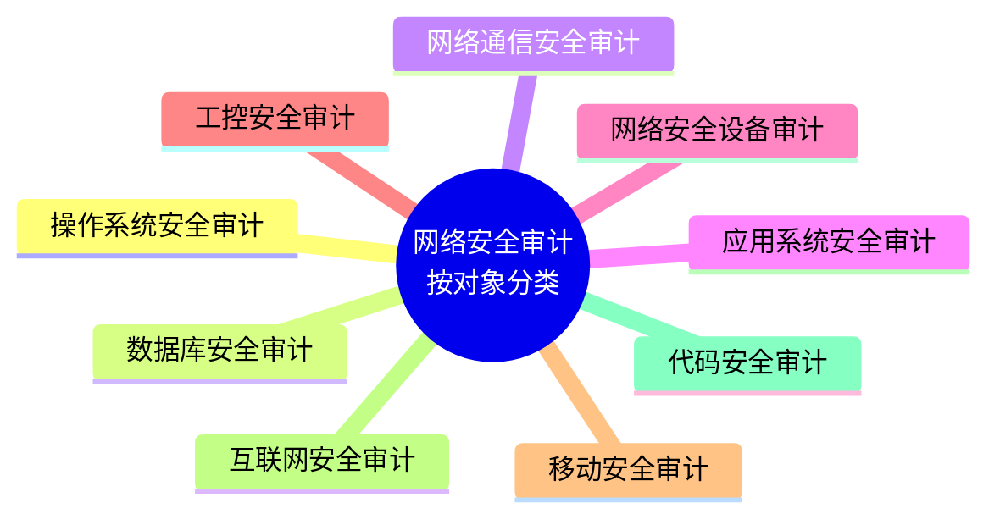
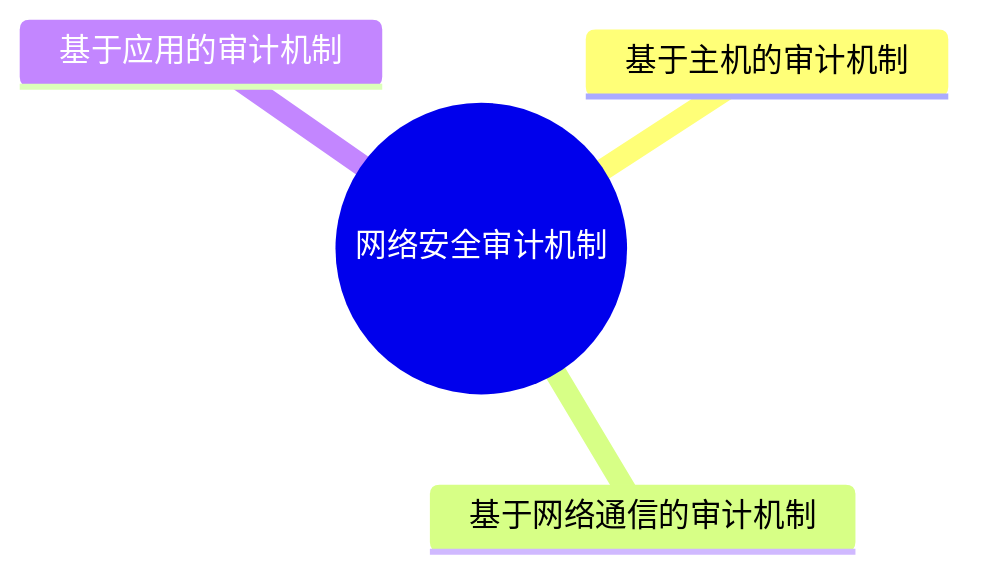
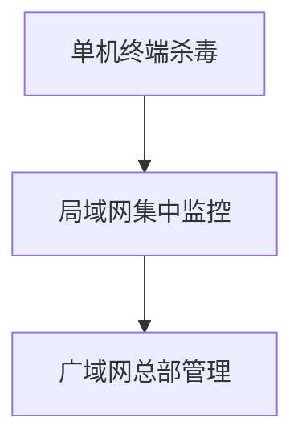
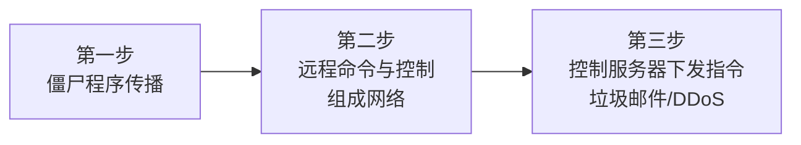
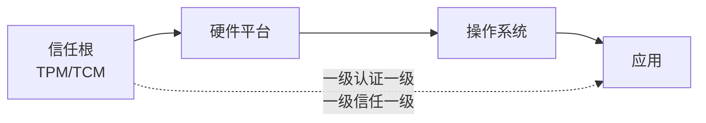
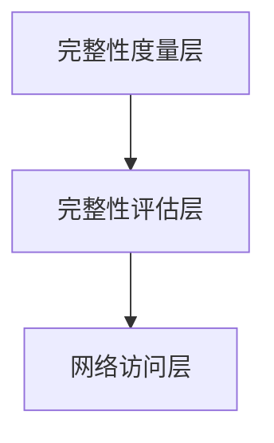
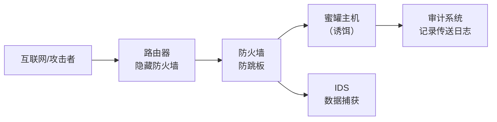
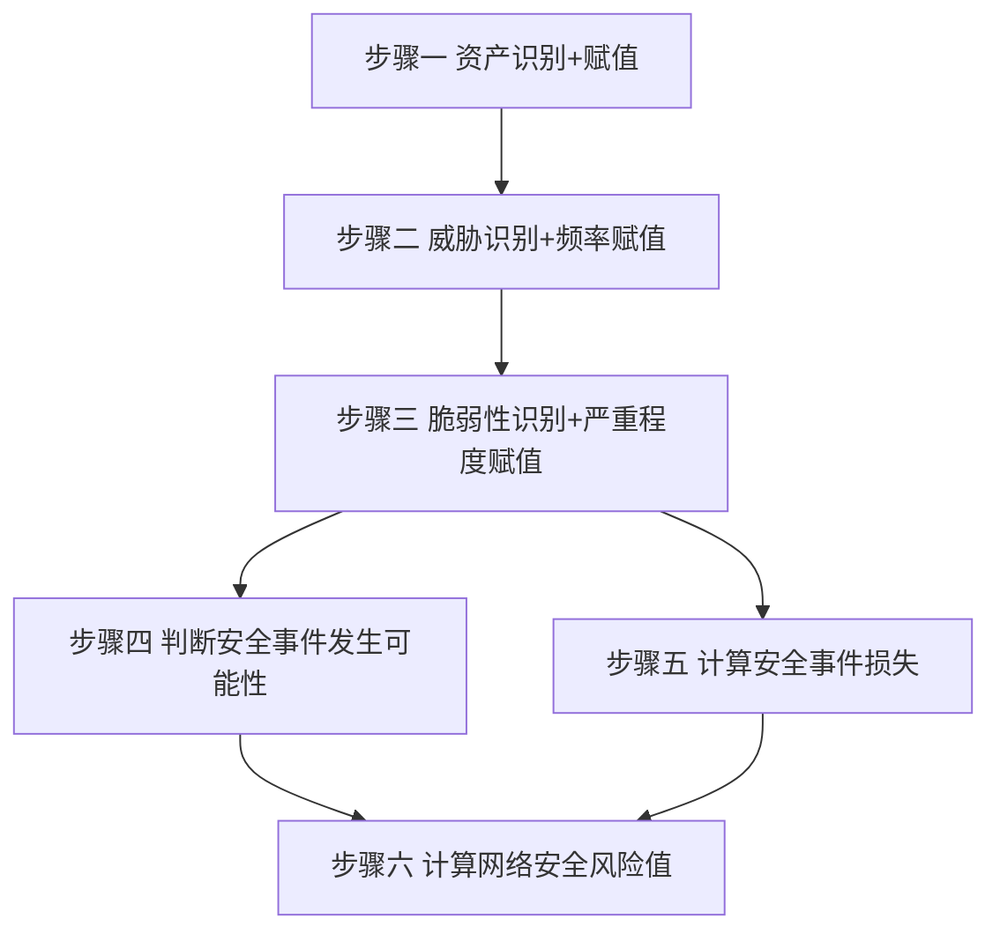
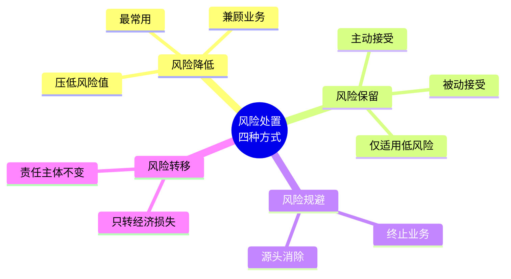

<div align="center">

# 课件精讲（第 2 / 11 卷）

[⬅ 上一卷](01_%E8%AF%BE%E4%BB%B6%E7%B2%BE%E8%AE%B2.md)　·　[📚 总目录](README.md)　·　[下一卷 ➡](03_%E8%AF%BE%E4%BB%B6%E7%B2%BE%E8%AE%B2.md)

**本卷内容**：第 2 部分

</div>

> [!NOTE]
> 单文件体积超出 GitHub 渲染上限会导致整页不显示，故全文拆卷。**总目录、材料覆盖表与自检清单见 [README.md](README.md)**。

## 📑 本卷目录

- [📘 一、《2026 中级信息安全工程师 课件合集（全 40 讲）》精讲要点 · 第 2 部分](#-一2026-中级信息安全工程师-课件合集全-40-讲精讲要点--第-2-部分)
  - [2026 中级信息安全工程师 · 课件合集（全40讲）— 片段 02](#2026-中级信息安全工程师--课件合集全40讲-片段-02)
    - [第12章 网络安全审计技术原理与应用（承接上一片段，本片段含 02～06 小节）](#第12章-网络安全审计技术原理与应用承接上一片段本片段含-0206-小节)
    - [第13章 网络安全漏洞防护技术原理与应用](#第13章-网络安全漏洞防护技术原理与应用)
    - [第14章 恶意代码防范技术原理](#第14章-恶意代码防范技术原理)
    - [第15章 网络安全主动防御技术与应用](#第15章-网络安全主动防御技术与应用)
    - [第16章 网络安全风险评估技术原理与应用](#第16章-网络安全风险评估技术原理与应用)
    - [第17章 网络安全应急响应技术原理与应用](#第17章-网络安全应急响应技术原理与应用)
    - [第18章 网络安全测评技术与标准](#第18章-网络安全测评技术与标准)
    - [第19章 操作系统安全保护](#第19章-操作系统安全保护)
    - [第20章 数据库系统安全](#第20章-数据库系统安全)
    - [第21章 网络设备安全](#第21章-网络设备安全)
    - [第22章 网站安全需求分析与安全保护工程](#第22章-网站安全需求分析与安全保护工程)
    - [第23章 云计算安全需求分析与安全保护工程](#第23章-云计算安全需求分析与安全保护工程)
    - [第24章 工控安全需求分析与安全保护工程](#第24章-工控安全需求分析与安全保护工程)
    - [⚠️ 疑点（原文疑似错误/笔误，原样保留，仅作说明）](#-疑点原文疑似错误笔误原样保留仅作说明)

---

## 📘 一、《2026 中级信息安全工程师 课件合集（全 40 讲）》精讲要点 · 第 2 部分

### 2026 中级信息安全工程师 · 课件合集（全40讲）— 片段 02

> 覆盖范围：Page 249 ～ Page 438
> 内容章节：第12章 网络安全审计（承接上文）→ 第13章 网络安全漏洞防护技术原理与应用 → 第14章 恶意代码防范技术原理 → 第15章 网络安全主动防御技术与应用 → 第16章 网络安全风险评估技术原理与应用 → 第17章 网络安全应急响应技术原理与应用 → 第18章 网络安全测评技术与标准 → 第19章 操作系统安全保护 → 第20章 数据库系统安全 → 第21章 网络设备安全 → 第22章 网站安全需求分析与安全保护工程 → 第23章 云计算安全需求分析与安全保护工程 → 第24章 工控安全需求分析与安全保护工程（片段末尾截断）
> 说明：已去除每页重复出现的页眉页脚/广告水印（课程宣传、QQ群、公众号、TB店等），**知识点零删减**。

---

#### 第12章 网络安全审计技术原理与应用（承接上一片段，本片段含 02～06 小节）

##### 12.2 网络安全审计系统组成与类型【有时考，熟悉】

###### 📌 审计对象类型分类

按**审计对象类型**分类，网络安全审计主要有以下九类：

| 项目 | 要点 |
| --- | --- |
| 审计对象分类（9种） | ① 操作系统安全审计 ② 数据库安全审计 ③ 网络通信安全审计 ④ 应用系统安全审计 ⑤ 网络安全设备审计 ⑥ 工控安全审计 ⑦ 移动安全审计 ⑧ 互联网安全审计 ⑨ 代码安全审计 |



###### 🖥️ 操作系统审计

**定义**：对用户和系统服务进行记录，主要包括**用户登录和注销、系统服务启动和关闭、安全事件**等。

| 操作系统 | 基本审计信息 |
| --- | --- |
| **Windows** | 注册登录事件、目录服务访问、审计账户管理、对象访问、审计策略变更、特权使用、进程跟踪、系统事件 |
| **Linux** | 系统开机自检日志 `boot.log`、用户命令操作日志 `acct`/`pacct`、最近登录日志 `lastlog`、使用 `SU` 命令日志 `sulog`、当前用户登录日志 `utmp`、用户登录和退出日志 `wtmp`、系统接收和发送邮件日志 `maillog`、系统消息 `messages` |

> [!IMPORTANT]
> **必背对应关系**（真题高频）：
> - `boot.log` → 系统开机自检日志
> - `lastlog` → **最近登录日志**（记录用户最近一次成功登录）
> - `utmp` → **当前**用户登录日志
> - `wtmp` → 用户登录和**退出**日志
> - `sulog` → `SU` 命令使用日志
> - `acct`/`pacct` → 用户命令操作日志
> - `maillog` → 邮件收发日志
> - `messages` → 系统消息

###### 🗄️ 数据库审计

- 通常是**监控并记录**用户对数据库服务器的**读、写、查询、添加、修改以及删除**等操作，并可以对数据库操作命令进行**回放**。
- **Oracle 默认对特权操作进行审计**，例如 `ALTER ANY PROCEDURE`、`CREATE ANY LIBRARY`、`DROP ANY TABLE`。

**Oracle 特权操作与风险对照表（必背）**

| 特权操作 | 权限说明 | 风险要点 |
| --- | --- | --- |
| `CREATE/ALTER/DROP ANY TABLE` | 任意创建/修改/删除其他用户的表 | 数据破坏：可删除业务表；数据泄露：可修改表结构窃取数据 |
| `CREATE ANY LIBRARY` | 创建指向操作系统库的外部库 | **高危！** 允许执行系统命令（如 `rm -rf`），直接导致服务器沦陷 |
| `GRANT ANY PRIVILEGE` | 授予任意系统权限（包括 `DBA`） | 可将超级用户权限授予攻击者账户 |
| `ALTER USER` | 修改用户属性（如密码、权限） | 身份绕过：重置管理员密码后登录；解锁账户：激活被封禁的恶意账户 |
| `CREATE/ALTER/DROP ANY PROCEDURE` | 任意创建/修改/删除其他用户的存储过程 | 后门植入：注入恶意代码（如定时发送数据） |
| `ALTER SYSTEM` | 修改数据库系统参数 | 服务中断：强制关闭数据库；审计绕过：禁用审计功能掩盖攻击痕迹 |
| `DROP ANY TABLE` | 删除任意用户的表 | 批量删除关键业务表（无需确认） |

> [!WARNING]
> 表格中 `CREATE/ALTER/DROP ANY TABLE` 与 `DROP ANY TABLE` 分列为两行（后者是前者的子集），原文如此，注意区分记忆。

###### 🌐 网络通信安全审计

- 一般采用**专用的审计系统**，通过**专用设备获取网络流量**，然后再进行**存储和分析**。

###### 🔀 按审计范围分类

| 分类 | 说明 |
| --- | --- |
| 综合审计系统 | 独立的**产品**形态 |
| 单个审计系统 | **系统自带**的审计功能 |

---

##### 12.3 网络安全审计机制与实现技术【有时考，熟悉】

###### 📌 三大审计机制

网络安全审计机制主要有：

1. **基于主机的审计机制**
2. **基于网络通信的审计机制**
3. **基于应用的审计机制**



###### 🔧 常用技术总览

| 技术 | 定位 |
| --- | --- |
| 系统日志数据采集技术 | 把操作系统、数据库、网络设备等系统中产生的事件信息汇聚到统一服务器存储 |
| 网络流量数据获取技术 | 网络通信安全审计的关键技术之一 |
| 网络审计数据安全分析技术 | 通过数据分析技术提取审计数据 |
| 网络审计数据存储技术 | 分散存储 / 集中采集存储 |
| 网络审计数据保护技术 | 分权、强制访问、加密、隐私保护、完整性保护 |

###### 📥 系统日志数据采集技术

- **定义**：把操作系统、数据库、网络设备等系统中产生的事件信息**汇聚到统一的服务器存储**，以便于查询分析与管理。
- **常见采集方式**：`SysLog`、`SNMP Trap`。

###### 📡 网络流量数据获取技术

| 获取方法 | 说明 |
| --- | --- |
| **共享网络监听** | 在共享式网络中直接监听 |
| **交换机端口镜像（Port Mirroring）** | 网络流量采集设备通过交换机端口镜像功能，获取流经交换机的网络通信包 |
| **网络分流器（Network Tap / TAP）** | 对于**不支持端口镜像功能**的交换机，通常利用网络分流器（TAP）把网络流量导入网络流量采集设备 |

###### 📦 常见的开源网络数据采集软件包（必背）

| 软件 | 说明 |
| --- | --- |
| `Libpcap`（Library for Packet Capture） | 网络数据包捕获软件，**支持不同平台**使用 |
| `Winpcap` | 支持在 **Windows** 平台捕获网络数据包 |
| `Windump` | 基于 `Winpcap` 的网络协议分析工具，可以采集网络数据包 |
| `Tcpdump` | 基于 `Libpcap` 的网络流量数据采集工具，常常应用于 **Linux** 操作系统中 |
| `Wireshark` | **图形化**的网络流量数据采集工具，可用于网络流量数据的采集和分析 |

> [!TIP]
> 记忆：**Linux → Libpcap → Tcpdump**；**Windows → Winpcap → Windump**；**图形化 → Wireshark**。

###### 🔍 网络审计数据安全分析技术（5种）

| 分析技术 | 说明 |
| --- | --- |
| **字符串匹配** | 通过模式匹配来查找相关审计数据，以便发现安全问题。常见工具 `grep`，格式：`grep [options] [regexp] [filename]`，其中 `regexp` 为正则表达式，用来表示要搜索匹配的模式。举例：`grep "login success" logfile.txt` |
| **全文搜索** | 利用搜索引擎技术来分析审计数据。开源搜索引擎工具 **Elastic search** 常用作数据分析 |
| **数据关联** | 将网络安全威胁情报信息，如系统日志、全网流量、安全设备日志等**多个数据来源**进行综合分析 |
| **统计报表** | 对安全审计数据的特定事件、阈值、安全基线等进行统计分析生成告警信息，形成发送**日、周、月报** |
| **可视化分析** | 将审计数据进行图表化处理，形成**饼图、柱状图、折线图、地图**等各种可视化效果，支持各种场景 |

###### 💾 网络审计数据存储技术

| 方式 | 说明 |
| --- | --- |
| **系统分散存储** | 审计数据保存在不同的系统中 |
| **集中采集** | 建立审计数据存储服务器，由专用的存储设备保存，**便于事后查询分析和电子取证** |

###### 🛡️ 网络审计数据保护技术（5种）

| 保护技术 | 要点 |
| --- | --- |
| **系统用户分权管理** | 操作系统、数据库等系统设置**操作员、安全员和审计员**三种类型的用户。操作员只负责系统的操作维护工作，操作过程被系统进行了详细记录；安全员负责系统安全策略配置和维护；审计员负责维护审计相关事宜，可以查看操作员、安全员工作日志；**操作员不能够修改自己的操作记录，审计员不能对系统进行操作** |
| **审计数据强制访问** | 采取强制访问控制措施，对审计数据设置**安全标记**，防止非授权用户查询及修改审计数据 |
| **审计数据加密** | 使用加密技术对敏感的审计数据进行加密处理，以防止非授权查看审计数据或泄露 |
| **审计数据隐私保护** | 采取隐私保护技术，防止审计数据泄露隐私信息 |
| **审计数据完整性保护** | 使用 **Hash 算法和数字签名**对审计数据进行数字签名和来源认证、完整性保护，防止非授权修改审计数据。Hash 算法主要有 `MD5`、`SHA`、国产 `SM3` 算法等。国产 `SM2`/`SM9` 可用于对审计数据签名 |

> [!IMPORTANT]
> **三权分立必背**：操作员（只能操作维护，**不能修改自己的操作记录**）／安全员（配置维护安全策略）／审计员（**只能查看**操作员、安全员日志，**不能对系统进行操作**）。
> **算法对应必背**：完整性 → `MD5`/`SHA`/`SM3`（杂凑）；签名 → `SM2`/`SM9`。

---

##### 12.4 网络安全审计主要产品与技术指标【有时考，熟悉】

###### 📋 日志安全审计产品

- **定义**：日志信息采集、分析与管理的系统。
- **基本原理**：利用 `Syslog`、`Snmptrap`、`NetFlow`、`Telnet`、`SSH`、`WMI`、`FTP`、`SFTP`、`SCP`、`JDBC`、文件等技术，对分散设备的**异构系统日志**进行分布采集、集中存储、统计分析、集中管理，便于有关单位／机构进行安全合规管理，保护日志信息安全。
- **主要功能**：日志采集、日志存储、日志分析、日志查询、事件告警、统计报表、系统管理。

###### 🖥️ 主机监控与审计产品

- **定义**：有关**主机行为信息**的安全审查及管理的系统。
- **基本原理**：通过**代理程序**对主机的行为信息进行采集，然后基于采集到的信息进行分析，以记录系统行为，帮助管理员评估操作系统的风险状况，并为相应的安全策略调整提供依据。
- **主要功能**：系统用户监控、系统配置管理、补丁管理、准入控制、存储介质（`U盘`）管理、非法外联管理等。

###### 🗄️ 数据库审计产品

- **定义**：对数据库系统活动进行审计的系统。
- **基本原理**：通过**网络流量监听、系统调用监控、数据库代理**等技术手段对所有访问数据库系统的行为信息进行采集，然后对采集的信息进行分析，形成数据库操作记录，保存和发现数据库各种违规的或敏感的操作信息，为相应的数据库安全策略调整提供依据。
- **三种实现方式对比（必背）**

| 实现方式 | 做法 | 优点 | 缺点/不足 |
| --- | --- | --- | --- |
| **网络监听审计** | 对获取到的数据库流量进行分析，从而实现对数据库访问的审计和控制 | **不影响数据库服务器** | 对**加密的数据库网络流量难以审计**；**无法对数据库服务器的本地操作进行审计** |
| **自带审计** | 启用数据库系统自带的审计功能 | 能够实现数据库**网络操作和本地操作**的审计 | 对数据库系统的**性能有**一些**影响**；审计策略配置、记录的粒度、日志统一分析方面不够完善；**日志本地存储容易被删除** |
| **数据库 Agent** | 安装采集代理（Agent），通过 Agent 对数据库的各种访问行为进行分析 | 能够实现数据库网络操作和本地操作的审计 | Agent 需要安装，对数据库服务系统的**性能、稳定性、可靠性**有影响 |

> [!TIP]
> 口诀：**网络监听 → 不碰服务器但管不了本地 + 怕加密**；**自带 + Agent → 能管本地，但一个耗性能一个要装东西**。

###### 🌐 网络安全审计产品

- **定义**：有关**网络通信活动**的审计系统。
- **基本原理**：通过**网络流量信息采集及数据包深度内容分析**，提供网络通信及网络应用的活动信息记录。
- **常见功能**：

| 功能 | 说明 |
| --- | --- |
| **网络流量采集** | 获取网上通信流量信息，按照协议类型及采集规则保存流量数据 |
| **网络流量数据挖掘分析** | 对采集到的网络流量数据进行挖掘，提取网络流量信息，形成网络审计记录，并可**回放** |

**网络流量数据挖掘分析的 6 类协议审计（必背）**

| 序号 | 审计类型 | 协议 | 记录内容 |
| --- | --- | --- | --- |
| (1) | 邮件收发协议审计 | `SMTP`、`POP3` | 记录收发邮件的**时间、地址、主题、附件名、收发人**等信息 |
| (2) | 网页浏览审计 | `HTTP` | 记录用户访问网页的**时间、地址、域名**等信息 |
| (3) | 文件共享审计 | `NetBIOS` | 记录网络用户对网络资源中的文件共享操作 |
| (4) | 文件传输审计 | `FTP` | 记录用户对 FTP 服务器的远程登录时间、**读、写、添加、修改以及删除**等操作 |
| (5) | 远程访问审计 | `Telnet` | 记录用户对 Telnet 服务器的远程登录时间、各种操作命令 |
| (6) | `DNS` 审计 | `DNS` | 记录用户 DNS 服务请求信息 |

###### 🏭 工业控制系统网络审计产品

- **定义**：对工业控制网络中的**协议、数据和行为**等进行记录、分析，并做出一定的响应措施的信息安全专用系统。
- **基本原理**：利用网络流量采集及**协议识别**技术，对工业控制协议进行**还原**，形成工业控制系统的操作信息记录，然后进行保存和分析。
- **实现方式**：（1）**一体化集中产品**；（2）由**采集端和分析端**两部分组成。

###### 🔐 运维安全审计产品（堡垒机）

- **定义**：有关**网络设备及服务器操作**的审计系统（即**堡垒机**）。
- **基本原理**：通过网络流量信息采集或**服务代理**等技术方式，记录 `Telnet`、`FTP`、`SSH`、`tftp`、`HTTP`、`RDP` 等运维操作服务的活动信息。
- **主要功能（必背）**

| 功能 | 覆盖协议/对象 |
| --- | --- |
| **字符会话审计** | `SSH`、`Telnet` |
| **图形操作审计** | `RDP`、`VNC`、`HTTP`/`HTTPS` |
| **数据库运维审计** | `Oracle`、`MS SQL Server`、`IBM DB2`、`PostgreSQL` |
| **文件传输审计** | `FTP`、`SFTP` |
| **合规审计** | — |

> [!WARNING]
> 易混：`SFTP` 在"日志安全审计产品"里是**日志采集手段**，在"运维安全审计"里属于**文件传输审计**（而非字符会话审计）。真题常在此设陷阱。

---

##### 12.5 网络安全审计应用【了解】

网络安全审计技术应用场景：**安全运维保障、数据访问监测、网络入侵检测、网络电子取证**等。

| 应用场景 | 说明 |
| --- | --- |
| **网络电子取证** | 日志分析技术广泛应用于计算机犯罪侦查与电子取证 |
| **安全运维保障** | IT 系统运维面临**内部安全威胁**和**第三方外包服务安全风险**，网络安全审计是应对运维安全风险的重要安全保障机制。通过运维审计，可以有效防范和追溯安全威胁操作 |
| **数据访问监测** | 数据库安全审计产品就是通过安全监测，智能化、自动地从**海量日志信息**中，发现**违规访问或异常访问**记录，从而有效降低安全管理员日志分析的工作量 |
| **网络入侵检测** | 对网络设备、安全设备、应用系统的日志信息进行**实时收集和分析**，检测发现各种攻击行为 |

---

##### 12.6 课堂练习

**题 1**　操作系统审计一般是对操作系统用户和系统服务进行记录，主要包括：用户登录和注销、系统服务启动和关闭、安全事件等。Linux 操作系统中，文件 `lastlog` 记录的是（　　）。
A. 系统开机自检日志　B. 当前用户登录日志　C. 最近登录日志　D. 系统消息

**题 2**　关键信息基础设施的核心操作系统、关键数据库一般设有操作员、安全员和审计员三种角色类型。以下表述**错误**的是（　　）。
A. 操作员只负责对系统的操作维护工作
B. 安全员负责系统安全策略配置和维护
C. 审计员可以查看操作员、安全员的工作过程日志
D. 操作员可以修改自己的操作记录

**题 3**　操作系统审计一般是对操作系统用户和系统服务进行记录，主要包括用户登录和注销、系统服务启动和关闭、安全事件等。Windows 操作系统记录系统事件的日志中，只允许系统管理员访问的是（　　）。
A. 系统日志　B. 应用程序日志　C. 安全日志　D. 性能日志

**题 4**　等保 2.0 从（　　）级开始要求安全审计。
A. 一级　B. 二级　C. 三级　D. 四级

**题 5**　在运维审计中，以下属于**字符会话审计**范畴的协议是（　　）。
A. `SSH`　B. `SFTP`　C. `FTP`　D. `PostgreSQL`

> [!TIP]
> 参考答案（由正文知识点推断，非原文）：题1 **C**（`lastlog`＝最近登录日志）；题2 **D**（原文明确"操作员不能够修改自己的操作记录"）；题3 **C**（安全日志）；题4 **B**（等保2.0 二级起要求安全审计）；题5 **A**（`SSH` 属字符会话，`SFTP`/`FTP` 属文件传输，`PostgreSQL` 属数据库运维）。

---

#### 第13章 网络安全漏洞防护技术原理与应用

**命题规律**：上午选择题 **2 分左右**，下午案例考漏洞实例

**目录**

| 序号 | 小节 | 考频 |
| --- | --- | --- |
| 1 | 网络安全漏洞概述 | 【有时考，熟悉】 |
| 2 | 网络安全漏洞分类与管理 | 【常考，熟悉】 |
| 3 | 网络安全漏洞扫描技术与应用 | 【了解】 |
| 4 | 网络安全漏洞处置技术与应用 | 【有时考，熟悉】 |
| 5 | 网络安全漏洞防护主要产品与技术指标 | 【了解】 |

---

##### 13.1 网络安全漏洞概述【有时考，熟悉】

###### 📌 漏洞概念

- 网络安全漏洞又称为**脆弱性**，简称**漏洞**。
- 漏洞一般是**致使网络信息系统安全策略相冲突的缺陷**，这种缺陷通常称为**安全隐患**。
- 例：**"融化"、"幽灵"** CPU 漏洞，影响 CPU 芯片及 OS。

> [!WARNING]
> 原文写作"融化"、"幽灵"。业界通行译名为**"熔断"（Meltdown）与"幽灵"（Spectre）**，此处保留原文写法，详见文末「⚠️ 疑点」。

###### 🎚️ 按补丁状况分类

| 类型 | 说明 |
| --- | --- |
| **普通漏洞** | 已有补丁的漏洞 |
| **零日漏洞**（zero-day vulnerability） | 尚无补丁的漏洞 |

###### 🌍 漏洞管理平台（必背）

| 平台/组织 | 名称 |
| --- | --- |
| 美国 **MITRE** 公司 | 通用漏洞披露 **CVE**、通用缺陷列表 **CWE** |
| 事件响应与安全组织论坛 **FIRST** | 通用漏洞评分系统 **CVSS** |
| 美国国家漏洞库 | **NVD** |
| 中国国家信息安全漏洞库 | **CNNVD** |
| 国家信息安全漏洞共享平台 | **CNVD** |

---

##### 13.2 网络安全漏洞分类与管理【常考，熟悉】

###### 📌 漏洞来源——两大方面

网络信息系统的漏洞主要来自两个方面：

| 类别 | 内容 |
| --- | --- |
| **非技术性安全漏洞** | 管理组织结构、管理制度、管理流程、人员管理等 |
| **技术性安全漏洞** | 网络结构、通信协议、设备、软件产品、系统配置、应用系统等 |

**非技术性安全漏洞的主要来源（5条）**

1. 网络安全**责任主体不明确**。
2. 网络安全**策略不完备**。
3. 网络安全**操作技能不足**。
4. 网络安全**监督缺失**。
5. 网络安全**特权控制不完备**。

**技术性安全漏洞的主要来源（8条，必背）**

| 序号 | 来源 | 说明 |
| --- | --- | --- |
| (1) | **设计错误** | 由于系统或软件程序设计错误而导致的安全漏洞 |
| (2) | **输入验证错误** | 由于未对用户输入数据的合法性进行验证，使攻击者非法进入系统 |
| (3) | **缓冲区溢出** | 输入程序缓冲区的数据超过其规定长度，造成缓冲区溢出，破坏程序正常的堆栈，使程序执行其他代码 |
| (4) | **意外情况处置错误** | 由于程序在实现逻辑中没有考虑到一些意外情况，而导致运行出错 |
| (5) | **访问验证错误** | 由于程序的访问验证部分存在某些逻辑错误，使攻击者可以绕过访问控制进入系统 |
| (6) | **配置错误** | 由于系统和应用的配置有误，或配置参数、访问权限、策略安装位置有误 |
| (7) | **竞争条件** | 由于程序处理文件等实体在时序和同步方面存在问题，存在一个短暂的时机使攻击者能够施以外来的影响 |
| (8) | **环境错误** | 由于一些环境变量的错误或恶意设置造成的安全漏洞 |

###### 🗂️ 漏洞分类（国际 + 国内）

国际上较为认可的是 **CVE** 和 **CVSS**。另外，还有我国信息安全漏洞分类及 **OWASP** 漏洞分类。

| 分类体系 | 说明 |
| --- | --- |
| **CVE 漏洞分类** | 美国 **MITRE** 公司建设和维护的安全漏洞字典。给出**统一标识和规范化描述**。CVE 条目包含内容是**标识数字、安全漏洞简要描述**。标识数字简称 **CVE ID**，其格式由**年份数字和其他数字**组成，如 `CVE-2019-1543` 为一个 Open SSL 安全漏洞编号 |
| **CVSS** | 通用漏洞计分系统，分数计算依据由**基本度量计分、时序度量计分、环境度量计分**组成 |
| **CNNVD**（国家信息安全漏洞库） | 将信息安全漏洞划分为：**配置错误、代码问题、资料不足** |
| **CNVD**（国家信息安全漏洞共享平台） | 根据漏洞产生原因，将漏洞分为 **11 种类型**；依据行业划分主要分为**行业漏洞和应用漏洞**。在漏洞分级方面，将网络安全漏洞划分为**高、中、低**三种危害级别 |
| **OWASP** | 开放式 Web 应用程序安全项目组织发布有关 Web 应用程序的**前十种安全漏洞** |
| **CWE** | 软件安全弱点的分类框架，描述漏洞的**通用成因和类型** |

> [!IMPORTANT]
> **CVE vs CWE 必背**：`CWE` 是**软件安全弱点的分类框架**，描述漏洞的**通用成因和类型**；`CVE` 是**具体漏洞实例的标识系统**，为每个已知漏洞分配**唯一 ID**。**均由 MITRE 公司管理**，**CWE 是 CVE 的补充**。

###### 📢 漏洞发布

漏洞发布方式主要有三种形式：**网站、电子邮件、安全论坛**。

###### 🔎 漏洞信息获取

国内外漏洞信息来源主要有**四个方面**：

1. 网络安全**应急响应机构**；
2. 网络安全**厂商**；
3. **IT 产品或系统提供商**；
4. 网络安全**组织**。

###### 🔄 漏洞管理过程（5步，必背顺序）

1. **资产确认**
2. **漏洞信息采集**
3. **漏洞评估**
4. **漏洞消除和控制**
5. **漏洞变化跟踪**


---

##### 13.3 网络安全漏洞扫描技术与应用【了解】

###### 📌 漏洞扫描器

- 具有漏洞扫描功能的软件或设备，简称为**漏洞扫描器**。漏洞扫描器通过**远程或本地**检查系统是否存在**已知漏洞**。
- **具体模块功能**：用户界面、扫描引擎、漏洞扫描结果分析、漏洞信息及配置参数库。

###### 🎚️ 漏洞扫描器三种类型（必背）

| 类型 | 工作原理 | 代表工具 |
| --- | --- | --- |
| **主机漏洞扫描器** | 通过检查**本地系统中关键性文件的内容及安全属性**来发现漏洞；运行与目标系统**在同一主机**上，并且**只能进行单机检测** | `COPS`、`Tiger`、`Microsoft Baseline Security Analyser`（**MBSA**） |
| **网络漏洞扫描器** | 通过与待扫描的目标机**建立网络连接**后，发送特定网络请求进行漏洞检查 | `Nmap`、`Nessus`、`X-scan` |
| **专用漏洞扫描器** | 针对**特定系统**的安全漏洞检查工具 | 数据库漏扫、网络设备漏扫、Web 漏扫、工控漏扫 |

- 网络安全漏洞扫描常用于网络信息系统**安全检查**和**风险评估**。

---

##### 13.4 网络安全漏洞处置技术与应用【有时考，熟悉】

- 网络安全漏洞处置是**网络安全应急响应**的重要工作。主要有**漏洞发现技术、漏洞修补技术、漏洞利用防范技术**。
- 网络安全漏洞的**发现方法**主要依赖于：**人工安全性分析、工具自动化检测及人工智能辅助分析**。

###### 🔧 漏洞修补技术——补丁管理六环节（必背）

补丁管理是一个**系统的、周而复始**的工作，主要由**六个环节**组成：

1. **现状分析**
2. **补丁跟踪**
3. **补丁验证**
4. **补丁安装**
5. **应急处理**
6. **补丁检查**


###### 🛡️ 漏洞利用防范技术（5种，必背）

**定义**：主要针对漏洞**触发利用的条件**进行**干扰或拦截**，以防止攻击者成功利用漏洞。

| 序号 | 技术 | 原理/作用 |
| --- | --- | --- |
| (1) | **地址空间随机化技术 `ASLR`** | 通过对程序**加载到内存的地址**进行随机化处理，使得攻击者**不能事先确定程序的返回地址值**，从而降低攻击成功的概率 |
| (2) | **数据执行阻止（`DEP`）** | 操作系统通过对特定的内存区域标注为**非执行**，使得代码不能够在指定的内存区域运行。可以有效地保护应用程序的**堆栈区域**，防止被攻击者利用 |
| (3) | **`SEHOP`** | **结构化异常处理覆盖保护**的缩写，其原理是防止攻击者利用结构化异常处理（`SEH`）重写 |
| (4) | **堆栈保护** | 通过设置**堆栈完整性标记**以检测函数调用返回地址是否被篡改，阻止攻击者利用**缓冲区漏洞** |
| (5) | **虚拟补丁** | 对尚未进行漏洞永久补丁修复的目标系统程序，在**不修改可执行程序**的前提下，检测进入目标系统的**网络流量**而**过滤掉漏洞攻击数据包**，从而保护目标系统程序免受攻击 |

> [!TIP]
> 记忆口诀：**地址随机（ASLR）→ 找不到返回地址；数据不可执行（DEP）→ 跑不起来；SEHOP → 不能重写异常处理；堆栈保护 → 检测返回地址被篡改；虚拟补丁 → 网络侧过滤，不动程序**。

---

##### 13.5 网络安全漏洞防护主要产品与技术指标【了解】

###### 📊 网络安全漏洞扫描产品技术指标（9项）

1. 漏洞扫描**主机数量**。
2. 漏洞扫描**并发数**。
3. 漏洞扫描**速度**。
4. 漏洞**检测能力**。
5. **数据库漏洞检查功能**。
6. **Web 应用漏洞检查功能**。
7. **口令检查功能**。
8. **标准兼容性**。
9. **部署环境难易程度**。

###### 🧩 网络安全漏洞服务平台

网络安全产业界推出漏洞相关的产品与服务，如**漏洞盒子、补天漏洞响应平台、网络威胁情报服务**等。

###### 🚧 网络安全漏洞防护网关

- **产品原理**：通过从**网络流量**中提取和识别**漏洞利用特征模式**，阻止攻击者对目标系统的漏洞利用。
- **常见产品形式**：`IPS`、Web 防火墙（简称 **`WAF`**）、统一威胁管理（**`UTM`**）等。
- **相关产品常见技术指标**：

| 指标 | 说明 |
| --- | --- |
| 阻断安全漏洞攻击的**种类与数量** | — |
| 阻断安全漏洞攻击的**准确率** | — |
| 阻断安全漏洞攻击的**性能** | — |
| **支持网络带宽**的能力 | — |

---

##### 13.6 课堂练习

**题 1**　网络安全漏洞是网络安全管理工作的重要内容，网络信息系统的漏洞主要来自两个方面：非技术性安全漏洞和技术性安全漏洞。以下属于**非技术性安全漏洞**主要来源的是（　　）。
A. 缓冲区溢出　B. 输入验证错误　C. 网络安全特权控制不完备　D. 配置错误

**题 2**　无论是哪一种 Web 服务器，都会受到 HTTP 协议本身安全问题的困扰，这样的信息系统安全漏洞属于（　　）。
A. 开发型漏洞　B. 运行型漏洞　C. 设计型漏洞　D. 验证型漏洞

**题 3**　降低缓冲区溢出概率的措施是（　　）。
A. `ASLR`　B. 虚拟补丁　C. `SEHOP`　D. `DEP`

**题 4**　以下网络安全漏洞发现工具中，**具备网络数据包分析功能**的是（　　）。
A. `Flawfinder`　B. `Wireshark`　C. `MOPS`　D. `Splint`

> [!TIP]
> 参考答案（推断）：题1 **C**（特权控制不完备属非技术性；A/B/D 均为技术性）；题2 **C**（设计型漏洞，协议自身设计缺陷）；题3 **A**（`ASLR` 地址随机化降低溢出攻击成功概率）；题4 **B**（`Wireshark` 网络协议分析）。

---

#### 第14章 恶意代码防范技术原理

**命题规律**：上午选择题 **3-5 分**，下午案例题考得比较少，考的话 **5 分组合题**

**目录**

| 序号 | 小节 | 考频 |
| --- | --- | --- |
| 1 | 恶意代码概述 | 【有时考，熟悉】 |
| 2 | 计算机病毒分析与防护 | 【有时考，熟悉】 |
| 3 | 特洛伊木马分析与防护 | 【常考，熟悉】 |
| 4 | 网络蠕虫分析与防护 | 【常考，熟悉】 |
| 5 | 僵尸网络分析与防护 | 【有时考，熟悉】 |
| 6 | 其他恶意代码分析与防护 | 【了解】 |
| 7 | 恶意代码防护主要产品与技术指标 | 【了解】 |
| 8 | 恶意代码防护技术应用 | 【了解】 |

---

##### 14.1 恶意代码概述【有时考，熟悉】

###### 📌 恶意代码定义与分类

- **定义**：恶意代码是一种**违背目标系统安全策略的程序代码**，会造成目标系统**信息泄露、资源滥用**，破坏系统的**完整性及可用性**。
- **种类**：计算机病毒（Computer Virus）、蠕虫（Worms）、特洛伊木马（Trojan Horse）、逻辑炸弹（Logic Bombs）、细菌（Bacteria）、恶意脚本（Malicious Scripts）和恶意 `ActiveX` 控件、间谍软件（Spyware）等。

###### 🔁 恶意代码攻击模型（6步骤，必背）

1. 第一步，**侵入系统**。
2. 第二步，**维持或提升已有的权限**。
3. 第三步，**隐蔽**。
4. 第四步，**潜伏**。
5. 第五步，**破坏**。
6. 第六步，**重复前面 5 步**对新的目标实施攻击过程。


###### 🏷️ 扩展知识：恶意代码命名格式

恶意代码表示一般格式为：`<病毒前缀>.<病毒名>.<病毒后缀>`

| 序号 | 前缀分类 | 前缀标识 |
| --- | --- | --- |
| 1 | **系统病毒** | `VIRUS`、`PE` |
| 2 | **蠕虫病毒** | `Worm` |
| 3 | **木马病毒、黑客病毒** | 木马病毒前缀是 `Trojan`，黑客病毒前缀名一般为 `Hack` |
| 4 | **脚本病毒** | `Script`、`VBS`、`JS` |
| 5 | **宏病毒** | `Macro`，第二前缀是 `Word`、`Word97`、`Excel`、`Excel97` |
| 6 | **后门病毒** | `Backdoor` |
| 7 | **病毒种植程序病毒** | `Dropper`。运行时会从体内**释放出一个或几个新的病毒**，由释放出来的新病毒产生破坏 |
| 8 | **破坏性程序病毒** | `Harm`。**诱惑用户点击，直接破坏**，如格式化硬盘 |
| 9 | **玩笑病毒** | `Joke` |
| 10 | **捆绑机病毒** | `Binder`。与**正常程序捆绑** |
| 11 | **其他** | `DoS`：会针对某台主机或者服务器进行 DoS 攻击；`Exploit`：会自动通过溢出对方或者自己的系统漏洞来传播自身，或者他本身就是一个用于 Hacking 的溢出工具；`HackTool`：黑客工具 |

###### 🧬 恶意代码生存技术（8类）

**1. 反跟踪技术**

提高自身的**伪装能力和防破译能力**，使检测与清除恶意代码的难度大大增加。大致可以分为两大类：

| 类别 | 具体方法 |
| --- | --- |
| 反动态跟踪技术 | **禁止跟踪中断、检测跟踪法、其他反跟踪技术** |
| 反静态分析技术 | 对程序代码**分块加密执行、伪指令法** |

**2. 加密技术**

恶意代码**自我保护**的手段，再配合反跟踪技术的使用，让分析者不能正常调试和阅读恶意代码，无法获得恶意代码的工作原理，**不能抽取特征串**。加密手段有三种：**信息加密、数据加密和程序代码加密**。

**3. 模糊变换技术**

感染客体对象时使潜入宿主程序的代码**不尽相同**。只采用基于特征的检测工具一般无法有效识别它们。主要分为以下几种：

- **指令替换技术**
- **指令压缩技术**
- **指令扩展技术**
- **伪指令技术**
- **重编译技术**

**4. 自动生产技术**

普通病毒能够利用**"多态性发生器"**编译成具有多态性的病毒。**多态变换引擎**能够让程序代码本身产生改变，但却可以保持原有功能。

**5. 变形技术**

具有**同一功能不同特征码**的恶意代码。这种变换恶意代码特征码的技术称为变形技术。常见的恶意代码变形技术包括如下几个方面：**重汇编技术、压缩技术、膨胀技术、伪指令技术**。

**6. 三线程技术**

防止恶意代码被外部操作停止运行。工作原理是同时开启了**三个线程**，一个为负责远程控制工作的**主线程**，另外两个监视线程负责检查恶意代码程序是否被删除或被停止自启动的**监视线程**和**守护线程**。

**7. 进程注入技术**

在系统启动时操作系统的**系统服务和网络服务**一般能够自动加载。

**8. 通信隐藏技术（4类）**

| 技术 | 说明与例子 |
| --- | --- |
| **端口定制技术** | 旧木马几乎都存在**预设固定的监听端口**，但是新木马一般都有**定制端口**的功能 |
| **端口复用技术** | 木马 `Executor` 用 **80 端口**传递控制信息和数据；`Blade Runner`、`Doly Trojan`、`Fore`、`FTP Trojan`、`Larva`、`ebEx`、`WinCrash` 等木马复用 **21 端口**；`Shtrilitz Stealth`、`Terminator`、`WinPC`、`WinSpy` 等木马复用 **25 端口** |
| **通信加密技术** | 将恶意代码的通信内容加密发送 |
| **隐蔽通道技术** | 有效隐藏**通信内容和通信状态**，常见的能提供隐蔽通道方式进行通信的后门有：`BO2K`、`Code Red II`、`Nimida` 和 `Covert TCP` 等 |

> [!IMPORTANT]
> **端口复用必背**：`80` → `Executor`；`21`（FTP）→ `Blade Runner`、`Doly Trojan`、`Fore`、**`FTP Trojan`**、`Larva`、`ebEx`、`WinCrash`；`25`（SMTP）→ `Shtrilitz Stealth`、`Terminator`、`WinPC`、`WinSpy`。
> 真题：FTP 特洛伊木马通常复用的端口是 **21**。

**9. 内核级隐藏技术**

| 技术 | 说明 |
| --- | --- |
| **`LKM` 隐藏** | `LKM` 是**可加载内核模块**，能够在**不用重新编译内核**的情况下把（模块）动态加载到内存中。`LKM Rootkit` 通过系统提供的接口加载到内核空间，将恶意程序转化成内核的某一部分，再通过 **hook 系统调用**的方式实现隐藏功能 |
| **内存映射隐藏** | 内存映射是指由**一个文件到一块内存的映射**。内存映射可以将硬盘上的内容映射至内存中，用户可以通过**内存指令读写文件** |

###### ⚔️ 恶意代码攻击技术（4类）

| 技术 | 说明 |
| --- | --- |
| **进程注入技术** | 将与服务相关的嵌入了恶意代码程序的可执行代码作为载体，实现自身隐藏和启动的目的 |
| **超级管理技术** | 采用超级管理技术对反恶意代码软件系统进行**拒绝服务攻击**，阻碍反恶意代码软件的正常运行。例如，**"广外女生"**是一个国产特洛伊木马，对**"金山毒霸"和"天网防火墙"**采用超级管理技术进行拒绝服务攻击 |
| **端口反向连接技术** | 指令恶意代码使用端口反向连接技术使攻击的**服务端（被控制端）主动连接客户端（控制端）**端口。最早实现这项技术的木马程序是国外的 **"Boinet"**，它可以通过 `ICO`、`IRC`、`HTTP` 和**反向主动连接**这 4 种方式联系客户端。**"网络神偷"**是我国最早实现端口反向连接技术的恶意代码。**"灰鸽子"**则是这项技术的**集大成者**，它内置 `FTP`、域名、服务端主动连接这 **3 种**服务端在线通知功能 |
| **缓冲区溢出攻击技术** | 攻击代码以一定的权限运行有缓冲区溢出漏洞的程序来获得被攻击主机的控制权。缓冲区溢出攻击成为恶意代码从**被动式传播转为主动式传播**的主要途径之一。例如，**"红色代码"**利用 `IIS Server` 上 `Indexing Service` 的缓冲区溢出漏洞完成攻击、传播和破坏等恶意目的 |

> [!TIP]
> 端口反向连接三件套：**国外最早 "Boinet" → 国内最早 "网络神偷" → 集大成者 "灰鸽子"**。

###### 🔬 恶意代码分析技术

**静态分析方法**：反恶意代码软件的检查、**字符串分析、脚本分析**和**静态反汇编分析、静态反编译分析**等。

**动态分析方法**

| 方法 | 说明与工具 |
| --- | --- |
| **文件监测** | 恶意代码执行后，在目标主机上可能读写各文件，修改程序，添加文件，甚至把代码嵌入其他文件，因此对文件系统必须进行监测。`fileMon` 是常用的文件监测程序，能够记录与文件相关的动作，例如**打开、读取、写入、关闭、删除和存储时间戳**等。另外还有**文件完整性监测工具**，如 `Tripwire`、`AIDE` 等 |
| **进程监测** | 主机上所有被植入进程的细节都能为分析恶意代码提供重要参考信息。常用的进程监测工具是 **`Process Explorer`**，它将机器上的每一个执行中的程序显示出来，将每一个进程的工作详细展示出来 |
| **网络活动监测** | — |
| **注册表监测** | 恶意代码运行时一般要改变 Windows 操作系统的配置来改变 Windows 操作系统的行为，实现恶意代码自身的目的。常用的监测软件是 **`Regmon`**，它能够实时显示读写注册表项的全部动作 |
| **动态反汇编分析** | 该监测过程从代码的**入口点**处开始，控制权在程序代码与调试工具之间来回传递，直到程序执行完为止。如 `OllyDbg`、`IDA Pro`、`SoftICE` |

> [!WARNING]
> 原文把 `IDA Pro` 写作 "IDA Rro"，保留原文，详见文末「⚠️ 疑点」。

###### 🛡️ 恶意代码防范策略

一方面**加强组织管理**；另一方面通过**技术手段**来实现恶意代码防御。

---

##### 14.2 计算机病毒分析与防护【有时考，熟悉】

###### 📌 计算机病毒概念与特性

- 计算机病毒是**恶意代码的一种类型**，它是一组具有**自我复制、传播能力**的程序代码。
- **四个基本特点**：(1) **隐蔽性**。(2) **传染性**。(3) **潜伏性**。(4) **破坏性**。

###### 🧩 计算机病毒组成与运行机制

- **三部分**：**复制传染部件、隐藏部件、破坏部件**。
- **生命周期两个阶段**：第一阶段，**复制传播阶段**。第二阶段，**激活阶段**。

###### 🦠 计算机病毒常见类型与技术（4种）

| 类型 | 说明 |
| --- | --- |
| **引导型病毒** | 通过感染计算机系统的**引导区**而控制系统，典型的有**磁盘杀手病毒、`AntiExe` 病毒**等 |
| **宏病毒**（Macro Viruses） | 利用**宏语言**来实现的计算机病毒。能够感染任何运行 **Office** 的计算机 |
| **多态病毒**（Polymorphic Viruses） | 多态病毒**每次感染新的对象后**，通过**更换加密算法**，改变其存在形式 |
| **隐蔽病毒**（Stealth Viruses） | 将自身的存在形式进行隐藏，使得操作系统和反病毒软件不能发现。隐蔽病毒使用的技术主要包括：**隐藏文件的日期、时间的变化；隐藏文件大小的变化；病毒加密** |

###### 🔍 计算机病毒防范策略和技术

**1. 查找计算机病毒源**

对计算机文件及**磁盘引导区**进行计算机病毒检测，以发现异常情况，确证计算机病毒的存在，主要方法如下：**比较法、搜索法、特征字识别法、分析法**。

**2. 阻断计算机病毒传播途径**

由于病毒的危害性不可预见，因此**切断病毒的传播途径是关键防护措施**，具体方法如下：

- 用户具有计算机病毒防范**安全意识和安全操作习惯**
- **消除计算机病毒载体**
- **安全区域隔离**

**3. 主动查杀计算机病毒**

- 定期对计算机系统进行病毒检测。定期检查**主引导区、引导扇区、中断向量表、文件属性（字节长度、文件生成时间等）、模板文件和注册表**等。
- 安装防计算机病毒软件，建立**多级病毒防护体系**。

**4. 计算机病毒应急响应和灾备**

- **备份**。
- **数据修复技术**。
- **网络过滤技术**。
- **计算机病毒应急响应预案**。

###### 🏗️ 计算机病毒防护方案（5种，必背）

| 方案 | 说明 |
| --- | --- |
| **基于单机计算机病毒防护** | **传统防御模式**，防护单台计算机 |
| **基于网络计算机病毒防护** | 通过在**网管中心**建立网络防病毒管理平台，实现病毒**集中监控与管理**，集中监测整个网络的病毒疫情，提供网络整体防病毒策略配置。对网络系统的**服务器、工作站和客户机**，进行病毒防范的统一管理，及时更新**病毒特征库和杀病毒软件的版本升级** |
| **基于网络分级病毒防护** | **三级管理模式**：单机终端杀毒 → 局域网集中监控 → 广域网总部管理 |
| **基于邮件网关病毒防护** | 邮件网关防毒系统放置在**邮件网关入口处**，接收来自外部的邮件，对病毒、**不良邮件**（如带有色情、政治反动色彩的邮件）等进行过滤，处理完毕后再将安全邮件转发至邮件服务器，全面保护内部网络用户的电子邮件安全 |
| **基于网关防护** | 在**网络出口处**设置有效的病毒过滤系统，防火墙将数据提交给网关杀毒系统进行检查，如有病毒入侵，网关防毒系统将**通知防火墙立刻阻断进行攻击的 IP** |



---

##### 14.3 特洛伊木马分析与防护【常考，熟悉】

###### 📌 特洛伊木马概念与特性

- 特洛伊木马（Trojan Horse，简称**木马**）是具有**伪装能力、隐蔽执行非法功能**的恶意程序，而受害用户表面上看到的是**合法功能的执行**。
- 特洛伊木马**不具有自我传播能力**，而是通过**其他的传播机制**来实现。

> [!IMPORTANT]
> **木马 ≠ 病毒**：木马**不具有自我传播能力**（无自我复制），这是与病毒/蠕虫的核心区别。

###### 🎚️ 分类

| 类型 | 说明 |
| --- | --- |
| **本地木马** | 只运行在本地，**没有远程通信功能** |
| **网络木马** | 具有**网络通信连接及服务功能**，由两部分组成，即**远程木马控制管理**和**木马代理** |

###### 🔁 运行机制——木马攻击过程（5步）

1. ① **寻找攻击目标**
2. ② **收集目标系统的信息**
3. ③ **将木马植入目标系统**
4. ④ **木马隐藏**
5. ⑤ **攻击意图实现**


###### 📥 特洛伊木马植入技术

| 植入方式 | 常用方法 |
| --- | --- |
| **被动植入** | **文件捆绑法、邮件附件、Web 网页** |
| **主动植入** | 研究目标系统的**脆弱性**，利用其漏洞，通过程序来自动完成木马的植入。如**"红色代码"** |

###### 🕶️ 特洛伊木马隐藏技术

**1. 本地活动行为隐藏技术**

- **`LKM`**（可加载内核模块）：通过 `LKM` **动态增加系统功能而不需要重新编译内核**。**Linux、Solaris 和 FreeBSD 都支持 `LKM`**。
- 利用操作系统的 `LKM` 功能，通过**替换或调整系统调用**来实现木马程序的隐藏，常见的技术方法：**文件隐藏、进程隐藏、通信连接隐藏**。

**2. 远程通信过程隐藏技术**

远程通信过程的隐藏包括**通信内容和通信方式**的隐藏，关键技术方法：**通信内容加密技术、通信端口复用技术、网络隐蔽通道**。

###### 💓 特洛伊木马存活技术

- **反监测技术**，甚至中断反网络木马程序运行。如**"广外女生"**。
- **端口反向连接功能**。如 **"Boinet"、"网络神偷"、"灰鸽子"** 等木马。

###### 🔎 特洛伊木马防范技术（7类，必背）

**1. 基于查看开放端口检测特洛伊木马技术**

- **基本原理**：根据木马在受害计算机系统上留下的**网络通信端口号**痕迹进行判断。
- **查看开放端口的技术有**：① 系统自带的 **`netstat`** 命令；② 用**端口扫描软件**远程检测机器。

**2. 基于重要系统文件检测特洛伊木马技术**

- **基本原理**：根据木马对**重要系统文件进行修改的痕迹**，通过**比对文件变化**来确认木马的存在。
- 在 Windows 系统中，**`Autostart Folder`、`Win.ini`、`System.ini`、`Wininit.ini`、`Winstart.bat`、`Autoexec.bat`、`Config.sys`、`Explorer Startup`** 等常被木马修改。

**3. 基于系统注册表检测特洛伊木马技术**

- **基本原理**：检查**注册表键值异常情况**以及对比已有木马修改注册表的规律，综合确认系统是否受到木马侵害。

**4. 具有隐藏能力的特洛伊木马检测技术（针对 Rootkit）**

| 方法 | 说明与工具 |
| --- | --- |
| **针对已知的 Rootkit 进行检测** | 基于 `Rootkit` 的**运行痕迹特征**来判断计算机系统是否存在木马 |
| **基于执行路径的分析检测** | 通过利用 **x86 系列的 CPU 提供的步进模式**，在 CPU 每执行一条指令后进行计数，将测量到的结果与正常的干净的系统测得的数据进行比较，然后根据比较的差异，判断系统是否可能已被安装了 Rootkit。如 **`patchfinder`** 工具 |
| **直接读取内核数据的分析检测** | 该方法针对通过**修改内核数据结构**的方法来隐藏自己的 Rootkit，其基本原理是**直接读取内核中的内部数据**以判断系统当前的状态。如 **`Klister`** |

**5. 基于网络检测特洛伊木马技术**

- **原理**：安装**入侵检测系统**，通过捕获主机的网络通信，检查通信的数据包是否具有特洛伊木马的特征，或者分析通信是否异常来判断主机是否受到木马的侵害。
- **防止木马植入主要有下面几种方法**：不轻易安装未经过安全认可的软件、对重要的文件进行**完整性检查**、安装**补丁软件包**。

**6. 基于网络阻断特洛伊木马技术**

- 利用**防火墙、路由器、安全网关**等网络设备，对木马的通信进行阻断，从而使得木马的功能失效或限制其传播。

**7. 清除特洛伊木马技术**

- 清除特洛伊木马的技术方法有两种：**手工清除方法**和**软件清除方法**。

---

##### 14.4 网络蠕虫分析与防护【常考，熟悉】

###### 📌 网络蠕虫概念与特征

- 网络蠕虫**综合黑客技术和计算机病毒技术**，是一种具有**自我复制和传播能力、可独立自动运行**的恶意程序。利用系统中存在漏洞的主机，将自身在节点中传播。
- **1988 年**著名的**"小莫里斯"**蠕虫事件成为网络蠕虫攻击的先例。

###### 🧩 网络蠕虫组成——四个功能模块（必背）

| 模块 | 功能 |
| --- | --- |
| **探测模块** | 完成对特定主机的**脆弱性检测**，决定采用何种攻击渗透方式 |
| **传播模块** | 该模块可以采用各种形式生成各种形态的**蠕虫副本**，在不同主机间完成蠕虫副本传递 |
| **蠕虫引擎模块** | 决定采用何种**搜索算法**对本地或者目标网络进行信息搜集，内容包括**本机系统信息、用户信息、邮件列表、对本机的信任或授权的主机、本机所处网络的拓扑结构、边界路由信息**等 |
| **负载模块** | 网络蠕虫内部的实现**伪代码** |

###### 🔁 网络蠕虫运行机制（三阶段）

1. 第一阶段，**搜索易感染目标主机**。
2. 第二阶段，**把蠕虫代码传送到易感染目标主机上**。
3. 第三阶段，**目标主机感染后，又开始重复感染**直至蠕虫从主机系统被清除掉。

###### 💻 网络蠕虫内部实现伪代码

```c
worm() {              // 主函数：蠕虫启动流程
    worm_engine();    // 1. 启动引擎（核心模块）
    probe();          // 2. 探测目标
    transport();      // 3. 传播自身
}

worm_engine() {       // 引擎函数：控制蠕虫行为
    install_and_initialize_the_worm();             // 步骤1：安装并初始化蠕虫
    execute_payload_if_any_needs_to_be();          // 步骤2：执行恶意操作（如破坏/窃密）
    choose_the_next_host_to_probe();               // 步骤3：选择下一个攻击目标
    wait_until_desired_time_for_the_next_probe();  // 步骤4：潜伏等待下次行动
}
```

> [!WARNING]
> 原文所有函数名均写作 `worn`（如 `worn()`、`worn engine()`），系教材/OCR 笔误，标准应为 `worm`。此处保留原文写法说明，详见文末「⚠️ 疑点」。

###### 🔎 网络蠕虫扫描技术

良好的传播方法能够加速蠕虫传播，**提高扫描的准确性**主要有三种措施：

1. 减少扫描**未用的地址空间**；
2. 在**主机漏洞密度高的地址空间**发现易感主机；
3. **增加感染源**。

**按发现易感主机的方式，传播方法分成三类（必背）**

| 扫描方式 | 基本原理 | 代表蠕虫 |
| --- | --- | --- |
| **随机扫描** | 蠕虫对**整个 IP 地址空间**随机抽取的一个地址进行扫描 | **"Slammer"** 蠕虫 |
| **顺序扫描**（又称**"子网扫描"**） | 蠕虫根据感染主机的地址信息，按照**本地优先原则**，选择它**所在网络内的 IP 地址**进行传播 | **"W32.Blaster"** 蠕虫 |
| **选择性扫描** | 蠕虫在**事先获知一定信息**的条件下，**有选择地**搜索下一个感染目标主机。可进一步细分为 5 种：① 选择性随机扫描 ② 基于目标列表的扫描 ③ 基于路由的扫描 ④ 基于 DNS 的扫描 ⑤ 分而治之的扫描 | — |

> [!TIP]
> 真题锚点：**随机扫描 → Slammer**；**顺序扫描（子网扫描）→ W32.Blaster**。

###### 🛠️ 网络蠕虫漏洞利用技术（5类）

- 主机之间的**信任关系漏洞**
- 目标主机的**程序漏洞**
- 目标主机的**默认用户和口令漏洞**
- 目标主机的**用户安全意识薄弱漏洞**
- 目标主机的**客户端程序配置漏洞**

###### 🛡️ 网络蠕虫防范技术（6项，必背）

| 序号 | 技术 | 基本原理 |
| --- | --- | --- |
| 1 | **网络蠕虫监测与预警技术** | 在网络中安装**探测器**，这些探测器从网络环境中收集与蠕虫相关的信息，然后将这些信息**汇总分析**，以发现早期的网络蠕虫行为 |
| 2 | **网络蠕虫传播抑制技术** | 利用网络蠕虫的传播特点，来构造一个**限制网络蠕虫传播的环境**。现在，已有的网络蠕虫传播抑制技术主要基于**蜜罐技术** |
| 3 | **网络系统漏洞检测与系统加固技术** | 防治网络蠕虫的关键问题之一是**解决漏洞问题**，包括**漏洞扫描、漏洞修补、漏洞预防**等 |
| 4 | **网络蠕虫免疫技术** | 在易感染的主机系统上**事先设置一个蠕虫感染标记**，**欺骗真实的网络蠕虫**，从而保护易感主机免受蠕虫攻击 |
| 5 | **网络蠕虫阻断与隔离技术** | 主要利用**防火墙、路由器**进行控制 |
| 6 | **网络蠕虫清除技术** | 用在感染蠕虫后的处理，基本方法是根据蠕虫感染系统后所留下的痕迹，如**文件、进程、注册表**等信息，分析蠕虫的运行机制，有针对性地删除有关蠕虫的文件或进程。清除蠕虫可以**手工清除**或用**专用工具清除** |

---

##### 14.5 僵尸网络分析与防护【有时考，熟悉】

###### 📌 僵尸网络概念与特性

- **僵尸网络（Botnet）** 是指攻击者利用入侵手段将**僵尸程序**植入目标计算机，进而**操纵受害机执行恶意活动**的网络。
- **构建方式**主要有：**远程漏洞攻击、弱口令扫描入侵、邮件附件、恶意文档、文件共享**等。

###### 🔁 僵尸网络运行机制的三个基本环节（必背）

1. 第一步，**僵尸程序的传播**。
2. 第二步，对僵尸程序进行**远程命令操作和控制**，将受害目标机**组成一个网络**。
3. 第三步，攻击者通过**控制服务器**给僵尸程序发送指令，执行攻击活动，如**发送垃圾电子邮件、DDoS 攻击**等。



###### 🛡️ 僵尸网络防范技术（4项）

| 序号 | 技术 | 说明 |
| --- | --- | --- |
| 1 | **僵尸网络威胁监测** | 通常利用**蜜罐技术**捕获僵尸程序（`Bot`），记录网络行为 |
| 2 | **僵尸网络检测** | 根据僵尸网络的**通信内容和行为特征**，检测网络中的**异常网络流量**，以发现僵尸网络 |
| 3 | **僵尸网络主动遏制** | 通过**路由和 DNS 黑名单**等方式屏蔽恶意的 IP 地址或域名 |
| 4 | **僵尸程序查杀** | 在受害的目标机上，安装**专用安全工具**，清除僵尸程序 |

---

##### 14.6 其他恶意代码分析与防护【了解】

| 类型 | 说明 |
| --- | --- |
| **逻辑炸弹** | 一段**依附在软件中**，具有**触发执行破坏能力**的程序代码。包括**计数器触发、时间触发、文件触发、特定用户访问触发**等方式。逻辑炸弹**不能复制自身，不能感染其他程序** |
| **陷门** | 软件系统里的一段代码，允许用户**避开系统安全机制而访问系统**。陷门由**专门的命令激活**，一般不容易发现。陷门通常是**软件开发商为调试程序、维护系统**而设定的功能。陷门**不具有自动传播和自我复制功能** |
| **细菌** | 具有**自我复制功能**的独立程序。**不会直接攻击任何软件**，通过复制本身来**消耗系统资源** |
| **间谍软件** | 在用户**不知情**的情况下被安装在计算机中的各种软件，执行用户**非期望**的功能。可以产生**弹出广告**，**重定向用户浏览器到陌生的网站**。还具有**收集信息**的能力，可记录用户的**击键情况、浏览习惯**，甚至会窃取用户的个人信息（如**用户账号和口令、信用卡号**），然后经**因特网传送给攻击者**。一般来说，间谍软件**不具备自我复制功能**。威胁用户和组织机构的信息安全，特别是用户的**个人隐私** |

> [!IMPORTANT]
> **传播能力对照表（易混必背）**：
> - **不能复制自身、不能感染其他程序** → 逻辑炸弹
> - **不具有自动传播和自我复制功能** → 陷门
> - **有自我复制功能**但**不直接攻击软件** → 细菌
> - **一般不具备自我复制功能** → 间谍软件
> - **具有自我复制、传播能力** → 计算机病毒
> - **自我复制传播、可独立自动运行** → 网络蠕虫
> - **不具自我传播能力** → 特洛伊木马

---

##### 14.7 恶意代码防护主要产品与技术指标【了解】

###### 📦 恶意代码防护主要产品（5类）

| 序号 | 产品类型 |
| --- | --- |
| 1 | **终端防护产品** |
| 2 | **安全网关产品** |
| 3 | **恶意代码监测产品** |
| 4 | **补丁管理系统** |
| 5 | **恶意代码应急响应** |

**常见的恶意代码专杀工具**：**金山木马专杀、木马克星、木马清除大师、`Chkrootkit`、`AIRT`（Advanced Incident Response Tool）、端口关联 `Fport`**。

###### 📊 恶意代码防护产品的主要技术指标（3项）

1. **恶意代码检测能力**
2. **恶意代码检测准确性**
3. **恶意代码阻断能力**

---

##### 14.8 恶意代码防护技术应用【了解】

| 应用 | 说明 |
| --- | --- |
| **终端防护** | 通常是在终端上安装一个**恶意代码防护代理程序**，该代理程序按照**终端管理中心下发的安全策略**进行安全控制 |
| **APT 防护** | 针对**高级持续威胁**攻击的特点，部署 **APT 检测系统**，检测**电子文档和电子邮件**是否存在恶意代码，以防止攻击者通过电子邮件和电子文档渗透入侵网络 |

---

##### 14.9 课堂练习

**题 1**　通过 Word 文件传播的病毒是（　　）。
A. 求职信　B. 熊猫烧香　C. `Melissa`　D. `CIH`

**题 2**　恶意代码能够经过存储介质或网络进行传播，未经认证授权访问或破坏计算机系统。恶意代码的传播方式分为**主动传播**和**被动传播**。（　　）属于**主动传播**的恶意代码。
A. 逻辑炸弹　B. 特洛伊木马　C. 网络蠕虫　D. 计算机病毒

**题 3**　网络蠕虫利用系统漏洞进行传播，根据网络蠕虫发现易感主机的方式，可将网络蠕虫的传播方法分成三类：随机扫描、顺序扫描、选择性扫描。以下网络蠕虫中，支持**顺序扫描**传播策略的是（　　）。
A. `Slammer`　B. `Nimda`　C. `Lion Worm`　D. `Blaster`

**题 4**　恶意代码**静态检测**方法是（　　）。
A. 网络协议分析　B. 文件指纹　C. 行为监控　D. 沙箱执行

**题 5**　FTP 特洛伊木马通常复用的端口是（　　）。
A. 21　B. 80　C. 443　D. 1080

> [!TIP]
> 参考答案（推断）：题1 **C**（`Melissa` 为宏病毒，通过 Word 文档传播）；题2 **C**（网络蠕虫可独立自动运行，属主动传播）；题3 **D**（`Blaster` 即 `W32.Blaster`，顺序扫描/子网扫描）；题4 **B**（文件指纹属静态检测；行为监控、沙箱执行属动态）；题5 **A**（FTP → 21 端口）。

---

#### 第15章 网络安全主动防御技术与应用

**命题规律**：上午选择题 **2-3 分**

**目录**

| 序号 | 小节 | 考频 |
| --- | --- | --- |
| 1 | 入侵阻断技术与应用 | 【有时考，熟悉】 |
| 2 | 软件白名单技术与应用 | 【了解】 |
| 3 | 网络流量清洗技术与应用 | 【了解】 |
| 4 | 可信计算技术与应用 | 【了解】 |
| 5 | 数字水印技术与应用 | 【有时考，了解】 |
| 6 | 网络攻击陷阱技术与应用 | 【有时考，熟悉】 |
| 7 | 入侵容忍及系统生存技术与应用 | 【了解】 |
| 8 | 隐私保护技术与应用 | 【常考，掌握】 |
| 9 | 网络安全前沿技术发展动向 | 【了解】 |

---

##### 15.1 入侵阻断技术与应用【有时考，熟悉】

###### 📌 入侵阻断技术原理

- 入侵阻断的基本原理是通过对目标对象的**网络攻击行为进行阻断**，从而达到**保护目标对象**的目的。
- **入侵防御系统（`IPS`）** 的工作基本原理是根据**网络包的特性及上下文**进行攻击行为判断来控制包转发，工作机制类似于**路由器或防火墙**，但 `IPS` 能够进行**攻击行为检测**，并能**阻断入侵行为**。
- `IPS` 通常用**硬件方式**来实现，如基于 **`ASIC`** 来实现，或者基于**旁路阻断（`SPS`）** 来实现。

###### 🛠️ 入侵阻断技术应用——`IPS`/`SPS` 的主要安全功能（必背）

- 屏蔽**指定 IP 地址**；
- 屏蔽**指定网络端口**；
- 屏蔽**指定域名**；
- 封锁**指定 `URL`**、阻断**特定攻击类型**；
- 为**零日漏洞**（Zero-day Vulnerabilities）提供**热补丁**。

> [!WARNING]
> 真题陷阱：`IPS` 的安全功能**不包括"网络物理隔离"**（物理隔离是网闸/物理隔离产品的能力）。

---

##### 15.2 软件白名单技术与应用【了解】

###### 📌 软件白名单技术原理

- **原理**：设置**可信任的软件名单列表**，以**阻止恶意的软件运行**。
- 利用软件**进程名称、文件名称、发行商名称、二进制程序**等相关信息经过**密码技术处理**后，形成软件白名单**身份标识**，如**软件数字签名或软件 Hash 值**。然后，在此基础上进行软件白名单**身份检查确认**，依据检查结果来**控制软件的运行**。

###### 🎯 软件白名单技术应用（3项）

| 应用 | 说明 |
| --- | --- |
| **1. 构建安全、可信的移动互联网安全生态环境** | 移动互联网 **APP 白名单** |
| **2. 恶意代码防护** | 传统的杀毒软件基于**黑名单（病毒特征库）**匹配来防范恶意代码，由于病毒特征库的大小和覆盖攻击方法的局限性，其对新的**零日漏洞**的恶意代码**难以查杀**。利用软件白名单技术，只允许**可信的软件安装和执行**，可以阻止恶意软件安装到目标主机，同时阻断其运行 |
| **3. "白环境"保护** | "白环境"保护的安全机制基于白名单安全策略，即**只有可信任的设备才能接入控制网络；只有可信任的消息才能在网络上传输；只有可信任的软件才允许被执行** |

---

##### 15.3 网络流量清洗技术与应用【了解】

###### 📌 技术原理

通过**异常网络流量检测**，将原本发送给目标设备系统的流量**牵引**到**流量清洗中心**，当异常流量清洗完毕后，再把清洗后留存的**正常流量转送**到目标设备系统。

###### 🔧 网络流量清洗系统的主要技术方法（3步）

1. **流量检测**
2. **流量牵引与清洗**
3. **流量回注**


###### 🎯 网络流量清洗技术应用主要场景（4个）

1. **畸形数据报文过滤**
2. **抗拒绝服务攻击**
3. **Web 应用保护**
4. **DDoS 高防 IP 服务**

---

##### 15.4 可信计算技术与应用【了解】

###### 📌 可信计算技术原理

- **"可信计算组织"（`TCG`）** 试图构建一个可信计算体系结构，从**硬件、BIOS、操作系统**等层次增强计算机系统平台的可信性；拟建立以**安全芯片 `TPM` 为信任根**的**完整性度量机制**，使得计算系统平台运行时可鉴别组件的完整性。
- **技术原理**：构建一个**信任根**，再建立一条**信任链**，从信任根开始到硬件平台，到操作系统，再到应用，**一级认证一级，一级信任一级**，把这种信任扩展到整个计算机系统，从而确保整个计算机系统的可信。
- **可信计算平台的信任根包括三个根**：**可信度量根 `RTM`、可信存储根 `RTS`、可信报告根 `RTR`**。



> [!IMPORTANT]
> **三个根必背**：`RTM`（度量）、`RTS`（存储）、`RTR`（报告）。**三个字母 = M(easure)/S(torage)/R(eport)**。

###### 🇨🇳 中国自主可信计算标准体系

- 中国基于**自主密码算法**建立起以 **`TCM`** 为核心的自主可信计算标准体系。设立了**可信计算标准工作小组**。发布了**《信息安全技术 可信计算密码支撑平台功能与接口规范》**。
- 可信计算密码支撑平台以**密码技术**为基础，实现平台自身的**完整性、身份可信性和数据安全性**等安全功能。
- 该平台主要由**可信密码模块（`TCM`）** 和 **`TCM` 服务模块（`TSM`）** 两大部分组成。
- **可信密码模块（`TCM`）** 是可信计算密码支撑平台**必备的关键基础部件**，是**硬件和固件的集合**，可以采用**独立的封装形式**，也可以采用 **`IP` 核**的方式和其他类型芯片集成在一起，提供 `TCM` 功能。

###### 🧩 TCM 各组成部分的功能用途（必背）

| 组成部分 | 功能用途 |
| --- | --- |
| **`I/O`** | `TCM` 的**输入输出硬件接口** |
| **`SM4` 引擎** | 执行 **SMS4 对称密码**运算 |
| **`SM2` 引擎** | 产生 **`SM2` 密钥对**和执行 `SM2` **加／解密、签名**运算 |
| **`SM3` 引擎** | 执行**杂凑运算** |
| **随机数产生器** | **生成随机数** |
| **`HMAC` 引擎** | 基于 `SM3` 引擎来计算**消息认证码** |
| **执行引擎** | `TCM` 的**运算执行单元** |
| **非易失性存储器** | 存储**永久数据** |
| **易失性存储器** | 存储 `TCM` **运行时的临时数据** |

> [!TIP]
> 记忆：`SM4` 对称、`SM2` 非对称（密钥对/加解密/签名）、`SM3` 杂凑；`HMAC` 基于 `SM3`。

###### 🎯 可信计算技术主要应用场景（3个）

**1. 计算平台安全保护**

利用 `TPM`/`TCM` 安全芯片对计算平台的**关键组件**进行**完整性度量和检查**，防止恶意代码篡改 **BIOS、操作系统和应用软件**。国内**中标麒麟可信操作系统**支持 **`TCM`/`TPCM` 和 `TPM2.0`** 可信计算技术规范，通过中标软件**可信度量模块 `CTMM`** 提供**可信引导和可信运行控制**等功能，利用**信任链的创建传递过程**，实现对平台软硬件的完整性度量。

**2. 可信网络连接（`TNC`）**

- 传统的网络接入控制面临**安全状态伪造问题、接入后配置修改问题以及设备假冒接入问题**。
- 针对上述问题，可信网络连接（`TNC`）利用 `TPM`/`TCM` 安全芯片实现**平台身份认证和完整性验证**，从而解决**终端的安全状态认证、接入后控制**问题。
- **`TNC` 的组成结构分为三层**：**完整性度量层、完整性评估层、网络访问层**。



**3. 可信验证（等保 2.0）**

- 等保 2.0 构建以**可信计算技术**为基础的等级保护核心技术体系，要求**基于可信根**对**通信设备、边界设备、计算设备**等保护对象的**系统引导程序、系统程序、重要配置参数**等进行**可信验证**，并在检测到其可信性受到破坏后进行**报警**，并形成**审计记录送至安全管理中心**。
- 对于**高安全等级**的系统，要求对**应用程序的关键执行环节**进行**动态可信验证**，在检测到其可信性受到破坏后进行报警，并将验证结果形成审计记录送至安全管理中心。
- 另外，对于**恶意代码攻击**，采取**主动免疫可信验证机制**及时识别入侵和病毒行为，并将其**有效阻断**。

---

##### 15.5 数字水印技术与应用【有时考、了解】

###### 📌 数字水印技术原理

- 数字水印是指通过**数字信号处理方法**，在**数字化的媒体文件**中嵌入特定的标记。
- 水印分为**可感知的**和**不易感知**的。
- 数字水印技术通常由**水印的嵌入**和**水印的提取**两个部分组成。

###### 🎚️ 数字水印嵌入方法（2类，必背）

| 方法 | 工作原理 |
| --- | --- |
| **空间域方法** | 将水印信息**直接叠加**到数字载体的**空间域**上。如**最低有效位算法（`LSB`）** |
| **变换域方法** | 将水印叠加到 **`DCT` 域**中**幅值最大的前 `L` 个系数**上 |

###### 🎯 数字水印常见的应用场景（4个）

| 场景 | 说明 |
| --- | --- |
| **1. 版权保护** | 利用数字水印技术把**版权信息**嵌入数字作品中，以达到保护数字作品的目的 |
| **2. 信息隐藏** | 把**敏感信息**嵌入图像、声音等载体中，以达到隐藏敏感信息的目的，提升敏感信息的安全程度 |
| **3. 信息溯源** | 把**文件使用者的身份标识**嵌入受保护的文件中，通过水印**追踪来源**，防止电子文件非授权扩散 |
| **4. 访问控制** | 将**访问控制信息**嵌入需要保护的载体中，在用户访问受保护的载体之前**通过检测水印以判断是否有权访问**，从而可以起到保护作用 |

---

##### 15.6 网络攻击陷阱技术与应用【了解】

> [!NOTE]
> 原文小节标题标注为【了解】，但在目录中标注为【有时考，熟悉】，两者均保留。

###### 📌 网络攻击陷阱技术原理

网络攻击陷阱技术通过**改变保护目标对象的信息**欺骗网络攻击者，改变防守方的**被动性**，提升网络安全防护能力。

网络攻击诱骗技术有**蜜罐主机技术**和**陷阱网络技术**。

###### 🍯 1. 蜜罐主机技术（3种系统）

| 类型 | 说明 |
| --- | --- |
| **空系统** | 标准的机器，上面运行着**真实完整的操作系统及应用程序** |
| **镜像系统** | 建立一些让敌手感兴趣服务的**服务器镜像系统**，这些系统上安装的操作系统、应用软件以及具体的配置与**真实的服务器基本一致** |
| **虚拟系统** | 在一台真实的物理机上运行一些**仿真软件**，通过仿真软件对计算机硬件进行模拟，使得在仿真平台上可以运行**多个不同的操作系统**，这样一台真实的机器就变成了多台主机（称为**虚拟机**）。如 `Vmware`、`Honeyd` |

###### 🕸️ 2. 陷阱网络技术

由**多个蜜罐主机、路由器、防火墙、`IDS`、审计系统**共同组成，为攻击者制造一个攻击环境，供防御者研究攻击者的攻击行为。

| 组件 | 作用 |
| --- | --- |
| **蜜罐主机** | 是**诱饵** |
| **防火墙** | 控制**内外网络之间的通信连接**，**防止陷阱网络被作为跳板** |
| **路由器** | 可以**隐藏防火墙** |
| **`IDS`** | 陷阱网络的**数据捕获设备**，它监测和记录网络中的通信连接并报警可疑的网络活动 |
| **审计系统** | 主要是**记录和传送日志** |



> [!IMPORTANT]
> 真题锚点：陷阱网络中，**用于捕获攻击数据的设备是 `IDS`**（蜜罐主机只是诱饵）。

###### 🎯 网络攻击陷阱技术主要应用场景

**恶意代码监测、增强抗攻击能力和网络态势感知**。

---

##### 15.7 入侵容忍及系统生存技术与应用【了解】

###### 📌 技术原理

- 入侵容忍及系统生存技术是**网络安全防御思想的重大变化**，其技术目标是实现**网络安全弹性**，确保网络信息系统具有**容侵能力、可恢复能力**，保护**业务持续运营**。

###### 🎚️ 安全理念演进（必背）

| 理念 | 核心思想 |
| --- | --- |
| **安全 1.0** | 把入侵者**挡在保护系统之外** |
| **安全 2.0** | **检测**网络安全威胁、**阻止**网络安全威胁、实现网络安全**隔离** |
| **安全 3.0** | **容忍入侵**，对网络安全威胁进行**响应**，使受害的系统具有**可恢复性** |


###### 🔁 3R 策略（必背）

- 首先将系统划分成**不可攻破的安全核**和**可恢复部分**；
- 然后对一定的攻击模式，给出相应的 **3R 策略**：**抵抗（Resistance）、识别（Recognition）和恢复（Recovery）**，并将系统分为**正常服务模式**和**被黑客利用的入侵模式**，给出系统需要重点保护的**基本功能服务和关键信息**，针对两种模式分析系统的 3R 策略，找出其弱点并改进；
- 最后，根据使用和入侵模式的变化**重复以上的过程**。

> [!IMPORTANT]
> **3R 方法假定**：基本服务**不可攻破**，入侵模式是**有限集**，维持**攻防的动态平衡**是**生存性的前提**。

###### 🧰 入侵容忍及系统生存技术

主要有**分布式共识、主动恢复、门限密码、多样性设计**等。

###### 🎯 入侵容忍及系统生存技术应用（2个）

**1. 弹性 CA 系统**

将私钥 `d` 分解成若干个数的和，即 `d = d1 + d2 + … + di`，再将 `di` 分到第 `i` 个服务器中去，当需要签名时，客户机将需要的签名信息 **Hash 结果 `M`** 发送到这 `t` 个服务器中，各服务器将计算结果送回客户机，客户机再计算。

**2. 区块链**

区块链由众多**对等的节点**组成，利用**共识机制、密码算法**来保持**区块数据和交易的完整性、一致性**，形成一个统一的**分布式账本**。具有**较强的入侵容忍能力**。

---

##### 15.8 隐私保护技术与应用【常考，掌握】

###### 📌 隐私保护类型（4大类，必背）

隐私可以分为**身份隐私、属性隐私、社交关系隐私、位置轨迹隐私**等几大类。

| 类型 | 说明 |
| --- | --- |
| **1. 身份隐私** | 用户数据可以**分析识别出特定用户的真实身份信息** |
| **2. 属性隐私** | 用来描述个人用户的**属性特征**，例如**用户年龄、用户性别、用户薪水、用户购物史** |
| **3. 社交关系隐私** | 用户**不愿公开的社交关系信息** |
| **4. 位置轨迹隐私** | 用户**非自愿公开的位置轨迹数据及信息**，以防止个人敏感信息暴露 |

###### 🧪 隐私保护的方法

主要有 **`K-匿名`方法**和**差分隐私方法**。

###### 🛠️ 隐私保护的常见技术措施（5种，必背）

| 措施 | 定义 |
| --- | --- |
| **抑制** | 通过将**数据置空**的方式**限制数据发布** |
| **泛化** | 通过**降低数据精度**来提供匿名的方法 |
| **置换** | **改变数据的属主** |
| **扰动** | 在数据发布时**添加一定的噪声**，包括**数据增删、变换**等，使攻击者**无法区分真实数据和噪声数据**，从而对攻击者造成干扰 |
| **裁剪** | 将**敏感数据分开发布** |

> [!TIP]
> 真题锚点：「**改变文件属主**」属于 **置换** 技术。

###### 🎯 隐私保护技术应用场景

隐私保护技术广泛地应用于**个人信息保护**。应用场景如下：

1. **匿名化处理个人信息**
2. **对个人信息去标识化处理**

---

##### 15.9 网络安全前沿技术发展动向【了解】

###### 🕵️ 网络威胁情报服务

网络威胁情报是指有关网络信息系统遭受安全威胁的信息，主要包括**安全漏洞、攻击来源 IP 地址、恶意邮箱、恶意域名、攻击工具**等。

###### 🌐 域名服务安全保障

`DNS` 域名服务系统是网络正常运行的**基础保障**。针对 `DNS` 域名的安全问题，国内外安全厂商及 `DNS` 服务机构提出了安全解决方案。

###### 🔐 同态加密技术

同态加密是指一种加密函数，对**明文的加法和乘法运算再加密**，与**加密后对密文进行相应的运算**，**结果是等价的**。可以帮助我们在**保护数据隐私**的同时，进行一些**必要的计算操作**。

---

##### 15.10 课堂练习

**题 1**　入侵防御系统 `IPS` 的主要作用是过滤掉有害网络信息流，阻断入侵者对目标的攻击行为。`IPS` 的主要安全功能**不包括**（　　）。
A. 屏蔽指定 IP 地址　B. 屏蔽指定网络端口　C. 网络物理隔离　D. 屏蔽指定域名

**题 2**　**改变文件属主**属于（　　）技术。
A. 置换　B. 抑制　C. 泛化　D. 扰动

**题 3**　蜜罐是一种在互联网上运行的计算机系统，是专门为吸引并诱骗那些试图非法闯入他人计算机系统的人而设计的。以下关于蜜罐的描述中，**不正确**的是（　　）。
A. 蜜罐系统是一个包含漏洞的诱骗系统
B. 蜜罐技术是一种**被动防御**技术
C. 蜜罐可以与防火墙协作使用
D. 蜜罐可以查找和发现新型攻击

**题 4**　数字水印技术通过在多媒体数据中嵌入隐蔽的水印标记，可以有效实现对数字多媒体数据的版权保护等功能。以下**不属于**数字水印在数字版权保护中必须满足的基本应用需求的是（　　）。
A. 保密性　B. 隐蔽性　C. 可见性　D. 完整性

**题 5**　陷阱网络中，用于**捕获攻击数据**的设备是（　　）。
A. 蜜罐主机　B. 终端　C. 防火墙　D. `IDS`

> [!TIP]
> 参考答案（推断）：题1 **C**（网络物理隔离不属于 IPS 功能）；题2 **A**（置换＝改变数据属主）；题3 **B**（蜜罐是**主动防御**技术，非被动防御）；题4 **C**（水印要求**不可见/隐蔽**，"可见性"不是必须需求）；题5 **D**（`IDS` 是数据捕获设备）。

---

#### 第16章 网络安全风险评估技术原理与应用

**命题规律**：上午选择题 **1-2 分**，低概率案例 **5 分左右**

**目录**

| 序号 | 小节 | 考频 |
| --- | --- | --- |
| 1 | 网络安全风险评估概述 | 【了解】 |
| 2 | 网络安全风险评估过程 | 【常考，掌握】 |
| 3 | 网络安全风险评估技术方法与工具 | 【了解】 |
| 4 | 网络安全风险评估项目流程和工作内容 | 【了解】 |
| 5 | 网络安全风险评估技术应用 | 【了解】 |

---

##### 16.1 网络安全风险评估概述【了解】

###### 📌 概念

- **网络安全风险**：由于网络系统所存在的**脆弱性**，因**人为或自然的威胁**导致安全事件发生所造成的**可能性影响**。
- **风险评估**就是评估**威胁者利用网络资产的脆弱性，造成网络资产损失的严重程度**。

###### 🧩 风险评估要素（5个，必背）

**资产、威胁、脆弱性、安全措施、风险**。

###### 🎚️ 风险评估模式（3种，必背）

| 模式 | 说明 |
| --- | --- |
| **1. 自评估** | 依靠**自身力量**，对**自有**的网络系统进行的风险评估活动 |
| **2. 检查评估** | **主管机关发起**，依据已经颁布的**安全法规、安全标准或安全管理规定**等进行检查评估 |
| **3. 委托评估** | 使用单位**委托具有风险评估能力的专业评估机构**实施的评估活动 |

---

##### 16.2 网络安全风险评估过程【常考，掌握】

###### 🔁 风险评估工作环节（7个，必背顺序）

主要包括：**网络安全风险评估准备、资产识别、威胁识别、脆弱性识别、已有的网络安全措施分析、网络安全风险分析、网络安全风险处置与管理**等。


###### 1️⃣ 风险评估准备

- 确定**评估对象和范围**，输出**范围界定报告**。
- **网络评估范围的界定一般包括如下内容**：

| 序号 | 界定内容 |
| --- | --- |
| 1 | 网络系统**拓扑结构** |
| 2 | **网络通信协议** |
| 3 | **网络地址分配** |
| 4 | **网络设备** |
| 5 | **网络服务** |
| 6 | **网上业务类型与业务信息流程** |
| 7 | **网络安全防范措施**（防火墙、`IDS`、保安系统等） |
| 8 | **网络操作系统** |
| 9 | **网络相关人员** |
| 10 | **网络物理环境**（如建筑、设备位置） |

###### 2️⃣ 资产识别

| 要点 | 说明 |
| --- | --- |
| **网络资产鉴定** | 确认网络资产**种类和清单**，常见的网络资产主要分为**网络设备、主机、服务器、应用、数据和文档资产**等**六个方面** |
| **网络资产价值估算** | 是某一具体资产在网络系统中的**重要程度确认**。组织可以按照自己的实际情况，将资产按其对于**业务的重要性**进行赋值，得到**资产重要性等级划分表** |
| **价值估算的本质** | **不是**资产的**物理实际经济价值**，而是**相对价值**，一般是以资产的**保密性、完整性和可用性**为基础进行衡量的。价值估算的结果是由**资产安全属性未满足时，对资产自身及与其关联业务的影响大小**来决定的。赋值划分为**五级**，级别越高表示资产越重要 |

**资产价值计算示例表（一）：符号定义表**

| 资产编号 | 资产名称 | 保密性 | 完整性 | 可用性 | 业务承载性 | 业务重要性 | 保密性权值 | 完整性权值 | 可用性权值 | 业务承载性权值 | 业务重要性权值 |
| --- | --- | --- | --- | --- | --- | --- | --- | --- | --- | --- | --- |
| `A01` | PC | `C` | `I` | `A` | `Bc` | `Bi` | `δc` | `δi` | `δa` | `δbc` | `δbi` |
| `A02` | …… | …… | …… | …… | …… | …… | …… | …… | …… | …… | …… |

**资产价值计算公式**

```
资产价值：V_A01 = C×δc + I×δi + A×δa + Bc×δbc + Bi×δbi
```

**资产价值计算示例表（二）：数值代入表**

| 资产编号 | 资产名称 | 保密性 | 完整性 | 可用性 | 业务承载性 | 业务重要性 | `δc` | `δi` | `δa` | `δbc` | `δbi` | 资产价值 | 资产重要性 |
| --- | --- | --- | --- | --- | --- | --- | --- | --- | --- | --- | --- | --- | --- |
| `A01` | PC | 1 | 4 | 4 | 4 | 4 | 0.1 | 0.1 | 0.2 | 0.3 | 0.3 | **3.7** | 高 |
| `A02` | 防火墙 | 3 | 5 | 5 | 1 | 1 | 0.2 | 0.3 | 0.3 | 0.1 | 0.1 | **3.8** | 高 |
| `A03` | 核心交换机 | 3 | 5 | 5 | 2 | 2 | 0.2 | 0.3 | 0.3 | 0.1 | 0.1 | **4.0** | 很高 |
| `A04` | 部门交换机 | 2 | 4 | 4 | 3 | 3 | 0.2 | 0.3 | 0.3 | 0.1 | 0.1 | **3.4** | 高 |

> [!TIP]
> 验算（`A01` PC）：`1×0.1 + 4×0.1 + 4×0.2 + 4×0.3 + 4×0.3 = 0.1 + 0.4 + 0.8 + 1.2 + 1.2 = 3.7` ✓
> 验算（`A02` 防火墙）：`3×0.2 + 5×0.3 + 5×0.3 + 1×0.1 + 1×0.1 = 0.6 + 1.5 + 1.5 + 0.1 + 0.1 = 3.8` ✓
> 验算（`A03` 核心交换机）：`0.6 + 1.5 + 1.5 + 0.2 + 0.2 = 4.0` ✓
> 验算（`A04` 部门交换机）：`0.4 + 1.2 + 1.2 + 0.3 + 0.3 = 3.4` ✓

###### 3️⃣ 威胁识别

对资产有可能受到的**安全危害**进行分析，一般从**威胁来源、威胁途径、威胁意图**等几个方面来分析。

| 分析维度 | 说明 |
| --- | --- |
| **威胁源（首先标记）** | 首先是标记出**潜在的威胁源**，并且形成一份**威胁列表**，列出被评估的网络系统面临的潜在威胁源。威胁源可分为**自然威胁**和**人为威胁**。**自然威胁**有雷电、洪水、地震、火灾等；**人为威胁**则有盗窃、破坏、网络攻击等。《信息安全技术 信息安全风险评估规范》给出了一种**基于表现形式的威胁分类方法** |
| **威胁途径** | 是指威胁资产的**方法和过程步骤**，威胁者为了实现其意图，会使用各种**攻击方法和工具** |
| **威胁效果** | 是指威胁成功后，给网络系统造成的影响。一般来说，威胁效果抽象为**三种**：**非法访问、欺骗、拒绝服务** |
| **威胁意图** | 是指威胁主体实施威胁的**目的**。可以分为**挑战、情报信息获取、恐怖主义、经济利益和报复** |
| **威胁频率** | 是指出现**威胁活动的可能性**。通过已经发生的网络安全事件、行业领域统计报告和有关的监测统计数据来判断出现威胁活动的频繁程度。可以对威胁出现的频率进行**等级化处理**，不同等级分别代表威胁出现的频率的高低。**等级数值越大，威胁出现的频率越高** |
| **威胁的可能性赋值** | 通过结合**威胁发生的来源、威胁所需要的能力、威胁出现的频率**等综合分析而得出判定 |

> [!IMPORTANT]
> **威胁效果三种必背**：**非法访问、欺骗、拒绝服务**。
> **威胁意图五种必背**：**挑战、情报信息获取、恐怖主义、经济利益、报复**。

###### 4️⃣ 脆弱性识别

| 要点 | 说明 |
| --- | --- |
| **定义** | 通过各种**测试方法**，获得资产中存在的**缺陷（漏洞）清单**，又可分为**技术脆弱性评估**和**管理脆弱性评估** |
| **核心** | 脆弱性识别以**资产为核心**，针对每一项需要保护的资产，识别可能被威胁利用的**弱点**，并对脆弱性的**严重程度**进行评估 |
| **方法** | 主要有**漏洞扫描、人工检查、问卷调查、安全访谈和渗透测试**等 |

###### 5️⃣ 已有安全措施确认

- 对评估对象已采取的各种**预防性和保护性安全措施**的**有效性**进行确认。
- 对评估对象已采取的各种预防性和保护性安全措施的有效性进行确认，评估安全措施**能否防止脆弱性被利用**，**能否抵御已确认的安全威胁**。

###### 6️⃣ 网络安全风险分析

利用**定性和定量**的分析方法，选择适当的**风险计算方法或工具**确定**风险的大小与风险等级**，通过分析所评估的数据，进行**风险值计算**。

**安全风险分析的主要步骤（六步，必背顺序）**

| 步骤 | 内容 |
| --- | --- |
| 步骤一 | 对**资产**进行识别，并对**资产的价值**进行赋值 |
| 步骤二 | 对**威胁**进行识别，描述威胁的属性，并对**威胁出现的频率**赋值 |
| 步骤三 | 对**脆弱性**进行识别，并对具体资产的**脆弱性的严重程度**赋值 |
| 步骤四 | 根据**威胁及威胁利用脆弱性的难易程度**判断**安全事件发生的可能性** |
| 步骤五 | 根据**脆弱性的严重程度**及**安全事件所作用的资产的价值**计算**安全事件的损失** |
| 步骤六 | 根据**安全事件发生的可能性**以及**安全事件出现后的损失**，计算安全事件一旦发生对组织的影响，即**网络安全风险值** |



###### 🧮 风险值计算方法

网络安全风险值的计算方法主要有**定性计算方法、定量计算方法、定性和定量综合计算方法**。

风险计算一般有**相乘法**或**矩阵法**。

**（1）相乘法**

相乘法是将**安全事件发生的可能性**与**安全事件的损失**进行**相乘**运算得到风险值。

**（2）矩阵法（七步）**

通过构造一个**二维矩阵**，形成**安全事件发生的可能性**与**安全事件的损失**之间的二维关系。

| 步骤 | 内容 |
| --- | --- |
| 步骤一 | 计算**安全事件发生的可能性** |
| 步骤二 | 安全事件**发生可能性等级划分** |
| 步骤三 | 计算**安全事件的损失** |
| 步骤四 | 划分**安全事件损失等级** |
| 步骤五 | 计算**风险值** |
| 步骤六 | **结果判定** |
| 步骤七 | **输出** |

###### 📐 相乘法计算示例（必考计算题）

以资产 `A1` 为例使用相乘法来计算出网络安全风险值。

**约定**：使用计算公式 `z = f(x, y) = √(xy)`；并对 `z` 的计算值进行**四舍五入取整**得到最终值。

> 原文注释：
> - 【函数 `f`，以 `x` 和 `y` 作为输入参数，执行一套固定的计算规则，接收两个数字 `x`、`y`，执行 `xy` 运算得到结果。】
> - 【**使用根号的目的**：将两个打分指标相乘后的数值**压缩回统一合理区间**，避免乘积数值过大，实现**风险指标归一平滑**。】

**(1) 假设资产 `A1` 的风险值计算输入信息，具体如下：**

| 输入项 | 数值 |
| --- | --- |
| 资产价值 | `A1 = 4` |
| 威胁发生频率 | `T1 = 1` |
| 脆弱性严重程度 | 脆弱性 `V1 = 3` |

**(2) 使用相乘法计算的过程，具体如下：**

| 步骤 | 输入 | 输出 |
| --- | --- | --- |
| **步骤一**，计算安全事件发生的可能性 | 威胁发生频率 `T1 = 1`，脆弱性严重程度 `V1 = 3` | 安全事件发生的可能性 `z = f(1, 3) = 1×3 =` 原文记为 **3** |
| **步骤二**，计算安全事件的损失 | 资产价值 `A1 = 4`，脆弱性严重程度 `V1 = 3` | 安全事件的损失 `z = f(4, 3) = 4×3 =` 原文记为 **12** |
| **步骤三**，计算安全风险值 | 安全事件发生的可能性 **3**，安全事件的损失 **12** | 安全事件风险值 `3 × 12 = 36 =` **6** |

> [!WARNING]
> 原文步骤一/步骤二的"输出"直接写作 `1×3 = 3`、`4×3 = 12`（**未开根号**），而步骤三写作 `3 × 12 = 36 = 6`（**开根号**）。前后表述不一致，疑为教材排版/OCR 问题。此处**原样保留**全部数字，并在文末「⚠️ 疑点」中说明。

###### 📊 矩阵法计算示例（必考计算题）

矩阵法是指通过构造一个**二维矩阵**，形成**安全事件发生的可能性**与**安全事件的损失**之间的二维关系。

**(1) 假设资产 `A1` 的风险值计算输入信息，具体如下：**

| 输入项 | 数值 |
| --- | --- |
| 资产价值 | `A1 = 2` |
| 威胁发生频率 | `T1 = 2` |
| 脆弱性严重程度 | 脆弱性 `V1 = 2` |

**(2) 使用矩阵法计算的过程，具体如下：**

| 步骤 | 内容 | 结果 |
| --- | --- | --- |
| **步骤一** | 构建**安全事件发生可能性矩阵**（原文表 16-11），根据威胁发生频率值和脆弱性严重程度值在矩阵中进行对照 | 确定安全事件发生的**可能性值 = 6** |
| **步骤二** | 建立**安全事件发生可能性等级划分表**（原文表 16-12），对计算得到的安全事件发生可能性进行等级划分，对照确定 | 安全事件发生**可能性等级值 = 2** |
| **步骤三** | 构建**安全事件损失矩阵**（原文表 16-13），根据资产价值和脆弱性严重程度值在矩阵中进行对照 | 确定安全事件**损失值 = 5** |
| **步骤四** | 建立**安全事件损失等级划分表**（原文表 16-14），对计算得到的安全事件损失值进行等级划分，对照确定 | 安全事件**损失等级值 = 1** |
| **步骤五** | 首先构建**风险矩阵**（原文表），然后根据已计算出的结果（可能性等级值 = 2，损失等级值 = 1），对照风险矩阵表查询 | 确定安全事件**风险值 = 6** |
| **步骤六** | 首先建立**风险等级划分表**（原文表 16-15），然后对照风险等级划分表查询 | 确定**风险等级为 2** |
| **步骤七** | 输出 | 根据计算得出资产 `A1` 的**风险值 = 6，风险等级为 2** |

> [!NOTE]
> 原文中矩阵法所依赖的"表 16-11 ～ 表 16-15"及风险矩阵**仅以"如表所示"引用，PDF 页面未给出具体矩阵数值**，故此处保留原文给出的中间结果与最终结论。

###### 7️⃣ 网络安全风险处置与管理

针对风险给出具体的**风险控制建议**，其目标在于**降低网络系统的安全风险**。

**网络安全风险管理的控制措施主要有以下十大类：**

1. 制订明确**安全策略**；
2. 建立**安全组织**；
3. 实施**网络资产分类控制**；
4. 加强**人员安全管理**；
5. 保证**物理实体和环境安全**；
6. 加强**安全通信运行**；
7. 采取**访问控制机制**；
8. 进行**安全系统开发与维护**；
9. 保证**业务持续运行**；
10. 遵循**法律法规、安全目标一致性检查**。

**风险处置四种方式对比表（必背）**

| 风险处置方式 | 核心定义 | 优点 | 缺点 | 典型举例 |
| --- | --- | --- | --- | --- |
| **风险降低（减轻）** | 采取技术、管理手段，**降低风险发生概率或削减发生后的损失**，是**最常用**处置手段 | 1. 直接有效压低风险值；2. **不停止原有业务**，兼顾业务与安全；3. 残余风险可控，可量化评估 | 1. 采购设备、改造系统、培训人力会**增加成本**；2. 防火墙、加密、`EDR` 等措施对运维、技术能力有要求；3. **只能降低风险，无法彻底消除** | 1. 部署 `WAF` 防火墙抵御网页攻击；2. 数据定期备份＋异地灾备，降低勒索病毒损失；3. 全员开展钓鱼邮件安全培训，减少人为漏洞；4. 给服务器打高危漏洞补丁 |
| **风险保留（接受）** | 主动选择**自行承担风险后果**，分为**主动接受**（评估后风险低）、**被动接受**（未识别风险） | 1. **无需额外投入成本**，落地最简单；2. 处置流程短，不影响业务迭代速度 | 1. 风险根源未消除，隐患持续存在；2. 低估损失时，一旦爆发会造成高额损失；3. **仅适用于低风险场景，高风险禁止单独使用** | 1. 内部测试服务器存在低危漏洞，评估后漏洞无法外联，选择保留；2. 企业官网静态页面，即使被篡改影响极小，不额外采购防护设备；3. 明确备案风险，预留应急修复预算 |
| **风险规避（回避）** | **彻底终止**产生风险的业务、系统或操作，**从源头消除风险源** | 1. 完全规避该类风险带来的损失；2. 同时**降低事件发生概率与损失程度** | 1. 部分业务风险**无法规避**（如企业必须使用互联网）；2. 放弃业务会损失收益；3. 更换业务方案可能**诱发全新风险** | 1. 停用存在高危漏洞、无厂商维护的老旧业务系统；2. 取消未经等保测评的线上客户数据功能；3. 不采购存在严重后门风险的小众硬件设备 |
| **风险转移** | 通过**合同、付费**将风险的**财务损失**转嫁给第三方，**风险本身并未消失** | 1. 可全部/部分转移**经济损失**；2. 专业第三方分担风险，实操性强 | 1. **仅转移经济损失，安全责任主体不变**；2. 购买保险、外包安全服务会增加持续成本；3. 第三方服务存在泄露、履约不到位的**次生风险** | 1. 购买网络安全勒索保险，攻击损失由保险公司赔付；2. 将服务器运维外包给专业安全服务商；3. 与第三方数据供应商签订安全责任兜底合同 |



---

##### 16.3 网络安全风险评估技术方法与工具【了解】

###### 🧰 技术方法与对应工具（必背工具清单）

| 技术方法 | 说明 | 常见工具 |
| --- | --- | --- |
| **资产信息收集** | 通过**调查表**形式，查询**资产登记数据库**，对被评估的网络信息系统的资产信息进行收集 | — |
| **网络拓扑发现** | 获取被评估网络信息系统的**资产关联结构信息**，进而获取资产信息 | `ping`、`traceroute`、**网管平台** |
| **网络安全漏洞扫描** | 可以**自动搜集**待评估对象的漏洞信息，以评估其脆弱性 | 端口扫描工具 **`Nmap`**；漏扫工具 **`x-scan`、`nessus`**；数据库扫描工具 **`SQLMap`**；WEB 漏扫 **`AppScan`、`AWVS`** |
| **人工检查** | 通过人直接操作评估对象以获取所需要的评估信息。一般要**事先设计好检查表**，按检查表查找漏洞 | — |
| **渗透测试** | 在**获得法律授权**后，**模拟黑客攻击**网络系统，以发现**深层次**的安全问题 | — |
| **问卷调查** | 采用**书面形式**获得被评估信息系统的相关信息，以掌握信息系统的基本安全状况。一般根据调查对象设计问卷 | — |
| **安全访谈** | 通过安全专家和网络系统的使用人员、管理人员等相关人员进行**直接交谈**，以考查和证实对网络系统**安全策略的实施、规章制度的执行和管理与技术**等一系列情况 | — |
| **审计数据分析** | 用于**威胁识别**，作用包括**侵害行为检测、异常事件监测、潜在攻击征兆发觉**等。如分析**服务器访问日志** | — |
| **入侵监测** | **威胁识别的重要技术手段**。将入侵监测系统接入网络中，采集评估对象的威胁信息和安全状态 | 网络协议分析器 **`Tcpdump`、`Wireshark`**；入侵检测系统（开源）**`Snort`、`Bro`**；Windows 系统注册表监测 **`regedit`**；Windows 系统安全状态分析 **`Process Explorer`、`Autoruns`、`Process Monitor`**；恶意代码检测 **`RootkitRevealer`、`ClamAV`**；文件完整性检查 **`Tripwire`、`MD5sum`** |

> [!IMPORTANT]
> **工具分类必背**：
> - **端口扫描** → `Nmap`
> - **漏扫** → `x-scan`、`Nessus`
> - **数据库扫描** → `SQLMap`
> - **Web 漏扫** → `AppScan`、`AWVS`
> - **协议分析** → `Tcpdump`、`Wireshark`
> - **IDS** → `Snort`、`Bro`
> - **注册表监测** → `regedit`
> - **进程/启动项分析** → `Process Explorer`、`Autoruns`、`Process Monitor`
> - **Rootkit/恶意代码检测** → `RootkitRevealer`、`ClamAV`
> - **文件完整性** → `Tripwire`、`MD5sum`
> - **拓扑发现** → `ping`、`traceroute`

---

##### 16.4 网络安全风险评估项目流程和工作内容【了解】

| 阶段 | 工作内容 |
| --- | --- |
| **评估工程前期准备** | 确定**需求目标**、签订**合同和保密协议**、成立**评估工作组**、选择**评估模式** |
| **评估方案设计与论证** | 确认**评估方法、评估人员组织、评估工具选择、预期风险分析、评估实施计划**等内容。组织相关人员讨论，听取各方意见，然后修改评估方案，直至**论证通过** |
| **评估方案实施** | **避免改配置或必须备份**，**书面记录操作过程**，参评人员**至少两人**，**领导签字批准** |
| **风险评估报告撰写** | 报告内容一般主要包括**风险评估范围、风险计算方法、安全问题归纳及描述、风险级数、安全建议**等。风险评估报告还可以包括**风险控制措施建议、残余风险描述**等。网络风险评估报告由**绪论、安全现状描述、资产评估、脆弱性评估、安全管理评估、评估总结和建议**组成 |
| **评估结果评审与认可** | 召开**评估会议**进行总结、评审，验收**代表评估活动结束**，形成**书面材料备案** |


---

##### 16.5 网络安全风险评估技术应用【了解】

###### 🎯 网络安全风险评估应用场景（4个）

1. **网络安全规划和设计**
2. **网络安全等级保护**
3. **网络安全运维与应急响应**
4. **数据安全管理与运营**

###### 🧭 OWASP 风险评估方法（六步，必背）

| 步骤 | 英文 | 内容 |
| --- | --- | --- |
| 步骤一 | Identifying a Risk | **确定风险类别** |
| 步骤二 | Factors for Estimating Likelihood | 评估**可能性**的因素 |
| 步骤三 | Factors for Estimating Impact | 评估**影响**的因素 |
| 步骤四 | Determining the Severity of the Risk | 确定**风险的严重程度** |
| 步骤五 | Deciding What to Fix | 决定**修复内容** |
| 步骤六 | Customizing Your Risk Rating Model | **定制合适的风险评级模型** |


###### 🔗 ICT 供应链安全威胁识别参考

**供应链安全目标（4项）**

| 目标 | 说明 |
| --- | --- |
| **完整性** | 确保在 ICT 供应链的所有环节，产品、系统、服务**不被植入、篡改、替换和伪造** |
| **保密性** | 确保 ICT 供应链上传递的信息**不被泄露给未授权者** |
| **可用性** | 确保需方对 ICT 供应链的使用**不会被不合理地拒绝** |
| **可控性** | 需方对 ICT 产品、服务或供应链的**控制能力** |

**ICT 供应链主要面临五类安全威胁**：**恶意篡改、假冒伪劣、供应中断、信息泄露或违规操作、其他威胁**。

###### 🏭 工业控制系统平台脆弱性

包括**平台硬件、平台软件、平台配置和平台管理**四个方面的脆弱性。

###### 🤖 人工智能安全风险（5类，新增考点）

| 序号 | 风险类型 | 说明 |
| --- | --- | --- |
| 1 | **人工智能训练数据安全风险** | 在训练样本中掺杂**少量的恶意样本**，就能较大限度地干扰 AI 模型准确率，此种攻击方法称为**药饵攻击**（数据投毒） |
| 2 | **人工智能算法安全风险** | 借助一张**特别设计的打印图案**就可以避开人工智能视频监控系统；对**路标实体做涂改**，使 AI 路标识别算法将"**禁止通行**"的路标识别成为"**限速 45**"；可以在 AI 算法模型中**嵌入后门**，只有当输入图像中包含**特定图案**才能触发后门 |
| 3 | **人工智能系统代码实现安全风险** | 人工智能系统和算法都依赖于**代码的正确实现**。目前，**开源学习框架存在未知的安全漏洞**，可导致智能系统**数据泄露或失控** |
| 4 | **人工智能技术滥用风险** | 人工智能技术**过度采集个人数据**和**自动学习推理服务**，导致**隐私泄露风险增加** |
| 5 | **高度自治智能系统导致社会安全风险** | **自动驾驶、无人机**等智能系统的非正常运行，可能直接危害**人类身体健康和生命安全** |

---

##### 16.6 课堂练习

**题 1**　在安全评估过程中，采取（　　）手段，可以**模拟黑客入侵过程**，检测系统安全脆弱性。
A. 问卷调查　B. 人员访谈　C. 渗透测试　D. 手工检查

**题 2**　以下**不属于**信息安全风险评估中需要**识别**的对象是（　　）。
A. 资产识别　B. 威胁识别　C. 风险识别　D. 脆弱性识别

**题 3**　下列报告中，**不属于**信息安全风险评估**识别阶段**输出报告的是（　　）。
A. 资产价值分析报告　B. 风险评估报告　C. 威胁分析报告　D. 已有安全措施分析报告

**题 4**　数据外泄在威胁分类方法中属于（　　）。
A. 越权或滥用　B. 网络流量不可控　C. 软硬件故障　D. 隐私保护不当

**题 5**　以下属于 **Windows 注册表监测工具**的是（　　）。
A. `regedit`　B. `Tripwire`　C. `Wireshark`　D. `nessus`

> [!TIP]
> 参考答案（推断）：题1 **C**（渗透测试＝模拟黑客攻击）；题2 **C**（识别对象是资产/威胁/脆弱性，风险是"分析"阶段产物）；题3 **B**（风险评估报告属最终输出，非识别阶段）；题4 **A**（数据外泄属越权或滥用）；题5 **A**（`regedit`）。

---

#### 第17章 网络安全应急响应技术原理与应用

**命题规律**：上午选择题 **2 分左右**，下午案例题小概率结合其他技术考

**目录**

| 序号 | 小节 | 考频 |
| --- | --- | --- |
| 1 | 网络安全应急响应概述 | 【了解】 |
| 2 | 网络安全应急响应组织建设与工作机制 | 【了解】 |
| 3 | 网络安全应急响应预案内容与类型 | 【了解】 |
| 4 | 常见网络安全应急事件场景与处理流程 | 【有时考，熟悉】 |
| 5 | 网络安全应急响应技术与常见工具 | 【常考，熟悉】 |
| 6 | 网络安全应急响应参考案例 | 【有时考，熟悉】 |

---

##### 17.1 网络安全应急响应概述【了解】

###### 📌 概念

网络安全应急响应是指为应对网络安全事件，相关人员或组织机构对网络安全事件进行**监测、预警、分析、响应和恢复**等工作。

###### 📜 应急响应发展（3个时间点，必背）

| 时间 | 事件 |
| --- | --- |
| **1988 年** | 美国政府成立了**世界上第一个**计算机安全应急组织 **`CERT`** |
| **1990 年** | **11 个**应急响应安全组织成立了**事件响应与安全组论坛（`FIRST`）** |
| **2002 年** | 我国建立了**国家计算机网络应急技术处理协调中心**，简称"**国家互联网应急中心 `CNCERT`**"。并发起成立**国家信息安全漏洞共享平台（`CNVD`）**、**中国反网络病毒联盟**和**中国互联网网络安全威胁治理联盟** |

> [!IMPORTANT]
> `CNCERT` 中文全称：**国家计算机网络应急技术处理协调中心**。

###### ⚖️ 相关要求

网络安全应急响应是网络空间安全保障的重要机制，**《中华人民共和国网络安全法》（第五章 监测预警与应急处置）** 中明确地给出了相应的法律要求。

---

##### 17.2 网络安全应急响应组织建设与工作机制【了解】

###### 🏢 应急响应组织建立

- 网络安全应急响应组织主要由**应急领导组**和**应急技术支撑组**构成。
- **网络安全应急响应组织的工作**：**情报分析、事件监测、预警信息发布、应急预案编制修订、应急响应知识库开发管理、应急响应演练、安全事件响应处置、安全事件分析总结、安全教育培训**。

###### 🔄 工作机制

协调组织机构的安全紧急事件，为组织提供网络安全**监测、预警、响应、防范**等安全服务和技术支持，及时**收集、核实、汇总、发布**有关网络安全的权威性信息，并与国内外计算机网络安全应急响应组织进行**合作和交流**。

###### 🎚️ 应急响应组织类型（4类）

应急响应组分成以下几类：**公益性应急响应组、内部应急响应组、商业性应急响应组、厂商应急响应组**。

---

##### 17.3 网络安全应急响应预案内容与类型【了解】

###### 📌 网络安全事件类型与分级

- **2017 年中央网信办发布《国家网络安全事件应急预案》**，把网络信息安全事件分为 **7 个基本分类**：**恶意程序事件、网络攻击事件、信息破坏事件、信息内容安全事件、设备设施故障、灾害性事件和其他信息安全事件**。
- **网络安全事件分四级**：**特别重大网络安全事件、重大网络安全事件、较大网络安全事件和一般网络安全事件**。

###### 📋 网络安全应急响应预案内容（4项）

1. **详细列出系统紧急情况的类型及处理措施**。
2. **事件处理基本工作流程**。
3. **应急处理所要采取的具体步骤及操作顺序**。
4. **执行应急预案有关人员的姓名、住址、电话号码以及有关职能部门的联系方法**。

###### 🎚️ 网络安全应急响应预案类型

按照**覆盖管理区域**，应急预案可以分为**国家级、区域级、行业级、部门级**。**管理层级高的预案偏向指导，层级较低的预案侧重处置操作规程**。

###### 🚨 应急处置程序参考模板（必背）

**（一）核心业务系统中断或硬件设备故障时的应急处置程序（Ⅰ 级）**

- 迅速判断**故障节点**，启用**备用设备或线路**。
- 如**防火墙故障**，启用备用防火墙；如**交换机故障**，启用备用交换机。
- 如属于**上级部门故障**，立即报告。

**（二）门户网站及托管系统遭到完整性破坏时的应急处置程序（Ⅰ 级）**

- 立即**断开网站与互联网的连接**，并**停止系统运行**。
- 将被攻击（或被病毒感染）的服务器等设备**从网络中隔离出来**，**保护好现场**。
- 专业人员**重建系统、恢复数据**。
- **追查来源**，向上级主管或公安部门报警。

**（三）外网系统遭遇黑客入侵攻击时的应急处置程序（Ⅱ 级）**

- 立即**断开网站和相关系统与互联网的连接**。
- 使用**防火墙对攻击来源进行封堵**。
- **记录当前连接情况，保存相关日志**。向上级主管部门或网监部门报警。
- **修复**网站或相关系统后，将其**重新投入使用**。

**（四）外网系统遭遇拒绝服务攻击时的应急处置程序（Ⅱ 级）**

- 使用**防火墙对攻击来源进行封堵**。
- **更改 DNS 解析**，将拒绝服务攻击**分流**。
- **记录当前连接情况，保存相关日志**。
- 无法解决时，**断开网站与互联网的连接**，并向上级或公安报警。在互联网管理部门和公安部门的协助下解决此项应急工作。

**（五）外部电源中断后的应急处置程序（Ⅱ 级）**

- 手动**切换至备用供电线路**。立即查明断电原因。
- 如因局内部线路故障，迅速联系**物业管理部门**恢复供电。
- 预计停电 **1 小时以内**，由 **`UPS`** 供电（适用无备用供电线路情况）。
- 停电**超过 1 小时**，关闭网络设备、服务器、精密空调、`UPS` 电源设备和配电柜总开关等设备，并**关闭机房所有设备**。

> [!TIP]
> 记忆要点：**Ⅰ级＝最严重（业务中断/完整性被破坏）**，先断网、保护现场、再恢复；**Ⅱ级＝黑客入侵/DoS/断电**，先封堵、保存日志、再报警。断电 **1 小时**是 `UPS` 供电与关机的分界。

---

##### 17.4 常见网络安全应急事件场景与处理流程【熟悉】

###### 🎯 常见网络安全应急处理场景（4类）

| 场景 | 具体内容 |
| --- | --- |
| **恶意程序事件** | 主要包括**计算机病毒、网络蠕虫、特洛伊木马、僵尸网络** |
| **网络攻击事件** | **安全扫描器攻击、暴力破解攻击、系统漏洞攻击** |
| **网站及 Web 应用安全事件** | **网页篡改、网页挂马、非法页面、Web 漏洞攻击、网站域名服务劫持** |
| **拒绝服务事件** | **`DDoS`、`DoS`** |

###### 🔁 应急事件处理流程（6步骤，必背）

**安全事件报警 → 安全事件确认 → 启动应急预案 → 安全事件处理 → 撰写报告 → 应急工作总结**


**安全事件处理工作主要包括如下内容：**

| 工作 | 内容 |
| --- | --- |
| **准备工作** | 通知相关人员，交换必要的信息 |
| **检测工作** | 对现场**做快照**，保护一切可能作为**证据**的记录 |
| **抑制工作** | 采取**围堵措施**，尽最（量）限制攻击涉及的范围 |
| **根除工作** | 解决问题，**根除隐患**，分析导致事故发生的**系统脆弱点**，并采取**补救措施** |
| **恢复工作** | **恢复系统**，使系统正常运行 |
| **总结工作** | 提交**事故处理报告** |

###### 🎬 网络安全事件应急演练

- **定义**：应急演练是对**假定的**网络安全事件出现情况进行**模拟响应**，以确认应急响应工作机制及预案的**有效性**。
- **类型划分（3个维度，必背）**

| 划分维度 | 类型 |
| --- | --- |
| 按**组织形式** | **桌面应急演练**和**实战应急演练** |
| 按**内容** | **单项应急演练**和**综合应急演练** |
| 按**目的与作用** | **检验性应急演练、示范性应急演练和研究性应急演练** |

- **一般流程**：制定**应急演练工作计划** → 编写**应急演练具体方案** → 组织实施**应急演练方案** → 最后**评估和总结应急演练工作**，**优化改进应急响应机制及应急预案**。


---

##### 17.5 网络安全应急响应技术与常见工具【常考，熟悉】

网络安全应急响应技术包括**访问控制、网络安全评估、网络安全监测、系统恢复、入侵取证**等。

```mermaid
mindmap
  root((网络安全应急<br/>响应技术))
    访问控制
    网络安全评估
    网络安全监测
    系统恢复
    入侵取证
```

###### 1️⃣ 访问控制

- **作用**：控制网络资源**不被非法访问**，**限制安全事件的影响范围**。
- **技术手段**：主要有**网络/主机/数据库/应用服务访问控制**等。
- **实现方式**：主要通过**防火墙、代理服务器、`VLAN`、身份认证授权**等实现。

###### 2️⃣ 网络安全评估（7项，工具必背）

对**受害系统**进行分析，获取受害系统的**危害状况**。

| 序号 | 评估内容 | 常用工具 |
| --- | --- | --- |
| 1 | **恶意代码检测** | **D 盾＿Web 查杀、`chkrootkit`、`rkhunter`、360 杀毒工具** 等 |
| 2 | **漏洞扫描** | **`Nmap`、`Nessus`** 等 |
| 3 | **文件完整性检查** | 检查容易被木马代替的文件，UNIX 系统可使用 **`cmp`** 命令进行比较，或者用 `MD5` 工具进行 Hash 值校验（**`md5sum`**） |
| 4 | **系统配置文件检查** | Windows **系统事件查看器、`PCHunter`、火绒剑** 等 |
| 5 | **网卡混杂模式检查** | 确认是否安装了**网络嗅探器**。如 UNIX 平台下的 **`CPM`（Check Promiscuous Mode）、`ifstatus`** 等 |
| 6 | **文件系统检查** | 确认系统中是否有**入侵者创建的文件** |
| 7 | **日志文件审查** | UNIX/Linux 系统通过 **`utmp`** 日志文件，确定哪些用户登录受害系统，利用 **`who`** 命令读出其中的信息。常用 UNIX/Linux 的日志分析工具有 **`grep`、`sed`、`awk`、`find`** 等 |

> [!IMPORTANT]
> 真题锚点：**Linux 原始文件比较命令是 `cmp`**（`diff` 是比较文本差异，`comm` 比较已排序文件，`scp` 是远程复制）。

###### 3️⃣ 网络安全监测

**目的**：对受害系统的**网络活动或内部活动**进行分析，获取受害系统的**当前状态信息**。

**（1）网络流量监测**

- **作用**：发现受害系统的**网上异常行为，隐蔽的网络攻击**，如**远控木马、窃密木马、网络蠕虫、勒索病毒**等。
- **工具**：**`TCPDump`、`TCPView`、`Snort`、`WireShark`、`netstat`**。

**（2）系统自身监测**

掌握受害系统的**当前活动状态**，确认入侵者在受害系统的操作。方法包括：

| 序号 | 监测内容 | 命令/工具 |
| --- | --- | --- |
| (1) | 受害系统的**网络通信状态监测** | 用 **`netstat`** 命令、**`TCPView`、`HTTPNetworkSniffer`** 等显示当前受害机器的**网络监听程序及网络连接** |
| (2) | 受害系统的**操作系统进程活动状态监测** | Linux/UNIX 系统：**`ps`** 命令；Windows 系统：**`Autoruns`、`Process Explorer`、`ListDLLs`** 工具 |
| (3) | 受害系统的**用户活动状况监测** | 用 **`who`** 命令显示受害系统的**在线用户信息** |
| (4) | 受害系统的**地址解析状况监测** | 用 **`arp`** 命令查看受害机器的**地址解析缓存表** |
| (5) | 受害系统的**进程资源使用状况监测** | UNIX/Linux 系统：**`lsof`（list open file）** 工具；Windows 系统：**`fport`** 工具 |

###### 4️⃣ 系统恢复技术

将受害系统进行安全处理后，使其**重新正常运行**，尽量降低攻击造成的**损失**。

| 序号 | 技术 | 说明 |
| --- | --- | --- |
| 1 | **系统紧急启动** | 利用**系统紧急启动盘**恢复受损的系统，重新获取受损的系统访问权限 |
| 2 | **恶意代码清除** | 通过使用**安全专用工具**，对受害系统的恶意代码进行清除 |
| 3 | **系统漏洞修补** | 通过**安全工具**检查相应的安全漏洞，然后**安装补丁软件** |
| 4 | **文件删除恢复** | 通过**安全恢复工具**，可以把**已删除的文件**找回来 |
| 5 | **系统备份容灾** | 常见的备份容灾技术主要有**磁盘阵列、双机热备系统、容灾中心**等。如 **`Ghost`** 软件备份操作系统环境，一旦系统受到破坏，就用备份系统重新恢复 |

**《信息安全技术 信息系统灾难恢复规范（GB/T 20988—2007）》定义了六个灾难恢复等级和技术要求（必背）**

| 等级 | 名称 |
| --- | --- |
| 第 1 级 | **基本支持** |
| 第 2 级 | **备用场地支持** |
| 第 3 级 | **电子传输和部分设备支持** |
| 第 4 级 | **电子传输及完整设备支持** |
| 第 5 级 | **实时数据传输及完整设备支持** |
| 第 6 级 | **数据零丢失和远程集群支持** |

> [!TIP]
> 记忆进阶：**1 基本 → 2 加场地 → 3 加电子传输 → 4 完整设备 → 5 实时 → 6 零丢失（远程集群）**。

###### 5️⃣ 入侵取证

- **定义**：入侵取证是指通过特定的软件和工具，从计算机及网络系统中**提取攻击证据**。证据（分为）**易失信息和非易失信息**。
- **可以作为证据或证据关联的信息有以下几种**：**日志、文件、系统进程、用户、系统状态、网络通信连接记录、磁盘介质**。

**网络安全取证的 6 个步骤（必背顺序）**

| 步骤 | 内容 |
| --- | --- |
| 第一步 | **取证现场保护**。保护受害系统或设备的**完整性**，防止证据信息丢失 |
| 第二步 | **识别证据**。识别可获取的**证据信息类型**，应用适当的获取技术与工具 |
| 第三步 | **传输证据**。将获取的信息**安全地传送到取证设备** |
| 第四步 | **保存证据**。存储证据，并确保存储的数据**与原始数据一致** |
| 第五步 | **分析证据**。将有关证据进行**关联分析**，构造**证据链**，**重现攻击过程** |
| 第六步 | **提交证据**。向管理者、律师或者法院提交证据 |

```mermaid
flowchart LR
    A["① 取证现场保护"] --> B["② 识别证据"] --> C["③ 传输证据"] --> D["④ 保存证据"] --> E["⑤ 分析证据"] --> F["⑥ 提交证据"]
```

> [!WARNING]
> 易错：正确顺序是 **先"传输"后"保存"**（现场保护 → 识别 → 传输 → 保存 → 分析 → 提交）。真题常把"保存"放在"传输"之前作为干扰项。

**相关的技术与工具（3类）**

| 类别 | 说明 |
| --- | --- |
| **1. 证据获取** | 用于从受害系统获取原始证据数据，常见证据有**系统时间、系统配置信息、关键系统文件、系统用户信息、日志、垃圾箱文件、网络访问记录、恢复已删除的文件、防火墙日志、IDS 日志**等 |
| **2. 证据安全保护** | 用于保护受害系统的证据的**完整性及保密性**，防止证据受到破坏或非法访问，如用 **`md5sum`、`Tripwire`** 保护相关证据数据的完整性，使用 **`PGP`** 加密电子邮件 |
| **3. 证据分析** | 用于分析受害系统的证据数据，常见的技术方法有**关键词搜索、可疑文件分析、数据挖掘**等 |

---

##### 17.6 网络安全应急响应参考案例【有时考，熟悉】

###### 📌 案例总览

| 案例 | 要点 |
| --- | --- |
| **公共互联网网络安全突发事件应急预案** | — |
| **阿里云安全应急响应服务** | 按照**预防、情报信息收集、遏制、根除、恢复**流程，提供专业的 **7×24 小时**远程紧急响应处理服务，使云上用户能够快速响应和处理信息安全事件，保障业务安全运营 |
| **IBM 产品安全漏洞应急响应** | — |
| **"永恒之蓝"网络蠕虫的紧急处理方式** | 见下表 |
| **页面篡改事件处置规程** | — |

###### 🦠 "永恒之蓝"网络蠕虫的紧急处理方式（必背）

**(1) 如果主机已被感染**：则将主机**隔离或断网（拔网线）**。若有该主机备份，则**启动备份恢复程序**。

**(2) 如果主机未被感染**，采取以下合适的方式进行防护，避免主机被感染：

| 措施 | 具体做法 |
| --- | --- |
| **安装免疫工具** | — |
| **漏洞修补** | 安装 **`MS17-010`** 补丁 |
| **系统安全加固** | 手工**关闭 `445` 端口**相关服务或启动主机防火墙，**封堵 445 端口** |
| **阻断 445 端口网络通信** | 配置网络设备或安全设备的**访问控制策略（`ACL`）**，封堵 **445 端口**通信 |

```mermaid
flowchart TB
    A["主机是否已感染?"] -->|"是"| B["隔离/断网<br/>（拔网线）"] --> C["启动备份<br/>恢复程序"]
    A -->|"否"| D["安装免疫工具"]
    A -->|"否"| E["安装 MS17-010 补丁"]
    A -->|"否"| F["关闭/封堵 445 端口"]
    A -->|"否"| G["配置 ACL 阻断 445"]
```

> [!IMPORTANT]
> **必背数字**：**"永恒之蓝" = `MS17-010` 补丁 + `445` 端口（SMB）**。

---

##### 17.7 课堂练习

**题 1**　计算机取证主要围绕电子证据进行，电子证据必须是**可信、准确、完整、符合法律法规**的。电子证据**肉眼不能够直接可见，必须借助适当工具**的性质，是指电子证据的（　　）。
A. 高科技性　B. 易破坏性　C. 无形性　D. 机密性

**题 2**　Linux **原始文件比较**命令是（　　）。
A. `cmp`　B. `scp`　C. `diff`　D. `comm`

**题 3**　计算机取证分析工作中常用到包括**密码破译、文件特征分析技术、数据恢复与残留数据分析、日志记录文件分析、相关性分析**等技术，其中文件特征包括**文件系统特征、文件操作特征、文件格式特征、代码或数据特征**等。某单位网站被黑客非法入侵并上传了 `Webshell`，作为安全运维人员应首先从（　　）入手。
A. Web 服务日志　B. 系统日志　C. 防火墙日志　D. 交换机日志

**题 4**　入侵取证是指通过特定的软件和工具，从计算机及网络系统中提取攻击证据。以下网络安全取证步骤**正确**的是（　　）。
A. 取证现场保护 - 证据识别 - **保存证据** - **传输证据** - 分析证据 - 提交证据
B. 取证现场保护 - 证据识别 - **传输证据** - **保存证据** - 分析证据 - 提交证据
C. 取证现场保护 - **保存证据** - 证据识别 - 传输证据 - 分析证据 - 提交证据
D. 取证现场保护 - 证据识别 - **提交证据** - 传输证据 - 保存证据 - 分析证据

**题 5**　`CNCERT` 的中文全称是（　　）。
A. 国家计算机网络应急技术处理协调中心　B. 国家漏洞库　C. 国家密码管理中心　D. 国家安全评测中心

> [!TIP]
> 参考答案（推断）：题1 **C**（无形性）；题2 **A**（`cmp` 原始文件/二进制比较）；题3 **A**（WebShell 上传首先查 **Web 服务日志**）；题4 **B**（顺序：保护→识别→传输→保存→分析→提交）；题5 **A**。

---

#### 第18章 网络安全测评技术与标准

**命题规律**：上午选择题 **1-2 分**

**目录**

| 序号 | 小节 | 考频 |
| --- | --- | --- |
| 1 | 网络安全测评概况 | 【了解】 |
| 2 | 网络安全测评类型 | 【有时考，熟悉】 |
| 3 | 网络安全测评流程与内容 | 【有时考，熟悉】 |
| 4 | 网络安全测评技术与工具 | 【有时考，熟悉】 |
| 5 | 网络安全测评质量管理与标准 | 【了解】 |

---

##### 18.1 网络安全测评概况【了解】

###### 📌 概念

网络安全测评是指参照一定的**标准规范要求**，通过一系列的**技术和管理方法**，获取评估对象的**网络安全状况信息**，对其给出相应的网络安全情况**综合判定**。测评对象包括**信息系统的组成要素（产品）或信息系统自身**。

###### 📜 网络安全测评发展（时间轴必背）

| 时间 | 事件 |
| --- | --- |
| **1983 年** | 美国国防部颁布《**可信计算机系统评估准则**》**`TCSEC`**（橘皮书） |
| **1999 年** | ISO 接受 **`CC`（信息技术安全评价通用准则）** 作为国际标准 **ISO/IEC 15408** 标准并正式颁布发行。**`CC` 标准是目前最全面的信息技术安全评估标准** |
| **1995 年** | 英国制定《**信息安全管理要求**》，后续演变为国际信息安全管理标准 **ISO/IEC 27001** |
| **1999 年** | 我国发布了《**计算机信息系统安全保护等级划分准则**》（**GB 17859—1999**） |
| **2001 年** | 我国发布了《信息技术 安全技术 信息技术安全性评估准则》（**GB/T 18336—2001**） |
| **2008 年** | 我国建立了**自成体系的信息系统安全等级保护标准** |

**国家设立的四家测评机构**：**中国信息安全测评中心、国家密码管理局商用密码检测中心、国家保密科技测评中心、公安部信息安全等级保护评估中心**。

---

##### 18.2 网络安全测评类型【偶尔考，了解】

###### 🎚️ 四种分类维度（必背）

| 分类依据 | 类型 |
| --- | --- |
| **基于测评目标** | **等级（等保）测评、验收测评、风险测评**（三种） |
| **基于测评内容** | 依据网络信息系统构成的要素，分为**技术安全测评**和**管理安全测评**（两大类型） |
| **基于实施方式** | **安全功能检测、安全管理检测、代码安全审查、安全渗透、信息系统攻击测试**等 |
| **基于测评对象保密性** | **涉密信息系统安全测评、非涉密信息系统安全测评**（两种） |

**安全功能符合性检测的主要依据**：《信息安全技术 信息系统等级保护安全设计技术要求》（**GB/T 25070—2010**）、《信息安全技术 信息系统通用安全技术要求》（**GB/T 20271—2006**）、**网络信息安全最佳实践、网络信息系统项目安全需求说明书**等。

> [!WARNING]
> 同一课件在 18.6 课堂练习中把该标准写作 **GB/T 25070—2019**，与此处 **2010** 不一致。两处均保留原文，详见文末「⚠️ 疑点」。

---

##### 18.3 网络安全测评流程与内容【有时考，熟悉】

###### 🏛️ 网络安全等级保护测评流程与内容（4个活动）

过程包括：**测评准备活动、方案编制活动、现场测评活动和报告编制活动**。

```mermaid
flowchart LR
    A["测评准备活动"] --> B["方案编制活动"] --> C["现场测评活动"] --> D["报告编制活动"]
```

###### 🎯 网络安全渗透测试流程与内容（5个阶段，必背）

渗透测试的过程分为**委托受理、准备、实施、综合评估和结题**五个阶段。

| 阶段 | 内容 |
| --- | --- |
| **委托受理阶段** | 售前与委托单位就渗透测试项目进行**前期沟通**，签署"**保密协议**"，接收被测单位提交的资料。前期沟通结束后，双方签署"**网络信息系统渗透测试合同**" |
| **准备阶段** | 项目经理组织人员依据客户提供的**文档资料和调查数据**，编写制定**网络信息系统渗透测试方案**。项目经理与客户沟通测试方案，确定渗透测试的**具体日期、客户方配合的人员**。项目经理协助被测单位填写"**网络信息系统渗透测试用户授权单**"，并通知客户做好测试前的准备工作。如果项目需在被测单位的**办公局域网**内进行，测试全过程需有**客户方配合人员在场陪同** |
| **实施阶段** | 项目经理明确项目组测试人员承担的**测试项**。测试完成后，项目组整理渗透测试数据，形成"**网络信息系统渗透测试报告**" |
| **综合评估阶段** | 项目组和客户**沟通测试结果**，向客户发送"网络信息系统渗透测试报告"。必要时，可根据客户需要**召开报告评审会**，对报告进行评审。如被测单位希望**复测**，由被测单位在整改完毕后提交**信息系统整改报告**，项目组依据"网络信息系统渗透测试整改报告"开展复测工作。复测结束后，依据复测结果，出具"**网络信息系统渗透测试复测报告**" |
| **结题阶段** | 项目组将测评过程中生成的**各类文档、过程记录**进行整理，并交**档案管理员归档保存**。项目组质量工作人员请客户填写"**客户满意度调查表**"，收集客户反馈意见 |

```mermaid
flowchart LR
    A["委托受理"] --> B["准备"] --> C["实施"] --> D["综合评估"] --> E["结题"]
```

> [!IMPORTANT]
> 真题锚点：**确认渗透测试时间、制定渗透方案 → 属于"准备"阶段**（不是"委托受理"）。

---

##### 18.4 网络安全测评技术与工具【有时考，熟悉】

###### 🔍 漏洞扫描

漏洞扫描常用来获取测评对象的**安全漏洞信息**，常用的漏洞扫描工具有**网络安全漏洞扫描器、主机安全漏洞扫描器、数据库安全漏洞扫描器、Web 应用安全漏洞扫描器**。

###### 🎯 安全渗透测试三种模型（必背）

| 模型 | 说明 | 适用场景 |
| --- | --- | --- |
| **1. 黑盒模型** | 只需要提供**测试目标地址**，授权测试团队从**指定的测试点**进行测试 | — |
| **2. 白盒模型** | 需要提供**尽可能详细的测试对象信息**，测试团队根据所获取的信息，制订**特殊的渗透方案**，对系统进行**高级别**的安全测试 | 适合**高级持续威胁者（APT）模拟** |
| **3. 灰盒模型** | 需要提供**部分测试对象信息**，测试团队根据所获取的信息，**模拟不同级别的威胁者**进行渗透 | 适合**手机银行和代码安全测试** |

> [!IMPORTANT]
> 真题锚点："**需要提供部分测试对象信息，模拟不同级别的威胁者进行渗透**" = **灰盒测试**。

###### 📝 代码安全审计

代码安全审查是指按照 **`C`、`Java`、`OWASP`** 等**安全编程规范和业务安全规范**，对测评对象的**源代码或二进制代码**进行**安全符合性检查**。

###### 📡 协议分析

- **用途**：协议分析用于**检测协议的安全性**。常见的网络协议分析工具有 **`TCPDump`、`Wireshark`**。
- **`TCPDump` 支持环境**：`OpenBSD`、`Linux`、`Solaris`、`Windows`。
- **`TCPDump` 表达式中一般有三种类型的关键字（必背）**

| 关键字类型 | 关键字 | 示例 |
| --- | --- | --- |
| **1. 类型关键字** | 主要包括 **`host`、`net`、`port`** | 如 `host X.Y.Z.2` 是一台主机 |
| **2. 传输方向关键字** | 主要包括 **`src`、`dst`、`dst or src`、`dst and src`**，指明监听的通信内容**传输方向** | 如 `src X.Y.Z.2` 指明 IP 包中**源地址**是 `X.Y.Z.2` |
| **3. 协议关键字** | 指明监听包的**协议内容**，主要包括 **`FDDI`、`IP`、`ARP`、`RARP`、`TCP`、`UDP`** 等类型。还提供**三种逻辑运算功能**，包括**非运算 `not` `!`、与运算 `and` `&&`、或运算 `or` `\|\|`** | — |

**示例命令**

```bash
# 截获 X.Y.Z.61 主机收到的和发出的所有数据包
tcpdump host X.Y.Z.61

# 获取主机 X.Y.Z.1 接收或发出的 Telnet 包
tcpdump tcp port 23 host X.Y.Z.1
```

> [!TIP]
> 真题锚点：`src x.y.z.2` 表示**源地址**。

###### 📈 性能测试

- **用途**：性能测试用于评估测评对象的**性能状况**，检查测评对象的**承载性能压力**或**安全对性能的影响**。
- **常用工具**：性能监测工具（**系统自带**）、**`Apache JMeter`（开源）**、**`LoadRunner`（商业产品）**、**`SmartBits`（商业产品，硬件设备）**等。

###### 🧰 测评工具分类速记

| 类别 | 工具 |
| --- | --- |
| 开源 | `Apache JMeter` |
| 商业软件 | `LoadRunner` |
| 商业硬件 | `SmartBits` |
| 系统自带 | 性能监测工具 |

---

##### 18.5 网络安全测评质量管理与标准【了解】

###### 🏅 网络安全测评质量管理

网络安全测评质量管理工作主要包括**测评机构建立质量管理体系、测评实施人员管理、测评实施设备管理、测评实施方法管理、测评实施文件控制、测评非符合性工作控制、体系运行监督、持续改进**。目前，有关测评机构的质量管理体系的建立主要参考的国际标准是 **`ISO 9000`**。

###### 📏 网络安全测评标准

网络安全标准是测评工作开展的依据，目前国内信息安全测评标准类型可分为**信息系统安全等级保护测评标准、产品测评标准、风险评估标准、密码应用安全、工业控制系统信息安全防护能力评估**等。

---

##### 18.6 课堂练习

**题 1**　安全渗透测试通过模拟攻击者对测评对象进行安全攻击，以验证安全防护机制的有效性。其中需要**提供部分测试对象信息**，测试团队根据所获取的信息，**模拟不同级别的威胁者**进行渗透测试，这属于（　　）。
A. 黑盒测试　B. 白盒测试　C. 灰盒测试　D. 盲盒测试

**题 2**　网络安全渗透测试的过程可以分为**委托受理、准备、实施、综合评估和结题** 5 个阶段，其中**确认渗透测试时间、制定渗透方案**属于（　　）阶段。
A. 委托受理　B. 准备　C. 实施　D. 综合评估

**题 3**　按照网络安全测评的实施方式，测评主要包括安全管理检测、安全功能检测、代码安全审计、安全渗透、信息系统攻击测试等。其中《信息安全技术 信息系统等级保护安全设计技术要求》（**GB/T 25070—2019**）等国家标准是（　　）的主要依据。
A. 安全管理检测　B. 信息系统攻击测试　C. 代码安全审计　D. 安全功能检测

**题 4**　IP 头 "`src x.y.z.2`" 表示（　　）。
A. 源地址　B. 目的地址　C. 网络地址　D. 主机地址

**题 5**　`TCPDump` 命令功能，用于**指定监听网络接口**的参数是（　　）。
A. `-i`　B. `-n`　C. `-a`　D. `-d`

> [!TIP]
> 参考答案（推断）：题1 **C**（灰盒）；题2 **B**（准备阶段）；题3 **D**（安全功能检测）；题4 **A**（源地址）；题5 **A**（`-i` 指定网卡接口）。

---

#### 第19章 操作系统安全保护

**命题规律**：上午选择题 **2-5 分**，案例有概率出大题 **10-15 分**（一般不是教材里的）

**目录**

| 序号 | 小节 | 考频 |
| --- | --- | --- |
| 1 | 操作系统安全概述 | 【了解】 |
| 2 | Windows 操作系统安全分析与防护 | 【常考，熟悉】 |
| 3 | UNIX/Linux 操作系统安全分析与防护 | 【常考，掌握】 |
| 4 | 国产操作系统安全分析与防护 | 【了解】 |

---

##### 19.1 操作系统安全概述【了解】

###### 📌 操作系统安全概念

操作系统安全是指满足**安全策略要求**，具有相应的**安全机制及安全功能**，符合特定的**安全标准**，在一定约束条件下，能够**抵御常见的网络安全威胁**，保障自身的**安全运行及资源安全**。

###### 🎚️ 操作系统安全等级（GB/T 20272—2019，五级，必背）

《信息安全技术 操作系统安全技术要求（**GB/T 20272—2019**）》根据**安全功能和安全保障要求**，将操作系统分成五个安全等级：

1. **用户自主保护级**
2. **系统审计保护级**
3. **安全标记保护级**
4. **结构化保护级**
5. **访问验证保护级**

> [!TIP]
> **记忆口诀：【用系安结访】**（用户自主 / 系统审计 / 安全标记 / 结构化 / 访问验证）
> 注意：与 GB 17859—1999 的五级名称一致（第一级用户自主保护级 … 第五级访问验证保护级）。

###### 📋 操作系统安全需求（6项）

| 序号 | 需求 | 说明 |
| --- | --- | --- |
| (1) | **标识和鉴别** | 能够**唯一标识**系统中的用户，并进行**身份真实性鉴别** |
| (2) | **访问控制** | 按照安全策略对用户的操作进行**资源访问控制**，防止对资源的非法访问（**窃取、篡改和破坏**） |
| (3) | **系统资源安全** | 能够保护系统中信息及数据的**完整性、保密性、可用性** |
| (4) | **网络安全** | 能够进行**网络访问控制**，保证**网络通信数据安全**及**网络服务的可用性** |
| (5) | **抗攻击** | 具有**系统运行监督机制**，防御**恶意代码攻击** |
| (6) | **自身安全** | 操作系统具有**自身安全保护机制**，确保系统安全和完整性，具有**可信恢复能力** |

###### 🔧 操作系统安全机制（7项，必背）

操作系统的安全机制主要包括**硬件安全、标识与鉴别、访问控制、最小特权管理、安全审计、可信路径、系统安全增强**等。

| 序号 | 机制 | 说明 |
| --- | --- | --- |
| 1 | **硬件安全** | 操作系统安全的**基础保障机制**，包括**硬件安全可靠性、存储保护、`I/O` 保护、`CPU` 安全、物理环境保护**等 |
| 2 | **标识与鉴别** | 又称为**认证机制**，用于操作系统的用户及相关活动主体的**身份标识**，并给用户和相应的活动主体分配**唯一的标识符**。而**鉴别**则指**证实用户或活动主体的真实身份**的过程 |
| 3 | **访问控制** | 操作系统的**资源管理控制**，防止**资源滥用**。常见的访问控制有**自主访问控制**和**强制访问控制** |
| 4 | **最小特权管理** | 操作系统**不分配用户超过执行任务所需的权限**，防止**权限滥用**，减少系统的安全风险 |
| 5 | **可信路径** | 操作系统的本地和远程用户进行**初始登录或鉴别**时，系统与用户之间建立的**安全通信路径**。可信路径保护通信数据**免遭修改、泄露**，防止**特洛伊木马模仿登录过程，窃取用户的口令** |
| 6 | **安全审计** | 操作系统对系统中有关安全的活动进行**记录、检查及审核**，其主要目的就是**核实系统安全策略执行的合规性**，以**追踪违反安全策略的用户及活动主体**，确认**系统安全故障** |
| 7 | **系统安全增强** | 又称**安全加固**，通过**优化操作系统的配置**或**增加安全组件**，以提升操作系统的**抗攻击能力** |

###### 🧪 操作系统安全技术

操作系统是复杂的系统软件，其安全机制的实现综合集成了多种安全技术。如**容灾备份、可信计算、认证、加密、审计**等等。

---

##### 19.2 Windows 操作系统安全分析与防护【常考，熟悉】

###### 🏗️ Windows 系统架构

以 **XP** 为例系统划分为**三层**：

| 层次 | 说明 |
| --- | --- |
| **最底层：硬件抽象层** | 为上一层提供**硬件结构的接口** |
| **第二层：内核层** | 为低层提供**执行、中断、异常处理和同步**的支持 |
| **第三层：一系列基本系统服务模块** | 如**虚拟内存管理、对象管理、进程和线程管理、`I/O` 管理、进程间通信和安全参考监督器** |

###### 🔐 Windows 安全子系统（3个组件，必背）

Windows 安全子系统主要由**本地安全授权（`LSA`）、安全账户管理（`SAM`）和安全参考监视器（`SRM`）** 等组成。

| 组件 | 功能 |
| --- | --- |
| **`LSA`** | **保障用户获得存取系统的许可权**。产生**令牌**、执行**本地安全管理**、提供**交互式登录认证服务**、控制**安全审查策略**和由 `SRM` 产生的**审查记录信息** |
| **`SAM`** | 提供**用户登录认证**，负责对用户在 `Welcome` 对话框中输入的信息与 `SAM` 数据库中的信息**比对**，并为用户赋予一个**安全标识符（`SID`）** |
| **`SRM`** | 负责**访问控制和审查策略**，由 `LSA` 支持。`SRM` 提供**客体（文件、目录等）的存取权限**，检查**主体（用户账户等）的权限**，产生必要的**审查信息**。客体的安全属性由**访问控制项（`ACE`）** 来描述，全部客体的 `ACE` 组成**访问控制列表（`ACL`）**。**没有 `ACL` 的客体意味着任何主体都可访问**。而有 `ACL` 的客体则由 `SRM` 检查其中的每一项 `ACE`，从而决定主体的访问是否被允许 |

> [!IMPORTANT]
> `ACE`（访问控制项）→ 组成 `ACL`（访问控制列表）→ 由 `SRM` 逐项检查。**无 ACL = 任何主体可访问**。

###### 🛡️ Windows 安全机制（6项，必背）

| 序号 | 机制 | 说明 |
| --- | --- | --- |
| 1 | **Windows 认证机制** | 提供**本地认证**和**网络认证**。**本地认证**是根据用户的**本地计算机或 Active Directory 账户**确认用户的身份。**网络认证**根据此用户试图访问的任何**网络服务**确认用户的身份。**Windows 2000 集成三种身份验证技术：`Kerberos V5`、公钥证书和 `NTLM`** |
| 2 | **Windows 访问控制机制** | **Windows NT/XP 的安全性达到了橘皮书 `C2` 级**，实现了**用户级自主访问控制**。为了实现进程间的安全访问，Windows NT/XP 中的对象采用了**安全性描述符**。安全性描述符主要由**用户 `SID`（Owner）、工作组 `SID`（Group）、自由访问控制列表（`DACL`）和系统访问控制列表（`SACL`）** 组成 |
| 3 | **Windows 审计／日志机制** | Windows 日志有**三种类型**：**系统日志、应用程序日志和安全日志**，它们对应的文件名为 **`SysEvent.evt`、`AppEvent.evt` 和 `SecEvent.evt`**。这些日志文件通常存放在操作系统安装的区域 **`system32\config`** 目录下 |
| 4 | **Windows 协议过滤和防火墙** | **包过滤机制**可以限制网络包进入用户计算机。**防火墙**能够监控和限制用户计算机的网络通信 |
| 5 | **Windows 文件加密系统** | 加密文件系统 **`EFS`**，文件中的数据利用 `EFS` 在磁盘上加密 |
| 6 | **抗攻击机制** | **堆栈保护、安全结构例外处理、数据执行保护、地址随机化、补丁保护、驱动程序签名**等 |

> [!IMPORTANT]
> **日志三件套必背**：系统日志 → `SysEvent.evt`；应用程序日志 → `AppEvent.evt`；**安全日志 → `SecEvent.evt`**（只允许系统管理员访问）。存放目录：**`system32\config`**。
> **安全性描述符四要素**：`Owner SID`、`Group SID`、`DACL`、`SACL`。

###### ⚠️ Windows 系统的安全问题（7项）

| 序号 | 安全问题 | 说明 |
| --- | --- | --- |
| 1 | **Windows 口令** | — |
| 2 | **Windows 恶意代码** | — |
| 3 | **Windows 应用软件漏洞** | — |
| 4 | **Windows 系统程序的漏洞** | — |
| 5 | **Windows 注册表安全** | 注册表存储在系统安装目录 **`system32\config`** 下。缺省权限设置是"**所有人**（Everyone）"**"完全控制"（FullControl）** 和"**创建"（Create）**，这种设置可能会被恶意用户利用来**删除或者替换掉注册表（Registry）文件** |
| 6 | **Windows 文件共享安全** | Windows 2000、XP 在默认安装后允许任何用户通过**空用户连接（`IPC$`）** 得到系统**所有账号和共享列表**，任何一个远程用户都可以利用这个空的连接得到所有用户的共享列表。这就是网上较流行的 **`IPC` 攻击** |
| 7 | **Windows 物理临近攻击** | 一些攻击者利用**物理接近** Windows 系统的条件，借用安全工具**强行进入** Windows 系统 |

###### 🔧 常见系统安全增强方法（6项）

1. 安全漏洞**打补丁（Patch）**。
2. **停止服务和卸载软件**。
3. **升级或更换程序**。
4. **修改配置或权限**。
5. **去除特洛伊等恶意程序**。
6. **安装专用的安全工具软件**。

###### 📋 Windows 系统安全增强基本步骤（13步）

| 步骤 | 内容 | 要点 |
| --- | --- | --- |
| 1 | **确认系统安全增强的目标和系统的业务用途** | — |
| 2 | **安装最小化的操作系统** | 尽量使用**英文版** Windows 操作系统；**不要安装不需要的网络协议**；使用 **`NTFS` 分区**；**删除不必要的服务和组件** |
| 3 | **安装最新系统补丁** | — |
| 4 | **配置安装的系统服务** | 不要安装与系统业务运行**无关的网络／系统服务和应用程序**；安装最新的应用程序和服务软件，并**定期更新服务的安全补丁** |
| 5 | **配置安全策略** | **密码复杂度要求；账户锁定阈值；账户锁定时间；账户锁定记数器** |
| 6 | **禁用 `NetBIOS`** | 在防火墙上**过滤外部网络访问 `135`~`139`、`445` 端口**；修改注册表，禁用 `NetBIOS`，具体如下：`HKLM\SYSTEM\CurrentControlSet\Control\Lsa:restrictanonymous=2`；**禁用 `NetBIOS over TCP/IP`**；**禁用 Microsoft 网络的文件和打印共享** |
| 7 | **账户安全配置** | **禁用默认账号**；定期检查账户，尽早发现可疑账户；**锁定 `Guest` 账户** |
| 8 | **文件系统安全配置** | 删除不必要的帮助文件和 **`%System%\Driver cache`** 目录下的文件；删除不必要的应用程序，例如 `cmd.exe`；**启用加密文件系统**；**设置文件共享口令**；**修改系统默认安装目录名** |
| 9 | **配置 `TCP/IP` 筛选和 `ICF`** | **过滤不需要使用的端口**；过滤不需要的**应用层网络服务**；**过滤 `ICMP` 数据包** |
| 10 | **禁用光盘或软盘启动** | — |
| 11 | **使用屏幕保护口令** | — |
| 12 | **设置应用软件安全** | 及时安装应用软件安全的补丁，特别是 **`IE`、`Outlook`、`Office` 办公套件**等；修改应用软件安全的**默认设置**；**限制应用软件的使用范围** |
| 13 | **安装第三方防护软件** | — |

> [!IMPORTANT]
> **必背端口**：禁用 `NetBIOS` 需过滤 **`135`~`139`、`445`** 端口。
> **必背注册表项**：`HKLM\SYSTEM\CurrentControlSet\Control\Lsa:restrictanonymous=2`。

###### 🏅 Windows 2000 系统安全增强实例（5项）

| 序号 | 内容 | 要点 |
| --- | --- | --- |
| 1 | **系统启动安全增强** | **关闭软盘及光盘的启动功能**，`CMOS` 设置功能，然后将系统的启动选项设置为"**C only**" |
| 2 | **账号与口令管理安全增强** | **停掉 `guest` 账号**；**限制不必要的用户数量**；把系统 **`Administrator` 账号改名**；**创建一个陷阱账号**；设置**安全复杂的口令**；**设置屏幕保护口令**；**不让系统显示上次登录的用户名**；**开启口令安全策略**；**开启账号策略** |
| 3 | **安装最新系统补丁** | — |
| 4 | **网络安全增强** | **禁止建立空连接**、**关闭默认共享**、**关闭不必要的网络服务和网络端口** |
| 5 | **安装第三方防护软件** | — |

###### 🧰 Windows 典型安全工具（必背）

| 类别 | 工具 |
| --- | --- |
| **远程安全登录管理工具** | **`OpenSSH`**（开源） |
| **系统身份认证增强工具** | **`Kerberos`**（开源）等 |
| **恶意代码查杀工具** | **`ClamAV`**（开源）、**360 杀毒、火绒剑** 等 |
| **系统安全检查工具** | **`Nmap`**（开源）、**`Fport`**、**`Sysinternals`**（工具集成）等 |
| **系统安全监测工具** | **`Netstat`**（系统自带）、**`WinDump`**（开源）等 |

> [!WARNING]
> 原文把 `Sysinternals` 写作 "Sysintemals"，保留原文，详见文末「⚠️ 疑点」。

---

##### 19.3 UNIX/Linux 操作系统安全分析与防护【常考，掌握】

###### 🏗️ UNIX/Linux 系统架构

一般的 UNIX/Linux 操作系统分为**三层**：**硬件层、系统内核和应用层**。

###### 🔐 UNIX/Linux 安全机制

UNIX/Linux 是一种**多用户、多任务**的操作系统，基本的安全功能需求就是**不同用户之间避免相互干扰，禁止非授权访问系统资源**。

**UNIX/Linux 系统的主要安全机制（3项）**

| 序号 | 机制 | 说明 |
| --- | --- | --- |
| 1 | **UNIX/Linux 认证** | （1）**基于口令的认证方式**（2）**终端认证**（3）**主机信任机制**（4）**第三方认证** |
| 2 | **UNIX/Linux 访问控制** | 通过**文件访问控制列表 `ACL`（9bit 位）** 来实现系统资源的控制 |
| 3 | **UNIX/Linux 审计机制** | **早期 UNIX** 审计日志目录放在 **`/usr/adm`**；**较新版本的**在 **`/var/adm`**；**`Solaris`、`Linux` 和 `BSD`** 在 **`/var/log`** |

**常见日志文件（必背）**

| 日志文件 | 记录内容 |
| --- | --- |
| **`lastlog`** | 记录用户**最近成功登录**的时间 |
| **`loginlog`** | **不良的登录尝试**记录 |
| **`messages`** | 记录输出到**系统主控台**以及由 **`syslog`** 系统服务程序产生的消息 |
| **`utmp`** | 记录**当前登录**的每个用户 |
| **`wtmp`** | 记录**每一次用户登录和注销**的历史信息 |
| **`vold.log`** | 记录使用**外部介质**出现的错误 |
| **`Xferlog`**（原文写作 `Xferkig`） | 记录 **`ftp`** 的存取情况 |
| **`sulog`** | 记录 **`SU` 命令**的使用情况 |
| **`acct`** | 记录**每个用户使用过的命令** |

> [!IMPORTANT]
> 真题锚点：Linux/UNIX 中**每个用户使用过的命令**记录在 **`acct`** 文件（`lastlog` 是最近登录、`sulog` 是 SU 命令、`utmp` 是当前登录）。

###### ⚠️ UNIX/Linux 系统安全分析（8项）

| 序号 | 安全问题 |
| --- | --- |
| 1 | **UNIX/Linux 口令／账号安全** —— Linux 口令信息保存在 **`passwd` 和 `shadow`** 文件中，目录是 **`/etc`**。入侵者常利用各种方法来获取口令文件 |
| 2 | **UNIX/Linux 可信主机文件安全** —— 系统提供两个文件 **`$HOME/.rhosts`** 或 **`/etc/hosts.equiv`** 来配置实现**可信主机的添加**。如果信任关系配置不当，会带来安全隐患 |
| 3 | **UNIX/Linux 应用软件漏洞** |
| 4 | **UNIX/Linux 的 `SUID` 文件安全** |
| 5 | **UNIX/Linux 的恶意代码** |
| 6 | **UNIX/Linux 文件系统安全** |
| 7 | **UNIX/Linux 网络服务安全** |
| 8 | **UNIX/Linux 系统程序漏洞** |

###### 🔁 UNIX/Linux 系统的安全增强方法和流程（7步）

| 步骤 | 内容 |
| --- | --- |
| 1 | **确认系统的安全目标** |
| 2 | **安装最小化 UNIX/Linux 系统** |
| 3 | 利用 UNIX/Linux 系统**自身的安全机制**，**配置安全策略** |
| 4 | 利用**第三方软件包**来增强系统安全 |
| 5 | 利用**系统安全测试工具**，检查 UNIX/Linux 系统的**安全策略的有效性**或系统的**安全隐患** |
| 6 | 根据系统安全测试，**重新调整安全策略或安全措施** |
| 7 | **定期安全监控** |

###### 🛠️ UNIX/Linux 系统安全增强技术（11项，必背）

| 序号 | 技术 | 要点 |
| --- | --- | --- |
| 1 | **安装系统补丁软件包** | 在 Linux 中安装补丁前，可以用 **`MD5Sum`** 检查工具来判断补丁软件包的**完整性** |
| 2 | **最小化系统网络服务** | **`inetd.conf`** 的文件权限设置为 **`600`**；`inetd.conf` 的文件属主为 **`root`**；**`services`** 的文件权限设置为 **`644`**；`services` 的文件属主为 **`root`**；在 `inetd.conf` 中，**注销不必要的服务**，比如 **`finger`、`echo`、`chargen`、`rsh`、`rlogin`、`tftp`** 服务；**只开放与系统业务运行有关的网络通信端口** |
| 3 | **设置系统开机保护口令**（`BIOS` 实现） | — |
| 4 | **弱口令检查** | 常用口令检查工具是 **`John the Ripper`** |
| 5 | **禁用默认账号** | — |
| 6 | **用 `SSH` 增强网络服务安全** | 替代**明文传输的 `Telnet`、`FTP`** |
| 7 | **利用 `tcp_wrapper` 增强访问控制** | — |
| 8 | **构筑 UNIX/Linux 主机防火墙** | **`ipchains`、`iptables`、`netfilter`** |
| 9 | **使用 `Tripwire` 或 `MD5Sum` 完整性检测工具** | — |
| 10 | **检测 `LKM` 后门** | 除了利用完整性检查工具外，还可利用专用安全检查工具，例如 **`Kstat`、`Chkrootkit`、`Rootkit Hunter`** |
| 11 | **系统安全监测** | 常用的安全工具有 **`Netstat`、`lsof`、`Snort`** 等 |

###### ⚙️ Linux 安全增强配置参考（7项，命令必背）

**1. 禁止访问重要文件**

对于系统中的某些关键性文件，如 **`inetd.conf`、`services` 和 `lilo.conf`** 等可修改其属性，防止意外修改和被普通用户查看。

```bash
chmod 600 /etc/inetd.conf    # 改变文件属性为600
chattr +i /etc/inetd.conf    # 保证文件的属主为root, 将其设置为不能改变
```

**2. 禁止不必要的 `SUID` 程序**

`SUID` 可以使普通用户以 `root` 权限执行某个程序，应严格控制。

```bash
find / -type f \( -perm -04000 -o -perm -02000 \) –print | less   # 找出root所属的带s位的程序
chmod a-s program_name                                            # 禁止其中不必要的程序
```

**3. 为 `LILO`（Linux 引导程序）增加开机口令**

**4. 设置口令最小长度和最短使用时间**

修改文件 **`/etc/login.defs`** 中的参数 **`PASS_MIN_LEN`**。同时应限制口令的使用时间，保证定期更换口令，建议修改参数 **`PASS_MIN_DAYS`**。

**5. 限制远程访问**

在 Linux 中可通过 **`/etc/hosts.allow`** 和 **`/etc/hosts.deny`** 这两个文件**允许和禁止**远程主机对本地服务的访问。

**6. 用户超时注销**

编辑文件 **`/etc/profile`**，在"`HISTFILESIZE=`"行的下一行增加如下一行：

```bash
TMOUT=600    # 所有用户将在10分钟无操作后自动注销
```

**7. 注销时删除命令记录**

编辑 **`/etc/skel/.bash_logout`** 文件，增加如下行：

```bash
rm -f $HOME/.bash_history    # 原文写作 .bash_hsitory
```

###### 🧩 UNIX/Linux 安全模块应用参考

| 模块 | 定位 |
| --- | --- |
| **`PAM`** | **身份验证服务** |
| **`SELinux`** | **访问控制安全增强** |

###### 🧰 UNIX/Linux 系统典型安全工具

原文注明：**（和 Windows 差不多）**。

> [!NOTE]
> 原文此处未展开列举，仅说明与 Windows 典型安全工具相近。

---

##### 19.4 国产操作系统安全分析与防护【了解】

###### 📌 国产操作系统概况

原文标注：**（已过时）**。

###### 🔍 国产操作系统安全分析

**内核、组件、第三方、配置、硬件**等方面的安全问题。

###### 🛡️ 国产操作系统安全增强措施

国产操作系统在**自主可控、安全可信**方面，对开源操作系统 **Linux** 进行安全增强，从多个方面对 Linux 操作系统提供安全保障，包括：

- **管理员分权**
- **最小特权**
- **结合角色的基于类型的访问控制**
- **细粒度的自主访问控制**
- **多级安全**（即**禁止上读下写**）

等多项安全功能，从**内核到应用**提供全方位的安全保护。

> [!IMPORTANT]
> **中标麒麟、中科方德**等厂商研发的国产操作系统通过了国家标准《信息安全技术 操作系统安全技术要求（**GB/T 20272—2019**）》中规定的**第三级、第四级**认证。
> **多级安全 = 禁止上读下写**（必背）。

###### 🏢 各厂商产品

| 产品 | 特点 |
| --- | --- |
| **中科方德方舟** | 基于**三权分立**的管理机制；**强化的身份标识与认证**机制；综合应用**多种安全策略**，提高系统的安全性；基于**内核层的安全审计**；**支持各类通用软件** |
| **中标麒麟安全操作系统** | 提供**三权分立机制权限集管理功能**和统一的**安全管理中心 `SMC`**，**支持安全管理模式切换**，针对特定应用的**安全策略定制**；提供**加密、审计、认证**等 |
| **中标麒麟可信操作系统** | 见下 |

**中标麒麟可信操作系统（4项）**

1. 提供基于**三权分立机制**的多项安全功能（**身份鉴别、访问控制、数据保护、安全标记、可信路径、安全审计**等）和统一的**安全控制中心**。
2. 支持国内外**可信计算规范**（**`TCM`/`TPCM`、`TPM2.0`**）。
3. 支持国家密码管理部门发布的 **`SM2`、`SM3`、`SM4`** 等**国密算法**；兼容主流的软硬件和**自主 `CPU` 平台**。
4. 提供**可持续性**的安全保障，防止软硬件被篡改和信息被窃取，系统免受攻击。

---

##### 19.5 课堂练习

**题 1**　日志文件是 Windows 系统中一个比较特殊的文件，它记录 Windows 系统的运行状况，如各种系统服务的启动、运行、关闭等信息。Windows 日志中，**安全日志**对应的文件名为（　　）。
A. `SecEvent.evt`　B. `AppEvent.evt`　C. `SysEvent.evt`　D. `CybEvent.evt`

**题 2**　Windows 注册表文件保存在（　　）。
A. `system32/config`　B. `Windows/System`　C. `ProgramData`　D. `Users`

**题 3**　文件加密就是将重要的文件以密文形式存储在媒介上，对文件进行加密是一种有效的数据加密存储技术。**基于 Windows 系统**的是（　　）。
A. `AFS`　B. `TCFS`　C. `CFS`　D. `EFS`

**题 4**　Linux 中 **`passwd` 和 `shadow`** 文件位于（　　）。
A. `/etc`　B. `/var`　C. `/home`　D. `/bin`

**题 5**　在 Linux/Unix 系统中，**每个用户使用过的命令**记录在哪个文件（　　）。
A. `acct`　B. `lastlog`　C. `sulog`　D. `utmp`

**题 6**　关于**中标麒麟操作系统**的描述，**错误**的是（　　）。
A. 通过了国家标准《信息安全技术 操作系统安全技术要求（GB/T 20272—2019）》规定的**第五级**要求
B. 具备**细粒度自主访问控制**
C. **结合角色的基于类型的访问控制**
D. 对 Linux 系统进行安全增强

> [!TIP]
> 参考答案（推断）：题1 **A**（`SecEvent.evt`）；题2 **A**（`system32/config`）；题3 **D**（`EFS` 加密文件系统）；题4 **A**（`/etc`）；题5 **A**（`acct`）；题6 **A**（原文明确为**第三级、第四级**，非第五级）。

---

#### 第20章 数据库系统安全

**命题规律**：上午选择题 **1-3 分**

**目录**

| 序号 | 小节 | 考频 |
| --- | --- | --- |
| 1 | 数据库安全概况 | 【有时考，熟悉】 |
| 2 | 数据库安全机制与实现技术 | 【常考，熟悉】 |
| 3 | Oracle 数据库安全分析与防护 | 【有时考，熟悉】 |
| 4 | MS SQL 数据库安全分析与防护 | 【了解】 |
| 5 | MySQL 数据库安全分析与防护 | 【了解】 |
| 6 | 国产数据库安全分析与防护 | 【了解】 |

---

##### 20.1 数据库安全概况【有时考，熟悉】

###### ⚠️ 数据库面临的安全威胁（8项，必背）

| 序号 | 威胁 |
| --- | --- |
| (1) | **授权的误用** |
| (2) | **逻辑推断和汇聚** |
| (3) | **伪装** |
| (4) | **旁路控制** |
| (5) | **隐蔽信道** |
| (6) | **`SQL` 注入攻击** |
| (7) | **数据库口令密码破解** |
| (8) | **硬件及介质攻击** |

###### 🔓 数据库安全隐患（7项）

| 序号 | 隐患 | 说明 |
| --- | --- | --- |
| 1 | **数据库用户账号和密码隐患** | **Oracle 内部密码储存在 `strXXX.cmd` 文件**，需要设置密码；**Oracle 监听进程密码保存在文件 `listener.ora`**，需要改默认密码；**Oracle 内部密码允许 `SYSDBA` 角色保存在 `orapw` 文本文件中**，需要限制访问权限 |
| 2 | **数据库系统扩展存储过程隐患** | 只要登录为"**`sa`**"，就可以使用扩展存储过程 **`xp_cmdshell`**，这允许 **Sybase 和 SQL Server 用户执行操作系统命令** |
| 3 | **数据库系统软件和应用程序漏洞** | — |
| 4 | **数据库系统权限分配隐患** | — |
| 5 | **数据库系统用户安全意识薄弱** | — |
| 6 | **网络通信内容是明文传递** | — |
| 7 | **数据库系统安全机制不健全** | **MS SQL Server 不能删除账号 `sa`，且 `sa` 默认空口令**。黑客**无须口令**就能直接登录并控制 MS SQL Server |

> [!IMPORTANT]
> **Oracle 三处密码存放必背**：`strXXX.cmd`（内部密码）、`listener.ora`（监听进程密码）、`orapw`（`SYSDBA` 角色口令文件）。
> **SQL Server 必背**：`sa` 账号**不能删除**、**默认空口令**；`xp_cmdshell` 可执行操作系统命令。

###### 📋 数据库的安全需求（8项）

| 序号 | 需求 |
| --- | --- |
| 1 | **数据库标识与鉴别** |
| 2 | **数据库访问控制** |
| 3 | **数据库安全审计** |
| 4 | **数据库备份与恢复** |
| 5 | **数据库加密** |
| 6 | **资源限制** |
| 7 | **数据库安全加固** |
| 8 | **数据库安全管理** |

---

##### 20.2 数据库安全机制与实现技术【常考，熟悉】

数据库安全机制主要有**标识和鉴别、访问控制、安全审计、备份与恢复、数据加密、资源限制、安全加固、安全管理**等。

###### 🔐 数据库加密

数据库加密方式分为两种类型：

| 类型 | 说明 |
| --- | --- |
| 一是与数据库**网上传输**的数据 | 通常利用 **`SSL` 协议**来实现 |
| 二是数据库**存储**的数据 | 通过**数据库存储加密**来实现 |

**数据库存储加密可以分成两种加密方式**：**库内加密**和**库外加密**。

**数据库存储加密的常用技术方法（3种，粒度必背）**

| 方法 | 粒度 | 说明 |
| --- | --- | --- |
| **基于文件（表空间）** | **粗** | 将数据库文件**作为整体**，对**整个数据库文件**进行加密，形成密文来保证数据的机密性 |
| **基于记录（单行记录）** | **中等** | 将数据库的**每一个记录**加密成密文并存放于数据库文件中 |
| **基于字段（单列字段值）** | **细** | 加密数据库的**字段**，以不同记录的**不同字段**为基本加密单元进行加密 |

> [!TIP]
> 记忆：**文件（粗）→ 记录（中）→ 字段（细）**。

###### 🔥 数据库防火墙

- **原理**：数据库防火墙通过 **`SQL` 协议分析**，根据**预定义的禁止和许可策略**让**合法的 `SQL` 操作通过**，**阻断非法违规操作**，形成数据库的**外围防御圈**，实现 `SQL` 危险操作的**主动预防、实时审计**。
- **数据库防火墙的安全作用（7项）**

| 序号 | 作用 |
| --- | --- |
| (1) | **屏蔽直接访问数据库的通道** |
| (2) | **增强认证** |
| (3) | **攻击检测** |
| (4) | **防止漏洞利用** |
| (5) | **防止内部高危操作**。限定**更新和删除影响行**、限定**无 `Where` 的更新和删除操作**、限定 **`drop`、`truncate`** 等**高危操作**避免大规模损失 |
| (6) | **防止敏感数据泄露** |
| (7) | **数据库安全审计** |

###### 🎭 数据库脱敏（必背）

**定义**：是指利用数据脱敏技术将数据库中的数据进行**变换处理**，在**保持数据按需使用目标**的同时，又能**避免敏感数据外泄**。

**常见的数据脱敏技术方法有**：**屏蔽、变形、替换、随机、加密**。

> 原始数据：`4346 6454 0020 5379`

| 脱敏方法 | 原理 | 脱敏后 | 可逆性 |
| --- | --- | --- | --- |
| **替换脱敏** | **直接修改数据库原始数据**，中间真实数字**永久替换为 `XXX`**，**无法恢复完整卡号** | `4346 XXXX XXXX 5379` | **不可逆**（原始数据被改） |
| **屏蔽脱敏** | 数据库**仍保存完整真实卡号**，仅**展示页面用 `*` 视觉遮挡**，**后台可查看完整原始数据** | `4346 **** **** 5379` | 后台可见原始数据 |
| **变形脱敏** | **仅打乱原始数字分段顺序**，**字段长度、格式保持不变**，**无真实原始数值**，不可逆 | `4346 0020 6454 5379` | **不可逆** |
| **随机脱敏** | 生成**同格式全新随机数字**，**和原始卡号无关联**，**原始敏感数据完全失效**，不可逆 | `4346 1952 7043 5379` | **不可逆** |
| **加密脱敏** | 将明文卡号转为**密文字符串**，属于**可逆脱敏**，**持有密钥才能解密**还原真实卡号 | `a729sdk8gh02j4537` | **可逆**（需密钥） |

> [!IMPORTANT]
> **易错辨析**：
> - **替换** = 用 `XXX` 真的改掉数据（不可逆）
> - **屏蔽** = 用 `*` 只是遮住显示（数据还在）
> - **变形** = 打乱顺序，格式不变
> - **随机** = 全新随机数，与原始无关
> - **加密** = 可逆（唯一可逆的一种）
>
> 真题锚点：将"**4002154634**"处理为"**400xxxx634**" → 中间变为 `xxxx` → **替换**（不是屏蔽，屏蔽应为 `****`）。
> 真题锚点：**不属于**数据脱敏技术的是 **访问控制**（脱敏只有屏蔽、变形、替换、随机、加密）。

###### 🔍 数据库漏洞扫描

模拟黑客使用的漏洞发现技术，对目标数据库的安全性尝试进行**安全探测分析**，**收集数据库漏洞的详细信息**，分析数据库系统的**不安全配置**，检查有**弱口令**的数据库用户。

---

##### 20.3 Oracle 数据库安全分析与防护【有时考，熟悉】

###### 🔍 Oracle 数据库安全分析

| 安全方面 | 说明 |
| --- | --- |
| **用户认证** | Oracle 数据库的认证方式采用"**用户名+口令**"，具有**口令加密、账户锁定、口令生命期和过期、口令复杂度验证**等安全功能。对于**数据库管理员认证**，Oracle 数据库要求进行**特别认证**，支持**强认证、操作系统认证、口令文件认证**。**网络认证**支持**第三方认证、`PKI` 认证、远程认证**等 |
| **访问控制** | Oracle 数据库提供**细粒度访问控制**，如针对 **`select`、`insert`、`update`、`delete`** 等操作可使用**不同的策略** |
| **保险库** | **数据库保险库（Database Vault，`DV`）** 机制：保护敏感数据，`DV` 机制通过设置**安全域（Realm）** 和**命令规则（Command Rules）** 对**特权**进行控制 |
| **安全审计和数据库防火墙** | 可审计 **3 种类型**：**登录尝试、数据库活动和对象存取**。数据库防火墙支持**白名单、黑名单和基于例外名单**的策略 |
| **高级安全功能** | **透明数据加密**和**数据屏蔽** |

###### ✅ Oracle 安全最佳实践（12项，必背）

| 序号 | 实践 | 要点 |
| --- | --- | --- |
| 1 | **增强 Oracle 数据库服务器的操作系统安全** | **最小化系统服务，安装最新补丁，关闭不需要的网络通信端口** |
| 2 | **最小化安装 Oracle** | **删除不必要的组件** |
| 3 | **安装最新的安全补丁** | — |
| 4 | **删除或修改默认的用户名和密码** | Oracle 的默认安装会建立**很多默认的用户名和密码**，从而留下了很大的安全隐患 |
| 5 | **启用认证机制** | Oracle 支持多种认证方式，为了安全，**必须启用认证机制**，防止非法用户访问数据库 |
| 6 | **设置好的口令密码策略** | 在 Oracle 中，可以通过修改**用户概要文件**来设置密码的安全策略，可以**自定义密码的复杂度** |
| 7 | **设置最小化权限** | 采用**最小授权原则**，给用户尽量少的权限。**撤销 `Public` 组**的一些不必要的权限，**严格限制以下程序包的权限**（见下表） |
| 8 | **限制连接 Oracle 的 IP 地址** | 由于 Oracle 的 **`TNS` 监听器**有许多安全漏洞，其中的一些漏洞甚至能让入侵者得到**操作系统的超级用户权限**，或者能修改数据库中的数据。因此，在打补丁的同时**限制连接的 IP**，避免攻击者的 IP 访问到数据库 |
| 9 | **传输加密** | Oracle 采用的是 **`TNS` 协议**传输数据，不能保证其中的数据不被窃听乃至修改，因此最好**对传输进行加密**。例如采用 **`SSL` 加密机制** |
| 10 | **启用 Oracle 审计** | 记录所有的用户**失败访问**和分析**安全事件日志** |
| 11 | **定期查看 Oracle 漏洞发布信息，及时修补漏洞** | Oracle 漏洞公布网址有 **Oracle 厂商自身、应急响应部门、安全专业服务公司**等 |
| 12 | **实施 Oracle 灾备计划** | 监测 Oracle 的安全运行，**定期**对数据库数据进行**备份**。针对 Oracle 的可能安全事件，制定**安全应急预案** |

**需严格限制权限的 4 个 Oracle 程序包（必背）**

| 程序包 | 风险 |
| --- | --- |
| **`UTL_FILE`** | 该程序包允许 Oracle 用户**读取服务器上的文件**。如果设置错误，可能会得到任何文件 |
| **`UTL_HTTP`** | 该程序包允许 Oracle 用户通过 **`HTTP` 访问外部资源**，包括**恶意的 Web 代码和文件** |
| **`UTL_TCP`** | 该程序包允许 Oracle 通过 **`TCP` 建立连接**，从而从网络上得到**可执行文件** |
| **`UTL_SMTP`** | 该程序包允许 Oracle 通过 **`SMTP` 方式进行通信**，从而**转发关键文件** |

> [!TIP]
> 记忆：四个 `UTL_*` —— **FILE（读文件）、HTTP（访问 Web）、TCP（建连接拿可执行文件）、SMTP（转发文件）**。

###### 🔧 Oracle 漏洞修补

原文标注：**（以 2020 年的补丁举例，可以不看）**

---

##### 20.4 MS SQL 数据库安全分析与防护【了解】

- **`SQL Server` 起源于 `Sybase`**，是基于 **Windows NT 结构**的大型关系型数据库管理系统，是业界领先的数据库管理系统之一。

###### 🔍 MS SQL 安全分析（5项）

| 序号 | 方面 | 内容 |
| --- | --- | --- |
| (1) | **用户身份认证** | **Windows 认证、混合认证** |
| (2) | **访问控制** | **服务器角色、数据库角色、应用角色** |
| (3) | **数据库加密** | **服务主密钥、数据库主密钥、数据库加密密钥** |
| (4) | **备份、恢复机制** | — |
| (5) | **安全审计** | — |

> [!IMPORTANT]
> **三级密钥体系必背**：**服务主密钥 → 数据库主密钥 → 数据库加密密钥**。

###### ✅ MS SQL Server 安全最佳实践（9项，必背）

| 序号 | 实践 | 要点 |
| --- | --- | --- |
| 1 | **设置好的数据库密码安全策略** | 数据库账号的密码设置简单或为空对于数据库系统的安全威胁极大，例如 **`MS SQL Slammer`** 就是利用**管理员 `sa` 密码为空**进行攻击 |
| 2 | **加强扩展存储过程管理，删除不必要的存储过程** | SQL Server 的系统存储过程容易被利用来**提升权限或进行破坏**。为保护 SQL Server 的安全，**删除不必要的存储过程**。例如，**`xp_cmdshell` 是数据库留给操作系统的（后门）** |
| 3 | **网上数据加密传输** | SQL Server 使用的 **`Tabular Data Stream`（`TDS`）协议**用**明文**传输数据，容易导致数据库敏感数据网上泄露，建议使用 **`SSL` 协议** |
| 4 | **修改数据库默认的 `TCP/IP` 端口号** | 更改 SQL Server 原默认的 **`1433`** 端口，减少攻击者获取数据库端口信息 |
| 5 | **对 SQL 数据库访问的网络连接进行 `IP` 限制** | 通过**防火墙或 Windows 操作系统的安全功能**对 SQL 数据库 IP 连接进行限制，**只保证授权的 IP 能够访问** |
| 6 | **启用 SQL Server 日志审计** | 记录所有的用户访问和分析安全事件日志：特别是审核数据库登录事件的"**失败和成功**"，定期查看 SQL Server 日志，检查是否有**可疑的登录事件**发生 |
| 7 | **定期查看 MS SQL Server 漏洞发布信息，及时修补漏洞** | — |
| 8 | **保证 MS SQL Server 的操作系统安全** | 安全增强 MS SQL Server 的操作系统**降低来自操作系统的安全威胁** |
| 9 | **MS SQL Server 安全检测，制定安全容灾备份计划** | 监测 MS SQL Server 的安全运行，**定期将数据库数据进行备份** |

> [!IMPORTANT]
> **端口必背**：`SQL Server` 默认服务端口 = **`TCP 1433`**。

###### 🔧 MS SQL Server 漏洞修补

原文标注：**（可以不看）**

---

##### 20.5 MySQL 数据库安全分析与防护【了解】

- `MySQL` 是**网络化的关系型数据库系统**，具有**功能强、使用简便、管理方便、运行速度快**等优点，用户可利用许多语言编写访问 MySQL 数据库的程序，特别是与 **`PHP`、`Apache`** 组合，广泛应用在互联网领域。

###### 🔍 MySQL 安全分析（3项）

| 序号 | 方面 | 内容 |
| --- | --- | --- |
| 1 | **用户身份认证** | **用户名/口令** |
| 2 | **访问授权** | **5 个授权表：`user`、`db`、`host`、`tables_priv` 和 `columns_priv`**；用 **`grant` 和 `revoke`** 来创建用户、授权和撤权、删除用户 |
| 3 | **安全审计** | **内置** |

> [!IMPORTANT]
> **5 个授权表必背**：`user`、`db`、`host`、`tables_priv`、`columns_priv`。
> **撤销权限命令 = `REVOKE`**（授予 = `GRANT`）。

###### ✅ MySQL 安全最佳实践（8项，必背）

| 序号 | 实践 | 要点 |
| --- | --- | --- |
| 1 | **MySQL 安装** | 建立**单独启动 MySQL 的用户和组**。安装最新的 MySQL 软件包，选择合适的**静态参数编译** MySQL 数据库 |
| 2 | **建立 MySQL `Chrooting` 运行环境** | 形成"**沙箱**"保护机制，增强系统**抗渗透能力** |
| 3 | **关闭 MySQL 的远程连接** | 关闭 MySQL 的**默认监听端口 `3306`**，避免增加 MySQL 的远程攻击风险。由于 MySQL 本地程序可以通过 **`mysql.sock`** 来连接，不需要远程连接，且 MySQL 的备份通常使用 **`SSH`** 来执行 |
| 4 | **禁止 MySQL 导入本地文件** | 禁止 MySQL 中用"**`LOAD DATA LOCAL INFILE`**"命令。防范攻击者利用此命令把本地文件读到数据库中，阻止用户非法获取敏感信息 |
| 5 | **修改 MySQL 的 `root` 用户 ID 和密码** | 见下方命令 |
| 6 | **删除 MySQL 的默认用户和 `db`** | 删除 MySQL 的**默认数据库 `test`**。除了 `root` 用户外，其他的用户都去掉 |
| 7 | **建立应用程序独立使用数据库和用户账号** | 建立应用程序所需要的所有数据库和账号，要求这些账号**只能访问应用程序用到的数据库**，限制访问 MySQL 数据库和任何系统**不能够拥有特权**，如 **`FILE`、`GRANT`、`ALTER`、`SHOW DATABASE`、`RELOAD`、`SHUTDOWN`、`PROCESS`、`SUPER`** 等 |
| 8 | **安全监测 / 安全备份** | 安全监控 MySQL 数据库运行，及时修补 MySQL 数据库漏洞；**定期备份** MySQL 数据库系统及数据。**`mysqldump`** 是 MySQL **专用备份命令**，可以导出**整库、单表**的数据与表结构 |

**修改 root 密码**

```bash
/usr/local/mysql/bin/mysql -u root     # 用root账号登录MySQL客户端
```

```sql
mysql> SET PASSWORD FOR root@localhost = PASSWORD('new_password');
--  修改本地root用户的登录密码
```

**更改 root 用户名，防止口令暴力破解**

```sql
mysql> update user set user="mydbadmin" where user="root";
-- 将管理员用户名root修改为mydbadmin

mysql> flush privileges;
-- 刷新权限表，使账号名称、密码修改立即生效
```

> [!IMPORTANT]
> **端口必背**：`MySQL` 默认端口 = **`3306`**。
> **备份命令必背**：**`mysqldump`**。
> **刷新权限**：`flush privileges`。

###### 🔧 MySQL 漏洞修补

原文标注：**（可以不看）**

---

##### 20.6 国产数据库安全分析与防护【了解】

- 国产数据库常见的有**人大金仓、达梦**等传统数据库以及**中科院软件所安捷实时数据库**。
- 我国制定了国家标准《**信息安全技术 数据库管理系统安全技术要求**》（**`GB/T 20273—2019`**），该标准规定了数据库管理系统的**五个安全等级**及其所需要的安全技术要求。

###### 🔍 国产数据库安全分析（4项）

| 序号 | 分析项 | 举例 |
| --- | --- | --- |
| 1 | **国产数据库安全漏洞** | — |
| 2 | **国产数据库依赖第三方系统组件的安全** | 如 **`open ssl` 协议安全漏洞** |
| 3 | **国产数据库系统安全配置的安全** | 如**安全配置不当** |
| 4 | **国产数据库支持平台的安全** | 如**操作系统安全问题导致数据库文件被窃取或破坏** |

###### 🛡️ 国产数据库安全增强措施（3项）

1. **国产数据库安全漏洞挖掘及扫描**
2. **国产数据库加密**
3. **国产安全数据库**

---

##### 20.7 课堂练习

**题 1**　数据库脱敏是指利用数据脱敏技术将数据库中的数据进行变换处理，在保持数据按需使用目标的同时，又能避免敏感数据外泄。以下技术中，**不属于数据脱敏技术**的是（　　）。
A. 屏蔽　B. 变形　C. 替换　D. 访问控制

**题 2**　**`SQL Server` 默认服务端口**是（　　）。
A. `TCP 1433`　B. `TCP 1521`　C. `UDP 1434`　D. `TCP 3306`

**题 3**　多数数据库系统有公开的默认账号和默认密码，系统默认密码有些就存储在操作系统中的普通文本文件中，如 **Oracle 数据库的内部密码**就存储在（　　）文件中。
A. `listener.ora`　B. `strXXX.cmd`　C. `key.ora`　D. `paswrd.cmd`

**题 4**　MySQL 中**撤销用户权限**的命令是（　　）。
A. `DELETE`　B. `DROP`　C. `REVOKE`　D. `REMOVE`

**题 5**　将信息"**4002154634**"处理为"**400xxxx634**"的敏感数据保护技术是（　　）。
A. 替换　B. 加密　C. 屏蔽　D. 变形

**题 6**　MySQL 数据库中，用于**备份数据库**的命令是（　　）。
A. `select`　B. `mysqldump`　C. `flush privileges`　D. `grant`

> [!TIP]
> 参考答案（推断）：题1 **D**（访问控制是安全机制，非脱敏技术）；题2 **A**（`TCP 1433`；`1521` 是 Oracle，`3306` 是 MySQL）；题3 **B**（`strXXX.cmd`）；题4 **C**（`REVOKE`）；题5 **A**（`xxxx` 属替换，屏蔽应用 `****`）；题6 **B**（`mysqldump`）。

---

#### 第21章 网络设备安全

**命题规律**：上午选择题 **1-2 分**

**目录**

| 序号 | 小节 | 考频 |
| --- | --- | --- |
| 1 | 网络设备安全概况 | 【常考，熟悉】 |
| 2 | 网络设备安全机制与实现技术 | 【有时考，熟悉】 |
| 3 | 网络设备安全增强技术方法 | 【有时考，了解】 |
| 4 | 网络设备常见漏洞与解决方法 | 【有时考，了解】 |

---

##### 21.1 网络设备安全概述【常考，熟悉】

###### 🔀 交换机五代演进（必背）

交换机分为**第一代交换机、第二代交换机、第三代交换机、第四代交换机、第五代交换机**。

| 代际 | 名称 | OSI 层次 | 主要特点 |
| --- | --- | --- | --- |
| **第一代** | **集线器** | **物理层** | 主要功能是对接收到的信号进行**再生整形放大**，延长网络通信线路的传输距离，同时，把网络中的节点汇聚到集线器的**一个中心节点**上。**集线器会把收到的报文向所有端口转发** |
| **第二代** | **以太网交换机**（**二层交换机**） | **数据链路层** | 识别数据中的 **`MAC` 地址**信息，并根据 `MAC` 地址选择转发端口 |
| **第三代** | **三层交换机** | **网络层** | 针对 **`ARP`/`DHCP`** 等广播报文对终端和交换机的影响，三层交换机实现了**虚拟网络（`VLAN`）** 技术来**抑制广播风暴**，将不同用户划分为不同的 `VLAN`，`VLAN` 之间的数据包转发通过交换机**内置的硬件路由查找功能**完成 |
| **第四代** | 业务功能交换机 | — | 为满足业务的**安全性、可靠性、`QoS`** 等需求，在第二、第三代交换机功能的基础上**新增业务功能**，如**防火墙、负载均衡、`IPS`** 等。这些功能通常由**多核 `CPU`** 实现 |
| **第五代** | **SDN 交换机** | — | 通常支持**软件定义网络（`SDN`）**，具有**强大的 `QoS` 能力** |

> [!IMPORTANT]
> 真题锚点：**第二代交换机（以太网交换机）工作于 OSI 的"数据链路层"**。
> 对照：第一代 = 物理层；第二代 = 数据链路层；第三代 = 网络层。

###### ⚠️ 交换机面临的网络安全威胁（4项）

| 序号 | 威胁 | 说明 |
| --- | --- | --- |
| 1 | **`MAC` 地址泛洪** | 通过**伪造大量的虚假 `MAC` 地址**发往交换机，当交换机的 **`MAC` 地址表被填满**之后，交换机将**不再学习其他 `MAC` 地址** |
| 2 | **`ARP` 欺骗** | 发送**虚假 `ARP` 包**更新被攻击主机上的 `ARP` 缓存，进行**地址欺骗** |
| 3 | **口令威胁** | 如**弱口令、通信明文传输、口令明文存储**等，通过**口令猜测、网络监听、密码破解**等技术手段获取交换机口令认证信息，从而**非授权访问**交换机设备 |
| 4 | **漏洞利用** | 利用交换机的漏洞信息，导致**拒绝服务、非授权访问、信息泄露、会话劫持** |

###### ⚠️ 路由器面临的网络安全威胁（5项）

| 序号 | 威胁 | 说明 |
| --- | --- | --- |
| 1 | **漏洞利用** | 导致**拒绝服务、非授权访问、信息泄露、会话劫持、安全旁路** |
| 2 | **口令安全威胁** | 口令认证存在安全隐患，导致攻击者可以**猜测口令，监听口令，破解口令文件** |
| 3 | **路由协议安全威胁** | 接收**恶意路由协议包**，导致**路由服务混乱** |
| 4 | **`DoS`/`DDoS` 威胁** | 攻击者利用 **`TCP/IP` 协议漏洞**或路由器的漏洞发起拒绝服务攻击 |
| 5 | **依赖性威胁** | 破坏路由器所**依赖的服务或环境**，导致路由器非正常运行。如**破坏认证服务器导致管理员无法登录** |

> [!TIP]
> 对比记忆：交换机威胁 4 项（MAC 泛洪、ARP 欺骗、口令、漏洞利用）；路由器威胁 5 项（漏洞利用、口令、路由协议、DoS/DDoS、依赖性）。交换机**独有** MAC 泛洪 + ARP 欺骗；路由器**独有** 路由协议 + DoS + 依赖性。

---

##### 21.2 网络设备安全机制与实现技术【有时考，熟悉】

###### 🔑 认证机制

为防止网络设备滥用，网络设备对用户身份进行**认证**。用户需要提供**正确口令**才能使用网络设备资源。

**口令认证形式**：网络设备提供 **`Console` 口令、`AUX` 口令、`VTY` 口令、`user` 口令、`privilege-level`（特权级）口令** 等多种形式的口令认证。

**以路由器为例，`Console` 口令的使用过程如下：**

```
Router#config terminal     # 进入全局配置模式
Enter configuration commands, one per line. End with CNTL/Z.
Router (config) #line console 0                  # 进入Console 0本地串口线路配置视图
Router(config-line)#login                        # 开启Console线路登录密码校验功能（必须配置，否则密码不生效）
Router(config-line)#password console-password    # 设置Console本地登录密码为console-password
```

**网络设备对于 `Console`、`AUX` 和 `VTY` 口令的口令认证配置文件如下：**

```
line con 0                       # 进入Console 0本地控制台线路
password console-password        # 设置Console登录密码为console-password
login                            # 开启该线路密码认证，无此命令密码不生效

line aux 0                       # 进入AUX异步备用线路，老式Modem拨号已淘汰
password aux-password            # 设置AUX线路登录密码为aux-password
login                            # 开启AUX线路密码身份校验

line vty 0  4                    # 进入0~4共5条VTY虚拟终端，支持Telnet/SSH远程登录
password vty-password            # 设置远程VTY登录密码为vty-password
login                            # 开启远程登录密码校验，防止无密码访问设备
```

> [!IMPORTANT]
> `login` 命令是关键：**不配 `login`，密码不生效**。`line vty 0 4` = **0~4 共 5 条**虚拟终端线路。

###### 🅰️ AAA 认证（`TACACS+` / `RADIUS`）

为了便于网络安全管理，交换机、路由器等网络设备支持 **`TACACS+`（终端访问控制器访问控制系统）** 认证（**`TCP 49`**）、**`RADIUS`（远程用户拨号认证系统）** 认证（**`UDP 1812` 认证、`1813` 计费**）。

**`AAA`** 是指**认证（Authentication）、授权（Authorization）和计费（Accounting）** 三个功能的缩写。`AAA` 可以通过多种协议来实现，在实际应用中，**最常使用 `RADIUS` 协议**。

> [!IMPORTANT]
> **端口必背**：`TACACS+` → **`TCP 49`**；`RADIUS` 认证 → **`UDP 1812`**，计费 → **`UDP 1813`**。

**`TACACS+` 配置示例：**

```
Router(config)#aaa new-model                        # 启用AAA全新访问控制模型
Router(config)#tacacs-server host X.Y.Z.10          # 指定TACACS+服务器地址X.Y.Z.10
Router(config)#tacacs-server key MyTACACSkey
# 配置与TACACS+服务器通信共享密钥MyTACACSkey
Router(config)#aaa authentication login default group tacacs+ local
# 定义默认登录认证策略：优先TACACS+认证，服务器故障时降级使用本地账号备份认证
Router(config)#line vty 0 4                         # 进入VTY 0~4虚拟终端线路配置模式
Router(config-line)#login authentication default     # VTY远程线路调用default AAA认证策略
```

> [!IMPORTANT]
> 真题锚点：**配置 `TACACS+` 服务器密钥的命令是 `tacacs-server key`**（`tacacs-server host` 是指定服务器地址）。

**`RADIUS` 认证示例**（`RADIUS` 服务器 IP 为 `X.Y.Z.5`，密钥为 `MyRADIUSkey`）：

```
Router(config)#aaa new-model                                  // 启用AAA框架
Router(config)#radius-server host X.Y.Z.5                     // 指定RADIUS服务器IP地址
Router(config)#radius-server key MyRADIUSkey                  // 设置与RADIUS服务器通信的共享密钥
Router(config)#aaa authentication login default group radius local
// 创建名为"default"的认证策略，优先使用RADIUS，其次为本地认证
Router(config)#line con 0                                     // 进入控制台线路配置模式
Router(config-line)#login authentication default               // 将"default"认证策略应用到控制台登录
Router(config)#line vty 0 4                                   // 进入虚拟终端配置模式
Router(config-line)#login authentication default
// 将"default"认证策略应用到所有VTY线路（用于远程管理的虚拟接口，如telnet、ssh等）
```

###### 🚪 访问控制

网络设备的访问可以分为**带外（out-of-band）访问**和**带内（in-band）访问**。**带外访问不依赖其他网络**，而**带内访问则要求提供网络支持**。

**网络设备的访问方法有**：**控制端口（默认）、辅助端口（`AUX Port` 带外）、`VTY`（网络访问）、`HTTP`（图形界面）、`TFTP`（传输文件）、`SNMP`（网管）**。

| 访问方式 | 安全控制措施 |
| --- | --- |
| **`CON` 端口访问** | **限定特定主机**访问网络设备 |
| **`VTY` 访问控制** | **配置指定 IP 地址访问**，可增加**超时限制**（见下方配置） |
| **`HTTP` 访问控制** | **限制指定 IP 地址访问** |
| **`SNMP` 访问安全控制措施** | **`SNMP` 访问认证**（提供**社区字符串认证**）、**限制 `SNMP` 访问的 IP 地址**、**关闭 `SNMP` 访问** |
| **设置管理专网** | 建立一个**专用的网络**用于管理设备（原文图 21-5） |
| **特权分级** | 提供**权限分级机制**，每种权限级别对应不同的操作能力。在 **Cisco 网络设备中，将权限分为 `0`~`15` 共 `16` 个等级，`0` 为最低等级，`15` 为最高等级。等级越高，操作权限就越多** |

**`VTY` 访问控制配置示例（ACL + 超时）：**

```
Router(config)#access-list 10 permit X.Y.Z.12      # 允许管理主机X.Y.Z.12访问VTY
Router(config)#access-list 10 permit X.Y.Z.5       # 允许管理主机X.Y.Z.5访问VTY
Router(config)#access-list 10 deny any             # 拒绝其他所有IP访问VTY
Router(config)#line vty 0 4                        # 进入0~4共5条虚拟终端线路配置模式
Router(config-line)#access-class 10 in             # 在VTY入方向调用ACL10，限制登录源IP
Router(config-line)#exec-timeout 5 0               # 设置VTY线路空闲超时时间为5分0秒，空闲超时自动断开连接
```

> [!IMPORTANT]
> 真题锚点：**不属于**网络设备 `SNMP` 访问控制措施的是 **`SNMP` 权限分级机制**（原文只有三项：SNMP 访问认证、限制 SNMP 访问的 IP 地址、关闭 SNMP 访问）。

###### 🔒 信息加密

- 网络设备配置文件中有**敏感口令信息**，如果泄露将导致网络设备失去控制。
- 为保护配置文件的敏感信息，网络设备提供**安全加密功能**，保存敏感口令数据。
- **未启用加密保护的时候，配置文件中的口令信息是明文**。
- 启用 **`service password-encryption`** 配置后，对口令明文信息进行加密保护。

###### 🔐 安全通信

网络设备和管理工作站之间的安全通信有两种方式：一是**使用 `SSH`**；二是**使用 `VPN`**。

###### 📋 日志审计

网络运行中会发生很多突发情况，通过对网络设备进行审计，有利于管理员分析安全事件。网络设备提供**控制台日志审计、缓冲区日志审计、终端审计、`SNMP traps`、`AAA` 审计、`Syslog` 审计**等多种方式（原文图 21-6）。

###### 🛡️ 安全增强

为了增强网络设备的抗攻击性，网络设备提供**服务关闭及恶意信息过滤**等功能，以提升网络设备的自身安全保护能力。主要有：

1. **关闭非安全的网络服务及功能**；
2. **信息过滤**；
3. **协议认证**。

###### 🏢 物理安全

**指定授权人**进行安装、维护、连接等。

---

##### 21.3 网络设备安全增强技术方法【有时考，了解】

###### 🔧 交换机安全增强技术方法（4类）

| 序号 | 方法 | 要点 |
| --- | --- | --- |
| 1 | **配置交换机访问口令和 `ACL`，限制安全登录** | — |
| 2 | **利用镜像技术监测网络流量** | — |
| 3 | **`MAC` 地址控制技术** | **设置最多可学习到的 `mac` 地址数**；**设置系统 `mac` 地址老化时间** |
| 4 | **安全增强**（删除命令**思科为 `no`，华为是 `undo`**） | 关闭不必要的网络服务、不必要的端口；创建本地账号；启用 `SSH` 服务；限制安全远程访问；限制控制台的访问；启用登录安全检查；安全审计；限制 `SNMP` 访问；安全保存交换机 `IOS` 软件镜像文件 |

###### 🔧 路由器安全增强技术方法（9项）

| 序号 | 方法 |
| --- | --- |
| 1 | **及时升级操作系统和打补丁** |
| 2 | **关闭不需要的网络服务** |
| 3 | **明确禁止不使用的端口** |
| 4 | **禁止 IP 直接广播和源路由** |
| 5 | **增强路由器 `VTY` 安全** |
| 6 | **阻断恶意数据包** |
| 7 | **路由器口令安全**：使用 **`Enable secret`** 命令保存口令**密文** |
| 8 | **传输加密**：启用 **`IPSec`** 功能 |
| 9 | **增强路由器 `SNMP` 的安全**：设置**不易猜测的验证字** |

> [!IMPORTANT]
> 真题锚点：**路由器保存口令密文用 `Enable secret` 命令**（`key chain`/`key-string` 是密钥链配置，`no ip finger` 是关闭 finger 服务）。

---

##### 21.4 网络设备常见漏洞与解决方法【有时考，了解】

###### 🐛 网络设备常见漏洞（8类，CVE 对照必背）

| 序号 | 漏洞类型 | CVE / 说明 |
| --- | --- | --- |
| (1) | **拒绝服务漏洞** | 思科 `Catalyst` 交换机的 `HTTP` 服务器**不当处理 TCP Socket**，允许远程攻击者通过将恶意数据包发送到 **80 或 443 端口**导致拒绝服务 |
| (2) | **跨站伪造请求 `CSRF`** | 根据 **`CVE-2018-0255`** 信息，**思科 `IE2000` 系列交换机**存在此类漏洞 |
| (3) | **格式化字符串漏洞** | **`CVE-2018-0175`** 信息显示 **`Cisco IOS` 软件、`Cisco IOS XE` 软件、`Cisco IOS XR` 软件**存在此类漏洞 |
| (4) | **`XSS`（跨站脚本）** | **`CVE-2016-6404`** 信息显示思科 **`IOS 15.5(2)T`** 版本和 **`IOS XE`** 中的 **`Cisco IOx Local Manager`** 中的 Web 框架中存在此类漏洞 |
| (5) | **旁路** | **`CVE-2015-6366`** 信息显示 `Cisco IOS 15.2(04)M6` 版本和 `15.4(03)S` 版本中存在此类漏洞，**可绕过流量限制**。**`CVE-2017-3216`** 信息显示**华为基于 `MediaTck SDK`（`libmtk`）的 `WiMAX` 路由器**存在**认证绕过**漏洞 |
| (6) | **代码执行** | **`CVE-2000-0945`** 信息显示思科 **`Catalyst 3500 XL`** 交换机的 **Web 配置接口**允许远程攻击者**不需要认证就执行任意命令** |
| (7) | **溢出** | `Cisco IOS 12.0`、`12.1`、`12.2` **处理 `GRE IP` 不当**，存在**整数溢出**，攻击者可以注入构造特殊包到路由队列，从而引发**路由 `ACL` 被旁路** |
| (8) | **内存破坏** | `Cisco IOS 12.4` **对 `MPLS` 包处理不当**，导致攻击者远程构造恶意包干扰思科相关的网络设备的运行，**形成拒绝服务** |

> [!IMPORTANT]
> 真题锚点：`CVE-2000-0945`（思科 `Catalyst 3500 XL` Web 配置接口，无认证执行任意命令）= **代码执行**漏洞。

###### 🛠️ 网络设备漏洞解决方法（3步）

| 步骤 | 内容 |
| --- | --- |
| **1. 及时获取网络设备漏洞信息** | — |
| **2. 网络设备漏洞扫描** | **端口扫描工具**；**通用漏洞扫描器**；**专用漏洞扫描器** |
| **3. 网络设备漏洞修补** | **修改配置文件**；**安全漏洞利用限制**；**服务替换**（**`SSH` 替换 `Telnet`，启用 `IPSec`**）；**软件包升级** |

---

##### 21.5 扩展知识点——端口镜像配置（华为）

**1. 配置观察端口**

```
# 在Switch上配置接口GE0/0/2为本地观察端口。
<HUAWEI> system-view
[HUAWEI] sysname Switch
[Switch] observe-port 1 interface gigabitethernet 0/0/2
// 配置GE0/0/2为本地观察端口，观察端口索引为1
```

**2. 配置镜像端口**

```
# 在Switch上配置接口GE0/0/1为镜像端口，将其入方向绑定到本地观察端口，
# 即将镜像端口接收到的报文复制一份到本地观察端口。
[Switch] interface gigabitethernet 0/0/1
[Switch-GigabitEthernet0/0/1] port-mirroring to observe-port 1 inbound
// 将接口GE0/0/1的入方向绑定到索引为1的观察端口上
[Switch-GigabitEthernet0/0/1] return

# 查看观察端口的配置情况。
<Switch> display observe-port
# 查看镜像端口的配置情况。
<Switch> display port-mirroring
```

---

##### 21.6 课堂练习

**题 1**　交换机是构成网络的基础设备，主要功能是负责网络通信数据包的交换传输。交换机根据功能变化分为五代，其中**第二代交换机又称为以太网交换机**，其工作于 OSI（开放系统互连参考模型）的（　　）。
A. 物理层　B. 数据链路层　C. 网络层　D. 应用层

**题 2**　口令是保护路由器安全的有效方法，一旦口令信息泄露就会危及路由器安全。因此，路由器的口令存放应是密文。在路由器配置时，使用（　　）命令保存口令密文。
A. `Enable secret`　B. `key chain`　C. `key-string`　D. `no ip finger`

**题 3**　网络设备的常见漏洞包括拒绝服务漏洞、旁路、代码执行、溢出、内存破坏等。`CVE-2000-0945` 漏洞显示思科 `Catalyst 3500 XL` 交换机的 web 配置接口允许远程攻击者不需要认证就执行命令，该漏洞属于（　　）。
A. 拒绝服务漏洞　B. 旁路　C. 代码执行　D. 内存破坏

**题 4**　以下**不属于**网络设备提供的 **`SNMP` 访问控制措施**的是（　　）。
A. `SNMP` 权限分级机制　B. 限制 `SNMP` 访问的 IP 地址　C. `SNMP` 访问认证　D. 关闭 `SNMP` 访问

**题 5**　交换机中，用于对**登录用户进行过滤控制**的技术是（　　）。
A. `ACL`　B. `MAC` 过滤　C. `IP` 绑定　D. 端口镜像

**题 6**　配置 `TACACS+` 服务器密钥的命令是（　　）。
A. `tacacs-server key`　B. `tacacs-server host`　C. `tacacs-server`　D. `passwd`

> [!TIP]
> 参考答案（推断）：题1 **B**（数据链路层）；题2 **A**（`Enable secret`）；题3 **C**（代码执行）；题4 **A**（原文只有认证、限制 IP、关闭 SNMP 三项）；题5 **A**（`ACL` 用于登录用户过滤控制）；题6 **A**（`tacacs-server key`）。

---

#### 第22章 网站安全需求分析与安全保护工程

**命题规律**：上午选择题 **2 分左右**，下午案例有可能结合攻击方式考 **5 分**

**目录**

| 序号 | 小节 | 考频 |
| --- | --- | --- |
| 1 | 网站安全威胁与需求分析 | 【了解】 |
| 2 | Apache Web 安全分析与增强 | 【有时考，熟悉】 |
| 3 | IIS 安全分析与增强 | 【有时考，熟悉】 |
| 4 | Web 应用漏洞分析与防护 | 【有时考，掌握】 |
| 5 | 网站安全保护机制与技术方案 | 【有时考，熟悉】 |
| 6 | 网站安全综合应用案例分析 | 【有时考，了解】 |

---

##### 22.1 网站安全威胁与需求分析【了解】

###### 📌 网站安全概念

- 网站是一个基于 **`B/S` 技术架构**的综合信息服务平台，主要提供**网页信息及业务后台对外接口服务**。
- 一般网站涉及**网络通信、操作系统、数据库、Web 服务器软件、Web 应用、浏览器、域名服务**以及 **`HTML`、`XML`、`SSL`、`Web Services`** 等相关协议，同时，网站还有**防火墙、漏洞扫描、网页防篡改**等相关的安全措施。
- **网站安全主要是有关网站的机密性、完整性、可用性及可控性**。

###### ⚠️ 网站面临的主要威胁（7项）

| 序号 | 威胁 | 说明 |
| --- | --- | --- |
| 1 | **非授权访问** | — |
| 2 | **网页篡改** | — |
| 3 | **数据泄露** | — |
| 4 | **恶意代码** | 原文图 22-2 |
| 5 | **网站假冒** | 原文图 22-3 |
| 6 | **拒绝服务** | — |
| 7 | **网站后台管理安全威胁** | **管理员密码失窃、管理网页漏洞、权限分配不合理** |

###### 📋 网站安全需求（3方面）

| 方面 | 内容 |
| --- | --- |
| **技术** | **物理环境、网络通信、操作系统、数据库、应用服务器、Web 服务软件、Web 应用程序、数据**等安全威胁防护 |
| **管理** | 建立相应的**组织管理体系**以及**安全运维工具和平台** |
| **合规** | 必须符合**国家法律政策要求** |

---

##### 22.2 Apache Web 安全分析与增强【有时考，熟悉】

###### 📌 Apache Web 概述

`Apache Httpd` 是一个用于搭建 Web 服务器的**开源软件**，目前应用非常广泛。

**Apache Httpd 配置文件（4个，必背）**

| 序号 | 配置文件 | 说明 |
| --- | --- | --- |
| 1 | **`httpd.conf`** | Apache 的**主配置文件**，`httpd` 程序启动时会**先读取 `httpd.conf`**。该文件设定 Apache 服务器**一般的属性、端口、执行者身份**等 |
| 2 | **`conf/srm.conf`** | **数据配置文件**，在这个文件中主要设置 **WWW Server 读取文件的目录、目录索引时的画面、`CGI` 执行时的目录**等。`srm.conf` **不是必需的**，可以完全在 `httpd.conf` 里设定 |
| 3 | **`conf/access.conf`** | 负责**基本的读取文件控制**，**限制目录所能执行的功能及访问目录的权限**。设置 `access.conf` **不是必需的**，可以在 `httpd.conf` 里设定 |
| 4 | **`conf/mime.conf`** | 设定 Apache 所能辨别的 **`MIME` 格式**，一般而言无须动此文件。若要增加 `MIME` 格式，可参考 `srm.conf` 中 **`AddType`** 的语法说明 |

> [!IMPORTANT]
> 真题锚点：Apache 配置文件中，**负责基本读取文件控制的是 `access.conf`**（`srm.conf` 是数据配置，`mime.conf` 是 MIME 格式）。

###### ⚠️ Apache Web 安全分析（7项威胁）

1. **软件程序威胁**
2. **软件配置威胁**
3. **安全机制威胁**
4. **应用程序威胁**
5. **服务通信威胁**
6. **服务内容威胁**
7. **服务器拒绝服务威胁**

###### 🛡️ Apache Web 安全机制（7项）

**1. 本地文件安全：更改文件属主和权限**

```bash
chown -R root.root /usr/local/apache          # 递归修改apache目录下所有文件的属主和属组为root
chmod 511 /usr/local/apache/bin/httpd         # 设置httpd程序权限，所有者可读执行，其余用户仅可执行
chmod 600 /usr/local/apache/logs/*log         # 设置日志文件仅所有者可读写，防止敏感日志信息泄露
```

**2. 模块管理机制**：通过配置**禁止不用的模块**。

**3. 认证机制（三步，必背）**

- **第一步**：修改主配置文件 `httpd.conf` 里的配置项：

```apache
<Directory "/usr/local/apache/htdocs/secret">
AllowOverride AuthConfig
# 关键：允许该目录下.htaccess中的认证配置生效，为下一步做准备
Order allow,deny
# 访问控制顺序：先判断允许规则，再判断拒绝规则
Allow from all                               # 允许所有IP访问，访问权限依靠账号密码进行控制
```

- **第二步**：在 `secret` 目录创建 `.htaccess` 文件

```apache
AuthName "private"                           # private是弹窗提示文本，表示私有资源，可自定义文字
AuthType Basic                               # 使用HTTP基础认证方式
AuthUserFile /usr/local/apache/conf/passwd   # 指定账号密码文件路径，调用htpasswd生成的文件
Require valid-user                           # 允许密码文件内所有合法用户访问资源
```

- **第三步**：`htpasswd` 命令创建用户与密码文件

```bash
/usr/local/apache/bin/htpasswd -c /usr/local/apache/conf/passwd testuser
# htpasswd是apache自带工具；-c 创建全新密码文件；指定密码文件路径；testuser为新建用户名
```

**4. 连接耗尽应对机制**

- （1）**减少默认的超时设置、增大支持的客户端数量**

```apache
Timeout 30                  # 客户端连接超时时间，30秒内无动作则断开连接
MaxClients 256              # 服务器最大并发连接数量，最多同时处理256个客户端请求
```

- （2）**限制同一 IP 的最大连接数**：设置 **`per-source`** 参数

**5. 自带的访问机制**

```apache
Order deny,allow
# 规则优先处理deny拒绝规则，之后再处理allow允许规则
Deny from all                                # 默认拒绝所有客户端访问
Allow from 192.168.X.0/255.255.255.0         # 放行192.168.X.0网段
```

**6. 审计和日志**

| 日志 | 内容 |
| --- | --- |
| **`access.log`** | 记录对 Web 站点的**每个进入请求** |
| **`error.log`** | 记录**产生错误状态**的请求 |

**7. 服务器防范 `DoS`**

通过软件 **`Apache DoS Evasive Maneuvers Module`** 来实现。

###### 🔧 Apache Web 安全增强措施（8项）

| 序号 | 措施 | 要点 |
| --- | --- | --- |
| 1 | **及时安装 Apache Web 补丁** | — |
| 2 | **启用 `.htaccess` 文件保护网页** | `.htaccess` 文件是 Apache 服务器上的一个配置文件。其功能包括**设置网页密码、设置发生错误时出现的文件、改变首页的文件名（如 `index.html`）、禁止读取文件名、重新导向文件、加上 `MIME` 类别、禁止列目录下的文件**等 |
| 3 | **为 Apache Web 服务软件设置专门的用户和组** | 按照**最小特权原则**，给 Apache Web 服务程序分配一个合适的权限，让其能够完成 Web 服务**必须保证 Apache 使用一个专门的用户和用户组，不要使用系统预定义的账号，比如 `nobody` 用户和 `nogroup` 用户组** |
| 4 | **隐藏 Apache Web 软件的版本号** | 修改配置文件 `httpd.conf`，找到关键字 **`ServerSignature` 和 `ServerTokens`**，将其参数设定为 **`ServerSignature Off` 和 `ServerTokens Prod`**，然后重新启动 Apache 服务器 |
| 5 | **Apache Web 目录访问安全增强** | 设定**禁止使用目录索引文件、禁止默认访问、禁止用户重载** |
| 6 | **Apache Web 文件目录保护** | **文件属主和权限设置** |
| 7 | **删除 Apache Web 默认目录或不必要的文件** | **源代码文件、默认 `HTML` 文件、`CGI` 样例、默认用户文件** |
| 8 | **使用第三方软件安全增强** | 构建**安全沙箱**、使用 **`SSL` 安全通信**、使用 **`TCP Wrappers`** 增强访问控制 |

---

##### 22.3 IIS 安全分析与增强【有时考，了解】

###### 📌 IIS 概述

- `IIS`（Internet Information Services）是 **Microsoft 公司的 Web 服务软件**的简称，主要提供 Web 服务。`IIS` 从最初的 **1.0 版本**已经发展到 **10.0 版本**。
- **`IIS` 处理 HTTP 请求的步骤**：客户端请求被**内核 `HTTP.sys`** 接收后通知 **`WAS`（Windows 进程激活服务）**，`WAS` 读取配置文件并启动 **`w3wp.exe`** 处理请求，最终响应经由 **`HTTP.sys`** 返回客户端。

```mermaid
sequenceDiagram
    participant C as 客户端
    participant S as "HTTP.sys<br/>（内核）"
    participant W as "WAS<br/>（Windows进程激活服务）"
    participant P as "w3wp.exe<br/>（工作进程）"
    C->>S: HTTP请求
    S->>W: 通知WAS
    W->>P: 读取配置并启动w3wp.exe
    P->>S: 处理请求并回送响应
    S->>C: 返回响应
```

###### ⚠️ IIS 的典型安全威胁（5项）

- **非授权访问**
- **网络蠕虫**
- **网页篡改**
- **拒绝服务**
- **`IIS` 软件漏洞**

###### 🛡️ IIS 安全机制

| 机制 | 内容 |
| --- | --- |
| **`IIS` 认证机制** | **匿名、基本、证书、签名**等 |
| **`IIS` 访问控制** | **请求过滤、`URL` 授权控制、`IP` 地址限制、文件授权**等 |
| **`IIS` 日志审计** | — |

> [!IMPORTANT]
> 真题锚点：**对文件夹的 `NTFS` 许可权限管理**属于 **`IIS` 访问控制中的"文件授权"**。

###### 🔧 IIS 的安全增强措施（5项）

| 序号 | 措施 |
| --- | --- |
| 1 | **及时安装 `IIS` 补丁** |
| 2 | **启用动态 `IP` 限制** |
| 3 | **启用 `URLScan`** |
| 4 | **启用 `IIS Web` 应用防火墙** |
| 5 | **启用 `SSL` 服务** |

---

##### 22.4 Web 应用漏洞分析与防护【有时考，掌握】

###### 📌 Web 应用安全概述

- Web 应用安全是网站安全的重要组成部分。
- 常见的 Web 安全漏洞有两个方面：

| 类别 | 说明 |
| --- | --- |
| **技术安全漏洞** | 其漏洞来源是因为**技术处理不当**而产生的安全隐患 |
| **业务逻辑安全漏洞** | 其漏洞来源于**业务工作流程及处理上因安全考虑不周或处理不当**而产生的安全隐患 |

###### 🏆 OWASP Top 10（必背）

`OWASP Top 10` 是国际开放 Web 应用安全项目组（Open Web Application Security Project，OWASP）推出的前 **10** 个 Web 应用漏洞排名。

| 编号 | 漏洞名称（英文） | 说明 |
| --- | --- | --- |
| **A1** | **注入漏洞**（Injection） | 将**不受信任的数据**作为**命令或查询的一部分**发送到**解析器**时，导致产生注入漏洞，如 **`SQL` 注入漏洞、`NoSQL` 注入漏洞、`OS` 注入漏洞和 `LDAP` 注入漏洞**。攻击者构造恶意数据输入诱使解析器在**没有适当授权**的情况下执行非预期命令或访问数据。简单来说，`SQL` 注入就是**服务端没有对客户端的输入信息做过滤，并且信息被带入了数据库查询** |
| **A2** | **遭受破坏的认证**（Broken Authentication） | — |
| **A3** | **敏感数据暴露漏洞**（Sensitive Data Exposure） | — |
| **A4** | **`XML` 外部实体引用漏洞**（XML External Entities，`XXE`） | — |
| **A5** | **受损害的访问控制漏洞**（Broken Access Control） | — |
| **A6** | **安全配置错误**（Security Misconfiguration） | — |
| **A7** | **跨站脚本漏洞**（Cross-Site Scripting，`XSS`） | 当应用程序的新网页中包含**不受信任的、未经恰当验证或转义的数据**时，或者使用可以创建 `HTML` 或 `JavaScript` 的浏览器 `API` 更新现有的网页时，就会出现 `XSS` 缺陷。`XSS` 让攻击者能够在**受害者的浏览器中执行脚本**，并**劫持用户会话、破坏网站或将用户重定向到恶意站点** |
| **A8** | **非安全反序列化漏洞**（Insecure Deserialization） | — |
| **A9** | **使用含有已知漏洞的组件**（Using Components with Known Vulnerabilities） | — |
| **A10** | **非充分的日志记录和监控**（Insufficient Logging and Monitoring） | — |

```mermaid
mindmap
  root((OWASP<br/>Top 10))
    A1 注入
    A2 失效认证
    A3 敏感数据暴露
    A4 XXE
    A5 失效访问控制
    A6 安全配置错误
    A7 XSS
    A8 不安全反序列化
    A9 已知漏洞组件
    A10 日志监控不足
```

###### 💉 A1 注入漏洞——四个场景代码分析

**场景 1：`SQL` 注入漏洞（PHP）**

```php
<?php
if(isset($_GET['Submit']))    //检查submit的get函数是否存在
{
    $id = $_GET['id'];
    // Retrieve data（检索数据）
    // 从GET请求中获取"id"参数的值，并将其存储在变量"$id"中。

    $getid = "SELECT first_name, last_name FROM users WHERE user_id = '$id'";
    // 构建一个SQL查询语句，使用用户ID从"users"表中检索匹配的用户记录。
    // 查询语句存储在变量"$getid"中。在这两句代码中，我们可以看到，用户提交的id未经任何过滤，
    // 直接赋值到SQL语句中，例如，输入 id=' or 'a'='a，可以使查询语句变成
    // SELECT * FROM users WHERE id=' 'or 'a'='a'，从而获取敏感信息。

    $result = mysql_query($getid) or die('<pre>' . mysql_error() . '</pre>' );
    // 执行一个MySQL查询语句，将结果存储在变量"$result"中，并在查询失败时输出错误信息。

    $num = mysql_numrows($result);
    // 使用mysql_numrows函数获取查询结果中的行数，并将其存储在变量"$num"中。

    // 以下代码是服务器返回给前端的查询结果，可暂时忽略
    $i = 0;
    while ($i < $num) {
        $first = mysql_result($result,$i,"first_name");
        $last  = mysql_result($result,$i,"last_name");
        echo '<pre>';
        echo 'ID: ' . $id . '<br>First name: ' . $first . '<br>Surname: ' . $last;
        echo '</pre>';
        $i++;
    }
}
```

**场景 2：`NoSQL` 注入（MongoDB + PHP）**

```php
1  $m = new Mango(),          // 原文写作 Mango（应为 Mongo）
2  $db = $m->cmsdb:           // 连接到MongoDB数据库
3  $collection = $db->user;   // 选择user为操作的目标集合
4  $js = "function() {
5  return this.username ='$username'& this.password =='$password': } ";
   // 如果$username和$password的值没有经过严格的过滤和验证，攻击者可能通过构造恶意的
   // 输入值来改变这段JavaScript函数的逻辑，从而实现注入攻击。
6  $obj = $collection->findOne (array('$where' => $js));
   // 定义java函数，根据给定的用户名和密码查询，并返回赋值给obj变量
7  if (isset ($obj["uid"]))   // 如果obj变量中存在uid元素，则设值为1，表示登录成功，0表示登录失败
8  {
9      $logged_in=1,
10 }
11 else
12 {
13    $logged_in=0.
14 }
```

> 原文注解：可通过注入使其**始终为真，绕过身份验证**。如输入用户名 `' OR '1'='1`，密码 `' OR '1'='1`。

**场景 3：`OS` 注入漏洞（C 语言）**

```c
1  int main(int argc, char** argv) {              // C程序主函数，接受命令行参数作为输入
2      char cmd[CMD_MAX] = " /usr/bin/cat ";      // 创建一个字符串数组cmd，并设置初始命令"/usr/bin/cat"
3      strcat (cmd, argv[1]);
       // 使用strcat函数将命令行参数argv[1]连接到cmd字符串中。
       // 这里没有检查输入参数是否包含恶意的特殊字符或命令注入的代码。
4      system (cmd);                              // 使用system函数执行字符变量cmd中的系统命令。
5  }
```

> 原文说明：这段代码主要实现了一个简单的命令行程序，通过执行系统命令来输出指定文件的内容。如果用户输入标准的文件名，则该程序运行正常。但是，如果用户在命令后面增加 **`; rm -rf /`**，则系统执行 `cat` 命令失败，并紧接着执行 `rm` 命令**删除 root 分区下的所有文件**。

**场景 4：`LDAP` 注入漏洞**

用户获得授权查询某些地区的销售部门：

```
(| (department=Bejing sales))
```

攻击者将提交的参数 `Beijing sales` 替换为 `Shenzhen sales (department=*)`，`*` 字符为 `LDAP` 的**通配符**，变化后为：

```
(| (department=Shenzhen sales ) (department=*))
```

###### 🛡️ Web 应用漏洞防护

Web 应用漏洞防护的常见方法有 **`SQL` 注入漏洞分析与防护、文件上传漏洞分析和防护和跨站脚本攻击**。

**（1）`SQL` 注入攻击的防范方法（4条，必背）**

| 序号 | 方法 |
| --- | --- |
| (1) | **对应用程序输入进行安全过滤**。安全过滤方法有两种：**建立程序输入黑名单**（拒绝**已知**的恶意输入，如 `insert`、`update`、`delete`、`or`、`drop` 等）；**建立程序输入白名单**（只接收**已知的正常**输入，如在一些表单中允许数字和大、小写字母等） |
| (2) | **设置应用程序最小化权限** |
| (3) | **屏蔽应用程序错误提示信息** |
| (4) | **对开源 Web 应用程序做安全适应性改造** |

**（2）针对文件上传漏洞的防护措施（2条）**

- 将**上传目录设置为不可执行**，避免上传文件远程触发执行。
- **检查上传文件的安全性**，阻断恶意文件上传。

**（3）跨站脚本攻击（`Cross-Site Scripting Attacks`）**

- **定义**：利用网站中的漏洞，在 `URL` 注入一些恶意的脚本，欺骗用户。
- **典型的攻击方式有以下几种模式**（原文注：**课本上放这里逻辑有误，没有讲防护**）：

| 模式 | 示例 |
| --- | --- |
| **(1) `HTML` 内容替换** | `http://mybank.com/ebanking?URL=http://evilsite.com/phishing/fakepage.htm` |
| **(2) 嵌入脚本内容** | `http://mybank.com/ebanking?page=1&client=<SCRIPT>evilcode...` |
| **(3) 强制网页加载外部的脚本** | `http://mybank.com/ebanking?page=1&response=evilsite.com%21evilcode.js&go=2` |

---

##### 22.5 网站安全保护机制与技术方案【有时考，熟悉】

###### 🛡️ 网站安全保护机制

网站除了**物理环境安全保护**外，基本安全保护机制还包括**身份鉴别、访问控制、内容安全、数据安全、安全防护、安全审计与监控、应急响应和灾备、合规管理、安全测评**等。

###### 🔧 网站构成组件安全加固

**操作系统、数据库、Web 服务器、Web 应用、Web 通信、域名服务、后台管理**等安全加固。

###### 🚧 网站攻击防护及安全监测（5项）

| 序号 | 措施 | 说明 |
| --- | --- | --- |
| 1 | **防火墙** | **WEB 应用防火墙**针对 **`80`、`443` 端口**、**`Web Services` 攻击** |
| 2 | **漏洞扫描** | — |
| 3 | **网站防篡改** | **操作系统文件调用事件检测、单向函数检测** |
| 4 | **网络流量清洗** | — |
| 5 | **网站安全监测** | **漏洞、挂马、`ICP` 备案、合规性、性能、`DNS`、入侵**等监测 |

---

##### 22.6 网站安全综合应用案例分析【有时考，了解】

###### 🏛️ 政务网站安全保护

- 政府网站的**信息安全等级原则上不应低于二级**。
- **三级网站每年应测评一次，二级网站每两年应测评一次**。

###### 🏦 网上银行安全保护

- 针对网站通信的安全问题，各银行都采取**加密方式**保护客户敏感信息。
- 使用**验证码**，防止用户密码**暴力猜测**攻击。

---

##### 22.7 课堂练习

**题 1**　`IIS` 是 Microsoft 公司提供的 Web 服务器软件，主要提供 Web 服务。`IIS` 的访问控制包括：请求过滤、`URL` 授权控制、`IP` 地址限制、文件授权等安全措施，其中**对文件夹的 `NTFS` 许可权限管理**属于（　　）。
A. 请求过滤　B. `URL` 授权控制　C. `IP` 地址限制　D. 文件授权

**题 2**　`Apache Httpd` 是一个用于搭建 Web 服务器的开源软件。`Apache Httpd` 配置文件中，**负责基本读取文件控制**的是（　　）。
A. `httpd.conf`　B. `srm.conf`　C. `access.conf`　D. `mime.conf`

**题 3**　安全套接字层超文本传输协议 `HTTPS` 在 `HTTP` 的基础上加入了 `SSL` 协议，网站的安全协议是 `HTTPS` 时，该网站浏览时会进行（　　）处理。
A. 增加访问标记　B. 身份隐藏　C. 口令验证　D. 加密

**题 4**　Web 服务器也称为网站服务器，可以向浏览器等 Web 客户端提供文档，也可以放置网站文件和数据文件。目前最主流的三个 Web 服务器是 `Apache`、`Nginx`、`IIS`。Web 服务器都会受到 `HTTP` 协议本身安全问题的困扰，这种类型的信息系统安全漏洞属于（　　）。
A. 设计型漏洞　B. 开发型漏洞　C. 运行型漏洞　D. 代码型漏洞

> [!TIP]
> 参考答案（推断）：题1 **D**（文件授权）；题2 **C**（`access.conf`）；题3 **D**（加密）；题4 **A**（设计型漏洞，协议自身设计缺陷）。

---

#### 第23章 云计算安全需求分析与安全保护工程

**命题规律**：上午选择题 **1 分或没有**

**目录**

| 序号 | 小节 | 考频 |
| --- | --- | --- |
| 1 | 云计算安全概念与威胁分析 | 【了解】 |
| 2 | 云计算服务安全需求 | 【了解】 |
| 3 | 云计算安全保护机制与技术方案 | 【有时考，了解】 |
| 4 | 云计算安全综合应用案例分析 | 【了解】 |

---

##### 23.1 云计算安全概念与威胁分析【了解】

###### 📌 云计算基本概念

云计算通过**虚拟化及网络通信技术**，提供一种**按需服务、弹性化的 IT 资源池**服务平台。

**云计算的主要特征（4项，必背）**

| 序号 | 特征 | 说明 |
| --- | --- | --- |
| 1 | **IT 资源以服务的形式提供** | **基础设施即服务 `IaaS`、平台即服务 `PaaS`、软件即服务 `SaaS`、数据即服务 `DaaS`、存储即服务 `STaaS`** |
| 2 | **多租户共享 IT 资源** | 支持多个组织或个人**按需租赁**。对租户间信息服务实现**隔离**，包括**功能隔离、性能隔离和故障隔离** |
| 3 | **IT 资源按需定制与按用付费** | — |
| 4 | **IT 资源可伸缩性部署** | — |

```mermaid
mindmap
  root((云计算<br/>服务形式))
    IaaS 基础设施即服务
    PaaS 平台即服务
    SaaS 软件即服务
    DaaS 数据即服务
    STaaS 存储即服务
```

**云计算有四种部署模式**：**私有云、社区云、公有云和混合云**。

###### ⚠️ 云计算安全分析

- **"端－管－云"**："**端**"是指**使用云计算服务的终端设备或用户端**，"**管**"是指**连接用户端和云计算平台的网络**，"**云**"就是**云计算服务平台**。
- **云计算平台安全威胁（11项，必背）**：**物理安全威胁、服务安全威胁、资源滥用安全威胁、运维及内部安全威胁、数据残留、过度依赖、利用共享技术漏洞、滥用云服务、云服务中断、利用不安全接口、数据丢失篡改泄露**。

###### 📋 云计算安全需求

在云计算环境中，除了传统的安全需求外，**新增的安全需求**主要是**多租户安全隔离、虚拟资源安全、云服务安全合规、数据可信托管、安全运维及业务连续性保障、隐私保护**等。

---

##### 23.2 云计算服务安全需求【了解】

云计算服务的安全需求，主要包括**云计算技术安全需求、云计算安全合规需求、云计算隐私保护需求**。

###### 🔐 云计算个人数据安全隐私保护要求（6项，必背）

| 序号 | 环节 | 要求 |
| --- | --- | --- |
| (1) | **数据采集** | **明确范围，告知风险** |
| (2) | **数据传输** | 采用**加密**安全措施 |
| (3) | **数据存储** | **加密、认证、访问控制、备份** |
| (4) | **数据使用** | **限制个人数据使用范围**，防止**滥用和非正当披露** |
| (5) | **数据维护** | 建立**流程制度**，签订**保密协议**，按规**清除敏感数据** |
| (6) | **数据安全事件处置** | 制订**应急预案** |

###### 🧩 云计算平台的技术安全需求（3部分，必背）

| 序号 | 部分 | 内容 |
| --- | --- | --- |
| 1 | **云端安全需求分析** | 云用户的**身份标识和鉴别**、云用户**资源访问控制**、云用户**数据安全存储**以及**云端设备及服务软件安全** |
| 2 | **网络安全通信安全需求分析** | **身份认证、密钥分配、数据加密、信道加密、防火墙、`VPN`、抗拒绝服务**等 |
| 3 | **云计算平台安全需求分析** | **物理环境安全、主机服务器安全、操作系统、数据库安全、应用及数据安全、云操作系统安全、虚拟机安全和多租户安全隔离**等 |

###### 📏 云计算安全合规需求

| 类别 | 标准/规范 |
| --- | --- |
| **1. 云计算安全国际管理标准规范** | **云安全联盟（`CSA`）** 发布的**云计算关键领域安全指南 4.0** |
| **2. 云计算安全国内管理标准规范** | **《云计算服务安全评估办法》、《信息安全技术 云计算服务安全指南》、《信息安全技术 云计算服务安全能力要求》、《信息安全技术 网络安全等级保护基本要求 第 2 部分：云计算安全扩展要求》** 等 |

---

##### 23.3 云计算安全保护机制与技术方案【有时考，了解】

###### 🏛️ 云计算安全等级保护框架

- 根据**网络安全等级保护 2.0** 的要求，对云计算实施**安全分级保护**，共分成**五个级别**。
- 等级保护标准首先要求保证**云计算基础设施位于中国境内**，并从**技术、管理**两方面给出具体规定。
- 围绕"**一中心，三重防护**"的原则，构建云计算安全等级保护框架。

> [!IMPORTANT]
> **"一个中心" = 安全管理中心**；**"三重防护" = 计算环境安全、区域边界安全和通信网络安全**。

###### 🛡️ 云计算安全防护

- 云计算平台是综合复杂的信息系统，涉及**物理和环境安全、网络和通信安全、设备和计算安全、应用和数据安全**。
- **常见的云计算网络安全机制（6项，必背）**

| 序号 | 机制 | 说明 |
| --- | --- | --- |
| (1) | **身份鉴别认证机制** | **强制密码、多因子、`kerberos`** |
| (2) | **数据完整性机制** | **数字签名** |
| (3) | **访问控制机制** | **强制访问控制、角色访问控制** |
| (4) | **入侵防范机制** | **`IDS`/`IPS`、沙箱、抗 `D`** |
| (5) | **安全审计机制** | **日志集中管理** |
| (6) | **云操作系统安全增强机制** | **热补丁修复、恶意程序检测** |

###### 📋 云计算安全管理

根据网络安全等级保护的要求，分为**管理制度、机构人员、管理对象**（原文此处结束）。

###### 🔧 云计算安全运维

根据等级保护要求，云计算安全运维的等级保护内容主要有**云计算环境与资产运维管理、云计算系统安全漏洞检查与风险分析、云计算系统安全设备及策略维护、云计算系统安全监管、云计算系统安全监测与应急响应**。

**常见的云计算安全运维的安全措施（5项，必背）**

| 序号 | 措施 | 说明 |
| --- | --- | --- |
| (1) | **云计算安全风险评估机制** | — |
| (2) | **云计算内部安全防护机制** | **多因素、堡垒机、`SSH`、`VPN`** |
| (3) | **云计算网络安全监测机制** | **收集流量、日志进行分析** |
| (4) | **云计算应急响应机制** | **制定应急响应预案** |
| (5) | **云计算容灾备份机制** | **异构云容灾备份机制，两地三中心** |

---

##### 23.4 云计算安全综合应用案例分析【了解】

###### ☁️ 阿里云安全

- 阿里云是通过了**公安部等级保护测评**的云计算系统，获得了**云安全国际认证金牌（`CSA STAR Certification`）**、**`ISO 27001` 信息安全管理体系国际认证**。
- 针对云安全，阿里云建立了**安全防护机制、监控机制、审计机制、身份认证机制以及安全运维机制**。
- 面对云上租户的安全需求，阿里云提供**云盾、`DDoS` 高防 `IP`、Web 应用防火墙、态势感知、`SSL` 证书、云防火墙、加密服务、实人认证**等多种云安全服务产品。

###### ☁️ 腾讯云安全

腾讯云提供了**网络安全、终端安全、应用安全、数据安全、业务安全、安全管理、安全服务、身份认证**等网络安全防护技术体系。

###### ☁️ 华为云安全

华为云提供**云计算、云存储、云网络、云安全、云数据库、云管理与部署应用**等 IT 基础设施云服务，为保护云安全，华为云构建了**芯片、平台、系统、应用、数据、开发、生态、隐私**等安全防护技术体系。

###### ☁️ 微软 Azure 云安全

（原文仅列标题，无展开内容。）

###### 🔐 云计算隐私保护

云计算隐私保护是云计算服务商所面临的**公共安全问题**。以下按照**隐私保护责任主体**，整理了国内外云计算隐私保护的安全措施：

**1. 云计算服务提供方的个人隐私保护措施（6项）**

- **个人信息备份保管**。
- 建立**严格的管理制度和流程**以保障个人信息安全。
- 建立**信息安全合规机制**与**开展安全认证**。
- 强化**身份验证和访问控制**。
- **限制个人信息存储地理位置**。
- **个人信息留存管理**。

**2. 用户个人隐私保护措施（4项）**

- **加强用户自我保护意识**。不随意向任何第三人提供账号密码等个人信息。
- **个人信息收集符合性监督**。发现违规收集主动要求服务方删除。
- **个人信息更正**。发现错误收集存储情况，可要求服务方更正。
- **个性化服务选择**。用户可以根据自身利益，通过浏览器设置**拒绝或管理 `Cookies`**。

**3. 个人信息安全事件应急响应措施**

针对个人信息安全事件，**制定应急响应预案**。

---

##### 23.5 课堂练习

**题 1**　根据网络安全等级保护 2.0 的要求，对云计算实施安全分级保护。围绕"**一个中心，三重防护**"的原则，构建云计算安全等级保护框架。其中**一个中心是指安全管理中心**，三重防护包括：**计算环境安全、区域边界安全和通信网络安全**。以下安全机制属于**安全管理中心**的是（　　）。
A. 应用安全　B. 安全审计　C. Web 服务　D. 网络访问

> [!TIP]
> 参考答案（推断）：**B**（安全审计属安全管理中心；应用安全属计算环境，网络访问属区域边界/通信网络）。

---

#### 第24章 工控安全需求分析与安全保护工程

> [!NOTE]
> 本片段在第 24 章中途截断（Page 438 结束），后续内容不在本片段范围内。

**命题规律**：上午选择题考 **1 分**

**目录**

| 序号 | 小节 | 考频 |
| --- | --- | --- |
| 1 | 工控系统安全威胁与需求分析 | 【有时考，了解】 |
| 2 | 工控系统安全保护机制与技术 | 【了解】 |
| 3 | 工控系统安全综合应用案例分析 | 【了解】 |

---

##### 24.1 工控系统安全威胁与需求分析【有时考，了解】

###### 📌 工业控制系统概念及组成

- 工业自动化控制系统一般简称为**工控系统**，其已经被列为**网络安全等级保护 2.0 的重要保护对象**。
- 工业控制系统是由各种**控制组件、监测组件、数据处理与展示组件**共同构成的对工业生产过程进行**控制和监控**的业务流程管控系统。工业控制系统通常简称**工控系统（`ICS`）**。
- 工控系统通常分为**离散制造类**和**过程控制类**两大类，控制系统包括 **`SCADA` 系统、分布式控制系统（`DCS`）、过程控制系统（`PCS`）、可编程逻辑控制器（`PLC`）、远程终端（`RTU`）、数控机床及数控系统**等。

| 序号 | 组成 | 说明 |
| --- | --- | --- |
| 1 | **`SCADA` 系统** | 是**数据采集与监视控制系统**，其作用是以计算机为基础对**远程分布运行的设备进行监控**，功能主要包括**数据采集、参数测量和调节**。`SCADA` 系统一般由设在控制中心的**主终端控制单元（`MTU`）、通信线路和设备、远程终端单位（`RTU`）** 等组成，系统作用主要是对**多层级、分散的子过程**进行数据采集和统一调度管理 |
| 2 | **分布式控制系统（`DCS`）** | 是基于计算机技术对生产过程进行**分布控制、集中管理**的系统。包括**现场控制级、系统控制级和管理级**两／三个层次 |
| 3 | **过程控制系统（`PCS`）** | 是通过**实时采集被控设备状态参数**进行调节，保证被控设备保持某一特定状态的控制系统。状态参数包括**温度、压力、流量、液位、成分、浓度**等。`PCS` 系统通常采用**反馈控制（闭环控制）**方式 |
| 4 | **可编程逻辑控制器（`PLC`）** | 主要执行各类**运算、顺序控制、定时**等指令，用于控制**工业生产装备的动作**，是工业控制系统的**基础单元** |
| 5 | **主终端设备（`MTU`）** | 一般部署在**调度中心**，用于生产过程的**信息收集和监测**，通过网络与 `RTU` 保持通信 |
| 6 | **远程终端设备（`RTU`）** | 主要用于生产过程的**信息采集、自动测量记录和传导**，通过网络与 `MTU` 保持通信 |
| 7 | **人机界面（`HMI`）** | 是提供**操作界面和数据通信**的软硬件平台。主要采用**终端**进行人机交互工作 |
| 8 | **工控通信网络** | 是各种工业控制设备及组成单元的**连接器**，传统工业通信网络一般采取**专用的协议**来构建，形成**封闭网络**。常见的工控专用协议有 **`OPC`、`Modbus`、`DNP3`** 等，工业通信网络类型有 **`DCS` 主控网络、`SCADA` 远程网络、现场控制级通信网络**等类型 |

```mermaid
mindmap
  root((工控系统 ICS))
    SCADA 数据采集与监视控制
    DCS 分布式控制
    PCS 过程控制
    PLC 可编程逻辑控制器
    RTU 远程终端
    MTU 主终端
    HMI 人机界面
    工控通信网络
      OPC
      Modbus
      DNP3
```

> [!IMPORTANT]
> 工控三大专用协议：**`OPC`、`Modbus`、`DNP3`**（必背）。

###### 🦠 工业控制系统安全威胁分析

- **2010 年**首次发现针对工控系统实施破坏的恶意代码 **`Stuxnet`**（简称"**震网**"病毒）。
- "震网"病毒利用了**微软操作系统至少 4 个 0-day 漏洞**，攻击**伊朗核电站**西门子公司的 **`SIMATIC WinCC`** 系统，其主要目的是**掩盖发生故障的情况以造成管理部门决策误判**，使伊朗核电站的**离心机运行失控**。

**工控系统的安全威胁（5项）**

1. **自然灾害及环境**
2. **内部安全威胁**
3. **设备功能安全故障**
4. **恶意代码**
5. **网络攻击**

**工业控制系统主要安全隐患（8项，必背）**

| 序号 | 隐患 |
| --- | --- |
| 1 | **工控协议安全** |
| 2 | **工控系统技术产品安全漏洞** |
| 3 | **工控系统基础软件安全漏洞** |
| 4 | **工控系统算法安全漏洞** |
| 5 | **工控系统设备固件漏洞** |
| 6 | **工控系统设备硬件漏洞** |
| 7 | **工控系统开放接入漏洞** |
| 8 | **工控系统供应链安全** |

###### 📋 工业控制系统安全需求分析

工业控制系统的安全除了传统 IT 的安全外，还涉及**控制设备及操作安全**。

| 系统 | 需求顺序 |
| --- | --- |
| **传统 IT 网络信息安全** | 侧重于"**保密性 → 完整性 → 可用性**"需求顺序 |
| **工控系统网络信息安全** | 偏重于"**可用性 → 完整性 → 保密性**"需求顺序 |

> [!IMPORTANT]
> **必背对比**：传统 IT = **保密性-完整性-可用性**；工控 = **可用性-完整性-保密性**（顺序完全相反，工控把**可用性**放第一位）。

---

##### 24.2 工控系统安全保护机制与技术【了解】

工业控制系统安全保护机制，主要包括**物理及环境安全防护、安全分区及边界保护、身份认证与访问控制、远程访问安全、恶意代码防范、数据安全、网络安全监测与应急响应、安全管理**等。

###### 🏢 物理及环境安全防护

- 物理及环境安全是工控系统的**安全基础**。
- **《工业控制系统信息安全防护指南》要求如下**：
  - 对**重要工程师站、数据库、服务器**等核心工控软硬件采取**访问控制、视频监控、专人值守**等物理安全防护措施。
  - **拆除或封闭工业主机上不必要的 `USB`、光驱、无线等接口**。确需使用，通过**外设安全管理**实施严格访问控制。

###### 🚧 安全边界保护

- **安全边界保护**：为确保有安全风险的区域隔离及安全控制管理，工业企业应将工业控制系统**划分为若干安全域**。
- **安全隔离类型**分为**物理隔离、网络逻辑隔离**等方式。
- **常见的工业控制边界安全防护设备**包括**工业防火墙、工业网闸、单向隔离设备及企业定制的边界安全防护网关**等。

###### 🔑 身份认证与访问控制

- 身份认证与访问控制是工业控制系统的**安全基础**。
- 目前，常见的**认证技术手段**有**口令密码、`USB-Key`、智能卡、人脸、指纹、虹膜**等。

> [!NOTE]
> 本片段到此（Page 438）结束，"远程访问安全、恶意代码防范、数据安全、网络安全监测与应急响应、安全管理"以及第 24.3 节"工控系统安全综合应用案例分析"属于后续片段内容。

---

#### ⚠️ 疑点（原文疑似错误/笔误，原样保留，仅作说明）

> 以下均为**原文写法**，正文未做任何修改，此处仅列出并给出"认为正确的写法"供参考。

| 序号 | 出处 | 原文写法 | 疑为正确写法 | 说明 |
| --- | --- | --- | --- | --- |
| 1 | 13.1 漏洞概念 | "**融化**"、"幽灵" CPU 漏洞 | "**熔断**（Meltdown）"、"幽灵"（Spectre） | 业界通行译名为"熔断" |
| 2 | 14.4 蠕虫伪代码 | `worn()`、`worn engine()`、`install and initialize the worn()` | `worm()`、`worm_engine()`、`install_and_initialize_the_worm()` | 全篇 `worn` 均为 `worm`（蠕虫）之误 |
| 3 | 14.1 动态反汇编分析 | `IDA Rro` | `IDA Pro` | 字母 `R` 应为 `P` |
| 4 | 16.2 相乘法 | 步骤一 `1×3 = 3`、步骤二 `4×3 = 12`（未开根号），步骤三 `3 × 12 = 36 = 6`（开根号） | 若统一使用 `z = √(xy)`：应为 `√3 ≈ 2`、`√12 ≈ 3`、`√36 = 6` | 原文注明"使用根号"，但前两步未开根号，前后不一致 |
| 5 | 16.2 矩阵法 | 表 16-11 ～ 表 16-15 及风险矩阵"如表所示" | — | PDF 页面未给出矩阵具体数值，仅保留结论数值 |
| 6 | 16.2 风险管理措施 | 保证**业务待续运行** | 保证**业务持续运行** | "待续"应为"持续" |
| 7 | 16.4 报告组成 | 绪论、**安令现状描述**、资产评估…… | 绪论、**安全现状描述**、资产评估…… | "安令"应为"安全" |
| 8 | 17.3 应急处置 | 保存相关**曰志** | 保存相关**日志** | "曰"应为"日" |
| 9 | 17.4 抑制工作 | **尽最**限制攻击涉及的范围 | **尽量**限制攻击涉及的范围 | "尽最"应为"尽量" |
| 10 | 19.2 Windows 典型安全工具 | `Sysintemals`（工具集成） | `Sysinternals` | 字母顺序笔误 |
| 11 | 19.2 禁用 NetBIOS 注册表 | `HKLM\SYSTEM\CurrentControlSet＼Control\Lsa:restrictanonymouse=2` | `restrictanonymous=2` | 多了一个 `e` |
| 12 | 19.3 UNIX 日志文件 | `Xferkig`（原注：教材拼写有误，应为 `Xferlog`） | `Xferlog` | **原文已自行标注** |
| 13 | 19.3 注销删除命令记录 | `rm -f $HOME/.bash_hsitory` | `rm -f $HOME/.bash_history` | 字母顺序笔误 |
| 14 | 19.3 查找 SUID 程序 | `find/ -type f \ (-perm -04000 -o -perm -02000 \) –print \| less` | `find / -type f \( -perm -04000 -o -perm -02000 \) -print \| less` | `find/` 缺空格；`–` 应为 `-` |
| 15 | 21.1 第一代交换机 | 把网络中的节点汇聚到**栠线器**的一个中心节点上 | **集线器** | "栠"应为"集" |
| 16 | 21.4 网络设备漏洞 | `Cisco IOS 15.2 (04) M6` 版本和 `15.4 (03) S` 版本中存在此类**漏涧** | **漏洞** | "涧"应为"洞" |
| 17 | 21.4 华为路由器漏洞 | 华为基于 **`MediaTck SDK`（`libmtk`）** 的 `WiMAX` 路由器 | `MediaTek SDK` | "Tck"应为"Tek" |
| 18 | 18.2 vs 18.6 标准年号 | 18.2 写 **GB/T 25070—2010**；18.6 写 **GB/T 25070一2019** | 现行标准为 **GB/T 25070—2019** | 同一课件两处年号不一致 |
| 19 | 22.4 NoSQL 注入 | `$m = new Mango( )` | `$m = new Mongo()` | "Mango"应为"Mongo"（MongoDB） |
| 20 | 22.4 NoSQL 注入 | `return this. username ='$username'& this. password =='$password': }` | `return this.username == '$username' && this.password == '$password'; }` | `&` 应为 `&&`；`=` 应为 `==`；`:` 应为 `;` |
| 21 | 22.4 LDAP 注入 | `( \| (department=**Bejing** sales))` | `Beijing sales` | 前文为 `Beijing sales`，此处少一个 `i` |
| 22 | 22.4 XSS 举例 | `http://mybank. com/ ebanking?page=1&client=<SCRIPT>evilcode...` | URL 中不应有空格 | 排版导致的多余空格 |
| 23 | 12.6 课堂练习 | 文件 `Iastlog` 记录的是 | `lastlog` | 首字母为小写 `l`，非大写 `I` |
| 24 | 15.6 网络攻击陷阱 | 小节标题标【了解】，目录标【有时考，熟悉】 | — | 两处考频标注不一致，均保留 |
| 25 | 21.2 网络设备访问 | **控制端口(默认)**、`VTY`（网络访问） | — | 原文表格未完整展开各访问方式描述，已按原文保留 |

---

> **整理说明**：本文件由 PDF 原始文本（Page 249～438）逐页、逐节完整整理而成，共覆盖 **13 个章节**（第12～24章，其中第12章为承接、第24章为部分），包含 **全部小节、定义、分类、对比表、机制流程、属性/参数表、示例命令与代码、数字/级别/端口、备注、补充说明、课堂练习**。已剔除的仅为每页重复的页眉页脚与广告水印文字（课程宣传语、QQ/微信群、公众号、TB 店铺等），未删减任何知识点。

---

<div align="center">

[⬅ 上一卷](01_%E8%AF%BE%E4%BB%B6%E7%B2%BE%E8%AE%B2.md)　·　[📚 总目录](README.md)　·　[下一卷 ➡](03_%E8%AF%BE%E4%BB%B6%E7%B2%BE%E8%AE%B2.md)

</div>
