<div align="center">

# 课件精讲（第 3 / 11 卷）

[⬅ 上一卷](02_%E8%AF%BE%E4%BB%B6%E7%B2%BE%E8%AE%B2.md)　·　[📚 总目录](README.md)　·　[下一卷 ➡](04_%E8%AF%BE%E4%BB%B6%E7%B2%BE%E8%AE%B2.md)

**本卷内容**：第 3 部分

</div>

> [!NOTE]
> 单文件体积超出 GitHub 渲染上限会导致整页不显示，故全文拆卷。**总目录、材料覆盖表与自检清单见 [README.md](README.md)**。

## 📑 本卷目录

- [📘 一、《2026 中级信息安全工程师 课件合集（全 40 讲）》精讲要点 · 第 3 部分](#-一2026-中级信息安全工程师-课件合集全-40-讲精讲要点--第-3-部分)
  - [2026 中级信息安全工程师 课件合集（全40讲）· 片段 03](#2026-中级信息安全工程师-课件合集全40讲-片段-03)
    - [目录索引](#目录索引)
  - [一、第 24 章 工控系统安全需求分析与安全保护工程（续）](#一第-24-章-工控系统安全需求分析与安全保护工程续)
    - [工控系统安全保护机制与技术 `02`](#工控系统安全保护机制与技术-02)
    - [工控系统安全综合应用案例分析【了解】 `03`](#工控系统安全综合应用案例分析了解-03)
    - [课堂练习 `04`](#课堂练习-04)
  - [二、第 25 章 移动应用安全需求分析与安全保护工程](#二第-25-章-移动应用安全需求分析与安全保护工程)
    - [本章目录与命题规律](#本章目录与命题规律)
    - [移动应用安全威胁与需求分析【了解】 `01`](#移动应用安全威胁与需求分析了解-01)
    - [Android 系统安全与保护机制【常考，熟悉】 `02`](#android-系统安全与保护机制常考熟悉-02)
    - [iOS 系统安全与保护机制【了解】 `03`](#ios-系统安全与保护机制了解-03)
    - [移动应用安全保护机制与技术方案【有时考，了解】 `04`](#移动应用安全保护机制与技术方案有时考了解-04)
    - [移动应用安全综合应用案例分析【了解】 `05`](#移动应用安全综合应用案例分析了解-05)
    - [课堂练习 `06`](#课堂练习-06)
  - [三、第 26 章 大数据安全需求分析与安全保护工程](#三第-26-章-大数据安全需求分析与安全保护工程)
    - [本章目录与命题规律](#本章目录与命题规律-1)
    - [大数据安全威胁与需求分析【了解】 `01`](#大数据安全威胁与需求分析了解-01)
    - [大数据安全保护机制与技术方案【了解】 `02`](#大数据安全保护机制与技术方案了解-02)
    - [大数据安全综合应用案例分析【了解】 `03`](#大数据安全综合应用案例分析了解-03)
  - [四、网络安全法律法规](#四网络安全法律法规)
    - [本章目录与命题规律](#本章目录与命题规律-2)
    - [网络安全法 `01`](#网络安全法-01)
    - [密码法 `02`](#密码法-02)
    - [数据安全法 `03`](#数据安全法-03)
    - [个人信息保护法 `04`](#个人信息保护法-04)
    - [关键信息基础设施保护条例 `05`](#关键信息基础设施保护条例-05)
    - [课堂练习 `06`](#课堂练习-06-1)
  - [五、网络安全等级保护](#五网络安全等级保护)
    - [本章目录与命题规律](#本章目录与命题规律-3)
    - [背景 `01`](#背景-01)
    - [等级保护流程 `02`](#等级保护流程-02)
    - [基本要求 `03`](#基本要求-03)
    - [考试涉及内容 `04`](#考试涉及内容-04)
    - [课堂练习 `05`](#课堂练习-05)
  - [六、网络基础知识](#六网络基础知识)
    - [本章目录](#本章目录)
    - [网络通信基础 `01`](#网络通信基础-01)
    - [网络参考模型 `02`](#网络参考模型-02)
    - [网络层协议与 IP 编址 `03`](#网络层协议与-ip-编址-03)
    - [IP 路由基础 `04`](#ip-路由基础-04)
    - [以太网交换基础 `05`](#以太网交换基础-05)
    - [网络地址转换 `06`](#网络地址转换-06)
    - [网络管理 `07`](#网络管理-07)
    - [园区网组网架构 `08`](#园区网组网架构-08)
    - [课堂练习 `09`](#课堂练习-09)
  - [七、案例考情分析](#七案例考情分析)
    - [本章目录](#本章目录-1)
    - [考试形式 `01`](#考试形式-01)
    - [考试大纲分析 `02`](#考试大纲分析-02)
    - [命题规律分析 `03`](#命题规律分析-03)
  - [八、密码学扩展](#八密码学扩展)
    - [本章目录](#本章目录-2)
    - [密码学基础概念 `01`](#密码学基础概念-01)
    - [DES 算法 `02`](#des-算法-02)
  - [九、⚠️ 疑点汇总（原文疑似错误 / 前后不一致，均**原样保留**）](#九-疑点汇总原文疑似错误--前后不一致均原样保留)

---

## 📘 一、《2026 中级信息安全工程师 课件合集（全 40 讲）》精讲要点 · 第 3 部分

### 2026 中级信息安全工程师 课件合集（全40讲）· 片段 03

> **来源**：PDF 原始文本提取，覆盖 **Page 439 ~ Page 643**
> **内容区间**：第 24 章（工控安全·续）→ 第 25 章（移动应用安全）→ 第 26 章（大数据安全）→ 网络安全法律法规 → 网络安全等级保护 → 网络基础知识 → 案例考情分析 → 密码学扩展（基础概念 / DES 算法）
> **整理原则**：完整保留全部知识点（定义、分类、对比、机制流程、参数表、示例、数字/级别/端口、备注、练习），仅去除每页重复的页眉页脚水印与广告装饰文字（"至强老师信息安全工程师精讲课程""考点清晰、专业高效""版权所有，翻录必究""至强老师信息安全工程师培训班 VIP 用户专用资料""最新多机构网课联系微信""SUMMER 课堂""至立学院"等）。

---

#### 目录索引

| 序号 | 大节 | 页码 |
| --- | --- | --- |
| 一 | 第 24 章 工控系统安全保护机制与技术（续） | P439–P443 |
| 二 | 第 25 章 移动应用安全需求分析与安全保护工程 | P444–P456 |
| 三 | 第 26 章 大数据安全需求分析与安全保护工程 | P457–P463 |
| 四 | 网络安全法律法规（网安法/密码法/数据安全法/个人信息保护法/关基条例） | P464–P493 |
| 五 | 网络安全等级保护 | P494–P532 |
| 六 | 网络基础知识 | P533–P608 |
| 七 | 案例考情分析 | P609–P630 |
| 八 | 密码学扩展 | P631–P643 |
| 九 | ⚠️ 疑点汇总 | 文末 |

---

### 一、第 24 章 工控系统安全需求分析与安全保护工程（续）

#### 工控系统安全保护机制与技术 `02`

##### 📌 远程访问安全

《工业控制系统信息安全防护指南》要求如下：

| 项目 | 要点 |
| --- | --- |
| 禁止高风险服务 | 原则上严格禁止工业控制系统面向互联网开通 `HTTP`、`FTP`、`Telnet` 等高风险通用网络服务 |
| 确需远程访问 | 采用**数据单向访问控制**等策略进行安全加固，对**访问时限**进行控制，并采用**加标锁定**策略 |
| 确需远程维护 | 采用**虚拟专用网络（VPN）** 等远程接入方式进行 |
| 日志与审计 | 保留工业控制系统的相关**访问日志**，并对操作过程进行**安全审计** |

> [!IMPORTANT]
> 远程访问三件套：**单向访问控制 + 访问时限控制 + 加标锁定**；远程维护首选 **VPN**。

##### 📌 工控系统安全加固

| 项目 | 要点 |
| --- | --- |
| 定义 | 通过**安全配置策略、身份认证增强、强制访问控制、程序白名单控制**等多种技术措施，对**工程师站、SCADA 服务器、实时数据库**等工控组件进行安全增强保护，**减少系统攻击面** |

> [!TIP]
> 记忆：加固 = **配（安全配置）+ 认（身份认证）+ 控（强制访问控制）+ 白（程序白名单）**；对象是**工程师站 / SCADA / 实时数据库**。

##### 📌 工控安全审计

| 项目 | 要点 |
| --- | --- |
| 定义 | 部署安全审计设备，通过审计系统保留工业控制系统**设备、应用**等访问日志，并**定期进行备份**，通过**审计人员账户、访问时间、操作内容**等日志信息，**追踪定位非授权访问行为** |

> [!TIP]
> 审计日志四要素：**人员账户 / 访问时间 / 操作内容 / 定期备份**。

##### 📌 恶意代码防范

| 项目 | 要点 |
| --- | --- |
| (1) 主机侧 | 在工业主机上采用经过**离线环境中充分验证测试**的防病毒软件或**应用程序白名单软件**，只允许经过**自身授权和安全评估**的软件运行 |
| (2) 管理机制 | 工业企业需建立工控系统**防病毒和恶意软件入侵管理机制**，对工控系统及**临时接入的设备**采用必要的安全预防措施。包括：定期扫描病毒和恶意软件、定期更新病毒库、查杀临时接入设备（如临时接入 **U 盘、移动终端**等外设） |
| (3) 漏洞与补丁 | 密切关注**重大工控安全漏洞及其补丁**，及时采取补丁升级措施；**补丁安装前需对补丁进行严格的评估和验证** |

> [!WARNING]
> 易错：工控环境强调"**离线环境充分验证测试**"的杀毒/白名单软件，且补丁**必须先评估验证再安装**（不能直接打补丁）。

##### 📌 工控数据安全

| 项目 | 要点 |
| --- | --- |
| (1) 分级分类 | 对**静态存储**和**动态传输**过程中的重要工业数据进行保护，根据**风险评估结果**对数据信息进行**分级分类管理** |
| (2) 备份 | 定期备份关键业务数据 |
| (3) 测试数据 | 对**测试数据**进行保护 |

##### 📌 工控安全监测与应急响应

| 项目 | 要点 |
| --- | --- |
| 四项工作 | 部署检测设备、制定应急预案、定期进行演练、关键组件冗余配置 |

> [!TIP]
> 口诀：**"检测—预案—演练—冗余"**。

##### 📌 工控安全管理

| 项目 | 要点 |
| --- | --- |
| 资产清单 | 建设工业控制系统**资产清单**，明确**资产责任人**，以及资产**使用及处置规则** |
| 冗余配置 | 对关键**主机设备、网络设备、控制组件**等进行冗余配置 |
| 安全软件选择与管理 | ① 在工业主机上采用经过离线环境充分验证测试的防病毒软件或应用程序白名单软件，只允许经过工业企业自身授权和安全评估的软件运行；② 建立防病毒和恶意软件入侵管理机制，对工业控制系统及临时接入的设备采取**病毒查杀**等安全预防措施 |
| 配置和补丁管理 | ① 做好工业控制网络、工业主机和工业控制设备的**安全配置**，建立工业控制系统**配置清单**，**定期进行配置审计**；② 对重大配置变更**制定变更计划并进行影响分析**，配置变更实施前进行**严格安全测试**；③ 密切关注重大工控安全漏洞及其补丁发布，及时采取补丁升级措施 |
| 供应链管理 | ① 选择工业控制系统**规划、设计、建设、运维或评估**等服务商时，**优先**考虑具备工控安全防护经验的企事业单位，以**合同**等方式明确服务商应承担的信息安全责任和义务；② 以**保密协议**的方式要求服务商做好保密工作，防范敏感信息外泄 |
| 落实责任 | 通过建立工控安全管理机制、成立**信息安全协调小组**等方式，明确工控安全管理**责任人**，落实工控安全**责任制**，部署工控安全防护措施 |

##### 📌 工控安全典型产品技术

| 类型 | 典型技术产品 |
| --- | --- |
| 1. 防护类型 | 工控防火墙、工控加密、工控用户身份认证、工控可信计算、系统安全加固 |
| 2. 物理隔离类型 | 网闸、正反向隔离装置 |
| 3. 审计与监测类型 | 工控安全审计、工控入侵检测系统 |
| 4. 检查类型 | 工控漏洞扫描、工控漏洞挖掘、工控安全基线检查 |
| 5. 运维和风险管控类型 | 工控堡垒机、工控风险管理系统 |

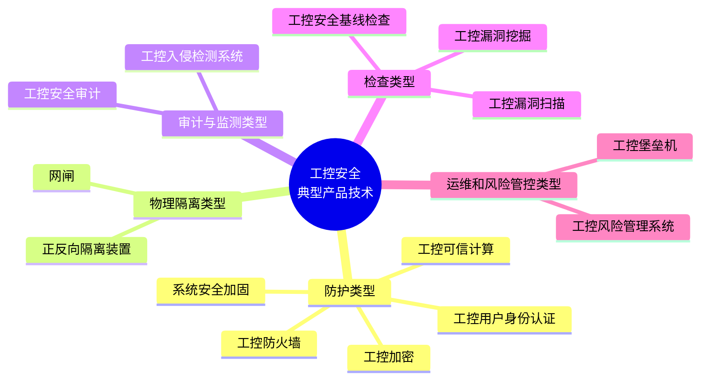

#### 工控系统安全综合应用案例分析【了解】 `03`

| 项目 | 要点 |
| --- | --- |
| 电力监控系统 | 安全策略是"**安全分区、网络专用、横向隔离、纵向认证**" |
| 水厂 | 水厂工控安全**集中监控** |
| 厂商方案 | 工控安全防护厂商方案 |

> [!IMPORTANT]
> 电力监控系统安全策略十六字方针：**"安全分区、网络专用、横向隔离、纵向认证"**（案例高频填空）。

#### 课堂练习 `04`

##### 第 1 题

> 2010 年，首次发现针对工控系统实施破坏的恶意代码 **Stuxnet**（简称"震网"病毒），"震网"病毒攻击的是伊朗核电站西门子公司的（ ）系统。
>
> A. Microsoft WinXP　B. Microsoft Win7　C. Google Android　D. SIMATIC WinCC

> [!TIP]
> 解析：**D. SIMATIC WinCC**（西门子工控 SCADA 组态软件）。Stuxnet＝2010 年首个针对工控系统（伊朗核设施）的破坏性恶意代码。

##### 第 2 题

> 工控系统广泛应用于电力、石化、医药、航天等领域，已经成为国家关键基础设施的重要组成部分。作为信息基础设施的基础，电力工控系统安全面临的主要威胁**不包括**（ ）。
>
> A. 内部人为风险　B. 黑客攻击　C. 设备损耗　D. 病毒破坏

> [!TIP]
> 解析：**C. 设备损耗**（属于物理自然损耗，不是安全威胁）。

---

### 二、第 25 章 移动应用安全需求分析与安全保护工程

> 章节封面：信息安全工程师 第 25 章 移动应用安全需求分析与安全保护工程（讲师：至强老师）

#### 本章目录与命题规律

| 序号 | 小节 | 重要度标注 |
| --- | --- | --- |
| 1 | 移动应用安全威胁与需求分析 | 【了解】 |
| 2 | Android 系统安全与保护机制 | 【**常考，熟悉**】 |
| 3 | iOS 系统安全与保护机制 | 【了解】 |
| 4 | 移动应用安全保护机制与技术方案 | 【**有时考**，了解】 |
| 5 | 移动应用安全综合应用案例分析 | 【了解】 |

> [!IMPORTANT]
> **命题规律：选择题 1-2 分，案例题常考。**

#### 移动应用安全威胁与需求分析【了解】 `01`

##### 📌 移动应用系统组成

| 项目 | 要点 |
| --- | --- |
| 组成 | 包括**三个部分**：① 移动应用（简称 **App**）；② 通信网络（**无线网络、移动通信网络及互联网**）；③ 应用服务端（由相关的**服务器**构成，负责处理来自 App 的相关信息或数据） |

##### 📌 移动应用安全分析

移动应用的安全威胁主要有以下类型：

| 编号 | 威胁类型 | 说明 |
| --- | --- | --- |
| 1 | 移动操作系统平台安全威胁 | **iOS、Android 漏洞** |
| 2 | 无线网络攻击 | **内容监听、假冒基站、网络钓鱼**等 |
| 3 | 恶意代码 | **资源消耗、恶意扣费、隐私窃取、恶意传播**等 |
| 4 | 移动应用代码逆向工程 | **反编译**获取算法思路或窃取敏感数据 |
| 5 | 移动应用程序非法篡改 | 恶意攻击、窃取信息 |

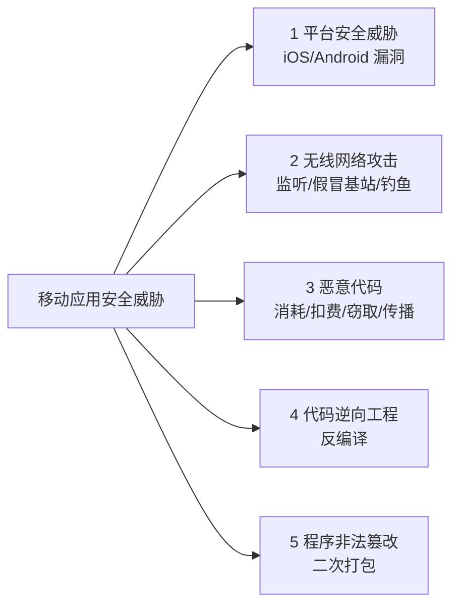

#### Android 系统安全与保护机制【常考，熟悉】 `02`

##### 📌 Android 系统组成概要

Android 是一个**开源的**移动终端操作系统，其系统结构组成分成四层：

| 层级 | 名称 | 英文 |
| --- | --- | --- |
| 底层 | Linux 内核层 | Linux Kernel |
| 第二层 | 系统运行库层 | Libraries 和 Android Runtime |
| 第三层 | 应用程序框架层 | Application Framework |
| 顶层 | 应用程序层 | Applications |

> [!TIP]
> 记忆顺序（自下而上）：**内核 → 运行库 → 框架 → 应用**。显示驱动等驱动位于 **Linux 内核层**。

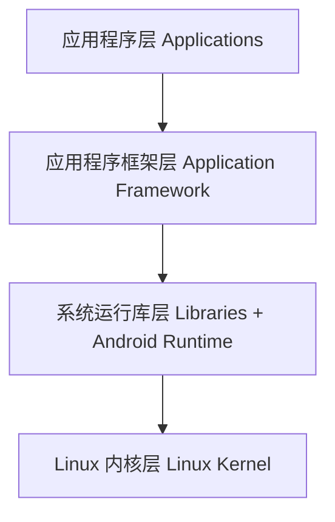

##### 📌 Android 系统安全机制（5 大机制）

Android 系统在**内核层、系统运行库层、应用程序框架层以及应用程序层**等各个层面采取了相应的安全措施。

###### 🎚️ 机制 1：权限声明机制

| 项目 | 要点 |
| --- | --- |
| 基本思想 | 为**操作权限和对象**之间设定了一些限制，只有把**权限和对象进行绑定**，才可以有权操作对象 |
| 认证制度 | 权限声明机制还制定了**不同级别不同认证方式**的制度 |
| 默认原则 | 默认情况下 Android 应用程序**不会被授予权限**，其权限分配根据 Android 应用 **APK 安装包中的 Manifest 文件（或 `AndroidManifest.xml`）** 确定 |

**应用程序层的权限分为 4 类：**

| 权限级别 | 含义与特点 |
| --- | --- |
| **normal 权限** | 不会给用户带来实质性的伤害 |
| **dangerous 权限** | 可能会给用户带来**潜在威胁**，如**读取用户位置信息、读取电话簿**等；对于此类安全威胁，目前大多数手机会在**用户安装应用时提醒用户** |
| **signature 权限** | 表示具有**同一签名**的应用才能访问 |
| **signatureOrSystem 权限** | 主要由**设备商**使用 |

> [!IMPORTANT]
> 权限声明文件 = **`AndroidManifest.xml`**（案例常考填空：Android 权限声明写在哪个文件）。

###### 🎚️ 机制 2：应用程序签名机制

| 项目 | 要点 |
| --- | --- |
| 定义 | Android 将应用程序打包成 **APK 文件**，应用程序签名机制规定对 **APK 文件进行数字签名**，用来标识相应应用程序的**开发者和应用程序之间存在信任关系** |

###### 🎚️ 机制 3：沙箱机制

| 项目 | 要点 |
| --- | --- |
| 定义 | 沙箱隔离机制使**应用程序和其相应运行的 Dalvik 虚拟机**都运行在**独立的 Linux 进程空间**，不与其他应用程序交叉，实现**完全隔离** |

> [!TIP]
> 关键词：**Dalvik 虚拟机 + 独立 Linux 进程空间 = 完全隔离**。

###### 🎚️ 机制 4：网络通信加密

| 项目 | 要点 |
| --- | --- |
| 定义 | Android 支持使用 **SSL/TSL 协议**对网络数据进行传输加密，以防止敏感数据泄露 |

> [!WARNING]
> 原文写作 "SSL/**TSL**"，标准写法应为 **SSL/TLS**（见文末「⚠️ 疑点」第 1 条）。

###### 🎚️ 机制 5：内核安全机制

| 项目 | 要点 |
| --- | --- |
| 定义 | Android 系统的内核层采用**分区**和 **Linux ACL 权限控制机制** |
| ACL 含义 | Linux ACL 权限控制机制是指**每个文件的访问控制权限都由其拥有者、所属的组、读写执行三个方面共同控制** |

##### ✅ Android 五大安全机制速记表

| 编号 | 机制 | 核心关键词 |
| --- | --- | --- |
| 1 | 权限声明机制 | `AndroidManifest.xml`；normal / dangerous / signature / signatureOrSystem |
| 2 | 应用程序签名机制 | APK 数字签名；开发者与应用信任关系 |
| 3 | 沙箱机制 | Dalvik 虚拟机；独立 Linux 进程；完全隔离 |
| 4 | 网络通信加密 | SSL/TLS 传输加密 |
| 5 | 内核安全机制 | 分区 + Linux ACL（拥有者 / 组 / 读写执行） |

#### iOS 系统安全与保护机制【了解】 `03`

##### 📌 iOS 系统组成概要

iOS 平台为**封闭的生态系统**，iOS 的系统架构分为**四个层次**：**核心操作系统层、核心服务层、媒体层和可触摸层**。

| 层次 | 说明与典型框架 |
| --- | --- |
| **可触摸层** | 提供了各种常用的框架并且**大部分框架与界面有关**，负责用户在 iOS 设备上的**触摸交互操作** |
| **媒体层** | 提供应用中**视听方面**的技术：图形图像相关的 `Core Graphics`、`Core Image`、`GLKit`、`OpenGLES`、`Core Text`；声音相关的 `Core Audio`、`OpenAL`、`AV Foundation`；视频相关的 `Core Media`、`Media Player` 框架；音视频传输的 **`AirPlay`** 框架等 |
| **核心服务层** | 提供给应用所需要的**基础的系统服务**，如**账户、数据存储、网络连接、地理位置、运动框架**等 |
| **核心操作系统层** | 提供**本地认证、安全、外部访问、系统**等服务 |

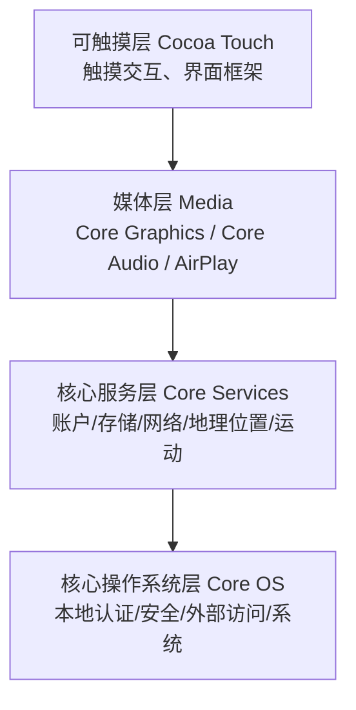

##### 📌 iOS 系统安全机制

iOS 平台的安全架构可以分为**硬件、固件、软件**：

| 层次 | 组成 |
| --- | --- |
| 硬件、固件层 | 由**设备密钥、设备组密钥、苹果根认证、加密引擎、内核**组成 |
| **Secure Enclave** | 是苹果**高版本 A 系列处理器**中的**协处理器**，**独立于应用处理器之外**，提供**所有加密操作** |
| 软件层 | 由**文件系统、操作系统分区、用户分区、应用沙盒及数据保护类**构成 |

**苹果主要安全机制如下（6 项）：**

| 编号 | 安全机制 |
| --- | --- |
| 1 | 安全启动链 |
| 2 | 数据保护 |
| 3 | 数据的加密与保护机制 |
| 4 | 地址空间布局随机化 |
| 5 | 代码签名 |
| 6 | 沙箱机制 |

> [!IMPORTANT]
> **Secure Enclave** = A 系列处理器中的**独立协处理器**，负责**所有加密操作**（iOS 安全架构高频考点）。

#### 移动应用安全保护机制与技术方案【有时考，了解】 `04`

##### 📌 移动应用 App 安全风险

| 项目 | 要点 |
| --- | --- |
| 定义 | 移动应用 App 是指运行在智能设备终端的**客户端程序** |
| 风险来源 | 由于移动应用 App **安装在用户的智能设备上**（通常为智能手机），很容易遭受到**反编译、调试、篡改、数据窃取**等安全威胁 |

##### 📌 移动应用 App 安全加固（"四防"）

为保护移动应用 App 的安全性，通常采用**防反编译、防调试、防篡改、防窃取**等多种安全保护措施。

| 编号 | 措施 | 具体做法 |
| --- | --- | --- |
| 1 | **防反编译** | 对移动应用程序文件进行**加密处理**，防止攻击者通过**静态的反编译工具**获取到应用的源代码；除加密外还可进行**代码混淆**，常见的混淆方法有**名字混淆、控制混淆、计算混淆**等 |
| 2 | **防调试** | 应用程序设置**调试检测功能**，以触发反调试安全保护措施，如**清理用户数据、报告程序所在设备的情况、禁止使用某些功能甚至直接退出运行** |
| 3 | **防篡改** | 通过**数字签名和多重校验**的防护手段，验证移动应用程序的**完整性**，防范移动应用程序 APK 被**二次打包**以及**盗版** |
| 4 | **防窃取** | 对移动应用相关的**本地数据文件、网络通信**等进行**加密**，防止数据被窃取 |

> [!TIP]
> 混淆三法：**名字混淆 / 控制混淆 / 计算混淆**。
> 防篡改核心：**数字签名 + 多重校验 → 完整性 → 防二次打包/盗版**。

##### 📌 移动应用 App 安全检测

Android 移动应用安全测试工具有许多，常见的包括：

| 工具 | 用途 |
| --- | --- |
| `Inject` | 进程注入工具 |
| `HijackActivity` | 劫持检测工具 |
| `Jeb` | 静态逆向分析工具 |
| `apktool` | APK 反编译和打包工具 |
| `Tcpdump` / `Wireshark` | 数据抓包工具 |
| `Xposed` | Android Hook 框架 |
| `Burpsuite` | 基于代理实现的抓包和分析工具 |
| `Androguard` | 静态分析工具 |
| `FlowDroid` | 安卓 APK 文件数据流分析工具 |
| `Android Killer` | 安卓应用逆向工具 |

##### 📌 服务类型的最小必要权限参考范围

| 序号 | 服务类型 | 最小必要权限 |
| --- | --- | --- |
| (1) | 地图导航 | 位置权限、存储权限 |
| (2) | 网络约车 | 位置权限、拨打电话权限 |
| (3) | 即时通信 | 存储权限 |
| (4) | 博客论坛 | 存储权限 |
| (5) | 网络支付 | 存储权限 |
| (6) | 新闻资讯 | 无 |
| (7) | 网上购物 | 无 |
| (8) | 短视频 | 存储权限 |
| (9) | 快递配送 | 无 |
| (10) | 餐饮外卖 | 位置权限、拨打电话权限 |
| (11) | 交通票务 | 无 |
| (12) | 婚恋相亲 | 存储权限 |
| (13) | 求职招聘 | 存储权限 |
| (14) | 金融借贷 | 存储权限 |
| (15) | 房屋租售 | 存储权限 |
| (16) | 二手车交易 | 存储权限 |
| (17) | 运动健身 | 位置权限、传感器权限 |
| (18) | 问诊挂号 | 存储权限 |
| (19) | 网页浏览器 | 无 |
| (20) | 输入法 | 无 |
| (21) | 安全管理 | 存储权限、获取应用账户、读取电话状态权限、短信权限 |

> [!IMPORTANT]
> 记"**无权限**"的 6 类：新闻资讯、网上购物、快递配送、交通票务、网页浏览器、输入法。
> 记"**位置 + 拨打电话**"的 2 类：网络约车、餐饮外卖。
> 记"**位置 + 传感器**"的 1 类：运动健身。
> 记权限最多的：**安全管理**（存储 + 获取应用账户 + 读取电话状态 + 短信）。

#### 移动应用安全综合应用案例分析【了解】 `05`

| 项目 | 要点 |
| --- | --- |
| 案例方向 | 金融移动安全；运营商移动安全；移动办公安全 |

#### 课堂练习 `06`

##### 第 1 题

> Android 是一个开源的移动终端操作系统，共分成 Linux 内核层、系统运行库层、应用程序框架层和应用程序层四个部分。**显示驱动**位于（ ）。
>
> A. Linux 内核层　B. 系统运行库层　C. 应用程序框架层　D. 应用程序层

> [!TIP]
> 解析：**A**（驱动属于 Linux 内核层）。

##### 第 2 题

> 为保护移动应用 App 的安全性，通常采用防反编译、防调试、防篡改和防窃取等多种安全保护措施，在移动应用 App 程序**插入无关代码**属于（ ）技术。
>
> A. 防反编译　B. 防调试　C. 防篡改　D. 防窃取

> [!TIP]
> 解析：**A. 防反编译**（插入无关代码＝代码混淆/花指令，属于防反编译手段）。

##### 第 3 题

> 移动终端设备常见的数据存储方式包括：① `SharedPreferences`；② 文件存储；③ `SQLite` 数据库；④ `ContentProvider`；⑤ 网络存储。Android 系统支持的数据存储方式包括（ ）。
>
> A. ①②③④⑤　B. ①③⑤　C. ①②④⑤　D. ②③⑤

> [!TIP]
> 解析：**A**（Android 支持全部 5 种：SharedPreferences、文件存储、SQLite、ContentProvider、网络存储）。

##### 第 4 题

> 移动用户有些属性信息需要受到保护，这些信息一旦泄露，会对公众用户的生命财产安全造成威胁。以下各项中，**不需要**被保护的属性是（ ）。
>
> A. 终端设备信息　B. 用户通话信息　C. 用户位置信息　D. 公众运营商信息

> [!TIP]
> 解析：**D. 公众运营商信息**（运营商信息本身不涉及用户隐私）。

---

### 三、第 26 章 大数据安全需求分析与安全保护工程

> 章节封面：信息安全工程师 第 26 章 大数据安全需求分析与安全保护工程

#### 本章目录与命题规律

| 序号 | 小节 | 重要度标注 |
| --- | --- | --- |
| 1 | 大数据安全威胁与需求分析 | 【了解】 |
| 2 | 大数据安全保护机制与技术方案 | 【了解】 |
| 3 | 大数据安全综合应用案例分析 | 【了解】 |

> [!WARNING]
> **命题规律：选择题还没有出过，案例也没有**（本章投入产出比低，以概念为主）。

#### 大数据安全威胁与需求分析【了解】 `01`

##### 📌 大数据相关概念发展

| 项目 | 要点 |
| --- | --- |
| 定义 | 大数据是指**非传统的数据处理工具**的数据集 |
| 4V 特征 | 具有**海量的数据规模**（Volume）、**快速的数据流转**（Velocity）、**多样的数据类型**（Variety）和**价值密度低**（Value）等特征 |
| 种类与来源 | 大数据的种类和来源非常多，包括**结构化、半结构化和非结构化**数据 |

##### 📌 大数据安全威胁分析（7 类）

| 编号 | 威胁 |
| --- | --- |
| 1 | "数据集"安全边界日渐模糊，安全保护难度提升 |
| 2 | 敏感数据泄露安全风险增大 |
| 3 | 数据失真与大数据污染安全风险 |
| 4 | 大数据处理平台业务连续性与拒绝服务 |
| 5 | 个人数据广泛分布于多个数据平台，隐私保护难度加大 |
| 6 | 数据交易安全风险 |
| 7 | 大数据滥用 |

##### 📌 大数据安全需求分析（7 方面）

| 编号 | 需求 |
| --- | --- |
| 1 | 大数据自身安全（**数据生命周期的真实、机密、完整**等） |
| 2 | 大数据安全合规 |
| 3 | 大数据跨境安全 |
| 4 | 大数据隐私保护 |
| 5 | 大数据处理平台安全 |
| 6 | 大数据业务安全（**业务安全管理措施**） |
| 7 | 大数据安全运营（**分类分级、安全服务、安全维护**） |

> [!TIP]
> 需求 7 字诀：**自身、合规、跨境、隐私、平台、业务、运营**。

##### 📌 大数据安全法规政策（12 部）

| 编号 | 法规/政策名称 |
| --- | --- |
| 1 | 《气象资料共享管理办法》 |
| 2 | 《中国人民银行关于银行业金融机构做好个人金融信息保护工作的通知》 |
| 3 | 《全国人民代表大会常务委员会关于加强网络信息保护的决定》 |
| 4 | 《电信和互联网用户个人信息保护规定》 |
| 5 | 《中华人民共和国消费者权益保护法（2013 修正）》 |
| 6 | 《地图管理条例》 |
| 7 | 《中华人民共和国网络安全法》 |
| 8 | 《网络预约出租汽车经营服务管理暂行办法》 |
| 9 | 《网络出版服务管理规定》 |
| 10 | 《人口健康信息管理办法（试行）》 |
| 11 | 《保险公司开业验收指引》 |
| 12 | 《保险机构信息化监管规定（征求意见稿）》 |

#### 大数据安全保护机制与技术方案【了解】 `02`

##### 📌 总体定位

| 项目 | 要点 |
| --- | --- |
| 保护对象 | 大数据被列为**网络安全等级保护 2.0 的重要保护对象**；大数据安全防护对象主要包括**大数据自身及其平台、业务、隐私、运营**等方面的安全保护技术 |

##### 📌 大数据安全保护机制（9 项）

| 编号 | 机制 |
| --- | --- |
| 1 | 数据分类分级 |
| 2 | 数据源认证 |
| 3 | 数据溯源 |
| 4 | 数据用户标识和鉴别 |
| 5 | 数据资源访问控制 |
| 6 | 数据隐私保护 |
| 7 | 数据备份与恢复 |
| 8 | 数据安全审计与监测 |
| 9 | 数据安全管理 |

##### 📌 分领域安全保护技术

| 领域 | 保护技术 |
| --- | --- |
| **大数据自身** | **数字签名**可以验证数据来源的**真实性**；**Hash 算法**用于确保数据的**完整性**；**加密算法**则用来保护数据的**机密性** |
| **大数据平台** | 通常采用**安全分区、防火墙、系统安全加固、数据防泄露**等安全技术用于保护大数据平台 |
| **大数据业务** | **业务授权**主要基于**角色的访问控制技术**；**业务逻辑安全**针对业务流程进行安全控制；**业务合规性**是指业务满足政策法规及安全标准规范要求 |
| **大数据隐私** | 数据身份匿名、数据差分隐私、数据脱敏、数据加密、数据访问控制等 |
| **大数据运营** | **网络入侵检测、网络安全态势感知、网络攻击取证、网络威胁情报分析、安全堡垒机**等技术常用于大数据平台**运维**安全保护；**数据脱敏、数据监控、数据安全网关**等常用于数据**经营**安全保护 |

> [!IMPORTANT]
> 三剑客对应关系必背：**数字签名 → 真实性；Hash → 完整性；加密 → 机密性**。

##### 📌 大数据安全标准规范

| 项目 | 要点 |
| --- | --- |
| 工作组 | 全国信息安全标准化技术委员会在 **2016 年**成立**大数据安全标准特别工作组** |
| 已制定国标 | 《信息安全技术 个人信息安全规范》、《信息安全技术 大数据服务安全能力要求》、《信息安全技术 大数据安全管理指南》、《信息安全技术 数据交易服务安全要求》、《信息安全技术 个人信息去标识化指南》 |

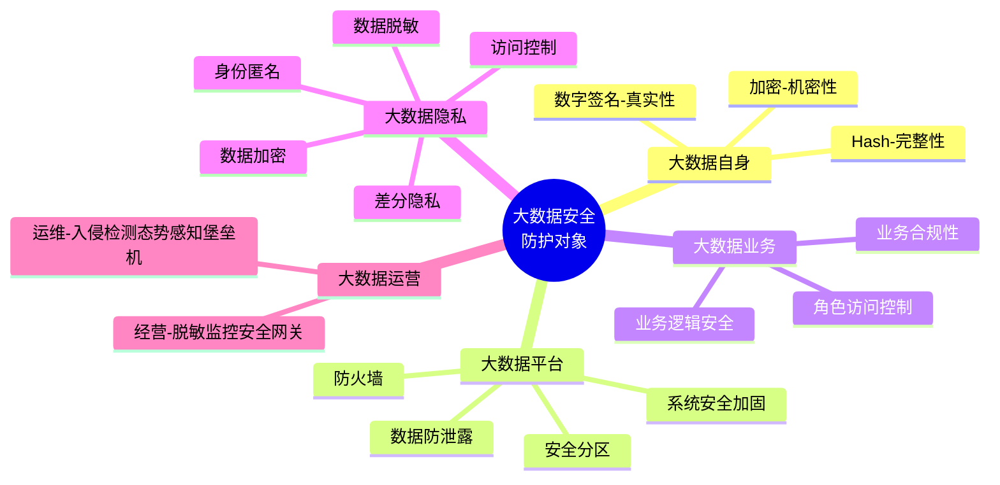

#### 大数据安全综合应用案例分析【了解】 `03`

| 编号 | 案例 |
| --- | --- |
| 1 | 阿里巴巴大数据安全实践 |
| 2 | 京东大数据安全实践 |
| 3 | 上海数据交易中心安全保护 |
| 4 | 华为大数据安全实践 |
| 5 | 科学数据安全管理 |
| 6 | 支付卡行业数据安全规范 |

---

### 四、网络安全法律法规

> 章节封面：信息安全工程师 网络安全法律法规

#### 本章目录与命题规律

| 序号 | 法规 |
| --- | --- |
| 1 | 中华人民共和国网络安全法 |
| 2 | 中华人民共和国密码法 |
| 3 | 中华人民共和国数据安全法 |
| 4 | 中华人民共和国个人信息保护法 |
| 5 | 关键信息基础设施保护条例 |

> [!IMPORTANT]
> **命题规律：上午选择题 3-5 分，案例也有可能考几分。**

#### 网络安全法 `01`

##### 📌 立法基本信息

| 项目 | 要点 |
| --- | --- |
| 主席令 | 中华人民共和国主席令**第五十三号** |
| 通过时间 | 《中华人民共和国网络安全法》已由中华人民共和国**第十二届**全国人民代表大会常务委员会**第二十四次**会议于 **2016 年 11 月 7 日**通过 |
| 施行时间 | 自 **2017 年 6 月 1 日**起施行 |
| 签署 | 中华人民共和国主席 习近平；2016 年 11 月 7 日 |
| 条文规模 | 《网络安全法》共 **7 章 79 条**法规，具体操作性的条款 **38 条**，主要分布在**第三、四、五章** |

##### 🎚️ 章节结构表

| 章节 | 数量 | 概要说明 |
| --- | --- | --- |
| 第一章 总 则 | **14 条** | 简述法律目的、范围、总则、部门职责、总体要求等 |
| 第二章 网络安全支持与促进 | **6 条** | 定义国家直属部门和政府在推动网络安全工作上的职责 |
| 第三章 网络运行安全 | **19 条** | 定义网络运营者与关键信息基础设施的运行安全规定 |
| 　第一节 一般规定 | **10 条** | 针对网络运营者的网络运行安全要求与职责规定 |
| 　第二节 关键信息基础设施的运行安全 | **9 条** | 针对关键信息基础设施的安全规定与保护措施要求 |
| 第四章 网络信息安全 | **11 条** | 定义个人信息保护的保护规定 |
| 第五章 监测预警与应急处置 | **8 条** | 定义国家网络安全检测与汇报机制 |
| 第六章 法律责任 | **17 条** | 定义处罚规定 |
| 第七章 附 则 | **4 条** | 相关名词释义与其他附则 |

> [!TIP]
> 条文数速记：**14 / 6 / 19（10+9）/ 11 / 8 / 17 / 4**，合计 **79 条**。

##### 📌 第一章 总则

| 条 | 要点 | 关键词 |
| --- | --- | --- |
| 第一条 | 为了**保障网络安全，维护网络空间主权和国家安全、社会公共利益**，保护公民、法人和其他组织的合法权益，促进经济社会信息化健康发展，制定本法 | 【**目的**】 |
| 第二条 | 在中华人民共和国境内**建设、运营、维护和使用网络**，以及网络安全的**监督管理**，适用本法 | 【**范围**】 |
| 第八条 | **国家网信部门**负责**统筹协调**网络安全工作和相关监督管理工作。国务院电信主管部门、公安部门和其他有关机关依照本法和有关法律、行政法规的规定，在各自职责范围内负责网络安全保护和监督管理工作。**县级以上**地方人民政府有关部门的网络安全保护和监督管理职责，按照国家有关规定确定 | 【**部门职责**】 |

> [!IMPORTANT]
> 统筹协调部门 = **国家网信部门**；其他按职责分工：电信主管部门、公安部门等。

##### 📌 第二章 网络安全支持与促进【推进职责】

| 条 | 要点 |
| --- | --- |
| 第十五条 | 国家建立和完善**网络安全标准体系**。国务院标准化行政主管部门和国务院其他有关部门根据各自的职责，组织制定并适时修订有关网络安全管理以及网络产品、服务和运行安全的**国家标准、行业标准**。国家支持**企业、研究机构、高等学校、网络相关行业组织**参与网络安全国家标准、行业标准的制定 |
| 第十七条 | 国家推进**网络安全社会化服务体系建设**，鼓励有关企业、机构开展**网络安全认证、检测和风险评估**等安全服务 |
| 第十九条 | 各级人民政府及其有关部门应当组织开展**经常性的网络安全宣传教育**，并指导、督促有关单位做好网络安全宣传教育工作。**大众传播媒介**应当有针对性地面向社会进行网络安全宣传教育 |
| 第二十条 | 国家支持**企业和高等学校、职业学校**等教育培训机构开展网络安全相关教育与培训，采取多种方式培养网络安全人才，促进网络安全人才交流 |

##### 📌 第三章 网络运行安全 · 第一节 一般规定【普通运营者职责】

| 条 | 要点 |
| --- | --- |
| **第二十一条** | 国家实行**网络安全等级保护制度**。网络运营者应当按照网络安全等级保护制度的要求，履行下列安全保护义务：<br/>（一）制定**内部安全管理制度和操作规程**，确定**网络安全负责人**，落实网络安全保护责任；<br/>（二）采取防范**计算机病毒和网络攻击、网络侵入**等危害网络安全行为的**技术措施**；<br/>（三）采取**监测、记录网络运行状态、网络安全事件**的技术措施，并按照规定留存相关的**网络日志不少于六个月**；<br/>（四）采取**数据分类、重要数据备份和加密**等措施；<br/>（五）法律、行政法规规定的其他义务 |
| 第二十二条 | 网络产品、服务应当符合相关**国家标准的强制性要求** |
| 第二十三条 | **网络关键设备和网络安全专用产品**应当按照相关国家标准的强制性要求，由**具备资格的机构安全认证合格或者安全检测符合要求**后，方可**销售或者提供** |
| 第二十四条 | 网络运营者为用户办理**网络接入、域名注册服务**，办理固定电话、移动电话等**入网手续**，或者为用户提供**信息发布、即时通讯**等服务，在与用户签订协议或者确认提供服务时，应当要求用户提供**真实身份信息** |
| 第二十五条 | 网络运营者应当制定**网络安全事件应急预案**，及时处置**系统漏洞、计算机病毒、网络攻击、网络侵入**等安全风险 |

> [!IMPORTANT]
> **网络日志留存不少于六个月** —— 数字型必背考点。
> 等保五项义务：制度规程 / 技术措施 / 监测记录+日志 6 个月 / 分类备份加密 / 其他。

##### 📌 第三章 · 第二节 关键信息基础设施的运行安全【关基职责】

| 条 | 要点 |
| --- | --- |
| **第三十一条** | 国家对**公共通信和信息服务、能源、交通、水利、金融、公共服务、电子政务**等重要行业和领域，以及其他一旦遭到破坏、丧失功能或者数据泄露，可能严重危害**国家安全、国计民生、公共利益**的关键信息基础设施，在**网络安全等级保护制度的基础上，实行重点保护** |
| **第三十八条** | 关键信息基础设施的运营者应当**自行或者委托网络安全服务机构**对其网络的安全性和可能存在的风险**每年至少进行一次检测评估**，并将检测评估情况和改进措施报送相关负责关键信息基础设施安全保护工作的部门 |
| **第三十九条** | 国家网信部门应当统筹协调有关部门对关键信息基础设施的安全保护采取下列措施：<br/>（一）对关键信息基础设施的**安全风险进行抽查检测**，提出改进措施，必要时可以委托网络安全服务机构对网络存在的安全风险进行检测评估；<br/>（二）**定期组织**关键信息基础设施的运营者进行**网络安全应急演练**，提高应对网络安全事件的水平和协同配合能力；<br/>（三）促进有关部门、关键信息基础设施的运营者以及有关研究机构、网络安全服务机构等之间的**网络安全信息共享**；<br/>（四）对网络安全事件的**应急处置与网络功能的恢复**等，提供技术支持和协助 |

> [!IMPORTANT]
> 关基检测评估频次：**每年至少一次**。

##### 📌 第四章 网络信息安全【个人信息保护】

| 条 | 要点 |
| --- | --- |
| 第四十条 | 网络运营者应当对其收集的用户信息**严格保密**，并建立健全**用户信息保护制度** |
| 第四十二条 | 网络运营者**不得泄露、篡改、毁损**其收集的个人信息；**未经被收集者同意，不得向他人提供**个人信息 |
| 第四十四条 | 任何个人和组织**不得窃取或者以其他非法方式获取个人信息**，不得非法出售或者非法向他人提供个人信息 |
| 第四十五条 | 依法负有网络安全监督管理职责的部门及其工作人员，必须对在履行职责中知悉的**个人信息、隐私和商业秘密严格保密**，不得泄露、出售或者非法向他人提供 |
| 第四十七条 | 网络运营者应当加强对其用户发布的信息的管理，发现法律、行政法规禁止发布或者传输的信息的，应当**立即停止传输**该信息，采取**消除等处置措施**，防止信息扩散，**保存有关记录**，并向有关主管部门**报告** |
| 第五十条 | 国家网信部门和有关部门依法履行网络信息安全监督管理职责，发现法律、行政法规禁止发布或者传输的信息的，应当要求网络运营者**停止传输**，采取**消除等处置措施**，**保存有关记录**；对来源于**中华人民共和国境外**的上述信息，应当通知有关机构采取**技术措施和其他必要措施阻断传播** |

> [!TIP]
> 处置四步：**停止传输 → 消除处置 → 保存记录 → 报告主管部门**。

##### 📌 第五章 监测预警与应急处置【监测汇报机制】

| 条 | 要点 |
| --- | --- |
| 第五十一条 | 国家建立**网络安全监测预警和信息通报制度**。国家网信部门应当统筹协调有关部门加强网络安全信息**收集、分析和通报**工作，按照规定**统一发布**网络安全监测预警信息 |
| 第五十二条 | 负责关键信息基础设施安全保护工作的部门，应当建立健全**本行业、本领域**的网络安全监测预警和信息通报制度，并按照规定**报送**网络安全监测预警信息 |
| 第五十三条 | 国家网信部门协调有关部门建立健全**网络安全风险评估和应急工作机制**，制定**网络安全事件应急预案**，并**定期组织演练** |
| 第五十八条 | 因维护国家安全和社会公共秩序，处置**重大突发社会安全事件**的需要，**经国务院决定或者批准**，可以在**特定区域对网络通信采取限制等临时措施** |

> [!IMPORTANT]
> 统一发布监测预警信息的主体 = **国家网信部门**。

##### 📌 第六章 法律责任【处罚规定】

| 条 | 违法行为 | 处罚 |
| --- | --- | --- |
| **第五十九条** | 网络运营者不履行本法**第二十一条（等保）**、**第二十五条（应急预案）** 规定的网络安全保护义务 | 责令改正，给予警告；拒不改正或者导致危害网络安全等后果的，处 **1 万元以上 10 万元以下**罚款，对直接负责的主管人员处 **5000 元以上 5 万元以下**罚款 |
| **第五十九条**（关基） | 关键信息基础设施的运营者不履行本法**第三十三条、第三十四条、第三十六条、第三十八条**规定的网络安全保护义务 | 责令改正，给予警告；拒不改正或者导致危害网络安全等后果的，处 **10 万元以上 100 万元以下**罚款，对直接负责的主管人员处 **1 万元以上 10 万元以下**罚款 |
| **第六十一条** | 网络运营者违反本法**第二十四条第一款**规定（**真实身份信息**） | 处 **5 万元以上 50 万元以下**罚款，并可以由有关主管部门责令**暂停相关业务、停业整顿、关闭网站、吊销相关业务许可证或者吊销营业执照**，对直接负责的主管人员和其他直接责任人员处 **1 万元以上 10 万元以下**罚款 |
| **第六十三条** | 违反本法**第二十七条**规定，从事危害网络安全的活动，尚不构成犯罪的 | 由**公安机关没收违法所得**，处 **5 日以下拘留**，可以并处 **5 万元以上 50 万元以下**罚款；情节较重的，处 **5 日以上 15 日以下拘留**，可以并处 **10 万元以上 100 万元以下**罚款 |
| **第六十三条**（从业限制） | 违反第二十七条受到**治安管理处罚**的人员 | **5 年内**不得从事网络安全管理和网络运营关键岗位的工作 |
| **第六十三条**（从业限制） | 违反第二十七条受到**刑事处罚**的人员 | **终身**不得从事网络安全管理和网络运营关键岗位的工作 |

> [!TIP]
> 罚款梯度记忆：
> - 一般运营者不履行等保/应急预案：**1 万 – 10 万**（主管 5000 – 5 万）
> - 关基运营者不履行义务：**10 万 – 100 万**（主管 1 万 – 10 万）
> - 违反真实身份信息：**5 万 – 50 万**（主管 1 万 – 10 万）
> - 危害网络安全活动：**5 万 – 50 万**（情节较重 10 万 – 100 万）
> - 从业限制：**治安处罚 5 年；刑事处罚终身**

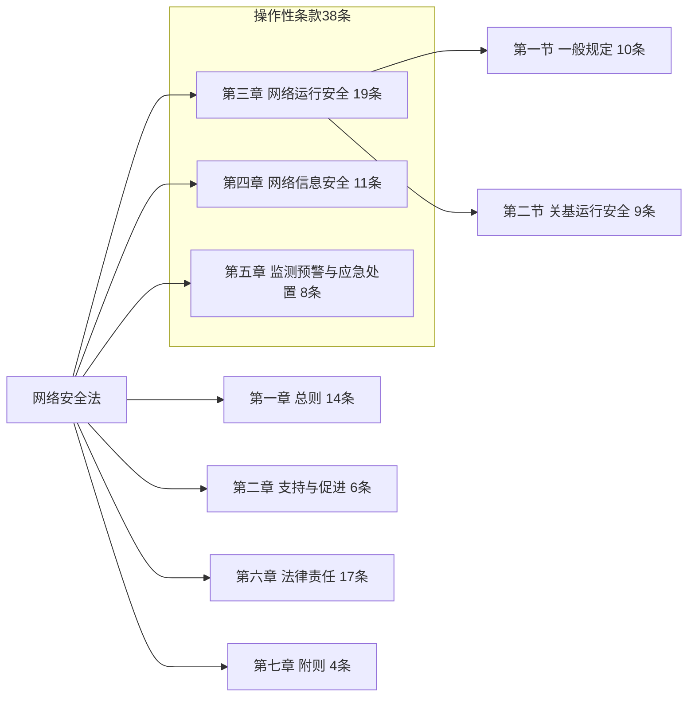

#### 密码法 `02`

##### 📌 立法背景和必要性（三个"重要举措"）

| 角度 | 内容 |
| --- | --- |
| **从法治建设上讲** | 这是**构建国家安全法律制度体系**的重要举措。长期以来，我国密码领域只有一部行政法规——**《商用密码管理条例》**，无论是**立法位阶还是法律效力**，都不能完全适应新时代密码事业发展的需要。制定《密码法》，就是要把党对密码工作的最新要求通过法定程序转化为**国家意志**，把密码工作的各个重要环节和关键要素纳入**法治轨道**。《密码法》是我国密码领域**第一部综合性、基础性法律**，它将与《国家安全法》《网络安全法》《反恐怖主义法》《反间谍法》等一起，共同构成**国家安全法律制度体系**，以法的名义护卫国家安全 |
| **从国家战略上讲** | 这是**维护国家网络空间主权安全**的重要举措。在保障网络安全的各种手段和技术中，**密码是目前世界上公认的最有效、最可靠、最经济的关键核心技术**。制定和实施密码法，就是要规范密码管理，引导全社会**合规、正确、有效**地使用密码，让密码在网络空间更加主动、更加充分地发挥保障作用，构建起**以密码技术为核心、多种技术交叉融合的网络空间新安全体制** |
| **从密码自身发展上讲** | 这是**推动密码事业高质量发展**的重要举措。密码的作用已经不再是单一的**信息加密**了，还可以用于**身份识别、安全隔离、完整性保护**等。密码的应用领域也极大拓展，不再是原来的仅仅服务于党政军领导机关和机密要害部门，而是已经"**飞入寻常百姓家**"。制定和实施密码法，就是要积极推进密码领域职能转变，建立健全密码法治的**实施、监督和保障体系**，使密码更好地为党和国家工作大局服务，更好地为广大人民群众的生产生活服务 |

> [!IMPORTANT]
> 密码定位三连：**最有效、最可靠、最经济**的关键核心技术。
> 密码作用扩展：信息加密 → **身份识别 + 安全隔离 + 完整性保护**。
> 《密码法》性质：**我国密码领域第一部综合性、基础性法律**。

##### 📌 立法基本信息

| 项目 | 要点 |
| --- | --- |
| 通过 | 《中华人民共和国密码法》由中华人民共和国**第十三届**全国人民代表大会常务委员会**第十四次**会议于 **2019 年 10 月 26 日**通过 |
| 施行 | 自 **2020 年 1 月 1 日**起施行 |

##### 📌 第一章 总则

| 条 | 要点 |
| --- | --- |
| **第二条** | 本法所称**密码**，是指采用**特定变换的方法**对信息等进行**加密保护、安全认证**的技术、产品和服务 |
| 第五条 | **国家密码管理部门**负责管理全国的密码工作。**县级以上地方各级密码管理部门**负责管理本行政区域的密码工作。国家机关和涉及密码工作的单位在其职责范围内负责本机关、本单位或者本系统的密码工作 |
| **第六条** | 国家对密码实行**分类管理**。密码分为**核心密码、普通密码和商用密码** |
| **第七条** | **核心密码、普通密码**用于保护**国家秘密信息**，核心密码保护信息的**最高密级为绝密级**，普通密码保护信息的**最高密级为机密级**。核心密码、普通密码**属于国家秘密**。密码管理部门依照本法和有关法律、行政法规、国家有关规定对核心密码、普通密码实行**严格统一管理** |
| 第八条 | **商用密码**用于保护**不属于国家秘密**的信息。公民、法人和其他组织可以**依法使用商用密码**保护网络与信息安全 |
| 第十二条 | 任何组织或者个人**不得窃取他人加密保护的信息**或者**非法侵入他人的密码保障系统**。任何组织或者个人不得利用密码从事危害国家安全、社会公共利益、他人合法权益等违法犯罪活动 |

> [!IMPORTANT]
> 密码三类三对应（必背）：
> - **核心密码 → 国家秘密信息，最高密级绝密级**
> - **普通密码 → 国家秘密信息，最高密级机密级**
> - **商用密码 → 不属于国家秘密的信息**
> - 核心密码、普通密码**本身属于国家秘密**。

##### 📌 第二章 核心密码、普通密码

| 条 | 要点 |
| --- | --- |
| 第十四条 | 在**有线、无线通信中传递的国家秘密信息**，以及**存储、处理国家秘密信息的信息系统**，应当依照法律、行政法规和国家有关规定使用**核心密码、普通密码**进行**加密保护、安全认证** |
| 第十六条 | 密码管理部门依法对密码工作机构的核心密码、普通密码工作进行**指导、监督和检查**，密码工作机构应当**配合** |

##### 📌 第三章 商用密码

| 条 | 要点 |
| --- | --- |
| **第二十一条** | 国家**鼓励**商用密码技术的研究开发、学术交流、成果转化和推广应用，健全**统一、开放、竞争、有序**的商用密码市场体系，鼓励和促进商用密码产业发展。各级人民政府及其有关部门应当遵循**非歧视原则**，依法平等对待包括**外商投资企业**在内的商用密码**科研、生产、销售、服务、进出口**等单位（统称**商用密码从业单位**）。国家鼓励在外商投资过程中基于**自愿原则和商业规则**开展商用密码技术合作。**行政机关及其工作人员不得利用行政手段强制转让商用密码技术**。商用密码的科研、生产、销售、服务和进出口，不得损害国家安全、社会公共利益或者他人合法权益 |
| 第二十三条 | 国家推动参与**商用密码国际标准化活动**，参与制定商用密码国际标准，推进商用密码**中国标准与国外标准之间的转化运用**。国家鼓励企业、社会团体和教育、科研机构等参与商用密码国际标准化活动 |

> [!TIP]
> 商用密码市场体系八字：**统一、开放、竞争、有序**。原则：**非歧视 + 自愿 + 商业规则**，**禁止强制转让技术**。

##### 📌 第四章 法律责任

| 条 | 违法行为 | 处罚 |
| --- | --- | --- |
| 第三十二条 | 破坏密码法的 | 按《中华人民共和国**网络安全法**》追究法律责任 |
| 第三十三条 | 未按要求使用的 | 给予**警告**；情节严重的依法给予**处分或者处理** |
| **第三十五条** | **没有依法检测认证**的 | 给予警告，**没收违法所得**；违法所得 **30 万元以上**的，可以并处违法所得 **1 倍以上 3 倍以下**罚款；没有违法所得或者违法所得**不足 30 万元**的，可以并处 **10 万元以上 30 万元以下**罚款；情节严重的，依法**吊销相关资质** |
| **第三十六条** | **销售不合格的商密产品** | 给予警告，**没收违法产品和违法所得**；违法所得 **10 万元以上**的，可以并处违法所得 **1 倍以上 3 倍以下**罚款；没有违法所得或者违法所得**不足 10 万元**的，可以并处 **3 万元以上 10 万元以下**罚款 |
| **第三十七条** | **关基运营者未按照要求使用商用密码** | 给予警告；拒不改正或者导致危害网络安全等后果的，处 **10 万元以上 100 万元以下**罚款，对直接负责的主管人员处 **1 万元以上 10 万元以下**罚款 |

> [!TIP]
> 密码法罚款分界：
> - 未依法检测认证：分界 **30 万元**（≥30 万按 1–3 倍；<30 万罚 10–30 万）
> - 销售不合格商密产品：分界 **10 万元**（≥10 万按 1–3 倍；<10 万罚 3–10 万）
> - 关基未按要求用商密：**10 万 – 100 万**（主管 1 万 – 10 万）

#### 数据安全法 `03`

##### 📌 整体框架（7 章）

| 章节 | 条目与要点 |
| --- | --- |
| **第一章 总则** | 1-2 目标、范围；3 定义：数据、数据安全；4 定位；5-6 明确主体、职责；7 明确数据要素；8 依法有序利用；9-11 宣传普及，行业参考，交流合作；12 投诉渠道；13 国家统筹安全与发展 |
| **第二章 数据安全与发展** | 14 国家实施大数据战略；15 国家支持开发利用数据，提升公共服务智能化服务水平；16 加强数据技术开发、数据安全研究；17 国家推进数据开发利用技术和数据安全标准体系建设；18 促进数据安全监测评估、认证服务；19 建立数据交易管理制度，培育数据交易市场；20 数据开发利用技术和数据安全相关教育和培训，人才培养等 |
| **第三章 数据安全制度** | 21 数据分级分类保护制度（重要数据目录、国家核心数据、分类分级保护）；22 数据安全风险评估，监测预警管理（风险评估，监测预警，风险报告，信息共享）获取→分析→研判→预警；23 数据安全应急处置机制；24 数据安全审查制度（国家安全审查）；25 数据依法实施出口管制；26 针对歧视性禁止、限制的对等措施 |
| **第四章 数据安全保护义务** | 27 健全全流程数据安全制度，开展培训，采取措施，履行义务，明确职责，落实责任；28 数据处理活动、开发数据新技术的目的；29 风险监测、缺陷与漏洞；安全事件处置、报告；30 风险评估包括（重要数据 种类、数量、活动情况、风险、措施）；31 关基运营者 重要数据出境安全管理；32 合法，正当收集数据；33 数据交易中介机构，提供溯源和记录；34 数据处理服务的许可；35 公安相关机关授权调取数据；36 司法用途的数据跨境管理 |
| **第五章 政务数据安全与开放** | 37 国家大力推行电子政务建设；38 国家机关：需依法使用数据，并予以保密；39 国家机关：健全数据安全管理制度、落实责任，保护政务数据安全；40 国家机关：应监督受托方数据安全保护义务，不得留存、使用、泄露政务数据；41 国家机关应该遵循政务数据公开原则；42 国家制定政务数据开放目录，构建政务数据开放平台（统一规范、互联互通、安全可控）；43 其他组织履行职能和责任 |
| **第六章 法律责任** | 49-52 履行义务，违法定责 |
| **第七章 附则** | 53-55 国家秘密及军密数据的参照；本法执行时间 |

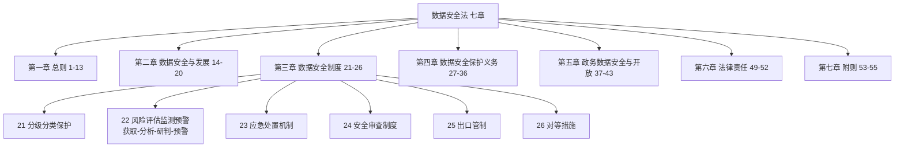

##### 📌 重点概述

| 编号 | 重点 |
| --- | --- |
| 1 | 上升到**国家总体安全观**层面，与**国家安全**挂钩 |
| 2 | 国家**数据安全大战略** |
| 3 | **统筹发展与安全**，数据安全和促进数据开发利用并重，**利用数据保发展，同时数据滥用被刹车** |
| 4 | 明确各级职责（**国家、公安/网信、行业、运营者**等） |
| 5 | 建立**数据安全管理制度、数据安全保护体系、数据安全治理、数据安全应急处置机制** |
| 6 | **政务数据安全与开放**，健全数据安全管理制度，**政务数据开放目录**，**政务开放平台** |
| 7 | **加大对违法行为的处罚力度** |

##### 📌 立法基本信息

| 项目 | 要点 |
| --- | --- |
| 通过 | 《中华人民共和国数据安全法》已由中华人民共和国**第十三届**全国人民代表大会常务委员会**第二十九次**会议于 **2021 年 6 月 10 日**通过 |
| 施行 | 自 **2021 年 9 月 1 日**起施行 |

##### 📌 第一章 总则 —— 数据开发利用 促进 / 数据安全 保障

| 方向 | 7 条举措 |
| --- | --- |
| **国家实施** | 国家实施**大数据战略**，推进**数据基础设施建设**；**数字经济发展**纳入本级国民经济和社会发展规划 |
| **技术支持** | 国家支持**数据开发利用和数据安全技术研究**；国家推进**数据开发利用技术和数据安全标准体系建设** |
| **服务与市场** | 国家促进**数据安全检测评估、认证等服务**；国家建立健全**数据交易管理制度** |
| **人才培养** | 国家支持和开展相关**教育和培训，专业人才培养与交流** |

（对应条目：14 国家实施大数据战略；15 国家支持开发利用数据，提升公共服务智能化服务水平；16 加强数据技术开发、数据安全研究；17 国家推进数据开发利用技术和数据安全标准体系建设；18 促进数据安全监测评估、认证服务；19 建立数据交易管理制度，培育数据交易市场；20 数据开发利用技术和数据安全相关教育和培训，人才培养等；12 投诉渠道；13 国家统筹安全与发展）

##### 📌 第二章 数据安全与发展

| 条 | 要点 |
| --- | --- |
| 13 | 国家**统筹安全与发展** |
| 14 | 国家实施**大数据战略** |
| 15 | 国家支持开发利用数据，**提升公共服务智能化服务水平** |
| 16 | 加强**数据技术开发、数据安全研究** |
| 17 | 国家推进**数据开发利用技术和数据安全标准体系**建设 |
| 18 | 促进**数据安全监测评估、认证服务** |
| 19 | 建立**数据交易管理制度，培育数据交易市场** |
| 20 | 数据开发利用技术和数据安全相关**教育和培训，人才培养**等 |

##### 📌 第三章 数据安全制度（6 项制度）

| 条 | 要点 |
| --- | --- |
| **21** | 国家建立**数据分类分级保护制度**，制定**重要数据目录**，加强重要数据保护（含**国家核心数据**） |
| **22** | 国家建立**集中统一、高效权威**的数据安全**风险评估、报告、信息共享、监测预警**机制；流程：**获取 → 分析 → 研判 → 预警** |
| **23** | 国家建立**数据安全应急处置机制**（应急预案、预警通报） |
| **24** | 国家建立**数据安全审查制度**，对影响或者可能影响**国家安全的数据处理活动**进行**国家安全审查** |
| **25** | 国家对属于**管制物项**的数据依法实施**出口管制** |
| **26** | 国家针对**对华歧视性的禁止、限制**等**对等保护**措施 |

> [!IMPORTANT]
> 22 条流程四步：**获取 → 分析 → 研判 → 预警**；机制八字：**集中统一、高效权威**。

##### 📌 第四章 数据安全保护义务

**依法开展数据处理活动，履行数据安全保护义务：**

| 编号 | 义务 |
| --- | --- |
| 1 | **全流程、持续安全防护**（第 27 条：健全全流程数据安全制度，开展培训，采取措施，履行义务，明确职责，落实责任） |
| 2 | **数据安全风险监测与处置**（第 29 条：风险监测、缺陷与漏洞；安全事件处置、报告） |
| 3 | **重要数据定期风险评估**（第 30 条：种类、数量、活动情况、风险、措施） |
| 4 | **关基运营者重要数据出境安全管理**（第 31 条） |

**依法进行数据处理与服务：**

| 编号 | 义务 |
| --- | --- |
| 1 | **数据合法、正当收集**（第 32 条） |
| 2 | **数据交易行为规范**（第 33 条：数据交易中介机构，提供溯源和记录） |
| 3 | **数据处理服务许可**（第 34 条） |
| 4 | **数据调取严格审批**（第 35 条：公安相关机关授权调取数据） |
| 5 | **司法用途的数据跨境管理**（第 36 条） |
| 6 | **数据处理活动、开发数据新技术的目的**（第 28 条） |

##### 📌 第六章 法律责任

| 条 | 违法情形 | 处罚 |
| --- | --- | --- |
| **第四十四条** | 有关主管部门在履行数据安全监管职责中，发现数据处理活动存在**较大安全风险**的 | 可以按照规定的权限和程序对有关组织、个人进行**约谈**，并要求有关组织、个人采取措施进行**整改，消除隐患** |
| **第四十五条** | 开展数据处理活动的组织、个人不履行本法**第二十七条、第二十九条、第三十条**规定的数据安全保护义务 | 责令改正，给予警告，可以并处 **5 万元以上 50 万元以下**罚款，对直接负责的主管人员和其他直接责任人员可以处 **1 万元以上 10 万元以下**罚款；**拒不改正或者造成大量数据泄露等严重后果**的，处 **50 万元以上 200 万元以下**罚款，并可以责令**暂停相关业务、停业整顿、吊销相关业务许可证或者吊销营业执照**，对直接负责的主管人员和其他直接责任人员处 **5 万元以上 20 万元以下**罚款 |
| **（第四十五条第二款）** | 违反**国家核心数据管理制度**，危害国家主权、安全和发展利益的 | 由有关主管部门处 **200 万元以上 1000 万元以下**罚款，并根据情况责令暂停相关业务、停业整顿、吊销相关业务许可证或者吊销营业执照；**构成犯罪的，依法追究刑事责任** |
| **第四十六条** | 违反本法**第三十一条**规定，**向境外提供重要数据**的 | 责令改正，给予警告，可以并处 **10 万元以上 100 万元以下**罚款，对直接负责的主管人员和其他直接责任人员可以处 **1 万元以上 10 万元以下**罚款；**情节严重**的，处 **100 万元以上 1000 万元以下**罚款，并可以责令暂停相关业务、停业整顿、吊销相关业务许可证或者吊销营业执照，对直接负责的主管人员和其他直接责任人员处 **10 万元以上 100 万元以下**罚款 |

> [!IMPORTANT]
> 数据安全法罚款梯度：
> - 一般违法：**5 万 – 50 万**（主管 1 万 – 10 万）
> - 拒不改正/大量泄露：**50 万 – 200 万**（主管 5 万 – 20 万）
> - 违反国家核心数据管理制度：**200 万 – 1000 万**
> - 违规向境外提供重要数据：**10 万 – 100 万**（情节严重 **100 万 – 1000 万**）

#### 个人信息保护法 `04`

##### 📌 立法基本信息

| 项目 | 要点 |
| --- | --- |
| 通过 | 《中华人民共和国个人信息保护法》已由中华人民共和国**第十三届**全国人民代表大会常务委员会**第三十次**会议于 **2021 年 8 月 20 日**通过 |
| 施行 | 自 **2021 年 11 月 1 日**起施行 |

##### 📌 整体框架（8 章）

| 章节 | 主要条目 |
| --- | --- |
| **第一章 总则** | 1-3 目标、宗旨、范围 |
| **第二章 个人信息处理规则** | 4 关键定义<br/>**第一节 一般规定**：5 合法正当必要诚信原则；6 明确、合理原则；7 公开、透明原则；8 准确、完整原则；9 责任落实；10 强制要求；11-12 环境、合作；13 处理前提；14 取得同意；15 撤回同意；16 不得拒绝服务；17 告知要求；18 例外情形；19 最短时间；20 共同处理；21 委托处理；22 信息转移；23 第三方共享；24 自动化决策；25 不得公开；26 公共采集；27 重新同意<br/>**第二节 敏感个人信息处理规则**：28 关键定义；29 单独同意；30 必要性告知；31 未成年保护；32 行政许可<br/>**第三节 国家机关处理个人信息的特别规定**：33 适用范围；34 范围限度；35 告知同意；36 境内存储；37 公共事务 |
| **第三章 个人信息跨境提供的规则** | 38 向境外提供个人信息的前提条件（具备下列条件之一：**安全评估、个人信息保护认证、订立合同、其他条件**）；39 向境外提供个人信息（需要按照本条列举的要求向个人**如实披露**相关信息，并获其"**单独同意**"）；40 关键信息基础设施个人信息跨境要求（需向境外提供的，应当通过**国家网信部门组织的安全评估**；法律、行政法规和国家网信部门规定可以不进行安全评估的，从其规定）；41 外国司法或者执法机构关于提供存储于境内个人信息的请求（**非经中华人民共和国主管机关批准**，个人信息处理者**不得**向外国司法或者执法机构提供存储于中华人民共和国境内的个人信息）；42-43 限制清单、反制措施（明确构建"**个人信息提供黑名单制度**"以及在个人信息保护领域的报复和反制措施） |
| **第四章 个人在个人信息处理活动中的权利** | 44 知情权、决定权；45 查阅、复制权；46 更正、补充权；47 个人信息处理者主动删除个人信息的情形规定；48 要求解释说明权；49 自然人死亡后的近亲代行使权；50 便捷的个人行使权利的申请受理和处理机制 |
| **第五章 个人信息处理者的义务** | 51 个人信息处理者基本义务；52 个人信息保护**责任到人**；53 境外机构义务；54 合规审计；55 影响评估；56 评估内容（处理目的、处理方式、处理影响等）；57 个人信息安全事件补救措施以及补救通知；58 大型互联网平台义务；59 受托人义务 |
| **第六章 履行个人信息保护的职责部门** | 60 职责部门；61 保护职责；62 工作说明；63 履职措施；64 约谈审计；65 投诉举报 |
| **第七章 法律责任** | 66-71 行政责任、信用档案，国家机关处罚、民事责任、依法诉讼、刑事责任 |
| **第八章 附则** | 72-74 特色情况、专业术语、施行时间 |

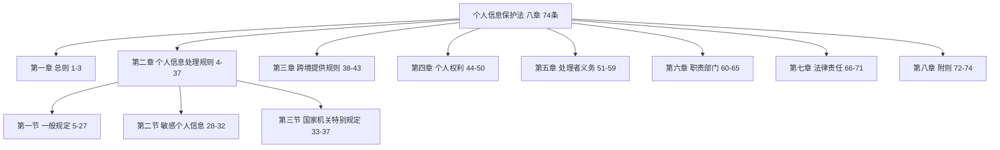

##### 📌 第一章 总则

| 条 | 要点 |
| --- | --- |
| **第四条** | **个人信息**是以电子或者其他方式记录的与**已识别或者可识别的自然人**有关的各种信息，**不包括匿名化处理后的信息**。个人信息的**处理**包括个人信息的**收集、存储、使用、加工、传输、提供、公开、删除**等 |
| **第六条** | 处理个人信息应当具有**明确、合理的目的**，并应当与处理目的**直接相关**，采取对**个人权益影响最小**的方式。收集个人信息，应当限于实现处理目的的**最小范围**，**不得过度收集**个人信息 |
| 第十条 | 任何组织、个人**不得非法收集、使用、加工、传输**他人个人信息，不得**非法买卖、提供或者公开**他人个人信息；不得从事危害国家安全、公共利益的个人信息处理活动 |

> [!IMPORTANT]
> 个人信息定义关键点：**可识别自然人 + 不包括匿名化信息**。
> 处理八环节：**收集、存储、使用、加工、传输、提供、公开、删除**。
> 两大原则：**目的明确合理 + 最小范围（最小必要）**。

##### 📌 第六章 履行个人信息保护职责的部门

| 条 | 要点 |
| --- | --- |
| 第六十条 | **国家网信部门**负责**统筹协调**个人信息保护工作和相关监督管理工作。国务院有关部门依照本法和有关法律、行政法规的规定，在各自职责范围内负责个人信息保护和监督管理工作 |

##### 📌 第七章 法律责任

| 条 | 违法情形 | 处罚 |
| --- | --- | --- |
| **第六十六条**（一般） | 违反本法规定处理个人信息，或者处理个人信息未履行本法规定的个人信息保护义务的 | **责令改正，给予警告，没收违法所得**；拒不改正的，并处 **100 万元以下**罚款；对直接负责的主管人员和其他直接责任人员处 **1 万元以上 10 万元以下**罚款 |
| **第六十六条**（情节严重） | 有前款规定的违法行为，**情节严重**的 | 由**省级以上**履行个人信息保护职责的部门责令改正，没收违法所得，并处 **5000 万元以下或者上一年度营业额 5% 以下**罚款，并可以责令**暂停相关业务或者停业整顿**、通报有关主管部门**吊销相关业务许可或者吊销营业执照**；对直接负责的主管人员和其他直接责任人员处 **10 万元以上 100 万元以下**罚款，并可以决定**禁止其在一定期限内担任相关企业的董事、监事、高级管理人员和个人信息保护负责人** |

> [!IMPORTANT]
> 个保法顶格罚款：**5000 万元以下 或 上一年度营业额的 5% 以下**（取高者），由**省级以上**部门作出。
> 从业禁止：可禁止一定期限内担任**董事、监事、高级管理人员和个人信息保护负责人**。

#### 关键信息基础设施保护条例 `05`

##### 📌 条例框架

| 章节 | 内容说明 |
| --- | --- |
| **第一章 总则** | 主要明确条例范围，定义和归口部门 |
| **第二章 关键信息基础设施认定** | 主要说明关键信息基础设施认定相关工作 |
| **第三章 运营者责任义务** | 主要说明关键信息基础设施的运营方应该如何支撑安全保护 |
| **第四章 保障和促进** | 主要说明政府相关部门应如何保障和促进条例的开展工作 |
| **第五章 法律责任** | 主要明确各相关单位在条例实施中的法律责任及相关处罚 |
| **第六章 附则** | 主要说明该法的不适应情况和执行时间 |

> [!IMPORTANT]
> 《关键信息基础设施安全保护条例》：**六章五十一条**。

##### 📌 关键信息基础设施（CII）定义

| 来源 | 定义 |
| --- | --- |
| **《中华人民共和国网络安全法》** | **公共通信和信息服务、能源、交通、水利、金融、公共服务、电子政务**等重要行业和领域，以及其他一旦遭到破坏、丧失功能或者数据泄露，可能严重危害**国家安全、国计民生、公共利益**的**设施** |
| **《关键信息基础设施安全保护条例》** | 关键信息基础设施（**Critical Information Infrastructure，简称 CII**）是指**公共通信和信息服务、能源、交通、水利、金融、公共服务、电子政务、国防科技工业**等重要行业和领域的，以及其他一旦遭到破坏、丧失功能或者数据泄露，可能严重危害国家安全、国计民生、公共利益的**重要网络设施、信息系统**等 |

> [!IMPORTANT]
> **《关键信息基础设施保护条例》新增了"国防科技工业"作为重要行业和领域**（网安法原文无此项）。

**国防科技工业：**

| 项目 | 要点 |
| --- | --- |
| 主管机构 | 国防科技工业的**主管机构是国防科技工业局** |
| 六大行业 | 国防科技工业包括**核、航天、航空、兵器、船舶、电子**六大行业 |
| 11 大军工集团 | 六大行业包括：中国核工业集团、中国核工业建设集团、中国航天科技集团、中国航天科工集团、中国航空工业集团、中国兵器工业集团、中国兵器装备集团、中国船舶工业集团、中国船舶重工集团、中国电子科技集团、中国电子信息产业集团等 **11 大军工集团** |

> [!TIP]
> 六大行业口诀：**"核、航天、航空、兵器、船舶、电子"**；11 大军工集团。

##### 📌 第一章 总则

| 条 | 要点 |
| --- | --- |
| 第三条 | 在**国家网信部门统筹协调**下，**国务院公安部门**负责**指导监督**关键信息基础设施安全保护工作 |
| 第六条 | 运营者依照本条例和有关法律、行政法规的规定以及**国家标准的强制性要求**，在**网络安全等级保护的基础上**，采取技术保护措施和其他必要措施，应对网络安全事件，防范网络攻击和违法犯罪活动，保障关键信息基础设施安全稳定运行，维护数据的**完整性、保密性和可用性** |

> [!IMPORTANT]
> 关基保护分工：**国家网信部门统筹协调；国务院公安部门指导监督**。

##### 📌 第二章 关键信息基础设施认定

| 条 | 要点 |
| --- | --- |
| 第八条 | 本条例第二条涉及的**重要行业和领域的主管部门、监督管理部门**是负责关键信息基础设施安全保护工作的部门（以下简称**保护工作部门**） |
| 第九条 | 保护工作部门结合本行业、本领域实际，制定**关键信息基础设施认定规则**，并报**国务院公安部门备案** |
| 第十条 | 保护工作部门根据认定规则负责**组织认定**本行业、本领域的关基，**及时将认定结果通知运营者**，并**通报国务院公安部门** |
| 第十一条 | 关键信息基础设施发生**较大变化**，可能影响其认定结果的，运营者应当**及时将相关情况报告保护工作部门**。保护工作部门自收到报告之日起 **3 个月内**完成**重新认定**，将认定结果通知运营者，并通报国务院公安部门 |

> [!IMPORTANT]
> 重新认定时限：**3 个月**。

##### 📌 第三章 运营者责任义务

| 条 | 要点 |
| --- | --- |
| **第十二条** | 安全保护措施应当与关键信息基础设施**同步规划、同步建设、同步使用**（"三同步"） |
| 第十三条 | 运营者应当建立健全**网络安全保护制度和责任制**，保障**人力、财力、物力**投入。运营者的**主要负责人**对关键信息基础设施安全保护**负总责**，领导关基安全保护和**重大网络安全事件处置**工作，组织研究解决重大网络安全问题 |
| 第十四条 | 运营者应当设置**专门安全管理机构**，并对专门安全管理机构**负责人和关键岗位人员**进行**安全背景审查**。审查时，**公安机关、国家安全机关**应当予以协助 |

> [!IMPORTANT]
> 必背：**三同步（同步规划、同步建设、同步使用）**；**主要负责人负总责**；**专门安全管理机构 + 安全背景审查**。

##### 📌 第四章 保障和促进

| 条 | 要点 |
| --- | --- |
| 第二十三条 | 国家网信部门统筹协调有关部门建立**网络安全信息共享机制**，及时**汇总、研判、共享、发布**网络安全**威胁、漏洞、事件**等信息，促进有关部门、保护工作部门、运营者以及网络安全服务机构等之间的网络安全信息共享 |
| 第二十四条 | 保护工作部门应当建立健全本行业、本领域的关基**网络安全监测预警制度**，及时掌握本行业、本领域关基**运行状况、安全态势**，**预警通报**网络安全威胁和隐患，指导做好安全防范工作 |
| 第二十五条 | 保护工作部门应当按照**国家网络安全事件应急预案**的要求，建立健全本行业、本领域的**网络安全事件应急预案**，**定期组织应急演练**；指导运营者做好网络安全事件应对处置，并根据需要组织提供技术支持与协助 |
| **第三十一条** | **未经国家网信部门、国务院公安部门批准或者保护工作部门、运营者授权**，任何个人和组织**不得**对关键信息基础设施实施**漏洞探测、渗透性测试**等可能影响或者危害关基安全的活动。对**基础电信网络**实施漏洞探测、渗透性测试等活动，应当**事先向国务院电信主管部门报告** |

> [!IMPORTANT]
> 第 31 条（高频）：**禁止未经批准对关基进行漏洞探测、渗透性测试**；基础电信网络需**事先向国务院电信主管部门报告**。

##### 📌 第五章 法律责任

| 条 | 要点 |
| --- | --- |
| **第三十九条** | 运营者有下列情形之一的，由有关主管部门依据职责**责令改正，给予警告**；拒不改正或者导致危害网络安全等后果的，处 **10 万元以上 100 万元以下**罚款，对直接负责的主管人员处 **1 万元以上 10 万元以下**罚款 |

**第三十九条列举的九种情形：**

| 编号 | 情形 |
| --- | --- |
| （一） | 在关键信息基础设施发生较大变化，可能影响其认定结果时**未及时将相关情况报告保护工作部门**的 |
| （二） | 安全保护措施**未与关键信息基础设施同步规划、同步建设、同步使用**的 |
| （三） | **未建立健全网络安全保护制度和责任制**的 |
| （四） | **未设置专门安全管理机构**的 |
| （五） | **未对专门安全管理机构负责人和关键岗位人员进行安全背景审查**的 |
| （六） | 开展与网络安全和信息化有关的决策**没有专门安全管理机构人员参与**的 |
| （七） | 专门安全管理机构**未履行本条例第十五条规定的职责**的 |
| （八） | **未对关键信息基础设施每年至少进行一次网络安全检测和风险评估**，未对发现的安全问题及时整改，或者未按照保护工作部门要求报送情况的 |
| （九） | 采购网络产品和服务，**未按照国家有关规定与网络产品和服务提供者签订安全保密协议**的 |

**从业限制：**

| 情形 | 限制 |
| --- | --- |
| 违反本条例第五条第二款和第三十一条规定，受到**治安管理处罚**的人员 | **5 年内**不得从事网络安全管理和网络运营关键岗位的工作 |
| 违反本条例第五条第二款和第三十一条规定，受到**刑事处罚**的人员 | **终身**不得从事网络安全管理和网络运营关键岗位的工作 |

> [!IMPORTANT]
> 关基检测评估频次：**每年至少一次**（网安法第 38 条与关基条例第 39 条一致）。
> 处罚：**10 万 – 100 万**（主管 1 万 – 10 万）。从业限制：**5 年 / 终身**。

##### 📌 五部法律法规时间线速记

| 法律法规 | 通过时间 | 施行时间 |
| --- | --- | --- |
| 网络安全法 | 2016-11-07（十二届全国人大常委会第二十四次会议） | **2017-06-01** |
| 密码法 | 2019-10-26（十三届全国人大常委会第十四次会议） | **2020-01-01** |
| 数据安全法 | 2021-06-10（十三届全国人大常委会第二十九次会议） | **2021-09-01** |
| 个人信息保护法 | 2021-08-20（十三届全国人大常委会第三十次会议） | **2021-11-01** |
| 关键信息基础设施安全保护条例 | —— | ——（六章五十一条） |

> [!TIP]
> 记忆：**网安法 2017.6.1 → 密码法 2020.1.1 → 数安法 2021.9.1 → 个保法 2021.11.1**。

#### 课堂练习 `06`

##### 第 1 题

> 为防范国家数据安全风险，维护国家安全，保护公共利益，**2021 年 7 月**，中国网络安全审查办公室发布公告，对"**滴滴出行**""**运满满**""**货车帮**"和"**BOSS 直聘**"开展网络安全审查。此次审查依据的国家相关法律法规是（ ）。
>
> A. 《中华人民共和国网络安全法》和《中华人民共和国国家安全法》
> B. 《中华人民共和国网络安全法》和《中华人民共和国密码法》
> C. 《中华人民共和国数据安全法》和《中华人民共和国网络安全法》
> D. 《中华人民共和国数据安全法》和《中华人民共和国国家安全法》

> [!TIP]
> 解析：**C**（《数据安全法》+《网络安全法》）。相关背景见文末「⚠️ 疑点」第 13 条。

##### 第 2 题

> 2021 年 6 月 10 日，第十三届全国人民代表大会常务委员会第二十九次会议表决通过了《中华人民共和国数据安全法》，该法律自（ ）起施行。
>
> A. 2021 年 9 月 1 日　B. 2021 年 10 月 1 日　C. 2021 年 11 月 1 日　D. 2021 年 12 月 1 日

> [!TIP]
> 解析：**A. 2021 年 9 月 1 日**（注意区分：个保法是 2021-11-01）。

##### 第 3 题（案例问答题，6 分）

> **【问题 1】**（6 分）2022 年 7 月 21 日，国家互联网信息办公室公布的对**滴滴全球股份有限公司**依法做出网络安全审查相关行政处罚的决定，开出了 **80.26 亿**的罚单，请分析一下，滴滴全球股份有限公司违反了哪些网络安全法律法规？

**参考答案（原文）：**

> 根据网络安全审查结论及发现的问题和线索，国家互联网信息办公室依法对滴滴全球股份有限公司涉嫌违法行为进行立案调查。经查实，滴滴全球股份有限公司**违反《网络安全法》《数据安全法》《个人信息保护法》**的违法违规行为**事实清楚、证据确凿、情节严重、性质恶劣**。

> [!IMPORTANT]
> 三部法：**《网络安全法》+《数据安全法》+《个人信息保护法》**；罚单金额 **80.26 亿元**（2022-07-21，国家网信办）。

---

### 五、网络安全等级保护

> 章节封面：信息安全工程师 网络安全等级保护

#### 本章目录与命题规律

| 序号 | 小节 |
| --- | --- |
| 1 | 网络安全等级保护的背景 |
| 2 | 网络安全等级保护流程 |
| 3 | 网络安全等级保护基本要求 |
| 4 | 补充考试涉及内容 |

> [!IMPORTANT]
> **命题规律：上午选择 2 分，下午案例 2 分。**

#### 背景 `01`

##### 📌 等级保护的定义

| 项目 | 要点 |
| --- | --- |
| 定义 | 等保（等级保护）是指**对国家重要信息、法人和其他组织及公民的专有信息以及公开信息**和**存储、传输、处理这些信息的信息系统分等级实行安全保护**，对信息系统中使用的**信息安全产品实行按等级管理**，对信息系统中发生的**信息安全事件分等级响应、处置**。（**针对非涉密信息系统**） |

> [!IMPORTANT]
> 等保三层含义：**信息分等级保护 + 产品按等级管理 + 事件分等级响应处置**；适用范围：**非涉密信息系统**。

##### 🎚️ 系统等级 ↔ 监管级别 ↔ 保护能力等级（GB 17859）

| 系统等级 | 监管级别 | 保护能力等级（**GB 17859**） |
| --- | --- | --- |
| **第一级** | 自主保护 | **用户自主保护级** |
| **第二级** | 指导保护 | **系统审计保护级** |
| **第三级** | 监督保护 | **安全标记保护级** |
| **第四级** | 强制保护 | **结构化保护级** |
| **第五级** | 专控保护 | **访问验证保护级** |

> [!IMPORTANT]
> 三列一一对应必背（案例填空高频）：
> **一级 自主保护/用户自主保护级；二级 指导保护/系统审计保护级；三级 监督保护/安全标记保护级；四级 强制保护/结构化保护级；五级 专控保护/访问验证保护级**。

##### 📌 三个"基本"

| 项目 | 要点 |
| --- | --- |
| 基本国策 | 网络安全等级保护是**党中央国务院决定在信息系统安全领域实施的基本国策** |
| 基本制度 | 网络安全等级保护是**国家网络安全保障工作的基本制度** |
| 基本方法 | 网络安全等级保护是**国家网络安全保障工作的基本方法** |

> [!TIP]
> 一句话：**网络安全等级保护是基本制度、基本国策、基本方法**。

##### 📌 角色职责

| 角色 | 职责 |
| --- | --- |
| **国家管理部门** | **公安部、国家保密局、国家密码管理局、国务院信息化工作办公室** —— **监督、检查、指导** |
| **信息系统主管部门** | **组织、协调、督促** |
| **信息系统运营、使用单位** | 根据规范和标准**确定等级，报主管部门审批同意**，根据等级**设计建设**，**检查评估整改**，**制定预案**，**加强管理** |
| **信息安全服务机构** | 根据规范和标准**协助等保工作**，**确定等级、需求分析、规划设计、建设施工** |
| **信息安全等级测评机构** | 对**信息系统进行检查评估**，对**安全产品进行检查评估** |
| **信息安全产品供应商** | **开发符合等保要求的安全产品**，**销售信息安全产品** |

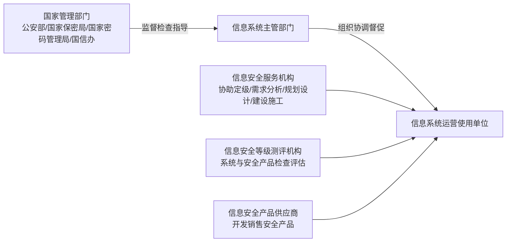

##### 📌 标准体系

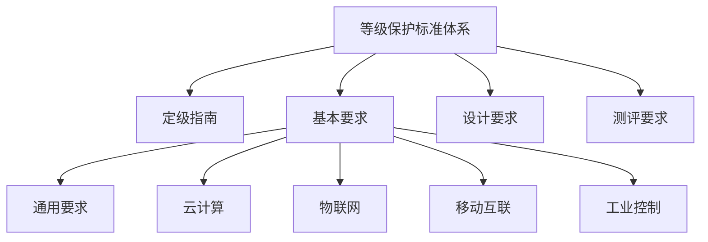

| 类别 | 标准 |
| --- | --- |
| 定级指南 | 等级保护定级指南 |
| 基本要求 | 通用要求 / 云计算 / 物联网 / 移动互联 / 工业控制（**安全扩展要求**） |
| 设计要求 | 等级保护设计要求 |
| 测评要求 | 等级保护测评要求 |

##### 📌 等级保护定级的对象

| 分类 | 对象 |
| --- | --- |
| **原有保护定级对象** | **网络基础设施**、**信息系统**、**大数据**（传统的：信息系统） |
| **新增保护定级对象** | **工业控制系统**、**云计算平台**、**物联网系统**、**采用移动互联技术的信息系统** |

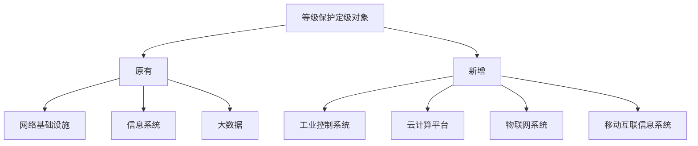

#### 等级保护流程 `02`

##### 📌 五个阶段

| 阶段 | 名称 | 说明 |
| --- | --- | --- |
| 第一阶段 | **定级** | 定级是开展等级保护工作的**第一步**。只有定级准确才能保证等保工作合理合法，安全投入有成效 |
| 第二阶段 | **备案** | 开展备案工作包括：**提交备案所需资料、受理、审核和备案信息管理**等工作 |
| 第三阶段 | **建设整改 / 安全建设** | 按照**等保基本要求**对目标系统**不满足项进行整改建设** |
| 第四阶段 | **等级测评** | 由**等保测评机构**对目标系统进行测评，**出具测评报告** |
| 第五阶段 | **监督检查** | 教材上叫"**运营维护**" |


> [!WARNING]
> 注意：课件 P502 第三阶段写作"**建设整改**"，P503 起写作"**安全建设**"，第五阶段"监督检查"旁注明"**教材上叫运营维护**"。见文末「⚠️ 疑点」第 8 条。

##### 📌 定级流程（5 步）

| 步骤 | 内容 |
| --- | --- |
| 1. 确定定级对象 | 包括**基础信息网络、工业控制系统、云计算平台、物联网、其他信息系统、大数据**等 |
| 2. 确定受侵害客体与侵害程度 | 包括确定**受侵害的客体**、**侵害对客体的侵害程度**以及**综合判定侵害程度** |
| 3. 专家评审 | 定级对象的运营、使用单位应组织**信息安全专家和业务专家**，对初步定级结果的**合理性进行评审**，**出具专家评审意见** |
| 4. 主管部门审核 | 定级对象的运营、使用单位应将初步定级结果**上报行业主管部门或上级主管部门进行审核** |
| 5. 公安机关备案审查 | 定级对象的运营、使用单位应按照相关管理规定，将初步定级结果**提交公安机关进行备案审查**；**审查不通过**，其运营使用单位应组织**重新定级**；**审查通过后最终确定**定级对象的安全保护等级 |

> [!WARNING]
> 课件 P504 "原标准 / 新标准"（对比图）在 PDF 抽取中**无文字内容**，此处按原文位置标明，不臆补。

##### 📌 定级建议（必背总结）

> [!IMPORTANT]
> **总结一句话**：信息系统涉及到**工作秘密、敏感信息**的，信息泄露出去或者被非法篡改、破坏后造成**比较大的影响**的系统，建议定到**三级**，其他系统定到**二级**。当然涉及到**国家安全的特别是全国性的系统**要定**四级**。

| 级别 | 定位与建设特点 |
| --- | --- |
| **四级 强制保护** | 比如**中央核心系统，重要行业核心业务系统**；建设内容很多，**每年都要检查**，容易形成长期销售机会，但是该级别信息系统**数量很少，技术门槛很高**，应**谨慎跟踪**（最好分期建设，先作容易的，后做难的） |
| **三级 监督保护** | 比如**省级信息系统，核心业务系统**等大都是此级别；此类项目**需要备案，测评，并且每年检查一次**；建设内容包括**产品集成、安全服务**，容易形成长期销售机会，应**重点跟踪**！**重点是集成** |
| **二级 指导保护** | 比如**市级信息系统，非核心业务系统**都是此级别；此类系统**需要备案，测评**；等保建设**以产品为主，有少量的安全服务**。**重点是产品** |
| **一级 自主建设** | 基本没多少内容，可能会有少量的产品 |

##### 🎚️ 常见二级 / 三级系统

| 级别 | 常见系统 |
| --- | --- |
| **常见二级系统** | 政府、企业**办公自动化系统**；**国企邮件系统**；**企业宣传网站** |
| **常见三级系统** | **省级办公自动化系统**；**企业 ERP 系统**；**医疗生产网**；**财政专网**；**市级以上政府网站** |

> [!TIP]
> 二级三件套：**办公 OA / 国企邮件 / 宣传网站**。
> 三级五件套：**省级 OA / ERP / 医疗生产网 / 财政专网 / 市级以上政府网站**。

##### 📌 备案

**备案层级与受理机构（地域维度）：**

| 层级 | 说明 |
| --- | --- |
| **省级** | 省级单位将资料交给**省公安网安总队** |
| **市级** | 各地级市的单位将定级资料交给各自**地级市的网安支队** |
| **县级** | 先将资料交到**区县网安大队**，再由区县网安大队转交**地级市网安支队**进行备案 |

**一、准备哪些资料？**

| 项目 | 要点 |
| --- | --- |
| 备案表 | 提交《**信息系统安全等级保护备案表**》**3 张**包括：**单位信息、信息系统信息、定级信息** |
| 第二级信息系统 | ① 《信息系统安全等级保护**定级报告**》纸质材料，**一式两份**；② 《信息系统安全等级保护**备案表**》纸质材料，**一式两份**；③ 上述备案的**电子档**，并制作出**光盘**提交 |
| 第三级以上信息系统 | 还应在**系统整改、测评完成后 30 日内**提交**表四《第三级以上信息系统提交材料情况》**及其有关材料 |

**第三级以上还需提交的 7 项材料：**

| 编号 | 材料 |
| --- | --- |
| （一） | 系统**拓扑结构及说明** |
| （二） | 系统**安全组织机构和管理制度** |
| （三） | 系统**安全保护设施设计实施方案或者改建实施方案** |
| （四） | 系统使用的**信息安全产品清单及其认证、销售许可证明** |
| （五） | 测评后符合系统安全保护等级的**技术检测评估报告** |
| （六） | 信息系统安全保护等级**专家评审意见** |
| （七） | **主管部门审核批准**信息系统安全保护等级的意见 |

> [!IMPORTANT]
> **第三级以上信息系统：整改、测评完成后 30 日内**提交表四及 7 项材料。

**二、到什么地方受理备案？**

> 首先到**公安机关指定的网址**下载并填写备案表，准备好备案文件，然后到**指定的地点**备案。

**三、备案受理过程是什么？**

| 步骤 | 内容 |
| --- | --- |
| ① | 公安机关收到备案材料后，会进行**严格审核** |
| ② | 材料齐全的，向备案单位出具《**信息系统安全等级保护备案材料接收回执**》 |
| ③ | 审核通过合格后，会反馈备案单位《**信息系统安全等级保护备案证明**》 |
| ④ | 不符合的，会通知备案单位进行**整改**，并出具《**信息系统安全等级保护备案审核结果通知**》 |

**备案受理机构表：**

| 序号 | 备案单位 | 受理机构 |
| --- | --- | --- |
| 1 | **地市级单位** | 由**地市级公安机关**受理 |
| 2 | **省级单位 / 跨地市联网信息系统** | 由**省级公安机关**受理 |
| 3 | **中央在京单位 / 跨省或全国联网信息系统** | 由**公安部（北京市公安局）** 受理 |
| * | **各部委统一定级信息系统在各地的分支系统**（如：终端连接、应用分支系统） | **所在地地市级以上公安机关**受理 |

##### 📌 建设整改、等级测评、监督检查

| 环节 | 要点 |
| --- | --- |
| **建设/整改** | 可**委托第三方服务机构、测评机构**分析整改需求。信息系统运营、使用单位可依据**整改方案**开展信息系统安全建设及整改 |
| **等级测评** | 选择**第三方测评机构**进行测评。对于**新建系统可以在试运行阶段进行评测**。信息系统运营、使用单位通过测评后，向**市级以上公安机关提交测评报告** |
| **监督检查** | **定期**选择第三方测评机构开展测评工作。**三级以上每年至少一次** |

> [!IMPORTANT]
> - 第三级以上信息系统**每年至少进行一次测评**（区别 **1.0 时的第四级每半年测评一次**）
> - **第五级信息系统**应当依据**特殊安全需求**进行等级测评
> - 等保 2.0 把 1.0 的"每年测评一次（三级）/ 每半年（四级）"调整为"**定期等级测评**"，在**定级指南**中明确**三级以上均为每年测评一次**

##### 🎚️ 测评结论（等保 2.0）

> [!IMPORTANT]
> 等保测评结论将由 **1.0 时代的符合、基本符合、不符合** 改为 **2.0 时代的优、良、中、差四个等级**。及格线由 **60 分提高到了 75 分**，等保对安全的最低要求已显然提高。

| 测评结论 | 判别依据 |
| --- | --- |
| **优** | 被测对象中存在安全问题，但**不会导致被测对象面临中、高等级安全风险**，且系统综合得分 **90 分以上（含 90 分）** |
| **良** | 被测对象中存在安全问题，但**不会导致被测对象面临高等级安全风险**，且系统综合得分 **80 分以上（含 80 分）** |
| **中** | 被测对象中存在安全问题，但**不会导致被测对象面临高等级安全风险**，且系统综合得分 **70 分以上（含 70 分）** |
| **差** | 被测对象中存在安全问题，**而且会导致被测对象面临高等级安全风险**，或被测对象综合得分**低于 70 分** |

> [!WARNING]
> 注意：原文同时出现"及格线由 60 分提高到 **75 分**"与"中＝70 分以上（含 70）"两种口径，见文末「⚠️ 疑点」第 10 条。

#### 基本要求 `03`

##### 📌 体系结构

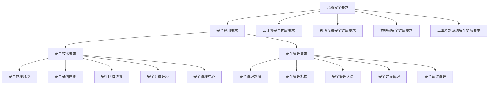

> [!IMPORTANT]
> **"一个中心，三重防护"**：**安全管理中心** + **安全计算环境、安全区域边界、安全通信网络**。

##### 📌 安全物理环境（10 个控制点）

| 编号 | 控制点 | 要点 |
| --- | --- | --- |
| 1 | **物理位置选择** | 防震、防风、防雨，**避免顶层或地下室** |
| 2 | **物理访问控制** | 机房**专人值守或电子门禁**；机房**电子门禁**；**重要区域第二道电子门禁** |
| 3 | **防盗防破坏** | 主要设备**有标记**；设备有标记，**电缆要隐蔽（底下或管道）**；机房**防盗报警系统或专人值守的视频监控** |
| 4 | **防雷击** | **接地**，**防雷保安器或过压保护** |
| 5 | **防火** | 机房有**灭火设备**；**自动消防系统，耐火建筑材料，机房区域隔离** |
| 6 | **防水防潮** | 机房**防水渗透**；机房**防水蒸气结露，地下积水转移渗透**；**防水检测仪表** |
| 7 | **防静电** | **防静电地板，静电消除器，防静电手环** |
| 8 | **温湿度控制** | 温湿度**可调节**；**温湿度自动调节设施** |
| 9 | **电力供应** | 电路**稳压过压保护**，**短期备用电力供应**，**冗余供电或并行电缆**；提供**应急供电设施** |
| 10 | **电磁防护** | **电源线与通信线缆隔离铺设**，关键设备**电磁屏蔽**；**关键区域电磁防护** |

> [!TIP]
> 等保 2.0 对部分条款进行了**精简**，体现可操作性，**整体变化不大**。
> **关注点：◆ 机房不要在顶层（承重）或地下（漏水）；◆ 电子门禁、视频监控；◆ 冗余供电**
> **字体约定（原文）：黑色字体为二级要求；黑色加粗字体为三级要求；红色字体为四级要求。**

##### 📌 安全通信网络（3 个控制点）

| 编号 | 控制点 | 要点 |
| --- | --- | --- |
| 1 | **网络架构** | 划分**不同网络区域**，避免将**重要区域部署在网络边界处**；设备业务处理能力和带宽满足**业务高峰**需要；**关键设备与链路冗余**；可根据业务重要程度**分配带宽，优先保障重要业务** |
| 2 | **通信传输** | 采用**校验技术**保证数据完整性；采用**校验技术或密码技术**保证数据完整性，采用**密码技术**保证数据保密性；**双向身份验证**；重要通信采用**基于密码模块的加解密和密钥管理** |
| 3 | **可信验证** | 可基于**可信根**对通信设备的**系统引导程序、系统程序、重要配置参数和通信应用程序**等进行可信验证，并在**应用程序的所有执行环节进行动态可信验证**，在检测到其可信性受到破坏后**进行报警**，并将验证结果**形成审计记录送至安全管理中心**，并进行**动态关联感知** |

**等保 2.0 变化点（通信网络，5 条）：**

| 编号 | 变化点 |
| --- | --- |
| 1 | 改**结构安全为网络架构**，强调**处理能力与带宽供给** |
| 2 | 在原应用通信完整性和保密性基础上**增加网络通信传输安全要求** |
| 3 | **新增可信验证**，对通信设备提出基于可信根的可信验证要求，**本项为可选项** |
| 4 | 将等保 1.0"网络安全"中的**访问控制、安全审计、边界完整性检查、入侵防范、恶意代码防范**的主要内容放在等保 2.0"**安全区域边界**"部分中 |
| 5 | 将等保 1.0"网络安全"中的**网络设备防护**的主要内容放在"**安全管理中心**"部分中 |

##### 📌 通信安全设计（典型网络拓扑示例要点）

| 要素 | 对应设计 |
| --- | --- |
| **网络架构** | **核心链路双冗余**；**核心应用与外部安全隔离**；区域划分：**DMZ 区、办公应用区、核心应用区、运维管理区、数据备份区、安全管理区** |
| **通信传输** | **通信传输加密**（VPN 网关等） |
| **可信验证** | **基于可信根对通信设备的可信验证** |

典型网络拓扑中出现的安全设备/系统（原文图注）：

| 区域 | 设备/系统 |
| --- | --- |
| 出口/边界 | 路由器、**VPN 网关**、防火墙、**入侵防御（IPS）**、**抗 DDoS 系统**、**WEB 应用防火墙（WAF）**、**邮件安全网关** |
| DMZ 区 | 网站服务器、网页防篡改系统 |
| 核心区 | 数据库服务器、应用服务器、**数据库审计**、**抗 APT 攻击系统**、邮件服务器 |
| 安全管理区 | **统一安全管理平台、性能集中监控、堡垒主机、漏洞扫描、数字认证系统、病毒防护服务器、终端安全管理系统、统一运维管理系统、网络安全审计、集中身份管理系统（4A）、密钥管理系统、DLP 系统** |
| 数据备份区 | 备份服务器、磁盘阵列 |
| 链路 | **光纤、链路聚合、心跳线、核心链路双冗余** |
| 终端 | 运维终端（部署**终端安全管理 Agent**） |

##### 📌 安全区域边界（6 个控制点）

| 编号 | 控制点 | 要点 |
| --- | --- | --- |
| 1 | **边界防护** | 访问与数据流通过**受控接口**；**非授权用户接入检查或限制（发现时阻断）**；**内部用户外联检查或限制（发现时阻断）**；**无线接入网关边界**；采用**可信验证机制对接入设备进行可信验证** |
| 2 | **访问控制** | 网络边界部署访问控制策略，**优化 ACL 表，协议检查**；访问控制策略部署**扩展到域边界**，根据**会话状态信息**控制访问，**粒度到端口**；基于**应用协议和应用内容**的访问控制；**通信协议转化或隔离方式交换数据** |
| 3 | **入侵防范** | 关键网络节点监控攻击，**限制从外向内的攻击，限制从内向外的攻击**，通过**行为分析检测新型网络攻击**；记录检测到的攻击并报警 |
| 4 | **恶意代码和垃圾邮件防范** | 关键节点处**检测和清除恶意代码**，**维护更新**；关键节点**检测和防护垃圾邮件**，维护更新 |
| 5 | **安全审计** | 网络边界与重要网络节点，**审计覆盖每个用户**，审计**重要用户行为和重要安全事件**；审计记录包含**必要信息**；审计记录**防篡改防删除，定期备份**；对**远程访问行为和互联网访问行为单独审计分析** |
| 6 | **可信验证** | 基于**可信根**对**边界设备**进行可信验证，并在应用程序的**关键执行环节进行动态可信验证**，在检测到其可信性受到破坏后进行报警，并将验证结果形成审计记录送至安全管理中心，并进行动态关联感知 |

**等保 2.0 变化点（区域边界，6 条）：**

| 编号 | 变化点 |
| --- | --- |
| 1 | **新增"边界防护"**，明确跨越边界数据通过**受控接口**，控制**内联、外联、无线接入**等非授权网络出入口 |
| 2 | 访问控制能基于**应用协议和应用内容** |
| 3 | **入侵检测要求提高**，能检测、防止或限制**从内向外和从外向内**的攻击，能检测**新型网络攻击** |
| 4 | 增加对**垃圾邮件检测、防护**要求 |
| 5 | 安全审计强调**远程访问与互联网行为**的审计 |
| 6 | 增加对**边界设备的可信验证**要求（**可选**） |

##### 📌 边界安全设计（典型拓扑对应）

| 控制点 | 对应措施/设备 |
| --- | --- |
| 边界防护 | **边界访问控制** |
| 访问控制 | 防火墙、ACL |
| 入侵防范 | **入侵防御（IPS）、入侵防范** |
| 恶意代码和垃圾邮件防范 | **垃圾邮件防范**、病毒防护 |
| 安全审计 | **运维审计、安全审计**、网络安全审计 |
| 可信验证 | **基于可信根对边界设备的可信验证** |

##### 📌 安全计算环境（第 1–6 控制点）

| 编号 | 控制点 | 要点 |
| --- | --- | --- |
| 1 | **身份鉴别** | **身份标识唯一，登录失败处理**；**远程管理防鉴别窃听**；**双因子身份鉴别**；**至少一种是密码技术** |
| 2 | **访问控制** | **重命名默认账户与口令，清理无用账户与共享账户**；管理用户**最小授权，管理权限分离**；授权管理，**主体粒度为用户或进程，客体到文件或数据库表**，重要主体和客体**设置安全标记**，控制访问；对**所有主客体安全标记**，主客体设置安全标记，实现**强制性访问控制** |
| 3 | **安全审计** | 审计覆盖每个用户，审计重要用户行为和安全事件；审计记录包含必要信息（**主客体标识**），审计记录**定期备份，防篡改防删除**；**审计进程进行保护，防止中断** |
| 4 | **入侵防范** | **最小安装**，关闭**不需要服务、默认共享和高危端口**；限制**管理终端接入方式与地址**，**数据有效性校验**；**发现漏洞并修补**；能检测到对**重要节点的入侵并报警** |
| 5 | **恶意代码防范** | 采用**免受恶意代码攻击的技术措施或主动免疫可信验证机制**（采用主动免疫可信验证机制）**及时识别入侵和病毒行为，并将其有效阻断** |
| 6 | **可信验证** | 基于**可信根**对**计算设备**进行可信验证，并在应用程序的**关键执行环节进行动态可信验证**，在检测到其可信性受到破坏后进行报警，并将验证结果形成审计记录送至安全管理中心，并进行动态关联感知 |

**等保 2.0 变化点（计算环境第 1 部分，5 条）：**

| 编号 | 变化点 |
| --- | --- |
| 1 | 将等保 1.0 中"**主机安全**"、"**应用安全**"和"**数据安全及备份恢复**"的内容**融合合并** |
| 2 | 身份鉴别、访问控制、安全审计要求针对的对象**相应扩大**，包括**设备、操作系统、应用、数据库**等。涵盖**虚拟化系统、感知节点设备、控制设备、移动终端**等 |
| 3 | 将原等保 1.0 中主机安全中"**资源控制**"控制点的部分内容移到"**安全管理中心**"中；将应用安全中"资源控制"控制点的**内容删除** |
| 4 | 在主机恶意代码防范中增加**主动免疫可信验证机制**方式，**三级可选，四级应实现** |
| 5 | 增加对**计算设备的可信验证**要求（**可选**） |

##### 📌 安全计算环境（第 7–11 控制点）

| 编号 | 控制点 | 要点 |
| --- | --- | --- |
| 7 | **数据完整性** | 重要数据**传输校验完整性**；采用**校验码技术或密码技术**保护数据**传输与存储时的完整性**，包括**鉴别数据、重要业务数据、重要审计数据、重要配置数据、重要视频数据和重要个人信息**等；采用**密码技术提供数据原发证据与数据接收证据，实现抗抵赖** |
| 8 | **数据保密性** | 采用**密码技术**保护数据**传输与存储时的保密性**，包括**鉴别数据、重要业务数据和重要个人信息**等 |
| 9 | **数据备份恢复** | 重要数据**本地备份与恢复**；**异地备份，定时批量数据同步**；**异地实时备份，重要系统热冗余**；建设**异地灾备中心，业务应用实时切换** |
| 10 | **剩余信息保护** | **鉴别信息**使用后的空间清除；**敏感数据**使用后空间**完全清除** |
| 11 | **个人信息保护** | **只采集存储必需的**；**禁止未授权访问和非法使用** |

**等保 2.0 变化点（计算环境第 2 部分，2 条）：**

| 编号 | 变化点 |
| --- | --- |
| 6 | 将等保 1.0 应用安全中"**抗抵赖**"、数据安全中"**数据完整性**"和"**数据保密性**"的内容合并为等保 2.0 中安全计算环境中的"**数据完整性**"和"**数据保密性**"，并**细化和扩充对象范围** |
| 7 | 增加对**个人信息保护**的要求，**二级系统及以上均要求** |

##### 📌 计算环境安全设计（典型拓扑对应）

| 控制点 | 对应措施/系统 |
| --- | --- |
| 数据完整性 / 数据保密性 | **应用系统采用密码技术**（密钥管理系统） |
| 数据备份恢复 | **数据定期备份（本地、异地）** |
| 剩余信息保护 / 个人信息保护 | **数据防泄密系统（DLP）**；**应用系统实现个人信息采集保护机制** |
| 身份鉴别、访问控制、安全审计、入侵防范、恶意代码防范 | 覆盖**服务器、数据库、应用、终端**各层面 |

##### 📌 安全管理中心（4 个控制点）

| 编号 | 控制点 | 要点 |
| --- | --- | --- |
| 1 | **系统管理** | 对**系统管理员**身份鉴别，只允许通过**特定命令或界面**操作，并对操作进行审计；通过系统管理员对系统的**资源和运行**进行配置、控制和管理，包括**用户身份、系统资源配置、系统加载和启动、系统运行的异常处理、数据和设备的备份与恢复**等 |
| 2 | **审计管理** | 对**审计管理员**身份鉴别，只允许通过特定命令或界面操作，并对操作进行审计；通过审计管理员对**审计记录进行分析**，并根据分析结果进行处理，包括根据**安全审计策略**对审计记录进行**存储、管理和查询**等 |
| 3 | **安全管理** | 对**安全管理员**身份鉴别，只允许通过特定命令或界面操作，并对操作进行审计；通过安全管理员对系统中的**安全策略进行配置**，包括**安全参数的设置，主体、客体进行统一安全标记，对主体进行授权，配置可信验证策略**等 |
| 4 | **集中管控** | 划分出**特定的管理区域**，并建立**安全的信息传输路径**，对分布在网络中的**安全设备或安全组件进行管控**；对**设备、链路运行状况进行集中监测**；对分散在各个设备上的**审计数据进行收集汇总和集中分析**，并保证审计记录的**留存时间符合法律法规要求**；对**安全策略、恶意代码、补丁升级**等安全相关事项进行**集中管理**；对网络中发生的**各类安全事件进行识别、报警和分析**；保证系统范围内的**时间由唯一确定的时钟产生** |

**等保 2.0 变化点（安全管理中心，3 条）：**

| 编号 | 变化点 |
| --- | --- |
| 1 | 本控制类为**新增**，等保 1.0 中将安全管理中心的相关要求在**网络安全、主机安全**部分中分散描述 |
| 2 | 明确了**系统三员（系统管理员、审计管理员和安全管理员）** 及相关工作职责 |
| 3 | 本控制类是对**整个安全管理区**的要求，集中管控具体要求可参见 **GB/T 36958-2018《网络安全等级保护安全管理中心技术要求》** |

> [!IMPORTANT]
> **三员**：系统管理员、审计管理员、安全管理员（**三员分离**）；集中管控标准：**GB/T 36958-2018**。

##### 📌 安全管理中心设计（典型拓扑对应）

| 控制点 | 对应措施 |
| --- | --- |
| 系统管理 / 审计管理 / 安全管理 | **系统运维管理、三员分离** |
| 集中管控 | **统一安全管理平台**（集中管控） |

##### 📌 安全管理制度（4 个控制点）

| 编号 | 控制点 | 要点 |
| --- | --- | --- |
| 1 | **安全策略** | 制定**总体方针与安全策略**，包括**总体目标、范围、原则与框架**等 |
| 2 | **管理制度** | 日常工作有安全管理制度；为**主要（各类）管理内容建立安全制度**，日常管理有**操作规程**；形成**安全管理体系（四级体系：安全策略、管理制度、操作规程、记录表单等）** |
| 3 | **制定和发布** | **专门发布部门或人员**，**正式发布**，**版本控制** |
| 4 | **评审和修订** | **定期评审和修订** |

**等保 2.0 变化点（管理制度，2 条）：**

| 编号 | 变化点 |
| --- | --- |
| 1 | 增加"**安全策略**"控制点，将等保 1.0 中"管理制度"控制点中的部分内容移至"安全策略"中，**强调安全策略要求** |
| 2 | 借鉴 **ISO 27001** 的**四级安全管理体系** |

> [!IMPORTANT]
> 四级体系：**安全策略 → 管理制度 → 操作规程 → 记录表单**（源自 **ISO 27001**）。

##### 📌 安全管理机构（5 个控制点）

| 编号 | 控制点 | 要点 |
| --- | --- | --- |
| 1 | **岗位设置** | 成立**安全管理委员会或领导小组**，**最高领导由单位主管领导担任或授权**；定义**安全部门与安全主管**等的职责；**设立三员**，定义部门及岗位职责 |
| 2 | **人员配备** | **一定数量的三员**配置；**专职安全管理员，不可兼任**；**关键岗位多人共同管理** |
| 3 | **授权和审批** | 明确**审批事项与流程**；重要事项包括**系统变更、重要操作、物理访问、系统接入**等，重要活动建立**逐级审批制度**；**定期审查审批事项，更新审批相关信息** |
| 4 | **沟通和合作** | **内部沟通会**，**外部沟通通信录**（**网络安全职能部门、供应商、专家、组织**等） |
| 5 | **审核和检查** | 定期**常规检查**（日常运行、系统漏洞、数据备份等）；定期**全面检查**，如**策略与配置的一致，安全措施的有效性**等，制定**检查表格**，形成**检查报告**，结果进行**通报** |

**等保 2.0 变化点（管理机构，2 条）：**

| 编号 | 变化点 |
| --- | --- |
| 1 | 明确安全管理**一把手为单位主管领导或其授权** |
| 2 | 将部分内容进行了**归并精简，措辞调整**，如公安机关改为"**网络安全职能部门**" |

##### 📌 安全管理人员（4 个控制点）

| 编号 | 控制点 | 要点 |
| --- | --- | --- |
| 1 | **人员录用** | **专人负责录用**；人员**背景审查**；**技能考核**；人员签**保密协议**，**关键岗位签岗位责任协议**；**关键岗位人员内部选拔** |
| 2 | **人员离岗** | **及时终止权限，收回设备**；承诺**调离保密义务** |
| 3 | **安全意识教育和培训** | 对各类人员进行**安全意识教育和岗位技能培训**，告知**安全责任与惩戒措施**；**不同岗位制定不同培训计划**；**定期对不同岗位人员进行技能考核** |
| 4 | **外部人员访问管理** | 访问**受控区域书面申请**，需**授权或审批**，**专人全程陪同，登记备案**；访问**受控网络书面申请**，专人**开设账户，分配权限，登记备案**；**离场后及时清除来访者权限**；与外部授权人员**签保密协议**，**不得复制和泄露敏感信息**；**关键区域与关键应用不允许外部人员访问** |

**等保 2.0 变化点（人员管理，2 条）：**

| 编号 | 变化点 |
| --- | --- |
| 1 | 将等保 1.0 中的"**人员考核**"和"**安全意识教育和培训**"合并到等保 2.0 的"**安全意识教育和培训**"，描述适当精简 |
| 2 | **细化和明确了外部人员访问的受控网络的权限管理要求** |

##### 📌 安全建设管理（10 个控制点）

| 编号 | 控制点 | 要点 |
| --- | --- | --- |
| 1 | **定级备案** | **书面说明安全等级及确定方法和理由**；**组织专家论证，相关部门批准**；**主管部门及公安备案** |
| 2 | **安全方案设计** | 依据**等级选择措施**，依据**风险补充调整措施**；考虑与其他等级保护对象的**关系**，进行**安全整体规划和方案设计**，**包括密码技术内容，形成配套文件**；对安全整体规划及配套文件进行**评审，批准后实施** |
| 3 | **产品采购和使用** | **网络安全产品符合国家规定**；**密码产品符合密码主管部门有关规定**；**预先产品选型，定期更新候选名单**；**重要部位产品委托专项测试后选择** |
| 4 | **自行软件开发** | **开发与实际环境分离，测试数据受控**；开发中**安全性测试**；**上线前恶意代码检测**；开发管理制度，**代码编写安全规范**，开发过程文档管理，**程序资源库的修改、更新、发布进行授权和批准，严格版本控制**；**专职开发人员，开发活动受控** |
| 5 | **外包软件开发** | **恶意代码检测**；提供**设计文档与使用指南**；提供**源代码，审查后门或隐秘通道** |
| 6 | **工程实施** | **专人管理实施过程**；制定**工程实施方案**；**第三方监理** |
| 7 | **测试验收** | **测试验收方案，验收报告**；**上线前安全测试报告**；**包含密码应用的安全性测试** |
| 8 | **系统交付** | **交付清单，根据清单清点**；对**运维人员培训**；提供**建设过程文档，运维文档** |
| 9 | **等级测评** | **定期测评，及时整改**；**重大变更或级别变化需要测评**；选择**合规的测评机构** |
| 10 | **服务商选择** | 选择**合规服务商，签订协议**；明确**服务供应链各方的安全义务**；**定期监督评审服务，控制服务内容变更** |

**等保 2.0 变化点（建设管理，6 条）：**

| 编号 | 变化点 |
| --- | --- |
| 1 | 根据新的等级保护实施流程，将等保 1.0 中的"**系统定级**"和"**系统备案**"**合并**为等保 2.0 的"**定级备案**" |
| 2 | **三级系统方案设计强调保护对象的关联性和整体安全规划，包含密码技术** |
| 3 | 明确了**自行开发的安全性测试和上线前检测**的要求 |
| 4 | **三级系统要求第三方工程监理**（等保 1.0 仅对四级系统要求） |
| 5 | 等保 1.0 中在"等级测评"中要求三级系统每年测评一次、四级系统每半年测评一次，等保 2.0 中调整为"**定期等级测评**"，在**定级指南**中明确**三级以上均为每年测评一次** |
| 6 | 将等保 1.0 中"**安全服务商选择**"改为"**服务供应商选择**"，要求**明确服务供应链各方安全义务** |

##### 📌 安全运维管理（14 个控制点）

| 编号 | 控制点 | 要点 |
| --- | --- | --- |
| 1 | **环境管理** | **专人或专门部门负责机房安全管理**，机房**进出与运维管理**；制定**机房安全管理制度**；含**敏感信息介质和文档不随意放置**；对**出入人员按级别授权**，**重要区域实时监控** |
| 2 | **资产管理** | **资产清单**（责任部门、重要程度、位置等）；**资产标识管理**；规定**信息分类并标识方法**，对信息的**使用、传输和存储进行规范化管理** |
| 3 | **介质管理** | **安全存放，环境专人管理，定期盘点**；**介质流转控制并记录** |
| 4 | **设备维护管理** | **专人维护**；包括**配套设施与软硬件**的维护，建立维护制度，明确责任，**审批监督**；**设备外出要审批**，**有存储介质的设备带出时重要数据加密**；**有存储介质的设备报废或重用前先彻底清除信息** |
| 5 | **漏洞与风险管理** | **识别，及时修补或评估后修补**；**定期测评，形成报告，采取措施应对** |
| 6 | **网络和系统安全管理** | **区分网络与系统运维，专人账户管理**；建立网络和系统安全管理制度（**策略、账户、口令、配置、日志、操作、补丁**等）；制定**重要设备配置与操作手册，进行安全配置**；**记录运维日志**；**专人或部门分析日志与监控数据**；**严控变更性运维**，操作中保留日志，**同步更新配置库**；**严格运维工具使用**，保留日志，**及时删除敏感信息**；**严控远程运维通道开通**，审批后开通，保留日志，**及时关闭**；**外部连接均要授权和审批**，**定期检查违规无线上网** |
| 7 | **恶意代码防范管理** | **外来接入要先查杀病毒**；规定恶意代码防范要求；**检查病毒库升级，并分析捕获样本**；**定期验证防病毒技术措施的有效性** |
| 8 | **配置管理** | 记录**基本信息（拓扑、组件、版本、补丁、配置参数）**；**基本配置信息的变更管理** |
| 9 | **密码管理** | **合规的算法与产品**；采用**密码模块加解密与密钥管理** |
| 10 | **变更管理** | 明确**变更需求，制定变更方案，评审后实施**；建立**变更审批流程，记录变更实施过程**；制定**变更失败回退流程**，必要时进行演练 |
| 11 | **备份与恢复管理** | 识别需备份的**重要业务信息、系统数据与软件**；规定**备份方式、介质、频率**等；制定**备份策略和恢复策略和程序** |
| 12 | **安全事件处置** | **及时报告安全事件**；制定**安全事件报告与处置管理制度**；**分析原因，总结教训**；对**重大服务中断与信息泄露事件有不同的处理流程与报告程序**；建立**联合防护和应急机制**，处置**跨单位安全事件** |
| 13 | **应急预案管理** | 制定**统一的应急预案框架**；**重要事件制定应急预案（处理与恢复流程）**；**定期人员培训与演练**；**定期对应急预案重新评估，修订完善**；建立**重大安全事件的跨单位联合应急预案，并进行演练** |
| 14 | **外包运维管理** | 选择**合规外包服务商，签订协议，明确范围**；协议中明确要求服务商**符合等保运维能力**，明确安全能力（如**基础设施故障的应急保障，敏感信息保护**等） |

**等保 2.0 变化点（运维管理，7 条）：**

| 编号 | 变化点 |
| --- | --- |
| 1 | 将等保 1.0 中"**监控管理和安全管理中心**"控制点删除，部分内容合并至等保 2.0 的"**网络和系统安全管理**"控制点中 |
| 2 | 在等保 2.0 中增加"**漏洞和风险管理**"控制点，将等保 1.0 中"网络安全管理"和"系统安全管理"中的相关内容纳入其中 |
| 3 | 将等保 1.0 中的"**网络安全管理**"和"**系统安全管理**"的内容**整合合并** |
| 4 | 增加"**配置管理**"控制点，说明对系统**基本信息**的管理要求 |
| 4（原文重复编号） | 对于 **4 级系统**要求采用**密码模块进行加密解密** |
| 5 | **删除对涉密事件处置的相关描述** |
| 6 | 对应急预案要求为**定期培训和演练**，**四级系统要求建立重大安全事件的跨单位联合应急预案，并进行应急预案的演练** |
| 7 | 等保 2.0 增加"**外部运维管理**"控制点，对**外部方运维管理能力和工作责任**的要求 |

##### 📌 等保 2.0 十大控制类速览

| 类别 | 控制类 | 控制点数量 |
| --- | --- | --- |
| 安全技术 | 安全物理环境 | 10 |
| 安全技术 | 安全通信网络 | 3 |
| 安全技术 | 安全区域边界 | 6 |
| 安全技术 | 安全计算环境 | 11 |
| 安全技术 | 安全管理中心 | 4 |
| 安全管理 | 安全管理制度 | 4 |
| 安全管理 | 安全管理机构 | 5 |
| 安全管理 | 安全管理人员 | 4 |
| 安全管理 | 安全建设管理 | 10 |
| 安全管理 | 安全运维管理 | 14 |

#### 考试涉及内容 `04`

##### 📌 GB 17859 计算机信息系统安全保护等级划分准则

| 级别 | 名称 | 准则描述 |
| --- | --- | --- |
| **第一级** | **用户自主保护级** | 本级的计算机信息系统**可信计算基**通过**隔离用户与数据**，使用户具备**自主安全保护**的能力 |
| **第二级** | **系统审计保护级** | 与用户自主保护级相比，本级的计算机信息系统可信计算基实施了**粒度更细的自主访问控制**，它通过**登录规程、审计安全性相关事件和隔离资源**，使用户**对自己的行为负责** |
| **第三级** | **安全标记保护级** | 本级的计算机信息系统可信计算基具有**系统审计保护级的所有功能**。此外，还需提供有关**安全策略模型、数据标记以及主体对客体强制访问控制**的**非形式化描述**，具有**准确地标记输出信息**的能力；**消除通过测试发现的任何错误** |
| **第四级** | **结构化保护级** | 本级的计算机信息系统可信计算基建立于一个**明确定义的形式安全策略模型**之上，要求将第三级系统中的**自主和强制访问控制扩展到所有主体与客体**。此外，还要**考虑隐蔽通道** |
| **第五级** | **访问验证保护级** | 本级的计算机信息系统可信计算基**满足访问控制器需求**。**访问监控器仲裁主体对客体的全部访问**。访问监控器本身是**抗篡改**的；必须**足够小，能够分析和测试** |

> [!IMPORTANT]
> 逐级递进关键词：一级 **隔离**；二级 **更细自主访问控制 + 审计**；三级 **安全策略模型 + 数据标记 + 强制访问控制（非形式化）**；四级 **形式化安全策略模型 + 隐蔽通道**；五级 **访问监控器（抗篡改、足够小）**。

##### 📌 等保 2.0 可信验证相关（各级递进）

等级保护 2.0 新标准**强化了可信计算技术使用的要求**，各级增加了"**可信验证**"控制点。其中：

| 级别 | 可信验证要求 |
| --- | --- |
| **一级** | 要求设备的**系统引导程序、系统程序**等进行可信验证 |
| **二级** | 增加**重要配置参数和应用程序**进行可信验证，并将**验证结果形成审计记录送至安全管理中心** |
| **三级** | 增加**应用程序的关键执行环节**进行**动态可信验证** |
| **四级** | 增加**应用程序的所有执行环节**进行**动态可信验证** |

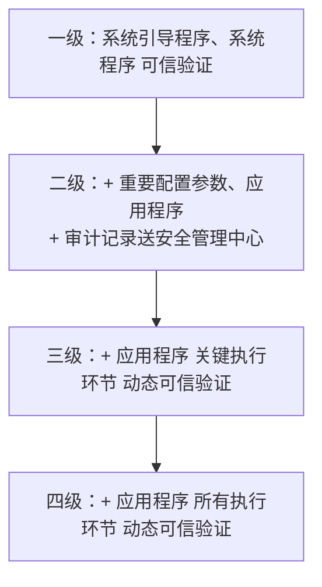

> [!IMPORTANT]
> 案例/选择高频：**"所有执行环节"＝四级；"关键执行环节"＝三级**。

#### 课堂练习 `05`

##### 第 1 题

> 信息系统受到破坏后，会对**社会秩序和公共利益造成特别严重损害**，或者对**国家安全造成严重损害**，按照计算机信息系统安全等级保护相关要求，应定义为（ ）。
>
> A. 第一级　B. 第二级　C. 第三级　D. 第四级

> [!TIP]
> 解析：**D. 第四级**。

##### 第 2 题

> 依据《信息安全技术 网络安全等级保护测评要求》的规定，定级对象的安全保护分为五个等级，其中**第三级**称为（ ）。
>
> A. 系统审计保护级　B. 安全标记保护级　C. 结构化保护级　D. 访问验证保护级

> [!TIP]
> 解析：**B. 安全标记保护级**。

##### 第 3 题

> 等级保护制度是中国网络安全保障的特色和基石，等级保护 2.0 新标准强化了对可信计算技术使用的要求。其中安全保护等级（ ）要求对应用程序**的所有执行环节**进行动态可信验证。
>
> A. 第一级　B. 第二级　C. 第三级　D. 第四级

> [!TIP]
> 解析：**D. 第四级**。

##### 第 4 题

> 根据网络安全等级保护 2.0 的要求，对云计算实施安全分级保护。围绕"**一个中心，三重防护**"的原则，构建云计算安全等级保护框架。其中一个中心是指**安全管理中心**，三重防护包括：**计算环境安全、区域边界安全和通信网络安全**。以下安全机制属于安全管理中心的是（ ）。
>
> A. 应用安全　B. 安全审计　C. Web 服务　D. 网络访问

> [!TIP]
> 解析：**B. 安全审计**。

##### 第 5 题（案例问答，2 分）

> **问题 1**（2 分）按照等级保护 2.0 的要求，**政府网站的定级不应低于几级？** 该等级的测评**每几年**开展一次？

**参考答案（原文）：**

> 答：**二级；每两年**。官方教材 **499 页**最下面写了：**政府网站的信息安全等级原则上不应低于二级**。**三级网站每年应测评一次，二级网站每两年应测评一次**。

> [!WARNING]
> 该"二级每两年"的说法与课件 P512"第三级以上信息系统每年至少进行一次测评"并不冲突（二级不在"三级以上"范围），但与部分资料"二级每两年"属教材特定表述，见文末「⚠️ 疑点」第 11 条。

---

### 六、网络基础知识

> 章节封面：信息安全工程师 网络基础知识

#### 本章目录

| 序号 | 小节 |
| --- | --- |
| 1 | 网络通信基础 |
| 2 | 网络参考模型 |
| 3 | 网络层协议与 IP 编址 |
| 4 | IP 路由基础 |
| 5 | 以太网交换基础 |
| 6 | 网络地址转换 |
| 7 | 网络管理 |
| 8 | 园区网组网架构 |

#### 网络通信基础 `01`

##### 📌 通信与网络通信

| 项目 | 要点 |
| --- | --- |
| 通信 | 是指**人与人、人与物、物与物**之间通过某种**媒介和行为**进行的**信息传递与交流** |
| 网络通信 | 是指**终端设备之间通过计算机网络**进行的通信 |

**网络通信的例子：**

| 编号 | 例子 |
| --- | --- |
| A | 两台计算机（终端）之间通过**网线**传递文件 |
| B | 多台计算机（终端）通过**路由器**传递文件 |
| C | 计算机（终端）通过 **Internet** 下载文件 |

> [!TIP]
> 类比记忆：虚拟的信息传递与真实的**物品传递**过程有许多相似之处 —— 物品 → 包裹 → 集散中心 →（天空/Internet 主干道）→ 集散中心 → 包裹 → 物品；对应 计算机 → 数据/报文 → 网关路由器 → 网关路由器 → 计算机。

##### 📌 关键术语

| 术语 | 说明 |
| --- | --- |
| **数据载荷** | 最终想要传递的信息 |
| **报文** | 网络中**交换与传输的数据单元** |
| **头部** | 在**数据载荷的前面**添加的信息段 |
| **尾部** | 在**数据载荷的后面**添加的信息段 |
| **封装** | 对数据载荷**添加头部和尾部，形成新的报文**的过程 |
| **解封装** | **去掉报文的头部和尾部，获取数据载荷**的过程 |
| **网关** | 提供**协议转换、路由选择、数据交换**等功能的网络设备 |
| **路由器** | 为报文**选择传递路径**的网络设备 |
| **终端设备** | 数据通信系统的**端设备**，作为数据的**发送者或接收者** |

##### 📌 数据通信网络

| 项目 | 要点 |
| --- | --- |
| 构成 | 由**路由器、交换机、防火墙、无线控制器、无线接入点**，以及**个人电脑、网络打印机、服务器**等设备构成的通信网络 |
| 功能 | 数据通信网络最基本的功能是实现**数据互通** |

典型场景：核心机房（日志系统、控制器、网管平台、应用服务器）+ 办公区域 1/2/3 + Internet。

##### 📌 常见网络设备

| 设备 | 定位与功能 |
| --- | --- |
| **交换机（Switch）** | **距离终端用户最近**的设备，用于**终端用户接入网络、对数据帧进行交换**等；终端设备（PC、服务器等）的网络接入；**二层交换（Layer 2 Switching）**；**广播域** |
| **路由器（Router）** | **网络层**设备，可以在因特网中进行**数据报文转发**。路由器根据所收到的报文的**目的地址选择一条合适的路径**，将报文传送到下一个路由器或目的地，**路径中最后的路由器负责将报文送交目的主机**。功能：**实现同类型网络或异种网络之间的通信；隔离广播域；维护路由表（Routing Table）、运行路由协议；路径（路由信息）选择、IP 报文转发；广域网接入、网络地址转换；连接通过交换机组建的二层网络** |
| **防火墙（Firewall）** | **网络安全设备**，用于控制**两个网络之间的安全通信**。它通过**监测、限制、更改跨越防火墙的数据流**，尽可能地对外部屏蔽网络内部的信息、结构和运行状况，以此来实现对网络的安全保护。功能：**隔离不同安全级别的网络；实现不同安全级别的网络之间的访问控制（安全策略）；用户身份认证；实现远程接入功能；实现数据加密及虚拟专用网业务；执行网络地址转换；其他安全功能** |

> [!IMPORTANT]
> 防火墙区域划分：**Trust 域（信任区）/ DMZ 域（非军事区）/ Untrust 域（非信任区，Internet）**。
> 路由器**隔离广播域**；交换机**隔离冲突域**（每个接口一个冲突域）但不隔离广播域。

##### 📌 网络按地理覆盖范围分类

| 类型 | 定义 | 典型例子 |
| --- | --- | --- |
| **局域网（LAN，Local Area Network）** | 在某一地理区域内由**计算机、服务器以及各种网络设备**组成的网络。覆盖范围一般是**方圆几千米以内** | **一家公司的办公网络，一个网吧的网络，一个家庭网络**等 |
| **城域网（MAN，Metropolitan Area Network）** | 在**一个城市范围内**所建立的计算机通信网络 | **宽带城域网、教育城域网、市级或省级电子政务专网**等 |
| **广域网（WAN，Wide Area Network）** | 通常覆盖很大的地理范围，从**几十公里到几千公里**。它能连接多个城市甚至国家，并能提供远距离通信，形成国际性的大型网络 | **Internet（因特网）** |

##### 📌 网络拓扑

| 项目 | 要点 |
| --- | --- |
| 定义 | 网络拓扑（Network Topology）是指用**传输介质**（例如双绞线、光纤等）互连各种设备（例如计算机终端、路由器、交换机等）所呈现的**结构化布局** |
| 作用 | 网络拓扑图是在网络工程领域用于描述网络的**物理或逻辑结构**，是一种非常重要的网络内容 |

**按照网络的拓扑形态来划分，网络可分为：**

| 编号 | 拓扑形态 |
| --- | --- |
| 1 | **星型网络** |
| 2 | **总线型网络** |
| 3 | **环形网络** |
| 4 | **树形网络** |
| 5 | **全网状网络** |
| 6 | **部分网状网络** |
| 7 | **组合型的网络拓扑** |

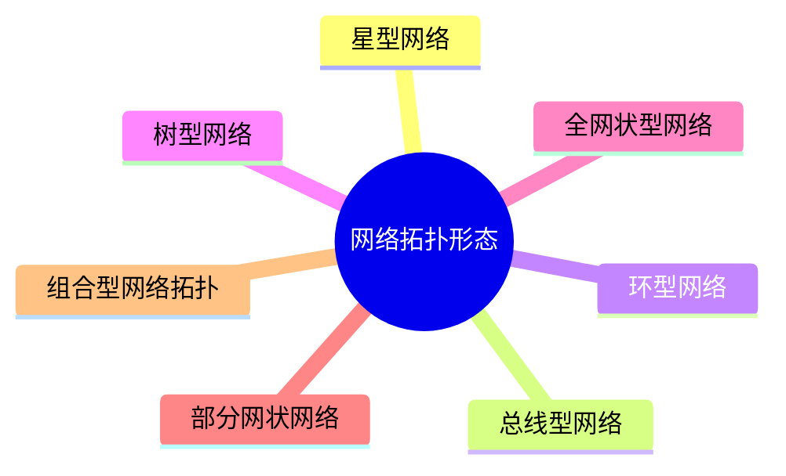

#### 网络参考模型 `02`

##### 📌 OSI 参考模型（7 层）

| 层 | 名称 | 功能 |
| --- | --- | --- |
| **7** | **应用层** | 对**应用程序提供接口** |
| **6** | **表示层** | 进行**数据格式的转换**，以确保一个系统生成的应用层数据能够被另外一个系统的应用层所识别和理解 |
| **5** | **会话层** | 在通信双方之间**建立、管理和终止会话** |
| **4** | **传输层** | **建立、维护和取消一次端到端的数据传输过程**。控制**传输节奏的快慢**，**调整数据的排序**等等 |
| **3** | **网络层** | 定义**逻辑地址**；实现数据从**源到目的地的转发** |
| **2** | **数据链路层** | 将**分组数据封装成帧**；在数据链路上实现数据的**点到点、或点到多点**方式的**直接通信**；**差错检测** |
| **1** | **物理层** | 在媒介上**传输比特流**；提供**机械的和电气的规约** |

##### 📌 TCP/IP 参考模型

> 因为 **OSI 协议栈比较复杂**，且 **TCP 和 IP 两大协议在业界被广泛使用**，所以 **TCP/IP 参考模型成为了互联网的主流参考模型**。

| OSI 模型 | TCP/IP 对等模型 | TCP/IP 标准模型 |
| --- | --- | --- |
| 应用层 | **应用层** | **应用层** |
| 表示层 | （合并至应用层） | （合并至应用层） |
| 会话层 | （合并至应用层） | （合并至应用层） |
| 传输层 | **传输层** | **主机到主机层** |
| 网络层 | **网络层** | **英特网层** |
| 数据链路层 | **数据链路层** | **网络接入层** |
| 物理层 | **物理层** | （合并至网络接入层） |

##### 📌 TCP/IP 协议栈常见协议

| 层级 | 协议 |
| --- | --- |
| **应用层** | `Telnet`、`FTP`、`TFTP`、`SNMP`、`HTTP`、`SMTP`、`DNS`、`DHCP` |
| **传输层** | `TCP`、`UDP` |
| **网络层** | `ICMP`、`IGMP`、`IP` |
| **数据链路层** | `PPPoE`、`Ethernet`、`PPP` |
| **物理层** | （底层介质相关） |

##### 📌 应用层

| 项目 | 要点 |
| --- | --- |
| 作用 | 应用层为**应用软件提供接口**，使应用程序能够使用网络服务。应用层协议会指定使用相应的**传输层协议，以及传输层所使用的端口**等 |
| PDU | 应用层的 PDU 被称为 **Data（数据）** |

**常见应用层协议与端口：**

| 协议 | 端口 | 说明 |
| --- | --- | --- |
| **HTTP** | **80（TCP）** | 超文本传输协议，提供浏览网页服务 |
| **Telnet** | **23（TCP）** | 远程登陆协议，提供远程管理服务 |
| **FTP** | **20、21（TCP）** | 文件传输协议，提供互联网文件资源共享服务 |
| **SMTP** | **25（TCP）** | 简单邮件传输协议，提供互联网电子邮件服务 |
| **TFTP** | **69（UDP）** | 简单文件传输协议，提供简单的文件传输服务 |

> [!IMPORTANT]
> 端口必背：**HTTP 80/TCP；Telnet 23/TCP；FTP 20+21/TCP（20 数据、21 控制）；SMTP 25/TCP；TFTP 69/UDP；DNS 53/UDP（查询）；SNMP 161/UDP；DHCP 67/68/UDP**。

###### 🎚️ HTTP

| 项目 | 要点 |
| --- | --- |
| 全称 | HTTP（**HyperText Transfer Protocol**）是互联网上应用最为广泛的一种网络协议 |
| 设计目的 | 设计 HTTP 最初的目的是为了提供一种**发布和接收 HTML 页面**的方法 |
| 交互 | HTTP 客户端 → 访问 `www.huawei.com` → HTTP 服务器 → 返回该页面的 HTML 文件 |

**传输示例（1）：**

> 用户在浏览器中输入 URL：`www.servs_app.com/web/index.html`；客户端通过 **DNS 解析**得到域名对应的 **IP 地址**之后，再通过 **HTTP 请求**向服务器端请求该页面。
> 请求：`GET /web/index.html HTTP/1.0` + `HOST:www.servs_app.com`

**传输示例（2）：**

> 服务器端依据 URL 找到本地存储的页面文件（文件系统 `/web/index.html`），返回给客户端。
> 响应：`HTTP/1.1 200 ok` + `index.html`
> 接收到 HTTP 回应之后，浏览器对收到的 HTML 文件进行**解析、渲染**，将页面在浏览器中显示给用户。

###### 🎚️ FTP

| 项目 | 要点 |
| --- | --- |
| 定义 | FTP（File Transfer Protocol）是一个用于从一台主机传送文件到另一台主机的协议，用于文件的"**下载**"和"**上传**"，它采用 **C/S（Client/Server）结构** |
| 端口 | FTP 服务器默认使用 **TCP 协议的 20、21 端口**与客户端进行通信：**20 端口用于建立数据连接，并传输文件数据**；**21 端口用于建立控制连接，并传输 FTP 控制命令** |
| FTP 服务器 | 运行 FTP 服务的设备。提供**远程客户端访问和操作**的功能，用户可以通过 FTP 客户端程序登录到服务器上，访问设备上的文件 |
| FTP 客户端 | 提供本地设备对远程服务器的文件进行操作的命令。用户在 PC 上通过应用程序作为 FTP Client，并与 FTP 服务器建立连接后，可以对 FTP Server 上的文件进行操作 |

###### 🎚️ Telnet

| 项目 | 要点 |
| --- | --- |
| 定义 | Telnet 是数据网络中提供**远程登录**服务的标准协议。Telnet 为用户提供了在**本地计算机上完成远程设备工作**的能力 |
| 条件 | 只要 **IP 地址可达**、能够和设备的 **TCP 23 端口**通信即可 |
| 交互 | 用户通过 Telnet 客户端程序连接到 Telnet 服务器。用户在 Telnet 客户端中输入命令，这些命令会在**服务器端运行**，就像直接在服务端的控制台上输入一样 |
| 可管理设备 | AP、Router、SW、Firewall、Server…… |

> [!WARNING]
> Telnet 明文传输，实际运维应使用 **SSH**（案例高频：SSH 远程管理，见 2021/2025 真题）。

###### 🎚️ DNS

| 项目 | 要点 |
| --- | --- |
| 域名 | 主机的**字符标识方式**。大部分情况下，我们访问网站时在浏览器内输入的 URL 就是该网站的域名 |
| DNS Server | **域名解析服务器**：负责维护**域名与 IP 地址对应关系**的数据库，并对解析者的请求进行响应 |
| 交互 | DNS query：域名 A（UDP）→ DNS reply：域名 A's IP is 1.1.1.1（UDP） |

**域名的表示方法：**

> 域名的表示方法为：**主机名.次顶级域名.顶级域名.根域**，根域为"**.**"，**一般最后的根域不表示**。

| 层级 | 示例 |
| --- | --- |
| 根（root）域 | `.` |
| 顶级域名 | `.com`、`.net`、`.cn`、`.edu`、`.org`、`.gov` |
| 次顶级域名 | `huawei` |
| 主机名 | `www` |

> 该主机的域名为：**`www.huawei.com`**

##### 📌 传输层

| 项目 | 要点 |
| --- | --- |
| 作用 | 传输层协议接收来自应用层协议的数据，封装上相应的传输层头部，帮助其建立"**端到端**"（**Port to Port**）的连接 |
| PDU | 传输层的 PDU 被称为 **Segment（段）** |
| **TCP** | 一种**面向连接的、可靠的**传输层通信协议，由 IETF 的 **RFC 793** 定义 |
| **UDP** | 一种**简单的无连接的**传输层协议，由 IETF 的 **RFC 768** 定义 |

###### 🎚️ TCP / UDP 报文格式

| TCP 头部（**20 Byte**） | 字段 |
| --- | --- |
| 16 bit | Source port（源端口） |
| 16 bit | Destination port（目的端口） |
| 32 bit | Sequence number（序列号） |
| 32 bit | Acknowledgement number（确认号） |
| 4 bit | Header length（首部长度） |
| 6 bit | Reserved（保留） |
| 6 bit | Control bits（控制位） |
| 16 bit | Window（窗口） |
| 16 bit | Checksum（校验和） |
| 16 bit | Urgent（紧急指针） |
| 可变 | Options（选项） |
| 可变 | Data |

| UDP 头部（**8 Byte**） | 字段 |
| --- | --- |
| 16 bit | Source port（源端口） |
| 16 bit | Destination port（目的端口） |
| 16 bit | Length（长度） |
| 16 bit | Checksum（校验和） |
| 可选 | Data（if any） |

> [!IMPORTANT]
> **TCP 头部固定 20 字节；UDP 头部固定 8 字节**（必背数字）。

###### 🎚️ 端口号

| 项目 | 要点 |
| --- | --- |
| 客户端源端口 | 客户端使用的**源端口一般随机分配**，**源端口号一般为系统中未使用的，且大于 1023** |
| 服务端目的端口 | **目的端口号为服务端开启的应用（服务）所侦听的端口**，如 **HTTP 缺省使用 80** |

> 示例：WEB 浏览器（`1.1.1.1`，源端口 `1024`）→ HTTP 服务器（`2.2.2.2`，目的端口 `80`）；同机还可使用 `TCP 23`（Telnet）。
> IP 头部：源 IP `1.1.1.1`、目的 IP `2.2.2.2`；TCP 头部：源端口号 `1024`、目的端口号 `80`。

###### 🎚️ TCP 的建立 —— 三次握手

> 任何基于 TCP 的应用，在发送数据之前，都需要由 TCP 进行"**三次握手**"建立连接。

| 步骤 | 方向 | 内容 |
| --- | --- | --- |
| 1 | PC1（`1.1.1.1:1024`）→ PC2（`2.2.2.2:23`） | 源=1.1.1.1，目的=2.2.2.2，**Seq=a，Ack=0**（**Flags：SYN 置位**） |
| 2 | PC2 → PC1 | 源=2.2.2.2，目的=1.1.1.1，**Seq=b，Ack=a+1**（**Flags：SYN 置位、ACK 置位**） |
| 3 | PC1 → PC2 | 源=1.1.1.1，目的=2.2.2.2，**Seq=a+1，Ack=b+1**（**Flags：SYN 置位**） |
| — | — | **TCP 连接已建立** |

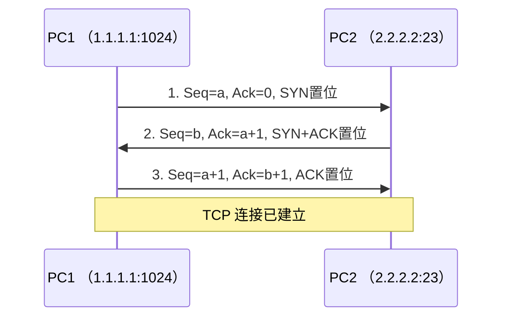

> [!WARNING]
> 原文第 3 步标注为"（Flags：**SYN** 置位）"，按 TCP 标准第 3 次握手的 SYN 不应置位、应为 **ACK 置位**。见文末「⚠️ 疑点」第 2 条。

###### 🎚️ TCP 的关闭 —— 四次挥手

| 步骤 | 方向 | 内容 |
| --- | --- | --- |
| 1 | PC1 → PC2 | 源=1.1.1.1，目的=2.2.2.2，**Seq=101，Ack=301**（**Flags：FIN 置位、ACK 置位**）—— **发送 FIN 请求断开连接** |
| 2 | PC2 → PC1 | 源=2.2.2.2，目的=1.1.1.1，**Seq=301，Ack=102**（**Flags：ACK 置位**）—— **发送 ACK** |
| 3 | PC2 → PC1 | 源=2.2.2.2，目的=1.1.1.1，**Seq=301，Ack=102**（**Flags：FIN 置位、ACK 置位**）—— **发送 FIN 请求断开连接** |
| 4 | PC1 → PC2 | 源=1.1.1.1，目的=2.2.2.2，**Seq=102，Ack=302**（**Flags：ACK 置位**）—— **发送 ACK** |
| — | — | **TCP 连接已断开** |

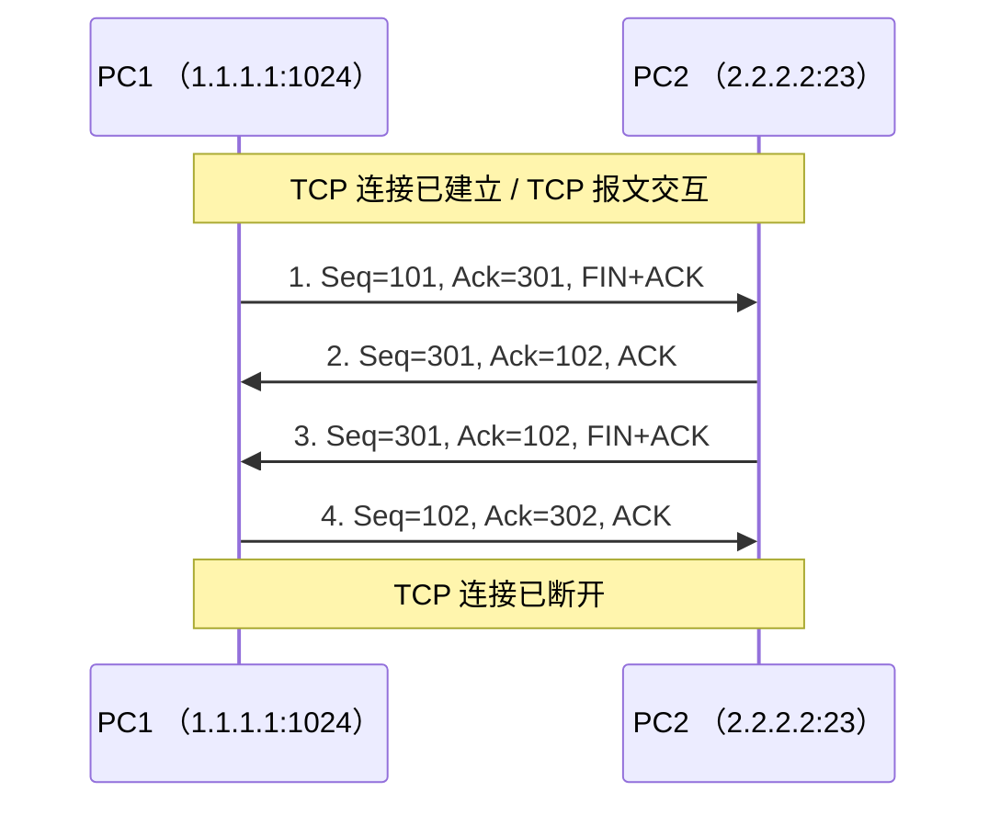

> [!TIP]
> 为什么是四次挥手：TCP **全双工**，每个方向需单独关闭（FIN + ACK 各一次），故为四次。

##### 📌 网络层

| 项目 | 要点 |
| --- | --- |
| 职责划分 | 传输层负责建立主机之间**进程与进程**之间的连接，而网络层则负责数据从**一台主机到另外一台主机**之间的传递 |
| PDU | 网络层的 PDU 被称为 **Packet（包）** |
| 别名 | 网络层也叫 **Internet 层**，负责将分组报文从**源主机发送到目的主机** |
| 作用 | 为网络中的设备提供**逻辑地址**；负责数据包的**寻径和转发** |
| 常见协议 | **IPv4、IPv6、ICMP、IGMP** 等 |

**网络层协议工作过程：**

| 阶段 | 说明 |
| --- | --- |
| 数据包的封装过程 | PC 完成 **IP 头部（信封）** 的封装，主要是**源目 IP 地址字段** |
| 基于网络层地址的报文转发过程 | ① 源设备发出的报文会在其网络层头部携带该报文的**源及目的设备的网络层地址**；② 具备路由功能的网络设备（例如路由器等）会**维护路由表（相当于它的地图）**；③ 当这些网络设备收到报文时，会读取其网络层携带的**目的地址**，并在其**路由表中查询**该地址，找到**匹配项**后，按照该表项的指示**转发数据** |

> [!TIP]
> 类比：**信件**＝上层（例如传输层）提交的数据；**信封**＝IP 报文头部；**发件人**＝源 IP 地址；**收件人**＝目的 IP 地址。

##### 📌 数据链路层

| 项目 | 要点 |
| --- | --- |
| 位置 | 数据链路层位于**网络层和物理层之间**，可以向网络层的 **IP、IPv6** 等协议提供服务 |
| PDU | 数据链路层的 PDU 被称为 **Frame（帧）** |
| 最常见协议 | **以太网（Ethernet）** |
| 作用 | 数据链路层向网络层提供"**段内通信**"；负责**组帧、物理编址、差错控制**等功能 |
| 常见协议 | **以太网、PPPoE、PPP** 等 |

**以太网与 MAC 地址：**

| 项目 | 要点 |
| --- | --- |
| 以太网定义 | 以太网是一种**广播式数据链路层协议**，支持**多点接入**。个人电脑的网络接口遵循的就是以太网标准。**一般情况下，一个广播域对应着一个 IP 网段** |
| MAC 地址 | MAC（Media Access Control）地址在网络中**唯一标识一个网卡**，每个网卡都需要且会有**唯一的一个 MAC 地址** |
| MAC 用途 | MAC 用于在**一个 IP 网段内**，寻址找到**具体的物理设备** |
| MAC 表 | 工作在数据链路层的设备（例如**以太网交换机**）会维护一张 **MAC 地址表**，用于指导**数据帧转发** |

##### 📌 地址解析协议（ARP）

| 项目 | 要点 |
| --- | --- |
| 全称 | ARP（**Address Resolution Protocol**）地址解析协议 |
| 作用 | 根据**已知的 IP 地址**解析获得其对应的 **MAC 地址** |

示例：

| 项 | Host A | Host B |
| --- | --- | --- |
| IP | `192.168.1.1/24` | `192.168.1.2/24` |
| MAC | `3C-52-82-49-7E-9D` | `48-A4-72-1C-8F-4F` |
| ARP 请求报文 | 目的 IP 地址：`192.168.1.2`；目的 MAC 地址：？ | — |
| ARP 响应报文 | — | 源 IP 地址：`192.168.1.2`；源 MAC 地址：`48-A4-72-1C-8F-4F` |

> [!WARNING]
> **ARP 欺骗/ARP 泛洪**是内网常见攻击；**IPv6 用 NDP 取代 ARP**。

##### 📌 物理层

| 项目 | 要点 |
| --- | --- |
| 作用 | 数据到达物理层之后，物理层会根据**物理介质的不同**，将数字信号转换成**光信号、电信号或者是电磁波信号** |
| PDU | 物理层的 PDU 被称为**比特流（Bitstream）** |
| 位置 | 物理层位于模型的**最底层** |
| 职责 | 负责**比特流在介质上的传输**；规范了**线缆、针脚、电压、接口**等物理特性规范 |
| 常见传输介质 | **双绞线、光纤、电磁波**等 |

**常见传输介质：**

| 介质 | 说明 |
| --- | --- |
| 双绞线 | **RJ45 连接器**；通过双绞线传输数据 |
| 光纤 | **光模块**；通过光纤传输数据 |
| 电磁波 | 终端（手机、笔记本电脑、平板）和**无线路由器**之间通过**无线信号**传输数据 |
| 串口线缆 | 同/异步串口线缆：**左 V.24，右 V.35**；通过串口线缆传输数据 |

##### 📌 发送方数据封装

| 层 | 封装结果 | PDU |
| --- | --- | --- |
| 应用层 | `DATA`（如 `www.huawei.com`） | **数据 Data** |
| 传输层 | `TCP Header` + `DATA` | **段 Segment** |
| 网络层 | `IP Header` + `Payload` | **包 Packet** |
| 数据链路层 | `Eth Header` + `Payload` + `FCS` | **帧 Frame** |
| 物理层 | `01001001……` 比特流 | **位 Bit** |

**中间网络数据传输：** 封装好的完整数据，将会在网络中被传递（经过 物理层—数据链路层—网络层 的多跳转发）。

**接收方数据解封装：** 比特流 → 帧（去 Eth Header/FCS）→ 包（去 IP Header）→ 段（去 TCP Header）→ 数据（DATA）→ **WEB 服务器**应用层。

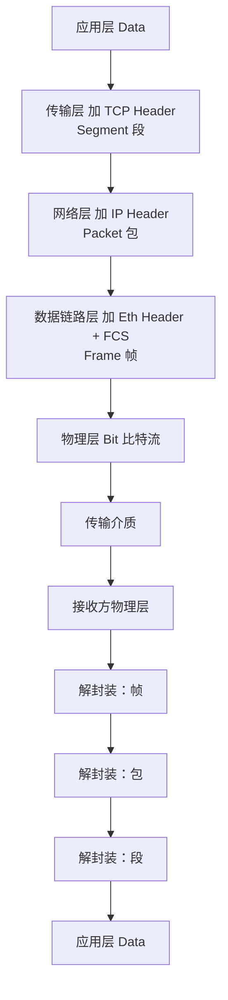

> [!TIP]
> PDU 五连记：**Data → Segment（段）→ Packet（包）→ Frame（帧）→ Bit（位）**。

#### 网络层协议与 IP 编址 `03`

##### 📌 网络层协议概览

| 项目 | 要点 |
| --- | --- |
| 别名 | 网络层经常被称为 **IP 层**。但网络层协议**并不只是 IP 协议** |
| 常见协议 | 还包括 **ICMP**（Internet Control Message Protocol）协议、**IPX**（Internet Packet Exchange）协议等 |
| IP 的作用 | **IP 寻址和路由选择** |

##### 📌 数据封装（PDU 对照）

| 层 | PDU |
| --- | --- |
| 应用层 | 数据 |
| 传输层 | **Segment** |
| 网络层 | **Packet** |
| 数据链路层 | **Frame** |
| 物理层 | **Bit** |

报文结构：**以太网头部 | IP 头部 | TCP 头部 | 用户数据 | 以太网尾部**

##### 📌 IPv4 报文格式

| 字段（顺序） |
| --- |
| Version |
| Header Length |
| Type of Service |
| Total Length |
| Identification |
| Flags |
| Fragment Offset |
| TTL |
| Protocol |
| Header Checksum |
| Source IP Address |
| Destination IP Address |
| Options |
| Padding |

| 项目 | 长度 |
| --- | --- |
| **固定长度** | **20 byte** |
| **可选长度** | **0 ~ 40 byte** |

> [!IMPORTANT]
> IPv4 首部：**固定 20 字节 + 可选 0–40 字节**，最大 **60 字节**。

##### 📌 什么是 IP 地址

| 项目 | 要点 |
| --- | --- |
| 作用 | IP 地址在网络中用于**标识一个节点（或者网络设备的接口）**；IP 地址用于 **IP 报文在网络中的寻址** |
| 类比 | IP 地址就像现实中的地址，可以标识网络中的一个节点，数据就是通过它来找到目的地 |

##### 📌 IP 地址表示

| 项目 | 要点 |
| --- | --- |
| 长度 | 一个 IPv4 地址有 **32 bit**（**4 byte**） |
| 表示法 | IPv4 地址通常采用"**点分十进制**"表示 |
| 范围 | IPv4 地址范围：**0.0.0.0 ~ 255.255.255.255** |

**十进制与二进制的转换示例：`192.168.10.1`**

| 段 | 十进制 | 二进制 |
| --- | --- | --- |
| 第 1 段 | 192 | `11000000` |
| 第 2 段 | 168 | `10101000` |
| 第 3 段 | 10 | `00001010` |
| 第 4 段 | 1 | `00000001` |

位权：2⁷=128，2⁶=64，2⁵=32，2⁴=16，2³=8，2²=4，2¹=2，2⁰=1
示例：`11000000` = 128 + 64 = **192**

##### 📌 IP 地址构成

| 项目 | 要点 |
| --- | --- |
| **网络掩码** | 区分一个 IP 地址中的**网络部分及主机部分** |
| **网络部分** | 用来**标识一个网络** |
| **主机部分** | 用来**区分一个网络内的不同主机** |

示例：`192.168.10.1`，掩码 `255.255.255.0`，写作 **`192.168.10.1/24`**

> [!WARNING]
> 原文此处写作 "`192.168.10.1 255.255.255.255 = 192.168.10.1/24`"，掩码与 `/24` 不一致，见文末「⚠️ 疑点」第 4 条。

##### 📌 IP 地址寻址

| 项目 | 要点 |
| --- | --- |
| 网络部分 | 用来标识一个网络，代表 IP 地址**所属网络** |
| 主机部分 | 用来区分一个网络内的不同主机，能**唯一标识网段上的某台设备** |

类比：**幸福小区（网络位）= 网段；X 栋 X 号 华华家（主机位）= 主机；网关**负责跨网段。

| 类型 | 说明 |
| --- | --- |
| **二层互联网络** | 同一网段内，如 `10.0.1.0/24`，**二层网络寻址**（用 MAC） |
| **三层互联网络** | 跨网段，如 `10.0.1.0/24` ↔ `10.0.2.0/24`，经**网关** `10.0.1.1/24`、`10.0.2.1/24`，**三层网络寻址**（用 IP） |

##### 📌 IP 地址分类

为了方便 IP 地址的管理及组网，IP 地址分成**五类**：

| 类别 | 首位模式 | 地址范围 | 用途 |
| --- | --- | --- | --- |
| **A 类** | `0NNNNNNN` | **0.0.0.0 ~ 127.255.255.255** | 分配主机使用 |
| **B 类** | `10NNNNNN` | **128.0.0.0 ~ 191.255.255.255** | 分配主机使用 |
| **C 类** | `110NNNNN` | **192.0.0.0 ~ 223.223.255.255** | 分配主机使用 |
| **D 类** | `1110NNNN` | **224.0.0.0 ~ 239.255.255.255** | **用于组播** |
| **E 类** | `1111NNNN` | **240.0.0.0 ~ 255.255.255.255** | **用于研究** |

**A/B/C 类默认网络掩码：**

| 类别 | 默认掩码 | 范围/前缀 |
| --- | --- | --- |
| **A 类** | **8 bit** | **0.0.0.0 ~ 127.255.255.255 /8** |
| **B 类** | **16 bit** | **128.0.0.0 ~ 191.255.255.255 /16** |
| **C 类** | **24 bit** | **192.0.0.0 ~ 191.223.255.255 /24** |

> [!WARNING]
> 原文 C 类范围写作 `192.0.0.0 ~ 223.223.255.255`、掩码段写作 `192.0.0.0 ~ 191.223.255.255/24`，均含有疑似笔误，见文末「⚠️ 疑点」第 5 条。

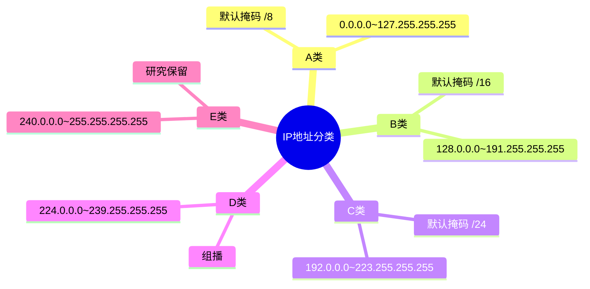

##### 📌 IP 地址类型

> 我们通常把一个**网络号所定义的网络范围**称为一个**网段**。

| 类型 | 说明 | 示例（192.168.10.0/24） |
| --- | --- | --- |
| **网络地址** | 用于**标识一个网络**（主机位全 0） | `192.168.10.0/24` |
| **广播地址** | 用于向该网络中的**所有主机**发送数据的特殊地址（主机位全 1） | `192.168.10.255/24` |
| **可用地址** | 可分配给网络中的**节点或网络设备接口**的地址 | `192.168.10.1/24` |

> [!IMPORTANT]
> **注意**：网络地址和广播地址**不能直接被节点或网络设备所使用**。
> 一个网段**可用地址数量**为：**2ⁿ − 2**（n：主机部分的比特位数）。

##### 📌 IP 地址计算（示例：`172.16.10.1/16`，B 类地址）

| 项目 | 结果 |
| --- | --- |
| IP 地址（二进制） | `10101100 00010000 00001010 00000001` |
| 网络掩码 | `11111111 11111111 00000000 00000000` |
| **网络地址**（主机位全 0） | `10101100 00010000 00000000 00000000` = **172.16.0.0/16** |
| **广播地址**（主机位全 1） | `10101100 00010000 11111111 11111111` = **172.16.255.255/16** |
| **IP 地址数** | **2¹⁶ = 65536** |
| **可用 IP 地址数** | **2¹⁶ − 2 = 65534** |
| **可用 IP 地址范围** | **172.16.0.1/16 ~ 172.16.255.254/16** |

> [!TIP]
> 计算口诀：**主机位全 0 = 网络地址；主机位全 1 = 广播地址；可用数 = 2ⁿ − 2**。

##### 📌 公网 IP 地址与私网 IP 地址

| 类型 | 说明 |
| --- | --- |
| **公网 IP 地址** | IP 地址是由 **IANA 统一分配**的，以保证任何一个 IP 地址在 **Internet 上的唯一性**。这里的 IP 地址是指公网 IP 地址 |
| **私网 IP 地址** | 实际上一些网络不需要连接到 Internet（比如一个大学的封闭实验室内的网络），只要同一网络中的网络设备的 IP 地址**不冲突**即可。在 IP 地址空间里，**A、B、C 三类地址中各预留了一些地址**专门用于上述情况，称为私网 IP 地址 |

**私网 IP 地址范围：**

| 类别 | 私网地址范围 |
| --- | --- |
| **A 类** | **10.0.0.0 ~ 10.255.255.255**（`10.0.0.0/8`） |
| **B 类** | **172.10.0.0 ~ 172.31.255.255** |
| **C 类** | **192.168.0.0 ~ 192.168.255.255**（`192.168.0.0/24`、`192.168.1.0/24`） |

> 私有网络连接到 Internet：**通过 NAT 技术实现**。

> [!WARNING]
> 原文 B 类私网写作 `172.10.0.0~172.31.255.255`，RFC 1918 标准为 **172.16.0.0 ~ 172.31.255.255**（课件 P608 课堂练习选项 C 亦写 `172.16.0.0`），见文末「⚠️ 疑点」第 6 条。

##### 📌 特殊 IP 地址

IP 地址空间中，有一些特殊的 IP 地址，这些 IP 地址有特殊的含义和作用：

| 特殊 IP 地址 | 地址范围 | 作用 |
| --- | --- | --- |
| **有限广播地址** | **255.255.255.255** | 可作为**目的地址**，发往该网段所有主机（**受限于网关**） |
| **任意地址** | **0.0.0.0** | "**任何网络**"的网络地址；"**这个网络上这个主机接口**"的 IP 地址 |
| **环回地址** | **127.0.0.0/8** | **测试设备自身的软件系统** |
| **本地链路地址** | **169.254.0.0/24** | 当主机**自动获取地址失败**后，可使用该网段中的某个地址进行**临时通信** |

> [!WARNING]
> 原文"本地链路地址"写作 `169.254.0.0/24`，标准为 **169.254.0.0/16**，见文末「⚠️ 疑点」第 7 条。

##### 📌 IPv4 vs IPv6

> 由全球 IP 地址分配机构 **IANA**（Internet Assigned Numbers Authority）管理的 **IPv4 地址，于 2011 年完全用尽**。随着最后一个 IPv4 公网地址分配完毕，加上接入公网的用户及设备越来越多，**IPv4 地址枯竭**的问题日益严重，这是当前 **IPv6 替代 IPv4 的最大源动力**。

| 对比项 | **IPv4** | **IPv6** |
| --- | --- | --- |
| **地址长度** | **32 bit** | **128 bit** |
| **地址分类** | **单播地址、广播地址、组播地址** | **单播地址、广播地址、任播地址** |
| **特点** | ① 地址枯竭；② 包头设计不合理；③ 对 **ARP 的依赖，导致广播泛滥**；④ …… | ① **无限地址**；② **简化的报文头部**；③ **IPv6 地址自动部署**；④ …… |

> [!WARNING]
> 原文 IPv6 分类写作"单播、广播、任播"，但 **IPv6 已取消广播地址**，标准分类为**单播（Unicast）、组播（Multicast）、任播（Anycast）**，见文末「⚠️ 疑点」第 12 条。

#### IP 路由基础 `04`

##### 📌 背景：网段间通信

| 项目 | 要点 |
| --- | --- |
| 背景 | IP 地址唯一标识了网络中的一个节点，每个 IP 地址都拥有自己的**网段**，各个网段可能分布在网络的**不同区域** |
| 需求 | 为实现 IP 寻址，分布在不同区域的网段之间要能够**相互通信**（"如何前往网络 M？"） |

##### 📌 路由基本概念

| 项目 | 要点 |
| --- | --- |
| **路由** | 是**指导报文转发的路径信息**，通过路由可以确认**转发 IP 报文的路径** |
| **路由设备** | 是依据路由**转发报文到目的网段**的网络设备，最常见的路由设备：**路由器** |
| **路由表** | 路由设备维护着一张**路由表**，保存着**路由信息** |

##### 📌 路由信息介绍

路由中包含以下信息：

| 项目 | 说明 |
| --- | --- |
| **目的网络** | 标识**目的网段** |
| **掩码** | 与目的地址**共同标识一个网段** |
| **出接口** | 数据包被路由后**离开本路由器的接口** |
| **下一跳** | 路由器转发到达目的网段的数据包所使用的**下一跳地址** |

> 这些信息标识了**目的网段**、明确了**转发 IP 报文的路径**。

示例路由条目：

| 目的网络/掩码 | 出接口 | 下一跳 |
| --- | --- | --- |
| **10.1.1.0/24** | **GE0/0/0** | **1.1.1.2** |

##### 📌 路由表（示例）

| 目的网络/掩码 | 下一跳 | 出接口 |
| --- | --- | --- |
| 11.0.0.0/8 | 2.2.2.2 | GE0/0 |
| 13.0.0.0/8 | 3.3.3.2 | GE0/1 |
| 14.0.0.0/8 | 1.1.1.2 | GE0/2 |
| 1.1.1.0/30 | 1.1.1.1 | GE0/2 |
| 1.1.1.1/32 | 127.0.0.1 | GE0/2 |

| 项目 | 要点 |
| --- | --- |
| 路由器通过各种方式**发现路由** | — |
| 路由器选择**最优**的路由条目放入**路由表**中 | — |
| **路由表指导设备对 IP 报文的转发** | — |
| 路由器通过对**路由表的管理**实现对路径信息的管理 | — |

##### 📌 路由信息获取方式

路由器依据路由表进行路由转发，为实现路由转发，路由器需要发现路由，以下为常见的路由获取方式：

| 路由来源 | 说明 | 示例 |
| --- | --- | --- |
| **直连路由** | 由**设备自动生成**指向**本地直连网络** | 10.1.1.0/24 → GE0/0/0；20.1.1.0/24 → GE0/0/1 |
| **静态路由** | 由**网络管理员手工配置**的路由条目 | 30.1.1.0/24 → GE0/0/1 |
| **动态路由** | 路由器**运行动态路由协议**学习到的路由（如 **OSPF**） | 40.1.1.0/24 → GE0/0/2 |

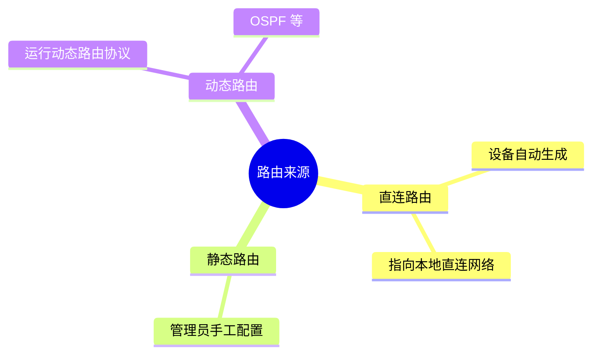

#### 以太网交换基础 `05`

##### 📌 以太网协议

| 项目 | 要点 |
| --- | --- |
| 定义 | 以太网是当今现有**局域网（LAN）** 采用的最通用的**通信协议标准**，该标准定义了在局域网中采用的**电缆类型和信号处理方法** |
| 机制 | 以太网是建立在 **CSMA/CD**（**Carrier Sense Multiple Access/Collision Detection，载波监听多路访问/冲突检测**）机制上的**广播型网络** |
| 组网演进 | 早期的以太网（同轴电缆总线共享）→ 交换机组网 |

##### 📌 冲突域

| 项目 | 要点 |
| --- | --- |
| 定义 | 冲突域是指连接在**同一共享介质上的所有节点的集合**，冲突域内所有节点**竞争同一带宽**，一个节点发出的报文（**无论是单播、组播、广播**），**其余节点都可以收到** |
| 早期以太网 | **1 个冲突域** |
| 交换机组网 | **5 个冲突域**（示例）—— **交换机不同的接口发送和接收数据独立，各接口属于不同的冲突域**，因此有效地**隔离了网络中物理层冲突域**，使得通过它互连的主机（或网络）之间不必再担心流量大小对于数据发送冲突的影响 |
| 解决机制 | **CSMA/CD** |
| 隔离方式 | **隔离冲突域**；**每个接口相当于 1 个独立的冲突域** |

> [!TIP]
> **同一介质上的节点越多，冲突发生的概率越大**。交换机**每个端口 = 1 个冲突域**（隔离冲突域），但**不隔离广播域**。

##### 📌 广播域

| 项目 | 要点 |
| --- | --- |
| 定义 | **广播报文所能到达的整个访问范围**称为**二层广播域**，简称广播域，同一广播域内的主机**都能收到广播报文** |
| 早期以太网 | **1 个广播域** |
| 交换机组网 | **1 个广播域**（交换机不隔离广播域） |

> [!IMPORTANT]
> **路由器隔离广播域；交换机隔离冲突域、不隔离广播域；VLAN 隔离广播域。**

##### 📌 以太网卡

| 项目 | 要点 |
| --- | --- |
| 定义 | **网络接口卡（Network Interface Card, NIC）** 也称为"**网卡**"，是**计算机、交换机、路由器**等网络设备与**外部网络世界相连的关键部件** |
| 网络接口 | 简称"**网口**"或"**接口**"或"**端口**" |
| 网卡 | **每个网口都有一块网卡与之对应**；计算机或交换机通过**网卡来转发数据** |

数据形态流转：计算机（TCP/IP + 网络层）→ **Packet** ↔ 网卡 ↔ **Frame** ↔ **Bit Stream** ↔ 交换机 ↔ 网卡 ↔ Frame ↔ Packet。

##### 📌 什么是 MAC 地址

| 项目 | 要点 |
| --- | --- |
| 定义 | MAC（**Medium Access Control**）地址在网络中**唯一标识一个网卡**，每个网卡都需要并拥有**唯一的一个 MAC 地址** |
| 唯一性 | 一块网卡的 MAC 地址是具有**全球唯一性**的 |
| 类比 | 如同每个人都有身份证号码来标识自己一样，每块网卡也拥有一个用来标识自己的号码，即 MAC 地址。**我一出厂就有专属的 MAC 地址了** |

##### 📌 MAC 地址表示

| 项目 | 要点 |
| --- | --- |
| 长度 | 一个 MAC 地址有 **48 bit**，**6 Byte** |
| 表示法 | MAC 地址通常采用"**十六进制**" + "**-**" 表示，如 `00-1E-10-DD-DD-02`，或 `001E-10DD-DD02` |

**十六进制与二进制的转换（示例）：**

| 十六进制 | 二进制 |
| --- | --- |
| `0` | `0000` |
| `1` | `0001` |
| `E`（14） | `1110`（8+4+2=14） |
| `D` | `1101` |

位权（每 4 bit）：2³=8，2²=4，2¹=2，2⁰=1

##### 📌 交换机的工作原理

| 步骤 | 说明 |
| --- | --- |
| 学习 | 在收到数据帧后，交换机**学习帧的源 MAC 地址** |
| 查表 | 然后在 **MAC 地址表**中**查询该帧的目的 MAC 地址** |
| 转发 | 并将帧**从对应的端口转发出去** |

示例（主机 1 → 主机 2）：

| 项 | 主机 1 | 主机 2 |
| --- | --- | --- |
| IP | `192.168.1.1`（IP1） | `192.168.1.2`（IP2） |
| MAC | `0050-5600-0001`（MAC1） | `0050-5600-0002`（MAC2） |
| 接口 | GE0/0/1 | GE0/0/2 |

主机 1 发出的数据帧：源 MAC：MAC1；目的 MAC：MAC2；源 IP：IP1；目的 IP：IP2；载荷。

##### 📌 VLAN 背景：传统以太网的问题

| 项目 | 要点 |
| --- | --- |
| 问题 | 在典型交换网络中，当某台主机发送一个**广播帧或未知单播帧**时，该数据帧会被**泛洪**，甚至传递到**整个广播域** |
| 后果 | **广播域越大，产生的网络安全问题、垃圾流量问题，就越严重** |

> 示例拓扑：PC1 → SW1 → SW2/SW3/SW4/SW5/SW6/SW7 → PC2（假定此时 SW1、SW3、SW7 的 MAC 地址表中存在关于 PC2 的 MAC 地址表项，但 SW2 和 SW5 不存在关于 PC2 的 MAC 地址表项）。单播帧 → 有效流量 + 垃圾流量 → **二层广播域（广播域）**。

##### 📌 虚拟局域网（VLAN, Virtual LAN）

| 项目 | 要点 |
| --- | --- |
| 作用 | 虚拟局域网 VLAN 可以**隔离广播域** |
| 效果 | 由 1 个广播域 → **VLAN 网络（多个广播域）** |
| 特点 | ① **不受地域限制**；② **同一 VLAN 内的设备才能直接进行二层通信** |

> [!IMPORTANT]
> VLAN 的核心价值：**隔离广播域、缩小广播域、抑制垃圾流量与安全风险**；**不同 VLAN 之间二层不能直接通信**（需三层路由）。

#### 网络地址转换 `06`

##### 📌 NAT 产生背景

| 项目 | 要点 |
| --- | --- |
| 背景 1 | 随着互联网用户的增多，**IPv4 的公有地址资源显得越发短缺** |
| 背景 2 | 同时 IPv4 公有地址资源存在**地址分配不均**的问题，这导致部分地区的 IPv4 可用公有地址**严重不足** |
| 结论 | 为解决该问题，使用**过渡技术**解决 IPv4 公有地址短缺就显得尤为必要 |

##### 📌 NAT 技术原理

| 项目 | 要点 |
| --- | --- |
| 定义 | NAT：对 **IP 数据报文中的 IP 地址进行转换**，是一种在现网中被广泛部署的技术，一般部署在**网络出口设备**，例如**路由器或防火墙**上 |
| 典型场景 | 在私有网络内部（园区、家庭）使用**私有地址**，出口设备部署 NAT：对于"**从内到外**"的流量，网络设备通过 NAT 将数据包的**源地址**进行转换（转换成特定的公有地址）；而对于"**从外到内**"的流量，则对数据包的**目的地址**进行转换 |
| 效果 | 通过**私有地址的使用结合 NAT 技术**，可以有效**节约公网 IPv4 地址** |

**交互示例（4 步）：**

| 步骤 | 报文 |
| --- | --- |
| 1 | PC（`192.168.1.10/24`）发出：源 IP `192.168.1.10` → 目的 IP `200.1.2.3` |
| 2 | 经 NAT（出口 `122.1.2.1`，内网口 `192.168.1.254`）转换后：源 IP **`122.1.2.1`** → 目的 IP `200.1.2.3` |
| 3 | Web 服务器（`200.1.2.3`）回应：源 IP `200.1.2.3` → 目的 IP `122.1.2.1` |
| 4 | 经 NAT 反向转换：源 IP `200.1.2.3` → 目的 IP **`192.168.1.10`** |

##### 📌 静态 NAT 原理

| 项目 | 要点 |
| --- | --- |
| 定义 | 静态 NAT：每个私有地址都有**一个与之对应并且固定的公有地址**，即私有地址和公有地址之间的关系是**一对一映射** |
| 双向互访 | 支持双向互访：私有地址访问 Internet 经过出口设备 NAT 转换时，会被转换成对应的公有地址。同时，外部网络访问内部网络时，其报文中携带的公有地址（目的地址）也会被 NAT 设备转换成对应的私有地址 |

**NAT 映射表（静态）：**

| 私有地址 | 公有地址 |
| --- | --- |
| 192.168.1.1 | 122.1.2.1 |
| 192.168.1.2 | 122.1.2.2 |
| 192.168.1.3 | 122.1.2.3 |

##### 📌 动态 NAT 原理

| 项目 | 要点 |
| --- | --- |
| 问题 | 静态 NAT 严格地一对一进行地址映射，这就导致即便内网主机**长时间离线或者不发送数据**时，与之对应的公有地址也处于**使用状态** |
| 解决 | 为了避免地址浪费，动态 NAT 提出了**地址池**的概念：**所有可用的公有地址组成地址池** |
| 机制 | 当内部主机访问外部网络时**临时分配**一个地址池中**未使用**的地址，并将该地址标记为"**In Use**"。当该主机**不再访问外部网络时回收**分配的地址，重新标记为"**Not Use**" |

**NAT 地址池（动态）：**

| 公有地址 | 状态 |
| --- | --- |
| 122.1.2.1 | Not Use |
| 122.1.2.2 | Not Use |
| 122.1.2.3 | Not Use |

##### 📌 NAT Server 使用场景

| 项目 | 要点 |
| --- | --- |
| 定义 | NAT Server：指定 **[公有地址:端口]** 与 **[私有地址:端口]** 的**一对一映射**关系，将**内网服务器映射到公网**，当私有网络中的服务器**需要对公网提供服务**时使用 |
| 效果 | **外网主机主动访问 [公有地址:端口] 实现对内网服务器的访问** |

**NAT 映射表（NAT Server）：**

| 私有地址:端口 | 公有地址:端口 |
| --- | --- |
| **192.168.1.10:80** | **122.1.2.1:80** |

> 示例：Internet 主机（`200.1.2.3`）访问 `122.1.2.1:80` → 映射到内网 Web 服务器 `192.168.1.10`（网关 `192.168.1.254`）。

> [!TIP]
> 三种 NAT 对比：**静态 NAT**（一对一固定，双向互访）；**动态 NAT**（地址池，临时分配/回收）；**NAT Server**（公网地址:端口 → 私网服务器:端口，对外发布服务）。

#### 网络管理 `07`

##### 📌 网络管理基本功能（OSI 五大功能模型）

OSI 定义了网络管理的五大功能模型：**配置管理、性能管理、故障管理、安全管理、计费管理**。

| 功能 | 说明 |
| --- | --- |
| **配置管理**（Configuration Management） | 配置管理负责**监控网络的配置信息**，使网络管理人员可以**生成、查询和修改**硬件、软件的**运行参数和条件**，并可以进行**相关业务的配置** |
| **性能管理**（Performance Management） | 性能管理以**网络性能为准则**，保证在使用**较少网络资源和具有较小时延**的前提下，网络能够提供**可靠、连续的通信能力** |
| **故障管理**（Fault Management） | 故障管理的主要目标是**确保网络始终可用**，并在**发生故障时尽快将其修复** |
| **安全管理**（Security Management） | 安全管理可以**保护网络和系统免受未经授权的访问和安全攻击** |
| **计费管理**（Accounting Management） | **记录用户使用网络资源的情况并核收费用**，同时也**统计网络的利用率** |

> [!TIP]
> 五大功能口诀：**配（配置）性（性能）故（故障）安（安全）计（计费）**＝"**配性故安计**"。

##### 📌 通过 CLI 或 Web 进行管理

| 项目 | 要点 |
| --- | --- |
| 适用 | 当**网络规模较小**时，CLI 和 Web 方式是常见的网络管理方式 |
| 方式 | 网络管理员可以通过 **HTTPS、Telnet、Console** 等方式登录设备后，对设备**逐一进行管理** |
| 优点 | 这种管理方式**不需要在网络中安装任何程序或部署服务器，成本较低** |
| 要求 | 网络管理员自身需要熟练掌握**网络理论知识、各设备厂商网络配置命令** |
| 局限 | 当**网络规模较大、网络拓扑较为复杂**时，这种方式的**局限性较大** |

> 特点：**"一对一"管理**；典型场景：厂商 A 交换机/防火墙/AC/路由器 + 厂商 B 路由器 + 厂商 C 交换机 + 厂商 D 交换机。

##### 📌 基于 SNMP 的集中式管理

| 项目 | 要点 |
| --- | --- |
| 定义 | **SNMP**（**Simple Network Management Protocol，简单网络管理协议**）是广泛用于 **TCP/IP 网络**的网络管理标准协议，提供了一种通过运行网络管理软件的**中心计算机**，即 **NMS**（**Network Management Station，网络管理工作站**）来管理**网元**的方法 |
| 优点 1 | 网络管理员可以利用 NMS 在网络上的**任意节点**完成**信息查询、信息修改和故障排查**等工作，**提升工作效率** |
| 优点 2 | **屏蔽了不同产品之间的差异**，实现了**不同种类和厂商的网络设备之间的统一管理** |
| 特点 | **"一对多"管理**（NMS ← SNMP 报文交互 → 多厂商设备） |

> [!IMPORTANT]
> SNMP 端口：**161（Agent）/ 162（Trap）**，基于 **UDP**；管理平台：**NMS**。

#### 园区网组网架构 `08`

##### 📌 园区网络典型架构

| 项目 | 要点 |
| --- | --- |
| 设计原则 | 园区网一般遵循**层次化和模块化**设计原则 |
| 分类 | 按照**终端用户数量或者网元数量**，可将园区网分为**小型园区网、中型园区网和大型园区网** |

| 区域/层次 | 说明 |
| --- | --- |
| **接入层** | 终端接入 |
| **汇聚层** | 汇聚接入 |
| **核心层** | 高速转发 |
| **出口区** | 连接 **WAN / Internet**，部署 **Firewall、IPS、Anti-DDoS、AC、eLOG** 等 |
| **数据中心区** | 服务器区 |
| **网络管理区** | 网管平台 |
| 其他 | **出差员工、分支园区**接入 |

```mermaid
flowchart TB
  I["Internet / WAN"] --> E["出口区<br/>Firewall / IPS / Anti-DDoS"]
  E --> C["核心层"]
  C --> A["汇聚层"]
  A --> AC["接入层"]
  C --> DC["数据中心区"]
  C --> NM["网络管理区"]
  R["出差员工 / 分支园区"] --> E
```

##### 📌 园区网络主要协议/技术

| 层次/区域 | 常用协议/技术 |
| --- | --- |
| **接入层** | **VLAN、生成树、链路聚合、AAA** 等 |
| **汇聚层** | **DHCP、堆叠、链路聚合、生成树、OSPF、静态路由** 等 |
| **核心层** | **堆叠、OSPF、静态路由、ACL** 等 |
| **出口区** | **NAT、OSPF、静态路由、PPPoE** 等 |
| 无线 | **WLAN 相关协议/技术**（**AC**） |
| 管理 | **SNMP / NETCONF**（**NMS**） |

#### 课堂练习 `09`

##### 第 1 题

> 计算机网络为了实现资源共享，采用**协议分层设计思想**，每层网络协议都有地址信息，如网卡（MAC）地址、IP 地址、端口地址和域名地址，以下有关上述**地址转换**的描述**错误**的是（ ）。
>
> A. DHCP 协议可以完成 IP 地址和端口地址的转换
> B. DNS 协议可实现域名地址和 IP 地址之间的转换
> C. ARP 协议可以实现 MAC 地址和 IP 地址之间的转换
> D. 域名地址和端口地址无法转换

> [!TIP]
> 解析：**A**（错误）。DHCP 用于**动态分配 IP 地址**，不做 IP 与端口的转换；DNS 做域名↔IP；ARP 做 IP↔MAC。

##### 第 2 题

> 一台连接在以太网内的计算机为了能和其它主机进行通信，需要有网卡支持。网卡接收数据帧的状态有：`unicast`、`broadeast`、`multicast`、`promiscuous` 等，其中能**接收所有类型数据帧**的状态是（ ）。
>
> A. Unicast　B. broadcast　C. multicast　D. promiscuous

> [!TIP]
> 解析：**D. promiscuous（混杂模式）**—— 抓包分析（Wireshark、Snort）的工作前提。

##### 第 3 题

> FTP 是一个交互会话的系统，在进行文件传输时，FTP 的客户和服务器之间需要建立**两个 TCP 连接**，分别是（ ）。
>
> A. 认证连接和数据连接　B. 控制连接和数据连接
> C. 认证连接和控制连接　D. 控制连接和登录连接

> [!TIP]
> 解析：**B. 控制连接和数据连接**（控制连接 **TCP 21**，数据连接 **TCP 20**）。

##### 第 4 题

> IP 地址分为全球地址（公有地址）和专用地址（私有地址），在文档 **RFC1918** 中，**不属于专用地址**的是（ ）。
>
> A. `10.0.0.0` 到 `10.255.255.255`
> B. `255.0.0.0` 到 `255.255.255.255`
> C. `172.16.0.0` 到 `172.31.255.255`
> D. `192.168.0.0` 到 `192.168.255.255`

> [!TIP]
> 解析：**B**（255 段属于 E 类保留/广播，不是 RFC1918 私有地址）。

---

### 七、案例考情分析

> 章节封面：信息安全工程师 案例考情分析

#### 本章目录

| 序号 | 小节 |
| --- | --- |
| 1 | 考试形式 |
| 2 | 考试大纲分析 |
| 3 | 命题规律分析 |

#### 考试形式 `01`

##### 📌 考试形式 —— 机考

（课件此页为图示，无文字要点，标题为"考试形式 – 机考"。）

##### 📌 考试形式 —— 题型（5 类）

| 题型 | 特点与应对 |
| --- | --- |
| **案例问答** | 需**依据题干描述进行针对性作答**，准确写出答案（**非管理类的点，是就是，不是就不是**），是案例分析的**核心考查形式** |
| **案例选择** | 相对灵活且有选项提示，**多选题遵循"少选得部分分，多选/错选不得分"** 的评分规则，需**精准判断选项** |
| **案例判断** | 考查**基础概念的辨析**，题目难度**整体偏低**，只要熟练掌握知识点，这类题型应**尽量拿下全分** |
| **案例填空** | 难度中等，出题频率**相对较低**，重点考查对**关键术语、核心参数**的精准记忆与理解 |
| **案例计算** | 集中在**密码学领域**，涉及**加密解密公式应用、密钥计算**等，需扎实掌握**核心概念与基础运算方法** |

> [!IMPORTANT]
> 多选题评分规则：**少选得部分分，多选/错选不得分** —— 不确定的选项**宁可少选**。

##### 📌 中级资格连考规则与注意事项

| 项目 | 要点 |
| --- | --- |
| 🕒 **中级资格连考规则** | 考试包含【**基础知识**】和【**应用技术**】两个科目，实行**连续作答模式**，**总时长 240 分钟**。其中基础知识科目作答时长**不少于 90 分钟、不超过 120 分钟**；若放弃后续科目，**开考 120 分钟后可离场**；若继续作答应用技术科目，需在**考试结束前 60 分钟**方可交卷 |
| 💻 **官方机考模拟** | **考前两周**将开放全国计算机技术与软件专业技术资格（水平）考试**官方模拟平台**，考生可登录系统熟悉**机考操作界面、题型布局及作答流程**，提前适应电子化考试环境，无需过度紧张 |
| 📋 **备考与考试注意事项** | ① **基础为本**：扎实掌握理论与技术是核心；② **机考适应**：利用操作基础优势，熟悉系统即可；③ **题型稳定**：核心题型与重点保持稳定，**无实操题** |

#### 考试大纲分析 `02`

##### 📌 官方教材与大纲出版物

| 名称 | 出版详情 |
| --- | --- |
| **信息安全工程师考试大纲** | 书号 **9787302508847**，**2020 年 9 月**由**清华大学出版社**出版 |
| **信息安全工程师教程（第 2 版）** | 书号 **9787302559344**，**2020 年 9 月**同步发行 |

##### 📌 考试目标（01 / 考试目标）

通过本考试的合格人员能够：

| 编号 | 能力要求 |
| --- | --- |
| 1 | 掌握**网络信息安全的基础知识和技术原理** |
| 2 | 根据国家网络信息安全**相关法律法规及业务安全保障要求**，能够**规划、设计信息系统安全方案**，能够**配置和维护常见的网络安全设备及系统** |
| 3 | 能够对信息系统的**网络安全风险进行监测和分析**，并给出**网络安全风险问题的整改建议** |
| 4 | 能够协助相关部门对单位的信息系统进行**网络安全审计和网络安全事件调查** |
| 5 | 能够对**网络信息安全事件开展应急处置**工作 |
| 6 | 具有**工程师的实际工作能力和业务水平** |

##### 📌 考试科目与形式（02 / 考试科目与形式）

| 科目 | 名称 | 考查内容 | 形式 | 时长 |
| --- | --- | --- | --- | --- |
| **科目一** | **基础理论** | 考查**网络信息安全基础知识与技术** | **机考**，题型为**客观选择题** | **120 分钟**（**最短时间 90 分钟**） |
| **科目二** | **综合实践** | 考查**网络安全工程应用与综合实践能力** | **机考**，题型为**主观问答题** | **120 分钟** |

##### 📌 考试范围

| 科目 | 范围 |
| --- | --- |
| **科目一** | **夯实理论基础，网络信息安全基础知识和技术**（**第一章到第二十一章 网络设备安全**） |
| **科目二** | **网络信息安全工程与综合应用实践** |

##### 📌 科目二考试大纲结构（按课件顺序）

###### 🎚️ 风险评估与方案设计

| 编号 | 条目 |
| --- | --- |
| ◆ **风险评估** | 1.1 网络安全风险评估实践；1.2 网络安全数据收集与分析 |
| ◆ **方案设计** | 2.1 操作系统安全方案设计；2.2 网络设备及通信安全方案设计；2.3 计算环境安全方案设计；2.4 应用及数据安全方案设计；2.5 网络安全管理方案设计 |

###### 🎚️ 设备部署与系统管控

| 编号 | 条目 |
| --- | --- |
| ◆ **设备部署使用** | 3.1 防火墙部署与使用；3.2 **IDS/IPS** 部署与使用；3.3 **网闸**部署与使用；3.4 **VPN** 部署与使用；3.5 漏洞扫描部署与使用 |
| ◆ **系统配置与管理** | 4.1 操作系统安全配置与管理；4.2 数据库系统安全配置与管理；4.3 网站系统安全配置与管理；4.4 网络设备安全配置与管理 |

###### 🎚️ 网站安全分析与保护工程

| 编号 | 条目 |
| --- | --- |
| 5.1 | 网站安全威胁与需求分析 |
| 5.2 | **Apache** 安全分析与增强 |
| 5.3 | **IIS** 安全分析与增强 |
| 5.4 | Web 应用漏洞分析与防护 |
| 5.5 | 网站安全保护机制与技术方案 |
| 5.5.1 | 网站构成组件安全加固 |
| 5.5.2 | 网站攻击防护及安全监测 |

###### 🎚️ 云计算安全需求分析与保护工程

| 编号 | 条目 |
| --- | --- |
| 6.1 | 云计算安全威胁与需求分析 |
| 6.1.1 | 云计算安全威胁 |
| 6.1.2 | 云计算安全需求 |
| 6.2 | 云计算安全保护机制与技术方案 |
| 6.2.1 | 云计算安全等级保护框架 |
| 6.2.2 | 云计算安全防护 |
| 6.2.3 | 云计算安全管理 |
| 6.2.4 | 云计算安全运维制（原文如此，见疑点） |
| 6.3 | 云计算安全保护案例分析 |

###### 🎚️ 工控安全需求与防护工程

| 编号 | 条目 |
| --- | --- |
| 7.1 | 工控系统安全威胁与需求分析 |
| 7.2 | 工控系统安全保护机制与技术 |
| 7.2.1 | 物理及环境安全防护 |
| 7.2.2 | 安全分区与边界防护 |
| 7.2.3 | 身份认证与访问控制 |
| **7.24** | 远程访问安全（**原文写作 7.24**，应为 7.2.4，见疑点） |
| 7.2.5 | 工控系统安全加固 |
| 7.2.6 | 工控安全审计 |
| 7.2.7 | 恶意代码防范 |
| 7.2.8 | 工控数据安全 |
| 7.2.9 | 工控安全监测与应急响应 |
| 7.2.10 | 工控安全管理 |
| 7.2.11 | 工控安全典型产品技术 |

###### 🎚️ 移动应用安全与防护实践

| 编号 | 条目 |
| --- | --- |
| 8.1 | 移动应用安全威胁与需求分析 |
| 8.2 | Android 系统安全与保护机制 |
| 8.3 | iOS 系统安全与保护机制 |
| 8.4 | 移动应用安全保护机制与技术方案 |
| 8.4.1 | 移动应用 App 安全风险 |
| 8.4.2 | 移动应用 App 安全加固 |
| **84.3** | 移动应用 App 安全检测（**原文写作 84.3**，应为 8.4.3，见疑点） |
| 8.5 | 移动应用安全综合应用案例分析 |

#### 命题规律分析 `03`

##### 📌 2016 年真题考点

| 试题编号 | 核心考点 |
| --- | --- |
| 2016 年上半年试题 1 | **CIA 基础**，加密过程（**PCBC**） |
| 2016 年上半年试题 2 | **Windows 访问控制规则** |
| 2016 年上半年试题 3 | **防火墙基础、防火墙规则表** |
| 2016 年上半年试题 4 | **身份认证过程、哈希概念** |
| 2016 年上半年试题 5 | **代码分析（C 语言）、堆栈** |

##### 📌 2017 年真题考点

| 试题编号 | 考点内容 |
| --- | --- |
| 2017 年上半年试题 1 | CIA 基础 |
| 2017 年上半年试题 2 | **Windows 用户安全管理（本地安全策略）** |
| 2017 年上半年试题 3 | **Nmap 扫描日志看图说话、防火墙规则表** |
| 2017 年上半年试题 4 | **DES 算法** |
| 2017 年上半年试题 5 | **公钥密码算法加密和认证的过程** |
| 2017 年上半年试题 6 | 代码分析（堆栈） |

##### 📌 2018 年真题考点

| 试题编号 | 考点内容 |
| --- | --- |
| 2018 年上半年试题 1 | **恶意代码（WannaCry 勒索病毒）、防火墙规则表配置与分析** |
| 2018 年上半年试题 2 | **密码学、哈希算法基础** |
| 2018 年上半年试题 3 | **Linux 系统账户安全基础** |
| 2018 年上半年试题 4 | **C 语言代码分析（心跳包机制）、模糊测试基础** |
| 2018 年上半年试题 5 | **IDS/IPS 基础、P2DR 安全模型、Snort 规则与攻击日志分析** |

##### 📌 2019 年真题考点

| 试题编号 | 考点内容 |
| --- | --- |
| 2019 年上半年试题 1 | **访问控制基本要素、BLP 模型、Linux 文件权限** |
| 2019 年上半年试题 2 | **密码学 CIA 三要素、仿射密码** |
| 2019 年上半年试题 3 | **身份认证基础、防重放攻击机制、哈希函数特性** |
| 2019 年上半年试题 4 | **防火墙规则表配置与策略分析** |
| 2019 年上半年试题 5 | **SDLC 安全开发生命周期、隐私保护、C 语言漏洞与堆栈分析** |

##### 📌 2020 年真题考点

| 试题编号 | 考点内容 |
| --- | --- |
| 2020 年上半年试题 1 | **Linux 用户安全及权限表示** |
| 2020 年上半年试题 2 | **密码学基础、RSA 算法** |
| 2020 年上半年试题 3 | **Windows 防火墙操作界面、拒绝服务攻击及日志分析** |
| 2020 年上半年试题 4 | **ISO 安全体系结构（安全服务类型选择）** |
| 2020 年上半年试题 5 | **C 语言代码漏洞判断、堆栈、漏洞缓解（Visual Studio 安全编译）** |

##### 📌 2021 年真题考点

| 试题编号 | 考点内容 |
| --- | --- |
| 2021 年下半年试题 1 | **等保定级、PHP 代码分析（SQL 注入）、用户口令保存（哈希加盐）、网络诊断命令（netstat）、防火墙体系结构、入侵检测系统（Snort）规则、Wireshark 流量包分析及端口镜像配置** |
| 2021 年下半年试题 2 | **网络设备安全运维（SSH 远程管理）、攻击日志分析、Linux 系统基础运维命令、密码学基础概念** |
| 2021 年下半年试题 3 | **域名系统安全威胁与 Wireshark 协议分析、网络攻击行为判定、信息安全 CIA 基础概念、Linux 防火墙（iptables）原理及规则配置** |
| 2021 年下半年试题 4 | **Android 安全架构、权限管理机制** |

##### 📌 2022 年真题考点

| 试题编号 | 考点内容 |
| --- | --- |
| 2022 年下半年试题 1 | **物理隔离概念、防火墙体系结构、iptables 防火墙概念及规则配置** |
| 2022 年下半年试题 2 | **Linux 用户判断、Linux 文件类型、Linux 相关命令、Linux 文件权限** |
| 2022 年下半年试题 3 | **Windows 日志类型判断、Windows 常见命令、Windows 日志分析、Wireshark 过滤表达式** |
| 2022 年下半年试题 4 | **安全法律法规、数据安全分级、隐私保护、密码学 RSA 组合题** |

##### 📌 2023 年真题考点

| 试题编号 | 考点内容 |
| --- | --- |
| 2023 年下半年试题 1 | **DES 加密算法（S 盒、明文填充、香农理论、加密过程了解）** |
| 2023 年下半年试题 2 | **抓包分析（抓包内容判断、Wireshark 过滤规则、网络基础、iptables）** |
| 2023 年下半年试题 3 | **代码漏洞分析（PHP 代码漏洞挖掘、Linux 系统基础）** |
| 2023 年下半年试题 4 | **Windows 系统安全（DOS 用户命令、注册表配置、系统权限判定）** |
| 2023 年下半年试题 5 | **安卓系统安全（格式、权限机制、权限文件名、最小权限判断、安全防护与配置文件）** |

##### 📌 2024 年真题考点

| 试题编号 | 考点内容 |
| --- | --- |
| 2024 年下半年试题 1 | **密码学（密码学基础概念、异或、ASCII 表对应）** |
| 2024 年下半年试题 2 | **CSF 安全模型（基本概念、模型功能、风险评估基础）** |
| 2024 年下半年试题 3 | **代码分析（PHP 一句话木马、Linux 安全基础）** |
| 2024 年下半年试题 4 | **抓包分析（Wireshark 看图说话、Windows 命令）** |
| 2024 年下半年试题 5 | **安卓系统安全（权限声明文件、四大组件、配置文件分析、权限配置）** |

##### 📌 2025 年真题考点

| 试题编号 | 考点内容 |
| --- | --- |
| 2025 年下半年试题 1 | **SSH 协议（免密认证配置）** |
| 2025 年下半年试题 2 | **安卓（基本概念、4 大组件、安全级别）** |
| 2025 年下半年试题 3 | **Windows 安全（常用命令、登录过程）** |
| 2025 年下半年试题 4 | **抓包分析（Wireshark 看图说话、iptables 规则配置、源码分析）** |
| 2025 年下半年试题 5 | **安全体系（常见安全机制对应关系）** |

##### 📌 常考高频考点

| 方向 | 具体内容与频次 |
| --- | --- |
| **系统安全** | **Linux 文件权限 / 配置命令 / 用户权限**等（累计考察 **8 次**）；**Windows 账户安全 / 配置命令 / 防火墙策略**（累计考察 **7 次**） |
| **日志与流量分析** | **Wireshark 抓包分析、访问日志分析**（累计考察 **6 次 +**） |
| **安全设备与防护** | **iptables 规则配置、Snort 入侵检测、防火墙策略表编写**（累计考察 **4 次 +**） |
| **密码学应用** | **加密算法原理（RSA/DES）、数字签名、Hash** 等（累计考察 **9 次**） |
| **代码安全审计** | **C 语言**（第一版考察 **5 次**）；**PHP 代码缺陷分析**（累计考察 **4 次 +**） |
| **安全架构体系** | **安全体系与安全模型**（累计考察 **4 次 +**） |

##### 📌 低频考点

| 方向 | 具体内容 |
| --- | --- |
| **合规与标准** | **网络安全法 / 数据安全法、等级保护 2.0 定级与测评要求、个人信息保护规范** |
| **风险管理** | **资产识别与分类、脆弱性评估方法、风险计算与处置策略制定** |
| **基础技术细节** | **网络协议安全配置、身份认证机制、恶意代码分析与防范基础** |

##### 📌 案例学习建议

| 编号 | 建议 | 要点 |
| --- | --- | --- |
| 📚 | **系统学习课程** | 系统学习案例课程，**真题讲解课程**，深度理解**解题逻辑与分析思路**，掌握案例题的**核心破题方法** |
| 📝 | **反复刷练真题** | 反复刷练**历年案例真题**，从"**会做**"进阶到"**精通**"，**总结题型规律与高频考点**，形成**标准化的答题思维与步骤** |
| 🌐 | **扩展关联知识** | 立足考试核心考点，**横向扩展关联知识面**，注重**理论与实际场景的结合**，提升解决**复杂综合问题**的应用能力 |

---

### 八、密码学扩展

> 章节封面：信息安全工程师 密码学扩展

#### 本章目录

| 序号 | 小节 |
| --- | --- |
| 1 | 密码学基础概念 |
| 2 | DES 算法 |
| 3 | RSA 算法 |

> [!NOTE]
> 本片段（Page 631–643）覆盖目录中的 **1 密码学基础概念** 与 **2 DES 算法**；**3 RSA 算法**在本 PDF 片段中**未出现**（属于后续片段）。

#### 密码学基础概念 `01`

##### 📌 密码学分类体系

###### 🎚️ 01 按密钥管理方式分类（最关键）

| 类型 | 核心 | 特性 | 代表算法 |
| --- | --- | --- | --- |
| **对称密码**（Symmetric Cryptography） | **加密 = 解密密钥（Ke = Kd）** | **运算速度极快，适合大数据加密**；**密钥分发难** | **DES（淘汰）、3DES、AES（主流）、国密 SM4** |
| **非对称密码**（Asymmetric Cryptography） | **公钥加密，私钥解密（PK ≠ SK）** | **解决密钥分发难题，支持数字签名**；**速度较慢** | **RSA（通用）、ECC（移动端）、国密 SM2** |

###### 🎚️ 02 按明文处理形式分类

| 类型 | 原理 | 核心 | 应用与代表 |
| --- | --- | --- | --- |
| **流密码**（Stream Cipher）—— **逐位加密** | 像水流一样**逐比特处理**，**实时性强** | 生成**伪随机密钥流**，与明文做"**异或（XOR）**"运算 | **无线通信、实时数据加密**；代表：**RC4、祖冲之 ZUC** |
| **分组密码**（Block Cipher）—— **分块加密** | 将明文切成**固定长度的块**（如 **64/128 位**）独立加密 | 基于**混淆（替代）和扩散（置换）** 设计，需**填充（Padding）** 确保长度符合要求 | **文件存储、数据加密标准**；代表：**AES、SM4、DES** |

###### 🎚️ 关键关联与互通

| 项目 | 要点 |
| --- | --- |
| **范畴归属** | **对称密码体系**包含"**流密码**"和"**分组密码**"**两种形态**，而**非对称密码无此划分** |
| **模式转换** | 分组密码可通过 **CTR（计数器模式）、OFB（输出反馈模式）** 等工作模式，生成**连续密钥流**，从而**模拟流密码的特性**，实现高效的流加密 |

```mermaid
mindmap
  root((密码学分类))
    按密钥管理方式
      对称密码
        加密=解密密钥
        速度快
        DES 3DES AES SM4
      非对称密码
        公钥加密私钥解密
        支持数字签名
        RSA ECC SM2
    按明文处理形式
      流密码
        逐位异或
        实时性强
        RC4 ZUC
      分组密码
        64/128位分块
        混淆与扩散
        AES SM4 DES
```

##### 📌 基础密码运算：字符与二进制的映射

ASCII 码是计算机中字符的**基础编码**，每个字符对应唯一的十进制数值，需将其转换为 **8 位二进制**（**不足 8 位补 0**）才能进行底层密码运算。

| 字符 | ASCII 十进制 | ASCII 十六进制 | 8 位二进制 |
| --- | --- | --- | --- |
| **a（小写）** | **97** | **61** | **01100001** |
| **A（大写）** | **65** | **41** | **01000001** |
| **0（数字）** | **48** | **30** | **00110000** |
| **Space（空格）** | **32** | **20** | **00100000** |
| **!（感叹号）** | **33** | **21** | **00100001** |
| **?（问号）** | **63** | **3F** | **00111111** |

> [!TIP]
> **16 进制可以不记**，用 10 进制或 2 进制计算可得。以十进制 **97**（字符 `a` 的 ASCII 码）为例，使用**除 16 取余法**：97÷16 商 6 余 1，6÷16 商 0 余 6；余数**逆序拼接**得到 **61**，补前缀写作 **0x61**。
> 更简单的等价二进制分组计算：十进制 97 → 8 位二进制 `0110 0001` 按 **4 位分组**：`0110`=6，`0001`=1 → 结果 **`0x61`**。

##### 📌 核心运算：异或（XOR）原理与特性

| 项目 | 要点 |
| --- | --- |
| **运算符号** | 数学符号为"**⊕**"，编程中常用"**^**"表示，是**流密码与简单加密的核心操作** |
| **判定规则** | 两个二进制位"**相同为 0，不同为 1**"（`0⊕0=0`，`0⊕1=1`，`1⊕0=1`，`1⊕1=0`） |
| **关键特性（可逆性）** | 加密过程为"**明文 ⊕ 密钥 = 密文**"，解密仅需再次异或同一密钥"**密文 ⊕ 密钥 = 明文**"，即对数据**异或两次相同密钥可完全还原原始信息**，这是实现高效加解密的基础 |

> [!IMPORTANT]
> XOR 可逆性：**P ⊕ K = C；C ⊕ K = P**（**异或两次同一密钥还原明文**）。

##### 📌 基础密码运算：流密码（Stream Cipher）

流密码是**对称加密的一种**，它将明文与**密钥流**进行**逐位异或（XOR）** 运算。其核心特点是**速度快、实现简单**，广泛应用于**实时通信**场景。加解密使用**同一密钥流**，利用"**异或运算可逆**"的特性实现。

| 操作步骤 | 具体说明与逻辑 | 二进制与运算细节（明文 `abc` / 密钥 `a`） |
| --- | --- | --- |
| **01. 明文转码** | 字符转 ASCII 码：**a=97，b=98，c=99** | `01100001 (a)` \| `01100010 (b)` \| `01100011 (c)` |
| **02. 密钥设定** | 固定密钥 `"a"`（ASCII=97）**循环复用** | `01100001` \| `01100001` \| `01100001` |
| **03. 异或运算** | 逐位异或规则：**相同为 0，不同为 1** | `01100001⊕01100001=00000000`；`97⊕97=0`<br/>`01100010⊕01100001=00000011`；`98⊕97=3`<br/>`01100011⊕01100001=00000010`；`99⊕97=2` |
| **04. 密文结果** | 生成不可读的二进制数据流 | `00000000` \| `00000011` \| `00000010` |

> [!IMPORTANT]
> 🔑 **核心公式**：**加密：Cᵢ = Pᵢ ⊕ Kᵢ｜解密：Pᵢ = Cᵢ ⊕ Kᵢ**
> 注：**C = 密文，P = 明文，K = 密钥流**。异或运算的可逆性保证了解密的可行性。

> [!WARNING]
> 💡 **安全提示**：**密钥流必须具备极高的随机性且不可重复使用**。若密钥流被复用（如本示例的简单重复），攻击者可通过**密文对比**轻松破解。

##### 📌 分组加密的工作模式

###### 🎚️ ECB（电子密码本）—— 不推荐使用

| 项目 | 要点 |
| --- | --- |
| **工作原理** | 就像**查密码本**一样，每个明文块都**独立地用同一个密钥**加密成密文块 |
| **优点** | **简单；可以并行加密和解密** |
| **缺点** | **极其不安全**。相同的明文块会生成**相同的密文块**，会**泄露数据的模式**（例如，加密后的图片还能看出轮廓） |
| **比喻** | 就像用**同一个模子做饼干**，每个饼干的形状都一样 |

###### 🎚️ CBC（密码分组链接）—— 经典常用

| 项目 | 要点 |
| --- | --- |
| **工作原理** | 每个明文块在加密前，要先与**前一个密文块**进行**异或（XOR）** 操作。**第一个块**则与一个随机值（称为 **IV，初始化向量**）进行异或 |
| **优点** | 解决了 ECB 的**模式泄露**问题，相同明文块会加密成**不同的密文块**，更安全 |
| **缺点** | 加密过程是**串行的（无法并行加密）**；如果传输中有一个比特错误，会导致**当前块和下一个块全部解密错误** |
| **比喻** | 做饼干时，每个饼干的配方都加入了**前一个饼干的碎末**，所以每个都独一无二 |

###### 🎚️ CFB（密码反馈模式）—— 将分组密码变为流密码

| 项目 | 要点 |
| --- | --- |
| **工作原理** | 先将 **IV 加密**，将结果与明文进行**异或**得到密文。然后，将这个**密文**（而不是明文）**反馈**给下一个步骤作为输入进行加密，再与下一个明文块异或 |
| **优点** | 同样**隐藏了明文模式**；可以实现**逐字节加密（不需要填充）** |
| **缺点** | 加密是**串行的**；和 CBC 一样，**错误会传播** |
| **比喻** | 一个**自更新的密码本**，加密完一段后，密码本会根据刚产生的密文自动翻到新的一页 |

###### 🎚️ OFB（输出反馈模式）—— 将分组密码变为流密码

| 项目 | 要点 |
| --- | --- |
| **工作原理** | 先加密 **IV**，得到一个**密钥流**，然后将这个密钥流与明文**异或**得到密文。下一次加密的是**上一次的密钥流**（而不是密文） |
| **优点** | **错误不会传播**，传输中的一个比特错误只会影响解密后的**一个对应比特** |
| **缺点** | 加密是**串行的**；如果**密钥和 IV 相同，密钥流会重复**，导致严重的安全问题 |
| **比喻** | **提前生成一串无限的随机密码（密钥流）**，然后像**一次一密**那样去加密你的明文 |

###### 🎚️ CTR（计数器模式）—— 现代、高效、推荐

| 项目 | 要点 |
| --- | --- |
| **工作原理** | 一个**计数器**（例如：1, 2, 3, ...）与一个随机数（**Nonce**）结合，加密后产生**密钥流**，再与明文**异或**得到密文 |
| **优点** | **并行加密和解密，速度非常快**；**错误不传播**，一个比特的错误只影响一个比特；**可以随机访问**，直接解密任意一个密文块，而无需解密之前的所有块 |
| **缺点** | 必须确保"**计数器 + Nonce**"的组合**永不重复**，否则密钥流会重复，导致安全漏洞 |
| **比喻** | 给书的每一页都标上**页码（计数器）**，然后根据页码生成密码来加密该页的内容。你可以**直接翻到任何一页解密**，而不需要从头开始读 |

###### 🎚️ 五种工作模式横向对比

| 模式 | 是否并行 | 错误传播 | 是否需要填充 | 安全性 |
| --- | --- | --- | --- | --- |
| **ECB** | ✅ 可并行 | 仅影响本块 | 需要 | ❌ 极不安全，泄露模式 |
| **CBC** | ❌ 串行（加密） | 影响当前 + 下一块 | 需要 | ✅ 需 IV |
| **CFB** | ❌ 串行 | 会传播 | **不需要**（可逐字节） | ✅ |
| **OFB** | ❌ 串行 | **不传播** | 不需要 | ⚠️ 密钥流不可重复 |
| **CTR** | ✅ 可并行 | **不传播** | 不需要 | ✅ 计数器+Nonce 不可重复 |

#### DES 算法 `02`

##### 📌 01 算法概述：经典对称分组加密

| 项目 | 要点 |
| --- | --- |
| 全称 | **DES（Data Encryption Standard）** |
| 研制 | 由 **IBM 公司**研制 |
| 定位 | 是应用最广泛的**传统对称加密算法**之一，采用**分组密码**设计，**加密和解密使用同一密钥** |

##### 📌 02 关键技术指标与流程

| 项目 | 要点 |
| --- | --- |
| **分组长度** | 固定为 **64 位（8 字节）**，输入明文需按此长度**分组并填充** |
| **密钥结构** | **名义 64 位**，实际**有效密钥长度为 56 位**（**剩余 8 位为奇偶校验位**），参与运算的**子密钥为 48 位** |
| **加密流程** | **初始置换（IP）→ 16 轮迭代**（每轮包含 **S 盒代换、P 盒置换及子密钥异或**）→ **逆初始置换（IP⁻¹）** |

> [!IMPORTANT]
> DES 三数字：分组 **64 位**；有效密钥 **56 位**（8 位校验）；子密钥 **48 位**；迭代 **16 轮**。

##### 📌 03 明文填充规则（以 PKCS#7 为例，行业事实标准）

> **规则**：当明文长度**不足 8 个字节（64 位）** 时，需填充 **n 个字节**，每个填充字节的**十六进制值均为 `0x0n`**（即**填充值等于填充字节数**）。

| 示例 | 说明 |
| --- | --- |
| **示例 1（单字符 "A"）** | A 占一个字节，需填充 **7 字节** → 填充值为 **`0x07`**（十六进制）→ 最终：**A + 0x07（7 个）**（共 64 位）。即字节序列：**`0x41, 0x07, 0x07, 0x07, 0x07, 0x07, 0x07, 0x07`**。在字符串表示中，填充后的结果为：**`"A\x07\x07\x07\x07\x07\x07\x07"`** |
| **示例 2（"12345"）** | 5 字符 = 40 位，缺 24 位 = **3 字节** → 填充值为 **`0x03`** → 最终：**12345 + 0x03（3 个）**（共 64 位） |

> **填充不仅用于补位，还能在解密时明确标识数据结束位置，一定程度防止篡改。**

**明文填充为什么用 16 进制表示：**

> 16 进制可以把 **1 字节（8 bit）拆分为高低各 4 bit，每 4 bit 对应 1 位十六进制字符**，因此 **1 个字节永远固定使用 2 位十六进制字符**表示，相比冗长的二进制更加简洁，例如二进制 `00000111` 简写为 **`0x07`**；同时通过 **`0x` 前缀**标记原始字节，能够**严格区分字节数值与 ASCII 可打印字符**，避免理解歧义。如填充字节 **`0x07`** 代表字节值为 7，而字符 `'7'` 的 ASCII 字节为 **`0x37`**，二者可直观区分。

##### 📌 04 典型应用示例（加密框架）

```mermaid
flowchart TB
  A["输入 64 比特明文数据"] --> B["初始置换 IP"]
  B --> C["在密钥控制下<br/>16 轮迭代"]
  C --> D["交换左右 32 比特"]
  D --> E["初始逆置换 IP⁻¹"]
  E --> F["输出 64 比特密文数据"]
  K["56 比特密钥"] --> G["生成 16 个轮密钥<br/>16 个 48 比特轮密钥"]
  G --> C
```

> **DES 算法：对称加密的经典分组密码**
> 算法逻辑复杂，可拆解为**三大模块**来理解：

| 模块 | 说明 |
| --- | --- |
| **整体加密框架** | 明文到密文的**标准化处理流程** |
| **F 轮函数** | **16 次迭代**的**非线性混淆与扩散**运算 |
| **密钥变换** | 从 **56 位主密钥**生成 **16 个 48 位子密钥** |

**64 位明文的标准加密执行步骤：**

| 步骤 | 说明 |
| --- | --- |
| **初始置换（IP）** | **打乱顺序**后拆分为**左右 32 位**分组 |
| **轮迭代运算** | 每轮结合**子密钥**对**右半部分**变换 |
| **逆置换（IP⁻¹）** | **合并分组**并还原为 **64 位密文**输出 |

##### 📌 初始置换与逆置换

| 项目 | 要点 |
| --- | --- |
| **初始置换的作用** | 香农理论中的**扩散（Diffusion）** |
| **逆置换作用** | 将通过初始置换后**已处于乱序状态的 64 位数据，变换到原来的正常位置**。这样才能保证**解密算法可逆** |
| **时序** | **初始置换（IP）** 是 DES 加密的**预处理步骤**，在**第一轮运算前**执行；**逆置换（IP⁻¹）** 则是**最后一步**，在**十六轮迭代后**完成，二者构成了 DES 算法的**首尾闭环**，是保障加密逻辑的基础 |

###### 🎚️ 初始置换 IP（8×8 = 64）

| 行 | 列 1 | 列 2 | 列 3 | 列 4 | 列 5 | 列 6 | 列 7 | 列 8 |
| --- | --- | --- | --- | --- | --- | --- | --- | --- |
| **1** | 58 | 50 | 42 | 34 | 26 | 18 | 10 | 2 |
| **2** | 60 | 52 | 44 | 36 | 28 | 20 | 12 | 4 |
| **3** | 62 | 54 | 46 | 38 | 30 | 22 | 14 | 6 |
| **4** | 64 | 56 | 48 | 40 | 32 | 24 | 16 | 8 |
| **5** | 57 | 49 | 41 | 33 | 25 | 17 | 9 | 1 |
| **6** | 59 | 51 | 43 | 35 | 27 | 19 | 11 | 3 |
| **7** | 61 | 53 | 45 | 37 | 29 | 21 | 13 | 5 |
| **8** | 63 | 55 | 47 | 39 | 31 | 23 | 15 | 7 |

###### 🎚️ 初始逆置换 IP⁻¹（8×8 = 64）

| 行 | 列 1 | 列 2 | 列 3 | 列 4 | 列 5 | 列 6 | 列 7 | 列 8 |
| --- | --- | --- | --- | --- | --- | --- | --- | --- |
| **1** | 40 | 8 | 48 | 16 | 56 | 24 | 64 | 32 |
| **2** | 39 | 7 | 47 | 15 | 55 | 23 | 63 | 31 |
| **3** | 38 | 6 | 46 | 14 | 54 | 22 | 62 | 30 |
| **4** | 37 | 5 | 45 | 13 | 53 | 21 | 61 | 29 |
| **5** | 36 | 4 | 44 | 12 | 52 | 20 | 60 | 28 |
| **6** | 35 | 3 | 43 | 11 | 51 | 19 | 59 | 27 |
| **7** | 34 | 2 | 42 | 10 | 50 | 18 | 58 | 26 |
| **8** | 33 | 1 | 41 | 9 | 49 | 17 | 57 | 25 |

> [!TIP]
> IP 与 IP⁻¹ 互为逆表：IP 表中第 n 位的数值 m，对应 IP⁻¹ 表中第 m 位的数值为 n。

##### 📌 初始置换与逆置换还原举例（原文完整数据）

> 说明：以下 4 段 **64 位比特流**均按 PDF 抽取顺序**逐位原样保留**，用于演示 **IP → IP⁻¹ 闭环还原**。

**① 输入（初始 64 位数据）：**

```
01100001 01100010 01100011 10110011 01111100 10110110 01011001 01100110
```

按字节转十六进制：`61 62 63 B3 7C B6 59 66`（前 3 字节 `61 62 63` 即 ASCII 字符 **`abc`**）

**② 经初始置换 IP 后（打乱后的 64 位）：**

```
01001101 00110111 10100010 10001000 10101001 11110111 11011110 00100001
```

按字节转十六进制：`4D 37 A2 88 A9 F7 DE 21`

**③ 课件再次给出的初始置换 IP 结果（与 ② 一致）：**

```
01001101 00110111 10100010 10001000 10101001 11110111 11011110 00100001
```

按字节转十六进制：`4D 37 A2 88 A9 F7 DE 21`

**④ 经初始逆置换 IP⁻¹ 后（还原为原始数据）：**

```
01100001 01100010 01100011 10110011 01111100 10110110 01011001 01100110
```

按字节转十六进制：`61 62 63 B3 7C B6 59 66`（与 ① **完全相同**，证明 IP 与 IP⁻¹ 互为逆运算）

```mermaid
flowchart LR
  P["明文 64 bit<br/>61 62 63 B3 7C B6 59 66"] --> IP["初始置换 IP"]
  IP --> M["乱序 64 bit<br/>4D 37 A2 88 A9 F7 DE 21"]
  M --> IPN["逆初始置换 IP⁻¹"]
  IPN --> R["还原 64 bit<br/>61 62 63 B3 7C B6 59 66"]
```

> [!IMPORTANT]
> 本例实证 **IP 与 IP⁻¹ 互逆**：**IP⁻¹(IP(P)) = P**。这是 DES 解密可逆的基础之一。

---

### 九、⚠️ 疑点汇总（原文疑似错误 / 前后不一致，均**原样保留**）

> 说明：以下条目中"**原文写法**"均**未修改**地保留在正文对应位置；"**疑为正确写法**"仅为整理者判断，供备考时自行甄别。

| 编号 | 位置 | 原文写法 | 疑为正确写法 / 说明 |
| --- | --- | --- | --- |
| **1** | P450 Android 网络通信加密 | 「Android 支持使用 **SSL/TSL** 协议对网络数据进行传输加密」 | 应为 **SSL/TLS**（TSL 为字母顺序笔误） |
| **2** | P559 TCP 三次握手第 3 步 | 「源=1.1.1.1 目的=2.2.2.2，Seq=a+1 Ack=b+1（**Flags：SYN 置位**）」 | 第三次握手应为 **ACK 置位**（SYN 不应再置位；SYN 只在第 1、2 次置位） |
| **3** | P578 IP 地址分类表 | C 类范围「**192.0.0.0~223.223.255.255**」 | 应为 **192.0.0.0 ~ 223.255.255.255** |
| **4** | P576 IP 地址构成 | 「192.168.10.1 **255.255.255.255** = 192.168.10.1/**24**」 | 掩码应为 **255.255.255.0**；`/24` 对应 `255.255.255.0`，且此处"="宜写作掩码配对/前缀写法 |
| **5** | P578 A/B/C 默认掩码段 | 「C 类：24 bit，**192.0.0.0~191.223.255.255/24**」 | 应为 **192.0.0.0 ~ 223.255.255.255 /24**（`191.223` 疑为 `223.255` 之误） |
| **6** | P581 私网 IP 地址 | 「B 类私网：**172.10.0.0~172.31.255.255**」 | RFC 1918 标准为 **172.16.0.0 ~ 172.31.255.255**（同课件 P608 练习选项 C 亦写 `172.16.0.0`） |
| **7** | P582 特殊 IP 地址 | 「本地链路地址 **169.254.0.0/24**」 | 应为 **169.254.0.0/16**（APIPA 自动专用地址段） |
| **8** | P502–P503、P510 等保五阶段 | 第三阶段一会儿写「**建设整改**」，一会儿写「**安全建设**」；第五阶段「监督检查」旁注「**教材上叫运营维护**」 | 五阶段标准表述为：**定级 → 备案 → 建设整改 → 等级测评 → 监督检查** |
| **9** | P512 测评结论 | 「及格线由 **60 分提高到了 75 分**」与「中＝**70 分以上（含 70 分）**」并存 | 两处口径不一致：若"中"起线为 70 分，则"及格线 75 分"的表述存疑 |
| **10** | P497 与 P506 等保级别名称 | P497 表：第一级「**自主保护**」；P506 正文：「**一级自主建设**」 | 与 GB 17859 一致的说法是「**用户自主保护级 / 自主保护**」；"自主建设"疑为讲师口语化表述 |
| **11** | P532 政府网站定级 | 「政府网站的信息安全等级**原则上不应低于二级**；三级网站每年应测评一次，**二级网站每两年应测评一次**」 | 与 P512「**第三级以上**信息系统每年至少进行一次测评」并不矛盾，但"二级每两年"属教材特定表述，需注意题干出处 |
| **12** | P583 IPv4 vs IPv6 | IPv6 地址分类：「**单播地址、广播地址、任播地址**」 | IPv6 **已取消广播地址**，标准分类为 **单播（Unicast）、组播（Multicast）、任播（Anycast）** |
| **13** | P493 滴滴审查练习题 | 「2021 年 7 月……审查依据的法律法规是（答案 **C：《数据安全法》和《网络安全法》**）」 | 《数据安全法》当时（2021-07）**已通过但尚未施行**（2021-09-01 施行），官方公开表述多提及《国家安全法》《网络安全法》及后续《数据安全法》《个人信息保护法》；本题按课件答案选 **C** |
| **14** | P479 / P485 数据安全法章节 | 框架图标注「**第六章 法律责任 49-52**」，但 P485 引用的法律责任条文为**第 44、45、46 条** | 《数据安全法》实际条文中第 44 条位于第五章（政务数据安全与开放），第 45 条起为第六章法律责任，两处标注存在出入 |
| **15** | P480–P482 数据安全法总则/第二章 | 第一章总则条目中混入 **14、16、17、18、19、20、15** 等编号（且 19、20 重复出现） | 这些条目按内容应属**第二章 数据安全与发展**；系课件版式/PDF 抽取错乱 |
| **16** | P486 个人信息保护法框架 | 第三节中条目顺序标为 **33 适用范围 / 34 范围限度 / 35 告知同意 / 36 境内存储 / 37 公共事务**，但排版上 36、37 位置倒置 | 编号本身正确，仅版式排列错乱 |
| **17** | P618 考试大纲条目编号 | 「**7.24** 远程访问安全」「**84.3** 移动应用 App 安全检测」「6.2.4 云计算安全**运维制**」 | 应分别为 **7.2.4**、**8.4.3**、**云计算安全运维**（"制"字疑为衍文） |
| **18** | P497 等保定义 | 「**等保等级保护**是指……」 | 疑为"**等级保护**"重复成词 |
| **19** | P517 / P519 / P521 等保 2.0 | 「基于**可行根**对边界设备/计算设备进行可信验证」 | 应为「基于**可信根**」（同页其他地方写"可信根"） |
| **20** | P504 定级流程 | 仅有标题「**原标准 / 新标准**」，PDF 抽取后**无文字内容** | 该页对比内容缺失，整理时未臆补 |
| **21** | P461 大数据法规列表 | 「《中华人民共和国消费者权益保护法**(2013 修正）**》」 | 书名号内括号半角/全角混用，原文如此 |
| **22** | P552 FTP 端口 | 「FTP 服务器默认使用 **TCP 协议的 20、21 端口**……20 端口用于建立**数据连接**，21 端口用于建立**控制连接**」 | 严格来说 **20 端口仅在主动（PORT）模式下**用于数据连接，被动（PASV）模式数据端口由服务器随机协商 |
| **23** | P590 冲突域 | 交换机组网图标注「**5 个冲突域**」（4 台主机 + 2 台交换机） | 按"每个交换机接口一个冲突域"计算，图中 5 个冲突域的口径取决于是否计入交换机互联链路，原文图示口径如此 |
| **24** | P529 等保 2.0 运维变化点 | 变化点编号出现**两个"4"**（配置管理 / 4 级系统密码模块），其后为 5、6、7 | 编号重复，原文如此 |
| **25** | P613–P614 考试时长 | 「科目一机考 **120 分钟（最短时间 90 分钟）**」与「基础知识科目作答时长**不少于 90 分钟、不超过 120 分钟**」 | 两处表述一致，不冲突；但与"总时长 240 分钟"相加时需理解为**连考**模式 |

---

> **整理说明**：本文件严格按"**不删减任何知识点**"的原则整理，覆盖 Page 439–643 全部 **8 个大节 / 30+ 个小节 / 100+ 个控制点与知识点 / 5 组课堂练习（共 19 道练习题）**，并还原了原文全部表格、条目编号、法条条号、罚款金额、端口与参数数字。凡原文疑似错误之处，一律**原样保留**并在上表单独列出。

---

<div align="center">

[⬅ 上一卷](02_%E8%AF%BE%E4%BB%B6%E7%B2%BE%E8%AE%B2.md)　·　[📚 总目录](README.md)　·　[下一卷 ➡](04_%E8%AF%BE%E4%BB%B6%E7%B2%BE%E8%AE%B2.md)

</div>
