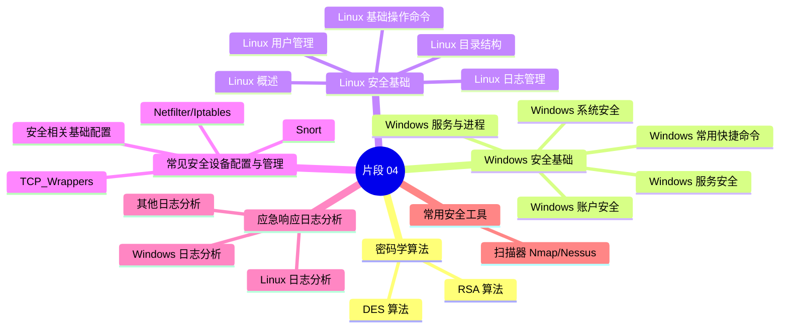
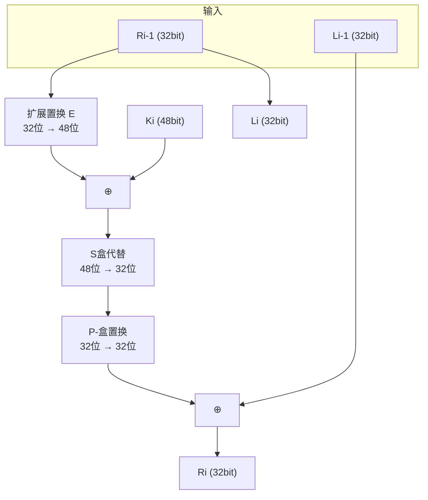
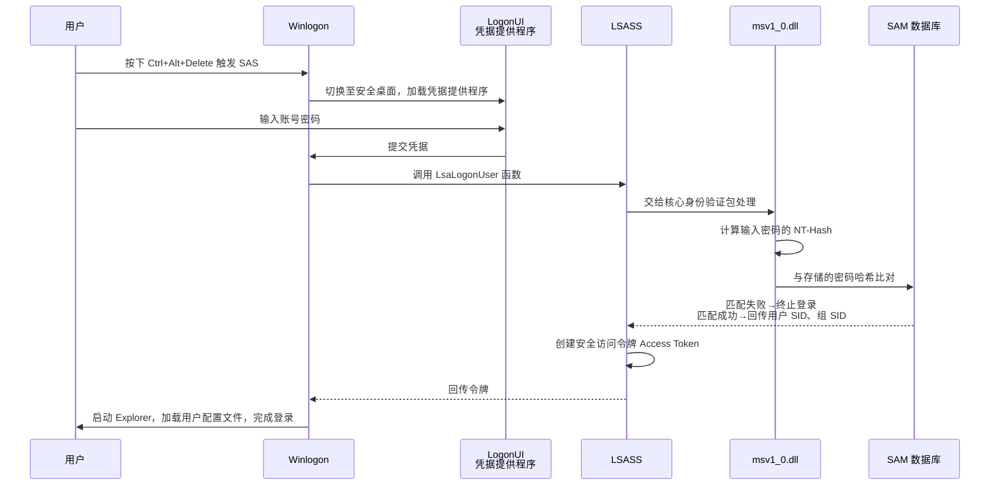
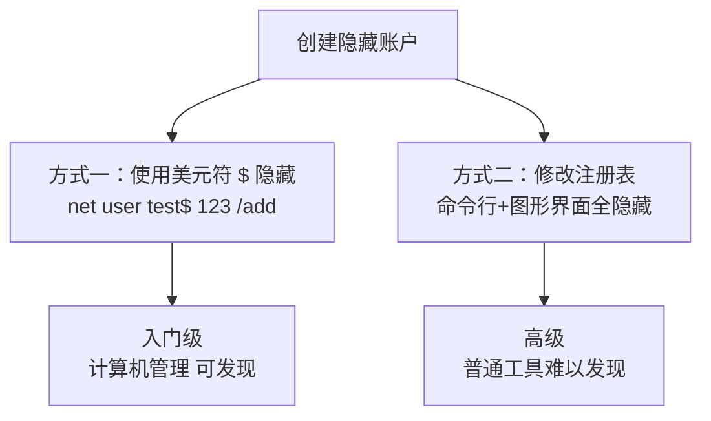
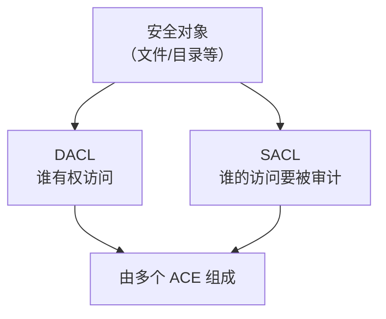
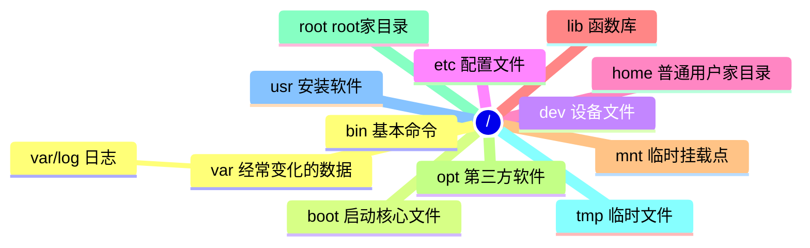
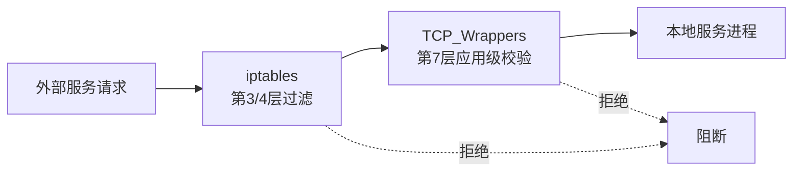
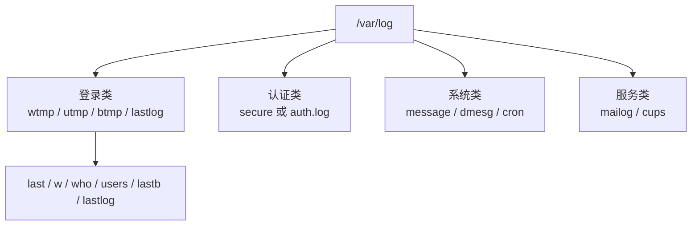

<div align="center">

# 课件精讲（第 4 / 11 卷）

[⬅ 上一卷](03_%E8%AF%BE%E4%BB%B6%E7%B2%BE%E8%AE%B2.md)　·　[📚 总目录](README.md)　·　[下一卷 ➡](05_%E8%AF%BE%E4%BB%B6%E7%B2%BE%E8%AE%B2%C2%B7%E5%AE%98%E6%96%B9%E6%95%99%E6%9D%90.md)

**本卷内容**：第 4 部分

</div>

> [!NOTE]
> 单文件体积超出 GitHub 渲染上限会导致整页不显示，故全文拆卷。**总目录、材料覆盖表与自检清单见 [README.md](README.md)**。

## 📑 本卷目录

- [📘 一、《2026 中级信息安全工程师 课件合集（全 40 讲）》精讲要点 · 第 4 部分](#-一2026-中级信息安全工程师-课件合集全-40-讲精讲要点--第-4-部分)
  - [2026 中级信息安全工程师 课件合集（全40讲）· 片段 04](#2026-中级信息安全工程师-课件合集全40讲-片段-04)
    - [📖 本片段结构导览](#-本片段结构导览)
  - [第一部分 · 密码学算法（续）](#第一部分--密码学算法续)
    - [2️⃣ DES 算法（02.）](#2-des-算法02)
    - [3️⃣ RSA 算法（03.）](#3-rsa-算法03)
  - [第二部分 · Windows 安全基础](#第二部分--windows-安全基础)
    - [1️⃣ Windows 账户安全（01.）](#1-windows-账户安全01)
    - [2️⃣ Windows 服务与进程（02.）](#2-windows-服务与进程02)
    - [3️⃣ Windows 系统安全（03.）](#3-windows-系统安全03)
    - [4️⃣ Windows 服务安全（04.）](#4-windows-服务安全04)
    - [5️⃣ Windows 常用快捷命令（05.）](#5-windows-常用快捷命令05)
  - [第三部分 · Linux 安全基础](#第三部分--linux-安全基础)
    - [1️⃣ Linux 概述（01.）](#1-linux-概述01)
    - [2️⃣ Linux 目录结构（02.）](#2-linux-目录结构02)
    - [3️⃣ Linux 基础操作命令（03.）](#3-linux-基础操作命令03)
    - [4️⃣ Linux 用户管理（04.）](#4-linux-用户管理04)
    - [5️⃣ Linux 日志管理（05.）](#5-linux-日志管理05)
  - [第四部分 · 常见安全设备配置与管理](#第四部分--常见安全设备配置与管理)
    - [1️⃣ Netfilter / Iptables（01.）](#1-netfilter--iptables01)
    - [2️⃣ TCP_Wrappers 访问控制机制（02.）](#2-tcp_wrappers-访问控制机制02)
    - [3️⃣ Snort 入侵检测系统原理与规则（03.）](#3-snort-入侵检测系统原理与规则03)
    - [4️⃣ 安全相关基础配置（04.）](#4-安全相关基础配置04)
  - [第五部分 · 应急响应日志分析](#第五部分--应急响应日志分析)
    - [1️⃣ Windows 日志分析（01.）](#1-windows-日志分析01)
    - [2️⃣ Linux 日志分析（02.）](#2-linux-日志分析02)
    - [3️⃣ 其他日志分析（03.）](#3-其他日志分析03)
  - [第六部分 · 常用安全工具](#第六部分--常用安全工具)
    - [1️⃣ 扫描器（01.）](#1-扫描器01)
  - [⚠️ 疑点（原文疑似错误，原样保留 + 订正建议）](#-疑点原文疑似错误原样保留--订正建议)
    - [📎 附：本片段速记数字清单](#-附本片段速记数字清单)

---

## 📘 一、《2026 中级信息安全工程师 课件合集（全 40 讲）》精讲要点 · 第 4 部分

### 2026 中级信息安全工程师 课件合集（全40讲）· 片段 04

> 原文页码范围：**Page 644 ~ Page 827**
> 覆盖主题：DES 算法迭代过程与 F 轮函数、RSA 算法与计算实例 → Windows 安全基础（全5讲）→ Linux 安全基础（全5讲）→ 常见安全设备配置与管理（Netfilter/Iptables、TCP_Wrappers、Snort、安全基础配置）→ 应急响应日志分析（Windows / Linux / 其他日志）→ 常用安全工具（扫描器）

---

#### 📖 本片段结构导览



---

### 第一部分 · 密码学算法（续）

#### 2️⃣ DES 算法（02.）

##### 📌 DES 算法 — 迭代过程总览（Page 644）

**整体流程**：`初始置换 IP` → `16 轮轮函数迭代` → `终结置换 IP⁻¹` → `64 位密文`


**迭代过程要点（4 步）**

| 项目 | 要点 |
| --- | --- |
| **01 初始置换与分组分割** | 明文经过初始置换（IP）打乱原有位序后，被严格拆分为左右两个 **32 位**的分组，记为 `L0` 和 `R0`。这一步是为后续复杂的轮函数运算奠定数据结构基础。 |
| **02 核心：16 轮轮函数迭代** | 每轮使用独立子密钥：右半部分经 F 函数非线性变换后与左半部分异或；前 **15 轮**运算后交换左右分组，**第 16 轮**保留结果不交换，通过多轮迭代极大增强加密复杂度。 |
| **03 终结置换与数据合并** | 16 轮迭代结束后，对左右分组进行最后一次交换并拼接为完整的 **64 位**数据；随后执行初始置换的逆置换（`IP⁻¹`），还原位序结构，完成加密的最后变换环节。 |
| **04 输出 64 位最终密文** | 经过逆置换的最终处理，系统输出标准的 **64 位**加密密文，完成单次 DES 加密的全流程闭环。该密文可通过相同密钥的逆运算进行解密还原。 |

**迭代过程数学表达**

```
L1  = R0
R1  = L0 ⊕ f(R0, K1)
L2  = R1
R2  = L1 ⊕ f(R1, K2)
...
L15 = R14
R15 = L14 ⊕ f(R14, K15)
R16 = L15 ⊕ f(R15, K16)
L16 = R15
```

> [!IMPORTANT]
> **必背**：DES 分组 **64 位**，密钥 **64 位**（有效 56 位 + 8 位校验），轮数 **16 轮**。第 16 轮**不交换**左右分组。

---

##### 📌 迭代过程具体细化（Page 645）

| 项目 | 要点 |
| --- | --- |
| 轮运算同构性 | 经过初始置换后，进行 **16 轮完全相同**的运算。这些运算被称为 **f 函数**，在运算过程中数据与密钥结合。 |
| 交换与结合 | 函数 `f` 的输出经过一个**异或运算**，和左半部分结合，其结果成为**新的右半部分**，原来的右半部分成为**新的左半部分**。 |

###### 🧮 补充：异或运算 ⊕（Exclusive OR，简称 XOR）

异或是一种**位运算**，它比较两个二进制数的每一位，并根据以下规则生成一个新的二进制数：

| 比较的两位 | 异或结果 |
| --- | --- |
| 相同（都是 `0` 或都是 `1`） | `0` |
| 不同（一个是 `0`，另一个是 `1`） | `1` |

> [!TIP]
> **记忆口诀**：「同 0 异 1」——相同得 0，不同得 1。异或又称"不进位加法"。

---

##### 📌 DES 算法 — F 轮函数（Page 646）

**核心结论**：函数 `f` 主要由**三步运算**构成：**扩展置换 E**、**S 盒置换**、**P 盒置换**。



**F 函数数据流与位宽变化**

| 环节 | 位宽 | 说明 |
| --- | --- | --- |
| `Li-1` | 32 位 | 上一轮左半部分 |
| `Ri-1` | 32 位 | 上一轮右半部分 |
| 扩展置换 E 后 | 48 位 | 与 48 位子密钥 `Ki` 异或 |
| ⊕ `Ki` 后 | 48 位 | 子密钥参与 |
| S 盒代替后 | 32 位 | 8 个 S 盒，6 进 4 出 |
| P-盒置换后 | 32 位 | 与 `Li-1` 异或得到 `Ri` |

**输出公式**：`Ri = Li-1 ⊕ f(Ri-1, Ki)`，`Li = Ri-1`

---

##### 📌 F 轮函数 — 扩展置换 E（Page 647）

| 项目 | 要点 |
| --- | --- |
| 基本作用 | 通过扩展置换 E，数据的右半部分 `Ri-1` 从 **32 位扩展到 48 位**。扩展置换改变了位的次序，**重复了某些位**。 |
| 目的 ① | 产生与密钥**同长度**的数据以进行异或运算； |
| 目的 ② | 提供更长的结果，使得在替代运算时能够进行**压缩**。 |

**🧩 扩展置换规则表**：中间为 **32 位**，两边为**扩展位**，扩展后为 **48 位**。

```
32 | 01 02 03 04 | 05
04 | 05 06 07 08 | 09
08 | 09 10 11 12 | 13
12 | 13 14 15 16 | 17
16 | 17 18 19 20 | 21
20 | 21 22 23 24 | 25
24 | 25 26 27 28 | 29
28 | 29 30 31 32 | 01
```

> [!TIP]
> **记忆技巧**：每行 6 个数（4 个中间位 + 左右各 1 个扩展位），8 行 × 6 = **48 位**。左边扩展位是**上一行末位**，右边扩展位是**下一行首位**（循环）。

---

##### 📌 F 轮函数 — S 盒代替（Page 648）

| 项目 | 要点 |
| --- | --- |
| 前置条件 | 扩展置换后，数据由原来的 **32 位扩展为 48 位**，然后和 **48 位子密钥**做异或运算，再进行 S 盒代替。 |
| 代替盒数量 | 代替运算由 **8 个不同的代替盒（S 盒）**完成。每个 S 盒有 **6 位输入，4 位输出**。 |
| 分组方式 | 48 位的输入被分为 **8 个 6 位的分组**，每一分组对应一个 S-盒代替操作。 |
| 输出 | 经过 S 盒代替，形成 **8 个 4 位分组**（共 32 位）。 |

###### 🧩 S8 盒（第 8 个 S 盒）查找表（Page 649）

| 行\列 | 0 | 1 | 2 | 3 | 4 | 5 | 6 | 7 | 8 | 9 | 10 | 11 | 12 | 13 | 14 | 15 |
| --- | --- | --- | --- | --- | --- | --- | --- | --- | --- | --- | --- | --- | --- | --- | --- | --- |
| **0** | 13 | 2 | 8 | 4 | 6 | 15 | 11 | 1 | 10 | 9 | 3 | 14 | 5 | 0 | 12 | 7 |
| **1** | 1 | 15 | 13 | 8 | 10 | 3 | 7 | 4 | 12 | 5 | 6 | 11 | 0 | 14 | 9 | 2 |
| **2** | 7 | 11 | 4 | 1 | 9 | 12 | 14 | 2 | 0 | 6 | 10 | 13 | 15 | 3 | 5 | 8 |
| **3** | 2 | 1 | 14 | 7 | 4 | 10 | 8 | 13 | 15 | 12 | 9 | 0 | 3 | 5 | 6 | 11 |

###### 🔍 S 盒查表实例（原文以 S8 盒为例，即 43-48 位）

假设输入是 `110011`：

| 步骤 | 计算过程 | 结果 |
| --- | --- | --- |
| ① 定行号 | 第 1 位和 第 6 位（最高位和最低位）组合为 `11`（二进制），转换为十进制为 `3` | 行号 = **3** |
| ② 定列号 | 原始数据第 2 位到第 5 位为 `1001`（二进制），转换为十进制为 `9` | 列号 = **9** |
| ③ 查表 | S8 盒的 **03 行 09 列**的数字为 `12` | 十进制 12 |
| ④ 转二进制 | `12` 转换为二进制为 `1100` | 输出 `1100` |
| ⑤ 结论 | 因此用二进制 `1100` 来代替 `110011` | 6 位 → 4 位 |


> [!IMPORTANT]
> **必背**：S 盒是 DES 中**唯一的非线性变换**部件，提供「混乱（Confusion）」。行由**首尾 2 位**决定，列由**中间 4 位**决定。

---

##### 📌 F 轮函数 — P 盒置换（Page 650）

| 项目 | 要点 |
| --- | --- |
| 雪崩效应 | P 置换使得**一个 S 盒的输出对下一轮多个 S 盒产生影响**，形成**雪崩效应**（明文或密钥的一点变动都引起密文的较大变化）。 |
| 轮末处理 | 经过 P-盒置换的结果与最初 64 位分组的**左半部分异或**，然后**左右两部分交换**，开始下一轮迭代。 |

###### ❓ 思考：已有初始置换和逆置换，为什么还要 P 盒置换？

| 视角 | 说明 |
| --- | --- |
| 初始置换 / 逆置换 | 进行**位重排** |
| S 盒 | 用于**混乱**，提供**非线性变换** |
| **P 盒置换** | 可以将 S 盒输出的位**重新分布到下一轮输入**中，增强算法的**扩散特性** |

**🧩 P-盒置换表**

```
16，7，20，21，29，12，28，17，1，15，23，26，5，18，31，10，
2，8，24，14，32，27，3，9，19，13，30，6，22，11，4，25
```

**举例**：第 **21** 位移到了第 **4** 位，第 **4** 位移到了第 **31** 位。

> [!TIP]
> **读表方法**：表中第 n 个位置的数字 = 输出的第 n 位取自输入的第几位。例如表第 4 项是 `21`，即「输入第 21 位 → 输出第 4 位」。

---

##### 📌 DES 子密钥的生成（Page 651）

| 项目 | 要点 |
| --- | --- |
| 总览 | 由 **64 位密钥**产生 **16 轮的 48 位子密钥**。 |
| 每轮独立 | 每一轮运算使用**不同的子密钥**。 |

**生成过程（4 步）**

| 步骤 | 说明 |
| --- | --- |
| ① 置换选择 1 | 按表置换，去掉校验位，变成 **56 位密钥**。 |
| ② 分组循环左移 | 分为左右两组各 **28 位**，循环左移。 |
| ③ 置换选择 2 | 循环左移后的两组结果合并，进行置换选择 2，按表置换，并去掉 **9、18、22、25、35、38、43、54** 位，生成 **48 位子密钥**。 |
| ④ 后续轮次 | 后面的轮次再按密钥表的循环左移计算逻辑，进行循环左移，两组结果合并，进行置换选择 2，生成后面每个轮次的 48 位子密钥。 |

###### ⚠️ 弱密钥

| 项目 | 要点 |
| --- | --- |
| 定义 | 生成的 **16 轮子密钥完全相同**的 DES 密钥（加密 1 轮与加密 16 轮效果一致，安全性大幅降低）。 |
| 典型弱密钥（16 进制） | 全 0 密钥：`0000000000000000`；全 1 密钥：`FFFFFFFFFFFFFFFF`；半 0 半 1 密钥：`000000FFFFFFFF`、`FFFFFFFF000000` |

> [!WARNING]
> **易错提醒**：DES 密钥长度标称 **64 位**，但其中 **8 位为奇偶校验位**，实际有效密钥长度仅 **56 位**。这是 DES 被暴力破解（如 EFF 深 crack）的根本原因。

---

#### 3️⃣ RSA 算法（03.）

##### 📌 RSA 算法概述（Page 652）

> **RSA 算法是非对称算法**，RSA 算法提供了一种保护网络通信和数据存储的**机密性、完整性、真实性和不可否认性**的方法。

###### 🔑 计算步骤（5 步生成密钥对）

| 步骤 | 名称 | 公式 / 说明 |
| --- | --- | --- |
| ① | 选大素数 | 随机选取两个不同的大素数 `p` 和 `q`（素数越大，安全性越高，实际应用中需 **1024 位**以上） |
| ② | 算模数 n | `n = p × q`（公钥、私钥共用，决定明文最大长度） |
| ③ | 算欧拉函数 φ(n) | `φ(n) = (p-1)(q-1)`（欧拉函数：小于 n 且与 n 互质的整数个数） |
| ④ | 选公钥指数 e | 满足 `1 < e < φ(n)`，且 `gcd(e, φ(n)) = 1`（e 与 φ(n) 互质，常用值：`3`、`17`、`65537`） |
| ⑤ | 算私钥指数 d | 满足 `(e × d) mod φ(n) = 1`（d 是 e 模 φ(n) 的**逆元**，需用**扩展欧几里得算法**计算） |

###### 🔐 RSA 公钥与私钥

| 密钥 | 组成 | 用途 | 分发方式 |
| --- | --- | --- | --- |
| **公钥** | `(n, e)` | 加密数据、**验证签名** | 公开（可通过证书分发） |
| **私钥** | `(n, d)` | 解密数据、**生成签名** | 保密（存储在硬件安全模块或加密文件中） |

###### 🧮 RSA 加解密公式

| 方向 | 公式 | 说明 |
| --- | --- | --- |
| **加密** | `C = M^e mod n` | `M`：明文，需满足 `0 < M < n`；`C`：密文 |
| **解密** | `M = C^d mod n` | 还原明文 |

> [!IMPORTANT]
> **关键限制（必背）**：① 明文必须为**整数**；② 明文必须**小于 n**。


---

##### 📌 RSA 计算实例（Page 653-654）

###### 🧩 密钥生成 — 例 1

| 步骤 | 计算过程 |
| --- | --- |
| ① 选择两个质数 | `p=47`，`q=71` |
| ② 算 n | `n = p × q = 47 × 71 = 3337` |
| ③ 算 φ(n) | `φ(n) = (p-1) × (q-1) = 46 × 70 = 3220` |
| ④ 随机选择 e | `e = 79`（满足条件 `gcd(79, 3220) = 1`，即 79 与 3220 互质，符合条件） |
| ⑤ 计算 d | `79 × d ≡ 1 (mod 3220)` |

**扩展欧几里得算法求解 d**

① 对余数进行**辗转相除**：

```
3220 = 79 × 40 + 60
79   = 60 × 1  + 19
60   = 19 × 3  + 3
19   = 3  × 6  + 1
3    = 1  × 3  + 0
```

② 对**商数逆向排列**（不含余数为 0 的商数：`6 – 3 – 1 – 40`）：

```
1 + 6 × 3    = 19
6 + 19 × 1   = 25
19 + 25 × 40 = 1019
```

③ 判断：除余数为 0 的商数为**偶数个**，所求**即为逆元 d**。

> **★ 原文最终密钥（Page 653 原样）**：公钥 `(n, e) = (3233, 17)`；私钥 `(n, d) = (3233, 2753)`

---

###### 🧩 密钥生成 — 例 2

| 步骤 | 计算过程 |
| --- | --- |
| ① 选择两个质数 | `p=61`，`q=53` |
| ② 算 n | `n = p × q = 61 × 53 = 3233` |
| ③ 算 φ(n) | `φ(n) = (p-1) × (q-1) = 60 × 52 = 3120` |
| ④ 随机选择 e | `e = 17`（满足条件 `gcd(17, 3120) = 1`，即 17 与 3120 互质，符合条件） |
| ⑤ 计算 d | `17 × d ≡ 1 (mod 3120)` |

**扩展欧几里得算法求解 d**

① 对余数进行**辗转相除**：

```
3120 = 17 × 183 + 9
17   = 9  × 1   + 8
9    = 8  × 1   + 1
8    = 1  × 8   + 0
```

② 对**商数逆向排列**（不含余数为 0 的商数：`1 – 1 – 183`）：

```
1 + 1 × 1     = 2
1 + 2 × 183   = 367
```

③ 判断：除余数为 0 的商数为**奇数个**，逆元 `d = 3120 - 367 = 2753`

> **★ 原文最终密钥（Page 653 原样）**：公钥 `(n, e) = (3337, 79)`；私钥 `(n, d) = (3337, 1019)`

---

###### 🔐 加密过程（Page 654）

| 项目 | 内容 |
| --- | --- |
| 明文 | 假设要加密的明文：`m = 8`（必须小于 `n=3233`） |
| 加密计算 | `c = m^e mod n = 8^17 mod 3233 = 2,251,799,813,685,248 mod 3233 = 2041` |

###### 🔓 解密过程

| 项目 | 内容 |
| --- | --- |
| 使用私钥解密 | `m = c^d mod n = 2041^2753 mod 3233 = 8` |
| 结果 | 解密得到原始明文：`m = 8` |

> **★ 最终密钥（Page 654 复述）**：公钥 `(n, e) = (3233, 17)`；私钥 `(n, d) = (3233, 2753)`

> [!TIP]
> **考试技巧**：原文提示「**考试可以使用计算器**」。RSA 手算的核心是**扩展欧几里得算法求逆元**，务必掌握「辗转相除 → 商数逆排 → 奇偶判断」三步法。

> [!WARNING]
> **易错提醒（原文疑点）**：Page 653 中「例 1」计算得到的是 `n=3337, e=79, d=1019`，但原文 ★ 最终密钥却写成 `(3233, 17)/(3233, 2753)`；「例 2」计算得到的是 `n=3233, e=17, d=2753`，原文却标注 `(3337, 79)/(3337, 1019)`。**两个例子的最终密钥在原文中互相错位**，详见文末「⚠️ 疑点」小节。

---

### 第二部分 · Windows 安全基础

> 章节目录（Page 657）
> 1. Windows 账户安全
> 2. Windows 服务与进程
> 3. Windows 系统安全
> 4. Windows 服务安全
> 5. Windows 常用快捷命令

---

#### 1️⃣ Windows 账户安全（01.）

##### 📌 Windows 账户与组的核心体系（Page 658）

> **核心结论**：账户是系统识别用户身份的**唯一凭证**，组是批量管理权限的**高效工具**。

| 项目 | 要点 |
| --- | --- |
| **用户账户** | 是操作系统的「**身份通行证**」，每个用户需通过独立账户登录系统，才能进行文件访问、软件运行等操作，实现用户间的**权限隔离**与**数据安全区分**。 |
| **组账户** | 是「**权限集合容器**」：当系统中有大量用户时，无需逐个分配权限，只需预先为组设置好权限，再将用户加入对应组，用户即可自动**继承组的所有权限**，大幅提升权限管理的效率与准确性，是企业级系统管理的核心方式。 |

###### 🎚️ 用户账户三类核心类型（按权限等级与使用场景划分）

| 账户类型 | 权限与场景 |
| --- | --- |
| **管理员账户** | 拥有系统**最高操作权限**，可执行安装软件、修改系统配置、创建/删除其他账户、格式化磁盘等关键操作，是系统的「超级管理者」。 |
| **标准账户** | 具备日常办公、上网、使用已安装软件等常规权限，**无法修改系统核心设置**或影响其他账户，是保障系统安全的「普通用户模式」。 |
| **来宾账户** | 为临时访问者设计的**无密码账户**，权限极低，仅能进行简单的文件查看、网页浏览等操作，**退出后数据自动清除**，适合临时借用场景。 |

---

##### 📌 系统内置账户和组（Page 659-660）

###### 👤 01 系统内置账户（独立身份）

| 内置账户 | 说明 |
| --- | --- |
| **Administrator（管理员）** | 拥有系统最高**完全控制权限**，可创建/管理账户、修改系统核心配置。**默认禁用**，仅可重命名/禁用，**无法删除**，是 Administrators 组默认成员。 |
| **Guest（来宾）** | 供临时无账户用户使用，权限**极度受限**（无法装软件、改设置、访问私人目录），**默认禁用**，保障临时访问的系统隔离性。 |

###### 👥 02 系统内置组账户（权限集合）

| 内置组 | 说明 |
| --- | --- |
| **Administrators 组** | 成员即系统管理员，具备完全访问权，可修改组策略、注册表、安装软硬件及管理其他用户，是系统权限管控的**核心组**。 |
| **Anonymous Logon 组** | 针对**未进行身份验证的匿名访问者**，用于控制匿名访问的资源权限边界。 |
| **Authenticated Users 组** | 包含所有通过**合法身份验证**的用户（**排除 Guest 账户**，即使 Guest 设密码也不包含），用于统一授权已验证用户的基础访问权限。 |
| **Backup Operators** | 该组中的成员可以**备份和还原**计算机中的文件和文件夹，**无法更改系统安全性设置**。 |
| **Everyone** | 该组包含**所有有效的用户**。 |
| **Guests** | 成员都是来宾账户，可以从本地或远程登录计算机，但是具有**较多的操作限制**。 |
| **Local Service** | 系统**虚拟账户**，由操作系统直接使用，用户不能使用。用于运行需要**较少特权或登录权限**的服务。 |
| **Local System** | 也称 System，系统虚拟账户，用于运行系统**最核心的组件和服务**，系统中的**大多数服务都运行在 Local System 账户下**。 |
| **Network** | 该组包含通过网络**远程访问本地计算机**的所有用户。 |
| **Network Service** | 系统虚拟账户。具有**标准用户**的权利和权限，不能向系统重要区域写入数据。用于运行需要较少特权或登录权限但**必须访问网络资源**的服务。与 Local Service 账户类似。 |
| **Power Users** | 具有管理员账户所具有的**部分权力和权限**。 |
| **Users** | **标准用户**所属的用户组。组成员可以执行一些常规任务和操作，**不能安装应用程序、更改系统时间、对系统进行安全方面的设置**，也不能对影响其他用户的所有设置进行更改。 |

> [!TIP]
> **记忆口诀**：三个虚拟账户——`Local System`（最高，跑核心服务）、`Network Service`（标准权限 + 能访问网络）、`Local Service`（最少权限，不能访问网络）。**只有 Network Service 能访问网络**。

---

##### 📌 本地登录认证流程（Page 661）



###### 🔄 6 步流程详解

| 步骤 | 说明 |
| --- | --- |
| **01 触发 SAS 安全注意序列** | 按下 `Ctrl+Alt+Delete` 触发 SAS，系统切换至 **Winlogon 安全桌面**，启动 **LogonUI** 加载凭据提供程序，弹出登录交互界面。 |
| **02 提交登录凭据** | 用户输入账号密码后，Winlogon 进程调用 **`LsaLogonUser` 函数**，将凭据提交给核心身份验证包 **`Msv1_0.dll`** 进行处理。 |
| **03 密码哈希比对校验** | 验证包将输入密码计算生成 **NT-Hash**，并将其与 **SAM 数据库**中存储的密码哈希值进行严格的一致性比对校验。 |
| **04 密码匹配结果判定** | 匹配失败则**终止登录**；匹配成功则从 SAM 读取用户 **SID**、所属组 SID，回传至本地安全授权服务器 (**LSASS**)。 |
| **05 生成安全访问令牌** | LSASS 利用获取的 SID 信息，创建包含用户身份、组权限及特权的**安全访问令牌 (Access Token)**，作为系统权限判断的核心凭证。 |
| **06 完成会话交接与登录** | Winlogon 接收令牌并启动用户桌面进程 (**Explorer**)，加载用户配置文件，完成整个交互式登录会话的初始化。 |

###### 🧩 核心组件（7 个，必背）

| # | 组件 | 作用 |
| --- | --- | --- |
| 1 | **SAS（安全注意序列）** | 快捷键 `Ctrl+Alt+Delete`，触发登录流程 |
| 2 | **Winlogon** | 登录会话管理进程，调度整个登录、注销流程 |
| 3 | **LogonUI + Credential Provider** | 登录弹窗 UI 组件，接收用户账号密码输入 |
| 4 | **ALPC（高级本地过程调用）** | Windows 本机进程间通信 |
| 5 | **LSASS (LSA Server)** | 本地安全授权子系统，执行身份验证、安全授权，生成访问令牌 |
| 6 | **msv1_0.dll** | 本地账号认证包，计算 NT-Hash |
| 7 | **SAM Server** | 安全账户管理器组件，本地账户数据库，存放账号、密码 NT-Hash、SID |

> [!IMPORTANT]
> **必背**：`Ctrl+Alt+Delete` = **SAS 安全注意序列**；本地口令哈希叫 **NT-Hash**（LM-Hash 已废弃）；存放在 **SAM** 中；认证包是 **msv1_0.dll**。

---

##### 📌 SID（安全标识符）（Page 662-665）

###### 📖 SID 基本概念

| 项目 | 要点 |
| --- | --- |
| 定义 | SID 是操作系统中每个账户的「**身份证明**」。每个账户都有**唯一**的 SID。 |
| 访问令牌 | 在用户每次登录系统时，系统都会为用户创建**访问令牌**，其中包含：① 用户账户的 SID；② 用户账户所属用户组的 SID；③ 用户拥有的权限。 |
| 存储位置 | SID 的相关信息存储在**注册表的受保护区域**中。 |
| 系统内部引用 | 系统内部使用 SID 来引用账户。**创建一个新用户账户，其 SID 永远都不会与以前使用过的 SID 相同**。 |

###### 💡 SID 结构解析（以管理员组为例）

**示例**：`S-1-5-32-544`（管理员组 SID）

| 段位 | 值 | 含义 |
| --- | --- | --- |
| 1 | `S` | 标识这是一个**安全标识符（SID）** |
| 2 | `1` | SID 的**版本号**，目前**固定为 1** |
| 3 | `5` | **颁发机构**（`5 = NT Authority`，即系统权限） |
| 4 | `32` | **域/内置标识符**（`32` 代表「内置账户组」） |
| 5 | `544` | **相对标识符（RID）**，`544` 代表管理员组 |

###### 🔢 用户 SID 的唯一性与构成解析

| 项目 | 说明 |
| --- | --- |
| 用户创建账户 SID 示例 | `S-1-5-21-2511208976-1494855368-2247111681-1001` |
| 关键组成 | 前面为「**域标识符**」（同机账户一致），最后一段 `1001` 为「**相对标识符（RID）**」，是账户的**唯一区分标志**。 |

###### 🎚️ 用户 RID 分配规则与系统内置账户

| 场景 / 账户 | RID 规则 |
| --- | --- |
| **普通用户（本机环境）** | 手动创建的第一个账户 RID 为 **1001**，后续依次 +1（如 1002、1003）。 |
| **普通用户（域环境）** | 第一个新建用户 RID 从 **1000** 开始，1000、1001、1002 依次递增。 |
| **内置管理员账户 Administrator** | 固定 RID 为 **500**，拥有系统最高权限。 |
| **来宾账户 Guest** | 固定 RID 为 **501**，仅具备临时访问的最低权限。 |

> [!TIP]
> **记忆口诀**：「**500 管理员、501 来宾、544 管理员组**」；本机新用户从 **1001** 起，域新用户从 **1000** 起。

###### 🔍 查看指定 SID 对应用户名的方法

**方法一：注册表编辑器（Page 664）**

| 步骤 | 操作 |
| --- | --- |
| **Step 1** | 启动注册表编辑器 —— 按下【`Win + R`】组合键，在弹出的「运行」对话框中输入 `regedit`，回车确认即可打开工具。 |
| **Step 2** | 定位关键路径 —— 依次展开至：`HKEY_LOCAL_MACHINE\SOFTWARE\Microsoft\Windows NT\CurrentVersion\ProfileList`，该目录下的子键即为系统中所有账户的 SID 值。 |
| **Step 3** | 读取对应账户信息 —— 选择要查看用户账户名称的 SID，在右侧窗格中双击 **`ProfileImagePath`** 的键值，可看到与当前 SID 对应的用户名。例如：SID 为 `S-1-5-21-2511208976-1494855368-2247111681-1001` 的用户账户的名称是 `user1`。 |

**方法二：命令行（Page 665）**

> 除了注册表外，可通过命令行快速查询：右键点击「开始」菜单选择「运行」，输入 `cmd` 打开命令提示符，执行 **`whoami /all`** 命令，回车后即可显示当前用户的完整身份信息，包括**账户名、所属用户组及对应的唯一 SID** 标识。

---

##### 📌 DOS 指令管理账户与组（Page 666-668）

| 项目 | 要点 |
| --- | --- |
| `net user` | 管理计算机账户可以使用命令 **`net user`**，其可以对账户进行**创建、删除**等操作。 |
| `net localgroup` | 命令 **`net localgroup`** 则可用于**组的查看、创建、删除**，还可以将账户加入指定的组当中（加入管理员组需要相应权限）。 |
| 渗透场景 | 在渗透 Windows 操作系统时，当黑客获取 shell 以后首先会使用相关命令**查看所属的用户与组**，从而检查所拥有的权限，然后再经过「**系统提权**」获取管理员执行权限并创建用户。而这些操作往往都是使用 **DOS 命令**的方式进行操作，因此，为了更好地保障系统安全，掌握这些命令非常重要。 |

###### 🧩 `net user` 命令应用案例

| 操作 | 说明 / 命令 |
| --- | --- |
| 查看当前系统账户列表 | 可以看到当前系统存在 `administrator`、`defaultaccount`、`guest`、`user1`、`wzq` 这些用户。 |
| 添加账户 | 添加账户 `test1`，密码为 `123`。 |
| 查看账户属性 | 查看 `test1` 账户属性。 |
| 修改密码 | 修改账户 `test1` 密码为 `456`。 |
| 删除账户 | 删除账户 `test1`。 |

###### 🧩 `net localgroup` 命令应用案例

| 操作 | 说明 |
| --- | --- |
| 查看当前系统账户组列表 | 列出本机所有本地组 |
| 将用户加入组 | 将用户 `test1` 添加进账户组 `testgroup` |
| 添加账户组 | 添加账户组 `testgroup` |
| 查看组成员 | 查看账户组 `testgroup` 下的成员列表 |
| 删除账户组 | 删除账户组 `testgroup` |
| 加入远程桌面组 | 将 `test1` 用户加入**远程桌面组**，使其可以远程连接服务器 |

> [!TIP]
> **记忆口诀**：`net user` 管**用户**，`net localgroup` 管**组**；加用户到管理员组：`net localgroup administrators 用户名 /add`。

---

##### 📌 创建隐藏账户（Page 669-672）

> **定义**：在 Windows 操作系统渗透测试中有一种利用方式是创建隐藏账户。**隐藏账户**就是在**控制面板和开机选择中看不见，却有管理员权限**的账户，使用该账户即使别人设置了密码也可以直接进入系统。创建好隐藏账户后将该账户加入管理员组 **Administrators** 中，那么该账户就具有了管理员权限。

Windows 系统中创建隐藏账户分为**两种类型**：



###### 🧩 类型一：使用「`$`」符号创建隐藏账户

| 项目 | 要点 |
| --- | --- |
| 原理 | 这种方法利用了 Windows 系统具有的一项功能：「**`$` 符号隐藏账户或文件夹**」。 |
| 局限性 | 该方法创建的账户**只能在「命令提示符」中进行隐藏**，而使用「**计算机管理**」则可以发现该账户。因此，这种隐藏账户的方法**并不是很实用**，是一种**入门级**的系统账户隐藏技术。 |
| 验证（暴露） | 进入控制面板的「管理工具」，打开其中的「计算机管理」节点，查看其中的「本地用户和组」，在「用户」一项中，建立的隐藏账户 `test$` **暴露无遗**。 |
| 创建命令 | 输入命令 **`net user test$ 123 /add`**，成功后会显示「命令成功完成」，此时隐藏账户 `test$` 已经创建成功。用 `net user` 显示当前账户，从返回的结果可以看到刚才建立的 `test$` 账户**并不显示**。 |

###### 🧩 类型二：通过修改注册表创建隐藏账户

> 该方法通过修改 Windows 注册表创建隐藏账户，通过该方法创建的隐藏账户可以在**命令行和图形界面中全部隐藏**用户，是渗透测试中常见的**提权和留后门**手段。**普通系统工具难以发现**。

**操作步骤**

| 步骤 | 操作内容 |
| --- | --- |
| ① | 找到并打开注册表位置 `HKEY_LOCAL_MACHINE\SAM\SAM\Domains\Account\Users\Names\`。值得注意的是，如果该 SAM（security account manager）无法打开，则需为该 SAM 进行授权，其要求 **Administrators 组用户具有「完全控制」权限**。 |
| ② | 在上述注册表的目录下，找到账户 `test$`。这时需要**导出三个注册表**，分别是：（1）`test$` 账户信息（2）`test$` RID 数据项（3）`Administrator` 账户 RID 数据项 |
| ③ | `test$` 用户对应的 Users 注册表，由于 `test$` 账户对应注册表类型为 **`0x3ef`**，所以在 users 目录下找到 **`0x3ef`** 注册表并导出。 |
| ④ | `Administrator` 用户对应的 users 目录注册表，本案例该管理员用户对应过的表名称为 **`0x1f4`**，路径为 `HKEY_LOCAL_MACHINE\SAM\SAM\Domains\Account\Users\000001F4\`。 |
| ⑤ | 打开 `Administrator` 导出的注册表，将其中的 **`F` 参数的值**替换到 `test$` 对应 user 目录的注册表中。 |
| ⑥ | 将原有的 `test$` 用户删除。 |
| ⑦ | 选择「文件」→「导入」命令，导入 `test$` 注册表，再导入修改的 `test$` 的 user 目录注册表 `3ef`。 |
| ⑧ | 测试功能，使用命令行与图形界面方式检查隐藏账户是否存在。然后借助对端服务器开启的**远程桌面服务**，使用隐藏账户进行远程桌面连接。 |

> [!WARNING]
> **⚠ 警告（原文）**：该技术属于**渗透权限维持手段**，仅可在自己的**虚拟机实验环境**操作，**禁止用于他人计算机，违反法律将承担责任**。

> [!TIP]
> **数字记忆**：`0x1f4` = 十进制 **500** = Administrator 的 RID；`0x3ef` = 十进制 **1007** = 本例中 test$ 的 RID。注册表中 RID 以**十六进制**表示。

---

#### 2️⃣ Windows 服务与进程（02.）

##### 📌 基本概念（Page 673）

| 概念 | 定义 |
| --- | --- |
| **进程（Process）** | 是系统**资源分配与调度的最小单位**，是程序运行的**动态实例**，拥有**独立的内存空间**与系统资源。 |
| **服务（Service）** | 是后台运行的「**无头**」应用程序，**无用户交互界面**，**随系统启动自动加载**，支持启停与重启，是 Windows 系统服务的核心载体。 |

##### 📌 图形界面管理 — 进程管理（Page 673-674）

###### 🔍 `tasklist` 查看进程

| 项目 | 要点 |
| --- | --- |
| 功能 | `tasklist` 用来显示运行在本地或远程计算机上的**所有进程**，带有多个执行参数。 |
| 输出组成（5 部分） | 打开命令行窗口，输入 `tasklist` 命令，显示本机的所有进程。本机的显示结果由 **5 部分**组成：**映像名称（进程名）、PID、会话名、会话＃、内存使用**。 |
| 查看进程调用的服务 | 在命令提示符下输入 **`tasklist /svc`**，显示每个进程所调用的服务。 |
| 关键字筛选 | 使用管道命令「` \| `」与 `findstr` 可根据关键字筛选出指定的进程情况。例如：使用命令 **`tasklist \| findstr "cmd"`** 可以筛选出 `cmd` 关键字的相关进程情况。 |

###### ❌ `taskkill` 关闭进程

> Windows 进程管理中 **`taskkill`** 命令用于结束进程，其与 `tasklist` 命令**配套使用**。

**格式**：`taskkill /f /t /fi "imagename eq cmd.exe"`

| 参数 | 含义 |
| --- | --- |
| `/f` | **强行终止**进程。 |
| `/t` | 终止指定的进程**和由它启用的子进程**。如果一个 cmd 中正在执行另一个程序，如 `adb logcat`，那么如果使用 taskkill 命令关闭这个 cmd 时不加 `/t`，`adb logcat` 就继续执行，不会被关闭。 |
| `/fi` | 指定**筛选器**。`/fi "imagename eq cmd.exe"` 筛选映像名为 `cmd.exe` 的进程，相当于 `/im "cmd.exe"`。 |

**举例**

| 场景 | 命令 |
| --- | --- |
| 假设本机开启程序 notepad（文件编辑器），使用 taskkill 命令结束 `notepad.exe` 进程 | `taskkill /im notepad.exe` |
| 通过进程 PID 结束进程（需与 `tasklist` 配合获取 PID）。如果 `mspaint.exe` 画图的 pid 为 `204` | `taskkill /pid 204` |

##### 📌 服务管理（Page 675）

| 管理方式 | 说明 |
| --- | --- |
| **图形界面** | 在「运行」对话框中输入 **`services.msc`** 命令并单击「确定」按钮。 |
| **命令行（`net`）** | 可以通过 `net` 命令方式启动和关闭服务，语法：`net start 服务名` / `net stop 服务名`。举例：以 Windows 系统中 **LanmanServer** 服务为例，可以使用 `net` 命令停止和启动该服务。 |
| **命令行（`sc`）** | **`sc`** 命令可查询、配置、创建和删除服务，**功能比 net 更强大**，**直接与服务管理控制器交互**。 |

> [!IMPORTANT]
> **对比必背**：`net start/stop` 只能启停；**`sc` 功能更强大**（查询/配置/创建/删除），直接与服务管理控制器（SCM）交互。

---

##### 📌 Windows 端口（Page 676-678）

###### 📖 端口基本概念

| 项目 | 要点 |
| --- | --- |
| 定义 | 端口是计算机网络通信的「**数字出入口**」，用于区分同一 IP 下的不同服务，端口号为 **`0~65535`** 的整数。 |
| 唯一标识 | 通过「**IP + 端口号**」的组合可唯一标识网络服务，是网络通信的基础逻辑标识。 |
| **安全意义** | 端口是网络攻防的**核心入口**，攻击者可通过**开放端口探测服务版本、系统漏洞**，进而实施渗透；同时也是**正向/反弹 Shell、远控木马**建立连接的关键通道。 |

###### 🎚️ 端口分类与状态

| 分类维度 | 类别 | 说明 |
| --- | --- | --- |
| **按协议类型** | **TCP 端口** / **UDP 端口** | 由于 TCP 和 UDP 两个协议是独立的，因此各自的端口号也**相互独立**，比如 TCP 有 **235** 端口，UDP 也可以有 **235** 端口，两者并不冲突。对于 TCP 端口而言，由于 TCP 连接的「**三次握手**」特性，该端口将根据其处于的 TCP 连接状态的阶段分为几种状态。 |
| **按号段（周知/动态）** | **周知端口** | 众所周知周知的端口号，范围为 **`0 ~ 1023`**，如 **80** 端口分配给 WWW 服务，**21** 端口分配给 FTP 服务。 |
| **按号段（周知/动态）** | **动态端口** | 范围是 **`1024 ~ 65535`**。动态分配指当一个系统进程或应用程序进程需要网络通信时，它向主机申请一个端口，主机从可用的端口号中分配一个供它使用。当这个进程关闭时，同时也就**释放了所占用的端口号**。**很多木马程序就是使用此类型端口建立连接的**。 |

###### 🔍 查看端口状态（Page 677-678）

> 能查看系统主机端口是安全管理员的**必备技能**，通过端口的监听情况往往能够判定一些**可疑的端口与进程**，然后对可疑程序进行处理。

Windows 系统中可以使用 **`netstat`** 命令查看端口状态情况，该命令与 Linux 类似，其用于显示系统中网络相关信息，如**网络连接、路由表、端口状态**等。

**`netstat` 命令常用参数**

| 命令 | 作用 |
| --- | --- |
| `netstat -an` | 查看服务器上**所有打开的端口** |
| `netstat -ano` | 查看该端口**被哪个进程所占用** |

###### 🕵️ 根据端口查找程序（三步法）

| 步骤 | 命令与说明 |
| --- | --- |
| **第 1 步：定位占用端口的 PID** | 假设我们了解 Windows 系统并未启动 Web 应用的 80 端口，但是我们通过 `netstat` 命令查看本机启动了 80 端口。在命令行中输入命令 **`netstat -ano \| findstr 80`**，查看 80 端口是否被占用，其中 `findstr` 是查找指定的一个或多个文件中包含某些特定字符串的行。可以发现使用 **TCP** 协议且为 80 端口的程序进程 **PID 为 2568**。 |
| **第 2 步：PID 反查应用** | 然后，输入命令 **`tasklist \| findstr 2568`**，查看该 PID 被哪个应用占用了。可以发现该 PID 运行了我们本不想开启的 **`hfs.exe`** 应用程序。 |
| **第 3 步：强制关闭** | 最后，使用命令 **`taskkill`** 强制关闭该程序。 |


> [!TIP]
> **排查套路（必背）**：`netstat -ano` 找 **PID** → `tasklist | findstr PID` 找**程序名** → `taskkill /f /pid PID` **杀进程**。

---

#### 3️⃣ Windows 系统安全（03.）

##### 📌 组策略（Page 679）

| 项目 | 要点 |
| --- | --- |
| 定义 | 组策略是 Windows 系统的**集中管理框架**，通过「开始 → 运行 → 输入 **`gpedit.msc`**」打开。 |
| 部署范围 | 组件驻留在**域控制器**及**所有 Windows 终端**中，可批量向用户/设备推送配置，实现**环境标准化与安全加固**。 |
| 核心应用场景 | 涵盖**安全策略**（密码复杂度/账户锁定/审计）、**软件部署与更新**、**桌面环境定制**（控制面板/启动项）、**系统维护**（磁盘配额/驱动管控）等关键维度。 |

###### 🎚️ 计算机配置 vs 用户配置

| 配置类型 | 作用范围与效果 |
| --- | --- |
| **计算机配置（管设备）** | 针对**硬件设备**生效，无论谁登录该电脑，均强制遵守统一的安全规则、硬件限制与系统基础配置。 |
| **用户配置（管用户）** | 针对**用户身份**生效，无论登录哪台域内电脑，都能获得一致的桌面环境、软件权限与个性化映射。 |
| **二者结合** | 可实现「**设备标准化**」与「**用户个性化**」的平衡，是 Windows 企业级管理的核心工具。 |

---

##### 📌 本地安全策略（Page 680）

> **本地安全策略**是 Windows 系统管理**账户安全**的核心工具，通过 **`secpol.msc`** 命令可快速打开。

**涵盖四大核心板块**

| 板块 | 内容 |
| --- | --- |
| **密码策略** | 设置复杂度、有效期与长度 |
| **账户锁定策略** | 防暴力破解的锁定阈值与时长 |
| **本地策略** | 审核登录/操作日志、分配用户权限 |
| **安全选项** | 交互式登录提示、网络访问控制 |

> 这些配置是构筑系统**第一道安全防线**的关键，能有效降低账户被攻破的风险。

---

##### 📌 访问控制（Page 681）

> Windows 用户登录到系统时，**WinLogon** 进程为用户创建**访问令牌**，包含用户及所属组的**安全标识符 (SID)**，作为用户的身份标识。文件等客体则含有**自主访问控制列表 (DACL)**，标明谁有权访问，还含有**系统访问控制列表 (SACL)**，标明哪些主体的访问需要被记录。

| 概念 | 全称 | 作用 |
| --- | --- | --- |
| **DACL** | Discretionary Access Control List（自主访问控制列表） | 主要用于设置**用户以及用户组对安全对象的访问权限**。 |
| **SACL** | System Access Control List（系统访问控制列表） | 用于配置对安全对象的访问的**审计（生成日志）**。 |
| **ACE** | Access Control Entries（访问控制项） | 每个 **ACL 由多个 ACE** 构成。 |



> [!IMPORTANT]
> **必背对比**：**DACL 管「权限」**（能不能访问），**SACL 管「审计」**（要不要记日志）。两者都由 **ACE** 组成。

---

##### 📌 Windows 日志审计（Page 682-684）

###### 🗂️ 日志分类（三类）

| # | 日志类型 | 定位与内容 | 默认存储路径 |
| --- | --- | --- | --- |
| **01** | **系统日志 (System Log)**<br/>底层运行的「体检表」 | 记录**操作系统内核、硬件驱动、系统服务**的关键事件（如驱动加载失败、硬件故障、IP 冲突、服务启停异常）。是排查**系统级故障**的核心线索。 | `%SystemRoot%\System32\Winevt\Logs\System.evtx` |
| **02** | **应用程序日志 (Application Log)**<br/>业务运行的「记录仪」 | 由**应用软件/服务主动写入**，记录程序崩溃、数据库连接失败、功能调用异常等**业务层事件**。是**定位软件故障**的直接依据。 | `%SystemRoot%\System32\Winevt\Logs\Application.evtx` |
| **03** | **安全日志 (Security Log)**<br/>合规审计的「铁证」 | 记录**用户登录/注销、权限变更、文件访问、账户管理、策略修改**等安全敏感行为。**默认需通过组策略/注册表手动开启**，是**网络攻击取证、权限审计**的核心证据。 | `%SystemRoot%\System32\Winevt\Logs\Security.evtx` |

> [!TIP]
> **💡 运维要点**：需**定期归档日志**防止被覆盖，同时**开启安全日志审核策略**，避免因日志缺失导致审计盲区。

###### 🎚️ 日志状态（5 种）

> Windows 日志将记录事件的 **5 种状态**，**所有的事件必须拥有 5 种状态中的一种**。

| # | 状态 | 说明与举例 |
| --- | --- | --- |
| **01** | **信息 (Information)** | 记录应用程序、驱动或服务的**正常成功操作**，属于系统运行的常规反馈，**无异常风险**。 |
| **02** | **警告 (Warning)** | 表示存在**潜在问题或非关键故障**，若不处理可能引发后续异常。例如：**磁盘空间不足、打印机连接失败**等非致命性问题。 |
| **03** | **错误 (Error)** | 记录**已经发生的严重故障**，通常伴随功能失效或数据丢失风险。例如：**系统服务启动失败、关键驱动加载异常**等。 |
| **04** | **成功审核 (Success Audit)** | 属于**安全日志**范畴，记录**通过验证**的敏感操作，如用户成功登录系统、权限变更生效、文件访问授权通过等**合规行为**。 |
| **05** | **失败审核 (Failure Audit)** | 记录**未通过安全验证**的操作尝试，是**发现入侵或违规行为的重要线索**。例如：**密码错误的登录尝试、非法访问共享文件的请求**等。 |

###### 🏷️ 日志事件 ID 与类型（Page 684）

| 项目 | 要点 |
| --- | --- |
| 关键要素 | Windows 事件日志中，关键要素包含**事件级别、记录时间、事件来源、事件 ID、事件描述、涉及的用户、计算机、操作代码及任务类别**等。 |
| 事件 ID 意义 | 对于 Windows 事件日志分析，**不同的事件 ID 代表了不同的意义**。 |

> [!NOTE]
> **原文说明**：Page 684 的「常见的事件 ID 说明」在课件中**以图片/表格形式呈现，PDF 文本层未提取到具体条目内容**。（本片段后续 Page 790 章节给出了完整的常见安全事件 ID 表，可对应参考。）

---

##### 📌 注册表安全（Page 685-686）

###### 📖 注册表概述

> 注册表是 Windows 系统的**核心配置数据库**，在**系统启动时即自动加载**并交互。它并非独立功能，而是整合了**硬件参数、软件配置、用户权限及系统策略**的有机整体。掌握注册表结构与操作，是管理员**优化系统性能、加固安全防线以及排查系统故障**的必备技能。

###### 🏗️ 注册表组织结构

| 层级 | 说明 |
| --- | --- |
| **基本结构** | Windows 注册表的基本结构是带有多个配置层面的**分层式结构**。这些层面由**根键、子键、键值和数据**组成。 |
| **根键** | Windows 注册表包含 **5 个根键**，它们位于注册表的**最顶层**，这 5 个根键的名称和功能如（课件原表所示）。 |
| **子键** | 类似「**文件夹-子文件夹**」的层级关系，从根键向下延伸。子键可由**系统自动生成**（如系统服务配置项）或**用户手动创建**，用于分类存储特定功能的配置参数，形成清晰的管理结构。 |
| **键值及其组成部分** | 每个键包含若干「**键值项**」，由【**名称 + 数据类型 + 具体数据**】组成。默认存在「**(默认)**」键值，常用类型包括：**字符串 (REG_SZ，存文本)、二进制 (REG_BINARY，存硬件参数)、双字值 (REG_DWORD，存开关/数值)** 等，适配不同配置需求。 |
| **根键或子键的路径** | 采用**反斜杠「`\`」**作为层级分隔符，格式与文件路径一致（例：`HKLM\SOFTWARE\Microsoft\Windows`）。编辑器**状态栏**会实时显示当前选中项的完整路径，是精准定位、修改或备份注册表项的**唯一标识**。 |

> [!NOTE]
> **原文说明**：Page 685 的「5 个根键名称和功能」在课件中**以表格图片形式呈现，PDF 文本层未提取到具体条目**。（标准答案：HKEY_CLASSES_ROOT、HKEY_CURRENT_USER、HKEY_LOCAL_MACHINE、HKEY_USERS、HKEY_CURRENT_CONFIG。）

###### 🛠️ 注册表编辑器

| 项目 | 内容 |
| --- | --- |
| 打开方式 | 「运行」对话框，输入 **`regedit`** 命令 |
| 命令行修改 | 修改注册表使用的命令是 **`reg`**。`reg` 也称**控制台注册表编辑器**，默认文件路径为 **`C:\Windows\System32\reg.exe`** |

---

#### 4️⃣ Windows 服务安全（04.）

##### 📌 远程桌面服务安全（Page 687）

> **RDP** 是 Windows 远程管理的核心入口，**默认监听 `3389` 端口**。由于其使用广泛且配置不当率高，成为黑客**扫描探测、暴力破解**的高频目标，一旦沦陷将导致系统**完全被控**。

###### 🛡️ 加固手段一：修改默认端口（隐藏攻击入口）

| 项目 | 说明 |
| --- | --- |
| 操作路径 | 运行输入 `regedit` 打开注册表 → 定位至 `[HKEY_LOCAL_MACHINE\SYSTEM\CurrentControlSet\Control\Terminal Server\WinStations\RDP-Tcp]` → 修改 **`PortNumber`** 值（**十进制**）为非默认端口（如 **`33910`**）。 |
| 效果 | 此方法可**规避针对 3389 端口的自动化扫描工具探测**。 |

###### 🛡️ 加固手段二：账户权限与密码策略强化

| 措施 | 具体做法 |
| --- | --- |
| **禁用/重命名默认账户** | 系统默认的「**Administrator**」是暴力破解的**首要目标**，务必**重命名或直接禁用**该账户，创建新的具有管理员权限的**专用远程管理账户**。 |
| **强密码与访问控制** | 强制使用 **12 位以上**的复杂密码（数字 + 大小写字母 + 特殊字符）；限制「**Remote Desktop Users**」组的成员数量，仅授权必要的运维人员访问，**杜绝弱口令与通用账户**。 |

> [!IMPORTANT]
> **必背数字**：RDP 默认端口 **3389**；注册表项 `...\Terminal Server\WinStations\RDP-Tcp` 下的 **`PortNumber`**。

---

##### 📌 文件共享安全（Page 688-691）

> 通过共享文件夹可实现网络内文件互访，支持 **NTFS、FAT32** 等主流文件系统。需配置严格的**共享权限与 NTFS 权限双重控制**，防止未授权访问。

###### 🔗 `net use` — DOS 指令管理共享

| 项目 | 要点 |
| --- | --- |
| 功能 | `net use`：**核心用于管理与远程主机的连接**，包括**建立映射、验证凭据、查看会话及清理连接**，是渗透测试中**横向移动**的常用手段。 |
| **安全警示** | 攻击者常利用**空连接**（`net use \\IP\IPC$ "" /user:""`）**探测主机存在**，或通过**弱口令建立映射**进行文件窃取与植入。 |

###### 📂 共享管理：`net share`

| 命令 | 作用 |
| --- | --- |
| `net share` | 查看本地**所有共享资源** |
| `net share ipc$ /del` | 删除 **IPC$** 默认共享 |
| `net share admin$ /del` | 删除**管理共享** |
| `net share c$ /del` | 删除 **C 盘隐藏共享** |

> **安全价值**：及时清理 `IPC$`、`Admin$` 等默认共享，是**阻断攻击者利用 SMB 协议进行横向移动的关键手段**。

###### 🔭 远程信息探测：`net view` 与 `net time`

| 命令 | 作用 |
| --- | --- |
| `net view \\192.168.1.145` | 列出目标主机**开放的共享目录列表** |
| `net time \\192.168.1.145` | 获取目标主机**系统时间**，用于密码爆破时间同步 |

> **渗透场景**：攻击者常通过此类命令确认目标是否存在可利用的文件共享服务，为后续攻击铺路。

###### 📁 共享目录访问：`dir` 命令的跨机应用

| 命令 | 作用 |
| --- | --- |
| `dir \\192.168.1.145\c$` | 直接列出目标主机 **C 盘根目录文件** |
| `dir \\192.168.1.145\c$\Windows\System32` | **深入遍历系统关键目录** |

> **安全警示**：若目标未关闭默认共享且权限配置过松，攻击者可**直接读取甚至写入恶意程序**。

---

###### ⚠️ 文件共享安全问题 — IPC$ 专题（Page 690）

> 由于共享文件可以通过主机的用户名和密码进行连接，因此带来了很多的安全问题。**最常见的是 IPC$ 连接问题**。

| 项目 | 要点 |
| --- | --- |
| **IPC$ 运行机制与默认配置** | `IPC$` 是基于**信任凭证**的加密通信管道，Windows **默认开启 `ADMIN$`、`C$`、`D$` 等隐藏共享**（仅管理员可见），用于远程管理；其特性为「**单 IP 单连接**」，初衷是便于运维，却被攻击者利用为**横向移动的跳板**。 |
| **攻击前置条件：端口与服务依赖** | `IPC$` 基于 **SMB/NBT** 协议运行，目标主机需开放 **`139` 端口（NetBIOS）或 `445` 端口（SMB 直接访问）**；若未监听这两个端口，将无法建立 IPC$ 会话，这是**防御的核心端口拦截点**。 |
| **典型攻击利用方式 ①** | **密码暴力破解**：通过 BAT 脚本/工具循环尝试账号密码，利用 IPC$ 鉴权机制**爆破弱口令**； |
| **典型攻击利用方式 ②** | **空会话探测**：**无需账号密码**即可建立匿名连接，可**枚举目标主机用户列表、共享资源**等关键信息，为后续攻击收集情报。 |

> [!IMPORTANT]
> **必背端口**：IPC$ 依赖 **139（NetBIOS）/ 445（SMB）**；关闭这两个端口即可阻断 IPC$ 会话。

---

###### 🛡️ IPC$ 共享服务安全加固实战方案（Page 691）

###### 方法一：注册表底层禁用（系统级根治）

| 目标 | 注册表路径与键值 |
| --- | --- |
| **关闭分区默认共享** | 定位注册表项 `HKEY_LOCAL_MACHINE\SYSTEM\CurrentControlSet\Services\lanmanserver\parameters`，将 **`AutoShareServer`** 键值改为 **`0`**（无则新建），彻底关闭磁盘分区共享。 |
| **关闭管理员共享** | 同路径下将 **`AutoShareWks`** 键值改为 **`0`**，禁用 `admin$` 高危隐藏共享。 |
| **关闭 IPC$ 共享** | 进入 `HKEY_LOCAL_MACHINE\SYSTEM\CurrentControlSet\Control\Lsa`，将 **`restrictanonymous`** 键值设为 **`1`**，阻断匿名连接。 |

###### 方法二：批处理脚本 + 组策略（开机自动清除）

| 步骤 | 操作 |
| --- | --- |
| ① 创建删除共享脚本 | 新建 **`C:\delete_share.bat`**，写入批量删除共享命令（如 `net share ipc$ /delete`）。 |
| ② 配置开机自启 | 运行 **`gpedit.msc`**，在【计算机配置 → Windows 设置 → 脚本（启动/关机）→ 启动】中添加该脚本，实现**开机自动清理共享**。 |

###### 方法三：停止共享（在服务里直接停止并禁用共享）

**▍ 示例：`delete_share.bat` 脚本内容**

```bat
@echo off
net share ipc$ /delete
net share admin$ /delete
net share c$ /delete 
net share d$ /delete
net share e$ /delete
echo 共享已清理完成！
```

> [!WARNING]
> **⚠ 安全提示（原文）**：完成配置后建议**重启服务器验证效果**，并通过 **`net share`** 命令检查共享状态是否已彻底关闭，避免遗留安全隐患。

---

##### 📌 Windows 防火墙（Page 692-693）

| 项目 | 要点 |
| --- | --- |
| 作用 | Windows 内包含的 Windows 防火墙可以保护计算机，使其避免遭受**外部恶意软件**的攻击。 |
| 网络位置 | 系统将网络位置分为**专用网络、公用网络与域网络**，而且可以**自动判断与设置**计算机所在的网络位置。 |
| 默认状态 | 系统**默认已启用** Windows 防火墙，它会阻挡其他计算机来与此台计算机通信。 |
| 更改设置路径 | 右击「开始」图标依次单击「控制面板」→「系统和安全」→「Windows 防火墙」，单击「**启用或关闭 Windows 防火墙**」，通过弹出的「**自定义设置**」对话框来更改。 |

###### ⚙️ Windows 规则配置

| 规则方向 | 管控对象 |
| --- | --- |
| **入站规则** | 管控**外部对服务器**的访问流量。若需限制外部网络访问服务器，需配置入站规则。 |
| **出站规则** | 管控**服务器对外**的访问流量。若需限制服务器对外访问，则配置出站规则。 |

> 二者共同实现**精细化流量管控**。

###### 🚫 实战案例：阻止外部 Ping 通服务器操作步骤

| 步骤 | 操作 |
| --- | --- |
| 1 | 打开「**高级安全 Windows 防火墙**」，点击左侧「**入站规则**」，右侧选择「**新建规则**」； |
| 2 | 在向导中选择「**自定义**」类型，协议选「**ICMPv4**」，作用域设为「任何 IP 地址」； |
| 3 | 最终选择「**阻止连接**」并完成配置，即可拦截外部对服务器的 ICMP 请求。 |

---

#### 5️⃣ Windows 常用快捷命令（05.）

##### 📌 Windows 核心系统管理与安全类（Page 694）

| 命令 | 功能说明 | 安全应用场景 |
| --- | --- | --- |
| `secpol.msc` | 打开**本地安全策略**控制台。 | 配置密码策略、账户锁定策略、用户权限分配、审计策略等，是**单机安全配置的核心**。 |
| `gpedit.msc` | 打开**本地组策略编辑器**。 | 进行更全面的系统安全配置，如软件限制策略、Windows 组件设置等（**仅专业版/企业版可用**）。 |
| `eventvwr.msc` | 打开**事件查看器**。 | 审计系统活动，查看「安全」日志中的登录成功/失败事件（**ID 4624/4625**），用于安全事件分析和取证。 |
| `services.msc` | 打开**服务管理控制台**。 | 停止并禁用非必要的后台服务，减少系统攻击面，防止服务被利用。 |
| `lusrmgr.msc` | 打开**本地用户和组**管理单元。 | 管理用户账户和用户组，检查是否存在可疑账户，将用户分配到合适的组以分配权限。 |
| `taskschd.msc` | 打开**任务计划程序**。 | 检查和管理自动执行的任务，排查恶意软件创建的**持久化计划任务**。 |
| `sysdm.cpl` | 打开**系统属性**窗口。 | 快速访问计算机名、硬件设置、系统保护（创建还原点）和性能选项。 |
| `msinfo32` | 打开**系统信息**工具。 | 收集详细的系统配置信息，作为系统基线，用于故障排除和安全评估。 |
| `regedit` | 打开**注册表编辑器**。 | （高级操作）修改深层系统设置、检查开机自启动项、分析软件配置，**操作需极其谨慎**。 |
| `net user` | 清理冗余账户、禁用可疑账户，避免未授权用户登录 | 管理本地用户账户（创建/删除/修改密码）示例：`net user 新用户名 密码 /add`（创建用户）；`net user 用户名 /active:no`（禁用账户） |
| `net localgroup` | 控制组成员，避免普通用户拥有过高权限 | 管理本地用户组（添加用户到组/移除用户）示例：`net localgroup administrators 用户名 /add`（将用户加入管理员组） |

> [!WARNING]
> **原文排版提示**：`net user` 与 `net localgroup` 两行的「功能说明」与「安全应用场景」列内容在课件中**呈现顺序与表头相反**（详见文末「⚠️ 疑点」）。

##### 📌 Windows 网络管理与诊断类（Page 695）

| 命令 | 功能说明 | 安全应用场景 |
| --- | --- | --- |
| `wf.msc` | 打开**高级安全 Windows 防火墙**控制台。 | 配置精细的入站和出站规则，控制特定程序或端口的网络访问，监控网络连接。 |
| `ncpa.cpl` | 打开**网络连接**窗口。 | 配置网卡属性、设置 IP 地址、禁用不使用的网络接口，实现网络隔离。 |
| `control firewall.cpl` | 打开传统 **Windows Defender 防火墙**控制面板。 | 快速启用或禁用防火墙，配置基本的程序允许规则。 |
| `ipconfig` | （在 CMD 中使用）显示当前 **TCP/IP 网络配置值**。 | 快速获取本机 IP 地址、网关、DNS 信息，用于网络连通性故障排除。常用参数：`/all`（显示详细信息）、`/release`（释放 IP）、`/renew`（更新 IP）。 |
| `ping` | （在 CMD 中使用）测试与另一台 TCP/IP 计算机的**连通性**。 | 基础网络诊断，检查能否到达目标主机或网络。例如：`ping www.baidu.com`。 |
| `netstat` | （在 CMD 中使用）显示活跃的网络连接、端口监听状态等。**关键安全工具**。 | 使用 **`netstat -ano`** 命令查看所有连接和监听端口，并显示对应的**进程 PID**，用于发现可疑的外联和开放端口。 |
| `tracert` | （在 CMD 中使用）跟踪数据包到达目标主机经过的**路由路径**。 | 诊断网络故障点，判断网络在哪个环节出现问题。 |
| `net use` | 1. 排查异常网络共享连接（如陌生远程共享）；2. 安全映射企业授权共享资源（避免权限泄露）；3. 退出时清理残留连接，防止他人滥用 | 管理网络资源连接，包括：1. `net use`（查看当前所有网络连接）；2. `net use Z: \\远程IP\共享文件夹`（映射网络驱动器）；3. `net use Z: /delete`（断开指定网络连接）；4. `net use * /delete`（断开所有网络连接） |

##### 📌 Windows 系统工具与程序类（Page 696）

| 命令 | 功能说明 |
| --- | --- |
| `cmd` | 打开**命令提示符**窗口。 |
| `powershell` | 打开 **PowerShell** 窗口，功能更强大的命令行 shell 和脚本语言。 |
| `taskmgr` | 打开**任务管理器**。 |
| `msconfig` | 打开**系统配置实用程序**，管理启动项、服务等。 |
| `devmgmt.msc` | 打开**设备管理器**。 |
| `diskmgmt.msc` | 打开**磁盘管理**。 |
| `cleanmgr` | 打开**磁盘清理**工具。 |
| `control` | 打开**控制面板**。 |

> [!TIP]
> **后缀记忆**：`.msc` = Microsoft Management Console 管理单元；`.cpl` = Control Panel 控制面板小程序；`.exe`/无后缀 = 可执行程序。

---

### 第三部分 · Linux 安全基础

> 章节目录（Page 699）
> 1. Linux 概述
> 2. Linux 目录结构
> 3. Linux 基础操作命令
> 4. Linux 用户管理
> 5. Linux 日志管理

---

#### 1️⃣ Linux 概述（01.）

##### 📌 Linux 的起源与核心特质（Page 700）

| 项目 | 要点 |
| --- | --- |
| 定位 | Linux 是一款**类 UNIX 操作系统**，承袭了 UNIX 的经典架构与设计哲学。 |
| 标志 | 其标志性的**企鹅形象**，不仅代表着系统的开源精神，更寓意着**自由、协作与开放**，这也是 Linux 能够成为全球服务器领域主流系统的核心原因。 |
| 起源 | Linux 由芬兰程序员 **Linus Torvalds 于 1991 年**发起，是一款**完全诞生并成长于互联网**的操作系统。 |
| 授权协议 | 基于 **Copyleft（无版权）** 的开源协议发布，它允许任何人**自由复制、修改和分发**，目前全球已有**超过 300 种**各具特色的发行版。 |

> [!IMPORTANT]
> **必背**：创始人 **Linus Torvalds**，时间 **1991 年**，协议 **GPL / Copyleft**，发行版 **300+** 种。

##### 📌 Linux 主流发行版本生态（Page 700）

| 发行版 | 特点与定位 |
| --- | --- |
| **Red Hat Linux** | 全球顶尖**商业级**发行版，主打**企业级稳定性与专业技术支持**，是服务器领域的行业标杆，生态体系完善。 |
| **CentOS** | 基于 **RHEL 开源代码编译**的社区版系统，曾是企业首选免费服务器方案，**2024 年起全面过渡至 CentOS Stream 滚动更新模式**。 |
| **Fedora** | 红帽赞助的**社区先锋版**，作为 **RHEL 的技术试验田**，更新速度快、功能前沿，是开发者与技术爱好者的首选系统。 |
| **Debian** | 诞生于 **1993 年**的经典发行版，以**极致稳定、完全开源自由**著称，是 **Ubuntu、Kali** 等众多流行系统的底层基础。 |
| **Ubuntu** | 基于 **Debian** 打造的易用型系统，主打**桌面友好体验**，对新手极其友好，同时也是云服务器与开发环境的热门选择。 |
| **SUSE** | 欧洲老牌 Linux 厂商，深耕**企业级市场**，提供高可用服务器方案与完善商业支持，适配数据中心、云端及边缘计算场景。 |

**✅ 版本选择指南**

| 场景 | 推荐发行版 |
| --- | --- |
| 企业生产环境 | **RHEL / CentOS Stream** |
| 开发者 / 技术尝鲜 | **Fedora** |
| 桌面用户 / 新手入门 | **Ubuntu** |
| 追求极致稳定与开源自由 | **Debian** |
| 企业级高端定制与欧洲市场适配 | **SUSE** |

##### 📌 Linux 特性总览（Page 701）

> Linux 作为开源操作系统的典范，继承了 UNIX 的稳定与高效，兼具**免费自由、跨平台兼容、安全可靠**等优势，凭借**多用户、多任务**的设计以及强大的网络能力，成为服务器领域与嵌入式开发的首选系统。

| 特性 | 说明 |
| --- | --- |
| **开源开放** | 遵循 **OSI** 国际标准，**源代码完全开放**，支持用户自主定制与二次开发，硬件与软件兼容性极强，成本低廉且易于获取。 |
| **多用户与多任务** | 支持多用户独立操作且**权限隔离**，系统可同时并行运行多个程序，进程间互不干扰，资源调度高效。 |
| **友好交互界面** | 提供**命令行终端（CLI）** 与**图形化界面（GUI）** 双重交互方式，兼顾专业操作效率与直观易用性。 |
| **设备独立性** | 将所有硬件设备**抽象为文件**进行管理，通过统一的文件接口操作设备，内核适配性强，无需频繁修改系统即可兼容新硬件。 |
| **丰富的网络功能** | 原生支持 **TCP/IP** 协议，内置完善的网络服务组件，完美适配互联网环境，支持远程访问、文件传输与集群通信。 |
| **高安全性与可移植性** | 通过**权限管控、审计跟踪**等机制保障安全；可跨 **x86、ARM** 等硬件架构运行，从嵌入式设备到大型服务器均可适配。 |
| **多文件系统兼容** | 原生支持 **Ext4、XFS** 等主流文件系统，亦可挂载 **FAT32、NTFS** 及网络共享文件系统（**NFS**），适配多场景数据存储需求。 |

---

#### 2️⃣ Linux 目录结构（02.）

##### 📌 文件类型（Page 702）

> 在展示出的文件属性中，第一个字段的**第一个字符**代表了文件的类型：

| 首字符 | 类型 | 说明 |
| --- | --- | --- |
| `d` | **directory 目录文件** | 一种特殊的文件，专门用于管理其他文件。 |
| `l` | **link 符号链接** | 分为**软链接（`ln -s`）和硬链接**，用于快速指向目标文件或目录。软链接类似于 Windows 系统中的**快捷方式**，是一个**独立文件**，仅存储目标路径，可跨分区、可链目录，但**原文件删除后链接失效**；硬链接则与原文件**共享同一数据块**，本质是同一份数据的另一个入口，**必须在同一分区内创建且不能链目录**，但**删除原文件后数据依然保留**。**简言之，软链接是「指路牌」，路没了就断了；硬链接是「同名分身」，删掉任何一个，数据都还在。** `ln -s` 用于创建软链接，`ln` 用于创建硬链接。 |
| `s` | **socket 套接字文件** | 专门用于**进程间通信**的特殊文件。服务端程序启动后创建该文件并监听请求，客户端通过连接它完成数据通信。这类文件最常见于 **`/var/run`** 目录下。 |
| `b` | **block 块设备文件** | 简单而言就是**硬盘**。数据量往往非常大，为了提高读/写效率，它们都是以**块（1024 字节）** 为单位来操作数据的。比如硬盘、U 盘等。 |
| `c` | **character 字符设备文件** | 是字符设备驱动程序在上层的表现形式，如**键盘、鼠标**等。 |
| `p` | **pipe 命名管道文件** | 主要用于实现**同一主机内不同进程（程序）之间的通信**。 |
| `-` | **普通文件** | 大多数文件的最常见类型，如文本、可执行文件、图片、视频等。 |

##### 📌 Linux 文件系统核心特性（Page 702）

| 特性 | 说明 |
| --- | --- |
| **一切皆文件** | 系统资源（**设备、进程、网络**等）均以文件形式抽象，统一通过路径访问与管理，是 Linux 设计哲学的核心。 |
| **大小写敏感** | 文件名与命令**严格区分大小写**（如 `File.txt` 与 `file.txt` 是不同文件），需严格遵循输入规范。 |
| **查看文件属性** | 使用 **`ls -l`**（或简写 **`ll`**）命令，**首字符标识文件类型**，是识别文件属性的关键方法。 |

---

##### 📌 Linux 的主要目录（Page 703）

| 目录 | 作用 |
| --- | --- |
| **`/`** | **根目录**，所有其他文件都在根目录下。 |
| **`/bin`** | 存放**基本命令的二进制文件**的目录，其主要存放 Linux 下常用的命令和工具。 |
| **`/boot`** | 该目录存放了**启动 Linux 时所需的核心文件**，包括连接文件、内核文件等。 |
| **`/dev`** | Linux 中访问设备的方式和访问文件的方式是相同的。**外围设备**（磁盘、打印机、终端等）都以文件形式存在于此目录中。 |
| **`/etc`** | 存放系统的**配置文件**，例如：账户密码文件、各种服务的启停文件等。一般情况下，配置文件只能通过 **root 用户**修改，例如：网卡配置文件、SSH 服务配置修改等。 |
| **`/home`** | 该目录下存放**普通用户的家目录**（home directory），当新增一个普通账户时，该目录下就会新建一个文件夹用于保存该账户个人数据和配置文件。 |
| **`/lib`** | 该目录下存放开机时用到的**函数库**，以及在 `/bin` 或 `/sbin` 下的指令会调用的函数库。函数库又名**动态链接共享库**，作用类似 Windows 里的 **DLL** 文件。 |
| **`/mnt`** | 存放系统文件的**临时挂载点**的目录，主要用于挂载外围设备。 |
| **`/opt`** | 该目录主要用于安装**第三方软件**，且其安装后的数据、库文件等都存放在该目录下。只要将该目录下特定软件文件夹删除则该软件就直接卸载。 |
| **`/root`** | 系统管理员（**root**）的家目录。 |
| **`/tmp`** | 存放**临时文件**，一般使用者或正在执行的程序可将文档放置于此。该目录是**任何人都能够存取**的，所以需要**定期清理**。需要注意的是，**重要资料不可放置在此目录**。 |
| **`/usr`** | 存放**次重要的分级文件系统**的目录，它通常用来安装各种软件。 |
| **`/var`** | 该目录用于存放系统中**经常发生变化的数据**，例如：系统日志文件、邮件以及应用程序的数据文件等。 |
| **`/var/log`** | 存放**日志文件**的目录。 |



---

#### 3️⃣ Linux 基础操作命令（03.）

##### 📌 Shell 命令基础：系统交互的核心接口（Page 704）

| 项目 | 要点 |
| --- | --- |
| **Shell 定位** | Shell 是 Linux 内核与用户之间的「**翻译官**」，既是**命令解释器**也是**程序设计语言**。它接收用户输入的命令并传递给内核执行，是操作 Linux 系统的核心环境。 |
| **启动方式** | 图形界面通过【**应用程序 → 系统工具 → 终端**】打开；纯文本模式下**开机即自动启动**，无需图形界面即可完成所有系统操作。 |
| **身份标识** | 普通用户提示符为 **`$`**，超级用户（管理员）为 **`#`**；按 **`Ctrl+C`** 可强制中止当前运行的命令；退出登录可使用 **`exit`、`logout`** 命令或 **`Ctrl+D`** 快捷键。 |
| **命令执行规则** | 输入命令及参数后按 **Enter** 键执行，执行完毕后会出现新的提示符，等待下一条指令输入。 |
| **语法规范** | Linux 命令**严格区分大小写**；命令、选项（如 `-l`）与参数之间**必须用空格分隔**，这是执行命令的关键前提。 |
| **高效技巧** | 使用 **Tab 键**可自动补全命令或文件名，输入前几个字符后按 Tab，系统会自动匹配并补全，若有多个匹配项则会全部列出，大幅提升操作效率。 |

> [!IMPORTANT]
> **必背**：提示符 `$` = 普通用户，`#` = root。`Ctrl+C` 中止命令，`Ctrl+D` 退出登录。

---

##### 📌 显示系统信息核心命令（Page 705）

| # | 命令 | 功能与示例 |
| --- | --- | --- |
| **01** | **`who`** — 查看系统登录用户信息 | 功能：查询当前有哪些用户登录到服务器，包含**用户名、终端、登录时间、远程 IP** 等关键信息。<br/>`[root@localhost ~]# who -a` // 显示所有用户的详细登录信息（含系统进程与死进程） |
| **02** | **`whoami`** — 显示当前操作用户身份 | 功能：快速确认当前终端的**有效用户**，常用于脚本判断权限、自动化运维场景。<br/>`[root@localhost ~]# whoami` // 输出当前登录的用户名（如 root 或普通用户） |
| **03** | **`hostname` / `hostnamectl`** — 主机名管理 | 功能：`hostname` 用于**查看**主机名；`hostnamectl` 支持**查看/永久修改**主机名。<br/>`[root@localhost ~]# hostname` // 查看当前系统主机名<br/>`[root@localhost ~]# hostnamectl set-hostname test1` // 永久修改主机名为 test1 |

---

##### 📌 文件及目录类命令（Page 706）

**`pwd` — 显示当前目录命令**

> `pwd` 是 **print working directory** 的缩写，以**绝对路径**形式显示当前工作目录。

```bash
[root@localhost ~]# pwd                   //显示当前目录
/root
```

**`cd` — 改变当前目录命令**

> `cd` 是 **change directory** 的缩写，改变当前目录，命令格式如下：

```bash
cd  [绝对路径或相对路径]
```

**`touch` — 创建文件或修改文件的存取时间**

> `touch` 命令用来创建文件或用来修改文件的存取时间，如果指定的文件不存在，则会生成一个**空文件**，命令格式如下：

```bash
touch  [选项]  目录或文件名
[root@myhost root]# touch file1
```

---

##### 📌 路径定义（Page 707）

> Linux 路径由定位文件的目录层级组成，目录分隔符为**斜杠「`/`」**，主要分为「**绝对路径**」和「**相对路径**」两种表示形式。

| 类型 | 说明 |
| --- | --- |
| **绝对路径** | 以**根目录「`/`」** 为起点，完整描述文件在系统中的位置，下级目录用「`/`」连接。例如：**`/etc/file1`**。**核心特征：路径的第一个字符永远是「`/`」**，不受当前工作目录影响，定位精准。 |
| **相对路径** | 以**当前工作目录**为参照点的路径表示。若目标文件在当前目录内，直接写文件名即可（如 `file1`）；若需向上级目录跳转，使用「**`..`**」（表示上一级），同级目录直接写名称。例如：当前目录为 `etc`，访问 `bin` 目录下的 `file2`，路径为「**`../bin/file2`**」。特殊符号：「**`.`**」代表当前目录，「**`..`**」代表上级目录。 |

---

##### 📌 通配符定义（Page 708）

> Linux 系统中，**通配符**是用于匹配多个文件名的特殊字符，能高效批量处理文件，是命令行操作的核心技巧之一。

| 通配符 | 作用与示例 |
| --- | --- |
| **星号（`*`）** | 匹配文件名中**任意长度的字符**（包括零个字符），例如 `*.txt` 匹配所有后缀为 txt 的文件。 |
| **问号（`?`）** | 匹配文件名中**任意单个字符**，例如 `file?.log` 可匹配 `file1.log`、`fileA.log` 等。 |
| **方括号（`[ ]`）** | 匹配括号内的**任意单个字符**，支持范围表示。如 `[abc].conf` 匹配 `a.conf`/`b.conf`/`c.conf`；`[0-9].sh` 匹配 0-9 数字开头的脚本。「**`-`**」用于表示字符范围。 |
| **转义符（`\`）** | 若需将通配符作为**普通字符**使用，需在其前加反斜杠转义，例如 `\*.txt` 仅匹配名为「`*.txt`」的文件。 |
| **注释符（`#`）** | 在 Shell 脚本或配置文件中，以 `#` 开头的行表示**注释**，系统执行时会忽略该行内容，用于添加说明。 |

> [!WARNING]
> **注意（原文）**：当「`-`」处于方括号之外，或「`?`」和「`*`」处于方括号内时，**无需转义即失去通配符功能**，仅作为普通字符处理。

---

##### 📌 `ls` — 显示目录文件命令（Page 709）

> `ls` 命令是 **list** 的缩写，不加参数时 `ls` 用来显示当前目录清单，是 Linux 下**最常用**的命令之一，通过 `ls` 命令不仅可以查看 Linux 文件夹包含的文件，而且可以查看文件、目录的**权限、目录信息**等，命令格式如下：

```bash
Ls    [选项]    目录或文件名
//常用选项为 -l，长格式显示详细信息，也可直接简写 ll
```

| 项目 | 说明 |
| --- | --- |
| 符号链接文件 | 对于符号链接文件，显示的文件名后有「**`->`**」和引用文件路径名； |
| 设备文件 | 对于设备文件，其「**文件大小**」字段显示**主、次设备号**，而不是文件大小。 |
| 文件类型标识 | 「**`-`**」表示常规文件；「**`d`**」表示目录；「**`c`**」表示字符设备文件；「**`b`**」表示块设备文件；「**`s`**」表示管道文件；「**`l`**」表示链接文件。 |

> [!NOTE]
> **注意**：原文此处将 `s` 标注为「管道文件」、`p` 标注为「命名管道文件」（见 Page 702 表格）。两处对 `s` 的表述存在不一致，详见文末「⚠️ 疑点」。

---

##### 📌 `mkdir` / `rmdir`（Page 710）

**`mkdir` — 创建新目录**

> 建立新目录的命令是 `mkdir`，该命令创建指定的目录名，要求创建的用户在当前目录中**具有写权限**，并且指定的目录名**不能是当前目录中已有的目录**，目录可以是绝对路径，也可以是相对路径，命令格式如下：

```bash
mkdir  [选项]  目录名
```

**`rmdir` — 删除目录**

> `rmdir` 是常用的命令，该命令的功能是**删除空目录**，一个目录被删除之前**必须是空的**，删除某目录时也必须具有**对父目录的写权限**，命令格式如下：

```bash
rmdir  [选项]  目录名
```

---

##### 📌 `rm` / `cp` / `mv`（Page 711）

**`rm` — 删除文件或目录**

> `rm` 既可以删除一个目录中的一个文件或多个文件或目录，也可以将某个目录及其下的所有文件及子目录均删除，**功能非常强大**，命令格式如下：

```bash
rm  [选项]  目录或文件名
[root@myhost root]# rm –i file1
[root@myhost root]# rm –f file1
```

**`cp` — 复制文件或目录**

> 要将一个文件或目录复制到另一个文件或目录中，可以使用 `cp` 命令，该命令功能非常强大，参数也很多，除了单纯的复制之外，还可以**建立连接文件，复制整个目录，在复制的同时也可以给文件进行改名操作**等，命令格式如下：

```bash
cp  [选项]  源目录或文件名  目标目录或文件名
```

**`mv` — 移动文件或目录**

> 使用 `mv` 命令可以将文件由一个目录移入另一个目录中，如果在**同一目录下相当于重命名**，命令格式如下：

```bash
mv  [选项]  源目录或文件名  目标目录或文件名
```

**📋 `rm`/`cp`/`mv` 常用参数表**

| 参数 | 功能说明 |
| --- | --- |
| `-i` | **交互式**操作，删除/覆盖前**逐一确认** |
| `-f` | **强制执行**，忽略提示与不存在的文件 |
| `-r` | **递归**处理，用于目录的复制或删除 |

---

##### 📌 `tar` / `echo` / `md5sum`（Page 712）

**`tar` — 打包、归档文件或目录**

> 使用 `tar` 命令可以把整个目录的内容**归并为一个单一的文件**，而许多用于 Linux 操作系统的程序就是打包为 tar 文件的形式，`tar` 是 Linux 环境下**最常用的备份工具之一**。`tar` 可用于建立、还原、查看、管理文件，也可以方便的追加新文件到备份文件中，或仅更新部分备份文件，以及解压、删除指定的文件，方便日常的系统管理工作，命令格式如下：

```bash
tar  [选项]  文件目录列表
```

**`echo` — 将显示内容输出到屏幕上**

> `echo` 命令非常简单，命令的输出内容如果没有特殊含义，则**原内容输出到屏幕**；如果输出内容有特殊含义，则**输出打印其含义**，主要做一些提醒信息。命令格式如下：

```bash
echo  [选项]  [输出内容]
```

**`md5sum` — 计算和校验文件哈希值**

> `md5sum` 命令是一个用于计算和校验文件 **MD5 哈希值**的工具。主要目的是为文件生成一个**唯一的数字指纹**，以验证文件的**完整性和唯一性**。该命令格式如下：

```bash
md5sum  [选项]   [文件...]
```

> [!WARNING]
> **注意（原文）**：虽然 MD5 曾用于安全领域，但**现已证实存在碰撞漏洞**，**不适用于安全防篡改场景**。对于安全敏感的应用，应使用 **`sha256sum`** 或 **`sha512sum`**。

---

##### 📌 `cat` / `more` / `less`（Page 713）

**`cat` — 显示文件内容**

> `cat` 命令的用途是**连接文件或标准输入并打印**。这个命令常用来显示文件内容，或者将几个文件连接起来显示，或者从标准输入读取内容并显示，它常与**重定向符号**配合使用，命令格式如下：

```bash
cat  [选项]  文件名
```

**`more` — 逐页显示文件中的内容（仅向下翻页）**

> 配置文件和日志文件通常都采用文本格式，这些文件通常都有很长的内容，不能在一屏内全部显示，所以在处理这种文件时，我们需要**分页显示**，这时我们可以用上 `more` 命令，命令格式如下：

```bash
more  [选项]  文件名
```

**`less` — 逐页显示文件中的内容（可向上、向下翻页）**

> `less` 还支持在文本文件中进行**快速的查找**，按「**`/`**」再输入查找的内容，命令格式如下：

```bash
less  [选项] 文件名
```

---

##### 📌 `find` — 查找命令（Page 714）

> `find` 是 Linux 系统中功能强大的文件查找工具，支持在指定目录（**含子目录**）中按**名称、属性、权限**等条件**递归搜索**文件/目录，是运维排查与文件管理的核心命令，命令格式如下：

```bash
find  [路径]  [参数]
```

**示例**

| 场景 | 命令 |
| --- | --- |
| 从根目录开始查找 `httpd.conf` 文件 | `[root@myhost root]# find / -name httpd.conf` |
| 从根目录搜索 tom 用户的文件 | `[root@myhost root]# find / -user tom` |
| 查找当前目录下文件权限为 644 的文件 | `[root@test1]# find . –perm 644` |

**扩展举例**

```bash
find /etc -perm 666 -type f -exec chmod 644 { } \;
```

> 含义：在 `/etc` 目录下递归查找所有**权限为 666 的普通文件**，并将它们的权限逐个修改为 **644**。`{ }` 是**文件占位符**，代表查找到的每一个文件。执行时，`find` 会把找到的文件路径逐个替换到 `{ }` 的位置。`\;` 是**命令结束标记**。

**📋 `find` 常用参数表**

| 参数 | 功能说明 |
| --- | --- |
| `-name` | 按**文件名**精确匹配，支持通配符 (`*`, `?`) |
| `-user` | 查找**指定用户**所拥有的文件/目录 |
| `-type` | 指定类型：`f`(文件)/`d`(目录)/`l`(链接) |
| `-perm` | 按**文件权限**查找，如 `755`、`644` |
| `-size` | 按**文件大小**查找，如 `+10M`(大于 10M) |
| `-exec` | 对查找到的文件**执行后续命令**操作 |

---

##### 📌 `grep` — 查找文件中包含有指定字符串的行（Page 715）

> `grep` 是一种强大的**文本搜索工具**，在指定文件中搜索特定的字符内容，并将含有这些字符内容的行输出，其格式如下：

```bash
grep [参数] 文件名
```

**例**：搜索 `/etc/vsftpd` 目录下后缀为 `.conf` 文件中，其内容中包含「`anon`」字符串（anonymous）的文本行。

```bash
[root@myhost root]# grep anon /etc/vsftpd/*.conf
```

---

##### 📌 硬链接与软链接（Page 716）

> Linux 系统中，一个文件可拥有多个文件名，这类文件被称为**链接文件**，主要分为**硬链接**和**软链接（符号链接）** 两种。`ln` 是创建链接的核心命令，作用是为文件在其他位置建立同步链接，**避免重复存储文件占用磁盘空间**。命令格式如下：

```bash
ln  [选项]  [源文件或目录]  [目标文件或目录]
```

**建立硬链接文件**

```bash
[root@localhost ~]# touch  test01.txt
[root@localhost ~]# ln  test01.txt  test02.txt
```

**建立软链接文件**

```bash
[root@localhost ~]# ln  –s  test01.txt  test03.txt
```

**📋 `ln` 参数表**

| 参数 | 含义 |
| --- | --- |
| `-f` | 链接时先将**与目标文件同名**的文件删除 |
| `-d` | 允许系统管理员创建**对目录的硬链接**，默认不允许 |
| `-i` | 在删除与目标文件同名的文件时**先进行询问** |
| `-n` | 在进行软链接时，将**目标文件视为一般的文件** |
| `-s` | 创建**软链接**，默认创建硬链接 |
| `-v` | 在链接之前**显示其文件** |
| `-b` | 在创建链接时将**可能被覆盖或删除的文件进行备份** |

> [!TIP]
> **对比记忆**：软链接 = Windows **快捷方式**（独立文件、存路径、可跨分区、可链目录、原文件删则失效）；硬链接 = **同一数据块的另一入口**（同分区、不能链目录、删原文件数据仍在）。

---

##### 📌 文件权限管理类（Page 717-720）

> Linux 作为**多用户多任务**操作系统，通过严格的**权限机制**保障系统安全。文件权限规定了不同用户对文件/目录的**访问能力**，核心围绕**访问控制与数据安全**展开，是系统安全的基础防线。

###### 🎚️ 三类核心操作权限

> 文件权限分为三类核心操作权限，仅**文件属主（所有者）或超级用户（root）** 有权修改文件的权限属性，确保权限管理的安全性。

| 权限 | 含义 | 数字 |
| --- | --- | --- |
| **读权限（`r`）** | 允许用户**读取文件内容**或者**列目录** | **4** |
| **写权限（`w`）** | 允许用户**修改文件内容**或者**创建、删除文件** | **2** |
| **可执行权限（`x`）** | 允许用户**执行文件**或者运行使用 `cd` 命令**进入目录** | **1** |

###### ✏️ 修改文件/目录的访问权限（`chmod`）

> 在 Linux 系统中，文件的权限是按照用户来划分的，同一个文件或目录，对于不同的用户赋予不同的读写权限。通过使用 **`ls -l`** 命令列出目录和文件的详细信息，可以查看不同类型用户所对应的权限。使用 **`chmod`** 命令修改文件或目录的访问权限。该命令的基本使用格式如下：

```bash
chmod [参数]  文件或目录名
```

> 说明：该命令的参数部分可以使用**符号表达式**，也可以使用**八进制数**（`r=4`，`w=2`，`x=1`）充当。当使用字符表达式时，包括三部分，即**用户对象、操作符号和读写权限**。

**① 用户对象**

| 符号 | 含义 |
| --- | --- |
| `u` | **属主**，即文件或目录的所有者，拥有对文件最大的读写权限。 |
| `g` | **属组**，即与文件属组有相同组 ID 的所有用户。 |
| `o` | 表示**其他用户**，通常只具有浏览权限。 |
| `a` | 表示以上**所有用户**（`u+g+o`），可一次性设置所有对象的权限。 |

**② 操作符号**

| 符号 | 含义 |
| --- | --- |
| `+` | **添加**某个权限。 |
| `-` | **取消**某个权限。 |
| `=` | **赋予**给定权限并**取消其他所有权限**（如果有的话）。 |

**③ 读写权限**

| 符号 | 含义 |
| --- | --- |
| `r` | **可读权限**。如果文件可读，表示用户可以读取该文件的内容；如果目录可读，表示用户可以列出该目录的信息。 |
| `w` | **可写权限**。如果文件可写，表示用户可以修改该文件的内容，或删除该文件；如果目录可写，表示用户可以在其中创建新的目录或文件，或删除目录内的文件或子目录。 |
| `x` | **可执行**。对于文件来说，可执行权限表示具有该权限的用户可以运行该程序；对于目录来说，可执行权限表示具有该权限的用户可以进入该目录。 |

> [!WARNING]
> **注意（原文）**：上述 3 种读写权限可以**任意组合**使用。另外，如果用户对某文件**仅具有可执行的权限**时，也**并不能真正被运行**，它还**必须具有该用户的可读属性**。

**符号法示例**

```bash
[root@myhost root]# chmod a-x file1   # 取消系统中的所有用户对 file1 文件的可执行权限
[root@myhost root]# chmod g+w file1   # 给 file1 属组用户添加可写权限
```

###### 🔢 八进制数字法

> 为简化权限配置，Linux 支持用八进制数字映射权限：**`r`(读)=4，`w`(写)=2，`x`(执行)=1，`-`(无权限)=0**。将属主、属组、其他用户的权限值分别相加，即可得到一个三位数字组合（如 `6=4+2`，代表可读可写）。

| 权限码位 | 值 | 含义 |
| --- | --- | --- |
| 第一位（属主） | `6` | 属主拥有**读写**权限 |
| 第二位（属组） | `4` | 属组仅有**读**权限 |
| 第三位（其他用户） | `4` | 其他用户也仅有**读**权限 |

**示例**：对文件 `file1` 设置读写权限，使得其**属主和属组用户拥有读取写入权限，其他用户只能读取**：

```bash
[root@myhost root]# chomd 664 file1
```

**📌 默认权限规则**

| 对象 | 默认权限 | 说明 |
| --- | --- | --- |
| **新创建的普通文件** | **644**（`rw-r--r--`） | 仅属主可修改 |
| **用户主目录** | **700**（`drwx------`） | 严格限制其他用户访问，保障个人目录数据隐私 |

> `644` 的设计思路是：**默认安全**。新创建的文件先给你读写能力，但**不会自动赋予执行权限**，避免意外运行不安全的文件。需要运行时，再**手动加权限**。

---

###### 👤 改变文件/目录的所有权（Page 720）

> Linux 通过「**属主-属组-其他**」的三元权限模型保障安全。文件所有权决定谁能修改文件的权限或属性，只有**超级用户（root）或文件的原始所有者**，才有权执行所有权变更操作。

| 命令 | 说明与格式 |
| --- | --- |
| **`chown`** | 该命令用于**更变**指定文件或目录的**属主和属组**信息。<br/>格式：`chown [参数] 属主[.属组] 文件或目录`<br/>例：将 `file1` 文件修改为 tom 组中 tom 用户所有：`[root@myhost root]# chown tom.tom file1` |
| **`chgrp`** | 该命令用于变更文件与目录的**所属组**。只有文件的所有者并且是该组成员或者是超级用户才能够修改文件的属组。<br/>格式：`chgrp [参数] 属组 文件或目录` |

###### 🔒 文件属性与不可变标志（`chattr` / `lsattr`）— 防篡改（Page 720）

> `chmod` 可以修改权限，但 **root 用户依然可以删除或修改任何文件**。如果黑客获取了 root 权限，或者为了防止运维误删关键文件（如 `/etc/passwd`），我们需要**更底层的保护**。

| 命令 | 说明 |
| --- | --- |
| **`chattr`** | Linux `chattr` （**Change Attribute**）命令用于改变文件或目录的属性，这些属性可以控制文件系统的行为，提供更高级的文件管理功能。<br/>**`chattr +i filename`**：给文件加上「**不可变**」属性。即使是 **root 也无法删除、修改、重命名**该文件（常用于**保护关键系统文件、网站主页防篡改**）。<br/>**`chattr +a filename`**：**只能追加内容**，不能删除或修改历史内容（常用于**保护日志文件**）。 |
| **`lsattr`** | 查看文件的**隐藏属性**。用法：`lsattr filename` |

**示例**

```bash
1. 用 chattr 给文件加上不可变属性
   chattr +i /tmp/test.txt
2. 用 lsattr 查看隐藏属性
   lsattr /tmp/test.txt
   # 输出：----i-----------e-- /tmp/test.txt
   #                ↑ 这里出现 i，说明文件已被设为不可变；e 为 ext4 文件系统格式标识
```

---

###### ⭐ 文件权限管理类 — 特殊权限（Page 721-722）

> Linux 的文件权限除了 `rwx` 之外，还有 **`s`** 和 **`t`** 两个特殊权限，用于实现更精细的权限控制。

###### 🔑 `s` 权限：SUID / SGID

| 项目 | 说明 |
| --- | --- |
| 作用 | 设置使文件在**执行阶段具有文件所有者的权限**，相当于**临时拥有文件所有者的身份**。 |
| 典型文件 | **`passwd`**。如果一般用户执行该文件，则在执行过程中，该文件可以获得 **root 权限**，从而可以更改用户自己的密码。 |
| 示例输出 | `[test@localhost /etc]$ ls -l /usr/bin/passwd`<br/>`-rwsr-xr-x  1 root root 27832 Jun 10  2014 /usr/bin/passwd` |
| **SUID** | 当 `s` 这个标志出现在**文件所有者 x 权限的位置**时，被称为 **Set UID**，简称 **SUID**。 |
| **SGID** | 当 `s` 这个标志出现在**文件所属用户组 x 权限的位置**时，被称为 **Set GID**，简称 **SGID**。 |

**原理说明**：在上述输出中，所有者权限位的 `s` 代表开启了 **SUID**。这意味着：普通用户执行 `passwd` 时，会**临时拥有 root（文件所有者）的权限**。由于系统密码存储在 **`/etc/shadow`**（权限为 **000**，仅 root 可写），普通用户本无写入权限。但借助 `passwd` 的 **SUID 机制**，用户能临时获得 root 权限，从而**合法修改自己的密码**。

###### 🩹 `t` 权限（Sticky Bit / 粘滞位）：目录防误删机制

> 使一个目录既能够让**任何用户写入文档**，又**不让用户删除这个目录下他人的文档**。

| 项目 | 说明 |
| --- | --- |
| 典型代表 | **`/tmp`** 目录，任何人都可以在 `/tmp` 内增加、修改文件（因为权限全是 `rwx`），但**仅有该文件/目录创建者与 root 能够删除自己的目录或文件**。权限是 **`drwxrwxrwt`**，最后的 **`t`** 就是 **SBIT** 标志。 |

**示例输出（原文）**

```bash
[test@localhost ~/sst]$ sudo chmod o+t testidr/
[sudo] password for test: 
[test@localhost ~/sst]$ ll
-rwxr-xr-x 1 root root 27832 Mar 19 16:05 passwd
drwxr-xrwt 2 root root     6 Mar 19 16:50 testidr
[test@localhost ~/sst]$ touch testidr/file_sbit
[test@localhost ~/sst]$ su test1
密码：
[test1@localhost sst]$ rm -f testidr/file_sbit 
rm: 无法删除"testidr/file_sbit": 不允许的操作
```

###### ⚙️ 特殊权限设置方法

**① 数字法**

> 通过在原权限数字（如 `755`）**前加上特殊权限的数字**来设置。格式：`chmod XYYY <file_or_directory>`。
> - **X** = 特殊权限的数字和（**SUID 4 + SGID 2 + SBIT 1**）
> - **YYY** = 传统的所有者/组/其他用户权限

| 命令 | 效果 |
| --- | --- |
| `chmod 4755 file1` | 设置 **SUID**，权限为 `-rwsr-xr-x` |
| `chmod 2755 dir1` | 设置 **SGID**，权限为 `drwxr-sr-x` |
| `chmod 1755 dir1` | 设置 **SBIT**，权限为 `drwxr-xr-t` |
| `chmod 6755 file1` | 同时设置 **SUID 和 SGID**（`4+2=6`），权限为 `-rwsr-sr-x` |
| `chmod 7755 file1` | 同时设置 **SUID、SGID 和 SBIT**（`4+2+1=7`），权限为 `-rwsr-sr-t`（这种情况极少见） |

**② 符号法**

| 操作 | 命令 |
| --- | --- |
| 设置 SUID | `chmod u+s file1` |
| 设置 SGID | `chmod g+s dir1` |
| 设置 SBIT | `chmod o+t dir1` |
| 移除 SUID | `chmod u-s file1` |
| 移除 SGID | `chmod g-s dir1` |
| 移除 SBIT | `chmod o-t dir1` |

> [!TIP]
> **记忆口诀**：「**4 SUID、2 SGID、1 SBIT**」，加在三位权限数字**前面**（共 4 位）。符号法对应 **`u+s`、`g+s`、`o+t`**。

---

##### 📌 进程类（Page 723-725）

> **进程**是一个具有一定独立功能的程序关于某个数据集合的一次运行活动。它是操作系统**动态执行的基本单元**，在传统的操作系统中，进程既是基本的**分配单元**，也是基本的**执行单元**。

###### 🔍 `ps` 命令

> 该命令可以查看进程的详细状况，使用格式如下：

```bash
ps [选项]
```

> 在终端命令提示符下执行 **`ps –aux`** 或 **`ps aux`** 命令后，执行结果如图所示。

**📋 `ps` 参数表**

| 参数 | 含义 |
| --- | --- |
| `-a` | 显示**终端上的所有进程**，包括其他用户的进程 |
| `-u` | 显示进程的**详细状态** |
| `-x` | 显示**没有控制终端**的进程 |
| `-w` | 显示**加宽**，以便显示更多的信息 |
| `-r` | 只显示**正在运行**的进程 |

###### 📊 `top` 命令（Page 724）

> `top` 命令用于**动态监控系统进程状态**，是 Linux 下常用的**性能分析工具**。它与 `ps` 命令不同，能**实时刷新**进程信息（**默认 3 秒更新**），可通过 **`top -d <interval>`** 指定刷新间隔（如 `top -d 5` 表示 **5 秒**更新一次）。界面直观展示 **CPU、内存占用、进程 PID、用户**等关键指标，是排查系统负载、定位资源占用异常的核心工具。

###### 📂 `lsof` 命令（Page 725）

> **`lsof`（list open files）** 可以列出当前系统中进程打开的**所有文件**。

---

##### 📌 网络类（Page 726-729）

> 为了便于 Linux 用户判断当前网络的连接情况，Linux 系统提供了 **`ping`、`traceroute` 和 `netstat`** 等网络测试命令。

###### 🏓 `ping` 命令

> `ping` 命令用于测试**当前系统的网络是否连通**。该命令能够**不间断**地向目标主机发送 **ICMP 协议**的数据包，目标主机接收到数据包后返回应答。用户可以根据返回信息判断网络的连通状态。该命令的格式如下：

```bash
ping  [选项]  目标主机名或IP地址
```

**例**：使用 ping 命令发送 **5 个**数据包，检查网络连通状态。

```bash
[root@myhost root]# ping –c 5 www.baidu.com
```

###### 🛰️ `traceroute` 命令

> 该命令向目的主机发送数据包，每经过一个**网关或路由**就返回一行信息，内容包括网络或路由的**主机名或 IP 地址、每次经过该网关或路由的时间（单位为 ms）**。该命令格式如下：

```bash
traceroute  [选项]  目的主机名或IP地址
```

###### 🔌 `netstat` 命令

> `netstat` 命令用于查看**网络连接、路由表信息**和**网络接口的状态信息**，其格式如下：

```bash
nestat [选项]
```

**例**：使用 `netstat` 命令查看本机的网络连接状态。

```bash
[root@myhost root]# netstat
```

###### 🌐 网络参数配置 — `ifconfig` 工具（Page 728-729）

> 该工具既可以用于**查看**网络接口的信息，也可以用于**配置**网络的 TCP/IP 参数，还可以用于**启动和停用**指定的网络接口。

**1) 查看网络接口信息**

```bash
ifconfig  [网络接口设备名]
```

> 其中网络接口设备名为可选参数，如果没有指定网络接口，`ifconfig` 将返回系统**所有**的网络设备的 TCP/IP 参数，包括**回环网络接口**的信息，否则返回指定的接口参数。

```bash
[root@myhost root]# ifconfig eth0
```

**2) 配置网络信息**

```bash
ifconfig  网络接口设备名  IP地址  [netmask  网络掩码]  [broadcast  广播地址]
```

> 其中 `netmask` 部分和 `broadcast` 部分可以**任选其一**，因为从网络掩码和广播地址可以互相推算。

**例**：使用 `ifconfig` 工具，给当前主机的 `eth0` 网络接口配置网络参数，其网络 IP 地址为 `192.168.0.138`，子网掩码为 `255.255.255.0`。

```bash
[root@myhost root]# ifconfig eth0 192.168.0.138 netmask 255.255.255.0
```

---

##### 📌 服务类（Page 730）

###### ⚙️ `systemctl` 命令

> `systemctl` 是 **systemd** 系统和服务管理器的核心控制命令，用于**启动、停止、管理和监控**系统服务及守护进程。该命令格式如下：

```bash
systemctl [选项...] <命令> <单元名称> [单元选项...]
```

| 组成部分 | 说明 |
| --- | --- |
| `<命令>` | 要对单元执行的操作（如 **`start`, `stop`, `status`, `enable`, `disable`**）。 |
| `<单元名称>` | 要管理的单元名称，通常是服务名。可以**省略 `.service` 后缀**，`systemctl` 会自动补全。例如，`systemctl restart nginx` 和 `systemctl restart nginx.service` 是**等价**的。 |
| `[单元选项...]` | （可选）一些命令或单元特有的选项。 |

###### 🔧 `service` 命令

> `service` 命令是一个用于管理系统服务的**脚本包装器**。主要目的是为不同初始化系统的服务管理操作提供一个**统一、简化**的命令行接口。该命令格式如下：

```bash
service <服务名> <执行的操作> [服务选项]
```

| 组成部分 | 说明 |
| --- | --- |
| `<服务名>` | 要管理的服务名称，对应于 **`/etc/init.d/`** 目录下的脚本文件名或 systemd 的单元名。例如：`nginx`, `ssh`, `mysql`, `docker`。 |
| `<执行的操作>` | 要对服务执行的操作，最常见的包括：**`start`**（启动服务）；**`stop`**（停止服务）；**`restart`**（重启服务）；**`reload`**（重新加载服务的配置文件，**不中断服务**）；**`status`**（查看服务的状态） |
| `[服务选项]` | 一些服务特有的选项（不常用）。 |

---

#### 4️⃣ Linux 用户管理（04.）

##### 📌 用户和组（Page 731）

> 在 Linux 系统中，不论是由本机或是远程登录系统，每个系统都必须拥有一个账号，并且对于不同的系统资源拥有不同的使用权限。在 Red Hat Linux 中系统账号可分为两种类型：

| 账号类型 | 说明 |
| --- | --- |
| **用户账号** | 是用户操作系统的**身份凭证**，分为**管理员**（`root`，**UID 为 0**，拥有最高权限）和**普通用户**（**UID ≥ 1000**）。每个用户拥有唯一 **UID 与 GID**，既可以是真实用户，也可以是 `apache`、`ftp` 等**应用服务的系统用户**，用于保障**进程运行的权限隔离**。 |
| **组账号** | 是用户的集合，用于**批量管理权限**。通过将用户加入同一组，可**一次性**为整组用户分配文件/目录的读、写、执行权限，避免逐个用户配置的繁琐，大幅提升系统权限管理的效率与规范性。 |

##### 📌 root 账号（Page 731）

| 项目 | 要点 |
| --- | --- |
| 定位 | Root 是 Linux 系统的**最高权限账号**，拥有对系统所有文件、进程、服务的**完全控制权限**，主要用于**系统维护与配置管理**。 |
| 识别依据 | 系统识别超级用户的依据**不是用户名，而是 UID**。在 **`/etc/passwd`** 文件中，**UID 为 0** 的用户即为超级用户，**无论其用户名是否为 root**。 |
| 安全建议 | 为降低误操作风险，推荐使用**普通用户登录**，通过命令切换至特权模式。常用切换命令为 **`su`**（切换用户），输入 root 密码即可获取超级权限。 |

**`su` 示例**

```bash
[tom@myhost tom]$ su              //在 tom 账号下使用 su 命令
Password：                        //输入 root 账号密码
[root@myhost tom]#                //进入 root 账号
```

**`sudo` 命令**

> **`sudo`（Superuser Do）** 命令：允许普通用户以 **root 用户或其他特权用户的身份**执行特定的命令。`sudo` 命令需要在系统中进行配置，以允许特定用户或用户组执行特定的命令。执行时**需要输入当前用户的密码**。

> [!IMPORTANT]
> **对比必背**：`su` 需要输入**目标用户（root）的密码**；`sudo` 需要输入**当前用户自己的密码**，且需在 sudoers 中配置授权。

---

##### 📌 Linux 的影子密码体系（Shadow Password）（Page 732-735）

###### 📖 体系概述

> 为解决早期密码存储的安全隐患，Linux 采用「**影子密码体系**」：将用户基础信息（如用户名、UID 等）保留在**全局可读的 `/etc/passwd`** 中，而将**加密后的口令**单独存储在**仅 root 用户可访问的 `/etc/shadow`** 文件中，从根本上杜绝了普通用户获取密码密文的风险。

###### 📄 用户账号信息：`/etc/passwd`

> 该文件权限为 **644**（所有用户可读，仅 root 可写），每行记录一个用户信息，字段间以**冒号「`:`」** 分隔，共包含 **7 个关键字段**，完整定义了用户的系统身份与运行环境。

**示例**

```bash
cat /etc/passwd
root:x:0:0:root:/root:/bin/bash
bin:x:1:1:bin:/bin:/sbin/nologin
daemon:x:2:2:daemon:/sbin:/sbin/nologin
adm:x:3:4:adm:/var/adm:/sbin/nologin
```

**字段对照表**

| 字段 | 1 | 2 | 3 | 4 | 5 | 6 | 7 |
| --- | --- | --- | --- | --- | --- | --- | --- |
| **名称** | 用户名 | 口令 | UID | GID | 账号信息 | 主目录 | 登录 shell |
| **示例（root）** | `root` | `x` | `0` | `0` | `root` | `/root` | `/bin/bash` |

###### 🔍 `/etc/passwd` 文件七大核心字段解析

| 字段 | 说明 |
| --- | --- |
| **① 用户名** | 用户登录系统的**唯一标识**，由管理员分配，是访问系统的首要凭证。 |
| **② 口令占位符** | 通常显示为「**`x`**」，表示密码已加密存储在 `/etc/shadow`（仅 root 可访问）；若为「**`*`**」则账号**被禁用**。 |
| **③ UID（用户 ID）** | 唯一识别号，**`0` 为 root**（超级管理员），**`1-999` 为系统账户**，**普通用户从 `1000` 开始**递增。 |
| **④ GID（组 ID）** | 用户所属**主组**的 ID，root 组 GID 为 `0`，普通组从 `1000` 开始，组信息存于 **`/etc/group`**。 |
| **⑤ 用户信息** | 存储用户全称、电话等备注信息，可通过 **`finger`** 命令查看，**`chfn`** 命令修改。 |
| **⑥ 主目录（Home）** | 用户登录后的默认工作目录，root 为 **`/root`**，普通用户默认为 **`/home/<用户名>`**。 |
| **⑦ 登录 Shell** | 默认 **`/bin/bash`**，若设为 **`/sbin/nologin`** 则**禁止交互式登录**（适用于系统服务账号）。 |

###### 🔐 核心文件：`/etc/shadow` — 仅 root 可读的加密口令存储库

> Linux 采用影子口令机制分离用户信息与密码，`/etc/passwd` 存**身份信息**，`/etc/shadow` 存**加密口令**，通过严格的权限控制（**仅 root 可读**）避免密码泄露，大幅提升系统安全性。

**9 字段结构（冒号分隔）**

```
格式：用户名 : 加密口令 : 最后修改日 : 最小间隔 : 有效期 : 警告期 : 宽限期 : 失效期 : 保留位
```

**示例**

```
wzq:$5$SUCCPAQJ6NKSjpySyTBO/WfR.WNR55qU7u9Lwd550a2iazeuxumwaxdf2:19835:0:99999:7:::
```

**📋 `/etc/shadow` 关键字段详解**

| 字段 | 含义 |
| --- | --- |
| **username** | 用户登录账户名，与 `/etc/passwd` **一一对应** |
| **passwd** | 加密后的密码串，「**`!`**」表示**账户锁定**，**空则无密码** |
| **lastchg** | 从 **1970 年 1 月 1 日**起至上次改密的**天数** |
| **min** | 两次改密的**最小间隔天数**，防止频繁修改 |
| **max** | 密码**有效期天数**，**`99999` 代表永不过期** |
| **warn** | 密码过期前**多少天**开始向用户发送**警告** |
| **inactive** | 密码过期后账户**仍可登录的宽限天数** |
| **expire** | 账户**失效的具体日期**（Unix 时间戳），到期锁定 |
| **flag** | **保留域**，暂未使用 |

###### 🛡️ 核心安全优势与管理特性（Page 735）

| 特性 | 说明 |
| --- | --- |
| **权限隔离与加密存储** | 将密码从公开可读的 `/etc/passwd` 迁移至**仅 root 可读**的 `/etc/shadow`，密码采用 **MD5 不可逆算法加密**，彻底杜绝非授权用户的密码窥探风险，root 仅可执行**重置或禁用**操作。 |
| **全生命周期管控** | 自动记录密码**最后修改时间**，支持设置密码**有效期（Max）** 与**最小使用周期（Min）**，既防止密码长期不换，也避免用户频繁变更密码导致记忆混乱。 |
| **全局策略标准化** | 通过 **`/etc/login.defs`** 配置系统级密码策略，如**密码最小长度、密码过期前警告天数、账号非活跃期锁定**等，建立统一的账号安全基线。 |
| **管理规范化** | 强制使用专用命令（**`useradd`/`passwd`/`usermod`**）进行账号管理，**直接修改 `/etc/passwd` 将失效**，规避了手动编辑系统文件可能带来的配置错误与安全隐患。 |

> [!IMPORTANT]
> **必背**：`/etc/passwd` 权限 **644**，7 字段；`/etc/shadow` 权限仅 root 可读，**9 字段**；全局密码策略文件 **`/etc/login.defs`**。

---

#### 5️⃣ Linux 日志管理（05.）

##### 📌 日志的功能（Page 736）

> 用于记录系统、程序运行中发生的各种事件；通过阅读日志，有助于**诊断和解决系统故障，发现安全问题**。

##### 📌 日志文件的分类（Page 736）

| 分类 | 说明 |
| --- | --- |
| **连接时间日志** | 由多个程序执行，把记录写入到 **`/var/log/wtmp`** 和 **`/var/run/utmp`**，通过 `login` 等程序更新 `wtmp` 和 `utmp` 文件，使系统管理员能够**跟踪谁在何时登录到系统**。 |
| **进程统计日志** | 由**系统内核**执行。当一个进程终止时，为每个进程往进程统计文件（**`pacct` 或 `acct`**）中写一个记录。进程统计的目的是为系统中的基本服务提供**命令使用统计**。 |
| **错误日志** | 各种系统守护进程、用户程序和内核通过 **`syslogd` 守护程序**向文件 **`/var/log/messages`** 报告值得注意的事件。另外，有许多 UNIX 程序创建日志，**HTTP 和 FTP** 等提供网络服务的服务器也保持详细的日志。 |
| **实用程序日志** | 许多程序通过维护日志来反映系统的安全状态。`su` 命令允许用户获得另一个用户的权限，所以它的安全很重要，它的文件为 **`sulog`**，同样的还有 **`sudolog`**。另外，诸如 **Apache** 等 HTTP 的服务器都有两个日志：**`access_log`**（客户端访问日志）以及 **`error_log`**（服务出错日志）。**FTP** 服务的日志记录在 **`xferlog`** 文件中，Linux 下邮件传送服务（**`sendmail`**）的日志一般存放在 **`maillog`** 文件当中。 |

##### 📌 日志保存位置（Page 737）

> 默认位于：**`/var/log`** 目录下

> [!NOTE]
> **原文说明**：Page 737 的「常用日志文件」在课件中**以表格图片形式呈现，PDF 文本层未提取到具体条目**。

##### 📌 日志消息的级别（从高到低）（Page 738）

| 级别 | 名称 | 说明 |
| --- | --- | --- |
| **0** | **EMERG（紧急）** | 系统不可用的严重故障，如**内核崩溃、硬件故障**等，需立即处理 |
| **1** | **ALERT（警告）** | 必须立即采取行动的问题，如**数据库损坏、关键服务停止** |
| **2** | **CRIT（严重）** | 严重的系统错误，如**磁盘空间耗尽、权限配置错误**，影响核心功能 |
| **3** | **ERR（错误）** | 常规运行错误，如**服务启动失败、文件读写异常**，需排查修复 |
| **4** | **WARNING（提醒）** | 潜在风险提示，如**配置文件过期、资源使用率偏高**，需关注 |
| **5** | **NOTICE（注意）** | 正常但值得记录的事件，如**用户登录、服务重启**，用于审计追踪 |
| **6** | **INFO（信息）** | 普通运行信息，如**服务启动成功、系统状态正常**，用于日常监控 |
| **7** | **DEBUG（调试）** | 程序调试与开发日志，包含详细的**变量、调用栈**信息，用于问题排查 |

> [!TIP]
> **记忆口诀**：`0 EMERG` → `7 DEBUG`，**数字越小越严重**。

##### 📌 日志记录的一般格式（Page 739）

```bash
[root@localhost ~]# tail  -5  /var/log/messages
Sep 14 11:22:44 localhost kernel: sdb: cache data unavailable
Sep 14 11:22:44 localhost kernel: sdb: assuming drive cache: write through
Sep 14 11:22:44 localhost kernel:  sdb: sdb1
Sep 14 11:23:37 localhost kernel: VFS: Can't find ext3 filesystem on dev sdb1.
Sep 14 16:54:48 localhost NetworkManager: <information> starting...
```

**四要素**

| 要素 | 说明 |
| --- | --- |
| **时间标签** | 精确记录日志产生的**日期与具体时分秒**，是排查系统事件时间线、定位故障发生时刻的核心依据。 |
| **主机名** | 标识生成该日志消息的**服务器名称**，在多服务器集群环境中，可快速区分日志来源的具体节点。 |
| **子系统名** | 指明消息的**来源主体**，如内核（`kernel`）、系统服务（`sshd`/`NetworkManager`）或用户进程，用于定位问题所属的系统模块。 |
| **消息字段** | 日志的**核心内容**，包含事件描述、错误代码、状态变化、操作结果等关键信息，是分析故障原因的直接依据。 |

##### 📌 登录日志示例（Page 740-742）

> `utmp` 记录**当前登录用户**的信息。用户登录和退出的记录保存在 **`wtmp`** 文件中，各个用户**最后一次登录**的日志可以使用 **`lastlog`** 查看。所有的记录都包含**时间戳**。

| 命令 | 说明 |
| --- | --- |
| **`wtmp` / `utmp` 为二进制文件** | 不能用文本查看命令直接查看，可以通过 **`who`、`w`、`users`、`last` 和 `ac`** 查看这两个文件包含的信息。 |
| **`who` 命令** | 查询 `utmp` 文件，输出包含**用户名、终端类型、登录日期及登录的来源主机**。`who` 命令跟 `wtmp` 文件名，则可以查看**所有的登录记录**信息。 |
| **`w` 命令** | 查询 `utmp` 文件，展示当前系统**所有登录用户及进程信息**，包含**登录名、终端、远程主机、登录时长、空闲时间、进程占用 CPU** 等关键数据。 |
| **`users` 命令** | 以**单行形式**输出当前所有登录的用户名，**每个用户名对应一个独立的登录会话**，简洁展示系统当前的用户登录概况。 |
| **`last` 命令** | **回溯读取 `wtmp` 日志文件**，呈现从文件创建至今的**所有用户登录历史记录**，包括**登录时间、来源地址、登出时间**等信息。 |

---

### 第四部分 · 常见安全设备配置与管理

> 章节目录（Page 745）
> 1. Netfilter/Iptables 防火墙原理与配置
> 2. TCP_Wrappers 访问控制机制
> 3. Snort 入侵检测系统原理与规则
> 4. 安全相关基础配置

---

#### 1️⃣ Netfilter / Iptables（01.）

##### 📌 Linux 包过滤防火墙概述（Page 746）

| 组件 | 层次 | 说明 |
| --- | --- | --- |
| **Netfilter（内核态）** | 内核空间 | ① **集成在 Linux 内核中的包过滤功能体系**，是防火墙的**核心实现层**；② 工作在**系统内核空间**，负责对进出服务器的数据包进行实际的**过滤、转发、修改**等操作。 |
| **iptables（用户态）** | 用户空间 | ① 位于 **`/sbin/iptables`** 路径下的**命令行工具**，属于防火墙的**规则管理接口**；② 通过 `iptables` 命令可以向内核态的 Netfilter **添加、删除、修改**防火墙规则，实现对网络访问的管控。 |

###### 🎚️ Linux 包过滤防火墙工作层次

| 项目 | 说明 |
| --- | --- |
| 工作层次 | 主要是**网络层**，解析 **IP 包头**信息，包括**源/目标 IP、协议类型、端口号**等 |
| 体现 | 体现在对包内的 **IP 地址、端口**等信息的处理上 |

> **课件图示层次**：链路层 / 网络层 / 传输层 / 应用代理（外部网络 → **网络层防火墙** → 受保护网络），防火墙工作在 OSI 的**网络层**。

---

##### 📌 Netfilter/Iptables 架构（Page 747）

> Netfilter 是 Linux 内核的底层数据包处理引擎，通过「**表（Tables）→ 链（Chains）→ 规则（Rules）**」的**三层层级结构**实现对网络数据包的过滤、修改与转发控制。**表是功能分类容器，链是规则的执行队列，规则则是具体的匹配条件与动作指令。**

###### 📊 iptables 内置 4 个表

| # | 表 | 作用 | 包含链 |
| --- | --- | --- | --- |
| **01** | **Filter 表（默认表）— 防火墙核心** | 负责数据包的**过滤决策**，决定数据包的「**放行 (ACCEPT)**」「**丢弃 (DROP)**」或「**拒绝 (REJECT)**」，是构建主机防火墙的核心表 | `INPUT`（入站）、`OUTPUT`（出站）、`FORWARD`（转发） |
| **02** | **NAT 表 — 地址与端口转换** | 实现**网络地址转换**功能，包含 **SNAT**（源地址转换，内网访问外网）、**DNAT**（目的地址转换，端口映射）、**MASQUERADE**（动态源转换），是网关与代理服务器的核心配置表 | `PREROUTING`、`OUTPUT`、`POSTROUTING` |
| **03** | **Mangle 表 — 数据包整形与标记** | 用于**修改**数据包的 IP 头部信息（如 **TTL 生存期、TOS 服务类型**），或为数据包添加**内核标记（Mark）**，支撑策略路由、流量整形等高级网络管控场景 | `PREROUTING`、`INPUT`、`FORWARD`、`OUTPUT`、`POSTROUTING` |
| **04** | **Raw 表 — 绕过连接跟踪的高性能表** | **优先级最高的表**，用于在**连接跟踪（Conntrack）之前**处理数据包，可配置**绕过连接跟踪机制**，提升高并发网络场景下的处理性能，也用于解决特殊无状态数据包的处理问题 | `PREROUTING`、`OUTPUT` |

###### 🔗 链（Chains）的本质：数据包的「检查清单」

> 链是数据包在系统中流转的**路径与规则集合**。当数据包到达某条链时，系统会**逐条匹配规则**：满足条件则执行对应动作（如放行、丢弃）；若**无一匹配**，则执行链的**默认策略**。

**系统默认的 5 大核心规则链**

| 链 | 作用 |
| --- | --- |
| **`INPUT` 链** | 专门处理**目标地址为本机**的入站数据包，是主机防护的**第一道关卡**。 |
| **`OUTPUT` 链** | 处理由**本机主动发起**的出站数据包，控制主机对外的网络访问请求。 |
| **`FORWARD` 链** | 针对**经过本机转发**的数据包生效，是**路由器、网关设备**的核心过滤规则链。 |
| **`PREROUTING` 链** | 数据包到达网络层后、**路由决策前**触发，常用于 **DNAT**（目标地址转换）配置。 |
| **`POSTROUTING` 链** | 路由决策完成后、**数据包离开本机前**触发，常用于 **SNAT**（源地址转换）与 **MASQUERADE**（地址伪装）。 |

###### 📏 规则（rules）（Page 749）

> 规则是网络管理员预定义的**匹配条件与动作组合**，核心逻辑为「**若数据包满足条件，则执行对应动作**」。规则存储于**内核空间**的过滤表中，匹配维度包含**源/目的 IP、传输协议（TCP/UDP/ICMP）及服务端口（HTTP/FTP 等）**。匹配成功后，执行动作包括：**放行（Accept）、拒绝（Reject，返回错误包）、丢弃（Drop，无响应）**。防火墙的配置本质就是对规则的**增删改查与策略优化**。

---

##### 📌 Raw 表举例（Page 750）

> 涉及比较少，后面不再讲。

###### 🔍 `ip_conntrack`（`nf_conntrack`）连接追踪

| 项目 | 说明 |
| --- | --- |
| 机制 | 内核维护一张**会话记录表**，记录 TCP/UDP 会话（**源/目的 IP、端口、连接状态**） |
| 用途 | ① 支持 **`-m state` 状态防火墙**；② **NAT 地址转换必须依赖此表** |
| 代价 | 消耗**内存 CPU**；高并发场景**表满会导致丢包** |

###### ⚡ raw 表特点（优先级最高）

| 项目 | 说明 |
| --- | --- |
| 链数量 | 仅 **2 条链**：`PREROUTING`、`OUTPUT` |
| 唯一核心动作 | **`-j NOTRACK`**（不做连接追踪） |
| 重要澄清 | **`NOTRACK` ≠ 丢弃数据包**，报文**仍然经过 filter 表做过滤** |

**RAW 表的定义方法**

```bash
iptables -t raw -A PREROUTING -d 192.168.56.102 -j NOTRACK
```

**NOTRACK 效果**

| # | 效果 |
| --- | --- |
| 1 | 数据包**不再写入 conntrack 会话表**，节约系统资源 |
| 2 | **自动跳过后续 NAT 规则**（NAT 依赖连接追踪） |
| 3 | 不能再使用 **state 状态模块**匹配该流量 |

---

##### 📌 Mangle 表举例（Page 751）

> 涉及比较少，后面不再讲。

| 项目 | 说明 |
| --- | --- |
| **mangle 表核心价值** | 在**路由决策前（PREROUTING 链）** 修改数据包标记，实现流量的**精细化路径控制**。 |
| **实现逻辑** | 通过 **MARK 标记**为流量分类，结合 Linux **多路由表机制**，让不同业务流量走不同的出口网关，满足**带宽管理或安全隔离**需求。 |

**▍ STEP 1：为不同业务流量打标记（MARK）**

```bash
# 为Web服务（80/443端口）打上标记1；为FTP服务（20/21端口）打上标记2
iptables -t mangle -A PREROUTING -i eth0 -p tcp --dport 80:443 -j MARK --set-mark 1
iptables -t mangle -A PREROUTING -i eth0 -p tcp --dport 20:21 -j MARK --set-mark 2
```

**▍ STEP 2：配置策略路由表与规则绑定**

```bash
# 定义两个独立的路由表（10和20），指向不同的出口网关
ip route add default via 202.106.xx.xx dev eth1 table 10   # 标记1流量走此路由
ip route add default via 211.108.xx.xx dev eth2 table 20   # 标记2流量走此路由
ip rule add from all fwmark 1  table 10                    # 绑定标记与表
ip rule add from all fwmark 2  table 20                    # 绑定标记与表
```

---

##### 📌 NAT 表举例（Page 752-753）

> 基本不会考，了解。

> **NAT** 是将局域网的**内部地址**转换为**公网上的 IP 地址**，从而使得内部主机能像有公网的主机一样上网。NAT 将自动修改 IP 报文中的**源 IP 和目的 IP** 地址，**IP 地址校验在 NAT 处理过程中自动完成**。网络地址转换分为**源地址转换**与**目的地址转换**两种。

###### 🔄 SNAT（源地址转换）

| 项目 | 说明 |
| --- | --- |
| 原理 | 数据包**出网卡时**替换源 IP 为公网 IP，使对端认为来自公网主机，从而正常响应，是**内网访问外网**的关键技术。 |
| 举例 | 公司内网主机（`192.168.1.100`）访问公网时，网关通过 SNAT 将源 IP 转换为服务器公网 IP（`218.29.30.31`），实现对外通信。 |
| **实现关键** | SNAT 需在**路由决策后**执行，因此**必须配置在 `POSTROUTING` 链**上，属于 nat 表的核心规则。 |
| 配置示例 | 使用 iptables 命令将内网 `192.168.1.0/24` 网段的源 IP 转换为公网 IP `218.29.30.31`，实现**共享上网**。 |

###### 🎯 DNAT（目的地址转换）

| 项目 | 说明 |
| --- | --- |
| 原理 | 在数据包**进入网卡时**修改目的 IP，将公网 IP 映射为内网私有 IP，是实现「**外网访问内网服务**」的关键技术。 |
| 典型场景 | 外部用户访问公司公网 IP（如 `218.29.30.31`）的 Web 服务，通过 DNAT 转发至内网服务器（如 `192.168.1.6`）。 |
| **实现关键** | DNAT 是在数据报文进行**路由选择前**进行的，因此其使用在 **`PREROUTING` 链**上。 |
| 配置效果 | 配置 iptables 使得从本机网卡流入的数据包从目的 IP 是 `218.29.30.31` 替换为目的 IP 是 `192.168.1.6`。 |

> [!IMPORTANT]
> **必背对比**：**SNAT → `POSTROUTING`**（路由之后，改源 IP，内网出公网）；**DNAT → `PREROUTING`**（路由之前，改目的 IP，公网进内网）。

---

##### 📌 默认的表、链结构整体规则（Page 754）

| # | 表 | 作用 | 包含链 |
| --- | --- | --- | --- |
| **01** | **Raw 表 · 连接跟踪** | 处理数据包连接跟踪，决定是否**跳过连接跟踪机制**，**优先级最高** | `PREROUTING`、`OUTPUT` |
| **02** | **Mangle 表 · 数据包标记** | 修改数据包的**服务类型 (TOS)、TTL 值**或设置标记，用于**流量整形** | `PREROUTING`、`INPUT`、`FORWARD`、`OUTPUT`、`POSTROUTING` |
| **03** | **NAT 表 · 地址转换** | 实现网络地址转换（**SNAT/DNAT**），修改数据包的**源或目的 IP 地址** | `PREROUTING`、`OUTPUT`、`POSTROUTING` |
| **04** | **Filter 表 · 防火墙核心** | 决定数据包的**放行（ACCEPT）、丢弃（DROP）或拒绝（REJECT）**，是防火墙的核心 | `INPUT`、`FORWARD`、`OUTPUT` |

###### 🚦 规则表执行优先级顺序

> **`Raw → Mangle → Nat → Filter`**（自上而下，**单向不可逆**）


###### ⚖️ 规则匹配核心逻辑

| # | 逻辑 |
| --- | --- |
| 1 | **顺序匹配**：规则**自上而下**依次检查，**匹配即停止**（**`LOG` 动作除外**）； |
| 2 | **兜底策略**：若**无一匹配**，则执行该链的**默认策略**（`ACCEPT` 放行 / `DROP` 丢弃）。 |

---

##### 📌 数据包过滤匹配流程示意图（Page 755）

**三大关键场景**

| # | 场景 | 路径 |
| --- | --- | --- |
| **01** | **入站流向 (Input)** | 外部数据包 → `PREROUTING` 链 → **路由判断** → `INPUT` 链 → 本地应用进程。此路径决定是否允许数据包**进入本机**。 |
| **02** | **转发流向 (Forward)** | `PREROUTING` → **路由判断** → `FORWARD` 链 → `POSTROUTING` 链。用于 **Linux 网关/路由器**场景下的数据包转发。 |
| **03** | **出站流向 (Output)** | 本地进程 → `OUTPUT` 链 → **路由判断** → `POSTROUTING` 链 → 外部网络。控制**本机发起**的连接请求。 |

**流经各表的顺序（课件图中节点）**

```
入站：raw:PREROUTING → mangle:PREROUTING → nat:PREROUTING → 路由选择 → mangle:INPUT → filter:INPUT → 本机的应用进程
出站：本机的应用进程 → raw:OUTPUT → mangle:OUTPUT → nat:OUTPUT → filter:OUTPUT → 路由选择 → mangle:POSTROUTING → nat:POSTROUTING
转发：网络A → (PREROUTING 链) → 路由选择 → mangle:FORWARD → filter:FORWARD → (POSTROUTING 链) → 网络B
```

---

##### 📌 iptables 的基本语法（Page 756）

```bash
iptables  [-t 表名]  选项  [链名]  [条件]  [-j 控制类型]
```

**⚠️ 几个注意事项**

| # | 注意点 |
| --- | --- |
| 1 | **不指定表名时，默认指 `filter` 表** |
| 2 | **不指定链名时，默认指表内的所有链** |
| 3 | **除非设置链的默认策略，否则必须指定匹配条件** |
| 4 | **选项、链名、控制类型使用大写字母，其余均为小写** |

**示例（阻止 ping 测试）**

```bash
[root@localhost ~]# iptables -t filter -I INPUT -p icmp -j REJECT
```

```
C:\Users\Administrator> ping 192.168.1.254
正在Ping 192.168.1.254 具有32 字节的数据:
来自192.168.1.254 的回复: 无法连到端口。
来自192.168.1.254 的回复: 无法连到端口。
……
```

###### 🎬 数据包的常见控制类型（7 种）

| 控制类型 | 说明 |
| --- | --- |
| **`ACCEPT`** | **允许通过** |
| **`DROP`** | **直接丢弃**，**不给出任何回应** |
| **`REJECT`** | **拒绝通过**，**必要时会给出提示** |
| **`LOG`** | **记录日志信息**，然后**传给下一条规则继续匹配** |
| **`MASQUERADE`** | 是 **SNAT 的一种特殊形式**，适用于**动态的地址分配** |
| **`SNAT`** | **源地址转换** |
| **`DNAT`** | **目标地址转换** |

> [!IMPORTANT]
> **必背对比**：`DROP` = **静默丢弃**（无回应，探测方超时）；`REJECT` = **拒绝并回送 ICMP 不可达**（探测方立即知道被拒）。`LOG` 是**唯一不终止匹配**的动作。

---

##### 📌 iptables 的管理选项（Page 757-761）

> 语法：`iptables [-t 表名] 选项 [链名] [条件] [-j 控制类型]`，**选项、链名、控制类型使用大写字母，其余均为小写**。

###### ➕ 添加新的规则

| 选项 | 作用 | 示例 |
| --- | --- | --- |
| **`-A`** | 在链的**末尾追加**一条规则 | `[root@localhost ~]# iptables -t filter -A INPUT -p tcp -j ACCEPT` |
| **`-I`** | 在链的**开头（或指定序号）插入**一条规则 | `[root@localhost ~]# iptables -I INPUT -p udp -j ACCEPT`<br/>`[root@localhost ~]# iptables -I INPUT 2 -p icmp -j ACCEPT` |

> `-p` 用来指定协议。

###### 🔍 查看规则列表

| 选项 | 作用 |
| --- | --- |
| **`-L`** | 列出**所有的规则条目** |
| **`-n`** | 以**数字形式**显示地址、端口等信息 |
| **`-v`** | 以**更详细**的方式显示规则信息 |
| **`--line-numbers`** | 查看规则时，**显示规则的序号** |

```bash
[root@localhost ~]# iptables -n -L INPUT
Chain INPUT (policy ACCEPT)
target     prot opt source          destination
ACCEPT     udp -- 0.0.0.0/0       0.0.0.0/0
ACCEPT     icmp -- 0.0.0.0/0       0.0.0.0/0
REJECT     icmp -- 0.0.0.0/0       0.0.0.0/0       reject-with icmp-port-unreachable
ACCEPT     tcp -- 0.0.0.0/0       0.0.0.0/0
```

> `-n -L` 可合写为 **`-nL`**。

###### 🗑️ 删除、清空规则

| 选项 | 作用 | 示例 |
| --- | --- | --- |
| **`-D`** | 删除链内**指定序号（或内容）** 的一条规则 | `[root@localhost ~]# iptables -D INPUT 3` |
| **`-F`** | **清空所有的规则** | `iptables -F` / `iptables -t nat -F` / `iptables -t mangle -F` / `iptables -t raw -F`（清空所有表的所有链） |

**删除后示例输出**

```bash
[root@localhost ~]# iptables -D INPUT 3
[root@localhost ~]# iptables -n -L INPUT
Chain INPUT (policy ACCEPT)
target     prot opt source               destination
ACCEPT     udp -- 0.0.0.0/0            0.0.0.0/0
ACCEPT     icmp -- 0.0.0.0/0            0.0.0.0/0
ACCEPT     tcp -- 0.0.0.0/0            0.0.0.0/0
```

**清空所有表的所有链**

```bash
[root@localhost ~]# iptables -F
[root@localhost ~]# iptables -t nat -F
[root@localhost ~]# iptables -t mangle -F
[root@localhost ~]# iptables -t raw -F
```

###### ⚙️ 设置默认策略

| 选项 | 作用 | 示例 |
| --- | --- | --- |
| **`-P`** | 为指定的链**设置默认规则** | `iptables -t filter -P FORWARD DROP` / `iptables -P OUTPUT ACCEPT` |

> **默认策略要么是 `ACCEPT`、要么是 `DROP`。**

###### ⬛⬜ 黑名单 vs 白名单策略

| 策略 | 默认策略 | 链中规则动作 | 含义 |
| --- | --- | --- | --- |
| **黑名单安全策略（宽松）** | 默认策略为 **`ACCEPT`** | 链中的规则对应的动作应该为 **`DROP` 或者 `REJECT`** | 表示**只有匹配到规则的报文才会被拒绝**，没有被规则匹配到的报文都会被**默认接受**。 |
| **白名单安全策略（严格）** | 链的默认策略为 **`DROP`** | 链中的规则对应的动作应该为 **`ACCEPT`** | 表示**只有匹配到规则的报文才会被放行**，没有被规则匹配到的报文都会被**默认拒绝**。 |

> [!TIP]
> **记忆**：黑名单 = 默认**放行**，列例外**拒绝**；白名单 = 默认**拒绝**，列例外**放行**。**白名单更安全**。

###### 📋 iptables 的常用管理选项汇总（Page 761）

| 类别 | 选项 | 用途 |
| --- | --- | --- |
| **添加新的规则** | `-A` | 在链的末尾追加一条规则 |
| **添加新的规则** | `-I` | 在链的开头（或指定序号）插入一条规则 |
| **查看规则列表** | `-L` | 列出所有的规则条目 |
| **查看规则列表** | `-n` | 以数字形式显示地址、端口等信息 |
| **查看规则列表** | `-v` | 以更详细的方式显示规则信息 |
| **查看规则列表** | `--line-numbers` | 查看规则时，显示规则的序号 |
| **删除、清空规则** | `-D` | 删除链内指定序号（或内容）的一条规则 |
| **删除、清空规则** | `-F` | 清空所有的规则 |
| **设置默认策略** | `-P` | 为指定的链设置默认规则 |

---

##### 📌 iptables 规则匹配条件（Page 762-763）

> 语法：`iptables [-t 表名] 选项 [链名] [条件] [-j 控制类型]`（选项、链名、控制类型使用大写字母，其余均为小写）

###### 🧩 常见的通用匹配条件

| 类型 | 语法 |
| --- | --- |
| **协议匹配** | **`-p 协议名`** |
| **地址匹配** | **`-s 源地址`**、**`-d 目的地址`** |
| **接口匹配** | **`-i 入站网卡`**、**`-o 出站网卡`** |

```bash
[root@localhost ~]# iptables -I INPUT -p icmp -j DROP
[root@localhost ~]# iptables -A FORWARD -p ! icmp -j ACCEPT      # 叹号 ! 表示条件取反
[root@localhost ~]# iptables -A FORWARD -s 192.168.1.11 -j REJECT
[root@localhost ~]# iptables -I INPUT -s 10.20.30.0/24 -j DROP
[root@localhost ~]# iptables -A INPUT -i eth1 -s 192.168.0.0/16 -j DROP   # 外网接口
[root@localhost ~]# iptables -A INPUT -i eth1 -s 10.0.0.0/8 -j DROP
[root@localhost ~]# iptables -A INPUT -i eth1 -s 172.16.0.0/12 -j DROP
```

###### 🧩 常见的隐含匹配条件

| 类型 | 语法 |
| --- | --- |
| **端口匹配** | **`--sport 源端口`**、**`--dport 目的端口`** |

```bash
[root@localhost ~]# iptables -A FORWARD -s 192.168.4.0/24 -p udp --dport 53 -j ACCEPT
[root@localhost ~]# iptables -A INPUT -p tcp --dport 20:21 -j ACCEPT
```

###### 📋 常见匹配条件汇总表

| 类别 | 条件类型 | 用法 |
| --- | --- | --- |
| **通用匹配** | 协议匹配 | `-p 协议名` |
| **通用匹配** | 地址匹配 | `-s 源地址`、`-d 目的地址` |
| **通用匹配** | 接口匹配 | `-i 入站网卡`、`-o 出站网卡` |
| **隐含匹配** | 端口匹配 | `--sport 源端口`、`--dport 目的端口` |

> [!WARNING]
> **注意**：`192.168.0.0/16`、`10.0.0.0/8`、`172.16.0.0/12` 是**外网接口上不应出现的私有地址**（防 IP 欺骗/源地址伪造），这是常见的**入站过滤（Ingress Filtering）** 配置。

---

#### 2️⃣ TCP_Wrappers 访问控制机制（02.）

##### 📌 TCP_Wrappers 基础（Page 764）

> **TCP_Wrappers** 是 Linux/Unix 系统中**轻量级的安全访问控制工具**，作为「**服务请求**」与「**系统服务**」的**中间校验层**，通过配置文件（`hosts.allow` / `hosts.deny`）实现**服务级的黑白名单管控**，同时**记录所有连接请求日志**，常与 **`inetd`/`xinetd` 守护进程**配合，覆盖 **SSH、FTP、HTTP、SMTP** 等主流网络服务。

**工作流程**

> 当 `inetd` 接收到外部服务请求时，**并非直接调用服务进程**，而是**先转交 TCP_Wrappers**；TCP_Wrappers 依据**预设的访问规则**（允许/拒绝）校验请求源的合法性；**校验通过**则将请求转发给对应服务守护进程，同时**记录连接日志**；若**校验失败**则**直接阻断请求**，从源头拦截非法访问。



##### 📌 iptables 和 TCP_Wrappers 的区别（Page 764）

| 对比项 | **iptables** | **TCP_Wrappers** |
| --- | --- | --- |
| 性质 | **防火墙软件** | **安全工具** |
| 归属层次 | 归于**第 4 层传输层** | 归于**第 7 层应用层** |
| 作用层次 | 作用于**第 3 层和第 4 层** | 作用于**第 3 层和第 7 层** |
| 限定对象 | 对 **IP、port、传输层协议（tcp、udp）** 进行限定 | 对 **IP、应用层协议（ssh、http、ftp 等）** 进行限定 |

**执行顺序**：**`iptables` → `TCP_Wrappers` → 本地服务**

**两层安全防护体系**

| 层级 | 防护内容 |
| --- | --- |
| **第一层防护（iptables）** | 拦截**网络层**恶意流量，阻挡**非法 IP/端口**的访问 |
| **第二层防护（TCP_Wrappers）** | 对通过第一层的请求进行**应用服务级准入校验** |
| **最终** | 合法请求抵达**本地服务进程** |

> 双层防护实现了「**从网络流量到应用服务**」的**纵深防御**体系。

---

##### 📌 TCP_Wrappers 工作原理（Page 765）

> 以 **ssh** 为例，每当有 ssh 的连接请求时，**先读取**系统管理员所设置的**访问控制文件**，符合要求，则会把这次连接**原封不动地转给 ssh 进程**，由 ssh 完成后续工作；如果这次连接发起的 IP **不符合**访问控制文件中的设置，则会**中断连接请求**，拒绝 ssh 服务。

**通过两个配置文件来控制**

| 文件 | 作用 |
| --- | --- |
| **`/etc/hosts.allow`** | 定义**允许**的访问 |
| **`/etc/hosts.deny`** | 定义**拒绝**的访问 |

**匹配规则**

| 规则 | 说明 |
| --- | --- |
| ① | **优先查看 `hosts.allow` 文件**，匹配访问控制策略 |
| ② **允许个别，拒绝所有** | `hosts.allow` 文件添加**单个允许**的策略，`hosts.deny` 文件添加 **`all`** |
| ③ **拒绝个别，允许所有** | `hosts.deny` 文件添加**单个拒绝**的策略，`hosts.allow` 文件为**空** |

---

##### 📌 TCP_Wrappers 配置文件格式（Page 766）

```
daemon_list : client_list [[[: option] : option] ...]
```

###### 🧩 `daemon_list`（守护进程）

> 说明：必须填写 **`/usr/sbin` 目录**下的应用程序文件名，支持多种匹配方式：

| 匹配方式 | 示例 |
| --- | --- |
| **单服务名** | 直接写程序名，如 **`vsftpd`**、**`sshd`** |
| **多服务列表** | 逗号分隔，如 **`sshd,vsftpd`** |
| **通配符** | **`ALL`** 代表所有受 TCP_Wrappers 管控的服务 |

###### 🧩 `client_list`（客户端）

> 支持 IP 地址、主机名或网段匹配，**网段需注意掩码格式规范**：

| 匹配方式 | 示例 |
| --- | --- |
| **基础匹配** | 单个 IP（如 **`192.168.1.10`**）或可解析的**主机名** |
| **标准网段** | 需使用**完整子网掩码**，如 **`172.16.0.0/255.255.0.0`** |
| **简洁网段** | 省略后段，如 **`172.16.`** 匹配 `172.16` 开头的所有地址 |

###### 🧩 `: option` 控制选项

| 选项 | 说明 |
| --- | --- |
| **`deny`** | **拒绝**，主要用于 `hosts.allow` 文件，定义**拒绝访问**规则； |
| **`allow`** | **允许**，主要用于 `hosts.deny` 文件，定义**允许访问**规则； |
| **`spawn`** | **触发外部脚本**（如日志记录、邮件告警）来执行后续的命令，**增强审计能力** |

###### 🎯 示例：sshd 服务不允许 `172.16.0.0/16`，但允许 `172.16.1.3` 访问

**方法一：（黑白名单分离控制）**

```bash
1、/etc/hosts.allow
   sshd : 172.16.1.3
2、/etc/hosts.deny
   sshd : 172.16.
```

**方法二：（单文件例外排除）**

```bash
/etc/hosts.deny
   sshd : 172.16. EXCEPT 172.16.1.3
```

**方法三：（全局兜底策略）**

```bash
1、/etc/hosts.allow
   sshd : ALL EXCEPT 172.16. EXCEPT 172.16.1.3
2、/etc/hosts.deny
   sshd : ALL
```

> [!TIP]
> **记忆口诀**：「**先 allow，后 deny**」；`hosts.allow` 命中即放行，`hosts.deny` 命中即拒绝，`EXCEPT` 用于**在范围内排除例外**。

---

#### 3️⃣ Snort 入侵检测系统原理与规则（03.）

##### 📌 Snort 核心概述（Page 767）

> **Snort** 是一款**轻量级、开源免费**的**网络入侵检测系统（NIDS）**，遵循 **GPL** 协议，适用于大中小型网络环境，尤其适合**无法承担商业 IDS 高昂成本**的中小企业，是网络安全防御体系中的重要工具。

##### 📌 核心功能特性（Page 767）

| 特性 | 说明 |
| --- | --- |
| **轻量高效** | 代码简洁短小，**资源占用低**，可在普通硬件上流畅运行，不影响网络性能。 |
| **实时检测** | 具备**实时流量分析与攻击检测**能力，支持 **TCP/UDP/ICMP** 等主流协议解析，快速发现并告警各类网络攻击行为。 |
| **跨平台兼容** | 完美支持 **Linux、Solaris、BSD、HP-UX 及 Windows** 等主流操作系统，部署灵活。 |
| **灵活扩展** | 支持**插件机制**，可通过插件扩展功能，同时利用 **FlexResp 模块**实现**主动阻断恶意连接**，提升防御能力。 |

##### 📌 Snort 核心工作模式（Page 768）

> Snort 具备**三种核心工作模式**：**嗅探器模式**（实时抓取并显示网络数据包流）、**包记录模式**（将捕获的流量持久化存储至硬盘）、**网络入侵检测模式（NIDS）**（基于规则库分析流量，识别攻击行为并触发告警/阻断动作）。其中 **NIDS 模式**支持灵活的规则配置，是实现入侵检测的核心。

###### 🔍 数据包嗅探器参数应用

> 作为轻量级网络嗅探工具，Snort 通过命令行参数控制数据包的**展示粒度**，可快速排查网络流量异常，常用关键参数如下表所示：

| 参数 | 功能说明 |
| --- | --- |
| **`-v`** | **基础模式**：仅显示数据包的 **TCP/IP 层包头信息** |
| **`-vd`** | **详细模式**：展示 **IP、TCP、UDP、ICMP** 等协议的**详细包头字段** |
| **`-vde`** | **完整模式**：同时输出**包头信息与数据包的实际载荷（数据内容）** |
| **`-c`** | **配置加载**：指定 Snort 运行时使用的**规则配置文件**（如 `snort.conf`） |

###### 💾 包记录（Page 769）

> Snort 可将截获的网络数据包**完整记录至指定日志文件**，是入侵检测与流量审计的基础功能。通过配置不同参数，可灵活定义日志的**存储路径、格式及输出方式**，满足不同场景下的审计与分析需求。

```bash
[root@myhost bin]# ./snort  -l /var/log/snort
```

**关键参数**

| 参数 | 功能说明 |
| --- | --- |
| **`-l <log_dir>`** | 指定**日志文件的存放目录**，需确保目录已存在且有写入权限。 |
| **`-h <IP/Host>`** | 定义**受保护的主机或网络（Home Network）**，用于区分内外网流量。 |
| **`-b`** | 以**二进制格式（tcpdump 格式）** 记录数据包，节省空间且便于后续分析。 |
| **`-s`** | 将日志信息发送给系统 **syslog** 服务，便于日志的集中收集与管理。 |

###### 🚨 网络入侵检测（Page 770）

> `snort` 最重要的用途还是作为**网络入侵检测系统**。能够**实时监控网络流量**，通过**预定义的规则库**识别攻击行为并触发告警。它通过分析数据包的**特征**，有效防御**端口扫描、DDOS 攻击、缓冲区溢出**等多种威胁，是构建网络安全防线的重要工具。

```bash
[root@myhost bin]# ./snort -ved -l /var/log/snort -c /etc/snort/snort.conf
```

**关键参数**

| 参数 | 功能说明 |
| --- | --- |
| **`-c <file>`** | 指定 Snort **配置文件路径**，包含检测规则库 |
| **`-A <mode>`** | 配置**告警输出模式**（如 `full`/`quick`/`console`） |
| **`-b`** | 以**二进制格式**快速记录原始网络数据包 |
| **`-s`** | 将告警信息转发至系统 **syslog** 日志服务 |
| **`-M WORKSTATIONS`** | 使用 **SMB 警报机制** |

###### 📢 Snort 警报机制（Page 771）

> snort 的警报机制有 **`full`、`fast`、`socket`、`none`、`smb(winpopup)` 和 `syslog`** 等 **6 种**。其中，前 **4 种**警报机制可以使用 **`-A`** 参数设置，其说明如下表。

| 核心参数 | 功能说明与应用场景 |
| --- | --- |
| **`-A fast`** | 输出**精简**的报警信息，仅包含关键要素：**时间戳、报警分类消息、源 IP/目的 IP 地址及通信端口**，适合快速查看与日志归档。 |
| **`-A full`** | **完整报警模式**，输出包含数据包的详细信息（如协议细节、负载内容片段等），适合**深度审计与入侵行为分析**。 |
| **`-A unsock`** | 将报警信息通过 **UNIX 本地套接字**发送给第三方进程，支持**实时联动处理**（如联动防火墙阻断、自动化响应脚本）。 |
| **`-A none`** | **完全关闭报警输出**功能，仅进行数据包检测而不生成任何报警日志，适用于仅需流量分析或性能优先的场景。 |

> [!TIP]
> **💡 使用建议**：日常监控推荐使用 **`-A fast`** 以节省日志存储空间；若需**取证分析或深度排查**，则使用 **`-A full`**；若需与**自动化运维平台联动**，**`-A unsock`** 是最佳选择。

---

##### 📌 Snort 规则（Page 772-776）

> snort 作为网络入侵检测系统，拥有自己的**规则语言**。从语法上看，该规则语言**非常简单，又足够强大**。

###### 📐 snort 规则语法

> 规则由两部分组成：**规则头部**定义流量的基础**五元组**特征（动作、协议、源/目的 IP、源/目的端口）；**规则选项**则包含**报警信息、攻击特征码**（如内容匹配、正则表达式）等关键检测条件，是判定是否触发规则的核心依据。

**标准格式**

```
rules_action protocol src_ip src_port -> dst_ip dst_port （rules_option）
```

| 组成部分 | 说明 |
| --- | --- |
| `rules_action` | 规则**动作**（如 `alert` 报警、`log` 记录、`pass` 放行） |
| `protocol` | 网络协议（如 `tcp`/`udp`/`icmp`） |
| 箭头**左侧** | **源端**信息 |
| 箭头**右侧** | **目的端**信息 |

**例如**

```
log tcp any any -> 192.168.0.0/24 21
```

> 使用这条规则，snort 可以将**任意网络到网络 `192.168.0.0/24` 的 `21` 端口**的数据包记录到日志中，用于**审计 FTP 访问行为**。

###### 🎬 3 种规则动作

| 规则动作 | 具体行为说明 |
| --- | --- |
| **`pass`** | **忽略并放行**匹配的数据包，**不进行任何记录或告警**，适用于**白名单**流量。 |
| **`log`** | 将匹配的数据包**详细信息记录到指定日志文件**中，用于**流量审计与回溯分析**。 |
| **`alert`** | 触发**实时告警**（如弹窗、邮件），同时将数据包信息**写入日志**，用于**威胁实时响应**。 |

###### 🧩 规则要素解析

| 要素 | 说明 |
| --- | --- |
| **通信方向** | 使用「**`->`**」定义**单向**流量（左源右目），「**`<>`**」定义**双向**通信，明确流量流向边界。 |
| **地址与端口** | 支持「**网络/掩码**」格式（如 `192.168.0.0/24`）；「**`any`**」匹配任意 IP/端口，「**`!`**」表示**取反**，「**`:`**」指定**端口范围**（如 `1024:65535`）。 |

**实战规则示例**

```
alert tcp ！192.168.0.0/24 any -> 192.168.0.0/24 1024:65535 (msg:" tcp traffice ";)
```

> 说明：监控内网 `192.168.0.0/24` 网段，对从**非** `192.168.0.0/24` 网络的任意端口发往该网段 **`1024-65535`** 端口的 TCP 流量进行**告警**。

> [!TIP]
> **💡 规则设计核心原则**：Snort 规则需兼顾**精准性与性能**，避免使用过宽泛的「`any`」匹配导致资源消耗过高；同时结合「`!`」取反操作可**快速排除信任网段**，聚焦威胁流量的检测与告警。

###### 📋 规则选项（Page 774）

> 规则选项是 Snort 入侵检测引擎的**核心逻辑载体**，封装在规则的**括号内**，各选项以**分号「`;`」** 分隔。它们定义了检测的**具体条件、匹配深度、响应动作及日志信息**，是实现精准威胁检测的关键要素，灵活组合可应对多样化的网络攻击场景。

| 规则选项 | 功能与说明 |
| --- | --- |
| **`content`** | 用于匹配数据包**应用层的负载内容**，是检测攻击特征（如恶意指令、病毒特征码）的**核心选项**。 |
| **`msg`** | 定义触发规则时输出的**报警或日志信息**，帮助管理员快速识别告警事件的类型与描述。 |
| **`flags`** | 检查 **TCP 头部的标志位**（如 `SYN`、`ACK`、`FIN`、`RST` 等），用于识别特定的 TCP 连接状态或扫描行为。 |
| **`depth`** | 指定内容匹配时在数据包负载中**搜索的最大深度**，合理设置可减少误报并提升检测效率。 |
| **`ack`** | 检查 TCP 头部的**确认号（Acknowledgment Number）** 字段，用于匹配特定的 TCP 会话确认状态。 |

###### 🛠️ 添加自制的 snort 规则（Page 775）

| 步骤 | 操作 |
| --- | --- |
| **01. 创建自定义规则文件** | 进入 Snort 规则目录（默认路径为 **`/etc/snort/rules`**），创建新的规则文件，例如命名为 **`new_rule.rules`**，该文件将用于存放自定义的入侵检测规则。 |
| **02. 编写具体检测规则** | 在新规则文件中写入规则语句，示例：<br/>`alert tcp ！192.168.0.0/24 any -> 192.168.0.0/24 80 (msg:" Web traffic "; sid:1000001; rev:1;)`<br/>解析：该规则表示**警报从外网的任意端口到 `192.168.0.0/24` 的所有 Web 通信**，同时定义了规则 ID（**`sid`**）和版本号（**`rev`**）。 |
| **03. 配置主文件引入规则** | 使用文本编辑器打开 Snort 主配置文件 **`/etc/snort/snort.conf`**，在文件末尾添加包含语句：**`include $RULE_PATH/new_rule.rules`**，让 Snort 启动时加载该自定义规则文件。 |
| **04. 重启服务使规则生效** | 执行重启命令（如 **`systemctl restart snort`**），Snort 将重新加载配置文件，新编写的自定义规则正式生效，开始对匹配的网络流量进行检测和告警。 |

###### 🧪 Snort 规则示例（Page 776）

```
alert http any any -> $HOME_NET any (msg:"Potential SQL injection attempt"; content:"SELECT|2b|OR|2b|INSERT|2b|UPDATE|2b|DELETE"; nocase; threshold:type both,track by_src,count 3,seconds 10; sid:1000005; rev:1;)
```

**逐段解析**

| 片段 | 解析 |
| --- | --- |
| `alert` | 表示触发这个规则时**产生一个警报**。`http` 指定协议为 **HTTP**。`any any` 表示**源 IP 地址和源端口可以是任意的**。`->` 表示**数据包的流向**。 |
| `$HOME_NET any` | 表示目标为**内部网络**（通过变量定义）的**任意端口**。 |
| `(msg:"Potential SQL injection attempt";` | 设置**警报消息**为「Potential SQL injection attempt」，即**潜在的 SQL 注入尝试**。 |
| `content:"SELECT \| 2b \| OR \| 2b \| INSERT \| 2b \| UPDATE \| 2b \| DELETE"; nocase;` | 检查 HTTP 数据包中是否包含常见的 **SQL 关键字**，如「SELECT」、「OR」、「INSERT」、「UPDATE」、「DELETE」等，这里的「**` \| 2b \| `**」表示**空格的十六进制表示**（原文如此），`nocase` 表示**不区分大小写**，因为 SQL 注入尝试可能以各种大小写形式出现。 |
| `threshold` | 用于设置触发警报的**阈值条件**。`type both` 表示**同时对警报数量和时间进行监测**。`track by_src` 表示**根据源 IP 地址进行跟踪**。`count 3` 表示在 **10 秒内**如果来自**同一个源 IP** 的满足该规则的数据包数量达到 **3 个**，则触发警报。`seconds 10` 表示**时间窗口为 10 秒**。 |
| `sid` | 规则的**唯一标识符**，这里为 **`1000005`**。 |
| `rev` | 规则的**版本号**，这里为 **`1`**。 |
| 整体效果 | 这个规则可以检测到可能的 **HTTP 请求中的 SQL 注入尝试**行为，当在特定时间内来自同一源 IP 的多个请求中包含可疑的 SQL 关键字时，Snort 会发出警报，提醒管理员防范潜在的 SQL 注入攻击。 |

> [!WARNING]
> **疑点**：原文注明「`|2b|` 表示空格的十六进制表示」，但 `0x2B` 实际对应字符 **`+`**，空格的十六进制应为 **`0x20`**（即 `|20|`）。见文末「⚠️ 疑点」。

---

#### 4️⃣ 安全相关基础配置（04.）

##### 📌 端口镜像（Page 777）

| 项目 | 说明 |
| --- | --- |
| **作用** | 像**网络摄像头**一样，把指定端口的网络流量**复制一份**，发送给**监控设备**（如 IDS、审计系统）进行分析，实现**全天候安全监控**。 |
| **场景** | 核心服务器区是黑客重点攻击目标。需要将访问服务器的所有流量**镜像给入侵检测系统 (IDS)**，以便实时发现漏洞利用、恶意软件等攻击行为。 |

**配置示例（华为）**

```bash
# 进入系统配置模式
system-view
# 第一步：设置"监控探头"（观察端口）。将连接IDS的端口G0/0/10定义为1号监控点。
[HUAWEI] observe-port 1 interface GigabitEthernet 0/0/10
# 第二步：确定"监控目标"和"监控方向"。进入服务器连接的端口G0/0/1。
[HUAWEI] interface GigabitEthernet 0/0/1
# 将该端口（G0/0/1）上both(进和出) 的双向流量，都复制一份发送给第1步设置的监控点(observe-port 1)
[HUAWEI-GigabitEthernet0/0/1] port-mirroring to observe-port 1 both
[HUAWEI-GigabitEthernet0/0/1] quit
```

---

##### 📌 ACL（访问控制列表）（Page 778）

| 项目 | 说明 |
| --- | --- |
| **作用** | 充当网络的**交通警察**，根据预设规则（**源/目标 IP、端口号**等）**允许 (permit)** 或 **拒绝 (deny)** 流量通过，实现**精细化的访问控制**。 |
| **场景** | 防止内部员工随意**远程桌面**连接到服务器区，降低服务器被误操作或内部攻击的风险，但允许其他必要的访问（如网页、文件共享）。 |

**配置示例（华为）**

```bash
# 创建一个高级ACL，编号为3000（3000-3999是高级ACL范围，可检查IP、端口、协议）
[HUAWEI] acl 3000
# 规则序号5：拒绝(deny)任何源IP到任何目标IP的tcp 协议且目标端口是3389（远程桌面）的流量
[HUAWEI-acl-adv-3000] rule 5 deny tcp destination-port eq 3389
# 规则序号10：允许(permit)所有其他IP协议流量。因为没有匹配上的流量默认被拒绝，所以这条规则是允许其他所有访问。
[HUAWEI-acl-adv-3000] rule 10 permit ip
[HUAWEI-acl-adv-3000] quit
# 将"交通警察" （ACL 3000）部署在关键路口（服务器区域的网关接口Vlanif20）的入方向(inbound)
[HUAWEI] interface Vlanif 20
[HUAWEI-Vlanif20] traffic-filter inbound acl 3000
```

> [!IMPORTANT]
> **必背**：华为 **高级 ACL 编号范围 `3000-3999`**（可匹配 IP、端口、协议）；**基本 ACL `2000-2999`**（仅匹配源 IP）。ACL 末尾隐含「**deny all**」。

---

##### 📌 端口安全 + 802.1X（了解）（Page 779）

| 项目 | 说明 |
| --- | --- |
| **作用** | 为网络接入端口配备**门禁系统**。只有**身份认证（802.1X）** 合法的设备才能接入，并能**限制接入设备的数量**（端口安全），防止私接设备。 |
| **场景** | 公司开放端口或重要部门端口，需确保只有**公司员工认证后的电脑**才能上网，且**一个网口只能接一台电脑**。 |

**配置示例（华为）**

```bash
# 启用全局的802.1X认证功能
[HUAWEI] dot1x enable
# 进入需要配置的具体接口
[HUAWEI] interface GigabitEthernet 0/0/5
# 在该接口上开启802.1X认证
[HUAWEI-GigabitEthernet0/0/5] dot1x enable
# 认证方式基于MAC地址（即对设备的MAC地址进行认证）
[HUAWEI-GigabitEthernet0/0/5] dot1x port-method macbased
# --- 端口安全配置，与802.1X协同工作---
# 启用端口安全功能
[HUAWEI-GigabitEthernet0/0/5] port-security enable
# 设置该端口最多只能学习1个安全MAC地址（即只允许1台设备接入）
[HUAWEI-GigabitEthernet0/0/5] port-security max-mac-num 1
# 设置违反安全策略后的动作：shutdown（关闭端口）。比如接入了Hub或第二台设备，端口会自动关闭。
[HUAWEI-GigabitEthernet0/0/5] port-security protect-action shutdown
```

---

##### 📌 SSH + 管理 ACL（了解）（Page 780-781）

| 项目 | 说明 |
| --- | --- |
| **作用** | 加固网络设备。**禁用不安全的明文管理方式（Telnet）**，改用**加密的 SSH**，并**限制只有管理员 IP 才能登录**，防止设备被非法登录控制。 |
| **场景** | 所有网络设备的管理配置，**杜绝密码在网络中被嗅探**，并防止非运维团队人员接触设备。 |

**配置示例（华为）**

```bash
# 生成SSH连接所需的RSA密钥对（相当于为设备创建一把加密锁）
[HUAWEI] rsa local-key-pair create
# 配置虚拟终端线路（VTY），即设备的远程登录入口
[HUAWEI] user-interface vty 0 4  # 同时进入0到4号共5个登录会话的配置模式
# 设置认证模式为AAA（使用用户名和密码登录）
[HUAWEI-ui-vty0-4] authentication-mode aaa
# 只允许SSH协议接入，禁止Telnet（明文传输，不安全）
[HUAWEI-ui-vty0-4] protocol inbound ssh
```

```bash
# 创建一条基本ACL 2000，用来定义"管理员IP网段"
[HUAWEI] acl 2000
[HUAWEI-acl-basic-2000] rule permit source 192.168.100.0 0.0.0.255  # 只允许运维网段
[HUAWEI-acl-basic-2000] rule deny source any       # 明确拒绝所有其他IP地址
# 在VTY线路上调用此ACL，作用于入方向（即只有指定IP的来源才能尝试登录）
[HUAWEI-ui-vty0-4] acl 2000 inbound
# 配置AAA本地用户，创建管理员账号
[HUAWEI] aaa
[HUAWEI-aaa] local-user admin01 password irreversible-cipher YourAdminPassword!  # 创建用户admin01，密码加密存储
[HUAWEI-aaa] local-user admin01 service-type ssh  # 指定该用户服务类型为SSH
[HUAWEI-aaa] local-user admin01 privilege level 15 # 赋予该用户最高权限等级（15级）
```

> [!IMPORTANT]
> **必背**：华为设备**最高权限等级 = 15 级**；`protocol inbound ssh` 用于**禁用 Telnet**；ACL 反掩码 `0.0.0.255` 对应 `/24` 网段。

---

### 第五部分 · 应急响应日志分析

> 章节目录（Page 784）
> 1. Windows 日志分析
> 2. Linux 日志分析
> 3. 其他日志分析

---

#### 1️⃣ Windows 日志分析（01.）

##### 📌 Windows 日志分类（Page 785）

> Windows 日志记录着 Windows 系统中**硬件、软件和系统问题**的信息，同时还可以**监视系统中发生的事件**，掌握计算机在特定时间的状态，以及了解用户的各种操作行为，并且包括有关系统、安全、应用程序的记录。

> Windows 系统日志文件通常分为**系统日志 (SysEvent)、应用程序日志 (AppEvent) 和安全日志 (SecEvent)** **3 种**。

###### 📂 日志位置（两个时代对比）

| 系统版本 | 系统日志 | 安全性日志 | 应用程序日志 |
| --- | --- | --- | --- |
| **Windows XP / Windows Server 2003** | `C:\Windows\System32\config\SysEvent.evt` | `C:\Windows\System32\config\SecEvent.evt` | `C:\Windows\System32\config\AppEvnet.evt` |
| **Windows 7 / Windows 10 / Windows Server 2008 之后** | `C:\Windows\System32\winevt\Logs\System.evtx` | `C:\Windows\System32\winevt\Logs\Security.evtx` | `C:\Windows\System32\winevt\Logs\Application.evtx` |

**打开方式**：通过图形界面操作，或者打开「运行」，输入 **`eventvwr.msc`**

> [!IMPORTANT]
> **必背**：扩展名变化 **`.evt` → `.evtx`**；路径变化 **`System32\config\` → `System32\winevt\Logs\`**。

---

##### 📌 Windows 常用快捷输入（Page 786）

| 命令 | 功能 |
| --- | --- |
| `cmd` | 打开**命令提示符**窗口。 |
| `regedit` | 打开**注册表编辑器**，用于编辑 Windows 注册表。 |
| `mstsc` | 打开**远程桌面连接**。 |
| `taskmgr` | 打开**任务管理器**。 |
| `control` | 打开**控制面板**。 |
| `msconfig` | 打开**系统配置实用程序**，用于配置启动项、服务和其他系统设置。 |
| `gpedit.msc` | 打开**组策略（Group Policy）** |
| `devmgmt.msc` | 打开**设备管理器**。 |
| `lusrmgr.msc` | 打开**本地用户和组** |
| `services.msc` | 打开**服务管理器**。 |
| `diskmgmt.msc` | 打开**磁盘管理**，用于管理硬盘分区和卷。 |
| `eventvwr.msc` | 打开**事件查看器**，用于查看系统和应用程序的事件日志。 |
| `firewall.cpl` | 打开 **Windows Defender 防火墙**设置。 |
| `wf.msc` | 打开 **高级安全 Windows Defender 防火墙**（可以配置入站和出站规则）。 |
| `taskschd.msc` | 打开**任务计划程序**。 |
| `certmgr.msc` | 打开**证书管理器**（管理用户证书）。 |
| `secpol.msc` | 打开**本地安全策略** |

> [!TIP]
> **后缀含义**
> - **`cpl`** = **C**ontrol **P**ane**l**（控制面板小程序）
> - **`msc`** = **M**icrosoft **M**anagement **C**onsole **S**nap-in（微软管理控制台管理单元）

---

##### 📌 Windows 三类日志内容（Page 787-788）

| 日志类型 | 记录内容 |
| --- | --- |
| **Windows 系统日志** | Windows 系统中的各个组件在运行中产生的各种事件，这些事件一般可以分为：系统中**各种驱动程序**在运行中出现的重大问题、**操作系统的多种组件**在运行中出现重大问题及**应用软件**在运行中出现的重大问题等，这些重大问题主要包括**重要数据的丢失、错误，以及系统产生的崩溃行为**等。 |
| **Windows 应用程序日志** | 应用程序日志主要记录**各种应用程序产生的各类事件**，例如系统中的 **SQL 数据库程序在受到暴力破解攻击**时，日志会有相关记录，该记录中包含对应事件相关的详细信息。 |
| **Windows 安全日志** | 主要记录了**各种与安全相关的事件**。构成该日志的内容主要包括：**各种登录与退出系统的成功或不成功的信息**；对系统中各种重要资源进行的各种操作，如对系统文件进行**创建、删除、更改**等操作。 |

##### 📌 Windows 日志分析方法（Page 789）

> **通过内置的日志筛选器进行分析**：使用日志筛选器可以对**记录时间、事件级别、任务类别、关键字**等信息进行筛选。

---

##### 📌 常见安全事件 ID 与常见登录类型（Page 790）

###### 🏷️ 常见安全事件 ID（第一组）

| 事件 ID | 说明 |
| --- | --- |
| **1102** | **清理审计日志** |
| **4625** | **登录失败** |
| **4726** | **删除用户** |
| **4647** | **用户启动的注销** |
| **4672** | **使用超级用户（如管理员）进行登录** |
| **4700** | **已启用计划任务** |

###### 🏷️ 常见安全事件 ID（第二组）

| 事件 ID | 说明 |
| --- | --- |
| **4624** | **登录成功** |
| **4720** | **创建用户** |
| **4634** | **注销成功** |
| **4732** | **成员被添加到安全的本地组** |
| **4698** | **已创建计划任务** |
| **4688** | **已创建新进程** |

###### 🔑 常见登录类型

| 登录类型 | 描述 | 说明 |
| --- | --- | --- |
| **2** | **交互式登录（Interactive）** | 用户在**本地**进行登录。 |
| **3** | **网络（Network）** | 最常见的情况就是**连接到共享文件夹或共享打印机**时。 |
| **4** | **批处理（Batch）** | 通常表明**某计划任务**启动。 |
| **5** | **服务（Service）** | 每种服务都被配置在**某个特定的用户账号**下运行。 |
| **7** | **解锁（Unlock）** | **屏保解锁。** |
| **8** | **网络明文（NetworkCleartext）** | 登录的密码在网络上是**通过明文传输**的，如 **FTP**。 |
| **9** | **新凭证（NewCredentials）** | 使用带 **`/Netonly` 参数的 `RUNAS` 命令**运行一个程序。（本地使用当前用户，访问网络时切换成指定的域用户。保证本地操作的灵活性，又确保了访问公司资源的安全性与便捷性。） |
| **10** | **远程交互（RemoteInteractive）** | 通过**终端服务、远程桌面或远程协助**访问计算机。 |
| **11** | **缓存交互（CachedInteractive）** | 以一个**域用户**登录而又**没有域控制器可用**。 |

> [!IMPORTANT]
> **必背事件 ID 组合**：`4624` 登录成功 / `4625` 登录失败 / `4634` 注销 / `4647` 用户启动注销 / `4672` 特权登录 / `4688` 新进程 / `4698` 创建计划任务 / `4700` 启用计划任务 / `4720` 创建用户 / `4726` 删除用户 / `4732` 加入安全本地组 / `1102` 清理审计日志。
>
> **必背登录类型**：`2` 本地交互、`3` 网络（共享）、`10` 远程桌面（RDP）、`11` 缓存域登录。

---

##### 📌 Windows 日志分析示例（Page 791）

| 场景 | 分析结论 |
| --- | --- |
| **暴力破解日志** | 发现**连续日志，由登录失败到成功**，`WorkstationName` 均来自名为 **kali** 的主机，并记录下 IP 地址。这个过程可以判断攻击者通过 **`192.168.74.129`** 的主机**破解成功 administrator 的密码**，此处即为留下的痕迹。 |
| **新增后门账号** | 发现攻击者**创建了后门账号**。据此时间点可确定在这之前使用某手段或利用某漏洞**获取了服务器权限**，可进一步在其他安全设备上查找**该时间点前**针对失陷服务器的**攻击告警事件**确定攻击方式。 |

---

##### 📌 Windows 文件分析（Page 792）

| 排查项 | 路径 / 说明 |
| --- | --- |
| **临时目录排查** | 如 `C:\Users\[用户名]\Local Settings\Temp` |
| **最近打开的文件** | 如 `C:\Users\[用户名]\Recent` |
| **文件修改时间** | 检查文件修改时间异常 |
| **System32 目录与 hosts 文件** | 见下方详解 |

###### 🔍 hosts 文件检查 3 种异常

| # | 异常类型 | 检查方法 |
| --- | --- | --- |
| 1 | **知名站点** | 检查对应 IP 是否**真的归属该站点**，防止「**钓鱼**」 |
| 2 | **未知站点** | 检查该**域名和 IP 是否恶意** |
| 3 | **无法访问的安全站点** | 即 IP 是否指向 **`127.0.0.1`、`0.0.0.0`** 等**本地地址、无效地址** |

> [!NOTE]
> **注**：
> - **System32** 主要用于存储 Windows 系统的各种重要文件，包括 **DLL 文件、驱动程序、系统服务、可执行文件**和其他与系统相关的数据。
> - **Hosts 文件**是一个**本地的域名解析文件**，**优先级高于 DNS 服务器**，用于手动将特定域名**强制指向某个 IP 地址**。

---

##### 📌 Windows 网络连接排查（Page 793）

| 项目 | 说明 |
| --- | --- |
| **网络连接** | 使用命令 **`netstat -ano`** 查看当前的网络连接，排查**可疑的服务、端口，外连的 IP**。 |
| **流量分析** | 流量分析可以使用 **Wireshark**，主要分析下当前主机**访问了哪些域名、URL、服务**，或者有哪些**外网 IP 在访问本地主机的哪些端口、服务和目录**，又使用了**何种协议**等等。 |

**示例**：使用 Wireshark 观察到，主机访问了 **`sjb555.3322.org`** 这种**动态域名**，即可粗略猜测这是一个 **C&C 服务器**。

---

##### 📌 Windows 可疑进程分析（Page 794）

| 异常类型 | 说明与示例 |
| --- | --- |
| **进程名字异常（随机名）** | 进程名字异常是指某些进程的名字是**随机产生的**，因此**高度可疑**。某感染环境，打开任务管理器，发现有大量名字随机的进程，如 `hrlB3.tmp`、`hrlCC.tmp`、`hrlCD.tmp`、`hrlC3.tmp`、`hrlC5.tmp`、`hrlD5.tmp`、`hrl6.tmp`、`hrlEE.tmp`。**不仅文件后缀不是典型的 exe，名字也是随机产生的，这种肯定是异常进程。** |
| **进程名字伪装** | 还有进程名字伪装是把某些进程的名字**伪装成跟系统进程名字相似**的名字，**混淆视听**，使经验不足或看走眼的管理员以为是正常进程或文件。 |

> [!NOTE]
> **注**：**`rundll32.exe`** 是 Windows 系统中一个**非常重要的可执行文件**，它主要用于**加载 DLL（动态链接库）文件中的函数**，并将这些函数暴露给其他程序使用。

> [!WARNING]
> **排查要点**：`rundll32.exe` 常被恶意软件**白利用（LOLBins）**，其正常路径应为 `C:\Windows\System32\rundll32.exe`，若出现在**临时目录**或**非 System32/SysWOW64 目录**，高度可疑。

---

#### 2️⃣ Linux 日志分析（02.）

##### 📌 Linux 日志文件概述（Page 795）

> 在 Linux 中常见的日志文件，**默认配置下，日志文件通常保存在 `/var/log` 目录下**：

| 日志文件 | 作用 |
| --- | --- |
| **`/var/log/cron`** | 记录**系统定时任务**的相关日志 |
| **`/var/log/cups`** | 记录**打印信息**的日志 |
| **`/var/log/dmesg`** | 记录系统在**开机时内核自检**的信息，也可以使用 **`dmesg`** 命令直接查看 |
| **`/var/log/mailog`** | 记录**邮件信息** |
| **`/var/log/message`** | 记录 Linux 系统中**绝大多数的重要信息**，在系统出现问题时，**首先要检查的就是这个日志文件** |
| **`/var/log/btmp`** | 记录**错误登录**日志。此文件为**二进制**不能直接使用 `vi` 查看，而要使用 **`lastb`** 命令 |
| **`/var/log/lastlog`** | 记录系统中**所有用户最后一次登录时间**的日志。文件为二进制不能用 `vi` 查看，要使用 **`lastlog`** 命令 |
| **`/var/log/wtmp`** | **永久**记录所有用户的**登录、注销**信息，同时记录系统的**启动、重启、关机**事件。使用 **`last`** 命令 |
| **`/var/log/utmp`** | 记录**当前已经登录**的用户信息，会随着用户的登录和注销**不断变化**，**只记录当前登录用户**的信息。这个文件不能直接使用 `vi` 查看，而要使用 **`w`、`who`、`users`** 等命令 |
| **`/var/log/secure` 或 `/var/log/auth.log`** | 记录**验证和授权**方面的信息，只要涉及**账号和密码**的程序都会记录，如 **SSH 登录、su 切换用户、sudo 授权**，以及**添加用户和修改用户密码**都会记录在这个日志文件中。 |



---

##### 📌 Linux 日志分析示例（Page 796-797）

| 日志 | 说明与查看方式 |
| --- | --- |
| **`/var/run/utmp`** | 记录**当前已经登录**的用户信息，会随着用户的登录和注销不断变化，**只记录当前登录用户**的信息。这个文件不能直接使用 `vi` 查看，而要使用 **`w`、`who`、`users`** 等命令。 |
| **`/var/log/lastlog`** | 记录系统中**所有用户最后一次登录时间**的日志。这个文件是**二进制**的，不能直接使用 `vi` 查看，而要使用 **`lastlog`** 命令。<br/>**注**：`lastlog` 命令在某些系统上**默认不会显示 root 账户的登录信息**。可使用 **`last`** 命令或直接查看 `utmp`/`wtmp` 文件。 |
| **`/var/log/wtmp`** | **永久**记录所有用户的**登录、注销**信息，同时记录系统的**启动、重启、关机**事件。这个文件是**二进制**的，不能直接使用 `vi` 查看，而要使用 **`last`** 命令。 |
| **`/var/log/btmp`** | 记录**错误登录**日志。这个文件是**二进制**的，不能直接使用 `vi` 查看，而要使用 **`lastb`** 命令。 |
| **`/var/log/auth.log`** | 记录**验证和授权**方面的信息，只要涉及**账号和密码**的程序都会记录，如 **SSH 登录、su 切换用户、sudo 授权**，以及**添加用户和修改用户密码**都会记录在这个日志文件中。 |

---

##### 📌 Linux 目录文件分析（Page 798-799）

###### 👤 系统用户排查

| 排查项 | 说明 |
| --- | --- |
| **筛选异常 UID** | 筛选**用户 ID = 0**（root 用户）或者**用户 ID >= 500**（新建用户）的用户，可以快速查看是否有**异常系统用户**。 |
| **多余 passwd 文件** | 黑客也可能**新建 passwd / shadow 文件**存用户信息，所以需要查看是否存在**多余的 passwd**。 |

###### 📝 操作命令记录（`history`）

| 项目 | 说明 |
| --- | --- |
| **查看历史命令** | 黑客控制服务器后，通常会使用 **bash shell** 操作命令控制服务器，可以用 **`history`** 查看**当前用户**的历史命令。 |
| **历史被清除时** | 如果黑客使用 **`history -c`** 将历史命令进行清除，可以查看宿主目录下的 **`.bash_history`** 文件进行查看：`cat /用户名/.bash_history` 查看指定用户的历史命令。 |

> [!IMPORTANT]
> **注（原文详解）**：**`history -c`** 作用是**清空当前终端会话的命令历史记录缓存**。它**不会删除已经保存到历史文件（通常是 `~/.bash_history`）中的记录**。之前关闭过的终端会话中的命令记录**仍然安全地保存在文件里**。
> **真正彻底的清空方法**：**`history -c && history -w`**（将当前（已清空的）历史记录**写入**历史文件，覆盖掉文件中原有的内容）或 **`rm ~/.bash_history`**。

---

##### 📌 Linux 网络行为排查（Page 800）

| 步骤 | 命令与说明 |
| --- | --- |
| **① 查看网络连接** | 使用命令 **`netstat -antop`** 查看当前的网络连接，排查**可疑的服务、端口，外连的 IP**。 |
| **② 反查进程** | 如发现 `netstat` 定位出的 **pid** 有问题，可再通过 **`ps -aux \| grep pid`** 可以进一步查看进程信息。 |

---

##### 📌 Linux 启动项排查（Page 801）

| 排查项 | 命令 |
| --- | --- |
| **排查启动服务** | **`chkconfig --list \| grep on`** 检查自启服务 |
| **任务计划** | 查看当前的任务计划有哪些，是否有**后门木马程序启动**相关信息 |

**任务计划排查命令清单**

```bash
crontab  –l  -u  root
cat /var/spool/cron/*
cat /etc/crontab
cat /etc/cron.d/*
cat /etc/cron.daiy/*
cat /etc/cron.weekly/*
cat /etc/cron.monthly/*
```

> [!WARNING]
> **疑点**：原文中的 `cat /etc/cron.daiy/*` 应为 `cat /etc/cron.daily/*`（每日任务目录）。详见文末「⚠️ 疑点」。

---

#### 3️⃣ 其他日志分析（03.）

##### 📌 WEB 服务日志分析 — 日志位置（Page 802）

###### 🪟 IIS 日志位置

| # | 路径 |
| --- | --- |
| 1 | `%SystemDrive%\inetpub\logs\LogsFiles` |
| 2 | `%SystemRoot%\System32\LogFiles\W3SVC1` |
| 3 | `%SystemDrive%\inetpub\logs\LogFiles\W3SVC1` |
| 4 | `%SystemDrive%\Windows\System32\LogFiles\HTTPERR` |

> [!NOTE]
> **注**：**`W3SVC1`** 是 Web 服务器上**默认网站的标识符**。`W3` = **World Wide Web**，`SVC` = **Service**，`1` 通常被分配给**第一个**，即**默认网站（Default Web Site）**。当首次安装 IIS 时，它会自动创建这个 ID 为 `1` 的网站。

###### 🐧 Apache 日志的位置

| # | 路径 |
| --- | --- |
| 1 | `/var/log/httpd/access.log` |
| 2 | `/var/log/apache/access.log` |
| 3 | `/var/log/apache2/access.log` |
| 4 | `/var/log/httpd-access.log` |

---

##### 📌 IIS 日志格式（Page 803）

> IIS 每条日志的格式由 **`date`、`time`、`c-ip`、`cs-method`、`cs-uri-stem`、`s-port`、`s-ip`、`cs(User-Agent)`、`sc-status`、`sc-bytes`、`cs-bytes`** 组成。

| 字段 | 含义 |
| --- | --- |
| **`date`** | 发出请求时的**日期**。 |
| **`time`** | 发出请求时的**时间**。 |
| **`c-ip`** | **客户端 IP 地址**。 |
| **`cs-method`** | 请求中使用的 **HTTP 方法**，如 **GET** 方法和 **POST** 方法。 |
| **`cs-uri-stem`** | **URI 资源**，记录作为操作目标的**统一资源标识符**，即访问的页面文件。 |
| **`s-port`** | 为服务配置的**服务器端口号**。 |
| **`s-ip`** | **服务器的 IP 地址**。 |
| **`cs(User-Agent)`** | **用户代理**，包括**客户端浏览器、操作系统**等情况。 |
| **`sc-status`** | **协议状态**，记录 **HTTP 状态代码**，其中，**`200` 表示成功，`403` 表示没有权限，`404` 表示找不到该页面**。 |
| **`sc-bytes`** | **服务器发送**的字节数。 |
| **`cs-bytes`** | **服务器接收**的字节数。 |

---

##### 📌 Apache 日志格式（Page 803-804）

> Apache 的配置文件「**`httpd.conf`**」中存在着**两个可调配的日志文件**，这两个日志文件分别是**访问日志 `access_log` / `access.log`** 和**错误日志 `error_log` / `error.log`**。如果使用 **SSL 服务**，则可能存在 **`ssl_access_log`、`ssl_error_log`、`ssl_request_log`** 这 **3 种**日志文件。

> 在应急响应中，**重点关注的是访问日志**，访问日志 `access.log` **记录了所有对 Web 服务器的访问活动**。

**示例**

```
127.0.0.1 - - [08/Jun/2021:11:43:08 +0800] "GET /sqli-labs/index.html_files/freemind2html.css HTTP/1.1" 200 1335
```

| 字段 | 说明 |
| --- | --- |
| **远程主机 IP** | 表示**访问网站的是谁**。 |
| **空白 (E-mail)** | 为了避免用户的邮箱被垃圾邮件骚扰，使用 **`-`** 取代。 |
| **空白 (登录名)** | 用于记录浏览者进行**身份验证**时提供的名字。 |
| **请求时间** | 用**方括号**包围，采用「**公用日志格式**」或「**标准英文格式**」。**`+0800`** 表示服务器时区**位于 UTC 之后的 8 小时**。 |
| **方法资源协议** | 表示服务器收到的是一个什么样的请求。该项信息的典型格式是「**METHOD RESOURCE PROTOCOL**」。 |
| **状态代码** | 请求是否成功，或者遇到了什么样的错误。大多数时候，这项值为 **`200`**，它表示服务器**已经成功响应**浏览器的请求。 |
| **发送字节数** | 发送给客户端的**总字节数**，可说明**传输是否被打断**（该数值是否和文件的大小相同）。 |

---

##### 📌 WEB 服务状态码信息（Page 805）

###### ℹ️ 信息响应（1xx）

| 状态码 | 含义 |
| --- | --- |
| **100 Continue** | 初始请求已经接受，客户端应**继续发送请求的其余部分**。 |
| **101 Switching Protocols** | 服务器**根据客户端的请求切换协议**。 |

###### ✅ 成功响应（2xx）

| 状态码 | 含义 |
| --- | --- |
| **200 OK** | **请求成功**。 |
| **201 Created** | 请求成功，并且**创建了新的资源**。 |
| **202 Accepted** | 请求**已被接受处理**，但处理尚未完成。 |
| **204 No Content** | 服务器成功处理了请求，但**没有返回任何内容**。 |
| **205 Reset Content** | 服务器成功处理了请求，客户端应**重置文档视图**。 |

###### ↪️ 重定向（3xx）

| 状态码 | 含义 |
| --- | --- |
| **300 Multiple Choices** | 资源有**多个位置**，客户端可以选择其中一个。 |
| **301 Moved Permanently** | 资源已**永久移动**到新的位置。 |
| **302 Found** | 资源**临时移动**到另一个位置。 |
| **304 Not Modified** | 资源**未被修改**，可以使用**缓存版本**。 |
| **305 Use Proxy** | 请求的资源**必须通过代理访问**。 |

###### ❌ 客户端错误（4xx）

| 状态码 | 含义 |
| --- | --- |
| **400 Bad Request** | 服务器**无法理解请求的格式**。 |
| **401 Unauthorized** | 请求**需要用户身份验证**。 |
| **403 Forbidden** | 服务器理解请求，但**拒绝执行**。 |
| **404 Not Found** | 请求的资源在服务器上**未找到**。 |
| **405 Method Not Allowed** | 请求的 **HTTP 方法不被允许**。 |
| **408 Request Timeout** | 服务器等待客户端发送请求的时间**过长**。 |
| **413 Payload Too Large** | 请求的**实体太大**，服务器无法处理。 |
| **414 URI Too Long** | 请求的 **URI 太长**，服务器无法处理。 |
| **415 Unsupported Media Type** | 请求的**媒体类型不被服务器支持**。 |

###### 💥 服务器错误（5xx）

| 状态码 | 含义 |
| --- | --- |
| **500 Internal Server Error** | 服务器遇到一个阻止它完成请求的**内部错误**。 |
| **501 Not Implemented** | 服务器**不支持**请求的功能。 |
| **502 Bad Gateway** | 服务器作为网关或代理，从**上游服务器收到无效响应**。 |
| **503 Service Unavailable** | 服务器**目前无法处理请求**，通常是因为过载或维护。 |
| **504 Gateway Timeout** | 服务器作为网关或代理，**没有及时**从上游服务器收到响应。 |
| **505 HTTP Version Not Supported** | 服务器**不支持请求的 HTTP 协议版本**。 |

> [!TIP]
> **应急响应必背**：`200` 成功 / `301` 永久重定向 / `302` 临时重定向 / `400` 请求格式错 / `401` 需认证 / `403` 无权限 / `404` 找不到 / `500` 服务器内部错误（**SQL 注入报错注入常见特征**）/ `502` 网关错 / `503` 服务不可用（**DoS 特征**）。

---

##### 📌 FTP 服务状态码信息（Page 806）

###### 🟢 正面初步答复

| 状态码 | 含义 |
| --- | --- |
| **110** | `Restart marker reply.`：重新开始标记响应。 |
| **120** | `Service ready in nnn minutes.`：服务将在 nnn 分钟内准备好。 |
| **125** | `Data connection already open; transfer starting.`：数据连接已打开，开始传输。 |

###### 🟢 正面完成答复

| 状态码 | 含义 |
| --- | --- |
| **200** | `Command okay.`：命令正常执行。 |
| **211** | `System status, or system help reply.`：系统状态或系统帮助信息。 |
| **212** | `Directory status.`：目录状态。 |
| **213** | `File status.`：文件状态。 |

###### 🔵 服务器 - 服务就绪

| 状态码 | 含义 |
| --- | --- |
| **220** | `Service ready for new user.`：服务准备好接受新用户。 |
| **221** | `Service closing control connection.`：服务正在关闭控制连接。 |

###### 🟡 服务暂不可用

| 状态码 | 含义 |
| --- | --- |
| **420** | `Service not available, closing control connection.`：服务不可用，正在关闭控制连接。 |
| **421** | `This service is unavailable.`：此服务不可用。 |

###### 👤 用户登录

| 状态码 | 含义 |
| --- | --- |
| **230** | `User logged in, proceed.`：用户**已登录**，可以进行操作。 |
| **530** | `Not logged in.`：未登录。 |

###### 📁 文件操作

| 状态码 | 含义 |
| --- | --- |
| **250** | `Requested file action okay, completed.`：请求的文件操作已完成。 |

###### 🔌 数据连接

| 状态码 | 含义 |
| --- | --- |
| **425** | `Can't open data connection.`：无法打开数据连接。 |
| **426** | `Connection closed; transfer aborted.`：连接关闭；传输中止。 |

###### 🔐 认证 / 授权问题

| 状态码 | 含义 |
| --- | --- |
| **530** | `Not logged in.`：未登录。 |
| **530** | `Permission denied.`：权限被拒绝。 |
| **550** | `Requested action not taken.`：请求的操作未执行。 |
| **550** | `File unavailable (e.g., file not found, no access).`：文件不可用（例如，文件未找到，无访问权限）。 |
| **552** | `Requested file action aborted.`：请求的文件操作中止。 |
| **553** | `Requested action not taken.`：请求的操作未执行。 |
| **553** | `File name not allowed.`：文件名不允许。 |

> [!IMPORTANT]
> **FTP 关键码必背**：**`220` 服务就绪**、**`230` 登录成功**、**`331` 需要密码**、**`530` 登录失败/权限拒绝**、**`550` 文件不可用**。

---

##### 📌 Webshell 示例（Page 807）

> 为清晰呈现攻击路径，**此日志为人工撰造**。

```
00:01  GET  http://localhost/index.php                                                          9.9.9.9  200  [正常请求]
00:02  GET  http://localhost/index.php?id=1'                                                    9.9.9.9  500  [疑似攻击，500通常表示内部错误，这里url包含单引号，可能是注入尝试]
00:05  GET  http://localhost/index.php?id=1' and 1=user() or ''='                               9.9.9.9  500  [确认攻击，包含sql注入明显模式，试图利用user()函数来获取数据库信息]
00:07  GET  http://localhost/index.php?id=1' and 1=(select top 1 name from userinfo) or ''='    9.9.9.9  500  [确认攻击，尝试从userinfo表中获取数据]
00:09  GET  http://localhost/index.php?id=1' and 1=(select top 1 pass from userinfo) or ''='    9.9.9.9  500  [确认攻击]
00:10  GET  http://localhost/admin/                                                             9.9.9.9  404  [疑似攻击，尝试访问敏感页面，下面几条类似]
00:12  GET  http://localhost/login.php                                                          9.9.9.9  404  [疑似攻击]
00:13  GET  http://localhost/admin.php                                                          9.9.9.9  404  [疑似攻击]
00:14  GET  http://localhost/manager/                                                           9.9.9.9  404  [疑似攻击]
00:15  GET  http://localhost/admin_login.php                                                    9.9.9.9  404  [疑似攻击]
00:15  GET  http://localhost/guanli/                                                            9.9.9.9  200  [疑似攻击，成功返回了200状态码，已成功响应]
00:18  POST http://localhost/guanli/                                                            9.9.9.9  200  [疑似攻击，对管理页面的post请求，可能包含攻击者发送的数据]
00:20  GET  http://localhost/main.php                                                           9.9.9.9  200  [疑似攻击]
00:20  POST http://localhost/upload.php                                                         9.9.9.9  200  [疑似攻击，尝试上传文件]
00:23  POST http://localhost/webshell.php                                                       9.9.9.9  200  [确认攻击，攻击者可能已经上传并执行webshell]
00:25  POST http://localhost/webshell.php                                                       9.9.9.9  200  [确认攻击]
00:26  POST http://localhost/webshell.php                                                       9.9.9.9  200  [确认攻击]
```

**攻击链路复盘（原文结论）**

> 首先我们通过找到后门文件「**`webshell.php`**」，得知攻击者 IP 为 **`9.9.9.9`**，然后提取了此 IP 所有请求，从这些请求可以清楚看出攻击者从 **00:01** 访问网站首页，然后使用了**单引号**对网站进行 **SQL 注入探测**，然后利用**报错注入**的方式得到了**用户名和密码**，随后**扫描到了管理后台**进入了登录进了网站后台**上传了 webshell 文件**进行了一些恶意操作。

**管理员处置建议**：需要立即采取行动，比如**修复 SQL 注入漏洞、检查文件上传功能的安全性**，以及**调查 WebShell 的来源和潜在的危害**。


---

##### 📌 FTP 示例（Page 808）

> 为清晰呈现攻击路径，**此日志为人工撰造**。

> **背景说明**：FTP 日志和 WWW 日志在默认情况下，**每天生成一个日志文件**，包含了该日的一切记录，文件名通常为 **`ex（年份）（月份）（日期）`**。例如 **`ex240619`**，就是 **2024 年 6 月 19 日**产生的日志，用记事本可直接打开。

**普通的有入侵行为的日志一般如下**

```
#Software: Microsoft Internet Information Services 5.0（微软IIS5.0）
#Version: 1.0 （版本1.0）
#Date: 20240619 0315 （服务启动时间日期）
#Fields: time   cip（客户端ip）  csmethod（http请求方法）  csuristem（资源路径）  scstatus（状态码）
0315 127.0.0.1 [1]USER administator 331（IP地址为127.0.0.1用户名为administator试图登录）
0318 127.0.0.1 [1]PASS – 530（登录失败）
032:04 127.0.0.1 [1]USER nt 331（IP地址为127.0.0.1用户名为nt的用户试图登录）
032:06 127.0.0.1 [1]PASS – 530（登录失败）
032:09 127.0.0.1 [1]USER cyz 331（IP地址为127.0.0.1用户名为cyz的用户试图登录）
0322 127.0.0.1 [1]PASS – 530（登录失败）
0322 127.0.0.1 [1]USER administrator 331（IP地址为127.0.0.1用户名为administrator试图登录）
0324 127.0.0.1 [1]PASS – 230（登录成功）
0325 127.0.0.1 [1]MKD nt 550（新建目录失败）
0325 127.0.0.1 [1]QUIT – 550（退出FTP程序）
```

**分析结论（原文）**

> 从日志里就能看出 IP 地址为 **`127.0.0.1`** 的用户一直试图登录系统，**会话 ID 为 1**，**换了四次用户名和密码才成功**，管理员立即就可以得知这个 IP **至少有入侵企图**。而他的**入侵时间、IP 地址以及探测的用户名**都很清楚地记录在日志上。如上例入侵者最终是用 **`Administrator`** 用户名进入的，那么就要考虑此用户名是不是**密码失窃**？还是**被别人利用**？接下来就要看看系统出什么问题了。

---

##### 📌 URL 中的特殊符号（Page 809）

| 符号 | 作用与示例 |
| --- | --- |
| **冒号（`:`）** | 冒号用于指示 URL 的**协议部分和主机部分的分隔**。例如，在「`http://`」之前的是协议部分，在冒号后面的部分是主机部分。例如，`http://www.example.com` 中的冒号用于分隔 "http" 和 "www.example.com"。 |
| **斜杠（`/`）** | 斜杠用于分隔 URL 的**不同部分**，例如协议、主机、路径等。在 URL 中，**两个斜杠（`//`）** 用于分隔**协议和主机**部分，斜杠后面的部分表示**路径**。例如，`http://www.example.com/path/to/file` 中的斜杠用于分隔协议、主机和路径部分。 |
| **问号（`?`）** | 问号用于在 URL 中**添加查询参数**。查询参数用于向服务器传递额外的信息。例如，在 `http://www.example.com/search?query=keyword` 中，问号后面的部分表示查询参数，`query=keyword` 表示查询参数的键值对。 |
| **井号（`#`）** | 是网页 URL 的**定位锚点**，指引浏览器跳转到**同一页面内的指定位置**，**其后的内容不会发送给服务器**。例如：`https://example.com/manual#chapter3` 会直接打开手册并滚动到「第三章」的位置。 |
| **百分号（`%`）** | 百分号用于 **URL 编码特殊字符**。URL 编码是一种将特殊字符转换为特定编码格式的方法，以便在 URL 中进行传输。例如，**空格字符**在 URL 中应该被编码为 **`%20`**，**引号**编码为 **`%22`** 等等。 |
| **双点（`..`）** | 双点用于表示**相对路径中的父级目录**。 |

> [!TIP]
> **安全视角必背**：`..` 与 `%2e%2e` 是**目录遍历**的核心符号；`%20`（空格）、`%22`（引号）、`%27`（单引号）是 **SQL 注入 / XSS** 常见的 URL 编码特征。

---

##### 📌 ASCII 字符编码标准（Page 810）

> **ASCII** 是一种**字符编码标准**，用于将字符映射为数字。它定义了 **128 个字符**，包括**英文字母、数字、标点符号和一些控制字符**。

###### 🧩 ASCII 编码在信息安全中的应用场景

| 场景 | 说明 |
| --- | --- |
| **密码学** | 在密码学中，ASCII 编码可以用于将**字符转换为数字**从而进行**加密和解密**操作。 |
| **数据传输和存储** | 在网络通信和数据存储中，ASCII 编码常用于将**文本数据转换为数字形式**进行传输和存储。如**电子邮件、网页、数据库**。 |
| **字符过滤和验证** | ASCII 编码可以用于**检查和过滤非法字符**。通过将文本转换为 ASCII 码，可以**检查不允许的字符**，防止**注入攻击和其他安全漏洞**。 |
| **字符集标准化** | 作为字符编码的基础，为不同的字符集标准提供了**参考**。 |
| **文件格式和元数据** | 在文件格式和元数据中，ASCII 编码可以用于表示和存储**文件的名称、路径、权限**等信息。例如，在文件系统中，文件和目录的名称常使用 ASCII 编码。 |

###### 🔢 记忆 ASCII 码的锚点值

| 字符 | ASCII 值 |
| --- | --- |
| 大写字母 **`A`** | **65** |
| 小写字母 **`a`** | **97** |
| 数字 **`0`** | **48** |

###### 🔄 10 进制转 16 进制的方法

> **口诀**：不断除以 16，倒取余数。

| 步骤 | 说明 |
| --- | --- |
| **1** | **除以 16，记录余数** |
| **2** | **倒着读余数** |
| **3** | **转换特殊数字**，如果余数大于 9，用 **A-F** 代替。 |

**例：十进制 65 转十六进制**

| 步骤 | 计算 |
| --- | --- |
| 第一步：除以 16，记录余数 | `65 ÷ 16 = 4 ... 余 1`<br/>`4 ÷ 16 = 0 ... 余 4`（商为 0，计算停止） |
| 第二步：倒着读余数 | 从下往上读余数：先是 **4**，然后是 **1**。 |
| 第三步：转换特殊数字 | 4 和 1 都小于 10，直接使用数字。 |
| **结果** | **65（十进制）= 41（十六进制）** |

> [!TIP]
> **记忆锚点**：`A=65=0x41`，`a=97=0x61`，`0=48=0x30`，空格 `= 32 = 0x20`，`+ = 43 = 0x2B`。

---

##### 📌 WEB 服务攻击日志示例（Page 811-813）

###### 🗂️ 目录遍历（Directory Traversal）

> **目录遍历**（也称**文件路径遍历、目录穿越、路径遍历、路径穿越**）是一种允许攻击者在**未授权的状态下读取应用服务上任意文件**的安全漏洞。这包括**应用代码、数据、凭证以及操作系统的敏感文件**。在有些情况下，攻击者还可能对服务器里的文件进行**任意写入**，更改应用数据甚至**完全控制服务器**。

| 项目 | 内容 |
| --- | --- |
| **产生原因** | 程序系统在实现上**没有过滤用户输入的 `../` 之类的目录跳转符**，允许攻击者通过提交目录跳转符来遍历服务器上的任意文件。 |
| **示例** | 比如：`http://www.test.com/index.php?file=image1.jpg`。当服务器处理传送过来的 `image1.jpg` 文件名后，Web 应用程序会自动添加完整的路径，比如：`c://test/static/imgs/image1.jpg`，然后 web 系统将读取的内容返回给攻击者。若对文件名称的安全性验证不足，攻击者会使用 **`../../../ect/passwd`** 的文件名，将会导致**访问非授权文件资源**。 |

**📋 目录跳转符对照表**

| 项目 | **Windows OS** | **Unix 类 OS** |
| --- | --- | --- |
| **根目录** | 「驱动器盘符`:`」 | 「`/`」 |
| **当前目录** | 「`.`」 | 「`.`」 |
| **目录分割符** | （原文此处为空）or 「`/`」 | 「`/`」 |
| **当前用户目录** | 「`%homepath%`」 | 「`~`」 |
| **跳转符** | （同 Unix 使用 `../`） | 「`../`」 |

> [!WARNING]
> **疑点**：原文 Windows 目录分割符一栏显示为空白，实际应为「**`\`**」或「`/`」；示例中的 `../../../ect/passwd` 应为 `../../../etc/passwd`。详见文末「⚠️ 疑点」。

---

###### 🕷️ 跨站脚本攻击 XSS（Cross Site Scripting）

> **跨站脚本攻击 XSS（Cross Site Scripting）**，恶意攻击者利用网站存在的漏洞往 Web 页面里**插入恶意 Script 代码**，当用户浏览该页面时，嵌入 Web 里面的 Script 代码会被执行，从而达到恶意攻击用户的目的。

> [!IMPORTANT]
> **注意**：**XSS 攻击针对的是用户层面的攻击**（而非服务器端）。

| XSS 类型 | 示例与原理 |
| --- | --- |
| **存储型 XSS** | 攻击者在一个论坛的**发帖功能**中输入以下内容：`<script>恶意代码</script>`。当**其他用户浏览该帖子**时，恶意代码会被执行，可能导致用户的账户被盗或其他恶意操作。这种 XSS 攻击是通过将**恶意脚本代码存储在 Web 应用程序的数据库中**，并在**页面加载时从数据库中提取并执行**。 |
| **反射型 XSS** | 攻击者构造一个**恶意链接**，链接中包含以下内容：`https://example.com/search?query=<script>恶意代码</script>`。当**用户点击该链接**并访问页面时，恶意代码会被执行。这种 XSS 攻击是通过将恶意脚本代码**作为 URL 参数传递**给 Web 应用程序，然后应用程序将该参数**直接插入到页面中**，从而导致恶意代码被执行。 |

---

###### 💉 SQL 注入

> **SQL 注入**：是指 web 应用程序对**用户输入数据的合法性没有判断或过滤不严**，攻击者可以在 web 应用程序中事先定义好的查询语句的结尾上**添加额外的 SQL 语句**，在管理员不知情的情况下实现非法操作，以此来实现**欺骗数据库服务器执行非授权的任意查询**，从而进一步得到相应的数据信息。

**示例（登录绕过）**

假设有一个登录页面，用户需要输入用户名和密码来进行身份验证。Web 应用程序可能会将用户输入的用户名和密码**拼接**到一个 SQL 查询中，以验证用户的凭证。例如，应用程序可能会使用以下查询来验证用户的登录信息：

```sql
SELECT * FROM users WHERE username = '输入的用户名' AND password = '输入的密码'
```

然而，如果应用程序没有正确地对用户输入进行**验证和转义**，攻击者可以通过输入恶意的用户名来利用 SQL 注入漏洞。例如，攻击者可以输入以下内容作为用户名：

```
' OR '1'='1
```

那么最终构建的 SQL 查询将变成：

```sql
SELECT * FROM users WHERE username = '' OR '1'='1' AND password = '输入的密码'
```

> 这个查询的条件部分 **`'1'='1'` 总是为真**，因此**无论密码输入的是什么**，这个查询都会返回用户的数据，即使密码是错误的。攻击者可以利用这个漏洞来**绕过身份验证，访问其他用户的账户，或者执行其他恶意操作**。

---

##### 📌 数据库日志（Page 814-816）

###### 🟠 Oracle 数据库

| 日志类型 | 说明 | 示例 | 解析 |
| --- | --- | --- | --- |
| **Alert 日志** | 记录数据库实例的**重要事件和错误**。 | `ORA-01017: invalid username/password; logon denied` | 这个实例表明一个用户在登录时提供了**无效的用户名或密码**。 |
| **Listener 日志** | 记录与 **Oracle 监听器**相关的事件和连接请求。 | `TNS-12518: TNS:listener could not hand off client connection` | 这个实例表明**监听器无法处理客户端的连接请求**。 |
| **Audit 日志** | 记录数据库中的**安全审计事件**，如登录尝试、权限更改等。 | `AUDIT SESSION BY USER: username, TERMINAL: terminal_id, ACTION: successful login` | 这个实例表明一个用户**成功登录**了数据库。 |
| **Trace 日志** | 记录数据库中的 **SQL 语句执行细节和性能信息**。 | `PARSE ERROR: line 1, column 7, unexpected symbol: "SELECT"` | 这个实例表明在**解析 SQL 语句时发生了错误**，错误发生在**第 1 行第 7 列**，出现了意外的符号 "SELECT"。 |

###### 🔵 SQL Server 数据库

| 日志类型 | 说明 | 示例 | 解析 |
| --- | --- | --- | --- |
| **Error 日志** | 记录数据库引擎的**错误和异常事件**。 | `Login failed for user 'user1'. Reason: Password did not match that for the login provided.` | 这个实例表明 "user1" 用户的**登录失败**，原因是提供的密码与登录所需的密码**不匹配**。 |
| **Security 日志** | 记录与**安全相关**的事件，如登录尝试、权限更改等。 | `Login succeeded for user 'user2'` | 这个实例表明 "user2" 用户**成功登录**了数据库。 |
| **Transaction 日志** | 记录数据库**事务的详细信息**，如事务的开始、提交和回滚。 | `Transaction log backup completed. Log sequence number: 12345` | 这个实例表明**事务日志备份已完成**，日志序列号为 `12345`。 |
| **SQL Server Agent 日志** | 记录 **SQL Server 代理作业**的执行情况。 | `Job 'job1' started successfully` | 这个实例表明作业 "job1" **成功开始执行**。 |

###### 🐬 MySQL 数据库

| 日志类型 | 说明 | 示例 | 解析 |
| --- | --- | --- | --- |
| **General 日志** | 记录 MySQL 服务器的**一般查询和连接信息**。 | `Query: SELECT * FROM table1 WHERE id = 123` | 这个实例表明执行了一个查询语句，从 "table1" 表中选择 ID 为 123 的记录。 |
| **Error 日志** | 记录 MySQL 服务器的**错误和异常事件**。 | `Access denied for user 'user1'@'localhost' (using password: YES)` | 这个实例表明用户 'user1' 在本地主机上使用了**错误的密码**，导致**访问被拒绝**。 |
| **Slow Query 日志** | 记录**执行时间超过阈值**的查询语句。 | `Query_time: 5.123456 Lock_time: 0.987654 Rows_sent: 10 Rows_examined: 100` | 这个实例表明**执行时间为 5.123456 秒，锁定时间为 0.987654 秒，发送了 10 行数据，扫描了 100 行数据**。 |

---

##### 📌 安全设备 / 系统日志（Page 817-819）

###### 🔥 防火墙日志

| 场景 | 示例 | 解析 |
| --- | --- | --- |
| **阻止外部 IP 地址的访问** | `Blocked connection from 192.168.1.100 to 10.0.0.1 on port 80` | 这个实例表明防火墙**阻止了**来自 `192.168.1.100` 的 IP 地址对 `10.0.0.1` 的 **80 端口**的访问。 |
| **阻止恶意扫描行为** | `Detected port scan from 10.0.0.2 to 10.0.0.3 on ports 22, 80, 443` | 这个实例表明防火墙**检测到了**来自 `10.0.0.2` 的 IP 地址对 `10.0.0.3` 的 **`22`、`80`、`443` 端口**的**扫描行为**。 |
| **允许特定 IP 地址的访问** | `Allowed connection from 192.168.1.200 to 10.0.0.5 on port 3389` | 这个实例表明防火墙**允许了**来自 `192.168.1.200` 的 IP 地址对 `10.0.0.5` 的 **3389 端口**的访问。 |

###### 🚨 入侵检测日志

| 场景 | 示例 | 解析 |
| --- | --- | --- |
| **检测到 SQL 注入攻击** | `Detected SQL injection attempt from 192.168.1.10 to 10.0.0.20` | 这个实例表明入侵检测系统检测到了来自 `192.168.1.10` 的 IP 地址对 `10.0.0.20` 的 **SQL 注入攻击尝试**。 |
| **检测到恶意软件传播** | `Detected malware propagation from 10.0.0.30 to 10.0.0.40` | 这个实例表明入侵检测系统检测到了来自 `10.0.0.30` 的 IP 地址对 `10.0.0.40` 的**恶意软件传播行为**。 |
| **检测到暴力破解尝试** | `Detected brute-force attack from 192.168.1.50 to 10.0.0.60` | 这个实例表明入侵检测系统检测到了来自 `192.168.1.50` 的 IP 地址对 `10.0.0.60` 的**暴力破解尝试**。 |

###### 🦠 防病毒日志

| 场景 | 示例 | 解析 |
| --- | --- | --- |
| **检测到病毒** | `Detected virus "Trojan.Win32.Malware" in file C:\Windows\System32\malware.exe` | 这个实例表明防病毒软件检测到了文件 `C:\Windows\System32\malware.exe` 中的 "**Trojan.Win32.Malware**" 病毒。 |
| **清除恶意文件** | `Cleaned malicious file C:\Users\user1\Downloads\malicious.doc` | 这个实例表明防病毒软件清除了文件 `C:\Users\user1\Downloads\malicious.docx` 中的**恶意内容**。 |
| **扫描活动** | `Completed full system scan, scanned 10000 files, found 3 potential threats` | 这个实例表明防病毒软件完成了**全系统扫描**，共扫描了 **10000 个文件**，发现了 **3 个潜在威胁**。 |

---

### 第六部分 · 常用安全工具

> 章节目录（Page 822）
> 1. 扫描器
> 2. 密码破解
> 3. 嗅探抓包
> 4. 渗透测试
> 5. 主机监测

---

#### 1️⃣ 扫描器（01.）

##### 📌 Nmap（Page 823-825）

> **Nmap（Network Map）** 是一个**网络连接端扫描软件**，用来扫描网上电脑**开放的网络连接端**。确定**哪些服务运行在哪些连接端**，并且**推断计算机运行哪个操作系统**。

###### 🧩 常见使用方法和参数

| 功能 | 说明 |
| --- | --- |
| **扫描单个目标地址** | 在 `Nmap` 后面**直接添加目标地址**即可。 |
| **扫描一个范围的目标地址** | 可以指定扫描一个**连续的网段**，中间使用「**`-`**」连接。 |
| **其他扫描源** | 也可以**扫描网段**，扫描 **txt 文件**列出的地址等等。 |
| **扫描指定端口** | 扫描某个目标地址的某些端口，**`-p`**：只扫描指定的端口，**`-p-` 代表全端口扫描**。 |
| **服务版本探测 `-sV`** | 扫描端口的同时**探测每个开放端口上运行的服务的版本信息**。比如 80 端口上运行的 web 服务器版本。 |
| **操作系统识别 `-O`** | 通过**分析目标主机对网络请求的响应特征**来猜测其**操作系统类型**。 |
| **脚本漏洞检测** | Nmap 支持多种脚本，可以用来**自动化检测各种漏洞**。如检测 **MS17-010** 漏洞：`nmap --script=smb-ms17-010 192.168.1.1` |

> [!IMPORTANT]
> **必背 Nmap 参数**：`-p` 指定端口（`-p-` 全端口）、`-sV` 服务版本探测、`-O` 操作系统识别、`--script=` 调用 NSE 脚本。

---

##### 📌 Nessus（Page 826-827）

> **简单了解一下**

> [!NOTE]
> **原文说明**：Page 826-827 的 Nessus 部分在课件中**以截图形式呈现**，PDF 文本层仅提取到「简单了解一下」一句，无更多文字内容。

---

### ⚠️ 疑点（原文疑似错误，原样保留 + 订正建议）

> 说明：以下条目**均已在上文中按原文原样保留**，此处仅汇总列出「原文写法」与「笔者认为正确的写法」，供备考时对照。**不要直接修改原文。**

##### 🔢 密码学部分

| # | 出处 | 原文写法 | 疑似问题 / 建议订正 |
| --- | --- | --- | --- |
| 1 | Page 653「密钥生成-例 1」 | ①`p=47, q=71` ②`n=3337` ③`φ(n)=3220` ④`e=79` ⑤`d=1019`，但 ★ 最终密钥写为「公钥 `(n, e) = (3233, 17)`；私钥 `(n, d) = (3233, 2753)`」 | **例 1 的正确结果应为 `(3337, 79)` / `(3337, 1019)`**。原文的「最终密钥」实际是**例 2 的结果**。 |
| 2 | Page 653「密钥生成-例 2」 | ①`p=61, q=53` ②`n=3233` ③`φ(n)=3120` ④`e=17` ⑤`d=2753`，但 ★ 最终密钥写为「公钥 `(n, e) = (3337, 79)`；私钥 `(n, d) = (3337, 1019)`」 | **例 2 的正确结果应为 `(3233, 17)` / `(3233, 2753)`**。原文的「最终密钥」实际是**例 1 的结果**。**结论：两个例子的"最终密钥"在原文中被互相错位标注。** |
| 3 | Page 654 加密过程 | `c = mᵉ mod n = 817 mod 3233 = 2,251,799,813,685,248 mod 3233 = 2041` | 「`817`」应为「**`8^17`**」（8 的 17 次方），原文脱字符 `^` 丢失。验算：`8^17 = 2,251,799,813,685,248`，`mod 3233 = 2041`，结果正确。 |
| 4 | Page 654 解密过程 | `m = cᵈ mod n = 20412753 mod 3233 = 8` | 「`20412753`」应为「**`2041^2753`**」，原文脱字符 `^` 丢失。 |
| 5 | Page 651 弱密钥 | 半 0 半 1 密钥：`000000FFFFFFFF`、`FFFFFFFF000000` | DES 密钥为 **64 位 = 16 个十六进制字符**，此处示例仅 **14 位**，长度不完整（标准弱密钥形如 `0101010101010101`、`FEFEFEFEFEFEFEFE`、`E0E0E0E0F1F1F1F1` 等）。 |
| 6 | Page 653 例 1 判断说明 | 「除余数为 0 的商数为**偶数个**，所求即为逆元 d」 | 例 1 商数序列为 `6–3–1–40`（4 个，偶），结果 `1019` 直接取用；例 2 为 `1–1–183`（3 个，奇），结果 `3120-367=2753`。该「奇偶判断法」表述不够严谨，建议以**标准扩展欧几里得算法 / 逆向递推**理解；答案本身（1019、2753）是正确的。 |

##### 🪟 Windows 部分

| # | 出处 | 原文写法 | 疑似问题 / 建议订正 |
| --- | --- | --- | --- |
| 7 | Page 674 `taskkill` 格式 | `taskkill /f /t /fi "imagename eq cmd.exe„` | 结尾引号写作「`„`」（德语下引号），应为**英文半角右引号 `"`**。 |
| 8 | Page 663 RID 分配规则 | 「（本机环境）手动创建的第一个账户 RID 为 **1001**；（域环境）第一个新建用户 RID 从 **1000** 开始」 | 两种环境的起始 RID 描述与常见实践存在差异（本机/域新建账户 RID 通常均从 **1000** 或 **1001** 起步，视具体系统而定）。考试时以**教材原文**为准。 |
| 9 | Page 694 命令表 | `net user` 行：第二列「清理冗余账户、禁用可疑账户，避免未授权用户登录」，第三列「管理本地用户账户（创建/删除/修改密码）示例：…」；`net localgroup` 行同理 | 表头为「命令 \| **功能说明** \| **安全应用场景**」，但这两行的**两列内容顺序颠倒了**（「功能说明」应为「管理本地用户账户…」）。 |
| 10 | Page 695 命令表 | `netstat` 行：第二列末尾出现「**关键安全工具。**」 | 「关键安全工具」属于**安全应用场景**列的内容，被误置入「功能说明」列。 |
| 11 | Page 695 命令表 | `control` 与 `firewall.cpl` 被拆成两行显示 | 实际命令为 **`control firewall.cpl`**（打开传统 Windows Defender 防火墙控制面板）。 |
| 12 | Page 684 / 685 / 737 | 「常见的事件 ID 说明」「5 个根键的名称和功能」「常用日志文件」 | 三处在课件中**均为图片表格**，PDF 文本层未提取到条目内容（已在上文用 `> [!NOTE]` 标注）。 |
| 13 | Page 686 | 「根键：Windows 注册表包含 5 个根键……名称和功能如表」 | 与第 12 条同源，5 个根键名称未在文本层出现（标准为 `HKEY_CLASSES_ROOT`、`HKEY_CURRENT_USER`、`HKEY_LOCAL_MACHINE`、`HKEY_USERS`、`HKEY_CURRENT_CONFIG`）。 |

##### 🐧 Linux 部分

| # | 出处 | 原文写法 | 疑似问题 / 建议订正 |
| --- | --- | --- | --- |
| 14 | Page 709 `ls` 文件类型 | 「`c` 表示字符设备文件；`b` 表示块设备文件；**`s` 表示管道文件**；`l` 表示链接文件」 | 与 Page 702 定义不一致：Page 702 中 **`s` = socket 套接字文件**，**`p` = pipe 命名管道文件**。标准 Linux 定义同 Page 702。 |
| 15 | Page 719 `chmod` 示例 | `[root@myhost root]# chomd 664 file1` | 命令名拼写错误，应为 **`chmod`**。 |
| 16 | Page 727 `netstat` 格式 | `nestat [选项]` | 命令名拼写错误，应为 **`netstat`**。 |
| 17 | Page 722 Sticky Bit 示例 | 输出行 `drwxr-xrwt 2 root root 6 Mar 19 16:50 testidr` | 属组权限位显示为 `r-x`，与「其他用户」位 `rwt` 不对称；示例中目录权限建议以「**`drwxrwxrwt`**」（`/tmp` 典型权限）为准理解。 |
| 18 | Page 801 启动项排查 | `cat /etc/cron.daiy/*` | 目录名拼写错误，应为 **`cat /etc/cron.daily/*`**。 |
| 19 | Page 799 历史命令 | `rm ∽/.bash_history` | 符号错误，「`∽`」应为波浪号 **`~`**，即 `rm ~/.bash_history`。 |
| 20 | Page 798 系统用户排查 | 「筛选用户 ID=0（root 用户）或者**用户 ID>=500**（新建用户）的用户」 | 与 Page 731/733「普通用户 **UID ≥ 1000**（或从 1000 开始递增）」不一致。`>=500` 是**旧版 RedHat/CentOS 5 及以前**的划分（0-499 系统用户，500+ 普通用户），现代发行版多为 **1000+**。 |
| 21 | Page 731 用户账号 | 「管理员（root，UID 为 0）和普通用户（**UID≥1000**）」 | 与 Page 733「**1-999 为系统账户**，普通用户从 **1000** 开始」一致；但与第 20 条的「UID>=500」存在教材内部不一致。 |
| 22 | Page 712 | 「使用 `tar` 命令**可以可以**把整个目录的内容……」 | 原文有**重复字词**（「可以可以」），应为「可以把」。 |
| 23 | Page 680 本地安全策略 | 「……能有效降低账户被攻破的风险**。。**」 | 原文句末有**两个句号**。 |

##### 🛡 安全设备 / Snort 部分

| # | 出处 | 原文写法 | 疑似问题 / 建议订正 |
| --- | --- | --- | --- |
| 24 | Page 766 TCP_Wrappers 方法三 | `hosts.allow`：`sshd : ALL EXCEPT 172.16. EXCEPT 172.16.1.3`<br/>`hosts.deny`：`sshd : ALL` | 连续两个 `EXCEPT` 的逻辑在 TCP_Wrappers 中语义含混（`ALL EXCEPT 172.16.` 已排除整个 `172.16.` 段，再 `EXCEPT 172.16.1.3` 会**重新包含**该地址，效果与需求相反）。**建议以「方法一」为准**。 |
| 25 | Page 776 Snort 规则 | `content:"SELECT \| 2b \| OR \| 2b \| INSERT \| 2b \| UPDATE \| 2b \| DELETE"` —— 原文注「` \| 2b \| ` 表示**空格**的十六进制表示」 | `0x2B` 实际对应字符 **`+`**（加号）；**空格**的十六进制应为 **`0x20`**（写作 ` \| 20 \| `）。此处更适合理解为用 `+` 连接各 SQL 关键字（URL 中空格常被编码为 `+`）。 |
| 26 | Page 773 Snort 规则示例 | `alert tcp ！192.168.0.0/24 any -> 192.168.0.0/24 1024:65535 (msg:" tcp traffice ";)` | ① 使用了**全角感叹号「`！`」**，Snort 规则须用**半角 `!`**；② `traffice` 疑似 `traffic` 的拼写错误。 |
| 27 | Page 775 Snort 自定义规则 | `alert tcp ！192.168.0.0/24 any -> 192.168.0.0/24 80 (msg:" Web traffic "; sid:1000001; rev:1;)` | 同样使用了**全角感叹号「`！`」**，应为半角 `!`。 |
| 28 | Page 771 Snort 警报机制 | 「snort 的警报机制有 `full`、`fast`、**`socket`**、`none`、`smb(winpopup)` 和 `syslog` 等 **6 种**」 | 表格中列出的前 4 项为 `fast`、`full`、**`unsock`**、`none`，与概述中的「`socket`」不一致（实际参数为 **`-A unsock`**）。 |
| 29 | Page 768 Snort 参数表 | 「`-A <mode>`：配置告警输出模式（如 **full/quick/console**）」 | 与 Page 771 的 `fast/full/unsock/none` 不一致；Snort 实际告警模式为 **`fast`、`full`、`console`、`cmg`、`none`、`unsock`**，「quick」说法存疑。 |
| 30 | Page 751 mangle 示例 | `iptables -t mangle -A PREROUTING -i eth0 -p tcp --dport 80:443 -j MARK --set-mark 1`（注释：为 Web 服务 **80/443 端口**打标记） | `--dport 80:443` 表示 **80 到 443 的连续端口范围**，并非仅 80 与 443 两个端口。若要精确匹配两个端口，应用 `-m multiport --dports 80,443`。 |

##### 📊 日志分析部分

| # | 出处 | 原文写法 | 疑似问题 / 建议订正 |
| --- | --- | --- | --- |
| 31 | Page 785 日志位置 | 应用程序日志：`C:\Windows\System32\config\AppEvnet.evt` | 文件名拼写错误，应为 **`AppEvent.evt`**（与 `SysEvent` / `SecEvent` 对应）。 |
| 32 | Page 795 Linux 日志 | `/var/log/mailog` 记录邮件信息 | 常见路径为 **`/var/log/maillog`**（双 l）。 |
| 33 | Page 795 Linux 日志 | `/var/log/message` | 常见路径为 **`/var/log/messages`**（复数形式，Page 736/739 亦写作 `messages`）。 |
| 34 | Page 795 / 796 utmp 路径 | Page 795 写 `/var/log/utmp`，Page 796 写 `/var/run/utmp` | 两处路径不一致；传统位置为 **`/var/run/utmp`**（Page 736 连接时间日志部分亦写作 `/var/run/utmp`）。 |
| 35 | Page 811 目录遍历示例 | 攻击者会使用 `../../../ect/passwd` 的文件名 | 应为 **`../../../etc/passwd`**（`ect` → `etc`）。 |
| 36 | Page 811 目录跳转符表 | Windows OS 目录分割符一栏显示为空（原文：「目录分割符: "" or "/"」） | 应为「**`\`**」或「`/`」，反斜杠在文本提取中丢失。 |
| 37 | Page 808 FTP 示例 | 时间戳 `032:04`、`032:06`、`032:09` | 时间格式异常（冒号位置错误），结合上下文应为 **`03:2x`** 形式的连续时间。 |
| 38 | Page 808 FTP 示例 | `0315 127.0.0.1 [1]USER administator 331` | 用户名拼写为 `administator`（少一个 `r`），后文成功登录的才是 `administrator`。**这实际是课件刻意展示的"试探用户名"过程**，但需留意区分。 |
| 39 | Page 819 防病毒日志 | 示例：`Cleaned malicious file C:\Users\user1\Downloads\malicious.doc`，解析却写「`malicious.docx`」 | 示例与解析中的文件扩展名不一致（`.doc` vs `.docx`）。 |
| 40 | Page 802 IIS 日志位置 | `%SystemDrive%\inetpub\logs\LogsFiles` | 常见实际路径为 **`%SystemDrive%\inetpub\logs\LogFiles`**（与同页第 3 条写法一致）。 |
| 41 | Page 803 Apache 示例时间 | 「`+0800` 表示服务器时区**位于 UTC 之后**的 8 小时」 | 表述正确（东八区 UTC+8），但需与部分教材「位于 UTC 之前」的说法统一记忆为 **UTC+8 = 东八区**。 |

---

#### 📎 附：本片段速记数字清单

| 类别 | 关键数字 |
| --- | --- |
| **DES** | 分组 **64 位**；密钥 **64 位**（有效 **56 位**）；**16 轮**；左右各 **32 位**；扩展置换 **32→48 位**；S 盒 **6 进 4 出**、共 **8 个**；子密钥 **48 位**；置换选择 1 去校验位得 **56 位**；置换选择 2 去掉 8 位（`9/18/22/25/35/38/43/54`）得 **48 位** |
| **RSA** | 素数 **1024 位**以上；常用 `e = 3 / 17 / 65537`；`φ(n) = (p-1)(q-1)`；`e·d ≡ 1 (mod φ(n))` |
| **Windows** | RDP **3389**；IPC$ 依赖 **139 / 445**；`netstat -ano`；事件 ID **1102/4624/4625/4634/4647/4672/4688/4698/4700/4720/4726/4732**；登录类型 **2/3/4/5/7/8/9/10/11**；SID `S-1-5-32-544`；RID：**500** Administrator、**501** Guest、**544** 管理员组；注册表 RID `0x1f4`(=500)、`0x3ef`(=1007) |
| **Linux** | `/etc/passwd` 权限 **644**、**7 字段**；`/etc/shadow` **9 字段**；UID **0** = root、系统账户 **1-999**、普通用户 **≥1000**；日志级别 **0 EMERG ~ 7 DEBUG**；权限 `r=4 w=2 x=1`；特殊权限 **SUID=4 / SGID=2 / SBIT=1**；默认文件 **644**、家目录 **700** |
| **iptables** | 4 表 **filter / nat / mangle / raw**；5 链 **INPUT / OUTPUT / FORWARD / PREROUTING / POSTROUTING**；优先级 **Raw → Mangle → Nat → Filter**；默认表 **filter** |
| **TCP_Wrappers** | 配置 `/etc/hosts.allow` 与 `/etc/hosts.deny`；执行顺序 **iptables → TCP_Wrappers → 本地服务** |
| **Snort** | 3 模式（嗅探器 / 包记录 / NIDS）；3 动作（`pass` / `log` / `alert`）；警报 **6 种**；参数 `-v` / `-vd` / `-vde` / `-c` / `-l` / `-h` / `-b` / `-s` / `-A` |
| **Web** | HTTP 状态码 `200/301/302/304/400/401/403/404/405/500/502/503/504`；FTP `220/230/331/530/550`；URL 编码 `%20` 空格、`%22` 引号 |
| **数据库 / 编码** | Oracle `ORA-01017`、`TNS-12518`；ASCII `A=65`、`a=97`、`0=48`；`65(十进制) = 41(十六进制)` |

---

<div align="center">

[⬅ 上一卷](03_%E8%AF%BE%E4%BB%B6%E7%B2%BE%E8%AE%B2.md)　·　[📚 总目录](README.md)　·　[下一卷 ➡](05_%E8%AF%BE%E4%BB%B6%E7%B2%BE%E8%AE%B2%C2%B7%E5%AE%98%E6%96%B9%E6%95%99%E6%9D%90.md)

</div>
