<div align="center">

# 官方教材（第 6 / 11 卷）

[⬅ 上一卷](05_%E8%AF%BE%E4%BB%B6%E7%B2%BE%E8%AE%B2%C2%B7%E5%AE%98%E6%96%B9%E6%95%99%E6%9D%90.md)　·　[📚 总目录](README.md)　·　[下一卷 ➡](07_%E5%AE%98%E6%96%B9%E6%95%99%E6%9D%90.md)

**本卷内容**：第 2 部分 / 第 3 部分

</div>

> [!NOTE]
> 单文件体积超出 GitHub 渲染上限会导致整页不显示，故全文拆卷。**总目录、材料覆盖表与自检清单见 [README.md](README.md)**。

## 📑 本卷目录

- [📗 二、《网络信息安全工程师教程》官方教材精要（OCR） · 第 2 部分](#-二网络信息安全工程师教程官方教材精要ocr--第-2-部分)
  - [《网络信息安全工程师教程》OCR 整理本 · part02](#网络信息安全工程师教程ocr-整理本--part02)
    - [第 7 章 访问控制技术原理与应用（续）](#第-7-章-访问控制技术原理与应用续)
    - [第 8 章 防火墙技术原理与应用](#第-8-章-防火墙技术原理与应用)
    - [第 9 章 VPN 技术原理与应用](#第-9-章-vpn-技术原理与应用)
    - [第 10 章 入侵检测技术原理与应用](#第-10-章-入侵检测技术原理与应用)
    - [第 11 章 网络物理隔离技术原理与应用](#第-11-章-网络物理隔离技术原理与应用)
    - [第 12 章 网络安全审计技术原理与应用](#第-12-章-网络安全审计技术原理与应用)
    - [⚠️ 疑点与 OCR 修正清单](#-疑点与-ocr-修正清单)
- [📗 二、《网络信息安全工程师教程》官方教材精要（OCR） · 第 3 部分](#-二网络信息安全工程师教程官方教材精要ocr--第-3-部分)
  - [《网络信息安全工程师教程》原文整理（第 13 章 ~ 第 14 章）](#网络信息安全工程师教程原文整理第-13-章--第-14-章)
    - [承前页：安全事件监测与报表示例（第 329 页）](#承前页安全事件监测与报表示例第-329-页)
    - [第13章 网络安全漏洞防护原理与应用](#第13章-网络安全漏洞防护原理与应用)
    - [第14章 恶意代码防范技术原理](#第14章-恶意代码防范技术原理)
    - [14.1 计算机病毒分析与防护](#141-计算机病毒分析与防护)
    - [14.2 特洛伊木马分析与防护](#142-特洛伊木马分析与防护)
    - [14.3 网络蠕虫分析与防护](#143-网络蠕虫分析与防护)
    - [14.4 僵尸网络分析与防护](#144-僵尸网络分析与防护)
    - [14.5 其他恶意代码分析与防护](#145-其他恶意代码分析与防护)
    - [14.6 恶意代码防护主要产品与技术指标](#146-恶意代码防护主要产品与技术指标)
    - [本章小结速记](#本章小结速记)
    - [⚠️ 疑点与 OCR 修正](#-疑点与-ocr-修正)
    - [📎 图表索引（原文插图对应位置）](#-图表索引原文插图对应位置)

---

## 📗 二、《网络信息安全工程师教程》官方教材精要（OCR） · 第 2 部分

### 《网络信息安全工程师教程》OCR 整理本 · part02

> [!NOTE]
> 本文件由扫描版 OCR 原文整理而成，覆盖 **第 7 章（后半）～ 第 12 章**：
> - 第 7 章 访问控制技术原理与应用（RBAC / ABAC 收尾、策略设计与实现、产品与应用）
> - 第 8 章 防火墙技术原理与应用
> - 第 9 章 VPN 技术原理与应用
> - 第 10 章 入侵检测技术原理与应用
> - 第 11 章 网络物理隔离技术原理与应用
> - 第 12 章 网络安全审计技术原理与应用
>
> 页眉页脚广告文字（"SUMMER课堂""SUMMER课党""SUMMER iE"等）已全部剔除；OCR 错字已按语义修正，修正清单见文末「⚠️ 疑点与 OCR 修正」。

---

#### 第 7 章 访问控制技术原理与应用（续）

##### 7.1 访问控制概述与模型（承接 part01）

###### 🔷 RBAC 与 Windows 2000 用户授权策略（原教材图 7-5 / 图 7-6）

原页为示意图，图中出现的组/账户名称如下（OCR 碎片，保留供对照）：

| 项目 | 要点 |
| --- | --- |
| 图 7-5 基于角色的访问控制示意图 | 主体（用户）→ 角色 → 权限 → 客体（资源），用户通过被赋予角色间接获得权限 |
| 图 7-6 Windows 2000 用户授权策略示意图 | 图中出现的组：`Administrators`、`SERVICE`、`Users`、`Backup Operators` |
| 说明 | 角色/组的划分体现"按职责授权"，Windows 通过本地组（`Administrators` 超级管理员组、`Users` 普通用户组、`Backup Operators` 备份操作员组）实现类似 RBAC 的授权策略 |

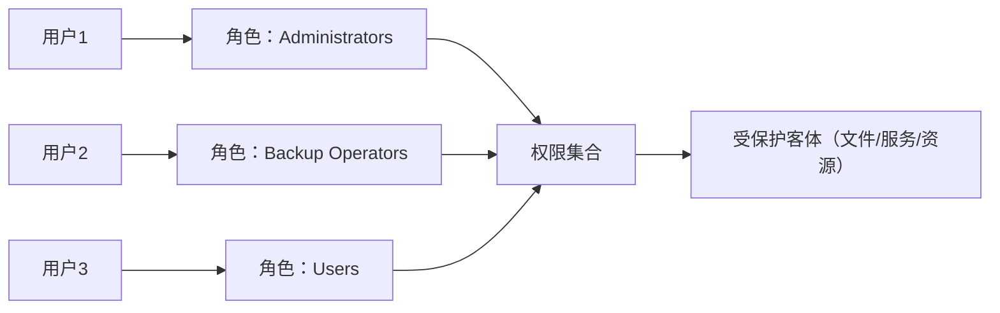

###### 🔷 访问控制模型 — ABAC 基于属性的访问控制

| 项目 | 要点 |
| --- | --- |
| 定义 | **基于属性的访问控制（ABAC, Attribute-Based Access Control）**：访问控制方法是根据**主体的属性**、**客体的属性**、**环境的条件**以及**访问控制策略**，对主体的请求操作进行授权许可或拒绝 |
| 四要素 | ① 主体（Subject）② 客体（Object）③ 环境条件（Environment Condition）④ 访问策略（Policy） |
| 判定对象 | 主体的属性（如身份、职务、部门、安全等级、年龄）+ 客体的属性（如密级、所有者、创建时间、文件类型） |
| 机制 | ABAC 访问控制机制位于"主体属性 + 客体属性 + 环境条件 + 访问策略"的交汇处，综合计算后输出"许可 / 拒绝" |
| 图号 | 图 7-7 基于属性的访问控制示意图 |

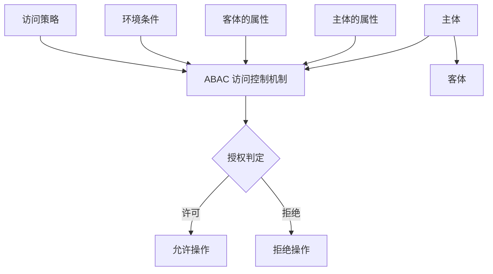

---

##### 7.2 访问控制策略设计与实现

###### 📌 访问控制策略的作用与设计要求

> [!IMPORTANT]
> **访问控制策略用于规定访问资源的权限，防止资源损失、泄密或非法使用。**

设计访问控制策略时，一般考虑如下 **6 项要求**：

| 序号 | 要求 | 原文要点 |
| --- | --- | --- |
| (1) | 不同网络应用的安全需求 | 如**内部用户**访问还是**外部用户** |
| (2) | 所有和应用相关信息的确认 | 如**通信端口号**、**IP 地址**等 |
| (3) | 网络信息传播和授权策略 | 如信息的**安全级别**和**分类** |
| (4) | 一致性 | 不同系统的访问控制策略和**信息分类策略之间的一致性** |
| (5) | 法规与合同义务 | 关于保护**数据**和**服务**的有关法规和合同义务 |
| (6) | 更新维护 | **访问权限的更新和维护** |

###### 📌 访问控制规则的说明原则

> [!IMPORTANT]
> **访问控制策略必须写明"禁止什么"和"允许什么"**。在说明访问控制规则时，应做到以下 4 点：

| 序号 | 原则 | 要点 |
| --- | --- | --- |
| (1) | 默认禁止 | 所建立的规则应以"**未经明确允许的都是禁止的**"为前提，而不是以较弱的原则"未经明确禁止的都是允许的"为前提 |
| (2) | 标记变化 | 信息标记的变化，包括由**信息处理设备自动引起**的或是由**用户决定**引起的 |
| (3) | 许可变化 | 由**信息系统**和**管理人员**引起的用户许可的变化 |
| (4) | 批准生效 | 规则在**颁布之前**需要管理人员的批准或其他形式的许可 |

> [!WARNING]
> 易错点：默认原则一定是"**未经明确允许的都是禁止的**"（白名单思维），不能记成"未经明确禁止的都是允许的"。

###### 📌 访问控制规则（访问约束条件集）

> [!IMPORTANT]
> **访问控制规则是访问约束条件集**，常见的访问控制规则有如下 **6 种**：

| 序号 | 规则类型 | 说明与示例 |
| --- | --- | --- |
| 1 | **基于用户身份**的访问控制规则 | 按具体用户账号授权 |
| 2 | **基于角色**的访问控制规则 | 按用户所属角色/组授权 |
| 3 | **基于地址**的访问控制规则 | 按源 IP / 网段 / MAC 授权 |
| 4 | **基于时间**的访问控制规则 | 按时间段（工作时间、有效期）授权 |
| 5 | **基于异常事件**的访问控制规则 | 例：**登录出现三次失败后，一段时间内冻结账户** |
| 6 | **基于服务数量**的访问控制规则 | 例：**网站在服务能力接近某个阈值时，暂时拒绝新的网络访问请求** |

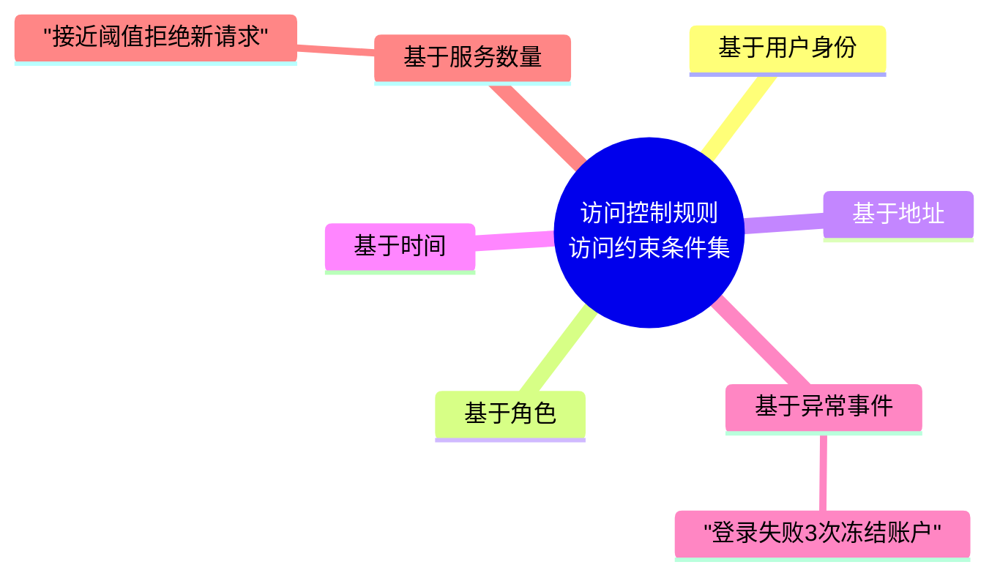

###### 📌 访问控制过程（管理五步骤）

> [!IMPORTANT]
> **访问控制的目的是保护系统的资产，防止非法用户进入系统及合法用户对系统资源的非法使用。**

实现访问控制管理，一般为 **5 个步骤**：

| 步骤 | 动作 | 记忆口诀 | 要点 |
| --- | --- | --- | --- |
| ① | 明确访问控制管理的资产 | **明确资产** | 例如网络系统的**路由器**、**Web 服务**等 |
| ② | 分析管理资产的安全需求 | **分析需求** | 例如**保密性**要求、**完整性**要求、**可用性**要求等 |
| ③ | 制定访问控制策略，确定访问控制规则以及用户权限分配 | **制定策略** | 输出规则集与权限表 |
| ④ | 实现访问控制策略 | **实现控制** | 建立**用户访问身份认证系统**，并根据用户类型授权用户访问资产 |
| ⑤ | 运行和维护访问控制系统，及时调整访问策略 | **运行维护** | 持续审计与调整 |


###### 📌 访问控制安全管理

###### 🔸 最小特权管理

| 项目 | 要点 |
| --- | --- |
| 原则 | **最小特权原则**：系统中每一个主体只能拥有**完成任务所必要的权限集** |
| 分配原则 | **"按需使用"（Need to Use）** |
| 作用 | 保证系统不会将权限过多地分配给用户，从而可以**限制特权造成的危害** |

###### 🔸 用户访问管理

| 项目 | 要点 |
| --- | --- |
| 内容（6 项） | ① **用户登记** ② **用户权限分配** ③ **访问记录** ④ **权限监测** ⑤ **权限取消** ⑥ **撤销用户** |


###### 🔸 口令安全管理（高频考点）

> [!IMPORTANT]
> 口令安全管理的 **7 条**硬性要求（务必逐条记忆）：

| 序号 | 要求 | 关键数字/细节 |
| --- | --- | --- |
| 1 | 口令长度与复杂度 | 口令选择应**至少在 8 个字符以上**，应选用**大小写字母、数字、特殊字符组合** |
| 2 | 禁用同名口令 | **禁止使用与账号相同的口令**；**更换系统默认口令**，避免使用默认口令 |
| 3 | 登录次数限制 | 限制账号登录次数，**建议为 3 次**；**禁止共享账号和口令** |
| 4 | 存储与传输 | 口令文件应**加密存放**，并**只有超级用户才能读取**；**禁止以明文形式在网络上传递口令** |
| 5 | 时效与重用 | 口令应有**时效机制**，保证经常更改，并且**禁止重用口令** |
| 6 | 弱口令检查 | 对**所有的账号**运行**口令破解工具**，检查是否存在**弱口令**或**没有口令**的账号 |
| 7 | 综合 | 上述措施共同构成口令生命周期管理 |

> [!TIP]
> 口诀：**8 位字符、3 次锁定、加密存储、禁止明文、定期更换、禁止重用、扫描弱口令**。

> [!WARNING]
> 易错点：口令文件是"**加密存放**"而不是"明文存放"；读取权限是"**只有超级用户**"，不是"所有用户"。

---

##### 7.3 访问控制产品与应用

###### 📌 访问控制主要产品

| 产品 | 技术特点 | 典型实例 |
| --- | --- | --- |
| **4A 系统** | 4A 指**认证（Authentication）、授权（Authorization）、账号（Account）、审计（Audit）**，中文名称为**统一安全管理平台**；平台集中提供账号、认证、授权和审计等网络安全服务；集成了访问控制机制和功能，提供多种访问控制服务；**常用基于角色的访问控制（RBAC）方法**，以便于账号授权管理 | 统一安全管理平台（4A 平台） |
| **安全网关**（原文标记为 SEM） | 利用**网络数据包信息**和**网络安全威胁特征库**，对网络通信连接服务进行访问控制；是一类特殊的网络安全产品 | **防火墙**、**统一威胁管理（UTM）** 等 |
| **系统安全增强** | 通常利用**强制访问控制技术**来增强操作系统、数据库系统的安全，**防止特权滥用** | **Linux 的安全增强系统 SELinux**、**Windows 操作系统加固** |

> [!TIP]
> "4A"记忆法：**A**uthentication（认证）→ **A**uthorization（授权）→ **A**ccount（账号）→ **A**udit（审计），四位一体即"统一安全管理平台"。

###### 📌 访问控制技术应用场景（按对象分类）

| 类型 | 具体场景 |
| --- | --- |
| **物理访问控制** | 门禁系统、警卫、个人证件、门锁、**物理安全区域划分** |
| **网络访问控制** | 网络接入控制、网络通信连接控制、网络区域划分、网络路由控制、**网络节点认证** |
| **操作系统访问控制** | 文件读写访问控制、**进程访问控制**、**内存访问控制**等 |
| **数据库 / 数据访问控制** | 数据库表创建、**数据生成与分发** |
| **应用系统访问控制** | 业务执行操作、业务系统文件读取等 |

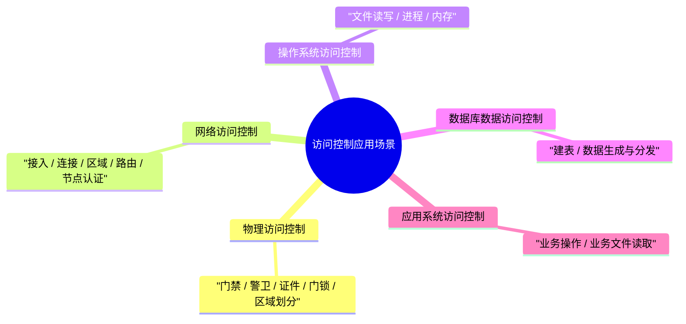

###### 📌 访问控制技术应用 — UNIX / Linux 系统

| 项目 | 要点 |
| --- | --- |
| 权限位数 | UNIX/Linux 系统中用 **10 bit** 表示访问控制权限 |
| 示例 | `-rw-r--r-- 1 root root 26195 Dec 15 12:42 install.log` |
| 结构拆分 | 第 1 位 = **文件类型**；第 2～4 位 = **用户（属主）权限**；第 5～7 位 = **用户组（属组）权限**；第 8～10 位 = **其他用户权限** |
| 权限符号 | `r` = **可读的**；`w` = **可写的**；`x` = **可执行的**；`-` = **无访问权限** |
| 文件类型 | `-` 普通文件；`d` 目录；`b`/`c` **设备文件**；`p` **管道文件** 等 |

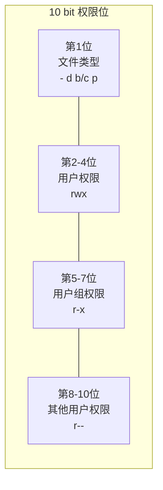

> [!WARNING]
> 示例 `-rw-r--r--` 中，属主 `root` 可读可写、属组 `root` 只读、其他用户只读；"**1**"为链接数，`26195` 为字节大小。

###### 📌 访问控制技术应用 — Windows 系统

| 项目 | 要点 |
| --- | --- |
| 访问令牌 | Windows 用户登录到系统时，**WinLogon 进程**为用户创建**访问令牌**，包含**用户及所属组的安全标识符（SID）**，作为用户的身份标识 |
| DACL | 文件等客体含有**自主访问控制列表（DACL, Discretionary ACL）**，标明**谁有权访问** |
| SACL | 客体还含有**系统访问控制列表（SACL, System ACL）**，标明**哪些主体的访问需要被记录**（审计） |
| 访问流程 | 用户进程访问客体对象时，通过 **WIN32 子系统**向**核心**请求访问服务 |
| 核心组件 | 核心的**安全参考监视器（SRM, Security Reference Monitor）** 将**访问令牌**与客体的 **DACL** 进行比较，决定主体是否拥有访问权限 |
| 审计判定 | 同时检查客体的 **SACL**，确定本次访问是否**落入既定的审计范围**内，是则送至**审计子系统** |
| 图号 | 图 7-10 Windows 2000 访问控制示意图 |

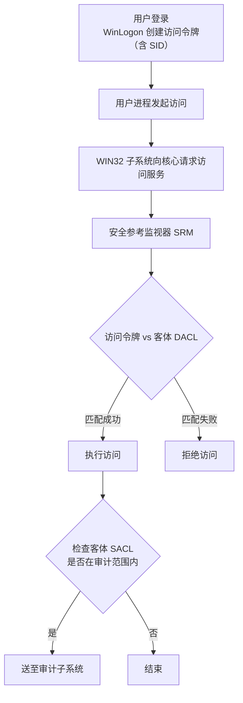

> [!IMPORTANT]
> **DACL 决定"能不能访问"，SACL 决定"要不要记录（审计）"** —— 二者含义不可混淆。

###### 📌 访问控制技术应用 — FTP（IIS FTP）访问控制

| 项目 | 要点 |
| --- | --- |
| 匿名访问控制设置 | 设置选择匿名访问此资源时使用的 **Windows 用户帐号**，例如 `IUSR_XXX` |
| 目录安全性设置 | FTP 的**目录权限设置**：**读取 = 下载**，**写入 = 上传** |
| 作用域 | **FTP 站点的目录权限对所有的 FTP 用户都有效** |
| 图号 | 图 7-12 匿名访问控制设置示意图；图 7-13 目录权限设置示意图 |

> [!TIP]
> 记忆：**读取 → 下载；写入 → 上传**。FTP 站点级目录权限对所有 FTP 用户生效，无法针对单个用户差异化（只能在 NTFS 文件系统层面细化）。

###### 📌 其他访问控制应用

###### 🔸 网络通信连接控制

| 项目 | 要点 |
| --- | --- |
| 设备 | 利用**防火墙、路由器、网关**等设备 |
| 部署位置 | 部署在**两个不同的通信网络的连接处** |
| 机制 | 使得所有的通信流都**经过通信连接控制器**，**只有当通信流符合访问控制规则时，才允许通信正常进行** |
| 图号 | 图 7-14 网络通信连接访问控制配置示意图（网关路由器 ↔ 内网路由器） |

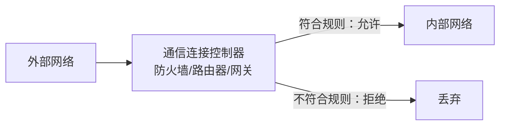

###### 🔸 基于 VLAN 的网络隔离

| 项目 | 要点 |
| --- | --- |
| 做法 | 根据网络的**功能**和**业务用途**，将网络划分为若干个小的**子网（网段）**，或者是**外部网**和**内部网** |
| 目的 | **避免各网之间多余的信息交换** |

###### 🔸 Web 服务访问控制流程

> [!IMPORTANT]
> Web 服务访问控制基本流程（图 7-15），**三级串行判定**：

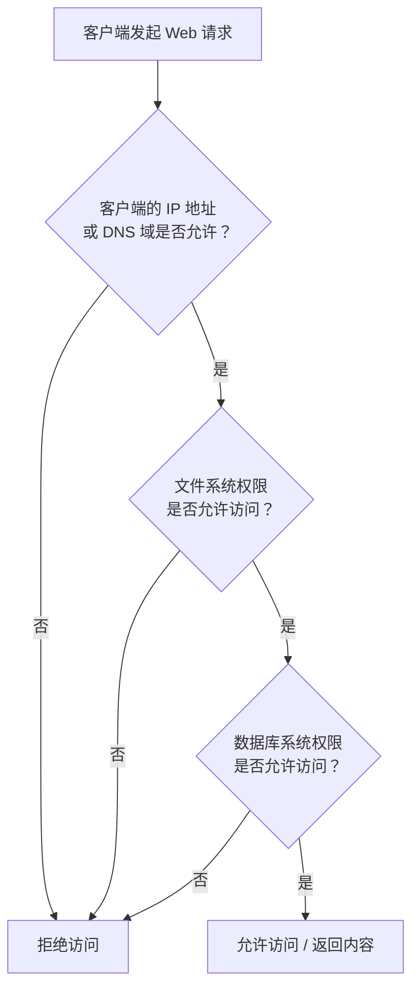

| 判定层级 | 内容 |
| --- | --- |
| 第一级 | **客户端的 IP 地址或 DNS 域是否允许** |
| 第二级 | **文件系统权限是否允许访问** |
| 第三级 | **数据库系统权限是否允许访问** |

---

#### 第 8 章 防火墙技术原理与应用

> 本章结构（据原教材目录）：
> 1. **防火墙概述**
> 2. **防火墙类型与实现技术**
> 3. **防火墙防御体系结构类型**
> 4. **防火墙技术应用**

##### 8.1 防火墙概述

###### 📌 防火墙的基本定位与区域划分

| 项目 | 要点 |
| --- | --- |
| 目的 | 为了**应对网络威胁**，将**内部信任网络**与**公共的不可信任的网络**进行**隔离** |
| 典型部署 | Internet → **出口防火墙** → IPS → 内部服务器区 / 汇聚交换机 → 接入交换机 → 终端 |

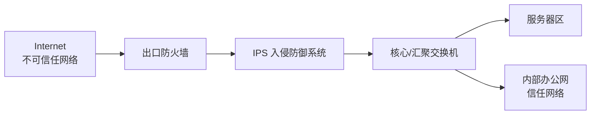

###### 🔸 防火墙区域划分（按安全信任程度）

> [!IMPORTANT]
> 根据网络的**安全信任程度**和**需要保护的对象**，人为划分若干安全区域：

| 区域 | 说明 |
| --- | --- |
| **公共外部网络** | 如 **Internet** |
| **内联网（Intranet）** | 如某个公司或组织的**专用网络**，网络访问**限制在组织内部** |
| **外联网（Extranet）** | 内联网的**扩展延伸**，常用作**组织与合作伙伴之间进行通信** |
| **军事缓冲区域（DMZ）** | 介于**内部网络和外部网络之间**的网络段，常**放置公共服务设备**，向外提供信息服务 |
| **Local（本地区域）** | **设备本身**，包括设备的各接口本身 |

> [!IMPORTANT]
> **受信任程度排序：`Local` > `Trust` > `DMZ` > `Untrust`**（华为防火墙区域划分）

> [!WARNING]
> 华为的区域划分（`Local` / `Trust` / `DMZ` / `Untrust`）与教材表述有细微差异，理解即可，考试以教材"公共外部网 / 内联网 / 外联网 / DMZ"提法为主。

###### 📌 防火墙工作原理

| 项目 | 要点 |
| --- | --- |
| 定义 | 防火墙是由一些**软、硬件组合而成的网络访问控制器** |
| 机制 | 根据一定的**安全规则**来控制流过防火墙的**网络包**，如**禁止**或**转发** |
| 效果 | 能够**屏蔽被保护网络内部的信息、拓扑结构和运行状况**，从而起到**网络安全屏障**的作用 |
| 用途 | 一般用来将**内部网络与因特网或者其他外部网络互相隔离**，**限制网络互访** |
| 图号 | 图 8-1 防火墙工作原理示意图（路由器 + 防火墙串联） |

###### 🔸 防火墙对流量的操作（厂商差异）

| 平台 | 操作动作 |
| --- | --- |
| **华为防火墙** | `permit`（允许）、`deny`（拒绝） |
| **Linux 防火墙** | `Accept`（接受）、`Reject`（拒绝数据包或信息通过，**通知信息源**）、`Drop`（拒绝数据包或信息通过，**不通知信息源**） |

> [!WARNING]
> **`Reject` 与 `Drop` 的区别是高频考点**：`Reject` 会**回送通知**（如 ICMP 不可达）给信息源；`Drop` **静默丢弃、不通知**。

###### 📌 防火墙安全策略类型

> [!IMPORTANT]
> 防火墙的安全策略有**两种类型**：

| 类型 | 定义 |
| --- | --- |
| **(1) 白名单策略** | **只允许符合安全规则的包通过防火墙，其他通信和包禁止** |
| **(2) 黑名单策略** | **禁止与安全规则相冲突的包通过防火墙，其他通信和包都允许** |

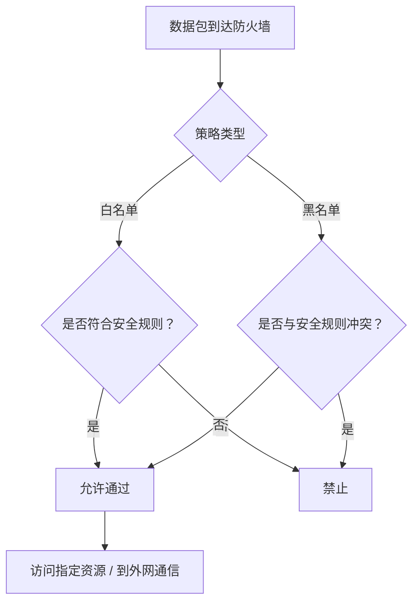

> [!TIP]
> 与访问控制规则"**未经明确允许的都是禁止的**"相呼应：**白名单 = 默认禁止，黑名单 = 默认允许**。安全实践中优先白名单。

###### 📌 防火墙功能

> [!IMPORTANT]
> 防火墙的 **5 大功能**：

| 序号 | 功能 |
| --- | --- |
| 1 | **过滤非安全网络访问** |
| 2 | **限制网络访问** |
| 3 | **网络访问审计** |
| 4 | **网络带宽控制** |
| 5 | **协同防御** |

###### 📌 防火墙安全风险与发展

> [!WARNING]
> 采用防火墙安全措施的网络**仍然存在**以下 **5 类**网络安全风险：

| 序号 | 风险 | 要点 |
| --- | --- | --- |
| (1) | **网络安全旁路** | 防火墙对**未经过它的**网络通信无能为力，例如**从内部直接拨号访问外网** |
| (2) | **防火墙功能缺陷**，导致一些网络威胁无法阻断 | 主要安全缺陷包括：① 防火墙**不能完全防止感染病毒的软件或文件传输**；② 防火墙**不能防止基于数据驱动式的攻击**；③ 防火墙**不能完全防止后门攻击** |
| (3) | **防火墙安全机制形成单点故障和特权威胁** | 一旦防火墙自身的安全管理失效，就会对网络造成**单点故障**和**网络安全特权失控** |
| (4) | **防火墙无法有效防范内部威胁** | 对来自内部的攻击基本无效 |
| (5) | **防火墙效用受限于安全规则** | 防火墙**依赖于安全规则更新** |

> [!IMPORTANT]
> **防火墙发展趋势**：控制粒度不断**细化**、检查安全功能持续**增强**、产品分类更**细化**、**智能化**增强。

---

##### 8.2 防火墙类型与实现技术

###### 📌 包过滤防火墙

| 项目 | 要点 |
| --- | --- |
| 层次 | 在 **IP 层（网络层）** 实现的防火墙技术 |
| 依据 | 根据包的**源 IP 地址、目的 IP 地址、源端口、目的端口**及**包传递方向**等**包头信息**判断是否允许包通过 |
| **优点** | **低负载、高通过率、对用户透明** |
| **缺点** | **不能在用户级别进行过滤**，如**不能识别不同的用户**和**防止 IP 地址的盗用**。如果攻击者把自己主机的 IP 地址设成一个合法主机的 IP 地址，就可以**轻易通过包过滤器** |
| 图号 | 图 8-3 包过滤工作机制（输入的网络通信流 → 过滤 → 允许输出的网络通信流） |


###### 🔸 包过滤规则组成

| 组成 | 说明 |
| --- | --- |
| **规则号** | 规则的顺序编号（决定匹配优先级） |
| **匹配条件** | 根据**源 IP 地址、目的 IP 地址、源端口号、目的端口号、协议类型（UDP / TCP / ICMP）、通信方向、规则运算**进行匹配 |
| **匹配操作** | 有 **拒绝、转发、审计** **三种** |

> [!IMPORTANT]
> 包过滤三要素：**规则号 + 匹配条件 + 匹配操作**；三种操作：**拒绝、转发、审计**。

###### 🔸 【案例分析】只允许内、外网的邮件通信，其他通信都禁止

> 表 8-1 防火墙过滤规则（OCR 表格残缺，保留可辨认结构）

| 规则 | 通信方向 | 协议 | 源地址 | 源端口 | 目的地址 | 目的端口 | 操作 |
| --- | --- | --- | --- | --- | --- | --- | --- |
| A | — | TCP | any | > 1024 | any | 25 | **允许** |
| B | — | TCP | any | 25 | any | > 1024 | **允许** |
| C～D | — | — | — | — | — | — | **（原文残缺，标记为"多放/转发"字样）** |
| E | — | IP | — | — | — | — | **拒绝** |

华为路由器 ACL 3000 配置实现：

```text
[Router] acl 3000
[Router-acl-adv-3000] rule 10 permit tcp source any destination any source-port gt 1024 destination-port eq 25
[Router-acl-adv-3000] rule 20 permit tcp source any destination any source-port eq 25 destination-port gt 1024
[Router-acl-adv-3000] rule 30 deny ip
```

> [!TIP]
> `gt 1024` = **大于 1024**（客户端随机高端口）；`eq 25` = **等于 25**（SMTP）。最后一条 `rule 30 deny ip` 体现**白名单默认拒绝**思想。

###### 🔸 【案例分析】包过滤工作原理识图题

> [!IMPORTANT]
> **网络防火墙是在两个网络之间加强访问控制的一整套装置**，强制所有访问控制和连接**必须经过这个保护层**，并在此进行**连接和安全检查**，**只有合法的流量才能通过**。

据图作答的三个问题（典型考题）：

| 问题 | 答案 |
| --- | --- |
| (1) 图中所示的是（　）类型防火墙的工作原理 | **包过滤防火墙** |
| (2) 该类型防火墙工作在 TCP/IP 模型的（　）层 | **网络层（IP 层 / 网际层）** |
| (3) 该类型防火墙中的安全访问策略（过滤规则）主要通过对进入防火墙的 IP 分组的（　）、（　）、（　）等进行设置，决定是否允许 IP 分组通过防火墙 | **源 IP 地址**、**目的 IP 地址**、**端口号（源端口 / 目的端口）**（协议类型、通信方向亦可） |

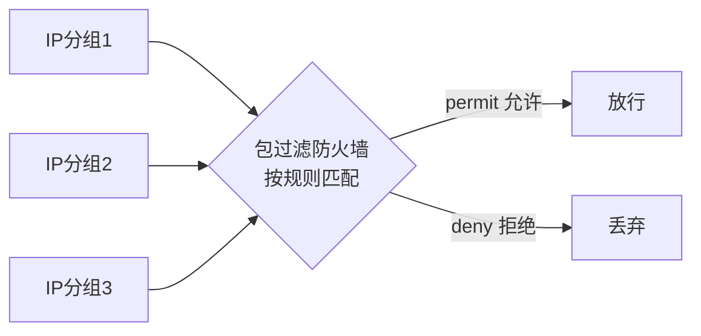

###### 📌 状态检测技术

| 项目 | 要点 |
| --- | --- |
| 定义 | 状态检查技术：通过利用 **TCP 会话**和 **UDP "伪"会话**的状态信息进行网络访问机制 |
| 核心 | 防火墙首先建立并维护一张**会话表**；当有符合已定义安全策略的 **TCP 连接或 UDP 流**时，防火墙会**创建会话项**，然后**依据状态表项检查**，判断是否允许通过防火墙 |

**主要步骤（4 步）**：

| 步骤 | 处理 |
| --- | --- |
| (1) | **接收到数据包** |
| (2) | **检查数据包的有效性**，若无效，则**丢掉数据包并审计** |
| (3) | **查找会话表**：若找到，则进一步检查数据包的**序列号**和**会话状态**，如有效，则进行**地址转换和路由**，**转发该数据包**；否则，**丢掉数据包并审计** |
| (4) | 当会话表中**没有新到的数据包信息**时，则**查找策略表**：如符合策略表，则**增加会话条目到会话表中**，并进行**地址转换和路由**，**转发该数据包**；否则，**丢掉该数据包并审计** |

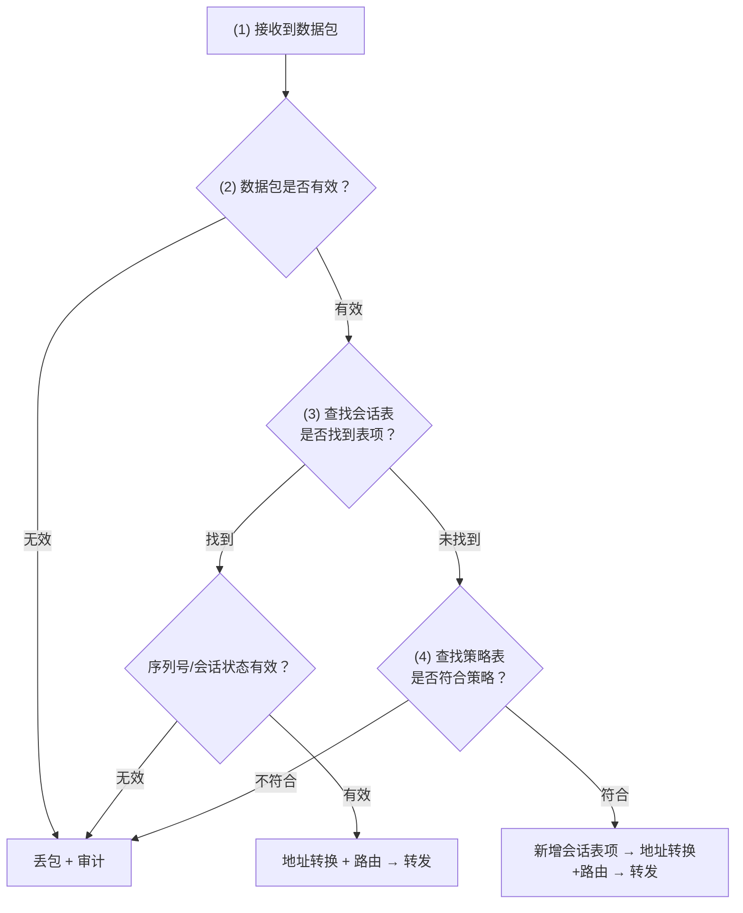

> [!TIP]
> 状态检测记忆口诀：**收包 → 验有效性 → 查会话表 → 查策略表 → 建表转发**，每一步失败都"**丢包 + 审计**"。

###### 📌 应用服务代理（代理防火墙）

| 项目 | 要点 |
| --- | --- |
| 角色 | 应用服务代理防火墙扮演着受保护网络的**内部网主机和外部网主机的"中间人"**角色 |
| 机制 | 代理防火墙**代替受保护网络的主机**向**外部网**发起服务请求，并将**外部服务请求响应的结果返回给受保护网络的主机** |
| 分类 | 代理服务器按照所代理的服务可以分为 **FTP、Telnet、Http、Socket、邮件代理** 等 |
| **优点** | ① **不允许外部主机直接访问内部主机**；② 支持**多种用户认证方案**；③ 可以**分析数据包内部的应用命令**；④ 可以提供**详细的审计记录** |
| **缺点** | ① **速度比包过滤慢**；② **对用户不透明**；③ **与特定应用协议相关联**，代理服务器**并不能支持所有的网络协议** |
| 图号 | 图 8-8 代理服务器工作示意图（内网客户代理 ↔ 代理防火墙 ↔ 外网服务器） |


> [!WARNING]
> 代理防火墙"**对用户不透明**"（需要客户端配置代理），而包过滤"**对用户透明**"——两者正好相反。

###### 📌 网络地址转换技术 NAT

| 项目 | 要点 |
| --- | --- |
| 产生原因 | NAT 是为了解决**公网地址不足**而出现的，它可以缓解**少量因特网 IP 地址**和**大量主机**之间的矛盾 |
| 安全价值 | NAT 技术用在网络安全应用方面，能**透明地对所有内部地址作转换**，使**外部网络无法了解内部网络的内部结构**，从而**提高了内部网络的安全性** |

**实现方式（3 种）**：

| 方式 | 说明 |
| --- | --- |
| **静态 NAT** | **内部网络中的每个主机**都被**永久映射**成**外部网络中的某个合法的地址**（一对一固定映射） |
| **NAT 池** | 在外部网络中配置**合法地址集**，采用**动态分配**的方法映射到内部网络（多对多） |
| **端口 NAT（PAT）** | 把内部地址映射到**外部网络的一个 IP 地址的不同端口**上（多对一，靠端口区分） |

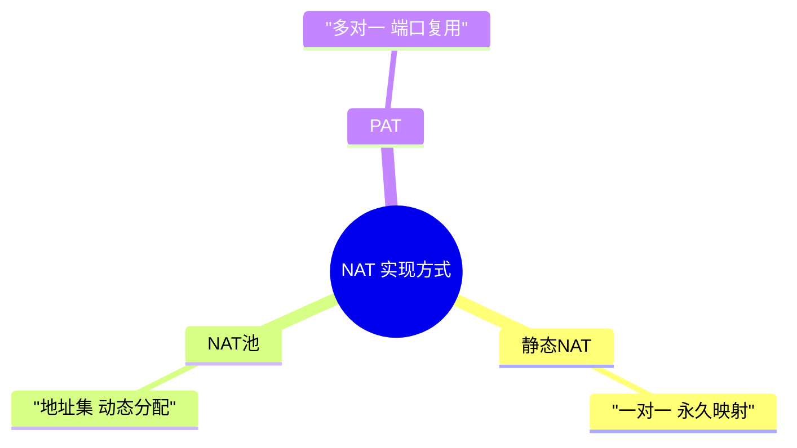

###### 📌 下一代防火墙技术

> [!IMPORTANT]
> 下一代防火墙除了集成传统防火墙**包过滤、状态监测、地址转换**等功能外，还具有以下 **7 项新功能**：

| 序号 | 新功能 | 要点 |
| --- | --- | --- |
| (1) | **应用识别和管控** | **不依赖端口**，通过对网络数据包**深度内容的分析**，实现对**应用层协议和应用程序**的精准识别，提供**应用程序级功能控制**，支持应用程序安全防护 |
| (2) | **入侵防护（IPS）** | 能够根据**漏洞特征**进行攻击检测和防护，如 **SQL 注入攻击** |
| (3) | **数据防泄露** | 对传输的**文件和内容**进行识别过滤，可识别常见文件的**真实类型**如 **Word、Excel、PPT、PDF** 等，并对**敏感内容**进行过滤 |
| (4) | **恶意代码防护** | 采用**基于信誉的恶意检测技术**，能够识别**恶意的文件和网站**；构建 **Web 信誉库**，通过对互联网站资源（**IP、URL、域名**）进行**威胁分析和信誉评级**，将含有恶意代码的网站资源**列入 Web 信誉库**，然后基于**内容过滤技术**阻挡用户访问**不信任的网站**，从而实现智能化保护终端用户的安全 |
| (5) | **URL 分类与过滤** | 构建 **URL 分类库**，含不同类型的 URL 信息（如**不良言论、网络"钓鱼"、论坛聊天**），**对与工作无关的网站、不良信息、高风险网站**实现**准确、高效过滤** |
| (6) | **带宽管理与 QoS 优化** | 通过**智能化识别业务应用**，有效管理网络用户 / IP 使用的**带宽**，**确保关键业务和关键用户的带宽**，优化网络资源的利用 |
| (7) | **加密流量检测** | 对 **URL、IP、SSL、SSH** 等加密流量进行识别与检测（原页 OCR 严重失真，依上下文补全） |

###### 📌 其他防火墙技术

###### 🔸 Web 防火墙技术

> [!IMPORTANT]
> **Web 应用防火墙可抵御的典型攻击**：**SQL 注入攻击、XSS 跨站脚本攻击、Web 应用扫描、Webshell、Cookie 注入攻击、CSRF 攻击** 等。

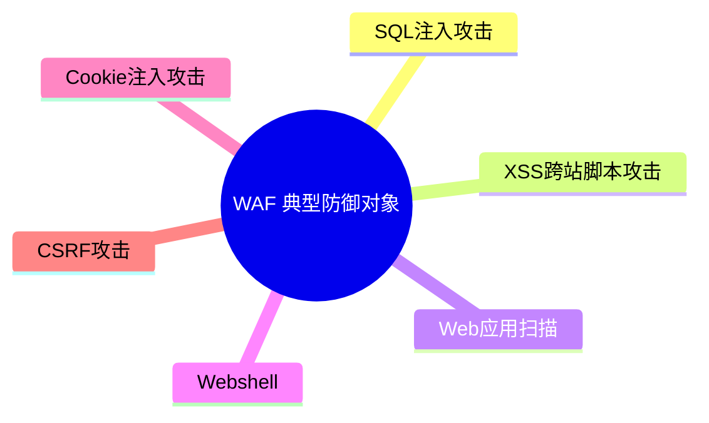

###### 🔸 数据库防火墙技术

| 项目 | 要点 |
| --- | --- |
| 技术基础 | 主要是基于**数据通信协议深度分析**和**虚拟补丁** |
| 机制 | 根据安全规则对**数据库访问操作及通信**进行安全访问控制，防止数据库系统受到攻击威胁 |
| 功能 | **监控数据库风险行为**，**阻断违规 SQL 操作**、**阻断或允许合法的 SQL 操作执行** |
| **虚拟补丁技术** | 通过在**数据库外部创建一个安全屏障层**，**监控所有数据库活动**，进而**阻止可疑会话、操作程序或隔离用户**，**防止数据库漏洞被利用**，从而**不用打数据库厂商的补丁**，也**不需要停止服务**，可以保护数据库安全 |

> [!TIP]
> 虚拟补丁的价值：**不修改数据库本身、不重启/停止服务**，即可防护已知漏洞。

###### 🔸 工控防火墙技术

| 项目 | 要点 |
| --- | --- |
| 用途 | 工控防火墙是用于**保护工业设备及系统**，主要通过**工控协议深度分析**，**防止恶意攻击** |
| 常见工控协议 | **Modbus TCP 协议**、**IEC 61850 协议**、**OPC 协议**、**Ethernet/IP 协议** 和 **DNP3** 等 |
| 特殊要求 | 工控防火墙要适应工业现场的**恶劣环境**及**实时性高**的工控操作要求 |

###### 📌 防火墙主要产品

| 产品 | 特点/功能 |
| --- | --- |
| **网络防火墙** | 部署在**不同安全域之间**，**解析和过滤经过防火墙的数据流**，具备**网络层访问控制及过滤功能**的网络安全产品 |
| **Web 应用防火墙** | 提供 **Web 应用安全防护** |
| **数据库防火墙** | 基于**数据库协议分析与控制技术**，实现对数据库的**访问行为控制**和**危险操作阻断** |
| **主机防火墙** | 部署在**终端计算机**上，监测和控制**网络级数据流**和**应用程序访问** |
| **工控防火墙** | 保护**工控系统**安全 |
| **下一代防火墙** | 集成**应用识别和管控、恶意代码防护、入侵防护、事件关联**等多种安全功能 |
| **家庭防火墙** | 防火墙功能模块集成在**智能路由器**中，具有 **IP 地址控制、MAC 地址限制、不良信息过滤控制、防止蹭网、智能家居保护** 等功能的网络安全产品 |

---

##### 8.3 防火墙防御体系结构类型

> [!IMPORTANT]
> **三种基本防御体系结构**：
> ① **基于双宿主主机防火墙**
> ② **基于代理型防火墙**
> ③ **基于屏蔽子网的防火墙**

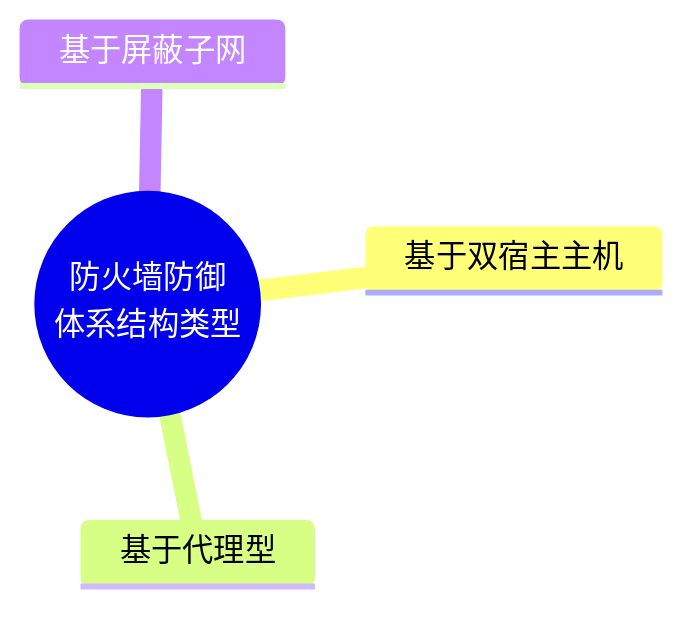

###### 📌 基于双宿主主机防火墙结构

| 项目 | 要点 |
| --- | --- |
| 地位 | **最基本的防火墙结构** |
| 构成 | 这种系统**至少具有两个网络接口卡（NIC）的主机系统** |
| 连接 | **内部网络和外部网络分别连接在不同的网卡**，使**内外网不能直接通信** |
| 工作过程 | 从**一块网卡**上送来的 **IP 包**，经过一个**安全检查模块**检查后：<br/>· 如果**合法**，则**转发到另一块网卡**上，以实现网络的正常通信<br/>· 如果**不合法**，则**阻止通信** |
| 效果 | **内外网络直接的 IP 数据流完全在双宿主主机的控制之中** |
| 图号 | 图 8-12 双宿主主机防火墙结构 |

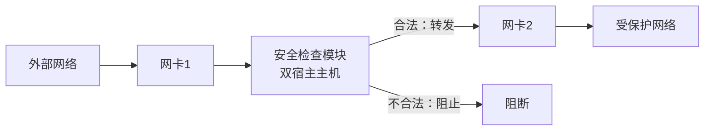

###### 📌 基于代理型防火墙结构

| 项目 | 要点 |
| --- | --- |
| 构成 | 由**一台主机同外部网连接**，该主机**代理内部网和外部网的通信**；代理型结构中还**通过路由器过滤**，**代理服务器和路由器共同构建一个网络安全边界防御架构** |
| 图号 | 图 8-13 代理型防火墙结构 |

**过滤路由器可按如下规则配置（3 条）**：

| 序号 | 规则 |
| --- | --- |
| 1 | **允许**其他内部主机为**某些类型的服务请求**与**外部网络**建立**直接连接** |
| 2 | **任何外部网（或 Internet）的主机**只能与**内部网络的代理主机**建立连接 |
| 3 | **任何外部系统对内部网络的操作**都必须**经过代理主机**。同时，**代理主机本身要有较全面的安全保护** |

| 评价 | 内容 |
| --- | --- |
| **优点** | 代理型结构比双宿主主机结构提供**更好的安全保护**，同时**操作也更加简便** |
| **缺点** | **攻击者攻破代理主机**，攻击者就变成了**内部合法用户**，可以**侦听到内部网络上的所有信息** |

```mermaid
flowchart LR
    E["外部网络"] --> R["过滤路由器"]
    R --> P["代理主机<br/>（需重点防护）"]
    R -->|"允许特定服务直连"| I["内部网络"]
    P --> I
```

###### 📌 基于屏蔽子网的防火墙结构

| 项目 | 要点 |
| --- | --- |
| 原理 | 屏蔽子网结构在**代理型结构中增加一层周边网络的安全机制**，使**内部网络和外部网络有两层隔离带** |
| 作用 | **周边网络隔离堡垒主机与内部网**，**减轻攻击者攻破堡垒主机时对内部网络的冲击力**。攻击者即使攻破了**堡垒主机**，也**不能侦听到内部网络的信息**，**不能对内部网络直接操作** |
| 特点 1 | **应用代理**位于**被屏蔽子网**中，**内部网络向外公开的服务器**也放在**被屏蔽子网**中，**外部网络只能访问被屏蔽子网，不能直接进入内部网络** |
| 特点 2 | **包过滤路由器 A** 的作用是**过滤外部网络对被屏蔽子网的访问**；**包过滤路由器 B** 的作用是**过滤被屏蔽子网对内部网络的访问**。所有外部网络经由被屏蔽子网对内部网络的访问，都必须**经过应用代理服务器的检查和认证** |
| **优点** | **安全级别最高** |
| **缺点** | **成本高，配置复杂** |
| 图号 | 图 8-14 屏蔽子网防火墙结构 |

```mermaid
flowchart LR
    E["外部网络"] --> RA["包过滤路由器 A"]
    RA --> DMZ["被屏蔽子网（周边网络）<br/>应用代理 / 堡垒主机 / 对外服务器"]
    DMZ --> RB["包过滤路由器 B"]
    RB --> I["受保护的内部网络"]
```

> [!IMPORTANT]
> **三种结构安全性对比**：双宿主主机 < 代理型 < **屏蔽子网（安全级别最高，成本最高、配置最复杂）**。

---

##### 8.4 防火墙技术应用

###### 📌 防火墙安全功能指标（12 项）

| 指标 | 要点 |
| --- | --- |
| **网络接口** | 是指防火墙所能够**保护的网络类型**，如**以太网、快速以太网、千兆以太网、ATM、令牌环及 FDDI** 等 |
| **协议支持** | 除支持 **IP 协议**之外，还支持 **AppleTalk、DECnet、IPX 及 NETBEUI** 等协议；建立 VPN 通道的协议：**IPSec、PPTP、专用协议**等；数据协议分析类型、工控协议分析类型、应用协议识别类型；**IPv6 协议支持** |
| **路由支持** | **静态路由**、**策略路由**、**动态路由** |
| **设备虚拟化** | **虚拟系统**、**虚拟化部署** |
| **加密支持** | 是指防火墙所能够支持的**加密算法**，例如 **DES、RC4、IDEA、AES** 以及**国产加密算法** |
| **认证支持** | 是指防火墙所能够支持的**认证类型**，如 **RADIUS、Kerberos、TACACS / TACACS+、口令方式、数字证书** 等 |
| **访问控制** | **包过滤、NAT、状态检测、动态开放端口、IP/MAC 地址绑定** |
| **流量管理** | **带宽管理**、**连接数控制**、**会话管理** |
| **应用层控制** | **用户管控**、**应用类型控制**、**负载均衡** |
| **攻击防护** | **拒绝服务攻击防护、Web 攻击防护、数据库攻击防护、恶意代码防护、其他应用攻击防护、自动化工具威胁防护、攻击逃逸防护、外部系统协同防护** |
| **管理功能** | 是指防火墙所能够支持的**管理方式**，如基于 **SNMP 管理**、管理的通信协议、带宽管理、负载均衡管理、**失效管理**、**用户权限管理**、**远程管理和本地管理** 等 |
| **审计和报表** | 是指防火墙所能够支持的**审计方式**和分析处理审计数据的**表达形式**，如**远程审计、本地审计** 等 |

> [!TIP]
> 记忆：接（接口）— 协（协议）— 路（路由）— 虚（虚拟化）— 加（加密）— 认（认证）— 控（访问控制）— 流（流量）— 应（应用层）— 攻（攻击防护）— 管（管理）— 审（审计）。

###### 📌 防火墙性能指标

| 指标 | 定义/要点 |
| --- | --- |
| **最大吞吐量** | 检查防火墙在**只有一条默认允许规则**和**不丢包**的情况下达到的**最大吞吐速率**，如**网络层吞吐量、HTTP 吞吐量、SQL 吞吐量** |
| **最大连接速率** | **TCP 新建连接速率、HTTP 请求速率、SQL 请求速率** |
| **最大规则数** | 检查在**添加大数量访问规则**的情况下，防火墙**性能变化状况** |
| **并发连接数** | 防火墙在**单位时间内**所能建立的**最大 TCP 连接数**，即**每秒的连接数** |

###### 🔸 防火墙安全保证指标

> [!IMPORTANT]
> 用于**测评防火墙的安全保障程度**，主要包括 **开发、指导性文档、生命周期支持、测试** 4 个方面。

###### 🔸 环境适应性指标

| 项目 | 要点 |
| --- | --- |
| 定义 | 用于评估防火墙的**部署和正常运行所需要的条件** |
| 组成 | 主要包括**网络环境**、**物理环境** |
| 网络环境 | 通常包括 **IPv4 / IPv6 网络**、**云计算环境**、**工控网络** 等 |
| 物理环境 | 通常包括**气候、电磁兼容、绝缘、接地、机械适应性、外壳防护** 等 |

###### 🔸 防火墙自身安全指标

> [!IMPORTANT]
> 主要有：**身份识别与鉴别、管理能力、管理审计、管理方式、异常处理机制、防火墙操作系统安全等级、抗攻击能力**。

###### 📌 防火墙部署（7 个步骤）

| 步骤 | 动作 | 记忆提示 |
| --- | --- | --- |
| ① | 根据组织或公司的安全策略要求，将网络**划分成若干安全区域** | **划分区域** |
| ② | 在安全区域之间设置针对网络通信的**访问控制点** | **设控制点** |
| ③ | 针对不同访问控制点的**通信业务需求**，制定相应的**边界安全策略** | **定策略** |
| ④ | 依据控制点的边界安全策略，采用**合适的防火墙技术和防范结构** | **选技术** |
| ⑤ | 在防火墙上，**配置实现对应的网络安全策略** | **配策略** |
| ⑥ | **测试验证**边界安全策略是否正常执行 | **测试验证** |
| ⑦ | **运行和维护**防火墙 | **运维维护** |

```mermaid
flowchart LR
    A["① 划分区域"] --> B["② 设控制点"] --> C["③ 定边界策略"] --> D["④ 选技术/结构"] --> E["⑤ 配置策略"] --> F["⑥ 测试验证"] --> G["⑦ 运维维护"]
```

###### 📌 防火墙应用案例 — Linux 防火墙（iptables）

**4. 允许所有入站 SSH：**

```bash
#iptables -A INPUT  -i eth0 -p tcp --dport 22 -m state --state NEW,ESTABLISHED -j ACCEPT
#iptables -A OUTPUT -o eth0 -p tcp --sport 22 -m state --state ESTABLISHED -j ACCEPT
```

**5. 只允许来自特定网络的入站 SSH：**

```bash
#iptables -A INPUT  -i eth0 -p tcp -s X.Y.Z.0/24 --dport 22 -m state --state NEW,ESTABLISHED -j ACCEPT
#iptables -A OUTPUT -o eth0 -p tcp --sport 22 -m state --state ESTABLISHED -j ACCEPT
```

**6. 允许入站 HTTP / HTTPS：**

```bash
#iptables -A INPUT  -i eth0 -p tcp --dport 80  -m state --state NEW,ESTABLISHED -j ACCEPT
#iptables -A OUTPUT -o eth0 -p tcp --sport 80  -m state --state ESTABLISHED -j ACCEPT
#iptables -A INPUT  -i eth0 -p tcp --dport 443 -m state --state NEW,ESTABLISHED -j ACCEPT
#iptables -A OUTPUT -o eth0 -p tcp --sport 443 -m state --state ESTABLISHED -j ACCEPT
```

> [!TIP]
> 规律：**入方向 INPUT 放行 `--dport`（目的端口）+ `NEW,ESTABLISHED`；出方向 OUTPUT 放行 `--sport`（源端口）+ `ESTABLISHED`**。端口：**SSH = 22，HTTP = 80，HTTPS = 443**。

> [!WARNING]
> OCR 原文中 `-j` 被误识别为 `-}j` / `-]j`，已统一修正为 `-j`（jump）。

###### 📌 防火墙应用案例 — 华为包过滤防火墙 ACL（基本 ACL 2000）

**组网与需求**：Router 已完成 IP 地址和路由的相关配置。在 Router 上部署**基本 ACL** 后，ACL 将试图穿越 Router 的**源地址为 `192.168.1.0/24` 网段的数据包过滤掉**，并**放行其他流量**，从而**禁止 `192.168.1.0/24` 网段的用户访问 Router 右侧的服务器网络**。

**配置步骤**：

```text
1、Router 已完成 IP 地址和路由的相关配置

2、创建基本 ACL 2000 并配置 ACL 规则，拒绝 192.168.1.0/24 网段
   [Router] acl 2000
   [Router-acl-basic-2000] rule deny   source 192.168.1.0 0.0.0.255
   [Router-acl-basic-2000] rule permit source any

3、由于从接口 GE0/0/1 进入 Router，所以在接口 GE0/0/1 的入方向配置流量过滤
   [Router] interface GigabitEthernet 0/0/1
   [Router-GigabitEthernet0/0/1] traffic-filter inbound acl 2000
   [Router-GigabitEthernet0/0/1] quit
```

```mermaid
flowchart LR
    A["192.168.1.0/24<br/>用户网段"] -->|"GE0/0/1 inbound<br/>acl 2000"| R["Router"]
    R -->|"deny"| X["丢弃"]
    R -->|"permit 其他"| S["服务器网络<br/>192.168.2.0/24"]
```

> [!TIP]
> **基本 ACL 编号范围 2000～2999，只能匹配源 IP**；**高级 ACL 编号范围 3000～3999，可匹配源/目的 IP、协议、端口**。通配符掩码 `0.0.0.255` 表示前 24 位精确匹配。

###### 📌 防火墙应用案例 — 华为包过滤防火墙 ACL（高级 ACL 3001 / 3002）

**组网与需求**：

| 项目 | 要点 |
| --- | --- |
| 前提 | **Router 已完成 IP 地址和路由的相关配置** |
| 场景 | 某公司通过 Router 实现**各部门之间的互连**。为方便管理网络，管理员为公司的**研发部**和**市场部**规划了两个网段的 IP 地址 |
| 需求 | 现要求 Router 能够**限制两个网段之间互访**，**防止公司机密泄露** |
| 地址 | 研发部 `10.1.1.0/24`（网关 `10.1.1.1/24`）；市场部 `10.1.2.0/24`（网关 `10.1.2.1/24`） |
| 接口 | 研发部接 **GE0/0/1**；市场部接 **GE0/0/2** |

**配置步骤**：

```text
1、Router 已完成 IP 地址和路由的相关配置

2、创建高级 ACL 3001 并配置 ACL 规则，拒绝研发部访问市场部的报文
   [Router] acl 3001
   [Router-acl-adv-3001] rule deny ip source 10.1.1.0 0.0.0.255 destination 10.1.2.0 0.0.0.255
   [Router-acl-adv-3001] quit

3、创建高级 ACL 3002 并配置 ACL 规则，拒绝市场部访问研发部的报文
   [Router] acl 3002
   [Router-acl-adv-3002] rule deny ip source 10.1.2.0 0.0.0.255 destination 10.1.1.0 0.0.0.255
   [Router-acl-adv-3002] quit

4、由于研发部和市场部互访的流量分别从接口 GE0/0/1 和 GE0/0/2 进入 Router，
   所以在接口 GE0/0/1 和 GE0/0/2 的入方向配置流量过滤
   [Router] interface GigabitEthernet 0/0/1
   [Router-GigabitEthernet0/0/1] traffic-filter inbound acl 3001
   [Router-GigabitEthernet0/0/1] quit

   [Router] interface GigabitEthernet 0/0/2
   [Router-GigabitEthernet0/0/2] traffic-filter inbound acl 3002
   [Router-GigabitEthernet0/0/2] quit
```

```mermaid
flowchart TB
    RD["研发部门<br/>10.1.1.0/24"] -->|"GE0/0/1 inbound<br/>acl 3001 deny"| R["Router"]
    MK["市场部门<br/>10.1.2.0/24"] -->|"GE0/0/2 inbound<br/>acl 3002 deny"| R
    R --> NET["其他网络 / Internet"]
```

> [!WARNING]
> OCR 原文中 ACL 编号前后不一致（出现 `acl 3001` 与 `[Router-acl-adv-2001]`、`[Router-acl-adv-3002]` 混写），已按"**高级 ACL 3001 / 3002**"统一修正；接口名 `GEOVCOVI` / `GECOVXCV` 统一为 `GigabitEthernet 0/0/1`、`GE0/0/2`。

###### 📌 防火墙应用案例 — 工控防火墙部署

原页为大型工控网络拓扑截图，涉及的层级与设备如下（文字摘录）：

| 层级 | 设备/系统 |
| --- | --- |
| 调度中心层 | 工程师站、操作员站（多个）、**大屏幕系统**、Web 服务器、GIS 服务器、仿真服务器、生产调度应用服务器、**集中安全管理平台** |
| 中心网络层 | 核心交换机、**路由器 + 防火墙**、交换机 |
| 场站接入层 | 多个场站的**交换机**（门站、储配站、加气站 / CNG 站等） |
| 末端设备 | **网络摄像头**、RTU / PLC 类采集设备 |
| 远程接入 | **无线**接入通道、路由器 |

```mermaid
flowchart TB
    SC["调度中心<br/>工程师站/操作员站/大屏幕/<br/>GIS·仿真·生产调度服务器"] --> CS["核心交换机"]
    CS --> R["路由器"]
    R --> FW["防火墙"]
    FW --> SW["场站交换机<br/>门站 / 储配站 / CNG站"]
    SW --> CAM["网络摄像头 / 采集终端"]
    SW --> W["无线接入"]
    SC --> SMP["集中安全管理平台"]
```

---

#### 第 9 章 VPN 技术原理与应用

> 本章结构（据原教材目录）：
> 1. **VPN 概述**
> 2. **IPSec 与 SSL**
> 3. **VPN 产品与应用**

##### 9.1 VPN 概述

###### 📌 VPN 定义与安全功能

| 项目 | 要点 |
| --- | --- |
| 全称 | **VPN（Virtual Private Network，虚拟专用网）** |
| 定义 | 把需要经过**公共网传递的报文（packet）** **加密处理**后，再由**公共网络发送到目的地** |
| 本质 | 利用 VPN 技术能够在**不可信任的公共网络上构建一条专用的安全通道**，经过 VPN 传输的数据在公共网上具有**保密性** |
| 图号 | 图 9-1 VPN 原理示意图：网络 A —（加密）— 外部公网 —（VPN 隧道）— 网络 B |

> [!IMPORTANT]
> **VPN 安全功能（3 项）**：**保密性服务**、**完整性服务**、**认证服务**。

```mermaid
flowchart LR
    A["网络 A"] -->|"明文数据"| E["加密处理"]
    E --> P["外部公网<br/>不可信任"]
    P --> D["解密处理"]
    D --> B["网络 B"]
    E -.->|"VPN 虚拟专用隧道"| D
```

###### 📌 VPN 分类（按 TCP/IP 协议栈工作层次）

> [!WARNING]
> 原页表格 OCR 残缺严重，下表为按可辨认文字 + 教材常识还原，**还原部分已在文末疑点中标注**。

| 网络层次 | VPN 技术 |
| --- | --- |
| **数据链路层（二层 VPN）** | **PPTP、L2TP（基于 PPP）**；**ATM、Frame Relay（帧中继）、多协议标签交换 MPLS** |
| **网络层（三层 VPN）** | **IPSec VPN**（原文该行 OCR 失真，仅余片段） |
| **传输层 / 应用层** | **SSL VPN**（基于 SSL/TLS） |

```mermaid
flowchart TB
    L2["数据链路层 VPN<br/>PPTP / L2TP / ATM / 帧中继 / MPLS"] --> S["在公共网上构建专用通道"]
    L3["网络层 VPN<br/>IPSec"] --> S
    L4["传输层/应用层 VPN<br/>SSL/TLS"] --> S
```

###### 📌 VPN 实现技术

###### 🔸 密码算法

| 项目 | 要点 |
| --- | --- |
| 地位 | **VPN 的核心技术是密码算法**，实现对需要传递的信息进行**加密变换** |
| 国际算法 | **DES、AES、IDEA、RSA** |
| 国产（商用）算法 | **SM1、SM2、SM3、SM4**（SM1/SM4 为对称分组密码，SM2 为非对称，SM3 为杂凑/摘要算法） |

> [!TIP]
> 国密记忆：**SM1 / SM4 对称加密，SM2 非对称（椭圆曲线），SM3 摘要（哈希）**。

###### 🔸 密钥管理

> [!IMPORTANT]
> 密钥的分发有 **两种**方法：

| 方式 | 特点 |
| --- | --- |
| ① **手工配置** | **可靠**，但是**密钥更新速度慢**，**只适合简单网络** |
| ② **密钥交换协议动态分发** | 通过**软件自动协商动态生成密钥**，**更新速度快**，**提高 VPN 安全性** |

**密钥交换与管理标准**：**SKIP（互联网简单密钥管理协议）** 和 **ISAKMP / Oakley（互联网安全联盟和密钥管理协议）**。

###### 🔸 认证访问控制

> [!IMPORTANT]
> VPN 中包括 **两种**认证：

| 类型 | 要点 |
| --- | --- |
| **(1) 用户身份认证** | 在 **VPN 连接建立之前**，核查其是否为**合法的授权用户**。如果使用**双向认证**，**VPN 客户机和 VPN 服务器都需要验证彼此的身份** |
| **(2) 数据完整性和合法性认证** | 检查传输的信息是否**来自可信源**，并且确认在传输过程中**是否被篡改** |

```mermaid
flowchart LR
    A["① 用户身份认证<br/>连接建立前"] --> B["② VPN 隧道建立"]
    B --> C["③ 数据完整性和合法性认证<br/>来源可信 + 未被篡改"]
```

---

##### 9.2 IPSec 与 SSL

###### 📌 IPSec 技术

| 项目 | 要点 |
| --- | --- |
| 定义 | **IPSec（IP Security）** 是 **IETF 定义的一组协议**，用于**增强 IP 网络的安全性** |

> [!IMPORTANT]
> **IPSec 协议集提供 4 项安全服务**：
> 1. **数据完整性（Data Integrity）**
> 2. **认证（Authentication）**
> 3. **保密性（Confidentiality）**
> 4. **应用透明安全性（Application-transparent Security）**

###### 🔸 IPSec 组成架构（3 类功能）

| 组件 | 全称 | 功能 |
| --- | --- | --- |
| **AH** | **认证头（Authentication Header）** | 用于**数据完整性认证**和**数据源认证**，**不提供加密服务** |
| **ESP** | **封装安全负荷（Encapsulating Security Payload）** | 提供**数据保密性**，能**防止重放攻击** |
| **IKE** | **Internet 密钥交换协议（Internet Key Exchange）** | 用于**生成和分发密钥** |

| IPSec 协议 | 功能 | 代表协议 |
| --- | --- | --- |
| **AH** | 数据完整性认证 + 数据源认证（**不加密**） | AH |
| **ESP** | 数据保密性 + 防重放 | ESP |
| **IKE** | 密钥生成与分发 | IKE（基于 ISAKMP / Oakley） |

```mermaid
flowchart TB
    IPSec["IPSec 协议集"] --> AH["AH 认证头<br/>完整性 + 源认证<br/>不加密"]
    IPSec --> ESP["ESP 封装安全负荷<br/>保密性 + 防重放"]
    IPSec --> IKE["IKE 密钥交换<br/>生成分发密钥"]
    IPSec --> S1["数据完整性"]
    IPSec --> S2["认证"]
    IPSec --> S3["保密性"]
    IPSec --> S4["应用透明安全性"]
```

> [!WARNING]
> **AH 不提供加密**；**ESP 提供加密**。二者都能做认证/完整性，考题常在此设陷。

###### 🔸 IPSec 两种封装模式

> [!NOTE]
> 原教材该页（图 9-4 / 9-5 附近）**只有示意图，文字说明在 OCR 中缺失**。按 IPSec 标准补充如下（标记为补充内容）：

| 模式 | 说明 | 特点 |
| --- | --- | --- |
| **传输模式（Transport Mode）** | 只加密/认证**上层数据（载荷）**，**原 IP 头保持不变** | 多用于**主机到主机**的端到端保护 |
| **隧道模式（Tunnel Mode）** | 将**整个原 IP 报文**封装为载荷，再加**新的 IP 头** | 多用于**网关到网关（站点到站点）**、VPN 隧道 |

> [!IMPORTANT]
> 教材考点提示：**AH 与 ESP 都可用于传输模式和隧道模式**；隧道模式下会新增一个外层 IP 头。

###### 📌 SSL 协议

| 项目 | 要点 |
| --- | --- |
| 定位 | SSL 是**传输层安全协议**，用于构建**客户端和服务端之间的安全通道** |
| 层次 | SSL 协议分**两层**：**下层是 SSL 记录协议**，**上层是 SSL 握手协议、SSL 密码规格变更协议和 SSL 报警协议** |

```mermaid
flowchart TB
    APP["应用层协议<br/>HTTP、FTP、EMAIL 等"]
    H["SSL 握手协议"]
    C["SSL 密码规格变更协议<br/>Change Cipher Spec"]
    AL["SSL 报警协议<br/>Alert Protocol"]
    R["SSL 记录协议<br/>Record Protocol"]
    TCP["TCP"]
    IP["IP"]
    APP --> H
    APP --> C
    APP --> AL
    H --> R
    C --> R
    AL --> R
    R --> TCP --> IP
```

> [!TIP]
> **SSL 位于应用层与 TCP 之间**，因此对所有基于 TCP 的应用协议透明（HTTP → HTTPS）。

###### 🔸 SSL 各层协议要点

| 协议 | 层次 | 功能 |
| --- | --- | --- |
| **SSL 记录协议** | 下层 | 为高层协议提供**基本的安全服务**，比如**分块、压缩、计算添加 HMAC、加密** 等 |
| **SSL 握手协议（Handshake Protocol）** | 上层 | **认证、协商加密算法和密钥** |
| **SSL 密码规格变更协议（Change Cipher Spec）** | 上层 | 保证**客户端和服务器双方**应该**每隔一段时间改变加密规范** |
| **SSL 报警协议（Alert Protocol）** | 上层 | 通信过程中**任何一方发现任何异常**，就需要**给对方发送一条警示消息通告** |

> [!NOTE]
> 上层三协议原文表述为"SSL 握手协议、SSL 密码变化协议和 SSL 报警协议"，其中"密码变化协议"即 **SSL 密码规格变更协议（Change Cipher Spec）**。

###### 🔸 SSL 协议功能（3 种安全通信服务）

| 序号 | 服务 | 实现 |
| --- | --- | --- |
| (1) | **保密性通信** | **握手协议产生秘密密钥后**才开始**加、解密数据**。使用**对称密码算法** |
| (2) | **点对点之间的身份认证** | 采用**非对称密码算法** |
| (3) | **可靠性通信** | 信息传送包含**信息完整性检查**，使用**有密钥保护的消息认证码 MAC** |

###### 🔸 SSL 记录协议的数据处理过程（5 步）

```mermaid
flowchart TB
    A["(1) SSL 将数据分割成<br/>可管理的区块长度"] --> B["(2) 选择是否要将<br/>已分割的数据压缩"]
    B --> C["(3) 加上消息认证码 MAC"]
    C --> D["(4) 将数据加密<br/>生成即将发送的消息"]
    D --> E["(5) 接收方：解密 → 验证 → 解压缩 → 重组<br/>再传送至高层"]
```

| 步骤 | 发送方处理 |
| --- | --- |
| (1) | SSL 将数据**分割成可管理的区块长度** |
| (2) | 选择是否要将**已分割的数据压缩** |
| (3) | **加上消息认证码 MAC** |
| (4) | 将**数据加密**，生成**即将发送的消息** |
| (5) | **接收方**收到的消息**解密、验证、解压缩，再重组后传送至高层**，即完成接收 |

> [!TIP]
> 顺序口诀：**分片 → 压缩 → 加 MAC → 加密 → （接收端）解密/验证/解压/重组**。

###### 📌 PPTP 和 L2TP

| 协议 | 要点 |
| --- | --- |
| **PPTP** | **点到点的安全隧道协议**，基于 **UDP 1723**，主要是给**电话上网的用户**提供 VPN 安全服务 |
| **L2TP** | 基于 **UDP 1701 端口**，用于在**客户端和服务器之间**建立 **VPN 隧道**，**不提供加密服务** |

> [!IMPORTANT]
> **PPTP 和 L2TP 都是二层 VPN，都采用 PPP 封装**，但存在以下 **4 点**区别：

| 序号 | 区别项 | PPTP | L2TP |
| --- | --- | --- | --- |
| ① | 承载网络要求 | **要求互联网络为 IP 网络** | 可以用于 **ATM、帧中继**等其他网络 |
| ② | 隧道数量 | 只能在两端点间建立**单一隧道** | 支持在两端点间使用**多隧道** |
| ③ | 包头压缩 / 开销 | 系统开销（overhead）是 **6 个字节** | **可以提供包头压缩**，压缩包头时系统开销是 **4 个字节** |
| ④ | 隧道验证 | **不支持隧道验证** | **可以提供隧道验证** |

```mermaid
flowchart TB
    V["二层 VPN<br/>均基于 PPP 封装"] --> P["PPTP<br/>UDP 1723<br/>仅 IP 网络 / 单隧道<br/>开销 6 字节 / 无隧道验证"]
    V --> L["L2TP<br/>UDP 1701 / 不加密<br/>ATM·帧中继 / 多隧道<br/>开销 4 字节 / 支持隧道验证"]
```

> [!WARNING]
> 数字必背：**PPTP = UDP 1723；L2TP = UDP 1701**；开销 **PPTP 6 字节 vs L2TP 4 字节**。
> 补充提示：业界实际实现中 **PPTP 的控制连接使用 TCP 1723 端口 + GRE（协议号 47）** 承载数据；**教材记载为 UDP 1723**，考试请以教材表述为准。

---

##### 9.3 VPN 产品与应用

###### 📌 VPN 主要产品

> [!IMPORTANT]
> **VPN 技术应用于网络通信安全和网络接入控制。**

| 类别 | 产品 |
| --- | --- |
| **商业产品** | **IPSec VPN 网关**、**SSL VPN 网关**；或者**集成 IPSec、SSL 安全功能的防火墙和路由器** |
| **开源产品** | **StrongSwan**、**OpenSwan**（OpenSwan 现多写作 OpenSwan / strongSwan 系列）、**OpenSSL** |

###### 📌 VPN 产品性能指标

| 产品类型 | 性能指标 |
| --- | --- |
| **IPSec VPN** | (1) **加解密吞吐率** (2) **加解密时延** (3) **加解密丢包率** (4) **每秒新建连接数** (5) **最大隧道数** |
| **SSL VPN** | (1) **最大并发用户数** (2) **最大并发连接数** (3) **每秒新建连接数** (4) **吞吐率** |

> [!NOTE]
> 原页 SSL VPN 一行 OCR 严重失真（仅余"（1）…（2）…（3）每秒新建连接数（3）…"），已按教材常见表述补全为"最大并发用户数、最大并发连接数、每秒新建连接数、吞吐率"。

###### 📌 VPN 技术应用

| 应用类型 | 说明 | 图号 |
| --- | --- | --- |
| **Access VPN（远程用户访问）** | 出差员工 / 远程办公用户通过 VPN 接入**公司总部**内网 | 图 9-7 Access VPN 应用示意图 |
| **Intranet VPN（总分机构互联）** | 公司总部与分支机构之间通过 VPN 互联，构成**内部虚拟专网** | 图 9-8 Intranet VPN 组成结构示意图 |
| **Extranet VPN（合作伙伴互联）** | 组织与合作伙伴之间（对应"外联网"）通过 VPN 互联 | — |

```mermaid
flowchart TB
    subgraph ACCESS["Access VPN"]
        U1["远程/出差用户"] -->|"VPN 隧道"| HQ1["公司总部"]
    end
    subgraph INTRA["Intranet VPN"]
        B1["分支机构 A"] -->|"VPN 隧道"| HQ2["公司总部"]
        B2["分支机构 B"] -->|"VPN 隧道"| HQ2
    end
```

---

#### 第 10 章 入侵检测技术原理与应用

> 本章结构（据原教材目录）：
> 1. **入侵检测技术原理**
> 2. **入侵检测系统组成与分类**
> 3. **入侵检测系统产品与应用**

##### 10.1 入侵检测技术原理

###### 📌 入侵检测概述

| 项目 | 要点 |
| --- | --- |
| **判断依据** | 判断是否为入侵的依据是：**对目标的操作是否超出了目标的安全策略范围** |
| **实现方式** | 入侵检测通过收集**操作系统、系统程序、应用程序、网络包**等信息，发现系统中**违背安全策略或危及系统安全的行为** |
| **系统名称** | 具有入侵检测功能的系统称为**入侵检测系统**，简称为 **IDS** |

###### 📌 入侵检测模型

| 模型 | 要点 |
| --- | --- |
| **早期入侵检测模型** | 根据**审计记录数据**，生成系统的**轮廓**，并**检测轮廓的变化**，发现入侵行为 |
| **通用入侵检测模型 CIDF** | 把入侵检测系统分成 **4 个组件**：**事件产生器、事件分析器、响应单元和事件数据库** |

| CIDF 组件 | 功能 |
| --- | --- |
| **事件产生器** | 从**整个计算环境**中**获得事件**，并向系统的其他部分**提供事件** |
| **事件分析器** | **分析所得到的数据**，并**产生分析结果** |
| **响应单元** | 对**分析结果**做出**反应** |
| **事件数据库** | 存放**各种中间和最终数据** |

```mermaid
flowchart LR
    SRC["原始事件来源"] --> EG["事件产生器"]
    EG --> EA["事件分析器"]
    EA --> RU["响应单元"]
    EA <--> EDB["事件数据库"]
    EA -.->|"分析结果反馈 / 更新规则"| EG
    RU -.->|"更新规则"| SRC
```

> [!TIP]
> CIDF 四组件记忆：**产生 → 分析 → 响应**，外加一个**事件数据库**做支撑。

###### 📌 入侵检测作用

> [!IMPORTANT]
> 入侵检测系统扮演**"预警机"或"安全巡逻人员"** 的角色，**不是阻止入侵事件的发生**，而是通过**检测技术**来发现系统中**企图或已经违背安全策略的行为**。主要作用 **6 条**：

| 序号 | 作用 |
| --- | --- |
| (1) | **发现受保护系统中的入侵行为或异常行为** |
| (2) | **检验安全保护措施的有效性** |
| (3) | **分析受保护系统所面临的威胁** |
| (4) | 有利于**阻止安全事件扩大**，**及时报警**触发**网络安全应急响应** |
| (5) | 可以为**网络安全策略的制定**提供重要指导 |
| (6) | **报警信息可用作网络犯罪取证** |

###### 🔸 入侵检测与安全态势感知

> [!IMPORTANT]
> 入侵检测技术还常用于**安全态势感知**，以获取网络信息系统的安全状况。
> **网络安全态势感知平台**通常**汇聚入侵检测系统的报警数据**，特别是分布在**不同安全区域**的报警，然后对其采取**数据关联分析、时间序列分析**等综合技术手段，给出**网络安全状况判断及攻击发展演变趋势**。

###### 🔸 华为 CIS 安全态势感知系统（案例摘录）

| 项目 | 要点 |
| --- | --- |
| 理念 | **全网联动，高速协同**；**大数据 + 人工智能精确分析** |
| 检测能力 | 高级威胁检测率 **> 99%**（原文 `re>99%`） |
| 组件 | **FireHunter 沙箱**（FireHunter 6000 系列）、**网络探针 / 防火墙内置探针 / 主机 Agent** 采集数据 |
| 平台 | **大数据安全平台** → 全网协同响应 |
| 采集方式 | **网络探针、防火墙内置探针或主机 Agent** 采集数据，**全网统一分析**高级威胁 |

```mermaid
flowchart TB
    A["网络探针 / 防火墙内置探针 / 主机 Agent"] --> B["大数据安全平台<br/>大数据 + AI 精确分析"]
    B --> C["FireHunter 沙箱<br/>未知威胁检测 >99%"]
    C --> D["全网协同响应"]
    B --> D
```

###### 🔸 企业威胁态势感知平台 / 全息威胁地图（案例摘录）

页面为态势感知大屏截图，提取的功能模块与指标如下：

| 模块 | 内容 |
| --- | --- |
| 概览 | **全网威胁度**、**今日已处理**事件数、**威胁事件趋势**（按日期 08/09～08/15 折线） |
| 威胁分析 | **威胁类型分布**（暴力破解、VPN 隧道等）、**威胁事件趋势** |
| 打分 | **整体安全态势打分**；**基于资产或 VIP 用户 / 组威胁打分** |
| 排行 | **Top 高危资产**、**Top 攻击源国家**、**Top 优先处理事件**、**Top 高危资产 / VIP 用户** |
| 存储与检索 | **PB 级存储**（日志事件、Metadata、PCAP）；**灵活字段组合检索、10 亿记录 3 秒返回** |
| 流量指标 | 带宽（Mb/s）、**eps（事件每秒）**（示例 `34545`） |

###### 🔸 外部威胁态势感知（案例摘录）

| 模块 | 内容 |
| --- | --- |
| 时间范围 | 支持 **7 天**等时间窗口（示例 `2018-03-15`） |
| 排行 | **威胁类型排行**（示例最高 702 次）、**受影响 IP 排行**（示例 425、242、222） |
| 趋势 | **外部威胁趋势** |
| 最新告警 | **最新告警内容**，含时间戳、源 IP / 目的 IP、事件名称 |
| 告警示例 | `2018-03-15 09:51:37 目的IP 10.57.0.3 …`；`2018-03-15 09:51:29 源IP 10.1.227.14 …` |

###### 📌 入侵检测技术原理（两大方法）

###### 🔸 误用检测（基于特征的检测）

| 项目 | 要点 |
| --- | --- |
| 定义 | 误用检测：又称**基于特征的入侵检测方法**，是指**根据已知的入侵模式检测入侵行为** |
| 分类（4 类） | **基于条件概率（贝叶斯定理）**、**基于状态迁移**、**基于键盘监控**、**基于规则** |
| **缺点** | **高度依赖特征库**，**检测不出新的攻击** |

###### 🔸 异常检测

| 项目 | 要点 |
| --- | --- |
| 定义 | 异常检测：通过**统计分析**，建立系统**正常行为的"轨迹"**，定义**一组系统正常数值**，然后将系统运行时的数值与定义的"正常"情况**相比较**，得出**是否有被攻击**。【例如：异常登录】 |
| 分类（4 类） | **基于统计**、**基于模式预测**、**基于文本分类**、**基于贝叶斯推理** |
| **缺点** | **存在较多误报**，**可以检测出新的攻击** |

```mermaid
flowchart TB
    M["误用检测<br/>基于特征 / 已知入侵模式"] --> M1["分类：条件概率·状态迁移<br/>键盘监控·规则"]
    M --> M2["缺点：依赖特征库<br/>检测不出新攻击"]
    A["异常检测<br/>统计正常行为轨迹 → 比对"] --> A1["分类：统计·模式预测<br/>文本分类·贝叶斯推理"]
    A --> A2["缺点：误报多<br/>可检测新攻击"]
```

> [!IMPORTANT]
> **对比必背**：
> | 对比项 | 误用检测 | 异常检测 |
> | --- | --- | --- |
> | 依据 | **已知入侵模式（特征库）** | **系统正常行为基线** |
> | 能否检测未知攻击 | **不能** | **能** |
> | 误报率 | **低** | **高（较多误报）** |
> | 典型分类 | 条件概率 / 状态迁移 / 键盘监控 / 规则 | 统计 / 模式预测 / 文本分类 / 贝叶斯推理 |

> [!WARNING]
> 图号：图 10-3 **基于攻击模式匹配的原理图**（误用检测）；图 10-4 **异常检测原理图**。

---

##### 10.2 入侵检测系统组成与分类

###### 📌 入侵检测系统组成

| 模块 | 要点 |
| --- | --- |
| **数据采集模块** | 采集原始数据 |
| **入侵分析引擎模块** | 核心分析 |
| **应急处理模块** | 对检测结果的响应处置 |
| **管理配置模块** | **提供配置服务**，是**模块和用户的接口** |
| **辅助模块** | **为入侵分析引擎模块提供信息** |

```mermaid
flowchart LR
    C["数据采集模块"] --> E["入侵分析引擎模块"]
    E --> R["应急处理模块"]
    M["管理配置模块<br/>（模块与用户接口）"] --> E
    S["辅助模块<br/>（为分析引擎提供信息）"] --> E
```

> [!NOTE]
> 图号：图 10-5 通用的入侵检测系统示意图。

###### 📌 入侵检测分类（按检测数据来源和安全作用范围）

> [!IMPORTANT]
> 根据 **IDS 的检测数据来源**和它的**安全作用范围**，可分为 **3 类**：

| 类型 | 全称 | 数据来源 |
| --- | --- | --- |
| **HIDS** | **基于主机的入侵检测系统** | 分析**主机的信息** |
| **NIDS** | **基于网络的入侵检测系统** | 扫描**网络通信数据包** |
| **DIDS** | **分布式入侵检测系统** | **多台主机、多个网段**采集数据**综合分析** |

###### 🔸 HIDS（基于主机的入侵检测系统）

| 项目 | 要点 |
| --- | --- |
| 机制 | HIDS 通过收集主机系统的**日志文件、系统调用**以及**应用程序的使用、系统资源、网络通信和用户使用**等信息，分析这些信息是否包含**攻击特征或异常情况**，并依此来判断该主机是否受到入侵 |
| **识别依据（常考点）** | **CPU 利用率、内存利用率、磁盘空间大小、网络端口使用情况、注册表、文件的完整性、进程信息、系统调用** 等 |
| **HIDS 软件** | **SWATCH**（实时监视日志的程序）、**Tripwire**（文件和目录完整性检测工具软件包）、**网页防篡改系统**（防止网页文件被入侵者非法修改） |
| 部署形态 | 在各主机上部署 **Agent**，由**系统管理控制台**统一管理；图中含路由器、防火墙、DNS Server、被保护的内部网络 |
| 图号 | 图 10-6 基于主机的入侵检测系统典型配置 |

```mermaid
flowchart TB
    MC["系统管理控制台"] --> A1["Agent"]
    MC --> A2["Agent"]
    MC --> A3["Agent"]
    MC --> A4["Agent"]
    A1 --> H1["主机"]
    A2 --> H2["主机"]
    A3 --> H3["主机"]
    A4 --> H4["主机"]
```

> [!TIP]
> HIDS 依据口诀：**CPU、内存、磁盘、端口、注册表、文件完整性、进程、系统调用**。

###### 🔸 NIDS（基于网络的入侵检测系统）

| 项目 | 要点 |
| --- | --- |
| 机制 | NIDS 通过**侦听网络系统**，**捕获数据包**，并依据**网络包是否包含攻击特征**，或者**网络通信流是否异常**来识别入侵行为 |
| **可检测对象** | **同步风暴（SYN Flood）**、**分布式拒绝服务攻击（DDoS）**、**网络扫描**、**缓冲区溢出攻击**、**协议攻击**、**流量异常**、**非法网络访问** |
| **组成（2 部分）** | **探测器** 和 **管理控制器** |
| **探测器** | 分布在**网络中的不同区域**，通过**侦听方式获取网络包**，探测器将检测到的攻击行为**形成报警事件**，向**管理控制器发送报警信息**，报告发生入侵行为 |
| **管理控制器** | 可**监控不同网络区域的探测器**，**接收来自探测器的报警信息** |

```mermaid
flowchart TB
    D1["探测器（区域1）"] --> MC["管理控制器"]
    D2["探测器（区域2）"] --> MC
    D3["探测器（区域3）"] --> MC
    MC --> AL["报警/响应"]
```

> [!IMPORTANT]
> **NIDS 的优点（3 条）**：
> 1. 可以**监控大型网络**的安全状况；
> 2. 对网络**影响很小**，通常属于**被动型**的设备，它们**只监听网络而不干扰网络的正常运作**；
> 3. 很好地**避免攻击**，对于攻击者甚至是**不可见的**。

> [!WARNING]
> **NIDS 的缺点（4 条）**：
> 1. 在**高速网络**中，NIDS 很难处理**所有的网络包**，因此有可能出现**漏检**现象；
> 2. **交换机**可以将网络分为许多小单元 **VLAN**，而**多数交换机不提供统一的监测端口**，这就**减少了基于网络的入侵检测系统的监测范围**；
> 3. 如果**网络流量被加密**，NIDS 中的探测器**无法对数据包中的协议进行有效的分析**；
> 4. NIDS **仅依靠网络流量无法推知命令的执行结果**，从而**无法判断攻击是否成功**。

###### 🔸 DIDS（分布式入侵检测系统）

> [!IMPORTANT]
> 网络系统结构的**复杂化和大型化**，带来许多**新的入侵检测问题（4 点）**：

| 序号 | 新问题 |
| --- | --- |
| (1) | 系统的**漏洞分散在网络中的各个主机上**，这些弱点有可能被攻击者**一起用来攻击网络**，**仅依靠基于主机或网络的 IDS 不会发现入侵行为** |
| (2) | **入侵行为不再是单一的行为**，而是**相互协作的入侵行为** |
| (3) | 入侵检测所依靠的**数据来源分散化**，**收集原始的检测数据变得困难**。如**交换型网络使监听网络数据包受到限制** |
| (4) | **网络传输速度加快**，网络的**流量增大**，**集中处理原始数据**的方式往往造成**检测瓶颈**，从而导致**漏检** |

**DIDS 的两种类型**：

| 类型 | 全称 | 组成 |
| --- | --- | --- |
| **HDIDS** | **基于主机检测的分布式入侵检测系统** | 分成两个部分：**主机探测器** 和 **入侵管理控制器** |
| **NDIDS** | **基于网络的分布式入侵检测系统** | 分成两个部分：**网络探测器** 和 **管理控制器** |

```mermaid
flowchart TB
    DIDS["分布式入侵检测系统 DIDS"] --> HD["HDIDS<br/>主机探测器 + 入侵管理控制器"]
    DIDS --> ND["NDIDS<br/>网络探测器 + 管理控制器"]
    HD --> H["各主机部署 Agent"]
    ND --> N["各网段部署 NIDS 探测器"]
```

> [!NOTE]
> 图号：图 10-7 网络入侵检测系统功能模块的分布式配置及管理；图 10-6 基于主机的入侵检测系统典型配置。

---

##### 10.3 入侵检测系统产品与应用

###### 📌 入侵检测产品

| 序号 | 产品类型 | 说明 / 实例 |
| --- | --- | --- |
| (1) | **主机入侵检测系统** | **北信源主机监控审计系统**、**360 安全卫士**、**McAfee MVISION Endpoint Detection and Response（EDR）** |
| (2) | **网络入侵检测系统** | 商业 **IDS 产品**，**所有安全厂商都有** |
| (3) | **统一威胁管理（UTM）** | 简称 **UTM**，集成**防火墙、入侵检测、防病毒**等多种功能 |
| (4) | **APT 高级持续威胁检测** | **复杂性攻击技术**，通常将**恶意代码嵌入 Word、Excel、PPT、PDF 文档**或**电子邮件**中，以实现**更隐蔽的网络攻击**，以**逃避普通的网络安全检查** |

> [!IMPORTANT]
> **入侵检测相关指标（6 项）**：**可靠性、可用性、可扩展性、时效性、准确性、安全性**。

###### 📌 APT 高级持续威胁（案例）

| 项目 | 要点 |
| --- | --- |
| 案例组织 / 事件 | **肚脑虫（Donot）** 组织，利用漏洞 **CVE-2017-8570** |
| 攻击链（截图文字） | 恶意文档 → 释放并执行 `sct` 脚本 → `Setup.exe` → 执行 → `A work.exe` → 备用指令 → `boothelp.exe` |
| **解决思路** | 基于**静态 / 动态分析**检测**可疑恶意电子文件**及**关联分析网络安全大数据**，以**发现高级持续威胁活动** |
| **APT 防护产品** | **安天追影威胁分析系统**、**360 天眼新一代威胁感知系统**、**华为 FireHunter 6000 系列沙箱**及 **CIS 网络安全智能系统** |

```mermaid
flowchart LR
    A["恶意电子文档<br/>Word/Excel/PPT/PDF/邮件"] --> B["释放并执行 sct 脚本"]
    B --> C["Setup.exe"]
    C --> D["A work.exe"]
    D --> E["boothelp.exe<br/>持久化/备用指令"]
    E --> F["内网横向渗透"]
```

> [!TIP]
> APT 防护关键词：**沙箱（Sandbox）+ 静态/动态分析 + 大数据关联分析**。

###### 📌 入侵检测系统部署方法（7 个步骤）

| 步骤 | 动作 |
| --- | --- |
| ① | 根据组织或公司的**安全策略要求**，确定 **IDS 要监测的对象或保护网段** |
| ② | 在监测对象或保护网段，**安装 IDS 探测器**，采集网络入侵检测所需要的**信息** |
| ③ | 针对监测对象或保护网段的**安全需求**，制定相应的**检测策略** |
| ④ | 依据检测策略，**选用合适的 IDS 结构类型** |
| ⑤ | 在 IDS 上，**配置入侵检测规则** |
| ⑥ | **测试验证** IDS 的安全策略是否**正常执行** |
| ⑦ | **运行和维护** IDS |

```mermaid
flowchart LR
    A["① 确定监测对象/保护网段"] --> B["② 安装探测器"] --> C["③ 制定检测策略"] --> D["④ 选 IDS 结构类型"] --> E["⑤ 配置检测规则"] --> F["⑥ 测试验证"] --> G["⑦ 运行维护"]
```

###### 📌 HIDS 主机威胁检测系统部署

> [!IMPORTANT]
> HIDS 一般用于检测**针对单台主机的入侵行为**，其主要应用方式有 **2 种**：

| 方式 | 说明 |
| --- | --- |
| **(1) 单机应用** | 在这种应用方式下，把 **HIDS 系统直接安装在受监测的主机上**即可 |
| **(2) 分布式应用** | 这种应用方式需要安装**管理器**和**多个主机探测器（Sensor）**。**管理器控制多个主机探测器（Sensor）**，从而可以**远程监控多台主机的安全状况** |

```mermaid
flowchart TB
    MC["HIDS 管理中心"] --> S1["HIDS 探测器"]
    MC --> S2["HIDS 探测器"]
    MC --> S3["HIDS 探测器"]
```

> [!NOTE]
> 图号：图 10-10 HIDS 分布式应用部署示意图。

###### 📌 NIDS 网络入侵检测部署

| 部署场景 | 做法 |
| --- | --- |
| **基于 NIDS 的内网威胁检测** | 将网络 IDS 的探测器接在**内部网的广播式 Hub** 或**交换机的 Probe 端口**。探测器通过**采集内网流量**，基于**流量分析**从而发现入侵行为 |
| **基于 NIDS 的网络边界威胁检测** | 将 NIDS 的探测器接在**网络边界处**，**采集出口流量**，然后分析**来自外部的入侵行为** |

```mermaid
flowchart LR
    subgraph INNER["内网威胁检测"]
        HUB["广播式 Hub / 交换机 Probe 端口"] --> D1["NIDS 探测器"]
    end
    subgraph EDGE["网络边界威胁检测"]
        BOUND["网络边界 / 出口"] --> D2["NIDS 探测器"]
    end
```

> [!NOTE]
> 图号：图 10-11 内部网络安全威胁检测示意图；图 10-12 网络边界安全威胁检测示意图。

---

#### 第 11 章 网络物理隔离技术原理与应用

> 本章结构（据原教材目录）：
> 1. **网络物理隔离技术**
> 2. **网络物理隔离产品**
> 3. **网络物理隔离应用**

##### 11.1 网络物理隔离技术

###### 📌 网络物理隔离概述

| 项目 | 要点 |
| --- | --- |
| 定义 | 网络物理隔离是**既满足内外网数据交换需求**，**又能防止网络安全事件出现**的安全技术，称为**物理隔离技术** |
| 基本原理 | **避免计算机之间直接连通**，以**阻断在线网络攻击** |

> [!WARNING]
> **网络物理隔离安全风险（4 类）**：

| 序号 | 风险 | 要点 |
| --- | --- | --- |
| (1) | **网络非法外联** | 处于隔离状态的**网络用户私自连接互联网或第三方网络** |
| (2) | **U 盘摆渡攻击** | 攻击者利用 **U 盘作为摆渡工具**，将**敏感数据拷贝到 U 盘中**，通过 **U 盘泄露** |
| (3) | **网络物理隔离产品安全隐患** | 网络隔离产品的**安全漏洞**，导致 **DoS / DDoS 攻击**，使得网络物理隔离设备**不可用**；或者，网络攻击者通过**构造恶意数据文档**，**绕过物理隔离措施**，从而导致**内部网络受到攻击** |
| (4) | **针对物理隔离的攻击新方法** | 将计算机中的数据转换为**声波、热量、电磁波**等**模拟信号**后**发射出去**，在**接收端通过模数转换复原数据**，从而达到**窃取信息**的目的。如 **Bitwhisper 窃密技术，是利用温度升降原理** |

```mermaid
mindmap
  root(("物理隔离安全风险"))
    网络非法外联
    U盘摆渡攻击
    产品安全隐患
      "DoS/DDoS 致不可用"
      "恶意文档绕过隔离"
    攻击新方法
      "声波/热量/电磁波"
      "Bitwhisper 温度升降"
```

> [!TIP]
> **Bitwhisper** 是典型的"**气隙（Air-Gap）旁路攻击**"：利用**热量变化**在两台物理隔离的计算机之间传递信息。

###### 📌 物理隔离机制与实现技术

###### 🔸 专用计算机上网

| 项目 | 要点 |
| --- | --- |
| 做法 | 指定**一台计算机**，这台计算机**只与外部网相连，不与内部网相连** |
| 要求 | 用户**必须到指定的计算机才能上网**，并要求**用户离开自己的工作环境** |

###### 🔸 多 PC

| 项目 | 要点 |
| --- | --- |
| 做法 | 桌面部署**两台 PC**，分别连接**两个分离的物理网络**，**一台用于外网，一台用于内网** |
| 图号 | 图 11-1 "多 PC" 物理隔离原理示意图（Internet / 外部网 与 内部网 分离） |

###### 🔸 外网代理服务

| 项目 | 要点 |
| --- | --- |
| 做法 | 在**内网指定服务器**，负责**专门搜集外网的指定信息**，然后把**外网信息手工导入内网** |
| 效果 | 从而实现内部用户"上网"，又**切断了内网与外网的物理连接**，**避免内网的计算机受到外网攻击** |

###### 🔸 内外网线路切换器

| 项目 | 要点 |
| --- | --- |
| 做法 | 在内部网中，上外网的计算机上连接一个**物理线路 A/B 交换盒**，通过**交换盒的开关设置**控制计算机的**网络物理连接** |
| 图号 | 图 11-3 "内外网线路切换器" 物理隔离原理示意图 |
| 相关 | 外网云桌面池 |

###### 🔸 单硬盘内外分区

| 项目 | 要点 |
| --- | --- |
| 做法 | 将**单台物理 PC 虚拟成逻辑上的两台 PC**，使得单台计算机在**某一时刻只能连接到内部网或外部网** |
| 图号 | 图 11-4 单硬盘内外分区物理隔离原理示意图（外区 / 内区） |

###### 🔸 双硬盘

| 项目 | 要点 |
| --- | --- |
| 做法 | 在**一台机器上安装两个硬盘**，通过**硬盘控制卡**对硬盘进行**切换控制**；用户在**连接外网时，挂接外网硬盘**，而当**用内网办公时，重新启动系统，挂接内部网办公硬盘** |
| 系统 | 在**两个硬盘上实际上安装了两个操作系统** |
| **缺点** | 需要**不断地重启系统**，**不易统一管理** |

###### 📌 其他物理隔离机制与实现技术

###### 🔸 协议隔离技术

| 项目 | 要点 |
| --- | --- |
| 定义 | 处于**不同安全域**的网络在**物理上是有连线的**，通过**协议转换**的手段保证受保护信息在**逻辑上是隔离的**，**只有被系统要求传输的、内容受限的信息可以通过** |
| 协议转换定义 | 协议转换 = **协议的剥离和重建** |
| 过程 | 把**基于网络的公共协议中的应用数据剥离出来**，**封装为系统专用协议**传递至所属其他安全域的隔离产品另一端，再将**专用协议剥离，并封装成需要的格式** |

```mermaid
flowchart LR
    A["安全域 A"] --> B["剥离公共协议<br/>取出应用数据"]
    B --> C["封装为系统专用协议"]
    C --> D["传输"]
    D --> E["剥离专用协议"]
    E --> F["重封装为目标格式"]
    F --> G["安全域 B"]
```

###### 🔸 单向传输部件（单工部件）

| 项目 | 要点 |
| --- | --- |
| 定义 | 是指一对具有**物理上单向传输特性**的传输部件 |
| 构成 | 该传输部件由**一对独立的发送和接收部件**构成 |
| 工作方式 | **发送和接收部件只能以单工方式工作**：**发送部件仅具有单一的发送功能**，**接收部件仅具有单一的接收功能** |
| 特性 | 两者构成**可信的单向通道**，该通道**无任何反馈信息** |

> [!IMPORTANT]
> 单向通道的两个关键属性：**① 单工；② 无任何反馈**。

###### 🔸 信息摆渡技术

| 步骤 | 说明 |
| --- | --- |
| ① | 信息先由**信息源所在安全域** **单向传输至中间缓存区域**，同时**物理断开中间缓存区域与信息目的所在安全域的连接** |
| ② | 随后**接通中间缓存区域与信息目的所在安全域的传输信道**，将信息**传输至信息目的所在安全域**，同时在信道上**物理断开信息源所在安全域与中间缓存区域的连接** |
| 关键约束 | **在任何时刻，中间缓存区域只与一端安全域相连** |

```mermaid
flowchart LR
    A["安全域 A（信息源）"] -->|"① 单向写入"| BUF["中间缓存区域"]
    BUF -.->|"断开 A"| A
    BUF -->|"② 单向读出"| B["安全域 B（信息目的）"]
```

> [!TIP]
> 信息摆渡 = **"分时复用"的缓存**：任一时刻缓存只连一端，杜绝直连通道。

###### 🔸 物理断开技术

| 项目 | 要点 |
| --- | --- |
| 定义 | 指处于**不同安全域的网络之间不能以直接或间接的方式相连接** |
| 要求 | 在物理网络环境中，实施不同安全域的**网络物理断开**，在技术上应确保信息在**物理传导、物理存储上的断开** |
| 实现 | 物理断开通常由**电子开关**实现 |

---

##### 11.2 网络物理隔离产品

###### 📌 终端隔离产品

| 项目 | 要点 |
| --- | --- |
| 用途 | 终端隔离产品用于**同时连接两个不同的安全域**，采用**物理断开技术**在终端上实现**安全物理隔离**的**安全隔离卡或安全隔离计算机** |
| 机制 | **隔离卡通过电子开关以互斥形式同时连通**"安全域 A 所连硬盘、安全域 A"或"安全域 B 所连硬盘、安全域 B"，从而实现**内外两个安全域的物理隔离** |
| 形态 | 该类产品也可将**隔离卡整合入主机**，以**整机的形式**作为产品 |
| 图号 | 图 11-7 终端隔离产品典型运行环境（PC + 双硬盘隔离卡 + 域 A / 域 B） |

```mermaid
flowchart TB
    PC["PC + 双硬盘隔离卡"] -->|"互斥开关 ①"| DA["安全域 A 硬盘 + 安全域 A"]
    PC -->|"互斥开关 ②"| DB["安全域 B 硬盘 + 安全域 B"]
```

###### 📌 网络隔离产品（网闸）

| 项目 | 要点 |
| --- | --- |
| 用途 | 网络隔离产品用于**连接两个不同的安全域**，实现两个安全域之间的**应用代理服务、协议转换、信息流访问控制、内容过滤和信息摆渡**等功能 |
| 架构 | 产品技术原理采用 **"2+1" 架构**，即以**两台主机 + 专用隔离部件**组成 |
| 技术 | 采用**协议隔离技术**和**信息摆渡技术**在网络上实现**安全域安全隔离与信息交换** |
| 专用隔离部件形态 | 一般采用**包含电子开关并固化信息摆渡控制逻辑的专用隔离芯片**构成的**隔离交换板卡**；或者是**经过安全强化的运行专用信息传输逻辑控制程序的主机** |
| 图号 | 图 11-8 网络隔离产品典型运行环境（安全域 A ← 网络隔离产品 → 安全域 B；客户端 ↔ 服务器） |

```mermaid
flowchart LR
    A["安全域 A<br/>客户端"] --> H1["主机 1（外网端）"]
    H1 --> GAP["专用隔离部件<br/>电子开关 + 摆渡控制逻辑"]
    GAP --> H2["主机 2（内网端）"]
    H2 --> B["安全域 B<br/>服务器"]
```

> [!IMPORTANT]
> **"2+1" 架构 = 两台主机 + 一个专用隔离部件**，是网闸（GAP）类产品的标准结构。

###### 📌 网络单向导入产品

| 项目 | 要点 |
| --- | --- |
| 位置 | 位于**两个不同的安全域之间** |
| 原理 | 通过**物理方式**（可基于**电信号传输或光信号传输**）构造**信息单向传输的唯一通道**，实现**信息单向导入**，并且保证**只有安全策略允许传输的信息可以通过**，同时**反方向无任何信息传输或反馈** |
| 组成 | 一般以**双机方式**组成，即**数据发送处理单元**和**数据接收处理单元**，**双机之间采用单向传输部件相连** |
| 连接 | **数据发送处理单元网络接口连接信息发送方安全域 A**；**数据接收处理单元网络接口连接信息接收方安全域 B**；**信息流由安全域 A 单向流入安全域 B** |
| 通道特性 | 单向传输部件利用**单向传输的物理特性**建立两个安全域之间**唯一的单向传输通道**，数据在这个通道中只能沿**数据发送处理单元 → 数据接收处理单元**方向的**可信路径单向传输**，**无任何反馈信息** |
| 图号 | 图 11-9 网络单向导入产品典型运行环境 |

```mermaid
flowchart LR
    A["安全域 A<br/>信息发送方"] --> TX["数据发送处理单元"]
    TX -->|"单向传输部件<br/>电信号/光信号 · 无反馈"| RX["数据接收处理单元"]
    RX --> B["安全域 B<br/>信息接收方"]
```

###### 📌 网闸（GAP 技术）

| 项目 | 要点 |
| --- | --- |
| GAP 定义 | 通过利用一种 **GAP 技术**，使**两个或者两个以上的网络在不连通的情况下**，实现它们之间的**安全数据交换和共享** |
| **风险** | 入侵者可以将**恶意代码隐藏在电子文档中**，将其**发送到目标网络中**，通过**具有恶意代码功能的电子文档触发**，构成对**内部网络的安全威胁** |
| 图号 | 图 11-6 网闸物理隔离原理示意图（内网网口 ↔ 隔离与交换 ↔ 数据交换区 ↔ 外网网口） |

```mermaid
flowchart LR
    I["内网网口"] --> G["隔离与交换<br/>GAP 技术"]
    G --> DZ["数据交换区"]
    DZ --> E["外网网口"]
```

> [!WARNING]
> 网闸虽然物理隔离了"通用协议连接"，但仍可能因**恶意电子文档**（宏病毒、0day 文档漏洞）穿透，因此网闸通常要配合**内容检查、代码扫描、格式白名单**。

---

##### 11.3 网络物理隔离应用

###### 📌 内网工作站安全隔离

| 项目 | 要点 |
| --- | --- |
| 实例 | **工作机安全上网实例**：在需要上因特网的计算机中**安装一块物理隔离卡**，通过物理隔离卡，使一台工作机在**上因特网时，从物理上断开与内部网的连接**，因而**减少内部网的安全威胁** |
| 环境 | 内部服务器、工作站、打印机 → 内部网络；部分工作站通过隔离卡访问 Internet |
| 图号 | 图 11-10 内网工作站节点机安全隔离上网示意图 |

###### 📌 电子政务网闸应用

| 项目 | 要点 |
| --- | --- |
| 电子政务网络构成 | 电子政务网络由**政务内网**和**政务外网**构成，**两网之间物理隔离**，**政务外网与互联网之间逻辑隔离** |
| 税务实例 | **税务外网和内网的数据交换只能通过安全隔离网闸**，保证了**内外网物理隔离并能进行实时的信息交换** |
| **网闸技术原理** | **切断网络之间的通用协议连接**，将数据包进行**分解或重组为静态数据**，然后对**静态数据进行安全审查**，包括**网络协议检查和代码扫描**等，**确认后的安全数据流入内部单元** |
| 拓扑 | 电子申报客户端 → 互联网 → 税务外网（Web 服务器 / 交换系统 / 电子申报受理服务器）→ 网闸 → 税务内网（电子申报处理服务器） |
| 图号 | 图 11-11 某税务网络网闸应用示意图 |

```mermaid
flowchart LR
    C["电子申报客户端"] --> NET["互联网"]
    NET --> W["税务外网<br/>Web 服务器 / 电子申报受理服务器"]
    W --> GAP["安全隔离网闸<br/>协议切断 → 静态数据 → 安全审查"]
    GAP --> I["税务内网<br/>电子申报处理服务器"]
```

###### 📌 政务外网 vs 政务内网

> [!IMPORTANT]
> 对比表（必背）：

| 对比项 | 电子政务外网 | 电子政务内网 |
| --- | --- | --- |
| **主管部门** | **国办（政府）** | **中办（党）** |
| **是否涉密** | **不涉密** | **涉密** |
| **与互联网隔离方式** | **逻辑隔离（防火墙）** | **物理隔离** |
| **承载业务** | **非涉密业务** | **涉密业务** |
| **应用范围** | **业务多，应用广** | **业务相对较少** |

> [!WARNING]
> 常见错误：把"政务外网"记成物理隔离。**政务外网与互联网是逻辑隔离（防火墙）；政务内网与政务外网之间是物理隔离**。

###### 📌 公安几张网

> [!IMPORTANT]
> **公安三张网**：**公安信息网、视频专网、互联网**。

| 网络 | 定位与要求 |
| --- | --- |
| **公安信息网 / 内网 / 专网** | 承载**公安内部业务**，与互联网**严格物理隔离**，**坚决防止"一机两用"** |
| **互联网** | **外网业务**（承载面向公众的业务/服务） |
| **视频专网** | 承载**监控摄像头**的网络 |

```mermaid
flowchart TB
    A["公安信息网（内网/专网）<br/>承载内部业务 · 与互联网物理隔离"]
    B["公安视频专网<br/>承载监控摄像头"]
    C["互联网<br/>外网业务"]
    A <-->|"视频安全接入系统 /<br/>边界安全接入平台"| B
    B <-->|"视频安全隔离设备、防火墙"| C
```

> [!TIP]
> "**一机两用**"指同一台计算机同时（或交替）接入公安信息网和互联网，是公安网络安全的高压线，必须**物理隔离**。

###### 🔸 公安网络分层架构（省厅 / 市局 / 区县分局）

原页为架构截图，提取要点如下：

| 层级 | 组成 |
| --- | --- |
| **省厅** | **省公安公安信息专网**；**公安视频专网**；互联网（社会资源）；**政府部门专网** |
| **市局** | **市公安公安信息专网**；**市公安视频专网**；**视频安全接入系统**；**社会面视频专网**；**边界安全接入平台**；**视频安全隔离设备、防火墙** |
| **区县 / 分局** | 区县分局对应网络；**视频安全接入系统**；**社会面视频专网**；**边界安全接入平台**；**视频安全隔离设备、防火墙** |
| **派出所** | **派出所视频接入网** |
| 资源 | **公安信息网视频资源**；**前端视频图像资源** |

| 安全建设状态 | 说明 |
| --- | --- |
| **公安信息专网** | 目前已有**完备的主机安全、网络安全、边界安全**等建设 |
| **视频专网本身** | **准入安全**待建设 |
| **政府、社会面视频专网** | 后续接入公安视频专网，**边界安全**为**未来建设目标** |

---

#### 第 12 章 网络安全审计技术原理与应用

> 本章结构（据原教材目录）：
> 1. **网络安全审计概述与组成**
> 2. **网络安全审计机制与实现技术**
> 3. **网络安全审计产品与应用**

##### 12.1 网络安全审计概述与组成

###### 📌 网络安全审计概述

| 项目 | 要点 |
| --- | --- |
| 定义 | 网络安全审计是指对网络信息系统的**安全相关活动信息**进行**获取、记录、存储、分析和利用**的工作 |
| **作用** | 网络安全审计的作用在于建立**"事后"安全保障措施**，为网络安全事件分析提供**线索及证据**，以便于**帮助发现潜在的网络安全威胁行为**，开展**网络安全风险分析及管理** |

> [!IMPORTANT]
> 我国 **GB 17859《计算机信息系统安全保护等级划分准则》** 从**第二级**开始要求提供**审计安全机制**。
> **第二级为系统审计保护级**：该级要求计算机信息系统**可信计算机**实施了**粒度更细的自主访问控制**，它通过**登录规程、审计安全性相关事件和隔离资源**，使用户**对自己的行为负责**。《准则》中明确了**各级别对审计的要求**。

###### 📌 等保五个级别对审计的要求

> [!WARNING]
> 原页表格 OCR 残缺，下表按可辨认文字整理，**缺失/残缺处已明确标注**。

| 级别 | 安全审计要求（OCR 可辨认内容） |
| --- | --- |
| **系统审计保护级（第二级）** | 计算机信息系统**可信计算基**能**创建和维护**受保护客体的**访问审计跟踪记录**，并能**阻止非授权的用户对它访问或破坏**。可信计算基能记录下述事件：<br/>① **使用身份鉴别机制**；② **将客体引入用户地址空间**（例如：打开文件、程序初始化）；③ **删除客体**；④ 由**操作员、系统管理员或（和）系统安全管理员**实施的动作，以及**其他与系统安全有关的事件**。<br/>对于每一事件，其审计记录包括：**事件的日期和时间、用户、事件类型、事件是否成功**。<br/>对于**身份鉴别事件**，审计记录包含**请求的来源**（例如：**终端标识符**）；<br/>对于**客体引入用户地址空间的事件及客体删除事件**，审计记录包含**客体名**。<br/>对**不能由可信计算基独立分辨的审计事件**，审计机制提供**审计记录接口**，可由**授权主体调用**。这些审计记录**区别于**可信计算基独立分辨的审计记录。 |
| **安全标记保护级（第三级）** | （OCR 残缺，仅余："……**统可信计算基具有审计更改可读输出记号的能力**"） |
| **结构化保护级（第四级）** | （OCR 残缺，仅余："……**被使用的事件**"） |
| **访问验证保护级（第五级）** | 在**结构化保护级**的基础上，要求**增强的审计功能**是：计算机信息系统可信计算基包含能够**监控可审计安全事件发生与积累的机制**，当**超过阈值**时，能够**立即向安全管理员发出报警**。并且，如果这些与安全相关的事件**继续发生或积累**，系统应以**最小的代价中止它们** |

> [!IMPORTANT]
> **必背**：审计记录的核心四要素 —— **事件的日期和时间、用户、事件类型、事件是否成功**。
> 第五级（访问验证保护级）的增强要求：**阈值 → 立即报警 → 继续则最小代价中止**。

###### 📌 网络安全审计系统组成

> [!IMPORTANT]
> 网络安全审计系统一般包括 **5 个组成部分**：**审计信息获取、审计信息存储、审计信息分析、审计信息展示及利用、系统管理**。

```mermaid
flowchart TB
    O["审计对象<br/>操作系统、数据库、网络通信等"] --> G["审计信息获取"]
    G --> S["审计信息存储"]
    S --> A["审计信息分析"]
    A --> V["审计信息分析结果展示及管理服务"]
    M["系统管理"] --> S
    M --> A
    P["安全保护"] --> S
```

| 组成 | 说明 |
| --- | --- |
| **审计信息获取** | 从审计对象采集原始审计数据 |
| **审计信息存储** | 保存审计数据（含安全保护） |
| **审计信息分析** | 对存储的审计数据进行分析 |
| **审计信息展示及利用** | 审计信息**分析结果展示及管理服务** |
| **系统管理** | 系统自身管理配置 |
| **审计对象** | **操作系统、数据库、网络通信** 等 |
| **安全保护** | 对审计数据的安全保护 |

> [!NOTE]
> 图号：图 12-1 网络安全审计系统组成示意图。

###### 📌 网络安全审计系统类型

###### 🔸 按审计对象分类

> [!IMPORTANT]
> 按照**审计对象**不同，分为：**操作系统安全审计、数据库安全审计、网络通信安全审计、应用系统安全审计、网络安全设备审计、工控安全审计、移动安全审计、互联网安全审计、代码安全审计** 等。

```mermaid
mindmap
  root(("按审计对象分类"))
    操作系统安全审计
    数据库安全审计
    网络通信安全审计
    应用系统安全审计
    网络安全设备审计
    工控安全审计
    移动安全审计
    互联网安全审计
    代码安全审计
```

###### 🔸 操作系统审计

| 项目 | 要点 |
| --- | --- |
| 内容 | 操作系统审计一般是对**操作系统用户和系统服务**进行记录，主要包括**用户登录和注销、系统服务启动、关闭** 等 |
| 自带能力 | **Windows、Linux 等操作系统都自带审计功能** |

**Windows 操作系统基本审计信息（8 项）**：

| 序号 | 审计项 |
| --- | --- |
| 1 | **注册登录事件** |
| 2 | **目录服务访问** |
| 3 | **审计账户管理** |
| 4 | **对象访问** |
| 5 | **审计策略变更** |
| 6 | **特权使用** |
| 7 | **进程跟踪** |
| 8 | **系统事件** |

**Linux 操作系统基本审计信息（8 个日志文件）**：

| 日志文件 | 说明 |
| --- | --- |
| `boot.log` | **系统开机自检日志** |
| `acct` / `pacct` | **用户命令操作日志** |
| `lastlog` | **最近登录日志** |
| `sulog` | **使用 su 命令日志** |
| `utmp` | **当前用户登录日志** |
| `wtmp` | **用户登录和退出日志** |
| `maillog` | **系统接收和发送邮件日志** |
| `messages` | **系统消息** |

> [!TIP]
> Linux 日志记忆：开机 `boot.log`、命令 `acct/pacct`、最近登录 `lastlog`、切用户 `sulog`、当前用户 `utmp`、登录退出 `wtmp`、邮件 `maillog`、系统消息 `messages`。

###### 🔸 数据库审计

| 项目 | 要点 |
| --- | --- |
| 内容 | 数据库审计通常是**监控并记录**用户对数据库服务器的**读、写、查询、添加、修改以及删除**等操作 |
| 能力 | 可以对**数据库操作命令进行回放** |

###### 🔸 网络通信安全审计

| 项目 | 要点 |
| --- | --- |
| 方式 | 一般采用**专用审计系统**，通过**专用设备获取网络流量**，然后再进行**存储和分析** |
| 常见内容 | **IP 源地址、IP 目的地址、源端口号、目的端口号、协议类型、传输内容** 等 |

###### 🔸 按审计范围分类

| 类型 | 要点 |
| --- | --- |
| **综合审计系统** | 由于各 **IT 产品自带的审计功能有限**，**审计能力不足**，于是安全厂商研发了**综合审计系统**（汇聚多源审计对象） |
| **单个审计系统** | 主要针对**独立的审计对象**，**审计数据来源单一**，**缺少多源审计对象的关联分析**，常见的是 **IT 系统或产品自带的审计功能** |

---

##### 12.2 网络安全审计机制与实现技术

###### 📌 技术分类

> [!IMPORTANT]
> 网络安全审计机制按实现方式分为：**基于主机的审计机制、基于网络通信的审计机制、基于应用的审计机制** 等。

###### 📌 系统日志数据采集技术

| 项目 | 要点 |
| --- | --- |
| 定义 | 常见的系统日志数据采集技术是**把操作系统、数据库、网络设备等系统中产生的事件信息汇聚到统一的服务器存储**，以便于**查询分析与管理** |

###### 📌 网络流量数据获取技术

> [!IMPORTANT]
> 常见的技术方法有 **3 种**：**共享网络监听**、**交换机端口镜像（Port Mirroring）**、**网络分流器（Network Tap）**。

| 方式 | 说明 |
| --- | --- |
| **共享网络监听** | 利用共享式网络的广播特性（如 Hub 环境）监听流量 |
| **交换机端口镜像（Port Mirroring）** | 将交换机端口流量复制到监测端口 |
| **网络分流器（Network Tap）** | 串接在链路中的硬件分流设备，旁路复制流量 |

```mermaid
flowchart TB
    T["网络流量获取技术"] --> A["共享网络监听<br/>（Hub 共享介质）"]
    T --> B["交换机端口镜像<br/>Port Mirroring"]
    T --> C["网络分流器<br/>Network Tap"]
```

###### 📌 网络流量采集软件

网络流量采集设备安装**网络数据捕获软件**，从网络上获取**原始数据**，然后再进行**后续处理**。

###### 🔸 Libpcap 工作流程

> [!IMPORTANT]
> 目前常见的**开源网络数据采集软件包**是 **Libpcap（Library for Packet Capture）**。Libpcap 的工作流程如下：

| 步骤 | 说明 |
| --- | --- |
| (1) | **设置嗅探网络接口**。在 Linux 操作系统中，大多数为 **`eth0`** |
| (2) | **初始化 Libpcap**。设定**过滤规则**，明确**获取网络数据包的类型** |
| (3) | **运行 Libpcap 循环主体**。Libpcap 开始**接收符合过滤规则的数据包** |

```mermaid
flowchart LR
    A["(1) 设置嗅探网络接口<br/>Linux：eth0"] --> B["(2) 初始化 Libpcap<br/>设定过滤规则"]
    B --> C["(3) 运行循环主体<br/>接收符合规则的数据包"]
```

###### 🔸 其他常用工具

| 工具 | 说明 |
| --- | --- |
| **Winpcap** | 支持在 **Windows 平台捕获网络数据包** |
| **Windump** | 基于 **Winpcap** 的**网络协议分析工具**，可以**采集网络数据包** |
| **Tcpdump** | 基于 **Libpcap** 的**网络流量数据采集工具**，常常应用于 **Linux 操作系统**中 |
| **Wireshark** | **图形化**的网络流量数据采集工具，可用于网络流量数据的**采集和分析** |

> [!TIP]
> 对应关系：**Libpcap（库）→ Tcpdump（Linux 命令行）**；**Winpcap（库）→ Windump（Windows 命令行）**；**Wireshark（图形化）**。

###### 📌 网络审计数据安全分析技术

> [!IMPORTANT]
> 常见的网络审计数据安全分析技术有：**字符串匹配、全文搜索、数据关联、统计报表、可视化分析** 等。

| 技术 | 说明 |
| --- | --- |
| **字符串匹配** | 通过**模式匹配**来查找相关审计数据，以便**发现安全问题**。常见的字符串匹配工具是 **`grep`**，其使用的格式：**`grep [options][regexp][filename]`** |
| **全文搜索** | 利用**搜索引擎技术**来分析审计数据。如开源搜索引擎工具 **`Elasticsearch`** |
| **数据关联** | 将**网络安全威胁情报信息**，如**系统日志、全网流量、安全设备日志**等**多个数据来源**进行**综合分析**，以**发现网络中的异常流量**，**识别未知攻击手段** |
| **统计报表** | 对审计数据的**特定事件、阈值、安全基线**等进行**统计分析**，**生成告警信息**，形成**日报、周报、月报** |
| **可视化分析** | 将安全审计数据进行**图表化处理**，形成**饼图、柱状图、折线图、地图**等各种可视化效果，以**支持各种用户场景**。将不同维度的可视化效果**汇聚成仪表盘**，辅助用户**实时查看当前事件变更**。安全关键 **KPI 状态高亮显示**，**突出异常行为的重要性** |

**`grep` 使用示例（网络设备配置过滤）**：

```text
[coresw1]display current-configuration | begin vrrp
* vrrp vrid 10 virtual-ip 192.168.10.254
* vrrp vrid 10 priority 120
* vrrp vrid 10 preempt-mode timer delay 20
```

> [!TIP]
> `grep` 三参数：**`[options]` 选项 + `[regexp]` 正则 + `[filename]` 文件名**。

###### 🔸 可视化分析截图要点（案例摘录）

原页为审计产品可视化大屏，提取的报表维度如下：

| 报表 | 内容 |
| --- | --- |
| **用户 / IP 上网流量 Top N** | 用户总流量排行图（柱状）；示例用户 `172.18.10.10`、`usgv3r1_username_009`～`001` |
| **主要应用类型 / 应用流量明细** | 示例：**远程接入 Citrix_HTTP(2.49KB)**、**数据库 TNS(2.20KB)**、**P2P 视频 PeerCast(1.90KB)**、**流协议 Avi_Streaming(1.61KB)**；含上行流量、下行流量、总流量 |
| **用户 / IP 上网时长 Top N** | 主要应用累计时长、应用累计总时长；示例 `IMVA(14小时6分钟19秒)`、即时通信（1小时58分钟20秒） |
| **Web 访问 Top N** | URL 排行；示例 `http://w3.huawei.com/...`、`www.baidu.com`、`www.sdo.com`、`www.163.com.cn`、`https://mail.huawei.com`、`www.hao123.com`、`http://10.88.32.174:8040`、`http://172.18.11.201:8080` |
| **文件外发用户 Top N / 文件外发方式 Top N** | 主要行为类型、行为量（次）、占总量的百分比；示例**邮件发送（21104 次）、25345、16.08%** |
| 导出能力 | 支持导出为 **PDF / RTF / EXCEL / HTML** 格式文件 |

###### 📌 网络审计数据存储技术

> [!IMPORTANT]
> 网络审计数据存储技术分为 **两种**：

| 方式 | 说明 |
| --- | --- |
| ① **分散存储** | **由审计数据产生的系统自己分散存储**，审计数据**保存在不同的系统中**。**操作系统、数据库、应用系统、网络设备**等都可以**各自存储日志数据** |
| ② **集中存储** | **集中采集各种系统的审计数据**，建立**审计数据存储服务器**，由**专用的存储设备保存**，便于**事后查询分析和电子取证** |

###### 🔸 审计日志存储的三种形态

> [!IMPORTANT]
> 对比表（必背）：

| 项目 | **在线日志** | **转储日志** | **备份日志** |
| --- | --- | --- | --- |
| **日志格式** | **文件 / 数据库** | **文件 / 数据库** | **压缩后的文件 / 数据库** |
| **查询速度** | **免去解压缩过程，最快** | **自动解压后查询，快** | **无法查询（需要将数据导回系统后查询）** |

```mermaid
flowchart LR
    ON["在线日志<br/>文件/数据库 · 查询最快"] --> TR["转储日志<br/>文件/数据库 · 自动解压后查询"]
    TR --> BK["备份日志<br/>压缩后文件/数据库 · 需导回才可查询"]
```

> [!WARNING]
> 易错：**备份日志"无法查询"**，必须**导回系统**后才能查询。

###### 📌 网络审计数据保护技术

> [!IMPORTANT]
> 网络审计数据涉及**系统整体的安全性**和**用户的隐私性**，通用的安全技术措施有如下 **5 种**：

| 序号 | 措施 | 要点 |
| --- | --- | --- |
| **1** | **系统用户分权管理** | 操作系统、数据库等系统设置**操作员、安全员和审计员** **三种类型**的用户 |
| **2** | **审计数据强制访问** | 系统采取**强制访问控制措施**，对审计数据**设置安全标记**，**防止非授权查询及修改** |
| **3** | **审计数据加密** | 使用**加密技术**对**敏感的审计数据**进行加密处理，以**防止非授权查看审计数据或泄露** |
| **4** | **审计数据隐私保护** | 采取**隐私保护技术**，**防止审计数据泄露隐私信息** |
| **5** | **审计数据完整性保护** | 使用 **Hash 算法和数字签名**，对审计数据进行**数字签名和来源认证、完整性保护**，**防止非授权修改审计数据** |

**三种用户角色的职责（必背）**：

| 角色 | 职责 |
| --- | --- |
| **操作员** | **只负责对系统的操作维护工作**，其**操作过程被系统进行了详细记录** |
| **安全员** | 负责**系统安全策略配置和维护** |
| **审计员** | 负责**维护审计相关事宜**，可以**查看操作员、安全员工作过程日志** |

> [!WARNING]
> **三权分立的两条硬约束**：
> ① **审计员不能对系统进行操作**；
> ② **操作员不能够修改自己的操作记录**。

```mermaid
flowchart TB
    OP["操作员<br/>只做操作维护<br/>操作过程被详细记录"]
    SE["安全员<br/>安全策略配置与维护"]
    AU["审计员<br/>维护审计事宜<br/>可查看操作员/安全员日志"]
    OP --> LOG["审计日志"]
    SE --> LOG
    LOG --> AU
    AU -.->|"不得操作系统"| SYS["系统"]
    OP -.->|"不得修改自己的记录"| LOG
```

---

##### 12.3 网络安全审计产品与应用

###### 📌 网络安全审计主要产品

###### 🔸 日志安全审计产品

| 项目 | 要点 |
| --- | --- |
| 定义 | 日志安全审计产品是有关**日志信息采集、分析与管理的系统** |
| 采集技术 | 利用 **Syslog、Snmptrap、NetFlow、Telnet、SSH、WMI、FTP、SFTP、SCP、JDBC、文件** 等技术 |
| 功能 | 对**分散设备的异构系统日志**进行**分布采集、集中存储、统计分析、集中管理、可视化呈现** |

> [!TIP]
> 采集协议/方式记忆：**Syslog、SNMP Trap、NetFlow、Telnet、SSH、WMI、FTP、SFTP、SCP、JDBC、文件**。

###### 🔸 主机监控与审计产品

| 项目 | 要点 |
| --- | --- |
| 定义 | 有关**主机行为信息的安全审查及管理**的系统 |
| 机制 | 通过主机监控与审计产品**代理程序**对**主机的行为信息**进行**采集**，然后基于采集到的信息**进行分析**，以**记录系统行为**，帮助管理员**评估操作系统的风险状况**，并为相应的**安全策略调整**提供依据 |
| 主要功能 | **系统用户管理**、**（外设/端口等）管理**、**非法外联管理** 等 |

###### 🔸 数据库审计产品

| 项目 | 要点 |
| --- | --- |
| 定义 | 对**数据库系统活动**进行审计的系统 |
| 采集技术 | 通过**网络流量监听、系统调用监控、数据库代理**等技术手段对所有**访问数据库系统的行为信息**进行采集 |
| 功能 | 然后对采集的信息进行分析，**形成数据库操作记录**，**保存和发现数据库各种违规的或敏感的操作信息**，为相应的**数据库安全策略调整**提供依据 |

###### 🔸 网络安全审计产品

| 项目 | 要点 |
| --- | --- |
| 定义 | 网络安全审计产品是有关**网络通信活动**的审计系统 |
| 基本原理 | 通过**网络流量信息采集及数据包深度内容分析**，提供**网络通信及网络应用的活动信息记录** |

**主要功能（2 大项）**：

| 序号 | 功能 | 说明 |
| --- | --- | --- |
| **1** | **网络流量采集** | 获取**网络通信流量信息**，按照**协议类型及采集规则**保存流量数据 |
| **2** | **网络流量数据挖掘分析** | 对采集到的网络流量数据进行挖掘，**提取网络流量信息**，**形成网络审计记录** |

**网络流量数据挖掘分析的具体内容（5 项）**：

| 序号 | 审计类型 | 协议 | 记录内容 |
| --- | --- | --- | --- |
| (1) | **邮件收发协议审计** | **SMTP、POP3 协议** | 从邮件网络流量数据提取信息，记录**收发邮件的时间、地址、主题、附件名、收发人**等信息，并能够**回放所收发的邮件内容** |
| (2) | **网页浏览审计** | **HTTP 协议** | 从 Web 网络流量数据提取信息，记录用户**访问网页的时间、地址、域名**等信息，并能够**回放所浏览的网页内容** |
| (3) | **文件共享审计** | **NetBIOS 协议** | 从文件共享网络流量数据提取信息，记录网络用户对**网络资源中的文件共享操作** |
| (4) | **文件传输审计** | **FTP 协议** | 从 FTP 网络流量数据提取信息，记录用户对 FTP 服务器的**远程登录时间、读、写、添加、修改以及删除**等操作，并可以对**操作过程进行完整回放** |
| (5) | **远程访问审计** | **Telnet 协议** | 记录用户对 Telnet 服务器的**远程登录时间、各种操作命令**，并可以对**操作过程进行完整回放** |

> [!IMPORTANT]
> **网络安全审计产品的性能指标**主要有：**支持网络带宽大小**、**协议识别种类**、**原始数据包查询响应时间** 等。

```mermaid
mindmap
  root(("网络流量<br/>挖掘分析"))
    邮件收发 SMTP·POP3
      "时间/地址/主题/附件名/收发人"
    网页浏览 HTTP
      "时间/地址/域名"
    文件共享 NetBIOS
    文件传输 FTP
      "登录/读写增删改"
    远程访问 Telnet
      "登录时间/操作命令"
```

###### 🔸 网络安全审计产品功能（案例摘录：锐捷 EG 界面）

产品界面中出现的审计模块与字段：

| 模块 | 内容 |
| --- | --- |
| 审计模块 | **IM 聊天审计、论坛发贴审计、搜索引擎审计、FTP 审计、TELNET 审计、WEB 页面审计** |
| 其他功能 | **流量管理、网络安全、路由配置、硬件 ByPass、快速配置、修改密码** |
| IM 审计记录字段 | **审计时间、用户、接收帐号、消息内容、传输方向、匹配规则**（示例：`a@hotmail.com`、"泄密拒绝"规则命中） |
| Web 页面审计字段 | **审计时间、用户、网站地址、网站类型、访问控制、匹配规则**（示例：`www.baidu.com` 搜索引擎 允许 未匹配；`news.163.com` 门户 允许） |
| 操作 | **查看泄密或非法、根据帐号查询、查看详（情）** |

###### 🔸 工业控制系统网络审计产品

| 项目 | 要点 |
| --- | --- |
| 定义 | 对**工业控制网络中的协议、数据和行为**等进行**记录、分析**，并做出一定的**响应措施**的**信息安全专用系统** |
| 原理 | 利用**网络流量采集及协议识别**技术，对**工业控制协议进行还原**，形成**工业控制系统的操作信息记录**，然后进行**保存和分析** |
| **实现方式 ①** | **一体化集中产品**，即将**数据采集和分析功能集中在一台硬件中**，统一完成审计分析功能 |
| **实现方式 ②** | 由**采集端和分析端两部分**组成：**采集端**主要提供**数据采集**的功能，将采集到的网络数据**发送给分析端**，由**分析端进一步处理和分析**，并采取相应的**响应措施** |

```mermaid
flowchart TB
    A["实现方式① 一体化集中产品<br/>采集+分析 一体机"] --> OUT["工业控制系统操作信息记录"]
    B["实现方式② 采集端"] --> C["分析端<br/>处理分析 + 响应措施"]
    C --> OUT
```

###### 🔸 运维安全审计产品（堡垒机）

| 项目 | 要点 |
| --- | --- |
| 定义 | 运维安全审计产品是有关**网络设备及服务器操作**的审计系统 |
| 记录内容 | 主要采集和记录系统维护过程中相关人员"**在什么终端、什么时间、登录什么设备（IP）、做了什么操作、返回什么结果、什么时间登出**"等行为信息 |
| 价值 | 为管理人员及时发现**权限滥用、违规操作**等情况，**准确定位身份**，以便**追查取证** |
| 基本原理 | 通过**网络流量信息采集或服务代理**等技术方式，记录 **Telnet、FTP、SSH、TFTP、HTTP** 等**运维操作服务**的活动信息 |

> [!TIP]
> 运维审计六问口诀：**谁（终端）— 何时 — 登哪台（IP）— 干了什么 — 结果如何 — 何时退出**。

**运维安全审计功能（5 项）**：

| 序号 | 功能 | 协议 | 审计内容 |
| --- | --- | --- | --- |
| (1) | **字符会话审计** | **SSH、Telnet** 等协议 | 访问**起始和终止时间、用户名、用户 IP、设备名称、设备 IP、协议类型、危险等级和操作命令** 等 |
| (2) | **图形操作审计** | **RDP、VNC** 等远程桌面以及 **HTTP / HTTPS** 协议的图形操作 | 访问**起始和终止时间、用户名、用户 IP、设备名称、设备 IP、协议类型、危险等级和操作内容** 等 |
| (3) | **数据库运维审计** | **Oracle、MS SQL Server、IBM DB2、PostgreSQL** 等各主流数据库 | 访问**起始和终止时间、用户名、用户 IP、设备名称、设备 IP、协议类型、危险等级和操作内容** 等 |
| (4) | **文件传输审计** | **FTP、SFTP** 等协议 | 访问**起始和终止时间、用户名、用户 IP、设备名称、目标设备 IP、协议类型、文件名称、危险等级和操作命令** 等 |
| (5) | **合规审计** | — | 根据上述审计内容，**参照相关的安全管理制度**，对运维操作进行**合规检查**，给出**符合性审查** |

```mermaid
flowchart TB
    OA["运维安全审计"] --> A1["字符会话审计 SSH/Telnet"]
    OA --> A2["图形操作审计 RDP/VNC/HTTP(S)"]
    OA --> A3["数据库运维审计 Oracle/MSSQL/DB2/PostgreSQL"]
    OA --> A4["文件传输审计 FTP/SFTP"]
    OA --> A5["合规审计"]
```

> [!IMPORTANT]
> 审计记录的**通用字段**（各类运维审计均包含）：**访问起始和终止时间、用户名、用户 IP、设备名称、设备 IP、协议类型、危险等级**；再按类型补充"操作命令 / 操作内容 / 文件名称"。

###### 🔸 堡垒机 — 实现运维单点登录

原页为架构截图，提取要点：

| 项目 | 要点 |
| --- | --- |
| 定位 | **集中身份安全管控平台**（堡垒机）位于运维人员/合作伙伴/外包维护人员与各类资源之间 |
| 统一入口 | **多种认证（证书 / AD / 用户名口令 / 指纹）统一入口**；**运维和业务人员统一访问资源入口** |
| 集中管理 | **各种资源的集中管理**（应用服务器、数据库、主机等） |
| 模块整合 | **集中对核心功能层各模块**（**帐号管理模块、认证授权模块、审计管理模块**等）**或外部接口**（如管理接口等）的**统一整合** |
| 支撑组件 | **Lucene**（检索/索引） |

```mermaid
flowchart LR
    U1["运维人员"] --> BAS["堡垒机 / 集中身份安全管控平台<br/>统一认证入口（证书/AD/口令/指纹）"]
    U2["合作伙伴 / 外包维护人员"] --> BAS
    U3["业务人员"] --> BAS
    BAS --> AM["帐号管理模块"]
    BAS --> AA["认证授权模块"]
    BAS --> AD["审计管理模块"]
    BAS --> R1["应用服务器"]
    BAS --> R2["数据库"]
    BAS --> R3["主机"]
```

###### 🔸 堡垒机 / 运维审计 — 操作审计（案例摘录）

**会话审计记录（元目录 / 行为审计 / 内容详细审计）**：

| 字段 | 示例值 |
| --- | --- |
| 会话起始时间 | `2012-07-12 13:44:30` |
| 会话结束时间 | `2012-07-12 13:46:14` |
| 审计资源类型 | `UNIX 主机` |
| 资源名称 | `debian 服务器` |
| 资源 IP | `192.168.23.2` |
| （账号） | `root` |
| （操作人） | `zhangliao` |
| 用户 IP | `192.168.23.104` |
| 协议类型 | `SSH` |
| （大小） | `24K` |

**回放的命令内容示例**：

```text
Last login: Thu Nov 10 17:58:09 2011 from 192.168.23.93
Linux fort1 2.6.18-6-686 #1 SMP Fri Dec 12 16:48:28 UTC 2008 i686
fort1:~# who am i        (2012-07-12 13:44:37)
root pts/0 2011-11-10 18:07 (192.168.23.93)
fort1:~# pwd             (2012-07-12 13:44:39)
root
fort1:~# ls              (2012-07-12 13:44:40)
heartbeat2.ins.bin  VMware-server-2.0.2-203138.i386.tar.gz  vmware-server-distrib
fort1:~#                (2012-07-12 13:46:14)
```

**命令详细审计（元目录 / 行为审计 / 命令详细审计）**：

| 序号 | 时间 | 命令 | 是否允许 |
| --- | --- | --- | --- |
| 1 | `2012-07-18 12:51:11` | `passwd root` | 是 |
| 2 | `2012-07-18 12:51:06` | `password root` | 是 |
| 3 | `2012-07-18 12:49:11` | `cd.` | 是 |
| 4 | `2012-07-18 12:48:42` | `ls` | 是 |
| 5 | `2012-07-18 12:48:40` | `cd /etc/` | 是 |
| 6 | `2012-07-18 12:48:16` | `who am i` | 是 |
| 7 | `2012-07-18 12:48:09` | `wo am i` | 是 |
| 8 | `2012-07-18 12:48:04` | `who` | 是 |
| 9 | `2012-07-18 12:47:58` | `ifconfig` | 是 |
| 10 | `2012-07-18 12:47:56` | `ls` | 是 |

###### 📌 网络安全审计应用

###### 🔸 安全运维保障

| 项目 | 要点 |
| --- | --- |
| 背景 | **IT 系统运维面临内部安全威胁和第三方外包服务安全风险**，通过**运维审计**，可以有效（管控） |
| 规则示例 | 例如，某公司规定运维人员**必须通过堡垒机/运维审计系统访问服务器**才符合公司企业内部的管理要求，**若直接对服务器进行操作则视为非法操作**，这一行为**将被记录下来**，通过该审计系统，**可获知有运维人员在执行绕行操作** |

###### 🔸 数据访问监测

| 项目 | 要点 |
| --- | --- |
| 背景 | **数据库承载企事业单位的重要核心数据资源**，保护数据库的安全成为各相关部门的重要职责 |
| 作用 | **数据库安全审计产品**就是通过**安全监测**，**智能化、自动地从海量日志信息中**，**发现违规访问或异常访问记录**，从而**有效降低安全管理员日志分析的工作量** |
| 示例 | 通过分析数据库访问日志信息，可以**自动发现违规访问**的问题。在特定的业务环境中，**用户在正常情况下应该通过前台的业务系统登录后修改后台数据库的内容**。假如有某个用户**绕过了前台的业务系统，直接登录到数据库并篡改了其中的数据**，则数据库管理人员通过分析用户访问日志信息，就可以发现该用户的数据库访问行为**违背了业务逻辑**（**缺少与之相关的前台登录行为**），从而**有效识别该违规访问** |

```mermaid
flowchart LR
    N["正常路径：<br/>用户 → 前台业务系统 → 数据库"] --> DB["数据库"]
    AB["违规路径：<br/>用户 → 直接登录数据库 → 篡改数据"] --> DB
    DB --> LOG["数据库访问日志"]
    LOG --> AUD["数据库安全审计<br/>缺少前台登录行为 → 判定违规"]
```

###### 🔸 网络入侵检测（基于日志审计）

| 项目 | 要点 |
| --- | --- |
| 能力 | 网络入侵检测对**网络设备、安全设备、商用系统的日志信息**进行**实时收集和分析**，可检测发现**黑客入侵、扫描渗透、暴力破解、网络蠕虫、非法访问、非法外联和 DDoS 攻击** |
| 示例 | 例如，**攻击者会对服务器进行密码破解攻击**，管理员可利用**日志安全审计系统**，**实时地收集服务器的日志**，分析**服务器的认证日志信息**，若发现**连续多次出现认证出错信息**，则可以**判定服务器受到密码破解攻击**，并**产生实时告警**，提醒管理员进行处理 |

###### 🔸 网络电子取证

| 项目 | 要点 |
| --- | --- |
| 应用 | **日志分析技术广泛应用于计算机犯罪侦查与电子取证**，许多案件**借助日志分析技术提供线索、获取证据** |
| 示例 | 例如某市公安机关接到该市某大学的**校园网络遭到攻击，造成网络瘫痪数日**的报警。侦察人员通过**路由器的日志文件**进行排查，**确定具有嫌疑的人员的 IP**，并**根据 IP 确定了相应的犯罪嫌疑人**，将**犯罪嫌疑人计算机内的日志文件**作为其犯罪的**有力证据** |

```mermaid
flowchart LR
    A["网络安全事件报警"] --> B["采集路由器/系统日志"]
    B --> C["日志分析与排查"]
    C --> D["确定嫌疑 IP"]
    D --> E["定位犯罪嫌疑人"]
    E --> F["日志文件作为电子证据"]
```

###### 🔸 日志分析实战界面（案例摘录）

**威胁排行视角**：

| 模块 | 内容 |
| --- | --- |
| 攻击类型排行 | 示例：`UDP flood attack`（2808）、`UDP tod ack`（2488）、`ARP flood stack`（20/226%）、`IP sweep stack`（8）、`Port scan attack`、`Large ICMP attack`、`Connectionless attack`、`IP spoof attack` |
| 目的 IP 排行 | 示例：`172.18.21.x`、`172.18.22.x`、`88.20x` 等，含占比 |
| 分析目标 | **系统正在被何种攻击侵害、来自哪里？** |

**日志检索视角（View Log Details）**：

| 检索维度 | 内容 |
| --- | --- |
| 时间范围（Time Range） | 示例 `2013-05-28 17:36:30` 至 `2013-05-29 17:36:30` |
| 日志级别（Log Level） | **Emergence、Alert、Critical、Error、Warning、Notice、Information、Debugging** |
| 日志类型（Log Type） | 示例 **Attack** |
| 攻击类型（Attack Type） | 示例 **TCP flood attack** |
| 接口（Interface） | 可选 |
| 源 IP 地址（Source IP Address） | 可选 |
| 目的 IP 地址（Destination IP Address） | 可选 |
| 关键字（Keyword） | 支持 **Contain** 及 **and** 逻辑组合 |
| 查询结果 | **No.、NE、Received at、Level、Attack Type**（示例：`USG 2013-05-29 17:36:30 Debugging TCP flood attack`） |
| 导出 | 支持导出为 **TXT / EXCEL / CSV** 文件 |

> [!TIP]
> 日志级别从高到低：**Emergence → Alert → Critical → Error → Warning → Notice → Information → Debugging**（与 Syslog 级别体系一致）。

---

#### ⚠️ 疑点与 OCR 修正清单

> 说明：本整理本对 OCR 噪音做了**语义修正**，以下逐条列出"原文写法 → 修正后写法"，便于回溯核对。凡**无把握还原**之处，均在正文中额外标注 `[!NOTE]` / `[!WARNING]`。

##### 一、全局性 OCR 系统错误（高频重复）

| 原文（OCR） | 修正为 | 说明 |
| --- | --- | --- |
| 防火播 / 防火寺 / 防火场 / 防屎场 / 防火雹 / 防火才 | **防火墙** | 同一词被多次误识别 |
| 扩术 / 近林 / 反木 / 反木 | **技术** | 例："访问控制扩术应用"→"访问控制技术应用" |
| 隅离 / 陋离 / 隔高 / 隅宛 | **隔离** | 第 11 章高频 |
| 屏北子网 / 屏表子网 / 屏贡子网 / 航屏沿子网 | **屏蔽子网 / 被屏蔽子网** | — |
| 茶止 / 蔡止 / 茜止 | **禁止** | — |
| 转友 / 转太 / 太送 | **转发 / 发送** | — |
| IDs / ID9 / IDS9 | **IDS** | — |
| HID9 | **HIDS** | — |
| NID9 | **NIDS** | — |
| DID3 | **DIDS** | — |
| 扫摘 | **扫描** | — |
| 市来 / 市宽 / 市计 / 市砚 | **带来 / 带宽 / 审计 / 带宽** | "市"多为"带/审/带"误识 |
| 和弟见 / 弟见 / 单见 | **常见** | — |
| 碍询 / 得询 | **查询** | — |
| 友现 / 点现 | **发现** | — |
| 目市 / 自市 | **自带** | — |
| 靖值 | **阈值** | — |
| 冰值 | **阈值** | — |
| 绿合分析 | **综合分析** | — |
| 天联 | **关联** | — |
| 异党流量 | **异常流量** | — |
| 异单处理 | **异常处理** | — |
| 并友连接数 | **并发连接数** | — |
| 公话管理 | **会话管理** | — |
| 亚意代码 / 还意 | **恶意代码 / 恶意** | — |
| 多人台 / 两人台 / 一人台 / 这人台 | **多台 / 两台 / 一台 / 这台** | — |
| 仪依靠 | **仅依靠** | — |
| 内人存 | **内存** | — |
| 内联网相关"人入侵" | **入侵** | — |
| 闯口 / 疾口 | **端口** | — |
| 痛口号 / 并口号 / 奖口号 | **端口号** | — |
| 局动 / 重司系统 | **启动 / 重启系统** | — |
| 仓 / 人存储 / 仔储 / 保仓 | **存储** | — |
| 分机 / 效据分机 | **分析** | — |
| 及集 / 信息及集 | **采集** | — |
| 数气 / 数气资源 | **数据 / 数据资源** | — |
| 复改 | **篡改** | — |
| 违育 | **违背** | — |
| 权 限移用 | **权限滥用** | — |
| 奶查取证 | **追查取证** | — |
| 终师 / 终六 / 终妆 / 终问 | **终端** | — |
| 安全城 | **安全域** | — |
| 友射 / 友送 / 友和送 / 分上友 / 友现 | **发射 / 发送 / 分发 / 发现** | — |
| 音向 / 单癌 / 单疝 / 单身 | **单向** | — |
| 缓仔区域 | **缓存区域** | — |
| 反饶 | **反馈** | — |
| 隐茂 | **隐藏** | — |
| 触友 | **触发** | — |
| 民构 | **架构** | — |
| 爸成 | **组成** | — |
| 隔必片 / 隔离必片 | **隔离芯片** | — |
| 安倒A | **安全域 A** | — |
| 安全拭物理隅离 | **安全物理隔离** | — |
| 高之B= seu eesz—（乱码） | **高亮显示** | — |
| 折绪图 | **折线图** | — |
| 目动地 | **自动地** | — |
| 正溃情况 | **正常情况** | — |
| 用己的 | **用户的** | — |
| 癌友现 | **能够发现** | — |
| 铝直接 | **若直接** | — |
| 有用户 | **用户** | — |
| 分辩 | **分辨** | — |
| 阔值 | **阈值** | — |
| 和釜名 | **签名** | — |
| 操人系统 | **操作系统** | — |
| 字符会语审计 | **字符会话审计** | — |
| 堡鸡机 | **堡垒机** | — |
| 箱 / 有米集妆 / 分析闯 | **采集端 / 分析端** | — |
| 文持 / 叉持 | **支持** | — |
| 规刚 | **规则** | — |
| 噢探 | **嗅探** | — |
| 人允许 / 人侵 / 人存储 | **允许 / 入侵 / 存储** | — |
| 揭明蓉止什么和人允许什么 | **必须写明禁止什么和允许什么** | — |
| 考碟 | **考虑** | — |
| 访问控制全略 / 案略 / 贫略 / 学略 | **访问控制策略** | — |
| 俊产 | **资产** | — |
| 洛人既定审计学围 | **落入既定审计范围** | — |
| 委置 | **装置** | — |
| 委户 | **客户端** | — |
| 客户靖 | **客户端** | — |
| 接收闪 | **接收方** | — |
| MA( / MAC 误写 | **MAC（消息认证码）** | — |
| 99L / 9S9SL / 93L | **SSL** | — |
| SSLi记录协议 | **SSL 记录协议** | — |
| X9S9 | **XSS（跨站脚本）** | — |
| IP3（下一代防火墙条目） | **IPS（入侵防护）** | — |
| DOSS（安全功能指标条目） | **加密支持** | — |
| 封儿模式 | **封装模式** | — |
| Autentication | **Authentication** | — |
| 封装安全负倚 | **封装安全负荷（ESP）** | — |
| DEs | **DES** | — |
| RSALAREIAIBYSM1, SM4, SM33 | **RSA 及国密 SM1、SM2、SM3、SM4** | — |
| SKIP（原文保留） | **SKIP（互联网简单密钥管理协议）** | 教材原文如此，保留 |
| Aaccess VPN | **Access VPN** | — |
| VPN了网天 | **VPN 网关** | — |
| 人入侵检测 / 了网络入侵检测 | **入侵检测 / 网络入侵检测** | — |
| 上IDS / 上T产品 | **HIDS / IT 产品** | — |
| Probe疾口 | **Probe 端口** | — |
| 一威胁管理 | **统一威胁管理（UTM）** | — |
| 安全三 商 | **安全厂商** | — |
| 巷入 | **嵌入** | — |
| apt/APTINTESE | **APT 高级持续威胁** | — |
| 肚脑虫 ( Donot) ZB2ZQL) | **肚脑虫（Donot）组织** | 乱码已删 |
| CAM / 锐插EG | **锐捷 EG**（产品界面） | — |
| Wi, RRS PS ess / RESET / yea eS BNR 等 | **（页面装饰/乱码，已删）** | — |
| SUMMER课堂 / SUMMER课党 / SUMMERiR / SUMMER tk / SUMMER iE / SUMMER ERS 等 | **（页眉页脚广告，已全部删除）** | — |
| 最新多机构网课联系微信 / 至强老师 等广告语 | **（广告，已删除）** | — |

##### 二、按页定位的具体修正

| 位置（原页） | 原文写法 | 修正为 | 依据 |
| --- | --- | --- | --- |
| 第 7 章页 | 访问控制全略 / 访问控制策略输入 | **访问控制策略** | 上下文 |
| 图 7-5/7-6 页 | 乱码 `erates sen sco Users,Backup Op.` | **`Users, Backup Operators, Administrators`（Windows 组名）** | 图中组名 |
| 访问控制设计要求 | "考虑如下要求" 写作 "考碟如下要求" | **考虑** | 语义 |
| 规则 5 | "冰值" | **阈值** | 语义 |
| 规则 6 | "冰值" | **阈值** | 语义 |
| 口令管理 | "8 个字符以上" | **至少 8 个字符以上**（保留） | 与教材一致 |
| 口令管理 | "茜止使用与账号相同的口令" | **禁止使用与账号相同的口令** | 语义 |
| 访问控制产品 | "SEM" | **安全网关**（原文条目名 OCR 失真） | 下文"安全网关产品的技术特点是…" |
| UNIX/Linux 页 | "10bit 表示" | **10 bit** | 保留 |
| Windows 页 | "目主访问控制列表 (DACL)" | **自主访问控制列表（DACL）** | 标准术语 |
| Windows 页 | "洛人在既定的审计学围内" | **落入既定的审计范围内** | 语义 |
| FTP 页 | "WIS FTP" | **FTP（IIS/Web FTP 服务）** | 上下文 |
| 防火墙工作原理 | "屏毅…折扑结构" | **屏蔽…拓扑结构** | 语义 |
| 防火墙工作原理 | "隔向" | **隔离** | 语义 |
| 安全策略类型 | "BSBA" | **白名单策略** | 下文"只允许符合安全规则的包通过" |
| 包过滤缺点 | "防止 \| P地址的次用" | **防止 IP 地址的盗用** | 下文"把 IP 设成合法主机 IP" |
| 包过滤规则 | "匹配操作有拒绝、转太、审计三种" | **拒绝、转发、审计三种** | 语义 |
| 匹配条件 | "源奖口号、目的并口号" | **源端口号、目的端口号** | 语义 |
| ACL 示例 | `-}j` / `-]j` | **`-j`** | iptables 语法 |
| 状态检测 | "SRA;"（查找会话表） | **查找会话表** | 上下文步骤 (3) |
| 下一代防火墙 (2) | "入侵防护 (IP3)" | **入侵防护（IPS）** | 标准术语 |
| 下一代防火墙 (4) | "Web 信和誉库""不展信和誉网上站""终问用户" | **Web 信誉库 / 不信任的网站 / 终端用户** | 语义 |
| 下一代防火墙 (5) | "不恨言论" | **不良言论** | 语义 |
| 下一代防火墙 (6) | "市碗管理与 Qos 优化" | **带宽管理与 QoS 优化** | 语义 |
| **下一代防火墙 (7)** | `DIABET. URI ATES, XISSL, SSHS IAM A TAT iM`（完全失真） | **加密流量检测：对 URL、IP、SSL、SSH 等加密流量进行识别与检测** | **低置信度补全，已在正文标注** |
| Web 防火墙 | "X9S9跨站脚本攻击" | **XSS 跨站脚本攻击** | 标准术语 |
| 工控协议 | "1IEC61850" | **IEC 61850** | 标准 |
| 防火墙产品 | "不展信息过滤控制""防止蹦网" | **不良信息过滤控制 / 防止蹭网** | 语义 |
| 安全功能指标 | "DOSS: 是指防火墙所能够支持的加密算法" | **加密支持：…支持的加密算法** | 语义（条目名失真） |
| 安全功能指标 | "公话管理" | **会话管理** | 语义 |
| 性能指标 | "网络层和否吐量" | **网络层吞吐量** | 语义 |
| 双宿主主机 | "双人宿主主机" | **双宿主主机** | 标准术语 |
| 代理型 | "由一人台主机同外部网连接" | **由一台主机同外部网连接** | 语义 |
| 代理型规则 | "人多许其他内部主机…" | **允许其他内部主机…** | 语义 |
| 屏蔽子网 | "屏菩子网""两层隅离融" | **屏蔽子网 / 两层隔离带** | 语义 |
| Linux 防火墙 | `eth0O` / `ethO` | **`eth0`** | 接口命名 |
| Linux 防火墙 | `sepcific` | **`specific`** | 英文拼写 |
| 华为 ACL（基本） | `GEOVCOVI` / `GEC/C7I` / `工?2.1C8.1L.O/X24` | **`GigabitEthernet 0/0/1` / `192.168.1.0/24`** | 命令语法 + IP 格式 |
| 华为 ACL（高级） | `[Router -acl-adv-2001]` 与 `acl 3001` 混写 | **统一为 `acl 3001` / `[Router-acl-adv-3001]`** | 高级 ACL 编号范围 3000-3999 |
| 华为 ACL（高级） | `GECOVXCV工` / `GEO/0/2i#` | **`GE0/0/1` / `GE0/0/2`** | 接口命名 |
| 华为 ACL（高级） | `ZOOL` / `5002`（接口下引用 ACL 号） | **`3001` / `3002`** | 与创建的 ACL 号一致 |
| VPN 分类表 | `spe =VPN`、`KRvIN` 等 | **二层 VPN（PPTP/L2TP/ATM/帧中继/MPLS）、网络层 VPN（IPSec）、SSL VPN** | **低置信度还原，已在正文标注** |
| 密码算法 | `RSALAREIAIBYSM1, SM4, SM33` | **RSA 及国密 SM1、SM2、SM3、SM4** | 国密体系 |
| 密钥管理 | "密铀" | **密钥** | 语义 |
| IPSec 组成 | "封装安全负倚 (ESP)" | **封装安全负荷（Encapsulating Security Payload, ESP）** | 标准译名 |
| **IPSec 两种封装模式** | 原页**仅有图，文字全部缺失** | 补充**传输模式 / 隧道模式**说明并明确标注为"补充" | **原文缺失，非 OCR 错误** |
| SSL | "99L是传输层安全协议" | **SSL 是传输层安全协议** | 语义 |
| SSL | "SSL密人码规格变更协议" | **SSL 密码规格变更协议** | 语义 |
| SSL | "SSLi记录协议" | **SSL 记录协议** | 语义 |
| PPTP/L2TP | "客户靖和服务器直接建立VPN隧道" | **客户端和服务器之间建立 VPN 隧道** | 语义 |
| **PPTP 端口** | "基于 UDP 1723" | **保留 UDP 1723**，另加 `WARNING` 说明业界实际为 **TCP 1723 + GRE 47** | **教材与事实差异，已在正文标注** |
| L2TP | "基于 UDP 1701 端口" | **保留** | 与教材一致 |
| VPN 性能指标 | SSL VPN 一行 OCR 残缺 | 补全为**最大并发用户数、最大并发连接数、每秒新建连接数、吞吐率** | **低置信度补全，已标注** |
| VPN 应用 | "Aaccess VPN" | **Access VPN（远程访问 VPN）** | 标准术语 |
| 入侵检测概述 | "人入侵检测""简称为IDs" | **入侵检测 / IDS** | 语义 |
| 入侵检测模型 | "轮厌" | **轮廓** | 语义 |
| 入侵检测作用 | "点现系统中企图或已经违背安全策略的行为" | **发现** | 语义 |
| 华为 CIS | `re>99%` | **检测率 > 99%** | 语义 |
| 华为 CIS | `FireHunter` `NerW IE上` | **FireHunter 沙箱 + 网络探针** | 语义 |
| 误用检测 | "基于条件概率 (贝叶斯定理)" | **保留** | 与教材一致 |
| 异常检测 | "【异常登录】" | **保留** | 与教材一致 |
| HIDS | "SWATCH (实施监视日志的程序)" | **SWATCH（实时监视日志的程序）** | 语义 |
| NIDS | "同步风暴 (SYN Flood)" | **保留** | 与教材一致 |
| NIDS | "缓冲区涤出攻击" | **缓冲区溢出攻击** | 标准术语 |
| NIDS | "法量异常" | **流量异常** | 语义 |
| NIDS 组成 | "管理控制刁" | **管理控制器** | 语义 |
| DIDS | "瓶贡" | **瓶颈** | 语义 |
| DIDS | `Fgh pr fetal A.` | **基于网络的分布式入侵检测系统** | 上下文两类划分 |
| DIDS | "入侵管理控制绒" | **入侵管理控制器** | 语义 |
| 入侵检测产品 | "北信源主机监控审计系统" | **保留** | 与教材一致 |
| 入侵检测产品 | `Mcafee MVISION Endpoint Detection and Response (EDR)` | **保留** | 与教材一致 |
| APT | `CVE-2017-8570i%5` | **CVE-2017-8570** | 漏洞编号格式 |
| APT 攻击链 | `JVGHBCYYKRAE2DU sct` | **`sct` 脚本（文件名乱码已删）** | 语义 |
| APT 产品 | "安天追影威肋分析系统" | **安天追影威胁分析系统** | 产品名 |
| IDS 部署 | "上IDS一般用于" | **HIDS 一般用于** | 上下文 |
| NIDS 部署 | "广播式Hub或交换机的Probe疾口" | **广播式 Hub 或交换机的 Probe 端口** | 语义 |
| 物理隔离概述 | "避免计算机之间和直接连通" | **避免计算机之间直接连通** | 语义 |
| 物理隔离风险 | "U盘摆湾攻击" | **U 盘摆渡攻击** | 标准术语 |
| 物理隔离风险 | "DDos9攻击" | **DoS/DDoS 攻击** | 语义 |
| 物理隔离风险 | "Bitwhisper窃密技术，是利用温度升降原理" | **保留** | 与教材一致 |
| 双硬盘 | "WHE: 在一台机器上安装两个硬盘" | **双硬盘：…** | 条目名失真，按下文补 |
| 单向部件 | "单癌传输特性"｜"友和送功能" | **单向传输特性 / 发送功能** | 语义 |
| 终端隔离产品 | `Simbel on` | **终端隔离产品** | 条目名失真 |
| 网络隔离产品 | "2+1 的民构" | **"2+1" 架构** | 标准表述 |
| 网络单向导入 | "网络单疝导入产品" | **网络单向导入产品** | 语义 |
| 网闸 | "RO" / "POR)" | **网闸（GAP 技术）** | 条目名失真 |
| 网闸 | "MASK: 入侵者可以将恶意代码隐茂在电子文档中" | **风险：…隐藏在电子文档中** | 条目名失真 |
| 公安网 | `buh, BOSSA`（外网业务示例） | **（OCR 完全失真，未能还原，已在正文省略为"外网业务"）** | **低置信度，已标注** |
| 公安网 | "坚决防止一机两用" | **保留** | 与教材一致 |
| 审计概述 | "我国@B17859" | **GB 17859** | 标准编号 |
| 审计概述 | "人和储分析和利用" | **获取、记录、存储、分析和利用** | 语义 |
| 审计概述 | "绪率及证据" | **线索及证据** | 语义 |
| 审计概述 | "上帮现潜在" | **帮助发现潜在** | 语义 |
| 等保级别表 | "系统审计你护级" | **系统审计保护级** | 标准级别名 |
| 等保级别表 | "计算机信息系统可信计算基" 前后出现"可信计算机" | **统一为可信计算基（TCB）** | 标准术语 |
| 等保级别表·第三级 | 仅余"统可信计算基具有审计更改可读输出记号的能力" | 标记为**OCR 残缺** | 未补全 |
| 等保级别表·第四级 | 仅余"被使用的事件" | 标记为**OCR 残缺** | 未补全 |
| 审计系统组成 | "审计数信息" | **审计信息** | 语义 |
| 操作系统审计 | "系统服务局动 MAA, BESS." | **系统服务启动、关闭** | 语义（低置信度） |
| 操作系统审计 | "自市审计功能" | **自带审计功能** | 语义 |
| 审计类型 | "目市的审计功能有限" | **自带的审计功能有限** | 语义 |
| 审计类型 | "和合审计系统" | **综合审计系统** | 语义 |
| 流量获取技术 | "[岂络流量数据获取技术" | **网络流量数据获取技术** | 语义 |
| 流量获取技术 | "交换机闯口镜像 (Port Mirroring)" | **交换机端口镜像（Port Mirroring）** | 标准术语 |
| Libpcap | "噢探网络接口" | **嗅探网络接口** | 语义 |
| Libpcap | "符合过滤规刚的数据包" | **符合过滤规则的数据包** | 语义 |
| 安全分析技术 | "[coresw1]display current-configuration \| begin vrrp" | **保留** | 华为命令 |
| 安全分析技术 | "安全关键KPI状态高之B= seu eesz— ye" | **安全关键 KPI 状态高亮显示** | 乱码已删 |
| 日志存储 | "转储日志" | **保留** | 与教材一致 |
| 数据保护 | "YER: 只负责对系统的操作维护工作" | **操作员：…** | 条目名失真 |
| 数据保护 | "HR: 负责维护审计相关事宜" | **审计员：…** | 条目名失真 |
| 数据保护 | "和釜名" | **数字签名** | 语义 |
| 审计产品 | "文持网络市砚大小" | **支持网络带宽大小** | 语义 |
| 审计产品 | "数据包深度内容分机" | **数据包深度内容分析** | 语义 |
| Telnet 审计 | "从FTP网络流量数据提取信息"（Telnet 条目） | 保留原文但**按语义应为 Telnet 网络流量** | **原文疑似笔误，已在正文照录并标注来源** |
| 主机监控审计 | `mit, AAS SH th SH A Glam (UR) 管理、非法外联管理等` | **系统用户管理、（外设/端口）管理、非法外联管理等** | **低置信度补全** |
| 运维审计 | "MAS" | **设备 IP** | 上下文六要素 |
| 运维审计 | "字符会语审计。审计939H、Telnet" | **字符会话审计。审计 SSH、Telnet** | 标准协议 |
| 运维审计 | "市计Oracle" | **审计 Oracle** | 语义 |
| 运维审计应用 | "FILO, ASKER ES SYS, Aa ARBATIEEA OORT oe SF LARS BE TIRE"（整句乱码） | **依上下文改写为"运维人员必须通过运维审计系统访问服务器"示例** | **低置信度改写，已标注** |
| 日志分析界面 | `UDP tod ack` / `ARP food stack` / `Large 1OUP attack` / `Crreaontoos tack` | **`UDP flood attack` / `ARP flood attack` / `Large ICMP attack` / `Connectionless attack`** | 攻击名还原（低置信度） |
| 日志分析界面 | `TheOthersiatiny aa` 等 | **（乱码，已删）** | — |

##### 三、原文缺失/无法还原，已在正文中明确标注的部分

| 位置 | 情况 |
| --- | --- |
| 第 7 章开头（图 7-5、图 7-6） | 仅有图示与组名碎片，无正文 |
| 表 8-1 防火墙过滤规则 | 表格大部分单元格 OCR 为空，仅保留可辨认的"允许/拒绝/转发"与华为 ACL 3000 配置 |
| IPSec 两种封装模式（原页） | **只有图，文字全部缺失** —— 正文中按标准补充并标注"补充" |
| VPN 分类表（按协议层次） | 表格残缺，按教材常识还原并标注 |
| 等保级别审计要求表 | 第三级、第四级内容 OCR 大面积缺失，已标注"残缺" |
| 下一代防火墙第 (7) 项 | 完全失真，低置信度补全 |
| 公安"互联网承载业务"示例 | 完全失真（`buh, BOSSA`），未还原 |
| 第 10 章态势感知截图（页 260-263、327-328） | 大屏数值类信息，仅提取字段名与示例，数值不作考点 |
| 第 12 章可视化截图（页 310、317、322-324） | 同上，仅提取字段与样例记录 |

---

> [!TIP]
> **本文件覆盖章节**：第 7 章（后半：7.1 收尾 / 7.2 / 7.3）、第 8 章（8.1～8.4）、第 9 章（9.1～9.3）、第 10 章（10.1～10.3）、第 11 章（11.1～11.3）、第 12 章（12.1～12.3）。


---

## 📗 二、《网络信息安全工程师教程》官方教材精要（OCR） · 第 3 部分

### 《网络信息安全工程师教程》原文整理（第 13 章 ~ 第 14 章）

> 来源：《网络信息安全工程师教程》（软考官方教程）OCR 扫描版 part03，页码范围 **第 329 页 ~ 第 397 页**。
> 整理原则：**完整保留全部知识点，不做删减、不做概括性跳段**；仅去除页眉页脚广告水印（"SUMMER课堂""最新多机构网课联系微信"等）。
> 文中所有 OCR 错别字均按上下文语义修正，修正清单统一列在文末 **⚠️ 疑点与 OCR 修正** 小节。

---

#### 承前页：安全事件监测与报表示例（第 329 页）

> [!NOTE]
> 本页为上一章（网络安全监测/防护产品）遗留的一组**系统截图型插图**，OCR 对图形区域识别率极低，下表为可从残字中还原的信息，属**图表数据**，考试一般不直接考查，保留备查。

##### 📊 TopN 攻击事件排行（示意图数据）

| 项目 | 要点 |
| --- | --- |
| 图表构成 | 攻击事件排行、攻击事件趋势（含**入侵防护事件 IPS** 曲线）、TopN 攻击事件表、邮件过滤（Anti-SPAM）区的"邮件连接趋势 / 邮件命中趋势"、RBL 黑名单 |
| TopN 攻击事件（按命中数降序） | ① `Deny DNS Request` — **2160** 次，占 **53.0%**；② `Scan Reporting Tripped URL (2)` — **2100** 次，占 **52.0%** |
| TopN 事件类型（按类型枚举） | ① Unreachable attack；② UDP flood attack；③ ARP flood attack；④ **IP sweep attack**；⑤ **Port scan attack**；⑥ **Large ICMP attack**；⑦ **Connection flood attack**；⑧ **IP spoof attack** |
| TopN 源 IP | `172.18.1.131`（2160，53.9%）、`172.18.1.132`（2100，52.4%）、`172.18.1.133`（2040）、`172.18.1.131`（1980，49.4%）、`172.18.1.135`（1860，46.0%）、`172.18.1.134`（1900，44.9%）、`172.18.1.133`（1740） |
| TopN 目的 IP | `1.1.1.1`（6，25.00%）、`111.3.x`（5，20.83%）、`182.15.15.15`（3，12.50%）、`192.16.15.12`（2，8.33%）、`192.168.1.212`（2，8.33%）、`172.18.1.200`（1，4.16%）等 |
| RBL 黑名单命中排行 | `185.15.15.45`（4，14.28%）、`172.18.1.111`（4，14.28%）、`4.4.11.2`（3，10.71%）、`192.45.65.82`（3，10.71%）、`1.4.11.2`（3，10.71%）等 |
| 界面功能项 | 导出为 PDF 格式文件、导出为 RTF 格式文件 |

---

#### 第13章 网络安全漏洞防护原理与应用

> 章节起始页：第 330 页。章内目录页（第 331、333、342、348 页）合并如下。

##### 📑 本章目录（Content）

| 项目 | 要点 |
| --- | --- |
| 一级条目 | 网络安全漏洞防护原理与应用 |
| 二级条目 | ① 网络安全漏洞概述；② 网络安全漏洞分类与管理；③ 网络安全漏洞扫描技术与应用；④ 网络安全漏洞处置技术与应用；⑤ 网络安全漏洞防护主要产品与技术指标 |

```mermaid
graph LR
    A["网络安全漏洞防护原理与应用"] --> B["13.1 网络安全漏洞概述"]
    A --> C["13.2 网络安全漏洞分类与管理"]
    A --> D["13.3 网络安全漏洞扫描技术与应用"]
    A --> E["13.4 网络安全漏洞处置技术与应用"]
    A --> F["13.5 网络安全漏洞防护主要产品与技术指标"]
    C --> C1["CVE 漏洞分类 / CVSS 漏洞分级"]
    C --> C2["我国 CNNVD / CNVD 分类"]
    C --> C3["OWASP TOP10"]
    C --> C4["漏洞发布机制与管理过程"]
    E --> E1["漏洞发现技术"]
    E --> E2["漏洞修补：补丁管理 6 环节"]
    E --> E3["漏洞利用防范技术"]
```

---

##### 13.1 网络安全漏洞概述

###### 🧩 漏洞的定义与影响

| 项目 | 要点 |
| --- | --- |
| 定义 | 网络安全漏洞又称为**脆弱性**，简称**漏洞** |
| 安全漏洞的影响 | **机密性受损**、**完整性破坏**、**可用性降低**、**抗抵赖性缺失**、**可控制性下降**、**真实性不保** 等 |
| 攻击者成功的关键 | 在于**早发现**和**早利用**目标的安全漏洞 |
| 解决漏洞问题的方法 | **漏洞检测**、**漏洞修补**、**漏洞预防** |

> [!IMPORTANT]
> 安全漏洞影响的"六性"：机密性、完整性、可用性、抗抵赖性、可控制性、真实性 —— 即**安全漏洞会破坏信息系统安全的全部基本属性**。

###### 🧩 按补丁状况分类：普通漏洞 与 零日漏洞

| 项目 | 要点 |
| --- | --- |
| 分类依据 | 根据**漏洞的补丁状况**，可将漏洞分为**普通漏洞**和**零日漏洞**（`zero-day vulnerability`） |
| 普通漏洞 | 相关漏洞信息**已经广泛公开**，安全厂商**已经有了解决修补方案** |
| 零日漏洞（**Oday / 0day**） | **新发现的、尚未提供补丁**的漏洞。零日漏洞通常被用来实施**定向攻击**（`Targeted Attacks`） |

> [!WARNING]
> 易错点：区分两者的关键不是"危害大小"，而是**"是否已有补丁/修补方案"**。零日漏洞 = 无补丁 + 未被厂商公开；普通漏洞 = 信息已广泛公开 + 已有修补方案。

###### 📋 表 13-1 与漏洞相关的重大安全事件统计表

| 时间 | 网络安全事件 | 所利用的漏洞 |
| --- | --- | --- |
| （OCR 缺失，约 2000 年前后） | **分布式拒绝服务攻击** | **TCP/IP 协议漏洞** |
| （OCR 缺失，史称 2001 年） | **"红色代码"蠕虫** | 微软 Web 服务器 **IIS 4.0 或 5.0** 中 **index 服务**的安全漏洞 |
| **2003 年** | **"冲击波"蠕虫** | （Windows）**DCOM RPC 缓冲区溢出漏洞** |
| （OCR 缺失，史称 2010 年） | （"震网"Stuxnet 类事件） | **Windows 操作系统、WinCC 系统漏洞** |

> [!NOTE]
> 表格"时间"列在 OCR 中大面积丢失，仅第三行可见 **2003年**。上表括号中的年份为**依据安全事件史实补全**，非原文直接文字，已在文末疑点小节标注。

---

##### 13.2 网络安全漏洞分类与管理

###### 🧩 漏洞分类标准总览

| 项目 | 要点 |
| --- | --- |
| 现状 | 网络安全漏洞分类有利于漏洞信息的管理，但是**目前还没有统一的漏洞分类标准** |
| 国际较认可的标准 | **CVE 漏洞分类** 和 **CVSS 漏洞分级标准** |
| 其他 | **我国信息安全漏洞分类**（CNNVD、CNVD）及 **OWASP 漏洞分类** |

###### 🧩 CVE 漏洞分类

| 项目 | 要点 |
| --- | --- |
| 全称/归属 | **CVE** 是由**美国 MITRE 公司**建设和**维护**的**安全漏洞字典** |
| 作用 | 给出**已经公开的安全漏洞的统一标识和规范化描述** |
| 目标 | 便于**共享漏洞数据** |
| 编号示例 | `CVE-2019-1543` 为一个 **OpenSSL** 安全漏洞编号 |

###### 🧩 CVSS：通用漏洞计分系统

| 项目 | 要点 |
| --- | --- |
| 全称 | **CVSS**：通用漏洞计分系统（`Common Vulnerability Scoring System`） |
| 分数计算依据 | 由 **基本度量计分**、**时序度量计分**、**环境度量计分** 三部分组成 |
| 基本度量计分 | 由 **攻击向量**、**攻击复杂性**、**特权要求**、**用户交互**、**完整性影响**、**保密性影响**、**可用性影响**、**影响范围** 等决定 |
| 时序度量计分 | 由 **漏洞利用代码成熟度**、**修补级别**、**漏洞报告可信度** 等参数决定 |
| 环境度量计分 | 由 **完整性要求**、**保密性要求**、**可用性要求**、**修订基本得分** 等决定 |

> [!TIP]
> 口诀：**"基本看攻击与影响，时序看成熟度与补丁，环境看业务要求"**。
> 基本度量 = 攻击向量 AV / 攻击复杂性 AC / 特权要求 PR / 用户交互 UI + CIA 三性影响 + 影响范围 S。

```mermaid
graph TD
    CVSS["CVSS 通用漏洞计分系统"] --> B["基本度量计分"]
    CVSS --> T["时序度量计分"]
    CVSS --> E["环境度量计分"]
    B --> B1["攻击向量 / 攻击复杂性 / 特权要求 / 用户交互"]
    B --> B2["完整性影响 / 保密性影响 / 可用性影响 / 影响范围"]
    T --> T1["漏洞利用代码成熟度 / 修补级别 / 漏洞报告可信度"]
    E --> E1["完整性要求 / 保密性要求 / 可用性要求 / 修订基本得分"]
```

###### 🧩 我国信息安全漏洞分类（CNNVD）

| 项目 | 要点 |
| --- | --- |
| 归属 | **国家信息安全漏洞库（CNNVD）** 漏洞分类分级标准 |
| 主管部门 | **中国信息安全测评中心**（简称"测评中心"），为切实履行**漏洞分析和风险评估**职能，负责建设运维的**国家级信息安全漏洞数据管理平台**，旨在为**国家信息安全保障**提供服务 |
| 漏洞分类（共 20+ 类） | **配置错误**、**代码问题**、**资源管理错误**、**数字错误**、**信息泄露**、**竞争条件**、**输入验证**、**缓冲区错误**、**格式化字符串**、**跨站脚本**、**路径遍历**、**后置链接**、**SQL 注入**、**代码注入**、**命令注入**、**操作系统命令注入**、**安全特征问题**、**授权问题**、**信任管理**、**加密问题**、**未充分验证数据可靠性**、**跨站请求伪造**、**权限许可和访问控制**、**访问控制错误** 和 **资料不足** |

###### 🧩 我国信息安全漏洞分类（CNVD）

| 项目 | 要点 |
| --- | --- |
| 归属 | **国家信息安全漏洞共享平台（CNVD）** |
| 建立方 | 由**国家计算机网络应急技术处理协调中心**联合国内重要的**信息系统单位**、**基础电信运营商**、**网络安全厂商**、**软件厂商**和**互联网企业**建立的**信息安全漏洞信息共享知识库** |
| 按成因分类 | 根据漏洞产生原因，将漏洞分为 **11 种类型**：**输入验证错误**、**访问验证错误**、**意外情况处理错误数目**、**边界条件错误数目**、**配置错误**、**竞争条件**、**环境错误**、**设计错误**、**缓冲区错误**、**其他错误**、**未知错误** |
| 按行业分类 | 依据行业划分安全漏洞，主要分为**行业漏洞**和**应用漏洞**。**行业漏洞**包括：**电信**、**移动互联网**、**工控系统**；**应用漏洞**包括：**Web 应用**、**安全产品**、**应用程序**、**操作系统数据库**、**网络设备等** |
| 漏洞分级 | 在漏洞分级方面，将网络安全漏洞划分为 **高**、**中**、**低** 三种危害级别 |

> [!IMPORTANT]
> **CNVD 分级 = 高 / 中 / 低三级**；**CNVD 按成因 = 11 类**；**CNVD 按行业 = 行业漏洞 + 应用漏洞**。三个数字/结论需分别记清。

###### 📋 表 13-2 CNVD 漏洞概况 —— Oracle MySQL Server 拒绝服务漏洞（实例）

| 项目 | 要点 |
| --- | --- |
| CNVD-ID | **`CNVD-2019-11750`** |
| 公开日期 | **2019-04-22** |
| 危害级别 | **高**（`AV:N/AC:L/Au:N/C:N/I:N/A:C`） |
| 影响产品 | **Oracle MySQL Server <= 8.0.15** |
| CVE ID | **`CVE-2019-2644`** |
| 漏洞描述 | Oracle MySQL 是美国甲骨文（Oracle）公司的一套**开源的关系数据库管理系统**。MySQL Server 是其中的一个**数据库服务器组件**。Oracle MySQL 中的 MySQL Server 组件 **8.0.15 及之前版本**的 **`Server: DDL`** 子组件存在安全漏洞。攻击者可利用该漏洞造成**拒绝服务（挂起或频繁崩溃）**，影响数据的**可用性** |
| 参考链接 | `https://www.oracle.com/technetwork/security-advisory/cpuapr2019verbose-5072824.html` |
| 漏洞解决方案 | 厂商已发布了漏洞修复程序，请及时关注更新：`https://www.oracle.com/technetwork/security-advisory/cpuapr2019verbose-5072824.html` |
| 厂商补丁 | Oracle MySQL Server 已发布用于修复该漏洞（`CNVD-2019-11750`）的补丁 |
| 验证信息 | **（暂无验证信息）** |

> [!TIP]
> CVSS 向量串解读：`AV:N` 攻击向量=网络；`AC:L` 攻击复杂度=低；`Au:N` 无需认证；`C:N/I:N/A:C` 机密性无影响、完整性无影响、**可用性完全影响** → 典型的**拒绝服务（DoS）**型漏洞特征。

###### 🧩 OWASP TOP10 漏洞分类

| 项目 | 要点 |
| --- | --- |
| 发布组织 | **OWASP** 组织发布了有关 **Web 应用程序的前十种安全漏洞** |
| 版本情况 | **已发布多个版本** |
| 主要漏洞类型 | **注入**、**未验证的重定向和转发**、**失效的身份认证**、**XML 外部实体（XXE）**、**敏感信息泄露**、**失效的访问控制**、**安全配置错误**、**跨站脚本（XSS）**、**不安全的反序列化**、**使用含有已知漏洞的组件**、**不足的日志记录和监控**、**非安全加密存储** |

> [!WARNING]
> OWASP TOP10 是**"Web 应用"**安全漏洞清单，与 CVE（通用漏洞字典）、CVSS（计分系统）、CNNVD/CNVD（我国漏洞库）**定位不同**，考题常以"以下哪个是 OWASP 组织发布的"形式出现。

---

##### 13.2（续） 安全漏洞发布机制

###### 🧩 漏洞发布机制的意义与主体

| 项目 | 要点 |
| --- | --- |
| 定义 | 安全漏洞发布机制是一种**向公众及用户公开漏洞信息**的方法 |
| 意义 | 及时将漏洞信息公布给用户，有利于帮助安全相关部门采取措施**及时堵住漏洞**，**不让攻击者有机可乘**，从而**提高系统的安全性**，**减少漏洞危害** |
| 发布主体 | 一般由 **软硬件开发商**、**安全组织**、**黑客**或**用户**来进行 |

###### 🧩 漏洞发布方式与公布内容

| 项目 | 要点 |
| --- | --- |
| 三种发布形式 | **网站**、**电子邮件** 以及 **安全论坛** |
| 管理员获取方式 | 网络管理员通过**访问漏洞发布网站**、**安全论坛**或**订阅漏洞发布电子邮件**，就能及时获取漏洞信息 |
| 公布内容（6 项） | **漏洞编号**、**发布日期**、**安全危害级别**、**漏洞名称**、**漏洞影响平台**、**漏洞解决建议** |

###### 🧩 国内外漏洞信息来源（四个方面）

| 来源 | 说明 |
| --- | --- |
| ① 网络安全应急响应机构 | 如 CERT/CC、CNCERT 等 |
| ② 网络安全厂商 | 安全企业发布的漏洞公告 |
| ③ IT 产品或系统提供商 | 软硬件厂商自身公告 |
| ④ 网络安全组织 | 各类安全研究组织/社区 |

###### 🧩 漏洞发布相关组织

| 组织 | 要点 |
| --- | --- |
| **CERT 组织** | 建立于 **1988 年**，是世界上**第一个计算机安全应急响应组织**，主要工作任务是提供**入侵事件响应与处理**。目前，该组织也**发布漏洞信息** |
| **Security Focus Vulnerability Database** | Security Focus **收集安全漏洞信息**，并进行**结构化整理**，组成了一个数据库 |
| **国家信息安全漏洞库 CNNVD** | 中国信息安全测评中心为切实履行**漏洞分析和风险评估**职能，负责建设运维的**国家级信息安全漏洞数据管理平台**，旨在为**国家信息安全保障**提供服务 |
| **国家信息安全漏洞共享平台 CNVD** | 由国家计算机网络应急技术处理协调中心联合国内重要的信息系统单位、基础电信运营商、网络安全厂商、软件厂商和互联网企业建立的**信息安全漏洞信息共享知识库** |
| **厂商** | 由**厂商自己公布的其生产产品的安全漏洞信息** |

---

##### 13.2（续） 网络安全漏洞管理过程

| 项目 | 要点 |
| --- | --- |
| 定位 | 网络安全漏洞管理是**把握网络信息系统安全态势的关键**，是实施网络信息安全管理**从被动向主动转变的标志性行动** |

| 环节 | 要点 |
| --- | --- |
| **① 网络信息系统资产确认** | 对网络信息系统中的**资产进行摸底调查**，建立**信息资产档案** |
| **② 网络安全漏洞信息采集** | 利用**安全漏洞工具**或**人工方法**收集整理信息系统的资产安全漏洞相关信息，包括**安全漏洞类型**、**当前补丁级别**、**所影响到的资产** |
| **③ 网络安全漏洞评估** | 对网络安全漏洞进行安全评估，如**安全漏洞对组织业务的影响**、**安全漏洞被利用的可能性**（是否有公开工具、远程是否可利用等）、**安全漏洞的修补级别**，最后形成**网络安全漏洞分析报告**，给出**网络安全漏洞威胁排序和解决方案** |
| **④ 网络安全漏洞消除和控制** | 常见的方法是**安装补丁包**、**升级系统**、**更新 IPS 或 IDS 的特征库**、**变更管理流程** |
| **⑤ 网络安全漏洞变化跟踪** | 网络信息系统是一个**开放的环境**，系统中的资产不断出现变化，安全威胁手段**层出不穷**。安全管理员必须设法**跟踪漏洞状态**，**持续修补**信息系统中的漏洞 |

```mermaid
graph TD
    A["① 资产确认：摸底调查，建立信息资产档案"] --> B["② 漏洞信息采集：工具/人工，类型+补丁级别+影响资产"]
    B --> C["③ 漏洞评估：业务影响+被利用可能性+修补级别"]
    C --> D["形成漏洞分析报告：威胁排序 + 解决方案"]
    D --> E["④ 漏洞消除和控制：补丁包/升级系统/更新IPS-IDS特征库/变更管理"]
    E --> F["⑤ 漏洞变化跟踪：持续跟踪状态、持续修补"]
    F -.循环.-> A
```

> [!TIP]
> 口诀：**"确认资产 → 采集信息 → 评估排序 → 消除控制 → 持续跟踪"**（五步闭环）。

###### 📋 某省级项目渗透测试汇总（案例）

| 序号 | 漏洞名称 | 风险等级 |
| --- | --- | --- |
| 1 | **永恒之蓝（MS17-010）** | **严重** |
| 2 | **Struts2 远程命令执行** | **严重** |
| 3 | **MySQL 数据库 root 账号空口令** | **高** |
| 4 | **Telnet 服务空口令漏洞** | **高** |
| 5 | **FTP 匿名登录** | **高** |
| 6 | **.SVN 目录敏感信息泄漏** | **中** |

> [!IMPORTANT]
> **风险等级 = 严重 / 高 / 中 / 低**。本案例体现出：**永恒之蓝（MS17-010）**对应 SMB 漏洞利用，与后文 **MS17-010** 常作为"漏洞+蠕虫化传播"的典型考点。

---

##### 13.3 网络安全漏洞扫描技术与应用

###### 🧩 漏洞扫描器（漏扫）定义与模块功能

| 项目 | 要点 |
| --- | --- |
| 定义 | 具有漏洞扫描功能的**软件或设备**，简称为**漏洞扫描器（漏扫）** |
| 工作原理 | 漏扫通过**远程或本地**检查系统**是否存在已知漏洞** |

| 模块 | 功能要点 |
| --- | --- |
| **（1）用户界面** | 接受并处理用户输入、**定制扫描策略**、**开始和终止扫描操作**、**分析扫描结果报告**等。同时，**显示系统扫描器工作状态** |
| **（2）扫描引擎** | 响应处理用户界面操作指令，**读取扫描策略**及**执行扫描任务**，**保存扫描结果** |
| **（3）漏洞扫描结果分析** | **读取扫描结果信息**，形成**扫描报告** |
| **（4）漏洞信息及配置参数库** | **保存和管理网络安全漏洞信息**，**配置扫描策略**，提供**安全漏洞相关数据查询和管理功能** |

```mermaid
graph TD
    UI["用户界面：输入/定制策略/启停/分析报告/显示状态"] --> EN["扫描引擎：响应指令/读策略/执行任务/保存结果"]
    DB["漏洞信息及配置参数库：存漏洞信息/配策略/查询管理"] --> EN
    EN --> RS["扫描结果"]
    RS --> AN["漏洞扫描结果分析：形成扫描报告"]
    AN --> UI
```

###### 🧩 漏扫的三种分类

| 分类 | 要点 |
| --- | --- |
| **主机漏洞扫描器** | **不需要通过建立网络连接**就可以进行，通过检查本地系统中**关键性文件的内容及安全属性**，来发现漏洞，如**配置不当**、**用户弱口令**、**有漏洞的软件版本**等。主机漏洞扫描器的运行**与目标系统在同一主机上**，并且**只能进行单机检测**。【典型：**杀毒软件**】 |
| **网络漏洞扫描器** | 通过与待扫描的目标机**建立网络连接**后，发送**特定网络请求**进行漏洞检查。与主机漏洞扫描的区别在于**网络漏洞扫描器需要与被扫描目标建立网络连接**。便于**远程检查联网的目标系统**。但是，由于**没有目标系统的本地访问权限**，只能获得**有限的目标信息**，检查能力受限于各种**网络服务中的漏洞检查**，如 **Web、FTP、Telnet、SSH、POP3、SMTP、SNMP** 等。【典型：**SuperScan、Nessus** 等】 |
| **专用漏洞扫描器** | 主要针对**特定系统**的安全漏洞检查工具，如**数据库漏洞扫描器**、**网络设备漏洞扫描器**、**Web 漏洞扫描器**、**工控漏洞扫描器** |

> [!IMPORTANT]
> 三分类对比要点：
> - **主机型**：同一主机、单机、无需网络 → 能查本地文件/弱口令/软件版本
> - **网络型**：需建连接、可远程、信息有限 → 只能查 **Web/FTP/Telnet/SSH/POP3/SMTP/SNMP** 等服务漏洞
> - **专用型**：面向特定对象（数据库 / 网络设备 / Web / 工控）

###### 🖼️ 图 13-7 / 图 13-8 Tiger 扫描示例（Linux 主机漏扫）

| 项目 | 要点 |
| --- | --- |
| 工具 | **Tiger security scripts**，版本 **`2.2.3`**（标识串 `1994.0309.2038`） |
| 执行命令 | `[root@monitor-lab tiger-2.2.3]# ./tiger` |
| 运行环境示例 | `monitor-lab`，`i686 Linux 2.2.14-5.0` |
| 扫描过程输出 | `Configuring...` → `Beginning security report for monitor-lab` → `Starting file systems scans in background...` → `Checking user accounts.` → `Checking anonymous ftp setup...` → `Checking inetd configuration...` → `Checking NFS export entries...` |
| 典型告警项 | `--CONFIG-- [con00?c] No configuration files for Linux. Using default configuration files. Not all checks may be performed.`；`--WARN-- [pass@62u] UID 0 exists multiple times in /etc/passwd`；`--WARN-- [acc@i2u] Login ID madsys has uid == 0.`；`--WARN-- [acc006w] Login ID mail's home directory (/var/spool/mail) has group 'mail' write access.`；`--WARN-- [acc006u] Login ID mht's home directory (/home/mht) has group 'root' write access.` |

###### 🧩 网络安全漏洞扫描应用（Windows RPC 漏洞扫描实例）

| 项目 | 要点 |
| --- | --- |
| 应用场景 | 漏扫常用于**网络信息系统安全检查**和**风险评估** |
| 案例目标 | 某网络管理员拟**远程检查**某台 **Windows 服务器**是否存在 **RPC 漏洞**，以防止**网络蠕虫攻击**。该服务器的 IP 地址是 **`192.168.X.Y`** |

**解决方案五步骤：**

| 步骤 | 要点 |
| --- | --- |
| ① | 网络管理员从网络下载具有 RPC 漏洞扫描功能的软件 **`retinarpcdcom.exe`** |
| ② | 网络管理员把 `retinarpcdcom.exe` **安装到管理机**上 |
| ③ | 网络管理员**运行** `retinarpcdcom.exe` |
| ④ | 网络管理员输入 **Windows 服务器的 IP 地址** |
| ⑤ | 网络管理员**查看扫描结果** |

| 扫描结果状态 | 含义 |
| --- | --- |
| **`VULNERABLE`** | 目标主机**存在漏洞**（可被攻击） |
| **`DCOM disabled`** | 目标主机 **DCOM 已禁用**（不受该漏洞影响） |

> [!NOTE]
> 扫描工具抬头信息：`Retina(R) DCOM Scanner - Copyright eEye Digital Security`（对应**图 13-10 RPC 漏洞扫描示意图**）。这是**网络漏洞扫描器**的典型应用（远程、建立网络连接）。

---

##### 13.4 网络安全漏洞处置技术与应用

###### 🧩 网络安全漏洞发现技术

| 项目 | 要点 |
| --- | --- |
| 三种发现方法 | **人工安全性分析**、**工具自动化检测** 及 **人工智能辅助分析** |
| 通常做法 | 将**已发现的安全漏洞进行总结**，形成一个**漏洞特征库**，然后利用该漏洞库，通过**人工安全分析**或者**程序智能化识别** |
| 具体发现技术 | **文本搜索**、**词法分析**、**范围检查**、**状态机检查**、**错误注入**、**模糊测试**、**动态污点分析**、**形式化验证** |

> [!TIP]
> 口诀：**"文本词法范围机，错注模糊污点验"**（8 种漏洞发现技术）。

###### 🧩 漏洞修补技术：补丁管理六环节

| 项目 | 要点 |
| --- | --- |
| 性质 | 补丁管理是一个**系统的、周而复始的工作** |
| 六个环节 | **现状分析** → **补丁跟踪** → **补丁验证** → **补丁安装** → **应急处理** → **补丁检查** |

```mermaid
graph TD
    A["现状分析"] --> B["补丁跟踪"]
    B --> C["补丁验证"]
    C --> D["补丁安装"]
    D --> E["应急处理"]
    E --> F["补丁检查"]
    F -.周而复始.-> A
```

> [!IMPORTANT]
> 补丁管理**六环节顺序**：**现状分析 → 补丁跟踪 → 补丁验证 → 补丁安装 → 应急处理 → 补丁检查**。注意"验证"在"安装"**之前**，"检查"在最后。

###### 🧩 网络安全漏洞利用防范技术

| 项目 | 要点 |
| --- | --- |
| 总体思路 | 针对**漏洞触发利用的条件**进行**干扰或拦截**，防止攻击者成功利用漏洞 |

| 编号 | 技术 | 原理要点 |
| --- | --- | --- |
| **1** | **地址空间随机化技术（ASLR）** | 缓冲区溢出攻击是利用缓冲区溢出漏洞所进行的攻击行动，会以 **`shellcode` 地址来覆盖**程序原有的**返回地址**。地址空间随机化（**ASLR**）就是通过对**程序加载到内存的地址进行随机化处理**，使得攻击者**不能事先确定程序的返回地址值**，从而**降低攻击成功的概率** |
| **2** | **数据执行阻止（DEP）** | 操作系统通过对**特定的内存区域标注为非执行**，使得**代码不能够在指定的内存区域运行**。利用 DEP，可以有效地**保护应用程序的堆栈区域**，防止被攻击者利用 |
| **3** | **SEHOP** | 原理是**防止攻击者利用 `Structured Exception Handler`（结构化异常处理）重写** |
| **4** | **堆栈保护** | 技术原理是通过**设置堆栈完整性标记**以**检测函数调用返回地址是否被修改**，从而阻止攻击者利用**缓冲区漏洞** |
| **5** | **虚拟补丁** | 工作原理是对**尚未进行漏洞永久补丁修复**的目标系统程序，在**不修改可执行程序**的前提下，**检测进入目标系统的网络流量**而**过滤掉漏洞攻击数据包**，从而保护目标系统程序免受攻击。虚拟补丁通过**入侵阻断**、**Web 防火墙**等相关技术来实现给目标系统程序"打补丁"，使得黑客无法利用漏洞进行攻击 |

```mermaid
graph LR
    A["缓冲区溢出攻击"] --> B["ASLR：随机化加载地址，无法确定返回地址"]
    A --> C["DEP：内存区标注为非执行，shellcode 无法运行"]
    A --> D["SEHOP：阻止重写结构化异常处理"]
    A --> E["堆栈保护：堆栈完整性标记，检测返回地址被篡改"]
    F["漏洞攻击数据包"] --> G["虚拟补丁：IPS/WAF 过滤攻击包，不改可执行程序"]
```

> [!WARNING]
> 五个技术中，**只有"虚拟补丁"是网络侧/流量侧的防护（不改目标程序）**，其余四个（ASLR / DEP / SEHOP / 堆栈保护）都是**主机侧、程序运行时防护**。考试常考"哪个不需要修改可执行程序" → **虚拟补丁**。

---

##### 13.5 网络安全漏洞防护主要产品与技术指标

###### 🧩 漏洞扫描器技术指标

| 项目 | 要点 |
| --- | --- |
| 产品定义 | 漏洞扫描器：利用**已公开的漏洞信息及特征**，通过程序对目标系统进行**自动化分析**，以确认目标系统**是否存在相应的安全漏洞**（**漏扫特点**） |

| 序号 | 技术指标 | 要点 |
| --- | --- | --- |
| （1） | **漏洞扫描主机数量** | 产品扫描主机的数量，**有无 IP 或域名限制** |
| （2） | **漏洞扫描并发数** | 产品**支持并发扫描任务**的数量 |
| （3） | **漏洞扫描速度** | 产品在**单位时间内**完成扫描漏洞任务的**效率** |
| （4） | **漏洞检测能力** | 漏洞知识库中是否**覆盖主流操作系统、数据库、网络设备** |
| （5） | **数据库漏洞检查功能** | 对 **Oracle、MySQL、MS SQL、DB2、Sybase、PostgreSQL、MongoDB** 等数据库漏洞检查的**支持程度** |
| （6） | **Web 应用漏洞检查功能** | 对 **SQL 注入**、**跨站脚本**、**网站挂马**、**网页木马**、**CGI 漏洞** 等的**检查能力** |
| （7） | **口令检查功能** | 产品支持的**口令猜测方式类型**，常见的口令猜测方式是利用 **SMB、Telnet、FTP、SSH、POP3、Tomcat、SQL Server、MySQL、Oracle、Sybase、DB2、SNMP** 等进行口令猜测。是否支持**外挂用户提供的用户名字典、密码字典和用户名密码组合字典** |
| （8） | **标准兼容性** | 产品漏洞信息是否兼容 **CVE、CNNVD、CNVD、BugTraq** 等主流标准，并提供 **CVE 兼容** |
| （9） | **部署环境难易程度** | 产品对部署环境要求的复杂程度，是否**支持虚拟化 VM 平台部署** |

> [!TIP]
> 记忆：九项指标可归为 **"量（1-3：数量/并发/速度）+ 能（4-7：检测/数据库/Web/口令）+ 兼部（8-9：标准兼容/部署）"**。
> 支持的数据库清单：**Oracle / MySQL / MS SQL / DB2 / Sybase / PostgreSQL / MongoDB**（7 个）。
> 口令猜测协议清单：**SMB / Telnet / FTP / SSH / POP3 / Tomcat / SQL Server / MySQL / Oracle / Sybase / DB2 / SNMP**（12 个）。

###### 🧩 网络安全服务平台（漏洞平台类）

| 平台 | 要点 |
| --- | --- |
| **漏洞盒子** | **专业的互联网安全测试平台**。自上线至今已有很多**互联网及传统厂商**在漏洞盒子平台发布了安全测试的**项目**，**上万名白帽子**为这些厂商提交了非常多的**高威胁性安全问题**，保障了厂商业务的安全 |
| **补天漏洞响应平台** | 专注于**漏洞响应**的**第三方公益平台**，通过 **SRC、众测**等方式引导**民间的白帽力量**，以**安全众包**的形式让白帽子成员**模拟攻击者发现安全问题**，实现高效的**漏洞报告与响应服务**，协助企业树立**动态、综合的防护理念**，维护企业的网络安全。（**360 旗下**） |
| **网络威胁情报服务** | **以安全漏洞通报的方式提供服务**。相关服务机构主要是**网络安全应急响应部门**、**网络安全厂商**等，如**国家互联网应急中心 CNCERT**、**CNCERT 网络安全应急服务支撑单位**、**CNVD（国家信息安全漏洞共享平台）技术组成员单位**、**国家网络与信息安全信息通报中心技术支持单位** |

###### 🧩 网络安全漏洞防护网关

| 项目 | 要点 |
| --- | --- |
| 原理 | 从**网络流量**中**提取和识别漏洞利用特征模式**，**阻止攻击者利用目标系统的漏洞** |
| 典型产品 | **IPS**、**Web 防火墙（简称 WAF）**、**统一威胁管理（UTM）** 等 |

| 技术指标 | 要点 |
| --- | --- |
| **阻断安全漏洞攻击的种类与数量** | 产品能够防御安全漏洞被攻击利用的**类型及数量** |
| **阻断安全漏洞攻击的准确率** | 产品能够检测并有效阻止安全漏洞被攻击利用的**正确程度** |
| **阻断安全漏洞攻击的性能** | 在**单位时间内**，产品能够检测并有效阻止安全漏洞被攻击利用的**数量** |

###### 💬 闲聊：消失的"乌云"

| 项目 | 要点 |
| --- | --- |
| 事件 | 国内曾经最 NB 的漏洞平台 **"乌云"** 于 **2016 年关闭** |
| 讨论主旨 | 以"挨家挨户敲门扭锁，**测试各家各户的大门是否安全**"作比喻，质疑未经授权的"漏洞测试"行为边界；结论是 **"互联网不是法外之地"** |
| 公告 | **"乌云及相关服务升级公告"**，落款 **2016 年 ? 月 20 日** |
| 作者 | **EXE** |

> [!WARNING]
> 结合合规考点：未经授权对他人系统实施漏洞扫描/渗透测试，可能触犯《刑法》第 285 条（非法侵入计算机信息系统罪、非法获取计算机信息系统数据罪）与第 286 条（破坏计算机信息系统罪）。**"授权"是安全测试合法性的前提**。

###### 🖼️ Tiger 扫描结果信息补充示例（第 353 页）

| 项目 | 要点 |
| --- | --- |
| 版本 | **Tiger security scripts `3.2rc3`**（标识串 `2003.23.04.13.00`） |
| 时间/主机 | `Thu Feb 4 15:21:58 CST 2016`；`antiCC.UnionPay`；`x86_64 Linux 3.19.0-25-generic` |
| 检查项 | `# Performing check of passwd files...` / `# Performing check of group files...` / `# Performing check of user accounts...` / `# Checking accounts from /etc/passwd.` / `# Performing check of /etc/hosts.equiv and .rhosts files...` / `# Performing check of .netrc files...` / `# Performing check of PATH components...` |
| 典型告警 | `--WARN-- [pass002w] UID 0 exists multiple times (2) in /etc/passwd.`；`--WARN-- [accol2w] Login ID www-data has uid == 0.`；`--WARN-- [acc015w] Login ID nobody has a duplicate home directory (/nonexistent) with another user.`；`--WARN-- [acc022w] Login ID nobody home directory (/nonexistent) is not accessible.`；`--WARN-- [acc02Qw] Login ID nobody does not have a valid shell (/usr/sbin/nologin).`；`--WARN-- [path009w] /etc/profile does not export an initial setting for PATH.`；多条 `[path002w]` —— `/usr/bin/bsd-write`、`/usr/bin/chage`、`/usr/bin/crontab`、`/usr/bin/dotlock`、`/usr/bin/dotlock.mailutils`、`/usr/bin/dotlockfile`、`/usr/bin/expiry`、`/usr/bin/locate` 等 **in root's PATH ... is not owned by root** |

---

#### 第14章 恶意代码防范技术原理

> 章节起始页：第 354 页。章内目录页（第 355、366、375、384、389 页）合并如下。

##### 📑 本章目录（Content）

| 项目 | 要点 |
| --- | --- |
| 一级条目 | 恶意代码防范技术原理 |
| 二级条目 | ① 计算机病毒分析与防护；② 特洛伊木马分析与防护；③ 网络蠕虫分析与防护；④ 僵尸网络分析与防护 |
| 补充条目 | 其他恶意代码分析与防护、恶意代码防护主要产品与技术指标、恶意代码防护技术应用 |

```mermaid
graph LR
    A["恶意代码防范技术原理"] --> B["14.1 计算机病毒分析与防护"]
    A --> C["14.2 特洛伊木马分析与防护"]
    A --> D["14.3 网络蠕虫分析与防护"]
    A --> E["14.4 僵尸网络分析与防护"]
    A --> F["14.5 其他恶意代码：逻辑炸弹/陷门/细菌/间谍软件"]
    A --> G["14.6 恶意代码防护主要产品与技术指标、应用"]
```

---

##### 14.0 恶意代码概述

###### 🧩 恶意代码概念与类型

| 项目 | 要点 |
| --- | --- |
| 英文 | **Malicious Code** |
| 定义 | 它是一种**违背目标系统安全策略**的**程序代码**，会造成目标系统**信息泄露**、**资源滥用**，破坏系统的**完整性及可用性** |
| 主要类型 | **病毒（Virus）**、**蠕虫（Worms）**、**特洛伊木马（Trojan Horse）**、**逻辑炸弹（Logic Bombs）**、**细菌（Bacteria）**、**恶意脚本（Malicious Scripts）** 和 **恶意 ActiveX 控件**、**间谍软件（Spyware）** 等 |

```mermaid
graph TD
    MC["恶意代码 Malicious Code"] --> V["病毒 Virus"]
    MC --> W["蠕虫 Worms"]
    MC --> T["特洛伊木马 Trojan Horse"]
    MC --> L["逻辑炸弹 Logic Bombs"]
    MC --> BA["细菌 Bacteria"]
    MC --> MS["恶意脚本 Malicious Scripts"]
    MC --> AX["恶意 ActiveX 控件"]
    MC --> SP["间谍软件 Spyware"]
    MC --> PT["被动传播"]
    MC --> AT["主动传播"]
```

> [!NOTE]
> 对应 **图 14-1 恶意代码分类示意图**，图中按**被动传播**与**主动传播**两个维度对恶意代码进行划分。

###### 🧩 恶意代码攻击模型（6 个步骤）

| 项目 | 要点 |
| --- | --- |
| 总体说明 | 恶意代码的行为不尽相同，破坏程度也不相同，但**作用机制基本相同**，分为 **6 个步骤** |

| 步骤 | 要点 |
| --- | --- |
| **① 侵入系统** | 从互联网下载的程序，其自身也许就带有恶意代码；接收了**已被恶意感染的电子邮件**；通过**光盘或软盘**在系统上安装的软件；**攻击者故意植入**系统的恶意代码等 |
| **② 维持或提升已有的权限** | 恶意代码的**传播与破坏**需要建立在**盗用用户或者进程的合法权限**的基础之上 |
| **③ 隐蔽** | 通过**恶意代码改名**、**删除源文件**或者**修改系统的安全策略**等方式**隐蔽入侵行为** |
| **④ 潜伏** | 恶意代码侵入系统后，在**具有足够的权限**并**满足某些条件**时就会**发作**，同时进行破坏活动 |
| **⑤ 破坏** | 恶意代码具有**破坏性的本质**，为的是造成**信息丢失、泄密，系统完整性被破坏**等 |
| **⑥ 重复前面 5 步** | 对**新的目标**实施攻击过程 |

```mermaid
graph TD
    A["① 侵入系统"] --> B["② 维持或提升已有权限"]
    B --> C["③ 隐蔽：改名/删源文件/改安全策略"]
    C --> D["④ 潜伏：满足条件后发作"]
    D --> E["⑤ 破坏：信息丢失/泄密/完整性破坏"]
    E --> F["⑥ 对新的目标重复 ①-⑤"]
    F -.-> A
```

> [!IMPORTANT]
> 恶意代码攻击模型**六步**：**侵入 → 提权/维持权限 → 隐蔽 → 潜伏 → 破坏 → 对新的目标重复前 5 步**。
> 与"网络攻击一般过程（侦察→扫描→获取访问→维持访问→掩盖痕迹）"注意区分。

---

##### 14.0（续） 恶意代码生存技术

###### 🧩 反跟踪技术与模糊变换技术

| 技术类型 | 详解 |
| --- | --- |
| **反跟踪技术（总述）** | 采用反跟踪技术来**提高自身的伪装能力和防破译能力**，使**检测与清除恶意代码的难度大大增加** |
| **反动态跟踪技术** | **禁止跟踪中断**：恶意代码通过**修改中断服务程序的入口地址**来实现其反跟踪的目的；**检测跟踪法**：**检测跟踪调试**，采取相应的措施实现其反跟踪目的 |
| **反静态分析技术** | **加密**：对**程序代码分块加密执行**，以**密文形式装入内存**；**伪指令法**：指令流中**插入"废指令"**，让静态反汇编**得不到全部正常的指令**，自然也就**不能抽取特征串**。加密有三种，即**信息加密、数据加密和程序代码加密** |
| **模糊变换技术** | 主要**加大提取特征码难度**，主要分为以下几种：**① 指令替换技术**：例如指令 `XOR REG, REG` 被变换为 `SUB REG, REG`；**② 指令压缩技术**：例如指令 `MOV REG, 12345678 / PUSH REG` 变换为指令 `PUSH 12345678` 等；**③ 指令扩展技术、伪指令技术、重编译技术**等 |

###### 🧩 自动生产技术、变形技术、三线程技术、进程注入技术

| 技术类型 | 详解 |
| --- | --- |
| **自动生产技术** | 利用**"多态性发生器"**编译成具有**多态性的病毒**。**多态变换引擎**能够让**程序代码本身产生改变**，但却可以**保持原有功能**。例如保加利亚的 **"Dark Avenger"**，变换引擎**每产生一个恶意代码，其程序体都会发生变化**，反恶意代码软件若只是采用**基于特征的扫描技术**，则**无法检测和清除**这种恶意代码 |
| **变形技术** | 病毒设计者利用**病毒特征代码库固定性**这一漏洞，设计出具有**同一功能不同特征码**的恶意代码。常见的恶意代码变形技术包括：**重汇编技术、压缩技术、膨胀技术、伪指令技术、重编译技术** |
| **三线程技术** | 为了**防止恶意代码被外部操作停止运行**，同时开启**三个线程**。**主线程**：负责**远程控制工作**；**监视线程和守护线程**：负责**检查恶意代码程序是否被删除或被停止自启动**，只要**进程被停止，它就会重新启动该进程**，同时**给主线程提供必要的数据**，这样就使得恶意代码**可以持续运行** |
| **进程注入技术** | **系统启动时**操作系统的**系统服务和网络服务一般能够自动加载**。恶意代码程序为了实现**隐藏和启动**的目的，把自身**注入**与这些服务有关的**进程中** |

> [!TIP]
> 生存技术谱系记忆：**"反跟踪（动态+静态）→ 模糊变换（替换/压缩/扩展）→ 自动生产（多态发生器）→ 变形（同功能异特征）→ 三线程（不死）→ 进程注入（隐藏启动）"**。

###### 🧩 恶意代码隐藏技术

| 技术类型 | 详解 |
| --- | --- |
| **通信隐藏技术（四类）** | **① 端口定制技术**：旧木马几乎都存在**预设固定的监听端口**，但是新木马一般都有**定制端口**的功能。优点：木马检测工具的一种检测方法就是**检测缺省端口**，**定制端口可以避过此方法的检测**；**② 端口复用技术**：利用**系统网络打开的端口**（如 **25** 和 **139** 等）**传送数据**。具有很强的**欺骗性**，可**欺骗防火墙等安全设备**，可**避过 IDS 和安全扫描系统等安全工具**；**③ 通信加密技术**：将恶意代码的**通信内容加密发送**，使得**通信内容隐藏**，但**弊端是通信状态无法隐藏**；**④ 隐蔽通道技术**：**有效隐藏通信内容和通信状态**，但**编写者需要耗费大量时间找寻隐蔽通道** |
| **LKM 隐藏** | **LKM** 是**可加载内核模块**，用来**扩展 Linux 的内核功能**。LKM 能够在**不用重新编译内核**的情况下（动态加载，实现隐藏） |
| **内存映射隐藏** | **内存映射**是指由**一个文件到一块内存的映射**。内存映射将**硬盘上的内容映射至内存中**，用户可以通过**内存指令读写文件** |

> [!WARNING]
> 通信隐藏四类对比易错点：
> - **端口定制** → 逃避"默认端口检测"
> - **端口复用** → 借用已开端口（25/139）→ 骗防火墙、绕过 IDS
> - **通信加密** → 只隐藏**内容**，**状态仍可见**
> - **隐蔽通道** → **内容 + 状态**都隐藏，代价是**难找通道**

---

##### 14.0（续） 恶意代码攻击技术

| 技术 | 描述 | 典型代表 |
| --- | --- | --- |
| **进程注入技术** | 进程注入技术是将恶意代码**注入到系统服务/网络服务**中，实现**自身隐藏和启动**的目的。这类恶意代码**只需要安装一次**，就能**被服务加载到系统中运行**，并且可以**一直处于活跃状态** | — |
| **超级管理技术** | 部分恶意代码能够**攻击反恶意代码软件**。恶意代码采用超级管理技术对**反恶意代码软件系统进行拒绝服务攻击**，**阻碍反恶意代码软件的正常运行** | 国产木马 **"广外女生"**（可使"金山毒霸"和"天网防火墙"失效） |
| **端口反向连接技术** | 防火墙对于**外网进入内部**的数据流有**严格的访问控制策略**，但对于**从内到外**的数据**并没有严格控制**。指（令）恶意代码使用**端口反向连接技术**使攻击的**服务端（被控制端）主动连接客户端（控制端）端口** | 国外 **"Boinet"**，我国 **"网络神偷"**、**"灰鸽子"** |
| **缓冲区溢出攻击技术** | 攻击代码以**一定的权限**运行**有缓冲区溢出漏洞的程序**来**获得被攻击主机的控制权**。缓冲区溢出攻击成为恶意代码**从被动式传播转为主动式传播的主要途径之一** | **"红色代码"** |

> [!IMPORTANT]
> 端口反向连接 = **"被控端主动外连控制端"** → 利用"防火墙对内→外管控宽松"这一弱点绕过边界防护。**反向连接/反向 Shell** 是必考概念。

---

##### 14.0（续） 恶意代码分析技术

| 项目 | 要点 |
| --- | --- |
| 总体构成 | 恶意代码的分析方法由 **静态分析** 和 **动态分析** 两部分构成 |

```mermaid
graph TD
    A["恶意代码分析方法"] --> S["静态分析"]
    A --> D["动态分析"]
    S --> S1["反恶意代码软件检测和分析"]
    S --> S2["字符串分析"]
    S --> S3["脚本分析"]
    S --> S4["静态反编译分析"]
    S --> S5["静态反汇编分析"]
    D --> D1["文件（系统）监测"]
    D --> D2["进程监测"]
    D --> D3["网络活动监测"]
    D --> D4["注册表监测"]
    D --> D5["动态反汇编分析"]
```

> 对应 **图 14-3 恶意代码的分析方法示意图**。

###### 🧩 静态分析（5 项技术）

| 技术 | 描述 |
| --- | --- |
| **（1）反恶意代码软件检测和分析** | 反恶意代码软件检测方法有 **特征代码法**、**校验和法**、**行为监测法**、**软件模拟法** 等 |
| **（2）字符串分析** | 通过在恶意代码样本中**搜寻字符串**得到：**①** 恶意代码的名字；**②** 帮助和命令行选项；**③** 用户对话框，可以通过它分析恶意代码的目的；**④**（可能的口令/密钥信息）；**⑤** 恶意代码相关的**网址/URL**；**⑥** 恶意代码作者或者攻击者的 **E-mail 地址**；**⑦** 恶意代码用到的**库，函数调用，以及其他的可执行文件**；**⑧** 其他的有用的信息 |
| **（3）脚本分析** | 恶意代码如果是用 **JS、Perl 或者 shell 脚本**等脚本语言编写的，那么恶意代码本身就可能**带有源代码**。通过**文本编辑器**将脚本打开**查看源代码** |
| **（4）静态反编译分析** | 对于**携带解释器**的恶意代码可以采用**反编译工具查看源代码**，因为**编译器优化**使得**逆向编译的代码有着较差的可读性** |
| **（5）静态反汇编分析** | 两种方法：**线性遍历**和**递归遍历**。**线性遍历算法**从输入程序的**入口点开始反汇编**，简单地**遍历程序的整个代码区**，反汇编它所遇到的每一条指令。虽然方法简单，但存在**不能够处理嵌入指令流中的数据**的问题，如**跳转表**。**递归遍历算法**试图用**反汇编出来的控制流指令来指导反汇编过程**，以此**解决上面线性遍历所存在的问题** |

###### 🧩 动态分析（5 项技术）

| 技术 | 描述 |
| --- | --- |
| **（1）文件（系统）监测** | 恶意代码执行后，在目标主机上可能**读写各文件**，**修改程序**，**添加文件**，甚至**把代码嵌入其他文件**，因此对**文件系统必须进行监测** |
| **（2）进程监测** | 恶意代码要**入侵甚至传播**，必须有**新的进程生成**或**盗用系统进程的合法权限** |
| **（3）网络活动监测** | 使用**网络嗅探器**检测恶意代码**传播的内容** |
| **（4）注册表监测** | **注册表**是包含了**操作系统和大多数应用程序的配置**的**层次数据库** |
| **（5）动态反汇编分析** | 动态反汇编指在**恶意代码的执行过程中**对其进行**监测和分析**。两种动态反汇编方法：**① 同内存调试**：使调试工具与被分析恶意代码程序**加载到相同的地址空间**里。优点：**实现代价相对较低**，相对来说比较简单；缺点：**需要改变被分析程序的地址**；**② 仿真调试（虚拟调试）**：让调试工具与分析的恶意代码程序**处于不同的地址空间**，可**绕过很多传统动态反跟踪类技术**。优点是**不用修改目标程序中的地址**，但在**进程间控制权的转移上要付出较高的代价** |

> [!TIP]
> 静态 vs 动态：
> - **静态**：不运行样本 → 特征代码法/校验和法/行为监测法/软件模拟法、字符串、脚本、反编译、反汇编（线性/递归遍历）
> - **动态**：运行样本 → 文件/进程/网络/注册表监测 + 动态反汇编（同内存调试 / 仿真调试）

---

##### 14.0（续） 恶意代码防范策略与防范框架

| 项目 | 要点 |
| --- | --- |
| 组织管理 | ① 组织管理上必须**加强恶意代码的安全防范意识**，**明确安全责任、义务和注意事项** |
| 技术手段 | ② 通过**技术手段**来实现恶意代码防御。防范恶意代码的**总体框架**如下图所示 |

```mermaid
graph TD
    A["恶意代码防范框架"] --> U["用户"]
    A --> M["恶意代码安全管理"]
    A --> T["恶意代码防御技术"]
    U --> U1["安全意识"]
    U --> U2["安全操作"]
    M --> M1["安全管理组织"]
    M --> M2["安全管理制度"]
    M --> M3["安全管理岗位"]
    T --> T1["恶意代码监测预警：安全通告、威胁报警、疫情发布等"]
    T --> T2["恶意代码预防：安装杀毒软件、安全加固、系统免疫、访问控制"]
    T --> T3["恶意代码检测查杀：特征码查找"]
    T --> T4["恶意代码应急响应：恢复、备份、漏洞修补"]
```

> 对应 **图 14-4 恶意代码防范框架结构图**。

| 框架支柱 | 组成内容 |
| --- | --- |
| **用户** | **安全意识**、**安全操作** |
| **恶意代码安全管理** | **安全管理组织**、**安全管理制度**、**安全管理岗位** |
| **恶意代码防御技术** | **恶意代码监测预警**（安全通告、威胁报警、疫情发布等）、**恶意代码预防**（安装杀毒软件、安全加固、系统免疫、访问控制）、**恶意代码检测查杀**（特征码查找）、**恶意代码应急响应**（恢复、备份、漏洞修补） |

---

#### 14.1 计算机病毒分析与防护

##### 14.1.1 计算机病毒概念与特性

###### 🧩 病毒的概念与主要症状

| 项目 | 要点 |
| --- | --- |
| 定义 | 计算机病毒是一组具有**自我复制、传播能力**的**程序代码**。它常**依附在计算机的文件中**，如**可执行文件或 Word 文档**等 |
| 主要症状（14 项） | **计算机屏幕显示异常**、**机器不能引导启动**、**磁盘存储容量异常减少**、**磁盘操作异常的读写**、**出现异常的声音**、**执行程序文件无法执行**、**文件长度和日期发生变化**、**系统死机频繁**、**系统不承认硬盘**、**中断向量表发生异常变化**、**内存可用空间异常变化或减少**、**系统运行速度性能下降**、**系统配置文件改变**、**系统参数改变** |

> [!TIP]
> 症状口诀：**"屏、启、盘、声、程、长、死、硬、向、内、速、配、参"** —— 出现以上异常即应怀疑病毒感染。

###### 🧩 计算机病毒的四个基本特点

| 编号 | 特点 | 要点 |
| --- | --- | --- |
| **（1）** | **隐蔽性** | 计算机病毒**附加在正常软件或文档中**，一旦用户未察觉，病毒就**触发执行**，**潜入**到受害用户的计算机中。病毒的隐蔽性使得受害用户在**不知不觉中**感染病毒 |
| **（2）** | **传染性** | 指计算机病毒可以进行**自我复制**，并把复制的病毒**附加到无病毒的程序中**，或者去**替换磁盘引导区的记录**，使得附加了病毒的程序或者磁盘**变成了新的病毒源**，又能进行病毒复制，**重复原先的传染过程** |
| **（3）** | **潜伏性** | **等到触发条件满足时**，才执行病毒的**恶意功能**，从而产生**破坏作用** |
| **（4）** | **破坏性** | 病毒的**破坏后果是不可知的**。据统计，病毒发作后，造成的破坏主要有**数据部分丢失**、**系统无法使用**、**浏览器配置被修改**、**网络无法使用**、**使用受限**、**受到远程控制**、**数据全部丢失** 等 |

> [!IMPORTANT]
> **病毒四特点：隐蔽性、传染性、潜伏性、破坏性**。与"恶意代码攻击模型六步"区分开。

##### 14.1.2 计算机病毒组成与运行机制

###### 🧩 病毒的三大组成部分

| 组成部件 | 英文 | 要点 |
| --- | --- | --- |
| **复制传染部件** | **replicator** | 负责病毒的自我复制与传播 |
| **隐藏部件** | **concealer** | 负责隐藏病毒自身 |
| **破坏部件** | **bomb** | 负责触发破坏功能 |

###### 🧩 计算机病毒生命周期的两个阶段

| 阶段 | 要点 |
| --- | --- |
| **第一阶段：计算机病毒的复制传播阶段** | 这一阶段有可能**持续一个星期到几年**。计算机病毒在这个阶段**尽可能地隐蔽其行为**，**不干扰正常系统功能**。计算机病毒**主动搜寻新的主机进行感染**，如将病毒**附在其他的软件程序中**，或者**渗透操作系统**。**可执行程序中的计算机病毒获取程序控制权**。在这一阶段，**发现计算机病毒特别困难**，这主要是因为计算机病毒**只感染少量的文件**，**难以引起用户的警觉** |
| **第二阶段：计算机病毒的激活阶段** | 计算机病毒在该阶段**开始逐渐或突然破坏系统**。计算机病毒的**主要工作是根据数学公式判断激活条件是否满足**，用作计算机病毒的**激活条件常有日期、时间、感染文件数或其他** |

```mermaid
graph TD
    A["第一阶段：复制传播阶段"] --> A1["持续 1 周 ~ 几年"]
    A --> A2["隐蔽行为、不干扰正常功能"]
    A --> A3["主动搜寻新主机：附在其他软件中 / 渗透操作系统"]
    A --> A4["可执行程序中病毒获取程序控制权"]
    A --> A5["发现困难：只感染少量文件，难引起警觉"]
    A --> B["第二阶段：激活阶段"]
    B --> B1["逐渐或突然破坏系统"]
    B --> B2["按数学公式判断激活条件"]
    B --> B3["激活条件：日期 / 时间 / 感染文件数 / 其他"]
```

##### 14.1.3 计算机病毒常见类型与技术

| 病毒类型 | 描述 |
| --- | --- |
| **引导型病毒** | 通过**感染计算机系统的引导区**而控制系统，病毒将**真实的引导区内容修改或替换**，当病毒程序执行后，才**启动操作系统**。因此，感染引导型病毒的计算机系统**看似正常运转**，而实际上病毒已在系统中隐藏，**等待时机传染和发作** |
| **宏病毒（Macro Viruses）** | （主要感染 **Office 系列文档**，如 Word、Excel 等）实现了病毒的**跨平台传播**，它能够**感染任何运行 Office 的计算机** |
| **多态病毒（Polymorphic Viruses）** | 多态病毒**每次感染新的对象后**，通过**更换加密算法**，**改变其存在形式**。这就意味着反病毒软件**常常难以检测到它**，一般需要采用**启发式分析方法**来发现。多态病毒有**三个主要组成部分**：**杂乱的病毒体**、**解密例程**、**变化引擎**。**变化引擎和病毒体都被加密**。多态病毒**没有固定的特征**、**没有固定的加密例程**，从而就能**逃避基于静态特征的病毒扫描器的检测** |
| **隐蔽病毒（Stealth Viruses）** | 隐藏病毒试图将**自身的存在形式进行隐藏**，使得**操作系统和反病毒软件不能发现**。隐蔽病毒使用的技术有许多，主要包括：**隐藏文件的日期、时间的变化**；**隐藏文件大小的变化**；**病毒加密** |

> [!WARNING]
> **多态病毒三组件 = 杂乱的病毒体 + 解密例程 + 变化引擎**（必背）。
> 检测多态病毒要靠**启发式分析**，不能靠静态特征码。

###### 📋 常见病毒特征码（命名规则）

| 病毒类型 | 关键字/前缀 | 特征 | 代表 |
| --- | --- | --- | --- |
| **系统病毒** | 前缀为 **`win32`**、**`win95`**、**`PE`**（`W32` 等） | 感染 **Windows 系统的 exe 或 dll 文件**，并通过这些文件进行传播 | **CIH 病毒** |
| **蠕虫病毒** | 关键字 **`worm`** | 通过**网络或者系统漏洞**进行传播，可以**向外发送带毒邮件**或**阻塞网络** | **冲击波**（阻塞网络）、**小邮差病毒**（发送带毒邮件） |
| **木马病毒 / 黑客病毒** | 木马前缀为 **`Trojan`**，黑客病毒前缀为 **`Hack`** | 通过**网络或漏洞**进入系统并**隐藏**起来，木马负责**入侵用户计算机**，黑客通过木马进行**远程控制** | **游戏木马 `Trojan.Lmir.PSW60`** |
| **脚本病毒** | （脚本前缀，如 `VBS`、`JS`） | 用**脚本语言**编写，通过**网页**进行传播 | **欢乐时光病毒 `VBS.Happtime`** |
| **后门病毒** | 前缀为 **`Backdoor`** | （通过后门）入侵后**添加隐藏账号** | （文中列有相关样本；会带来**代理安全隐患**） |
| **破坏性程序病毒** | （`Harm` 类） | 本身具有**好看的图标**来**诱惑用户点击**，当用户点击，**对计算机产生破坏** | — |
| **捆绑机病毒** | （`Binder` 类） | **将特定程序捆绑下载** | **下载大礼包**或某些**软件捆绑病毒** |

> [!TIP]
> 病毒命名前缀速记：**系统 = `win32/PE`；蠕虫 = `worm`；木马 = `Trojan`；黑客 = `Hack`；脚本 = `VBS/JS`；后门 = `Backdoor`**。

##### 14.1.4 计算机病毒防范策略与技术

###### 🧩 查找计算机病毒源（4 种方法）

| 方法 | 描述 |
| --- | --- |
| **比较法** | 比较法是用**原始备份**与被检测的**引导扇区**或被检测的**文件**进行**比较**，检查**文件及系统区域参数是否出现完整性变化** |
| **搜索法** | 搜索法是用**每一种病毒体含有的特定字节串**对被检测的对象进行**扫描**。如果在被检测对象内部**发现了某一种特定字节串**，就表明**发现了该字节串所代表的病毒** |
| **特征字识别法** | 特征字识别法是**基于特征串扫描法**发展起来的一种新方法。特征字识别法只须**从病毒体内抽取很少的几个关键特征字**，组成**特征字库**。由于**需要处理的字节很少**，又**不必进行串匹配**，因此**大大加快了识别速度**，当**被处理的程序很大时表现更突出** |
| **分析法** | 通过**详细分析病毒代码**，制定相应的**反病毒措施**。使用分析法的目的是**确认被观察的磁盘引导区和程序中是否含有病毒**，**辨别病毒的类型、种类、结构**，**提取病毒的特征字节串或特征字**，用于**增添到病毒代码库**供病毒扫描和识别程序用 |

###### 🧩 阻断计算机病毒传播途径（3 项措施）

| 措施 | 描述 |
| --- | --- |
| **安全意识与操作习惯** | 用户具有**计算机病毒防范安全意识和安全操作习惯**。用户**不要轻易运行未知可执行软件** |
| **消除计算机病毒载体** | 关键的计算机，做到**尽量专机专用**；**不要随便使用来历不明的存储介质**，如**磁盘、USB**；**禁用不需要的计算机服务和功能**，如**脚本语言、光盘自启动**等 |
| **安全区域隔离** | **重要生产区域网络系统与办公网络进行安全分区**，防止计算机病毒**扩散传播** |

###### 🧩 主动查杀与应急响应、灾备

| 防范策略 | 描述 |
| --- | --- |
| **主动查杀计算机病毒** | **定期对计算机系统进行病毒检测**；**安装防计算机病毒软件**，建立**多级病毒防护体系** |
| **计算机病毒应急响应和灾备（总述）** | 即使计算机系统受到病毒破坏后，也能有**相应的安全措施应对**，**尽可能避免计算机病毒造成的损失** |
| **—— 备份** | **是应对计算机病毒最有效的方法**。对计算机病毒容易侵害的**文件、数据和系统进行备份**。特别是**核心关键计算机系统**，还应做到**系统级备份** |
| **—— 数据修复技术** | 对**遭受计算机病毒破坏的磁盘、文件**等进行**修复** |
| **—— 网络过滤技术** | 通过**网络的安全配置**，将遭受计算机病毒攻击的**计算机或网段进行安全隔离** |
| **—— 计算机病毒应急响应预案** | 制定受病毒攻击的计算机及网络方面的**操作规程和应急处置方案** |

> [!IMPORTANT]
> **备份是应对计算机病毒"最有效"的方法**（原文原话，常考"最有效"字眼）。

##### 14.1.5 计算机病毒防护方案

| 防范方案 | 内容 |
| --- | --- |
| **基于单机终端病毒防护** | 单机病毒防护是**传统防御模式**，作为**固守网络终端的最后防线**。**阻止来自软盘、光盘、共享文件、互联网的病毒入侵**，进行**重要数据备份**等其他功能，**防护单台计算机** |
| **基于网络终端病毒防护** | 通过在**网管中心建立网络防病毒管理平台**，实现**病毒集中监控与管理**，**集中监测整个网络的病毒疫情**，提供**网络整体防病毒策略配置**，在**网管所涉及的重要部位设置防病毒软件或设备**，在**所有病毒能够进入的地方都采取相应的防范措施**，防止病毒侵袭。对网络系统的**服务器、工作站和客户机**，进行**病毒防范的统一管理**，**及时更新病毒特征库和杀病毒软件的版本升级** |
| **基于网络分级病毒防护** | 基于**三级管理模式**：**单机终端杀毒 → 局域网集中监控 → 广域网总部管理** |
| **基于邮件网关病毒防护** | **邮件网关防毒系统放置在邮件网关入口处**，**接收来自外部的邮件**，对**病毒、不良邮件**等进行**过滤**，处理完毕后再将**安全邮件转发至邮件服务器** |
| **基于网关病毒防护** | 在**网络出口处设置有效的病毒过滤系统**，**防火墙将数据提交给网关杀毒系统进行检查**，如有病毒入侵，**网关防毒系统将通知防火墙立刻阻断进行攻击的 IP**，这种**同步查毒的方式几乎不影响网络带宽**，同时能够**过滤多种数据库和邮件中的病毒**。**网关杀毒是杀毒软件和防火墙技术的完美结合** |

> [!TIP]
> 三级管理模式口诀：**"单机杀毒 → 局域网监控 → 广域网总部"**（自下而上）。

###### 🖼️ 图 14-7 基于网络病毒防御的安装部署模式示意图 / 图 14-8 局域网病毒防御架构示意图

| 组成要素 | 要点 |
| --- | --- |
| 核心组件 | **反病毒控制平台**、**防火墙**、**路由器**、**病毒监控中心**、**物理定位系统**、**安装/升级文件自动分发**、**工作站反病毒保护** |
| 报警方式 | **图形报警**、**声音报警**、**电话报警** |
| 终端/服务器覆盖 | **UNIX 版杀毒**、**For Win 9X 版杀毒**、**For Win NT server 版杀毒**、**Win 2000 server**、**Win NT workstation**、**Win 2000 professional** 等 |
| 其他功能 | **指定终端汇总** |

---

#### 14.2 特洛伊木马分析与防护

##### 14.2.1 特洛伊木马概念与分类

| 项目 | 要点 |
| --- | --- |
| 定义 | 特洛伊木马（**Trojan Horse**，简称**木马**），是具有**伪装能力**、**隐蔽执行非法功能**的**恶意程序** |
| 与病毒/蠕虫的区别 | 同计算机病毒和网络蠕虫相比较，特洛伊木马**不具有自我传播能力**，而是通过**其他传播机制**来实现 |
| 危害 | 受到特洛伊木马侵害的计算机，攻击者可**不同程度地远程控制受害计算机**，例如**访问受害计算机**、**在受害计算机上执行命令**或**利用受害计算机进行 DDoS 攻击** |

```mermaid
graph TD
    TH["特洛伊木马 Trojan Horse"] --> L["本地特洛伊木马"]
    TH --> N["网络特洛伊木马（主流）"]
    L --> L1["只运行在本地的单台主机"]
    L --> L2["没有远程通信功能"]
    L --> L3["攻击环境是多用户的 UNIX 系统"]
    L --> L4["典型例子：盗用口令的木马"]
    N --> N1["具有网络通信连接及服务功能，简称网络木马"]
    N --> N2["由两部分组成：远程木马控制管理 + 木马代理"]
```

| 分类 | 要点 |
| --- | --- |
| **本地特洛伊木马** | **只运行在本地的单台主机**，木马**没有远程通信功能**，木马的攻击环境是**多用户的 UNIX 系统**，典型例子就是**盗用口令的木马** |
| **网络特洛伊木马** | 具有**网络通信连接及服务功能**的一类木马，简称**网络木马**。此类木马由**两部分**组成，即**远程木马控制管理**和**木马代理**。（**主流**） |

> [!IMPORTANT]
> 木马**不自我传播**（区别于病毒、蠕虫）；网络木马 = **被控端（木马代理）+ 控制端（远程木马控制管理）**。

##### 14.2.2 特洛伊木马运行机制

| 项目 | 要点 |
| --- | --- |
| 总体 | 木马攻击过程主要分为**五个部分** |

| 步骤 | 要点 |
| --- | --- |
| **① 寻找攻击目标** | 攻击者通过**互联网或其他方式**搜索**潜在的攻击目标** |
| **② 收集目标系统的信息** | 获取目标系统的信息主要包括**操作系统类型**、**网络结构**、**应用软件**、**用户习惯**等 |
| **③ 将木马植入目标系统** | 攻击者根据所搜集到的信息，**分析目标系统的脆弱性**，**制定植入木马策略**。木马植入的途径有很多，如**通过网页点击**、**执行电子邮件附件**等 |
| **④ 木马隐藏** | 为实现攻击意图，木马设法**隐蔽其行为**，包括**目标系统本地活动隐藏**和**远程通信隐藏** |
| **⑤ 攻击意图实现（激活木马，实施攻击）** | 木马植入系统后，**待触发条件满足后**，就进行**攻击破坏活动**，如**窃取口令**、**远程访问**、**删除文件**等 |

```mermaid
graph TD
    A["① 寻找攻击目标"] --> B["② 收集目标系统信息：OS类型/网络结构/应用软件/用户习惯"]
    B --> C["③ 将木马植入目标系统：分析脆弱性、制定植入策略"]
    C --> D["④ 木马隐藏：本地活动隐藏 + 远程通信隐藏"]
    D --> E["⑤ 激活木马实施攻击：窃取口令/远程访问/删除文件"]
```

> 对应 **图 14-9 木马的运行机制流程图**。

##### 14.2.3 特洛伊木马植入技术

| 项目 | 要点 |
| --- | --- |
| 地位 | 特洛伊木马的**植入**是木马攻击目标系统**最关键的一步**，是**后续攻击活动的基础** |
| 分类 | 特洛伊木马植入方法可以分为：**被动植入** 和 **主动植入** |

| 植入方式 | 要点 |
| --- | --- |
| **被动植入** | 通过**人工干预方式**才能将木马程序**安装到目标系统中**，**依赖受害用户的手工操作**；被动植入主要通过**社会工程方法**将木马程序**伪装成合法的程序** |
| —— 常用方法①：**文件捆绑法** | 将木马**捆绑到一些常用软件包中**，当用户**安装软件**时，木马就**被植入**系统中 |
| —— 常用方法②：**邮件附件** | 将木马程序**伪装成邮件附件**，**发送给目标用户**，当用户**执行邮件附件**就将木马植入该系统中 |
| —— 常用方法③：**Web 网页** | 木马程序**隐藏在 html 文件中**，当受害用户**点击该网页**时，就将木马植入目标系统中 |
| **主动植入** | 将木马程序通过**程序自动安装**到目标系统中，植入过程**无须受害用户的操作** |

> [!TIP]
> 被动植入三招：**捆绑 / 邮件附件 / 网页**；共同点是**都依赖受害人动手**（点击、安装、执行）。主动植入 = **自动安装、无需用户操作**（如利用漏洞自动下载执行）。

##### 14.2.4 特洛伊木马隐藏技术

| 项目 | 要点 |
| --- | --- |
| 目的 | 特洛伊木马的设计者为了**逃避安全检测**，就要设法**隐藏木马的行为或痕迹** |
| 主要技术目标 | 将木马的**本地活动行为**、木马的**远程通信过程**进行隐藏 |

| 隐藏技术 | 内容 |
| --- | --- |
| **本地活动行为隐藏技术** | 现在的操作系统具有**支持 LKM** 的功能，通过 LKM 可**增加系统功能**，而且**不需要重新编译内核**，就可以**动态地加载**。木马设计者利用操作系统的 **LKM 功能**，通过**替换或调整系统调用**来实现木马程序的隐藏，常见的技术方法包括：**文件隐藏**、**进程隐藏**、**通信连接隐藏** |
| **远程通信过程隐藏技术** | **① 通信内容加密技术**；**② 通信端口复用技术**；**③ 网络隐蔽通道** |

###### 📋 表 14-6 几种特洛伊木马隐藏技术案例统计

| 木马 / Rootkit 名称 | 隐藏文件 | 隐藏进程 | 隐藏网络连接 | 网络隐蔽通道 |
| --- | --- | --- | --- | --- |
| **Knark** | 有 | 有 | 无 | 无 |
| **Adore** | 有 | 有 | 无 | 无 |
| **（第三行样本名 OCR 残缺，形如 "TF"）** | 有 | 有 | 无 | 无 |
| **KM** | 有 | 有 | 有 | 无 |
| **NTRootkit** | 有 | 有 | （有） | （有） |
| **tok** | （无） | （无） | 有 | （OCR 残缺） |

> [!NOTE]
> 该表在 OCR 中部分单元格失真（"有"被识别为 `868`/`8&8`/`#`/`x`，"无"被识别为 `一`）。表中带括号项为**按上下文推断**，已在文末疑点小节列出。

##### 14.2.5 特洛伊木马存活技术

| 项目 | 要点 |
| --- | --- |
| 原理 | 特洛伊木马的**存活能力**取决于**网络木马逃避安全监测的能力**，一些网络木马侵入目标系统时采用**反监测技术**，甚至**中断反网络木马程序运行** |
| 案例①：超级管理技术 | **"广外女生"** 是一个**国产的特洛伊木马**，可以让 **"金山毒霸"** 和 **"天网防火墙"** **失效**。【**超级管理技术**】 |
| 案例②：端口反向连接 | 一些**高级木马**常具有**端口反向连接功能**，例如 **"Boinet"**、**"网络神偷"**、**"灰鸽子"** 等木马。**端口反向连接技术**是指由**木马代理在目标系统主动连接外部网的远程木马控制端**，以**逃避防火墙的限制** |

##### 14.2.6 特洛伊木马防范技术（一）

| 项目 | 要点 |
| --- | --- |
| 总体 | 防范木马**监测与预警**、**通信阻断**、**系统加固及修复**、**应急管理**等技术**综合使用** |

| 防范技术 | 内容 |
| --- | --- |
| **基于查看开放端口检测** | 根据特洛伊木马在受害计算机系统上**留下的网络通信端口号痕迹**进行判断，**查看开放端口**的技术有：**① 系统自带的 `netstat` 命令**；**② 用端口扫描软件远程检测机器** |
| **基于重要系统文件检测** | 通过**比对正常系统的重要文件变化**来确认木马的存在，这些重要文件**一般与系统的自启动相关**，木马通过**修改这些文件**使得木马**能够自启动** |
| **基于系统注册表检测** | 检查计算机**注册表键值异常情况**以及**对比已有木马的修改注册表的规律** |
| **检测具有隐藏能力的木马技术** | **Rootkit** 是典型具有**隐藏能力的特洛伊木马**。检测 Rootkit 的技术有**三类**：**① 针对已知的 Rootkit 进行检测**：基于 **Rootkit 的运行痕迹特征**来判断计算机系统是否存在木马。这种方式主要的缺点是**只能针对特定的已知的 Rootkit**，而对**未知的 Rootkit 几乎无能为力**；**② 基于执行路径的分析检测方法**：安装 Rootkit 的系统在执行操作时，由于要完成 Rootkit 的功能，如**隐藏进程、文件**等，需要**执行更多的 CPU 指令**，利用 **CPU 提供的步进模式**，**CPU 每执行一条指令后进行计数**，将**测量结果与纯净系统数据比较**，判断是否被安装了 Rootkit。可**检测隐藏 Rootkit**；**③ 直接读取内核数据的分析检测方法**：该方法针对**通过修改内核数据结构的方法隐藏自己**的 Rootkit，其基本原理是**直接读取内核中的内部数据以判断系统当前的状态** |

> [!TIP]
> Rootkit 三类检测法：**已知特征检测 / 执行路径（CPU 指令计数）分析 / 直接读内核数据**。后两种可对付**未知/隐藏型 Rootkit**。

###### 🧩 Rootkit 是什么？

| 项目 | 要点 |
| --- | --- |
| 词源 | Rootkit 源于 **UNIX 系统**，**Root** 指**拥有所有特权的管理员**，**Kit** 是**管理工具**，由此可以认为 Rootkit 就是**用以获取管理员特权的工具**，可以利用其**越权** |
| 技术定义 | Rootkit 是一种通过**修改操作系统内核**或**更改指令执行路径**，来**隐藏系统对象**（如**文件、进程、注册表项、开放端口和网络连接**等），以**逃避或者规避标准系统机制**的程序 |

##### 14.2.7 特洛伊木马防范技术（二）

| 防范技术 | 内容 |
| --- | --- |
| **基于网络检测** | 在**网络中安装入侵检测系统**，通过**捕获主机网络通信**，检查**通信数据包是否具有特洛伊木马的特征**。**防止木马植入方法**：**① 不轻易安装未经过安全认可的软件**，特别是来自**公共网**的软件；**② 提供完整性保护机制**，即在需要保护的计算机上安装**完整性机制**，对**重要的文件进行完整性检查**。例如安装一种起完整性保护作用的**设备驱动程序**，这些程序**拦截一些系统服务调用**，**禁止任何新的模块的载入**，从而使系统**免于 Rootkit 的危害**；**③ 利用漏洞扫描软件**，检查系统存在的漏洞，然后针对相应的漏洞，**安装补丁软件包** |
| **基于网络阻断** | 大部分木马的**传播和运行都依赖于网络通信**，利用**防火墙、路由器、安全网关**等网络设备，对特洛伊木马的**通信进行阻断**，从而使得**木马的功能失效或限制其传播** |
| **清除特洛伊木马技术** | **手工清除方法**和**软件清除方法**。工作原理是**删除特洛伊木马在受害机器上留下的文件**，**禁止特洛伊木马的网络通信**，**恢复木马修改过的系统文件或注册表** |

---

#### 14.3 网络蠕虫分析与防护

##### 14.3.1 网络蠕虫概念与特性

| 项目 | 要点 |
| --- | --- |
| 定义 | 网络蠕虫是一种具有**自我复制和传播能力**、可**独立自动运行**的**恶意程序** |
| 技术综合 | 综合了**黑客技术**和**计算机病毒技术**，通过利用系统中**存在漏洞的节点主机**，将蠕虫自身**从一个节点传播到另外一个节点** |
| 网络环境的影响 | 在网络环境下，**多模式化的传播途径**和**复杂的应用环境**使网络蠕虫的**发生频率增高**、**传播性变强**、**影响面更广**，造成的**损失也更大** |

###### 🧩 蠕虫的四大功能模块

| 模块 | 描述 |
| --- | --- |
| **探测模块（Probe）** | 完成对**特定主机的脆弱性检测**，**决定采用何种攻击渗透方式**。该模块利用**获得的安全漏洞建立传播途径**，该模块在**攻击方法上是开放的、可扩充的** |
| **（第二模块，OCR 残缺：传播/攻击模块）** | （原文该行被 OCR 严重损坏，语义为蠕虫的**传播/攻击渗透功能模块**） |
| **蠕虫引擎模块（worm engine）** | 决定采用**何种搜索算法**对**本地或者目标网络**进行**信息搜集**，内容包括**本机系统信息**、**用户信息**、**邮件列表**、**对本机的信任或授权的主机**、**本机所处网络的拓扑结构**、**边界路由信息**等 |
| **负载模块（payload）** | 网络蠕虫**内部的实现伪代码** |

> [!NOTE]
> 原文标题写"蠕虫由**四大功能模块**"，可辨识出的有**探测模块、蠕虫引擎模块、负载模块**三个（另一行被 OCR 破坏）。常见的第四个模块为**传播/攻击模块（传播引擎）**，此处按原文保留并标注存疑。

##### 14.3.2 网络蠕虫的运行机制

| 项目 | 要点 |
| --- | --- |
| 总体 | 网络蠕虫的运行机制主要分为**三个阶段** |

| 阶段 | 要点 |
| --- | --- |
| **① 【搜索】** | **已经感染蠕虫的主机**在**网络上搜索易感染目标主机** |
| **② 【传送】** | **已经感染蠕虫的主机**把**蠕虫代码传送到易感染目标主机**上 |
| **③ 【感染】** | **易感染目标主机执行蠕虫代码**，**感染目标主机系统**。目标主机感染后，又**开始第一阶段的工作**，寻找**下一个易感目标主机**，**重复第二、第三阶段的工作**，直至蠕虫从主机系统**被清除掉** |

```mermaid
graph TD
    A["已经感染主机"] --> B["① 搜索：在网络上发现易感目标主机"]
    B --> C["② 传送：把蠕虫代码传送到易感目标主机"]
    C --> D["③ 感染：目标主机执行蠕虫代码，成为新的感染主机"]
    D -.重复 ①②③.-> A
```

> 对应 **图 14-13 网络蠕虫运行机制示意图**：已经感染主机 → 发现易感目标主机 → （传送蠕虫代码）→ 感染目标主机 → 目标主机系统。

##### 14.3.3 网络蠕虫常用技术

###### 🧩 扫描技术（按发现易感主机的方式）

| 扫描方式 | 描述 |
| --- | --- |
| **（1）随机扫描** | 对**整个 IP 地址空间随机抽取**进行扫描，**感染下一个目标具有非确定性** |
| **（2）顺序扫描** | 根据**感染主机的地址信息**，按照**本地优先原则**，选择它**所在网络内的 IP 地址**进行传播。顺序扫描又可称为**"子网扫描"**。若蠕虫扫描的目标地址 IP 为 **A**，则扫描的下一个地址 IP 为 **A+1 或者 A-1**。**避免扫描到未用地址空间**，但**可能重复扫描**，引起**网络拥塞** |
| **（3）选择性扫描** | **事先获知一定信息的条件下**，**有选择地搜索下一个感染目标主机**。选择性扫描是**网络蠕虫的发展方向**，可以进一步细分为 **5 种**：**① 选择性随机扫描**；**② 基于目标列表的扫描**；**③ 基于路由的扫描（效率是随机扫描的 3.5 倍）**；**④ 基于 DNS 的扫描**；**⑤ 分而治之的扫描** |

> [!TIP]
> 数字考点：**基于路由的扫描效率是随机扫描的 `3.5` 倍**；顺序扫描又称**"子网扫描"**，下一地址为 **A+1 / A-1**。

###### 🧩 漏洞利用技术（5 类）

| 漏洞利用方式 | 描述 |
| --- | --- |
| **主机之间信任关系漏洞** | 蠕虫利用系统中**信任关系**，将蠕虫程序**从一台机器复制到另一台机器** |
| **目标主机的程序漏洞** | 蠕虫利用它**构造缓冲区溢出程序**，**控制易感目标主机**，**传播蠕虫程序** |
| **目标主机的默认用户和口令漏洞** | 蠕虫**直接使用口令进入目标系统**，**直接上传蠕虫程序** |
| **目标主机的用户安全意识薄弱漏洞** | 网络蠕虫通过**伪装成合法的文件**，**引诱用户点击执行**，**直接触发蠕虫程序执行**。常见的例子是**电子邮件蠕虫** |
| **目标主机的客户端程序配置漏洞** | 如**自动执行网上下载的程序**。网络蠕虫**利用这个漏洞** |

##### 14.3.4 网络蠕虫防范技术

| 技术 | 描述 |
| --- | --- |
| **网络蠕虫监测与预警技术** | 基本原理是在**网络中安装探测器**，这些探测器**从网络环境中收集与蠕虫相关的信息**，然后将这些信息**汇总分析**，以**发现早期的网络蠕虫行为** |
| **网络蠕虫传播抑制技术** | 基本原理是利用**网络蠕虫的传播特点**，来**构造一个限制网络蠕虫传播的环境**。现在，已有的网络（传播抑制手段……）（该行 OCR 有残缺） |
| **网络系统漏洞检测与系统加固技术** | 通过**网络系统漏洞检测**，发现并**修补蠕虫赖以传播的漏洞**，进行**系统加固**（该行 OCR 有残缺，语义如上） |
| **蜜罐技术（诱捕）** | 就是在**易感染的主机系统上事先设置一个蠕虫感染标记**，**欺骗真实的网络蠕虫**（该行 OCR 有残缺，语义如上） |
| **网络蠕虫阻断与隔离技术** | 网络蠕虫阻断技术有很多，主要利用**防火墙、路由器进行控制** |
| **网络蠕虫清除技术** | 用在**感染蠕虫后的处理**，其基本方法是根据特定的网络蠕虫感染系统后**所留下的痕迹**，如**文件、进程、注册表**等信息，**分析网络蠕虫的运行机制**，然后**有针对性地删除有关网络蠕虫的文件或进程**。清除网络蠕虫可以**手工清除**或**用专用工具清除** |

> [!NOTE]
> 第 388 页表格中"传播抑制技术""网络系统漏洞检测与系统加固技术""蜜罐技术"三行的**原文句子被 OCR 严重破坏**，上表描述为依据残字与上下文还原的**语义补全**，已在文末疑点小节标注。

---

#### 14.4 僵尸网络分析与防护

##### 14.4.1 僵尸网络概念与构建方式

| 项目 | 要点 |
| --- | --- |
| 定义 | **僵尸网络（Botnet）** 是指攻击者利用**入侵手段**将**僵尸程序（bot or zombie）** 植入目标计算机上，进而**操纵受害机执行恶意活动**的**网络** |
| 构建方式 | 主要有**远程漏洞攻击**、**弱口令扫描入侵**、**邮件附件**、**恶意文档**、**文件共享**等 |

##### 14.4.2 僵尸网络运行机制与技术（三个基本环节）

| 环节 | 要点 |
| --- | --- |
| **① 僵尸程序的传播** | 将僵尸程序（bot/zombie）扩散植入到大量目标主机 |
| **② 远程命令操作和控制** | 对僵尸程序进行**远程命令操作和控制**，将**受害目标机组成一个网络** |
| **③ 发送攻击指令** | 攻击者通过**僵尸网络的控制服务器**，给僵尸程序**发送攻击指令**，**执行攻击活动** |

```mermaid
graph TD
    A["① 僵尸程序传播：远程漏洞攻击/弱口令扫描/邮件附件/恶意文档/文件共享"] --> B["② 远程命令与控制：把受害机组成一个网络"]
    B --> C["控制服务器 C&C"]
    C --> D["③ 下发攻击指令，执行攻击活动"]
```

##### 14.4.3 僵尸网络防范技术

| 环节 | 要点 |
| --- | --- |
| **① 僵尸网络预防（该行 OCR 残缺）** | （语义为通过**加强主机安全防护、及时修补漏洞与弱口令治理**等，从源头减少僵尸程序植入） |
| **② 僵尸网络检测** | 根据僵尸网络的**通信内容和行为特征**，**检测网络中的异常网络流量** |
| **③ 僵尸网络主动遏制** | 通过**路由和 DNS 黑名单**等方式**屏蔽恶意的 IP 地址或域名** |
| **④ 僵尸程序查杀** | 在**受害的目标机**上，**安装专用安全工具**，**清除僵尸程序** |

> [!IMPORTANT]
> 僵尸网络**四步防范**：**预防 → 检测（异常流量）→ 主动遏制（路由/DNS 黑名单）→ 查杀**。

##### 14.4.4 网络安全问答（对比类考点）

###### ❓ 病毒、木马与蠕虫的相同与不同之处？

| 对比项 | 要点 |
| --- | --- |
| **相同点** | 会对计算机信息的**保密性和完整性**造成损害 |
| **不同点 —— 病毒** | **自我复制、传播**、对**主机造成破坏**的**可执行程序** |
| **不同点 —— 木马** | **伪装成正常应用**骗取用户信任而入侵，**潜伏在电脑中窃取用户资料与信息**。木马会**极力隐藏自己**，**一般不具有破坏性功能**，**传播方式十分多样** |
| **不同点 —— 蠕虫** | **不断复制自身**，**消耗占用计算机性能和操作系统资源**，大多数通过**可移动介质以及内网**传播。**部分蠕虫样本携带感染性"基因"**，会**修改正常文件**，以至于让文件**无法正常打开** |
| **归类结论** | **木马属于后门间谍恶意软件，蠕虫属于病毒** |

###### ❓ 僵尸网络与木马的区别？

| 项目 | 要点 |
| --- | --- |
| 结论 | 木马分为**本地木马**和**网络木马**，**僵尸网络本质是大量感染网络木马的主机所组成的网络** |

> [!TIP]
> 一句话对比速记：
> - **病毒**：寄生 + 自我复制 + 破坏（依附宿主文件）
> - **蠕虫**：独立 + 自我复制 + 消耗资源（属病毒大类，靠网络/漏洞传播）
> - **木马**：伪装 + 不自我复制 + 远程控制（属后门间谍软件）
> - **僵尸网络**：海量"网络木马受害机" + 统一 C&C 控制

---

#### 14.5 其他恶意代码分析与防护

| 恶意代码 | 要点 |
| --- | --- |
| **逻辑炸弹** | **一段依附在其他软件中**，并具有**触发点执行破坏能力的程序代码**。**满足触发条件**，才开始执行逻辑炸弹的**破坏功能**。包括**计数器触发**、**时间触发**、**文件触发**、**特定用户访问触发** 等 |
| **陷门（Trap Door）** | 软件系统里的**一段代码**，**允许用户避开系统安全机制而访问系统**。陷门通常是**软件开发商为调试程序、维护系统而设定的功能**。陷门**不具有自动传播和自我复制功能** |
| **细菌（Bacteria）** | 具有**自我复制功能的独立程序**。虽然细菌**不会直接攻击任何软件**，但是它**通过复制本身来消耗系统资源**。例如，某个细菌**先创建两个文件**，然后**以两个文件为基础进行自我复制**，那么细菌以**指数级的速度增长**，**很快就会消耗掉系统资源**，包括 **CPU、内存、磁盘空间** |
| **间谍软件** | **用户不知情的情况下**被**安装在计算机中**的各种软件，执行**用户非期望的功能**。这些软件可以**产生弹出广告**，**重定向用户浏览器到陌生的网站**。同时，间谍软件还具有**收集信息的能力**，可记录用户的**键盘输入、浏览习惯、个人信息**（如**用户账号和口令、信用卡号**），然后（回传给攻击者） |

> [!IMPORTANT]
> 与"病毒"对比：**细菌不直接攻击软件，只靠自我复制耗尽资源**（CPU / 内存 / 磁盘）；**陷门不自动传播、不自我复制**；**逻辑炸弹必须满足条件才触发破坏**。

---

#### 14.6 恶意代码防护主要产品与技术指标

##### 📦 恶意代码防护主要产品

| 产品类别 | 描述 |
| --- | --- |
| **终端防护产品** | **部署在受保护的终端上**，常见的终端有**桌面电脑、服务器、智能手机、智能设备**。目前，典型的**防护模式是"云 + 终端"** |
| **安全网关产品** | 主要用来**拦截恶意代码的传播**，**防止破坏扩大化**。安全网关产品分为**三大类**：**第一类**是**通用性专用安全网关**，这类安全网关**不是针对某个具体的应用**，例如**统一威胁管理（UTM）**、**IPS**；**第二类**是**应用安全网关**，例如**邮件网关**和 **Web 防火墙**；**第三类**则是**具有安全功能的网络设备**，例如**路由器** |
| **恶意代码监测产品（网络监测类）** | 技术原理是通过**网络流量监测**以发现**异常节点**或者**异常通信连接**，以便发现**网络蠕虫、特洛伊木马、僵尸网络**等**恶意代码活动**。典型产品有 **IDS**、**网络协议分析器** 等 |
| **补丁管理系统（漏洞修补）** | 恶意代码**常常利用系统的漏洞来进行攻击**，**漏洞修补就成为防范恶意代码最有效的手段**。商业版本的补丁管理系统**大致分为两类**：**第一类**是**面向 PC 终端用户的补丁管理**，这类产品的补丁管理功能**依附在杀毒软件包中**；**第二类**是**企业级的补丁管理**，这类补丁管理，是由**补丁管理服务器**和**补丁管理代理**共同实现的 |
| **恶意代码应急响应（专杀工具）** | 恶意代码的爆发具有**突发性**，**网络安全厂商**或**网络安全应急响应部门**会针对某种恶意代码，研发**恶意代码专杀工具** |

> [!IMPORTANT]
> 安全网关**三分类**必背：**通用性专用安全网关（UTM / IPS）／应用安全网关（邮件网关 / WAF）／具有安全功能的网络设备（路由器）**。

##### 📊 恶意代码防护主要技术指标

| 指标 | 描述 |
| --- | --- |
| **恶意代码检测能力（检测技术措施）** | 恶意代码检测技术措施是**评估恶意代码检测能力**的重要依据。技术检测措施通常包括**静态检测**和**动态检测**。**静态检测**措施是**通过恶意代码的文件指纹来辨别**。而**动态检测**措施则利用**恶意代码运行的行为特征或活动轨迹**来判定，具体技术包括**安全沙箱、动态调试、系统监测、网络协议分析** 等 |
| **恶意代码检测误报/漏报（检测准确性）** | 受检测技术限制，恶意代码检测结果会出现**错误报警信息**。**一种情况**是把**正常的目标对象误报为恶意代码**（误报）；**另一种情况**是（把恶意代码漏报为正常对象，即漏报）。（误报/漏报）**情况难以根除** |
| **恶意代码阻断能力** | 恶意代码阻断能力主要包含**三个方面**：**一是阻断技术措施**，主要包括**基于网络阻断**、**基于主机阻断**（和基于应用阻断）；**二是阻断恶意代码的种类和数量**；**三是阻断安全措施对恶意代码处置的实时性** |

> [!TIP]
> 阻断能力"三方面"：**技术措施（网络/主机/应用）→ 种类与数量 → 实时性**。

##### 🛠️ 恶意代码防护技术应用

| 应用场景 | 要点 |
| --- | --- |
| **终端防护** | 终端防护通常是**在终端上安装一个恶意代码防护代理程序**，该代理程序按照**终端管理中心下发的安全策略**进行**安全控制** |
| **APT 防护** | **高级持续威胁（简称 APT）** 通常**利用电子邮件作为攻击目标系统**。攻击者将**恶意代码嵌入电子邮件中**，然后把它**发送到目标人群**，**诱使收件人打开恶意电子文档**或**单击某个指向恶意站点的链接**。一旦**收件人受骗**，恶意代码将会**安装在其计算机中**，从而**远程控制收件人的计算机**，进而**逐步渗透到收件人所在网络**，**实现其攻击意图** |
| **APT 检测系统部署** | 针对高级持续威胁攻击的特点，**部署 APT 检测系统**，检测**电子文档和电子邮件是否携带恶意代码**，以**防止攻击者通过电子邮件和电子文档渗透入侵网络** |

###### 🖼️ 图 14-16 终端恶意代码防范部署示意图 / 图 14-17 APT 防护部署示意图

| 组成要素 | 要点 |
| --- | --- |
| 网络边界 | **互联网** → **防火墙** → **内网**；终端经由互联网**更新病毒库 / 补丁** |
| 终端安全管理 | **天擎终端安全管理系统**、**控制中心** |
| 管理功能 | **统一管控运维** |
| 受保护对象 | **办公机**、**财务办公机**、**数据服务器**、**邮件服务器** |
| 数据流向 | **数据更新**在控制中心与各终端/服务器之间分发 |

```mermaid
graph LR
    IN["互联网"] --> FW["防火墙"]
    FW --> LAN["内网"]
    LAN --> TS["邮件服务器"]
    LAN --> DS["数据服务器"]
    LAN --> PC1["办公机"]
    LAN --> PC2["财务办公机"]
    CC["天擎终端安全管理系统 / 控制中心"] --> PC1
    CC --> PC2
    CC --> DS
    CC --> TS
    IN -.更新病毒库/补丁.-> CC
    CC -.统一管控运维.-> LAN
```

---

#### 本章小结速记

| 章 | 必背结论 |
| --- | --- |
| **13 章** | 漏洞 = 脆弱性；影响**六性**；按补丁状况分**普通漏洞 / 零日漏洞（0day，用于定向攻击）**；分类标准 **CVE（字典）+ CVSS（评分：基本/时序/环境）**，我国 **CNNVD / CNVD（高/中/低三级，成因 11 类）**，**OWASP TOP10（Web 应用）**；漏洞管理**五环节**；漏扫**四模块 / 三分类**；补丁管理**六环节**；漏洞利用防范**五技术（ASLR / DEP / SEHOP / 堆栈保护 / 虚拟补丁）**；漏扫**九项技术指标** |
| **14 章** | 恶意代码攻击模型**六步**；生存技术（反跟踪/模糊变换/自动生产/变形/三线程/进程注入）；隐藏技术（端口定制/端口复用/通信加密/隐蔽通道 + LKM/内存映射）；攻击技术（进程注入/超级管理/端口反向连接/缓冲区溢出）；分析 = **静态 + 动态**；病毒**四特点** + **三部件** + **生命周期两阶段** + **查找四法** + **防护五方案**；木马**五步运行机制 / 被动与主动植入 / Rootkit**；蠕虫**三阶段 / 扫描三方式 / 漏洞利用五类**；僵尸网络**三环节 / 四步防范** |

---

#### ⚠️ 疑点与 OCR 修正

> 以下列出本次整理中**所有按语义修正过的 OCR 错别字**，格式为 `原文写法 → 修正后写法`。
> 说明：本 OCR 稿存在大量**规律性字形混淆**（`漏↔沁/注/局`、`扫↔摘/拉`、`发↔友/龙/帮`、`现↔见/现` 等），已在正文中按语义统一回改，此处**不逐条罗列同型重复**，只列出**影响语义/考点**的条目与典型示例。

##### 一、第 13 章部分

| # | 原文写法（OCR） | 修正后写法 | 说明 |
| --- | --- | --- | --- |
| 1 | `普通漏泣` | **普通漏洞** | 字形混淆 |
| 2 | `零日漏洞 (Oday)` | **零日漏洞（0day）** | 字母 O → 数字 0 |
| 3 | `新上友现的` | **新发现的** | — |
| 4 | `零日漏洞通弟` | **零日漏洞通常** | — |
| 5 | `CP/IP协议漏洞` | **TCP/IP 协议漏洞** | 缺首字母 T |
| 6 | `iE RED COM RPC缓冲区溢出漏洞` | **Windows DCOM RPC 缓冲区溢出漏洞** | 对应"冲击波"蠕虫 |
| 7 | `冲击波晴虫` | **冲击波蠕虫** | — |
| 8 | `》布式拒绝服务攻击` | **分布式拒绝服务攻击** | — |
| 9 | `收软Web服务器1S4.0或5.0` | **微软 Web 服务器 IIS 4.0 或 5.0** | — |
| 10 | `CVEFE漏洞分类和CVSs漏洞分级标准` | **CVE 漏洞分类和 CVSS 漏洞分级标准** | — |
| 11 | `OWSP漏洞分类` | **OWASP 漏洞分类** | — |
| 12 | `Open SSL安全漏洞编号` | **OpenSSL 安全漏洞编号** | — |
| 13 | `授权问题信任管理` | **授权问题、信任管理** | CNNVD 实为两个独立分类项，补顿号 |
| 14 | `意外情况处理错误数目` / `边界条件错误数目` | **意外情况处理错误** / **边界条件错误** | "数目"为 OCR 误增，CNVD 11 类中无"数目"二字 |
| 15 | `应用漏词` / `行业漏洞和应用漏洞` | **应用漏洞** | — |
| 16 | `AV:N/AC:L/Au:N/C:N/LN/A:C` | **`AV:N/AC:L/Au:N/C:N/I:N/A:C`** | `LN` → `I:N`（机密性无影响） |
| 17 | `频繁般溃` | **频繁崩溃** | — |
| 18 | `可用人性` | **可用性** | — |
| 19 | `cpuapr20 1 9verbose-5072824.html` | **`cpuapr2019verbose-5072824.html`** | 空格为 OCR 断字 |
| 20 | `厂商补本\|Oracle MySQL Server fE24ARS ae] CCNVD-2019-11750) 的补丁` | **厂商补丁：Oracle MySQL Server 已发布用于修复该漏洞（CNVD-2019-11750）的补丁** | 整句 OCR 严重失真，按语义还原 |
| 21 | `减少漏洞市 ASS HRA` | **减少漏洞危害** | — |
| 22 | `电子邮伴` / `订阅漏洞发布电子邮件残能` | **电子邮件** / **就能** | — |
| 23 | `漏凋信息` / `堵住漏词` / `漏洞友布` / `漏词友布` | **漏洞信息** / **堵住漏洞** / **漏洞发布** | — |
| 24 | `Security FocusaalFy AeA, CRTPSIRASS RA. SAVER CARINE 构化整理` | **Security Focus 收集安全漏洞信息，并进行结构化整理** | 整句 OCR 严重失真 |
| 25 | `由三商目己公布的` | **由厂商自己公布的** | — |
| 26 | `简称为漏洞扫摘器 (eid)` | **简称为漏洞扫描器（漏扫）** | — |
| 27 | `扫摘引称` / `扫摘委略` / `扫摘胰略` / `扫摘结果` | **扫描引擎** / **扫描策略** / **扫描策略** / **扫描结果** | — |
| 28 | `主扫摘器工作状态` | **系统扫描器工作状态** | 应为"显示系统扫描器工作状态" |
| 29 | `天键性文件` | **关键性文件** | — |
| 30 | `残可以` | **就可以** | — |
| 31 | `工控漏洞扫摘颖` | **工控漏洞扫描器** | — |
| 32 | `SuperScan、Nessus等` | **SuperScan、Nessus 等** | 保留原样，仅规范空格 |
| 33 | `retinarpcdcom.exe` | **`retinarpcdcom.exe`** | 程序名保留（Retina RPC DCOM Scanner） |
| 34 | `该服务器的I\|P地址是192.168.X.Y` | **该服务器的 IP 地址是 `192.168.X.Y`** | — |
| 35 | `钳误注入` / `沱围检查` / `形了式化验证` | **错误注入** / **范围检查** / **形式化验证** | — |
| 36 | `主要由六个环世组成` | **主要由六个环节组成** | — |
| 37 | `补本跟踪、补丁验证、补丁安丢` | **补丁跟踪、补丁验证、补丁安装** | — |
| 38 | `图 13-11 补丁管理流程图` | 图 13-11 补丁管理流程图 | 图缺失，按六环节补绘 Mermaid |
| 39 | `漏洞利用防泄撤术` | **漏洞利用防范技术** | — |
| 40 | `以shellcode地址来履兰程序原有的返回地址` | **以 shellcode 地址来覆盖程序原有的返回地址** | — |
| 41 | `特定的内和存区域` | **特定的内存区域** | — |
| 42 | `扒枝保护` | **堆栈保护** | — |
| 43 | `5.虚拟定。` | **5. 虚拟补丁** | 缺"补丁"二字 |
| 44 | `【闻与持】` | **【漏扫特点】** | 括号内提示语 OCR 失真 |
| 45 | `漏洞扫描并友数` / `产品文持` | **漏洞扫描并发数** / **产品支持** | — |
| 46 | `Mongo DB` | **MongoDB** | — |
| 47 | `3MB、Telnet` | **SMB、Telnet** | 数字 3 → 字母 S（SMB 协议） |
| 48 | `扩术捐标前述如下` | **技术指标简述如下** | — |
| 49 | `覆善主流操作系统` | **覆盖主流操作系统** | — |
| 50 | `龙布了安全测试项日` / `矿商` | **发布了安全测试项目** / **厂商** | — |
| 51 | `帮现安全问题` | **发现安全问题** | — |
| 52 | `网络威胁情报服务弟以` | **网络威胁情报服务以** | 衍字 |
| 53 | `扩术文持单位` | **技术支持单位** | — |
| 54 | `安全配置错误` | 安全配置错误 | 属 OWASP 正常条目，无误 |

##### 二、第 14 章部分

| # | 原文写法（OCR） | 修正后写法 | 说明 |
| --- | --- | --- | --- |
| 55 | `恶意代码防泡技林原理` | **恶意代码防范技术原理** | 章标题 |
| 56 | `还意代码` / `亚意代码` / `焉意代码` / `TOR HE FIR` | **恶意代码** | — |
| 57 | `逻辑炸单` | **逻辑炸弹（Logic Bombs）** | — |
| 58 | `跟足技术` / `反动态跟踪技术` | **跟踪技术** / **反动态跟踪技术** | — |
| 59 | `借戎变换技术` | **模糊变换技术** | — |
| 60 | `指令蔡换技术` | **指令替换技术** | — |
| 61 | `变化引擎和病毒体都被加密` | 变化引擎和病毒体都被加密 | 无误 |
| 62 | `脱胀技术` | **膨胀技术** | — |
| 63 | `把自身佬入与这些服务有关的进程中` | **把自身注入与这些服务有关的进程中** | — |
| 64 | `铅主线程提供必要的数据` | **给主线程提供必要的数据** | — |
| 65 | `隐熙通道技术` | **隐蔽通道技术** | — |
| 66 | `LKM能够在不用重新编译内核的情况 smn a a` | **LKM 能够在不用重新编译内核的情况下（动态加载以隐藏自身）** | 句尾 OCR 残缺，按语义补全 |
| 67 | `进得注入技术` | **进程注入技术** | — |
| 68 | `痛口反向连接技术` | **端口反向连接技术** | — |
| 69 | `缓冲区溢出攻十技术` / `有缓冲区溢出p洞的程序` | **缓冲区溢出攻击技术** / **有缓冲区溢出漏洞的程序** | — |
| 70 | `灰例子` | **灰鸽子** | — |
| 71 | `Boinet` | **Boinet** | 原文即为此写法（常见写法为 `Bo2k`/`Back Orifice` 家族），**保留原文** |
| 72 | `恶意代码分析反术` | **恶意代码分析技术** | — |
| 73 | `反有恶意代码软` / `芭恶间作得软件` | **反恶意代码软件** | — |
| 74 | `OBIE:` | **（可能的口令/密钥信息）** | OCR 完全失真，按上下文（字符串分析可得信息）标注 |
| 75 | `简单地人遍历程序的整个代码区` | **简单地遍历程序的整个代码区** | 衍字 |
| 76 | `不能够处理具入指令流中的数据` | **不能够处理嵌入指令流中的数据** | — |
| 77 | `恶意代码防学策略` / `人做好恶意代码防泄` | **恶意代码防范策略** / **做好恶意代码防范** | — |
| 78 | `MME GOMER. Tit 表查找` | **恶意代码检测查杀（特征码查找）** | 框架图中该项 OCR 完全失真 |
| 79 | `僵记网络分析与防护` / `僵户网络` / `僵尸了网络` | **僵尸网络分析与防护** / **僵尸网络** | — |
| 80 | `目我复制` / `机器不能引导局动` / `友生变化` / `异单变化` | **自我复制** / **机器不能引导启动** / **发生变化** / **异常变化** | — |
| 81 | `隐苞性` / `甬发执行` / `4) 破讨性` | **隐蔽性** / **触发执行** / **破坏性** | — |
| 82 | `(2) sep:` | **（2）传染性** | OCR 完全失真 |
| 83 | `或者去蔡换磁盘引导区的记录` | **或者去替换磁盘引导区的记录** | — |
| 84 | `艳坏系统` / `艳坏` | **破坏系统** / **破坏** | — |
| 85 | `弟见类型与扩术` | **常见类型与技术** | — |
| 86 | `EBS AS SWRAEEBS OPTI, TUE MAELO ARS, PSHE (Macro Viruses)` | **宏病毒（Macro Viruses）：（感染 Office 系列文档），实现了病毒的跨平台传播，它能够感染任何运行 Office 的计算机** | 该行 OCR 严重失真，按"宏病毒"定义还原 |
| 87 | `病毒党常难以检测到它` | **病毒常常难以检测到它** | — |
| 88 | `没有固定的加密倒程` | **没有固定的加密例程** | — |
| 89 | `隐项病毒` | **隐蔽病毒（Stealth Viruses）** | — |
| 90 | `天键字` | **关键字** | 表头 |
| 91 | `嫩中病毒 348855 worm` | **蠕虫病毒，关键字 `worm`** | — |
| 92 | `Os 马前缀为Trojan` / `RSIBGAS \| SBIR ATO)aN, RE` | **木马病毒，木马前缀为 `Trojan`；黑客病毒前缀为 `Hack`；（描述：通过网络或漏洞进入系统并隐藏，黑客通过木马远程控制）** | 表格 OCR 错位 |
| 93 | `游戏木马rojan LmirpsW60` | **游戏木马 `Trojan.Lmir.PSW60`** | — |
| 94 | `欢乐时光病毒VBS.Happtime` | **欢乐时光病毒 `VBS.Happtime`** | — |
| 95 | `ramen AOA), SRP 入侵后添加隐藏账号` | **（后门病毒样本）；入侵后添加隐藏账号；（带来）代理安全隐患** | — |
| 96 | `得找计算机病毒源` | **查找计算机病毒源** | — |
| 97 | `EER HEN ieee \|` | **阻断计算机病毒传播途径** | 小标题 OCR 完全失真 |
| 98 | `定期对i 统进行病毒检测` | **定期对系统进行病毒检测** | — |
| 99 | `=, Bis:` | **（尽可能避免计算机病毒造成的）损失** | — |
| 100 | `县于单计牙机遍间让扣` | **基于单机终端病毒防护** | — |
| 101 | `县于内终;\|入机遍豆太扣` | **基于网络终端病毒防护** | — |
| 102 | `及二邮件网头斋囊态扩` | **基于邮件网关病毒防护** | — |
| 103 | `FROG \|` | **基于网关病毒防护** | 小标题 OCR 完全失真 |
| 104 | `辖发至邮件服务器` / `同时能够过波多种数据库和邮件中的病毒` | **转发至邮件服务器** / **过滤多种数据库和邮件中的病毒** | — |
| 105 | `特洛伊森马` / `竺洛伊森号` / `森马` | **特洛伊木马** | — |
| 106 | `伪闻能力、隐攻执行非法功能` | **伪装能力、隐蔽执行非法功能** | — |
| 107 | `同值入是` / `木马和值入` | **木马的植入** | — |
| 108 | `安委到目标系统中` / `用户安委软件时` | **安装到目标系统中** / **用户安装软件时** | — |
| 109 | `伪闪成合法的程序` / `伪妆成邮件附件` | **伪装成合法的程序** / **伪装成邮件附件** | — |
| 110 | `间用软件包` / `搓绑` | **常用软件包** / **捆绑** | — |
| 111 | `友和送给目标用户` / `奋用户执行` / `氮击该网页` | **发送给目标用户** / **当用户执行** / **点击该网页** | — |
| 112 | `仔活近术` | **存活技术** | — |
| 113 | `防沱扩术` / `防泄扩术` | **防范技术** | — |
| 114 | `是于音看开放癌口检测` / `是于重要系统文件检测` | **基于查看开放端口检测** / **基于重要系统文件检测** | — |
| 115 | `Rookit` | **Rootkit** | — |
| 116 | `Rootkit残是而己获取管理员特权的工具` | **Rootkit 就是用以获取管理员特权的工具** | — |
| 117 | `隐藏系统对象 (HSH. DERE. Skah. 注册表项、开放端口和网络连接等)` | **隐藏系统对象（如文件、进程、注册表项、开放端口和网络连接等）** | — |
| 118 | `通信阻上晰` / `基于网络阳晰` | **通信阻断** / **基于网络阻断** | — |
| 119 | `ASHER SBP` | **网络蠕虫分析与防护** | 目录条目 OCR 完全失真 |
| 120 | `晴虫` / `师虫` / `肾虫` / `凯虫` / `电虫` / `网络蠕虫划用扩术` | **蠕虫** / **蠕虫** / **蠕虫** / **蠕虫** / **蠕虫** / **网络蠕虫常用技术** | — |
| 121 | `蜂虫由四大功能模块` | **蠕虫由四大功能模块** | — |
| 122 | `cot [RADA RIVE-aG/: nS OMA, 2 ARTA LI SR eA.` | **（传播/攻击模块，OCR 严重失真）** | 蠕虫四模块中第二行无法还原 |
| 123 | `效率是随机扫描的3.5售` | **效率是随机扫描的 `3.5` 倍** | — |
| 124 | `忆si LL \|PE es ee ee` | **网络蠕虫传播抑制技术** | 表项标题 OCR 失真，描述按语义补全 |
| 125 | `MASE NIAS:\|p oracle ee? IRATE, LNRRIG IRIGIh JAMS.` | **网络系统漏洞检测与系统加固技术** | 同上 |
| 126 | `mister, \|RRSREMERMENAR LOE NOE, LURRESOR, MRM IERIE` | **蜜罐技术（诱捕）** | 同上 |
| 127 | `OBR MBean, SABER MADER Mee.` | **僵尸网络预防（源头治理）** | 僵尸网络防范第一项 OCR 失真 |
| 128 | `屏贡悉意的\|P地址或域名` | **屏蔽恶意的 IP 地址或域名** | — |
| 129 | `龙送攻击指令` / `僵户程序查杀` | **发送攻击指令** / **僵尸程序查杀** | — |
| 130 | `和触点执行破坏能力的程序代码` / `触友` / `触帮` | **触发点执行破坏能力** / **触发** / **触发** | — |
| 131 | `Bal) Vall)` | **陷门（Trap Door）** | — |
| 132 | `多许用户避开系统安全机制` / `目动传播和目我复制` | **允许用户避开系统安全机制** / **自动传播和自我复制** | — |
| 133 | `上司诗软件` / `间读软件` | **间谍软件** | — |
| 134 | `被安半在计算机中的备种软件` / `非期敢的功能` | **被安装在计算机中的各种软件** / **非期望的功能** | — |
| 135 | `APA ia, Win, RSS ee (如用户账号和口令、信用卡号)` | **记录用户的键盘输入、浏览习惯、个人信息（如用户账号和口令、信用卡号）** | — |
| 136 | `恶意代码方法产品` | **恶意代码防护主要产品** | — |
| 137 | `eeerenucaypeg,` | **恶意代码监测产品（网络监测类）** | 表项标题 OCR 失真 |
| 138 | `secereeape py,` / `TOs 局 =` | **补丁管理系统（漏洞修补）** | 同上 |
| 139 | `时间伐加应急响应` | **恶意代码应急响应** | 同上 |
| 140 | `jem Fi cetera` | **静态检测和动态检测** | — |
| 141 | `区2` / `况难以根除` | **（误报/漏报）情况难以根除** | — |
| 142 | `ee` / `基于主机阻` | **（基于应用阻断）** | 阻断技术措施第三类 OCR 残缺 |
| 143 | `终稍防护` / `终簿` | **终端防护** / **终端** | — |
| 144 | `下友的安全和妥略` | **下发的安全策略** | — |
| 145 | `忆级持续威胁` / `APT` | **高级持续威胁** | — |
| 146 | `恶意代码族入电子邮件中` / `仓侍恶意代码` / `一旦收件人惑沁` | **恶意代码嵌入电子邮件中** / **携带恶意代码** / **一旦收件人受骗** | — |
| 147 | `表 13-1 时间列` | 见正文说明 | **史称年份为补全**：红色代码 ≈ 2001 年、震网类 ≈ 2010 年，原文时间列 OCR 丢失 |
| 148 | `表 14-6 中 868/8&8/#/x/一` | **有 / 有 / 有 / 有 / 无** | 案例统计表符号 OCR 失真，按语义回改 |

---

#### 📎 图表索引（原文插图对应位置）

| 图号 | 名称 | 对应本节内容 |
| --- | --- | --- |
| 图 13-7 | Tiger 扫描过程示意图 | 13.3 漏洞扫描应用（Linux Tiger 2.2.3 示例） |
| 图 13-8 | Tiger 扫描结果信息示意图 | 13.3 漏洞扫描应用 |
| 图 13-10 | RPC 漏洞扫描示意图 | 13.3 Windows RPC 漏洞扫描实例（Retina DCOM Scanner） |
| 图 13-11 | 补丁管理流程图 | 13.4 补丁管理六环节（已补绘 Mermaid） |
| 图 14-1 | 恶意代码分类示意图 | 14.0 恶意代码概念（被动传播 / 主动传播） |
| 图 14-2 | 恶意代码的攻击模型示意图 | 14.0 攻击模型六步 |
| 图 14-3 | 恶意代码的分析方法示意图 | 14.0 静态分析 + 动态分析 |
| 图 14-4 | 恶意代码防范框架结构图 | 14.0 防范框架（用户 / 安全管理 / 防御技术） |
| 图 14-7 | 基于网络病毒防御的安装部署模式示意图 | 14.1.5 病毒防护方案 |
| 图 14-8 | 局域网病毒防御架构示意图 | 14.1.5 病毒防护方案 |
| 图 14-9 | 木马的运行机制流程图 | 14.2.2 木马五步运行机制 |
| 图 14-13 | 网络蠕虫运行机制示意图 | 14.3.2 蠕虫三阶段 |
| 图 14-16 | 终端恶意代码防范部署示意图 | 14.6 终端防护 |
| 图 14-17 | APT 防护部署示意图 | 14.6 APT 防护 |
| （无编号） | 攻击事件排行 / 攻击事件趋势 / 邮件过滤趋势图 | 第 329 页（承前页） |
| （无编号） | 乌云及相关服务升级公告 | 13.5 闲聊：消失的"乌云" |

---

<div align="center">

[⬅ 上一卷](05_%E8%AF%BE%E4%BB%B6%E7%B2%BE%E8%AE%B2%C2%B7%E5%AE%98%E6%96%B9%E6%95%99%E6%9D%90.md)　·　[📚 总目录](README.md)　·　[下一卷 ➡](07_%E5%AE%98%E6%96%B9%E6%95%99%E6%9D%90.md)

</div>
