<div align="center">

# 官方教材（第 7 / 11 卷）

[⬅ 上一卷](06_%E5%AE%98%E6%96%B9%E6%95%99%E6%9D%90.md)　·　[📚 总目录](README.md)　·　[下一卷 ➡](08_%E4%B8%89%E8%89%B2%E7%AC%94%E8%AE%B0.md)

**本卷内容**：第 4 部分 / 第 5 部分

</div>

> [!NOTE]
> 单文件体积超出 GitHub 渲染上限会导致整页不显示，故全文拆卷。**总目录、材料覆盖表与自检清单见 [README.md](README.md)**。

## 📑 本卷目录

- [📗 二、《网络信息安全工程师教程》官方教材精要（OCR） · 第 4 部分](#-二网络信息安全工程师教程官方教材精要ocr--第-4-部分)
  - [《网络信息安全工程师教程》OCR 原文整理 —— part04](#网络信息安全工程师教程ocr-原文整理--part04)
    - [第18章 网络安全测评技术与标准](#第18章-网络安全测评技术与标准)
    - [第19章 操作系统安全保护](#第19章-操作系统安全保护)
    - [第20章 数据库系统安全](#第20章-数据库系统安全)
    - [第21章 网络设备安全](#第21章-网络设备安全)
    - [第22章 网站安全需求分析与安全保护工程](#第22章-网站安全需求分析与安全保护工程)
    - [第23章 云计算安全需求分析与安全保护工程](#第23章-云计算安全需求分析与安全保护工程)
    - [第24章 工控安全需求分析与安全保护工程](#第24章-工控安全需求分析与安全保护工程)
    - [第25章 移动应用安全需求分析与安全保护工程](#第25章-移动应用安全需求分析与安全保护工程)
    - [⚠️ 疑点与 OCR 修正清单](#-疑点与-ocr-修正清单)
- [📗 二、《网络信息安全工程师教程》官方教材精要（OCR） · 第 5 部分](#-二网络信息安全工程师教程官方教材精要ocr--第-5-部分)
  - [《网络信息安全工程师教程》整理稿 · Part 05](#网络信息安全工程师教程整理稿--part-05)
    - [移动应用（智能终端）安全分析与保护](#移动应用智能终端安全分析与保护)
    - [第 26 章　大数据安全需求分析与安全保护工程](#第-26-章大数据安全需求分析与安全保护工程)
    - [⚠️ 疑点与 OCR 修正清单](#-疑点与-ocr-修正清单-1)

---

## 📗 二、《网络信息安全工程师教程》官方教材精要（OCR） · 第 4 部分

### 《网络信息安全工程师教程》OCR 原文整理 —— part04

> 覆盖范围：第 18 章 ~ 第 25 章（网络安全测评技术与标准 / 操作系统安全保护 / 数据库系统安全 / 网络设备安全 / 网站安全需求分析与安全保护工程 / 云计算安全需求分析与安全保护工程 / 工控安全需求分析与安全保护工程 / 移动应用安全需求分析与安全保护工程）
>
> 说明：本文件由扫描版 OCR 文本整理而成，已去除页眉页脚广告水印（"SUMMER课堂""最新多机构网课联系微信""至强老师"等）。所有按语义修正过的 OCR 错别字，均在文末 **⚠️ 疑点与 OCR 修正** 小节中逐条列出。

---

#### 第18章 网络安全测评技术与标准

##### 18.1 网络安全测评概况

###### 🔎 网络安全测评类型（基于测评方式/内容划分，续）

| 项目 | 要点 |
| --- | --- |
| **安全渗透测试** | 通过模拟黑客对目标系统进行攻击测试，发现、分析并验证其存在的**主机安全漏洞、敏感信息泄露、SQL 注入漏洞、跨站脚本漏洞及弱口令**等安全隐患，评估系统抗攻击能力，提出安全加固建议 |
| **信息系统攻击测试** | 根据用户提出的各种攻击性测试要求，分析应用系统现有防护设备及技术，确定攻击测试方案和测试内容；对应用系统的抗攻击能力进行测试并出具测试报告。例如**拒绝服务攻击、恶意代码攻击**等 |

###### 🔎 网络安全测评类型 —— 基于测评对象保密性分类

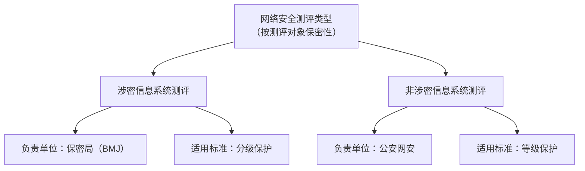

| 项目 | 要点 |
| --- | --- |
| **涉密信息系统测评** | 由**保密局**负责；适用标准为**分级保护** |
| **非涉密信息系统测评** | 由**公安网安**负责；适用标准为**等级保护** |

> [!IMPORTANT]
> 涉密 → **保密局 / 分级保护**；非涉密 → **公安网安 / 等级保护**。这是软考高频送分点。

##### 18.2 网络安全等级保护测评内容

| 项目 | 要点 |
| --- | --- |
| 测评构成 | 网络信息系统安全等级测评主要包括 **技术安全测评**、**管理安全测评** |
| 对比维度（原图） | 按 **等保 1.0 → 等保 2.0 试行稿 → 等保 2.0 最新版** 三条脉络，分别对比 **技术要求变化** 与 **管理要求变化** |

> [!WARNING]
> 原文此页（Page 491）为一张横向对比图（"技术要求变化 / 管理要求变化"，含"物+网+应"等标签），OCR 严重失真，具体对比项无法还原，仅能确认对比框架与三条版本线索。详见文末疑点清单。

##### 18.3 网络安全测评流程与内容

###### 🔎 等级测评过程（等保 2.0 规范）


| 项目 | 要点 |
| --- | --- |
| 依据 | 根据**等保 2.0** 规范 |
| 四阶段 | **测评准备活动 → 方案编制活动 → 现场测评活动 → 报告编制活动** |

###### 🔎 网络安全渗透测试五阶段


| 项目 | 要点 |
| --- | --- |
| 五阶段 | **委托受理、准备、实施、综合评估、结题** |

| 阶段 | 详细内容 |
| --- | --- |
| **委托受理阶段** | 前期沟通，**签署保密协议和渗透测试合同**，接收被测单位提交的资料 |
| **准备阶段** | 编写渗透测试方案，沟通方案，确定渗透测试日期、客户配合人员。项目经理协助被测单位填写 **"网络信息系统渗透测试用户授权单"**，并通知客户做好准备。例如内网测试，要求**客户全程陪同** |
| **实施阶段** | 明确项目组测试人员的测试项。测试完成后，整理测试数据，形成"网络信息系统渗透测试报告" |
| **综合评估阶段** | 项目组和客户沟通测试结果，向客户发送 **"网络信息系统渗透测试报告"**。必要时，可根据客户需要召开报告评审会，对该报告进行评审。<br/>如被测单位希望复测，由被测单位在整改完毕后提交 **信息系统整改报告**，项目组依据 **"网络信息系统渗透测试整改报告"** 开展复测工作。复测结束后，项目组依据复测结果，出具 **"网络信息系统渗透测试复测报告"** |
| **结题阶段** | 项目组将测评过程中生成的各类文档、过程记录进行**整理归档保存** |

> [!TIP]
> 渗透测试四份关键文档记忆口诀：**授权单 → 报告 → 整改报告 → 复测报告**。

##### 18.4 网络安全测评技术与工具

###### 🔎 漏洞扫描

| 项目 | 要点 |
| --- | --- |
| 作用 | 常用来**获取测评对象的安全漏洞信息** |
| 常用工具 | **网络安全漏洞扫描器**、**主机安全漏洞扫描器**、**数据库安全漏洞扫描器**、**Web 应用安全漏洞扫描器** |

###### 🔎 安全渗透测试（技术分类）

| 项目 | 要点 |
| --- | --- |
| 定义 | 通过**模拟攻击者**对测评对象进行安全攻击，以验证安全防护机制的有效性 |
| 分类依据 | 根据对测评对象**掌握的信息状况**，分为三种类型 |

| 类型 | 要点 |
| --- | --- |
| **黑盒模型** | 只需要提供**测试目标地址**，授权测试团队从指定的测试点进行测试 |
| **白盒模型** | 需要提供**尽可能详细**的测试对象信息，测试团队根据所获取的信息，制订**特殊的渗透方案**，对系统进行**高级别**的安全测试。该方式**适合高级持续威胁者（APT）模拟** |
| **灰盒模型** | 需要提供**部分**测试对象信息，测试团队根据所获取的信息，模拟**不同级别的威胁者**进行渗透。该方式**适合手机银行和代码安全测试** |

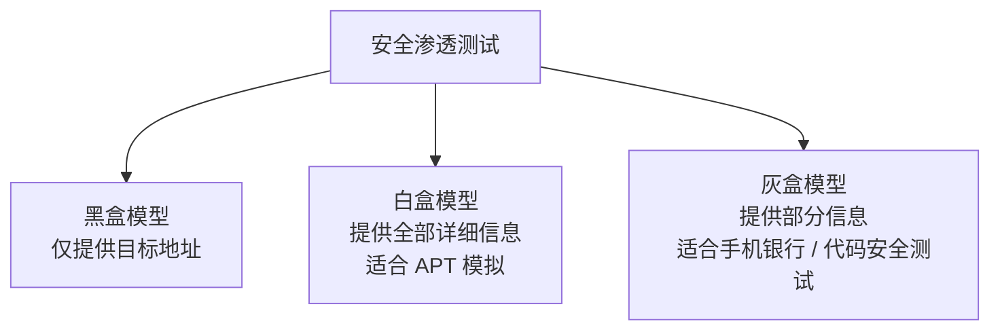

###### 🔎 代码安全审查

| 项目 | 要点 |
| --- | --- |
| 定义 | 按照 **C/C++、Java、OWASP** 等安全编程规范和业务安全规范，对测评对象的**源代码或二进制代码**进行安全符合性检查 |
| 典型代码安全缺陷类型 | **缓冲区溢出、代码注入、跨站脚本、输入验证、API 误用、密码管理、配置错误、危险函数** 等 |

###### 🔎 协议分析

| 项目 | 要点 |
| --- | --- |
| 作用 | 用于**检测协议的安全性** |
| 常见工具 | **TCPDump**、**Wireshark** |

###### 🔎 性能测试

| 项目 | 要点 |
| --- | --- |
| 作用 | 评估测评对象的**性能状况**，检查测评对象的**承载性能压力**或**安全对性能的影响** |
| 常用工具 | 性能监测工具（**操作系统自带**）、**Apache JMeter**（开源）、**LoadRunner**（商业产品）、**SmartBits**（商业产品）等 |

##### 18.5 网络安全测评质量管理与标准

###### 🔎 网络安全测评质量管理

| 项目 | 要点 |
| --- | --- |
| 定位 | 网络安全测评质量管理是**测评可信的基础性工作** |
| 主要工作内容 | ① 测评机构建立**质量管理体系**；② **测评实施人员管理**；③ **测评实施设备管理**；④ **测评实施方法管理**；⑤ **测评实施文件控制**；⑥ **测评非符合性工作控制**；⑦ **体系运行监督**；⑧ **持续改进** |
| 参考国际标准 | 目前，有关测评机构的质量管理体系的建立主要参考的国际标准是 **ISO 9000** |

###### 🔎 CNAS

| 项目 | 要点 |
| --- | --- |
| 全称 | **中国合格评定国家认可委员会**（简称 **CNAS**） |
| 职责 | 负责对**认证机构、实验室和检查机构**等相关单位的认可工作，对申请认可的机构的**质量管理体系**和**技术能力**分别进行确认 |

###### 🔎 附：原书插图 —— ISO 9001 质量管理体系认证证书示例

原文 Page 497 为一张认证证书截图（属于质量管理体系的实证材料，非广告），内容如下：

| 项目 | 要点 |
| --- | --- |
| 认证机构 | 中质协质量保证中心 |
| 注册号 | `00617Q20774R2L-4` |
| 获证组织 | 锐捷网络股份有限公司 |
| 统一社会信用代码 | `913500007549617646` |
| 注册地址 | 福州市仓山区建新镇金山大道 618 号桔园洲工业园 19# |
| 审核地址 | 福建省福州市仓山区金山大道 618 号桔园洲星网锐捷科技园 19#；福州市闽侯县上街镇高新大道 9 号星网锐捷海西科技园 |
| 邮编 | `350002` |
| 符合标准 | **ISO 9001:2015** |
| 认证范围 | 互联网接入设备、网络及通讯设备的设计、开发、生产和服务；网络技术及软件的设计开发、生产和服务；系统集成服务（依资质范围） |
| 常设分场所 | "无" |
| 证书有效期 | 2017 年 06 月 13 日 至 2020 年 06 月 12 日 |
| 有效性说明 | 证书有效期内每年监督审核合格并粘贴标识后方为有效；查询网址 `www.qac.com.cn`；亦可在国家认监委官网 `www.cnca.gov.cn` 查询 |
| 认可标志 | CNAS C006-M |

---

#### 第19章 操作系统安全保护

##### 19.1 操作系统安全概述

###### 🔎 操作系统安全概念

| 项目 | 要点 |
| --- | --- |
| 定义 | 指满足**安全策略要求**，具有相应的**安全机制及安全功能**，符合特定的**安全标准**，在一定约束条件下，能够抵御**常见的网络安全威胁**，保障**自身的安全运行及资源安全** |
| 安全等级 | 操作系统分**五个等级**：**用户自主保护级、系统审计保护级、安全标记保护级、结构化保护级、访问验证保护级** |
| 安全可控（狭义） | 侧重于**产品安全** |
| 安全可控（广义） | 侧重于**产业可控** |


> [!IMPORTANT]
> 操作系统五级（由低到高）：**用户自主 → 系统审计 → 安全标记 → 结构化 → 访问验证**。
> 记忆口诀："**主 审 标 构 验**"。

###### 🔎 操作系统安全目标

| 项目 | 要点 |
| --- | --- |
| 总体目标 | 能够**防范网络安全威胁**，保障操作系统的**安全运行**及**计算机系统资源的安全性** |
| 六项子目标 | **（1）标识和鉴别**；（2）**访问控制**；（3）**系统资源安全**；（4）**网络安全**；（5）**抗攻击**；（6）**自身安全** |

###### 🔎 操作系统安全机制

| 安全机制 | 内容 |
| --- | --- |
| **硬件安全** | 是操作系统安全的基础保障机制，包括**硬件安全可靠性、存储保护、I/O 保护、CPU 安全、物理环境保护**等 |
| **标识与鉴别机制** | 又称为**认证机制**，用于操作系统的用户及相关活动主体的**身份标识**，并给用户和相应的活动主体分配**唯一的标识符**。标识符具有**唯一性**，能够**防止伪造**。而**鉴别**则指证实用户或活动主体的**真实身份**的过程 |
| **访问控制机制** | **防止资源滥用**。常见的访问控制有**自主访问控制**和**强制访问控制** |
| **最小特权管理机制** | **防止权限滥用**，减少系统的安全风险 |
| **可信路径** | 是指操作系统的**本地用户和远程用户**进行**初始登录或鉴别**时，操作系统安全系统与用户之间建立的**安全通信路径**。可信路径保护通信数据免遭**修改、泄露**，防止**特洛伊木马**模仿登录过程、窃取用户的口令 |
| **安全审计** | 就是操作系统对系统中有关安全的活动进行**记录、检查及审核**，其主要目的就是核实**系统安全策略执行的合规性**，以追踪**违反安全策略的用户及活动主体**，确认**系统安全故障** |
| **系统安全增强** | 又称为**安全加固**，通过优化操作系统的配置或增加安全组件，以提升操作系统的**抗攻击能力** |

> [!TIP]
> 七大机制记忆口诀："**硬 标 访 最 可 审 强**"（硬件 / 标识鉴别 / 访问控制 / 最小特权 / 可信路径 / 安全审计 / 安全增强）。

##### 19.2 Windows 操作系统安全分析与防护

###### 🔎 Windows 系统架构

| 项目 | 要点 |
| --- | --- |
| 第一层（最底层） | **硬件抽象层（HAL）**，它为上面的一层提供**硬件结构的接口**，有了这一层就可以使系统**方便地移植** |
| 第二层 | **内核层**，它为低层提供**执行、中断、异常处理和同步**的支持 |
| 第三层 | 由实现**基本系统服务**的模块组成，例如**虚拟内存管理、对象管理、进程和线程管理、I/O 管理、进程通信**和**安全参考监督器** |

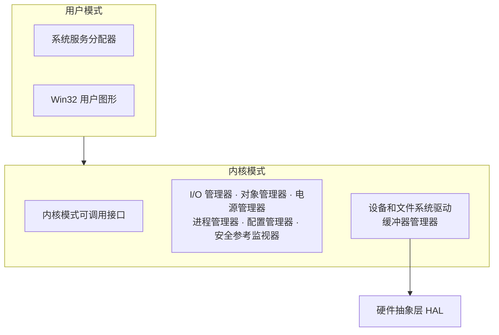

| 对比 | 要点 |
| --- | --- |
| **UNIX/Linux** 操作系统分层 | 分为三层：**硬件层、系统内核、应用层** |

###### 🔎 Windows 安全机制（一）

| Windows 安全机制 | 内容 |
| --- | --- |
| **认证机制** | Windows 系统提供两种基本认证类型，即**本地认证**和**网络认证**。<br/>· **本地认证**：根据用户的**本地计算机**或 **Active Directory 账户**确认用户的身份。<br/>· **网络认证**：三种技术是 **Kerberos V5**、**公钥证书**和 **NTLM** |
| **访问控制机制** | **Windows NT/XP** 的安全性达到了**橘皮书 C2 级**，实现了**用户级自主访问控制** |
| **审计/日志机制** | Windows 日志有**三种类型**：**系统日志、应用程序日志、安全日志**，对应的文件名为 `SysEvent.evt`、`AppEvent.evt`、`SecEvent.evt`。这些日志文件通常存放在操作系统安装的区域 **`system32\config`** 目录下 |
| **协议过滤和防火墙** | **Windows NT 4.0、Windows 2000** 提供了**包过滤机制**，通过过滤机制可以限制网络包进入用户计算机；而 **Windows XP** 则自带了**防火墙**，该防火墙能够**监控和限制用户计算机的网络通信** |

###### 🔎 Windows 安全机制（二）

| Windows 安全机制 | 内容 |
| --- | --- |
| **文件加密系统** | 为了防范入侵者通过**物理途径**读取磁盘信息，绕过 Windows 系统文件访问控制机制。微软公司研究开发了**加密的文件系统 EFS**，文件中的数据利用 **EFS** 在磁盘上加密。用户如果访问加密的文件，则**必须拥有这个文件的密钥**，才能够打开这个文件 |
| **抗攻击机制** | 针对常见的**缓冲区溢出、恶意代码**等攻击，微软公司的新版本操作系统增加抗攻击安全机制，集成了**内存保护机制**，主要包括：<br/>· **堆栈保护**<br/>· **安全结构化异常处理 SafeSEH**<br/>· **数据执行保护 DEP**<br/>· **地址随机化 ASLR**<br/>· **补丁保护 PatchGuard**<br/>· **驱动程序签名** 等保护机制 |

> [!IMPORTANT]
> Windows 抗攻击六件套：**SafeSEH / DEP / ASLR / PatchGuard / 堆栈保护 / 驱动签名**。

###### 🔎 Windows 系统可能遭遇的安全威胁

| 项目 | 要点 |
| --- | --- |
| 威胁清单 | ① **Windows 口令**；② **Windows 恶意代码**；③ **Windows 应用软件漏洞**；④ **Windows 系统程序的漏洞**；⑤ **Windows 注册表安全**；⑥ **Windows 文件共享安全**；⑦ **Windows 物理临近攻击** |

###### 🔎 Windows 系统安全增强方法

| 序号 | 方法 |
| --- | --- |
| （1） | **安全漏洞打补丁（Patch）** |
| （2） | **停止服务和卸载软件** |
| （3） | **升级或更换程序** |
| （4） | **修改配置或权限** |
| （6） | **安装专用的安全工具软件**。针对 Windows 漏洞修补问题，用户可以安装**自动补丁管理程序** |

> [!WARNING]
> 原文编号直接由（4）跳到（6），（5）缺失，疑为 OCR 漏识或原书排印缺项。

###### 🔎 Windows 系统安全增强基本步骤（一）

| 基本步骤 | 内容 |
| --- | --- |
| **确认系统安全增强的安全目标** | 系统安全目标实际上就是用户所期望系统的安全要求，例如**防止信息泄露、抗拒绝服务攻击、限制非法访问**等。系统的**业务用途**是后续安全增强的依据，根据系统的业务用途，系统在安装时或设置策略时进行合适的选择 |
| **安装最小化的操作系统** | 最小化操作系统的目的是**减少系统安全隐患数目**，系统越大，可能的安全风险就越大，而且管理上也难以顾及。安装最小化的操作系统要求：**尽量使用英文版 Windows 操作系统**；**不要安装不需要的网络协议**；**使用 NTFS 分区**；**删除不必要的服务和组件** |
| **安装最新系统补丁** | 能有效**阻止攻击者利用系统漏洞** |
| **配置安装的系统服务** | 根据系统的业务运行的基本要求，做到以下几点：<br/>· **不要安装与系统业务运行无关的网络/系统服务和应用程序**；<br/>· **安装最新的应用程序和服务软件，并定期更新服务的安全补丁** |
| **配置安全策略** | 安全策略是有关系统的**安全设置规则**，在 Windows 系统中需要配置的安全策略主要有**账户策略、审计策略、远程访问、文件共享**等。其中，策略中又要涉及多个参数，以配置**账户策略**为例，策略包含：**密码复杂度要求、账户锁定阈值、账户锁定时间、账户锁定记数器** |

###### 🔎 Windows 系统安全增强基本步骤（二）

| 基本步骤 | 内容 |
| --- | --- |
| **禁用 NetBIOS** | NetBIOS 提供**名称服务和会话服务**，这些服务通常会给攻击者提供**入侵切入点**。为了系统的安全，一般建议**禁用 NetBIOS**，其方法如下：<br/>① **在防火墙上过滤外部网络访问 135~139、445 端口**；<br/>② **修改注册表，禁用 NetBIOS**；<br/>③ **禁用 NetBIOS over TCP/IP**；<br/>④ **禁用 Microsoft 网络的文件和打印共享** |
| **账户安全配置** | 账户权限设置不当往往会导致安全问题，在 Windows 系统中，设置账户权限应做到：**禁用默认账号**；**定期检查账户，尽早发现可疑账户**；**锁定 Guest 账户** |
| **文件系统安全配置** | 文件系统安全是 Windows 系统重要的保护对象，特别是**向外提供网络服务的主机系统**。文件系统安全的措施通常如下：**删除不必要的帮助文件和 `%System%\Driver Cache` 目录下的文件**；**删除不必要的应用程序，例如 `cmd.exe`**；**启用加密文件系统**；**设置文件共享口令**；**修改系统默认安装目录名** |

###### 🔎 Windows 系统安全增强基本步骤（三）

| 基本步骤 | 内容 |
| --- | --- |
| **网络服务安全配置** | **过滤不需要的应用层网络服务，过滤 ICMP 数据包** |
| **禁用光盘或软盘启动** | 禁用光盘或软盘启动可以**防止入侵者进行物理临近攻击**，阻止入侵者进入系统 |
| **使用屏幕保护口令** | 使用屏幕保护口令**防止工作主机被他人滥用** |
| **设置应用软件安全** | **及时安装应用软件安全的补丁**，特别是 **IE、Outlook、Office 办公套件**等；**修改应用软件安全的默认设置**；**限制应用软件的使用范围** |
| **安装第三方防护软件** | 针对 Windows 系统的特定安全问题，安装第三方防护软件，如**杀毒软件、个人防火墙、入侵检测系统和系统安全增强工具** |

> [!IMPORTANT]
> 禁用 NetBIOS 需过滤端口：**TCP/UDP `135~139`、`445`**。

###### 🔎 Windows 2000 系统安全增强实例 —— 账号与口令管理

| 基本步骤 | 内容 |
| --- | --- |
| **启动与 BIOS** | 将系统的启动选项设置为 **`"C only"`**（即**仅允许从 C 盘启动**），同时为 **CMOS** 设置必要的密码 |
| **加强用户账号与口令的安全管理** | 具体安全增强措施如下：<br/>1）**停掉 guest 账号**<br/>2）**限制不必要的用户数量**<br/>3）**把系统 Administrator 账号改名**<br/>4）〔原书 OCR 不可辨，疑似"创建陷阱账号"〕<br/>5）〔原书 OCR 不可辨，疑似"修改共享文件默认权限/去掉 Everyone"〕<br/>6）**设置屏幕保护口令**<br/>7）**不让系统显示上次登录的用户名**<br/>8）**开启口令安全策略**<br/>9）**开启账号策略** |

###### 🔎 Windows 2000 系统安全增强实例 —— 网络安全增强

| 项目 | 内容 |
| --- | --- |
| **禁止建立空连接** | 方法是修改注册表 **`LSA-RestrictAnonymous`** 的键值为 **`1`** |
| **关闭默认共享** | Windows 2000 安装好以后，系统会创建一些**隐藏的共享**，用户可以在命令窗口下用 **`NET SHARE`** 查看。要禁止这些共享，操作的方法是：打开**管理工具 → 计算机管理 → 共享文件夹 → 共享**，在相应的共享文件夹上**右击停止共享**即可 |
| **关闭不必要的网络服务和网络端口** | 可以启用 Windows 2000 的 **"TCP/IP 筛选"** 机制关闭服务和端口 |

###### 🔎 Windows 典型安全工具

| 类别 | 工具 |
| --- | --- |
| **远程安全登录管理 / 身份认证增强** | 远程安全登录管理工具 **OpenSSH**（开源）；系统身份认证增强工具 **Kerberos**（开源）等 |
| **恶意代码查杀** | **ClamAV**（开源）、**360 杀毒**、**火绒剑** 等 |
| **系统安全检查** | **Nmap**（开源）、**Fport**、**Sysinternals**（工具集成）等 |
| **系统安全监测** | **Netstat**（系统自带）、**WinDump**（开源）等 |

##### 19.3 UNIX/Linux 操作系统安全分析与防护

###### 🔎 UNIX/Linux 系统结构

| 项目 | 要点 |
| --- | --- |
| 分层 | UNIX/Linux 操作系统分为三层：**硬件层、系统内核、应用层** |
| 特点 | UNIX/Linux 是一种**多用户、多任务**的操作系统 |

###### 🔎 （1）UNIX/Linux 认证

| 认证方式 | 要点 |
| --- | --- |
| **基于口令的认证方式** | 最基本的认证方式 |
| **终端认证** | 在 UNIX/Linux 系统中，还提供一个**限制超级用户从远程登录**的终端认证 |
| **主机信任机制** | 系统提供不同主机之间的**相互信任机制**，使得不同主机用户之间**无须系统认证就可以登录** |
| **第三方认证** | 例如**一次一密口令认证 S/Key**、**Kerberos 认证系统**、**插入式身份认证 PAM** |

###### 🔎 （2）UNIX/Linux 审计机制

| 版本 | 审计日志目录 |
| --- | --- |
| 早期版本 UNIX | **`/usr/adm`** |
| 较新版本 | **`/var/adm`** |
| **Solaris、Linux 和 BSD** | **`/var/log`** |

###### 🔎 （3）UNIX/Linux 访问控制

| 项目 | 要点 |
| --- | --- |
| 实现方式 | UNIX/Linux 一般通过**文件访问控制列表 ACL** 来实现系统资源的控制，也就是常说的通过 **"9 bit" 位**来实现 |
| 示例 | 某个文件信息：**`-rwxr-xr-- 1 test test 4月9日17:50 sample.txt`** |
| 示例解读 | 用户 **test** 对文件 `sample.txt` 的访问权限有**读、写、执行**，而 **test 组的其他用户**只能**读、执行**，除此以外的**其他用户**只有**读**权限 |

| 文件类型标识 | 含义 |
| --- | --- |
| **`-`** | 普通文件 |
| **`d`** | 目录文件 |
| **`l`** | 链接文件 |
| **`b`** | 块设备文件 |
| **`c`** | 字符设备文件 |
| **`p`** | 管道（FIFO）文件 |
| **`s`** | 套接字（socket）文件 |

| 权限位分组 | 说明 |
| --- | --- |
| 第 1 位 | **文件类型** |
| 第 2~4 位 | **用户（属主）权限**：可读 `r` / 可写 `w` / 可执行 `x` |
| 第 5~7 位 | **用户组（属组）权限** |
| 第 8~10 位 | **其他用户权限** |

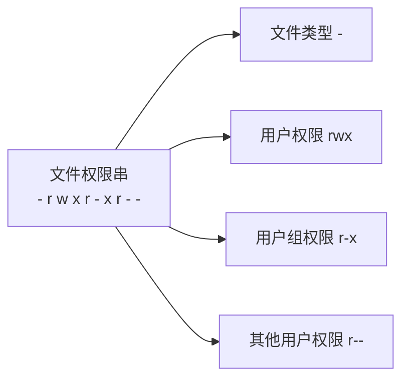

> [!TIP]
> `rwxr-xr--` = **754**。属主 `7`、属组 `5`、其他 `4`。

###### 🔎 UNIX/Linux 系统安全增强技术（一）

| 系统安全增强技术 | 内容 |
| --- | --- |
| **系统补丁软件包** | 及时从**应急响应安全站点**获取 UNIX/Linux 系统漏洞公布信息，并根据漏洞危害情况，给系统**安装补丁包**。同时，在安装操作系统补丁前，**必须确认补丁软件包的数字签名，检查其完整性**，保证补丁软件包是**可信的**，以防止**特洛伊木马或恶意代码**攻击。在 Linux 中，可以用 **`MD5Sum`** 检查工具来判断补丁软件包的完整性 |
| **最小化系统网络服务** | 满足业务的前提条件下，尽量**关闭不需要的服务和网络端口**，以减少系统潜在的安全危害。实现 UNIX/Linux 网络服务的最小化，具体安全要求如下：<br/>· **`inetd.conf` 的文件权限设置为 `600`**；<br/>· **`inetd.conf` 的文件属主为 `root`**；<br/>· **`services` 的文件权限设置为 `644`**；<br/>· **`services` 的文件属主为 `root`**；<br/>· 在 **`inetd.conf` 中注销不必要的服务**，比如 **finger、echo、chargen、rsh、rlogin、tftp** 服务；<br/>· **只开放与系统业务运行有关的网络通信端口** |
| **设置系统开机保护口令** | 针对**物理临近**入侵系统的威胁，一方面要尽量避免入侵者**物理临近**系统，另一方面要设置**系统开机保护口令**，阻止入侵者开机，从而达到保护系统的目的。开机保护口令由 **BIOS 程序**设置实现，这样当系统启动时，BIOS 程序将提示用户输入密码 |

###### 🔎 UNIX/Linux 系统安全增强技术（二）

| 系统安全增强技术 | 内容 |
| --- | --- |
| **弱口令检查** | 常用的口令检查工具是 **`John the Ripper`** |
| **用 SSH 增强网络服务安全** | 针对 **Telnet、FTP** 的安全，一般采用 **`SSH`（Secure Shell）** 来增强。SSH 提供**认证、加密**等安全服务，可以在两台或多台主机之间构造一条**加密通道**，保证通信安全 |
| **利用 `tcp_wrapper` 增强访问控制** | 通过 **`tcp_wrapper`**，管理员可以设置对 **inetd** 提供的各种服务进行监控和过滤 |
| **构筑 UNIX/Linux 主机防火墙** | 支持 UNIX/Linux 系统的防火墙软件包有 **`ipchains`、`iptables`** 以及 **`netfilter`** |
| **使用 Tripwire 或 MD5Sum 完整性检测工具** | 当建立新的 UNIX/Linux 系统后，应记录所有系统文件的**硬件和软件信息**，并形成一个**系统文件基准信息库**，以便日后检查系统文件的**完整性变化**，避免恶意程序的植入和修改。利用 **`Tripwire`** 或 **`MD5Sum`** 软件安全工具可以发现**被篡改的文件** |
| **检测 LKM 后门** | 针对 **LKM 后门**危害，除了利用完整性检查工具外，还可利用专用安全检查工具，例如 **`Kstat`、`Chkrootkit`、`Rootkit Hunter`** |
| **系统安全监测** | UNIX/Linux 系统的安全是**动态的**，对运行的系统进行**实时监控**有利于及时发现安全问题，做出安全应急响应。常用的安全工具有 **`Netstat`、`lsof`、`Snort`** 等 |

> [!IMPORTANT]
> 完整性检测 → **Tripwire / MD5Sum**；LKM 后门检测 → **Kstat / Chkrootkit / Rootkit Hunter**；弱口令检查 → **John the Ripper**。

###### 🔎 Linux 安全增强配置参考（一）

| 系统安全增强配置 | 内容 |
| --- | --- |
| **禁止访问重要文件** | 对于系统中的某些关键性文件，如 **`inetd.conf`、`services` 和 `lilo.conf`** 等可修改其属性，防止意外修改和被普通用户查看。<br/>· 首先改变文件属性为 600：**`chmod 600 /etc/inetd.conf`**<br/>· 保证文件的属主为 root，将其设置为不能改变：**`chattr +i /etc/inetd.conf`**<br/>· 这样，对该文件的任何改变都将被禁止。<br/>· 只有 root 重新设置复位标志后才能进行修改：**`chattr -i /etc/inetd.conf`** |
| **为 LILO 增加开机口令** | 在 **`/etc/lilo.conf`** 文件中增加选项，从而使 **LILO** 启动时要求输入口令，以加强系统的安全性。需注意，由于在 LILO 中**口令是以明码方式存放的**，所以还需要将 `lilo.conf` 的文件属性设置为 `600` |
| **设置口令最小长度和最短使用时间** | 口令是系统中认证用户的主要手段，系统安装时默认的口令最小长度通常为 **5**，但为保证口令不易被猜测攻击，可增加口令的最小长度**至少为 8**，为此，需修改文件 **`/etc/login.defs`** 中的参数 **`PASS_MIN_LEN`**。同时应**限制口令的使用时间**，保证定期更换口令，建议修改（`/etc/login.defs` 中的口令有效期相关参数） |

###### 🔎 Linux 安全增强配置参考（二）

| 系统安全增强配置 | 内容 |
| --- | --- |
| **限制远程访问** | 通过 **`/etc/hosts.allow`** 和 **`/etc/hosts.deny`** 这两个文件允许和禁止远程主机对本地服务的访问。<br/>（1）编辑 `hosts.deny` 文件，加入下列行：**`ALL: ALL@ALL`**，则**所有服务对所有外部主机禁止**，除非由 `hosts.allow` 文件指明允许。<br/>（2）编辑 `hosts.allow` 文件，可加入下列行：**`ftp: 202.XXX.XXX YYY.com`**，则将允许 **IP 地址为 `202.XXX.XXX`** 和**主机名为 `YYY.com`** 的机器作为客户访问 FTP 服务。<br/>（3）设置完成后，可用 **`tcpdchk`** 检查设置是否正确 |
| **用户超时注销** | 如果用户离开时**忘记注销账户**，则可能给系统安全带来隐患。可修改 **`/etc/profile`** 文件，保证账户在一段时间没有操作后，**自动从系统注销**。编辑文件 `/etc/profile`，在 **`"HISTFILESIZE="`** 行的下一行增加如下一行：**`TMOUT=600`**，则所有用户将在 **10 分钟**无操作后自动注销 |
| **注销时删除命令记录** | 编辑 **`/etc/skel/.bash_logout`** 文件，增加如下行：**`rm -f $HOME/.bash_history`**，这样使得系统中的用户在注销时都会删除其**命令记录**。如果只需要针对某个特定用户，如 root 用户进行设置，则可只在该用户的主目录下修改 **`$HOME/.bash_history`** 文件，增加相同的一行即可 |

###### 🔎 `/etc/hosts.allow` 书写格式参考

| 需求 | 书写格式 |
| --- | --- |
| **ssh 允许单个 IP** | `sshd:192.168.220.1` |
| **ssh 允许 IP 段** | `sshd:192.168.220.` |
| **telnet 允许单个 IP** | `in.telnetd:192.168.220.1` |
| **telnet 允许 IP 段** | `in.telnetd:192.168.221.` |

> [!TIP]
> `hosts.allow` 中 IP 段写法是**只写前几段并以点号结尾**，如 `sshd:192.168.220.` 表示整个 C 类网段。

###### 🔎 UNIX/Linux 安全模块应用参考 —— LSM

| 项目 | 要点 |
| --- | --- |
| 全称 | **Linux 安全模块（LSM，Linux Security Module）** |
| 定位 | 为 Linux 内核提供了一个**轻量级的、通用目的的访问控制框架**，使得很多**不同的访问控制模型**可以作为**可加载模块**来实现 |
| 实现方法 | LSM 采用了在**内核源代码中放置钩子（hook）**的方法，对内核内部对象的访问进行控制 |
| 应用 | 通过 LSM，相关安全组织可以根据安全需要开发**特定的安全模块**，挂接到 Linux 操作系统。目前，采取这种方式来增强 Linux 安全的主要有**插件式身份验证模块框架（PAM）**、**SELinux** 等 |

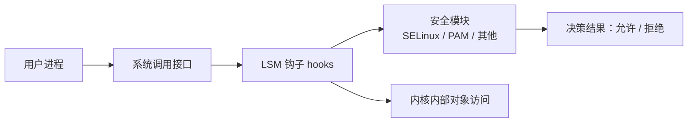

###### 🔎 1. PAM

| 项目 | 要点 |
| --- | --- |
| 作用 | 通过"**插件**"增加 UNIX/Linux **新的身份验证服务**，而**无须更改原有的系统登录服务**，例如 **Login、FTP 和 Telnet** |
| 集成能力 | 可以使用 PAM 将 UNIX/Linux 登录与其他安全机制（例如 **Kerberos**）集成在一起 |

###### 🔎 2. SELinux

| 项目 | 要点 |
| --- | --- |
| 全称 | **SELinux（Security Enhanced Linux）**，安全增强 Linux |
| 组成 | 由**策略**和**实施**组成，**策略封装在安全服务器中**，**实施由对象管理器具体执行** |
| 能力 | SELinux 可以实现**基于角色的访问控制（RBAC）**和**强制访问控制（MAC）** |

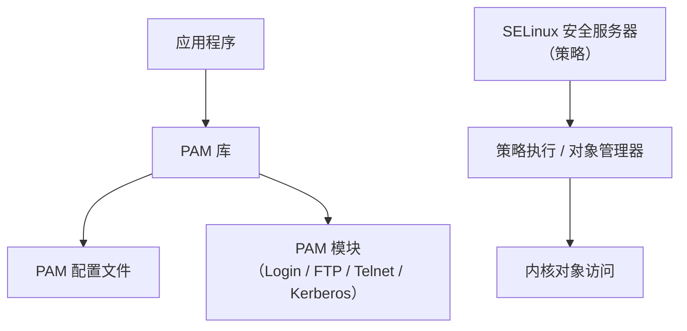

##### 19.4 国产操作系统安全分析与防护

###### 🔎 国产操作系统举例

| 项目 | 要点 |
| --- | --- |
| 名录 | **银河麒麟 / 中标麒麟（麒麟系列）、普华 Linux、红旗 Linux** 等，另有 **华为鸿蒙操作系统**、**阿里飞天云操作系统**、**统信 UOS** |

> [!WARNING]
> 原文此处（Page 523）第一行 OCR 严重失真（形如"PRI. Pili, Ib. oe. TRE Linux"），上述麒麟/普华/红旗为按常见教材内容还原，仅供记忆参考。

###### 🔎 国产操作系统安全分析

| 序号 | 安全风险 |
| --- | --- |
| **①** | **Linux 内核的安全风险**。内核漏洞：**输入验证错误、缓冲区溢出错误、边界条件错误、访问验证错误、异常条件处理错误、环境错误、配置错误、条件竞争错误、设计错误** 等 |
| **②** | **自主研发系统组件的安全**。因为软件的复杂性，国产操作系统自主研发系统组件**可能存在安全漏洞**，导致操作系统面临安全风险 |
| **③** | **依赖第三方系统组件的安全**。依赖的**第三方系统组件存在安全漏洞**，引发操作系统安全风险问题 |
| **④** | **系统安全配置的安全**。对国产操作系统的**安全配置不当**，构成系统安全威胁。常见的安全配置不当包括**未启用系统安全功能、设置弱口令、开放过多的服务端口、使用非安全远程登录工具**等 |
| **⑤** | **硬件的安全**。国产操作系统**受制于硬件**而产生的安全问题 |

###### 🔎 国产操作系统安全增强措施

| 项目 | 要点 |
| --- | --- |
| 总体思路 | 国产操作系统在**自主可控、安全可信**方面，对开源操作系统 **Linux** 进行安全增强，从多个方面对 Linux 操作系统提供安全保障 |
| 安全功能 | ① **管理员分权**；② **最小特权**；③ **结合角色的基于类型的访问控制**；④ **细粒度的自主访问控制**；⑤ **多级安全（即禁止上读下写）** 等多项安全功能 |
| 效果 | 从**内核到应用**提供全方位的安全保护 |

> [!IMPORTANT]
> 多级安全模型的核心规则：**禁止上读下写**（低级别不能读高级别、高级别不能写低级别）。

---

#### 第20章 数据库系统安全

##### 20.1 数据库安全概况

###### 🔎 数据库安全概念

| 项目 | 要点 |
| --- | --- |
| 定义 | 数据库安全是指数据库的**机密性、完整性、可用性**能够得到保障 |
| 涉及范围 | 主要涉及**数据库管理安全、数据安全、数据库应用安全**以及**数据库运行安全** |
| 国外数据库系统 | **MS SQL、MySQL、Oracle、DB2** 等 |
| 国产数据库系统 | **人大金仓、达梦** 等 |

###### 🔎 数据库安全威胁

| 数据库安全威胁 | 内容 |
| --- | --- |
| **授权的误用（Misuses of Authority）** | 合法用户**越权**获得他们不应该获得的资源，窃取程序或存储介质，修改或破坏数据。授权用户将自身的访问特权**不适当地授予其他用户**，导致系统安全策略受到威胁，使用户数据泄露 |
| **逻辑推断和汇聚（Logical Inference and Aggregation）** | 利用**逻辑推理**，把**不太敏感的数据结合起来**可以推断出**敏感信息** |
| **伪装（Masquerade）** | 攻击者**假冒用户身份**获取数据库系统的访问权限 |
| **旁路控制（Bypassing Controls）** | 在数据库设置**后门**，绕过数据库系统的安全访问控制机制 |
| **隐蔽信道（Covert Channels）** | 利用**非正常的通信途径**传输数据以逃避数据库安全机制的控制，如**共享内存、临时文件** |
| **SQL 注入攻击（SQL Injection）** | 攻击者利用数据库应用程序的**输入未进行安全检查**的漏洞，欺骗数据库服务器执行**恶意的 SQL 命令**。SQL 注入攻击常常导致**数据库信息泄露**，甚至会造成数据系统的**失控** |
| **数据库口令密码破解** | 利用**口令字典**或手动猜测数据库用户密码，以达到**非授权访问**数据库系统的目的。<br/>**撞库**：收集已泄露的用户+口令密码信息，生成对应的**字典表**，尝试批量登录其他网站后，得到一系列可以登录的用户 |
| **硬件及介质攻击** | 对数据库系统相关的**设备和存储介质的物理攻击** |

###### 🔎 数据库安全隐患（7 条）

| 序号 | 隐患 |
| --- | --- |
| **1** | **数据库用户账号和密码隐患** |
| **2** | **数据库系统扩展存储过程隐患**（缓存 / 索引等） |
| **3** | **数据库系统软件和应用程序漏洞** |
| **4** | **数据库系统权限分配隐患** |
| **5** | **数据库系统用户安全意识薄弱** |
| **6** | **网络通信内容是明文传递** |
| **7** | **数据库系统安全机制不健全** |

##### 20.2 数据库安全机制与实现技术

###### 🔎 数据库加密 —— 加密对象分类

| 项目 | 要点 |
| --- | --- |
| 两种加密类型 | ① **数据库网上传输的数据**，通常利用 **SSL 协议**来实现；<br/>② **数据库存储的数据**，通过**数据库存储加密**来实现 |

###### 🔎 数据库存储加密 —— 按加密组件与 DBMS 的关系分类

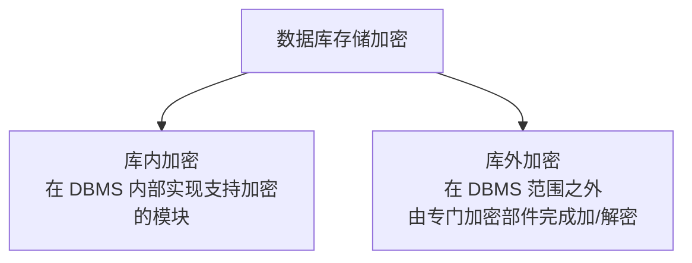

| 方式 | 要点 |
| --- | --- |
| **库内加密** | 指在 **DBMS 内部**实现支持加密的模块 |
| **库外加密** | 库外加密指在 **DBMS 范围之外**，由**专门的加密部件**完成加密/解密操作 |

###### 🔎 数据库存储加密的常用技术方法

| 技术方法 | 要点 |
| --- | --- |
| **基于文件的数据库加密技术** | 将**数据库文件作为整体**，对整个数据库文件进行加密，形成密文来保证数据的机密性 |
| **基于记录的数据库加密技术（行）** | 将数据库的**每一个记录**加密成密文并存放于数据库文件中 |
| **基于字段的数据库加密技术（列）** | 加密数据库的**字段**，以**不同记录的不同字段**为基本加密单元进行加密 |

表结构示意（姓名 / 性别 / 成绩 三列）：

| 姓名 | 性别 | 成绩 |
| --- | --- | --- |
| 〔字段加密单元〕 | 〔字段加密单元〕 | 〔字段加密单元〕 |

> [!TIP]
> 三种粒度记忆：**文件 → 记录（行） → 字段（列）**，粒度由粗到细。

###### 🔎 数据库防火墙

| 项目 | 要点 |
| --- | --- |
| 定义 | 根据预定义的**禁止和许可策略**让**合法的 SQL 操作**通过，**阻断非法违规操作**，形成数据库的**外围防御圈**，实现 **SQL 危险操作的主动预防、实时审计** |
| 虚拟补丁包功能 | 数据库系统**不用升级、打补丁**，即可完成对主要数据库漏洞的防控 |

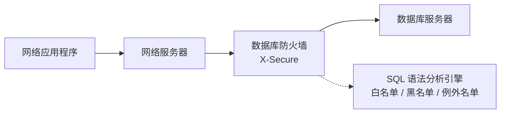

###### 🔎 数据库防火墙的安全作用（7 项）

| 序号 | 作用 |
| --- | --- |
| **（1）** | **屏蔽直接访问数据库的通道**。数据库防火墙部署介于**数据库服务器和应用服务器**之间，屏蔽直接访问的通道，防止**隐蔽通道**对数据库的攻击 |
| **（2）** | **增强认证**。应用程序对数据库的访问，必须经过**数据库防火墙**和**数据库自身**两层身份认证 |
| **（3）** | **攻击检测**。可实时检测用户对数据库进行的 **SQL 注入和缓冲区溢出攻击**，并报警或者阻止攻击行为，记录攻击操作发生的**时间、来源 IP、登录数据库的用户名、攻击代码**等详细信息 |
| **（4）** | **防止漏洞利用**。捕获和阻断数据库漏洞攻击行为，如利用 **SQL 注入特征库**可以捕获和阻断数据库 SQL 注入行为。实现**虚拟化补丁**，保护有漏洞的数据库系统 |
| **（5）** | **防止内部高危操作**。可以限定**更新和删除影响行**、限定**无 Where 的更新和删除操作**、限定 **`drop`、`truncate`** 等高危操作，避免大规模损失 |
| **（6）** | **防止敏感数据泄露**。可以限定**数据查询和下载数量**、限定**敏感数据访问的用户、地点和时间** |
| **（7）** | **数据库安全审计**。对数据库服务器访问情况进行**独立审计**，审计信息可以包括**用户名、程序名、IP 地址、请求的数据库、连接建立的时间、连接断开的时间、通信量大小、执行结果**等信息 |

###### 🔎 数据库脱敏

| 项目 | 要点 |
| --- | --- |
| 定义 | 利用**数据脱敏技术**将数据进行变换处理，在保持数据**按需使用目标**的同时，又能避免**敏感数据外泄**。数据脱敏指按照**脱敏规则**对敏感数据进行变换，**去除标识数据**，数据实现**匿名化处理**，从而实现敏感数据的保护 |
| 常见技术方法 | **屏蔽、变形、替换随机、加密**，使得敏感数据不泄露给非授权用户或系统 |

**示例（替换脱敏）：**

| 脱敏前 | 脱敏后 |
| --- | --- |
| `4346 6454 0020 5379` | `4346 XXXX XXXX 5379` |
| `4493 9238 7315 5787` | `4493 XXXX XXXX 5787` |
| `4297 8296 7496 8724` | `4297 XXXX XXXX 8724` |

###### 🔎 数据库漏洞扫描

| 项目 | 要点 |
| --- | --- |
| 定义 | 模拟黑客使用的漏洞发现技术，对目标数据库的**安全性尝试进行安全探测分析**，收集数据库漏洞的详细信息，分析数据库系统的**不安全配置**，检查**有弱口令的数据库用户** |
| 作用 | 通过数据库漏洞扫描，**跟踪监控数据库安全危险状态变化**，建立**数据库安全基线**，防止数据库安全危险恶化 |
| 商业产品 | **NGSSQuirrel for Oracle**、**X-Secure-DBScan** 等 |
| NGSSQuirrel for Oracle | 可以检查**几千个**可能存在的安全威胁、**补丁状况、对象和权限信息、登录和密码机制、存储过程以及启动过程**。NGSSQuirrel 提供强大的**密码审计功能**，包括**字典和暴力破解模式** |

##### 20.3 主流数据库安全分析与防护

###### 🔎 Oracle 数据库安全分析与防护

| 安全机制 | 内容 |
| --- | --- |
| **用户认证** | 除了 **Oracle 数据库认证**外，还集成支持**操作系统认证、网络认证、多级认证、SSL 认证**。<br/>Oracle 数据库的认证方式采用**"用户名+口令"**，具有**口令加密、账户锁定、口令生命期和过期、口令复杂度验证**等安全功能。<br/>对于**数据库管理员认证**，Oracle 数据库要求进行**特别认证**，支持**强认证、操作系统认证、口令文件认证**。<br/>**网络认证**支持**第三方认证、PKI 认证、远程认证**等 |
| **访问控制** | Oracle 数据库内部集成**网络访问控制**和**数据对象授权控制**。Oracle 数据库提供**细粒度访问控制**，如针对 **`select`、`insert`、`update`、`delete`** 等操作，可以使用不同的策略 |
| **保险库** | Oracle 数据库建立**数据库保险库（DV）** 机制，用于保护敏感数据，具有**防止数据系统未授权变更、多因素可信授权、职责隔离、最小化特权**的功能。DV 机制通过设置**安全域和命令规则**对特权进行控制。DV 机制的命令控制可阻止未授权命令操作，如 **`drop table`、`alter system`** |
| **安全审计和数据库防火墙** | Oracle 数据库具有对其内部所有发生的活动进行**审计**的能力。Oracle 数据库可审计的活动有 **3 种类型**：**登录尝试、数据库活动、对象存取**。<br/>Oracle 数据库防火墙提供了 **SQL 语法分析引擎**，检查进入数据库的 SQL 语句，精确地确定是否**允许、记录、警告、替换或阻止** SQL。Oracle 数据库防火墙支持**白名单、黑名单和基于例外名单**的策略 |

> [!IMPORTANT]
> Oracle 三类可审计活动：**登录尝试 / 数据库活动 / 对象存取**。

###### 🔎 Oracle 安全最佳实践（12 条）

| 序号 | 实践 |
| --- | --- |
| **（1）** | **增强 Oracle 数据库服务器的操作系统安全**。最小化系统服务，安装最新补丁，关闭不需要的网络通信端口 |
| **（2）** | **最小化安装 Oracle**，删除不必要的组件 |
| **（3）** | **安装最新的安全补丁** |
| **（4）** | **删除或修改默认的用户名和密码** |
| **（5）** | **启用认证机制** |
| **（6）** | **设置好的口令密码策略** |
| **（7）** | **设置最小化权限** |
| **（8）** | **限制连接 Oracle 的 IP 地址**。在打补丁的同时限制连接的 IP，避免攻击者的 IP 访问到数据库 |
| **（9）** | **传输加密**。Oracle 采用的是 **TNS 协议**传输数据，在传输过程中不能保证其中的数据不被窃听乃至修改，因此最好对传输进行加密。例如，采用 **SSL 加密机制** |
| **（10）** | **启用 Oracle 审计**。记录所有的用户失败访问和分析安全事件日志 |
| **（11）** | **定期查看 Oracle 漏洞发布信息**，及时修补漏洞 |
| **（12）** | **实施 Oracle 灾备计划**。监测 Oracle 的安全运行，定期进行备份。针对可能安全事件，制定安全应急预案 |

###### 🔎 MS SQL 数据库安全分析与防护

| 序号 | 安全机制 | 内容 |
| --- | --- | --- |
| **（1）** | **用户身份认证** | 支持 **Windows 认证**和**混合认证**两种方式 |
| **（2）** | **访问控制** | 采用**基于角色的访问控制机制**。SQL Server 的角色分为**三种类型**：即**固定服务器角色、固定数据库角色和应用角色** |
| **（3）** | **数据库加密** | SQL Server 提供 **Transact-SQL 函数、非对称密钥、对称密钥、证书、透明数据加密机制**。**MS SQL Server 2008 提供透明数据库加密服务**。透明加密使用**不同密钥**对不同敏感数据进行加密处理，其中密钥类型有**服务主密钥、数据库主密钥、数据库密钥** |
| **（4）** | **备份恢复机制** | 支持**静态备份**和**动态备份**。有**四种备份方案**：**文件和文件组备份、事务日志备份、完全备份、差异备份**。**恢复机制有三种模型**：**简单恢复、完全恢复和批量日志记录恢复**。SQL Server 系统可运用 **Transact-SQL 语句**或**企业管理器**实现数据的恢复或备份操作 |
| **（5）** | **安全审计** | （原文单列，未展开） |

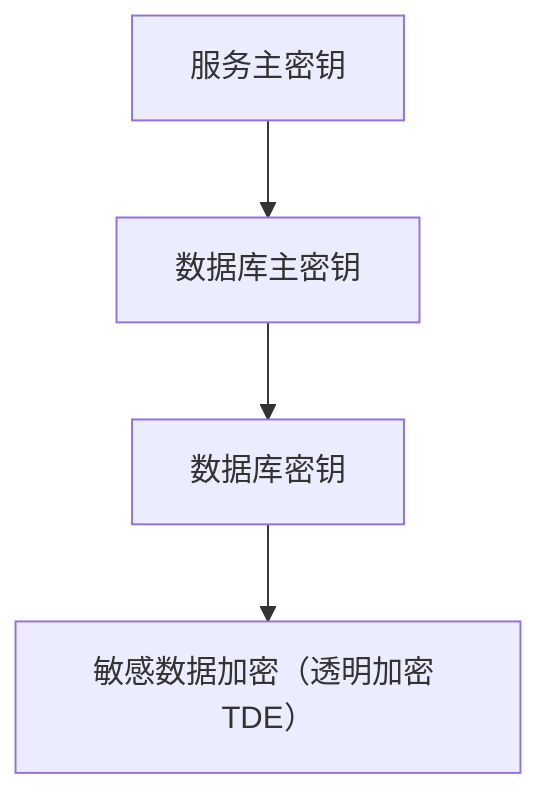

###### 🔎 几种备份方案对比

| 项目 | **完全备份** | **差量备份** | **增量备份** |
| --- | --- | --- | --- |
| **备份内容** | 文件、操作系统、数据库 | 本次与全备份的差异部分 | 本次与上次备份的差异部分 |
| **备份介质/其他** | 裸设备备份、备份软件日志… | 磁盘、磁带、备份服务器… | 〔同左，按策略组合〕 |
| **备份策略** | **每天全备份** | **每周一天备份**（全备份）+ 本周其余每天备份**与全备份差异部分** | **每周一天备份**（全备份）+ 其余每天备份**上次备份的差异部分** |
| **特点** | 恢复最快，占用空间最大 | 易于管理 | 占用空间最小，恢复最繁琐 |

| 项目 | 要点 |
| --- | --- |
| **备份窗口** | 启动备份的时间范围 |

###### 🔎 MS SQL Server 安全最佳实践（9 条）

| 序号 | 实践 |
| --- | --- |
| **1** | **设置好的数据库密码安全策略** |
| **2** | **加强扩展存储过程管理，删除不必要的存储过程**。SQL Server 的系统存储过程容易被利用来**提升权限或进行破坏**。为保护 SQL Server 的安全，删除不必要的存储过程 |
| **3** | **网上数据加密传输**。SQL Server 使用的 **Tabular Data Stream（TDS）协议**用**明文**传输数据，容易导致数据库敏感数据网上泄露，建议使用 **SSL 协议** |
| **4** | **修改数据库默认的 TCP/IP 端口号**，更改 SQL Server 原默认的 **`1433`** 端口 |
| **5** | **对 SQL 数据库访问的网络连接进行 IP 限制**。通过防火墙或 Windows 操作系统的安全功能对 SQL 数据库 IP 连接进行限制，只保证**授权的 IP** 能够访问，降低数据库的网络安全威胁来源 |
| **6** | **启用 SQL Server 日志审计**，记录所有的用户访问和分析安全事件日志 |
| **7** | **定期查看 MS SQL Server 漏洞发布信息**，及时修补漏洞 |
| **8** | **保证 MS SQL Server 的操作系统安全** |
| **9** | **MS SQL Server 安全检测，制定安全容灾备份计划** |

> [!IMPORTANT]
> 默认端口：**MS SQL Server `1433`**；协议 **TDS（明文）**。

###### 🔎 MySQL 数据库安全分析与防护

| 安全机制 | 内容 |
| --- | --- |
| **用户身份认证** | MySQL 支持**用户名/口令认证方式** |
| **访问授权** | MySQL 具有 **5 个授权表**：**`user`、`db`、`host`、`tables_priv`、`columns_priv`**。通过授权表，MySQL 提供非常灵活的安全机制。MySQL 具有 **`grant`** 和 **`revoke`** 命令，可以用来**创建和删除用户权限**，便于分配用户权限。MySQL 管理员可以用 `grant` 和 `revoke` 来**创建用户、授权和撤权、删除用户** |
| **安全审计** | MySQL **内置了审计机制**，可以记录 MySQL 的运行状况 |

> [!TIP]
> MySQL 五张授权表：`user`（全局）、`db`（数据库级）、`host`（主机级）、`tables_priv`（表级）、`columns_priv`（列级）。

###### 🔎 MySQL 安全最佳实践（10 条）

| 序号 | 实践 |
| --- | --- |
| **1** | **MySQL 安装**。建立**单独启动的用户和组**。安装最新的软件包，选择合适的**静态参数**编译数据库 |
| **2** | **建立 MySQL Chrooting 运行环境**。形成**"沙箱"保护机制**，增强系统抗渗透能力 |
| **3** | **关闭 MySQL 的远程连接**。关闭 MySQL 的默认监听端口 **`3306`**，避免增加 MySQL 的远程攻击风险 |
| **4** | **禁止 MySQL 导入本地文件**。禁止 MySQL 中用 **`"LOAD DATA LOCAL INFILE"`** 命令 |
| **5** | **修改 MySQL 的 root 用户 ID 和密码** |
| **6** | **删除 MySQL 的默认用户和 db**。删除 MySQL 的默认数据库 **`test`**。除了 root 用户外，其他的用户都去掉 |
| **7** | **更改 MySQL 的 root 用户名**，防止口令暴力破解 |
| **8** | **建立应用程序独立使用数据库和用户账号**。要求这些账号**只能访问应用程序用到的数据库** |
| **9** | **安全监测**。安全监控 MySQL 数据库运行，及时修补 MySQL 数据库漏洞 |
| **10** | **安全备份**，定期备份 MySQL 数据库系统及数据 |

###### 🔎 国产数据库安全分析与防护

| 项目 | 要点 |
| --- | --- |
| 定义 | 国产数据库是指由**国家自主研发力量**研制的数据库系统，具有较强的**可控性**和**安全性** |
| 国家标准 | 我国制定了国家标准 **《信息安全技术 数据库管理系统安全技术要求》（GB/T 20273-2019）**，该标准规定了数据库管理系统的**五个安全等级**及其所需要的安全技术要求 |

**国产数据库安全分析：**

| 序号 | 分析项 |
| --- | --- |
| **1** | **国产数据库安全漏洞** |
| **2** | **国产数据库依赖第三方系统组件的安全**。例如 **OpenSSL 协议安全漏洞**，对国产数据库**网络传输数据**有安全影响 |
| **3** | **国产数据库系统安全配置的安全**。对国产数据库系统的**安全敏感配置不当**，构成系统安全威胁。常见的安全配置不当包括**未启用国产数据库安全功能、设置数据库弱口令、开放过多的服务端口、使用非安全远程登录工具**等 |
| **4** | **国产数据库支持平台的安全**。国产数据库**受制于操作系统**而产生的安全问题。例如，操作系统的安全问题导致**数据库文件被窃取或破坏**，甚至失去控制 |

**国产数据库安全增强措施：**

| 序号 | 措施 |
| --- | --- |
| **1** | **国产数据库安全漏洞挖掘及扫描** |
| **2** | **国产数据库加密** |
| **3** | **国产安全数据库** |

> [!IMPORTANT]
> 数据库管理系统安全等级标准：**GB/T 20273-2019，五个安全等级**。

---

#### 第21章 网络设备安全

##### 21.1 网络设备安全概况

###### 🔎 交换机安全威胁

| 序号 | 威胁 |
| --- | --- |
| **1** | **MAC 地址泛洪（Flooding）**。伪造大量的**虚假 MAC 地址**发往交换机，由于交换机 **MAC 地址表容量有限**，当交换机的 MAC 地址表被填满之后，交换机将**不再学习其他 MAC 地址** |
| **2** | **ARP 欺骗**。攻击者可以随时发送**虚假 ARP 包**更新被攻击主机上的 **ARP 缓存**，进行地址欺骗 |
| **3** | **口令威胁**。比如**暴力破解密码** |
| **4** | **漏洞利用**。攻击者利用交换机的漏洞信息，导致**拒绝服务、非授权访问、信息泄露、会话劫持** |

###### 🔎 路由器安全威胁

| 序号 | 威胁 |
| --- | --- |
| **1** | **漏洞利用** |
| **2** | **口令安全威胁** |
| **3** | **路由协议安全威胁**。路由器接收**恶意路由协议包**，导致**路由服务混乱** |
| **4** | **DoS/DDoS 威胁**。攻击者利用 **TCP/IP 协议漏洞或路由器的漏洞**，对路由器发起**拒绝服务攻击**。攻击方法有两种：<br/>① **发送大量恶意数据包到路由器**，致使路由器处理数据不当，导致路由器**停止运行或干扰正常运行**；<br/>② 利用**僵尸网络**制造大的网络流量传送到目标网络，导致**路由器处理瘫痪** |
| **5** | **依赖性威胁**。攻击者破坏路由器**所依赖的服务或环境**，导致路由器**非正常运行**。例如，破坏路由器依赖的**认证服务器**，导致管理员**无法正常登录**到路由器 |

##### 21.2 网络设备安全机制与实现技术

###### 🔎 认证机制 —— 本地口令

| 项目 | 要点 |
| --- | --- |
| 目的 | 网络设备对用户身份进行认证。用户需要提供**正确口令**才能使用网络设备资源 |
| 口令形式 | 市场上的网络设备提供 **Console 口令、AUX 口令、VTY 口令、user 口令、privilege-level 口令**等多种形式的口令认证 |

**以路由器为例，Console 口令的使用过程如下：**

```
Router#config terminal
Router(config)#line console 0
Router(config-line)#login
Router(config-line)#password console-password
```

###### 🔎 认证机制 —— TACACS+ 与 RADIUS

| 项目 | 要点 |
| --- | --- |
| **TACACS+** | 全称 **Terminal Access Controller Access Control System**，为了便于网络安全管理，交换机、路由器等网络设备支持 **TACACS+** 认证 |
| **RADIUS** | 全称 **Remote Authentication Dial In User Service** |

**以路由器通过 AUX、VTY 使用 TACACS+ 进行认证为例**（TACACS+ 服务器的 IP 地址为 `X.Y.Z.10`，服务器的密钥 `MyTACACSkey`）：

```
Router#config terminal
Enter configuration commands，one per line. End with CNTL/Z.
Router(config)#aaa new-model
Router(config)#tacacs-server host X.Y.Z.10
Router(config)#tacacs-server key MyTACACSkey
Router(config)#aaa authentication login default group tacacs+ local
Router(config)#line aux 0
Router(config-line)#login authentication default
Router(config-line)#exit
Router(config)#line vty 0 4
Router(config-line)#login authentication default
```

**TACACS+ 特点**：要求用户提供**用户名和口令**进行认证，认证通过后再进行**授权操作和审计**。相比于 TACACS+，**RADIUS 的认证过程简单**。

**以路由器通过 VTY 使用 RADIUS 进行认证为例**（RADIUS 服务器的 IP 地址为 `X.Y.Z.25`，服务器的密钥是 `MyRADIUSkey`）：

```
Router(config)#aaa new-model
Router(config)#radius-server host X.Y.Z.5
Router(config)#radius-server key MyRADIUSkey
Router(config)#aaa authentication login default group radius local
Router(config)#line con 0
Router(config-line)#login authentication default
Router(config-line)#exit
Router(config)#line vty 0 4
Router(config-line)#login authentication default
```

> [!WARNING]
> 原文 RADIUS 示例中，正文写明服务器 IP 为 **`X.Y.Z.25`**，而配置命令中写作 **`X.Y.Z.5`**，二者不一致，疑为 OCR 或原书笔误。

###### 🔎 访问控制 —— 带外/带内访问

| 项目 | 要点 |
| --- | --- |
| **带外（out-of-band）访问** | **不依赖其他网络** |
| **带内（in-band）访问** | **要求提供网络支持** |
| 访问方法 | **控制端口（Console Port）、辅助端口（AUX Port）、VTY、HTTP、TFTP、SNMP**；其中 **Console、AUX 和 VTY** 称为 **line** |

###### 🔎 1. CON 端口访问控制

指定 `X.Y.Z.1` 可以访问路由器：

```
Router(Config)#Access-list 1 permit X.Y.Z.1
Router(Config)#line con 0
Router(Config-line)#Transport input none
Router(Config-line)#Login local
Router(Config-line)#Exec-timeoute 5 0
Router(Config-line)#access-class 1 in
Router(Config-line)#end
```

###### 🔎 2. VTY 访问控制

指定 `X.Y.Z.12`、`X.Y.Z.5` 可以通过 VTY 访问路由器：

```
Router(config)#access-list 10 permit X.Y.Z.12
Router(config)#access-list 10 permit X.Y.Z.5
Router(config)#access-list 10 deny any
Router(config)#line vty 0 4
Router(config-line)#access-class 10 in
```

**超时限制配置：**

```
Router(config)#service tcp-keepalives-in
Router(config)#line vty 0 4
Router(config-line)#exec-timeout 5 0
```

###### 🔎 3. HTTP 访问控制

只允许 `X.Y.Z.15` 访问路由器：

```
Router(config)#access-list 20 permit X.Y.Z.15
Router(config)#access-list 20 deny any
Router(config)#ip http access-class 20
```

**强化 HTTP 认证配置信息：**

```
Router(config)#ip http authentication type
```

其中，`type` 可以设为 **`enable`、`local`、`tacacs` 或 `aaa`**。

###### 🔎 4. SNMP 访问控制

为避免攻击者利用 **Read-only SNMP** 或 **Read/Write SNMP** 对网络设备进行危害操作，网络设备提供了 SNMP 访问安全控制措施，具体如下：

**一是 SNMP 访问认证。** 当通过 SNMP 访问网络设备时，网络设备要求访问者提供**社区字符串（community string）**认证，类似口令密码。

```
（1）设置只读 SNMP 访问模式的社区字符串：
Router(config)#snmp-server community UnGuessableStringReadOnly RO

（2）设置读/写 SNMP 访问模式的社区字符串：
Router(config)#snmp-server community UnGuessableStringWriteable RW
```

**二是限制 SNMP 访问的 IP 地址。** 如只有 `X.Y.Z.8` 和 `X.Y.Z.7` 的 IP 地址对路由器进行 SNMP 只读访问：

```
Router(config)#access-list 6 permit X.Y.Z.8
Router(config)#access-list 6 permit X.Y.Z.7
Router(config)#access-list 6 deny any
Router(config)#snmp-server community UnGuessableStringReadOnly RO 6
```

**三是关闭 SNMP 访问。**

```
Router(config)#no snmp-server community UnGuessableStringReadOnly RO
```

###### 🔎 5. 设置管理专网

| 项目 | 要点 |
| --- | --- |
| 目的 | 建立**专用的网络**用于管理设备，配置支持 **SSH** 访问，并且**指定管理机器的 IP 地址**才可以访问网络设备，从而降低网络设备的管理风险 |
| 方法（1） | 将管理主机和路由器之间的**全部通信进行加密**，使用 **SSH 替换 Telnet** |
| 方法（2） | 在路由器设置**包过滤规则**，只允许**管理主机**远程访问路由器 |

###### 🔎 6. 特权分级

| 项目 | 要点 |
| --- | --- |
| 目的 | 针对交换机、路由器潜在的操作安全风险，交换机、路由器提供**权限分级机制**，每种权限级别对应不同的操作能力 |
| Cisco 分级 | 在 Cisco 网络设备中，将权限分为 **`0~15` 共 `16` 个等级**，**`0` 为最低等级，`15` 为最高等级**。等级越高，操作权限就越多 |

```
Router>show privilege
Current privilege level is 1
Router>enable 5
Password: level-5-password
Router#show privilege
Current privilege level is 5
Router#
```

**命令级别示意（原图另含华为体系说明）：**

| 级别 | 说明 |
| --- | --- |
| **参观级（0 级）** | 网络诊断工具命令（`ping`、`telnet`）、访问外部设备命令（`display` 等最低级） |
| **监控级（1 级）** | 系统维护命令、`display` 命令 —— 但并非所有 `display` 命令都是监控级，例如 `display current-configuration`、`display saved-configuration` 是 **3 级管理级** |
| **配置级** | 配置文件切换命令、系统基本运行命令 |
| **管理级（3~15 级）** | `debugging` 命令等，关系到系统基本运行、系统支撑模块的命令，级别不低于管理级 |

> [!WARNING]
> 原文此页 Cisco 0~15 级与华为"参观/监控/配置/管理"四级命令体系混排在一张图中，OCR 交错，上表按可辨认内容整理。

###### 🔎 信息加密机制

| 项目 | 要点 |
| --- | --- |
| 背景 | 网络设备配置文件中有**敏感口令信息**，一旦泄露，将导致网络设备失去控制 |
| 未启用加密 | 配置文件中的口令信息是**明文**，任何人都可以读取 |
| 启用加密 | 启用 **`service password-encryption`** 配置后，对口令明文信息进行**加密保护** |

**华为 CE6800 Console 口令配置示例：**

```
进入 console 配置模式
[*CE6800]user-interface console 0
Console 认证方式为 password
[*CE6800-ui-console0]authentication-mode password
设置 console 密码为密文形式 huawei@123
[*CE6800-ui-console0]set authentication password cipher huawei@123
```

###### 🔎 安全通信

| 方式 | 要点 |
| --- | --- |
| **1. SSH** | 为了远程访问安全，网络设备提供 **SSH 服务以替换非安全的 Telnet**。如下所示，是在路由器 `RouterOne` 上设置 SSH 访问，**VTY 配置成只允许 SSH 访问** |
| **2. IPSec VPN** | 网络设备若支持 **IPSec**，则可以保证管理工作站和网络设备的**网络通信内容是加密传输**的 |

```
Router(config)#hostname RouterOne
RouterOne(config)#ip domain-name mydomain.con
RouterOne(config)#crypto key generate rsa
RouterOne(config)#ip ssh time-out 60
RouterOne(config)#ip ssh authentication-retries 2
RouterOne(config)#line vty 0 4
RouterOne(config-line)#transport input ssh
```

###### 🔎 日志审计

| 项目 | 要点 |
| --- | --- |
| 目的 | 网络运行中会发生很多突发情况，通过对网络设备进行审计，有利于**管理员分析安全事件** |
| 审计方式 | 网络设备提供**控制台日志审计、缓冲区日志审计、终端审计、SNMP traps、AAA 审计、Syslog 审计**等多种方式 |
| 集中存储 | 由于网络设备的**存储信息有限**，一般是建立**专用的日志服务器**，并开启网络设备的 **Syslog 服务**，接收网络设备发送出的**报警信息** |

###### 🔎 安全增强（其他）

| 序号 | 措施 |
| --- | --- |
| **1** | **关闭非安全的网络服务及功能** |
| **3** | **协议认证**。为保证路由协议的正常运行，用户在配置路由器时要使用**协议认证**。如果不是这样，路由器就会**来者不拒**，接收任意的路由信息，从而可能被恶意利用 |

> [!WARNING]
> 原文编号由 1 跳到 3，第 2 条 OCR 缺失。

###### 🔎 强物理安全

| 项目 | 要点 |
| --- | --- |
| 定位 | 物理安全是**网络设备安全的基础**，**物理访问必须得到严格控制** |
| 策略 | • 指定**授权人**安装、卸载和移动网络设备；<br/>• 指定**授权人**进行维护以及改变网络设备的物理配置；<br/>• 指定**授权人**进行网络设备的物理连接；<br/>• 指定**授权人**进行网络设备的控制台使用以及其他的直接访问端口连接；<br/>• 明确网络设备**受到物理损坏时的恢复过程**，或者出现网络设备**被篡改配置后的恢复过程** |

##### 21.3 网络设备安全增强技术方法

###### 🔎 交换机安全增强技术方法

| 序号 | 方法 |
| --- | --- |
| **1** | **配置交换机访问口令和 ACL，限制安全登录**。交换机安全访问控制分为**两级**：<br/>（1）**第一级通过控制用户的连接实现**。配置交换机 **ACL** 对登录用户进行过滤，只有**合法用户**才能和交换机设备建立连接。<br/>（2）**第二级通过用户口令认证实现**。连接到交换机设备的用户**必须通过口令认证**才能真正登录到设备。为防止未授权用户的非法侵入，必须在**不同登录和访问的用户界面设置口令**，设置**登录和访问的默认级别和切换口令** |
| **2** | **利用镜像技术监测网络流量**。以太网交换机提供基于**端口和流量的镜像功能**，即可将指定的**1 个或多个端口**的报文或数据包**复制到监控端口**，用于**报文的分析和监视、网络检测和故障排除** |
| **3** | **MAC 地址控制技术**。设置**端口最大学习的 MAC 地址数量**、**MAC 地址老化时间**，抑制 **MAC 攻击** |
| **4** | **安全增强**。关闭交换机**不必要的网络服务**、**限制安全远程访问**、**限制控制台的访问**、**启动登录安全检查**、**安全审计**等安全增强措施 |

###### 🔎 路由器安全增强技术方法

| 序号 | 方法 |
| --- | --- |
| **1** | **及时升级操作系统和打补丁** |
| **2** | **关闭不需要的网络服务**。路由器可以提供 **BOOTP、Finger、NTP、Echo、Discard、Chargen、CDP** 等网络服务，然而这些服务会给路由器造成安全隐患，为了安全，建议**关闭**这些服务 |
| **3** | **明确禁止不使用的端口** |
| **4** | **禁止 IP 直接广播（Directed Broadcast）** |
| **5** | **增强路由器 VTY 安全**。为了保护路由器的虚拟终端安全使用，要求用户**必须提供口令认证**，并且**限制访问网络区域或者主机** |
| **6** | **阻断恶意数据包**。路由器利用**访问控制**来禁止这些恶意数据包通行。常见恶意数据包有以下类型：**源地址声称来自内部网；loopback 数据包；ICMP 重定向包；广播包；源地址和目标地址相同** |
| **7** | **路由器口令安全**。路由器的口令存放应是**密文** |
| **8** | **传输加密**。启用路由器的 **IPSec** 功能，对路由器之间传输的信息进行**加密**。借助 IPSec，路由器支持建立**虚拟专用网（VPN）**，因而可以用在公共 IP 网络上确保数据通信的**保密性**。由于 IPSec 的部署简便，只须**安全通道两端的路由器支持 IPSec 协议**即可，几乎不需要对网络现有的基础设施进行变动 |
| **9** | **增强路由器 SNMP 的安全**。修改路由器设备厂商的 **SNMP 默认配置**，对于其 **`public` 和 `private` 的验证字一定要设置好**，尤其是 **`private` 的**，一定要设置一个**安全的、不易猜测的验证字** |

```
（3）明确禁止不使用的端口：
Router(Config)#interface eth0/3
Router(Config)#shutdown

（4）禁止 IP 直接广播：
router#interface eth 0/0
router#no ip directed-broadcast

为了防止攻击利用路由器的源路由功能，也应对其禁止使用，其配置方法是：
router# no ip source-route
```

> [!IMPORTANT]
> 恶意数据包五类：**内网源地址 / loopback / ICMP 重定向 / 广播包 / 源地址=目标地址**。
> 建议关闭的路由器服务：**BOOTP、Finger、NTP、Echo、Discard、Chargen、CDP**。

##### 21.4 网络设备常见漏洞与解决方法

###### 🔎 网络设备常见漏洞

根据已经公开的 **CVE 漏洞信息**，思科、华为等网络设备厂商的路由器、交换机等产品不同程度地存在安全漏洞，常见的安全漏洞主要如下：

| 序号 | 漏洞类型 |
| --- | --- |
| **（1）** | **拒绝服务漏洞**。拒绝服务漏洞将导致网络设备**停止服务**，危害网络服务**可用性** |
| **（2）** | **跨站伪造请求 CSRF（Cross-Site Request Forgery）** |
| **（3）** | **格式化字符串漏洞** |
| **（4）** | **XSS（Cross-Site Scripting）** |
| **（5）** | **旁路（Bypass something）**。旁路漏洞绕过网络设备的安全机制，使得**安全措施没有效果** |
| **（6）** | **代码执行（Code Execution）**。攻击者可以**控制网络设备**，导致网络系统**失去控制**，危害性极大 |
| **（7）** | **溢出（Overflow）**。该类漏洞利用后可以导致**拒绝服务、特权提升或安全旁路** |
| **（8）** | **内存破坏（Memory Corruption）**。内存破坏漏洞利用常会对路由器形成**拒绝服务攻击** |

###### 🔎 网络设备漏洞解决方法

| 序号 | 环节 | 内容 |
| --- | --- | --- |
| **1** | **及时获取网络设备漏洞信息** | — |
| **2** | **网络设备漏洞扫描** | 网络设备漏洞扫描的软件主要有以下几种：<br/>（1）**端口扫描工具**。利用 **Nmap** 工具，可以查看网络设备开放的**端口或服务**。<br/>（2）**通用漏洞扫描器**。使用 **Shadow Scanner、OpenVAS、Metasploit** 可以发现网络设备漏洞。<br/>（3）**专用漏洞扫描器**。**Cisco Torch、CAT（Cisco Auditing Tool）** 可以检查 **Cisco 路由设备**常见的漏洞 |
| **3** | **网络设备漏洞修补** | 网络设备安全漏洞的处理方法如下：<br/>（1）**修改配置文件**。用户调整网络设备配置即可修补漏洞，常见漏洞是**默认口令、开放不必要的服务、敏感数据未加密**等。<br/>（2）**安全漏洞利用限制**。针对网络设备的安全漏洞触发条件，**限制漏洞利用条件**。例如，利用网络设备**访问控制**，限制远程计算机访问网络设备。<br/>（3）**服务替换**。针对网络设备的非安全服务，使用**安全服务替换**。如使用 **SSH 替换 Telnet**，启用 **IPSec 服务**。<br/>（4）**软件包升级**。针对网络设备的软件实现产生的漏洞，通过**获取厂商的软件包**，升级网络设备的软件 |

---

#### 第22章 网站安全需求分析与安全保护工程

##### 22.1 网站安全威胁与需求分析

###### 🔎 网站面临的安全威胁（7 类）

| 序号 | 威胁 | 要点 |
| --- | --- | --- |
| **1** | **非授权访问** | 网站的**认证机制的安全缺陷**导致网站服务及信息被非授权访问。攻击者通过**口令猜测及"撞库"攻击**技术手段，获取网站用户的访问权限 |
| **2** | **网页篡改** | 网站相关的组件存在安全隐患，被攻击者利用，**恶意篡改网页** |
| **3** | **数据泄露** | 网站的**访问控制措施不当**，导致外部非授权用户获取敏感数据 |
| **4** | **恶意代码** | **网页木马**是一个含有恶意功能的网页文件，其目的是使得网页访问者**自动下载设置好的木马程序并执行**。网页木马将导致**用户账户密码等私密信息泄露、终端设备被黑客连接控制** |
| **5** | **网站假冒** | 攻击者通过**网站域名欺骗、网站域名劫持、中间人**等技术手段，诱骗网站用户访问以**获取敏感信息或提供恶意服务** |
| **6** | **拒绝服务** | 常见的网站拒绝服务攻击技术有 **UDP 洪水（UDP Flood）、ICMP 洪水（ICMP Flood）、SYN 洪水（SYN Flood）、HTTP 洪水（HTTP Flood）** |
| **7** | **网站后台管理安全威胁** | 网站后台管理是网站的**控制中心**，一旦失去控制，网站的安全就难以保障。网站后台管理的安全主要涉及**管理员账号安全性、后台管理程序安全性、内部管理权限安全性** |

###### 🔎 网站安全需求分析

| 项目 | 要点 |
| --- | --- |
| 技术层面 | 网站安全需求涉及多个方面，主要包括**物理环境、网络通信、操作系统、数据库、应用服务器、Web 服务软件、Web 应用程序、数据**等安全威胁防护 |
| 运维层面 | 网站运行维护需要建立一个相应的**组织管理体系**以及相应的**安全运维工具和平台** |
| 合规层面 | 网站作为一个业务运行承载平台，其相关业务必须**符合国家法律政策要求**，如**内容安全、等级保护、安全测评**以及**数据存储安全要求** |

##### 22.2 Apache Web 安全分析与增强

###### 🔎 案例：阿里云 Apache（Log4j2）事件

| 项目 | 要点 |
| --- | --- |
| 事件 | 阿里云公司发现**阿帕奇（Apache）Log4j2 组件严重安全漏洞隐患**后，以邮件方式向软件开发方 **Apache 开源社区**报告这一问题，**未及时向电信主管部门报告**，未有效支撑工信部开展网络安全威胁和漏洞管理 |
| 处理结果 | 经研究，现**暂停阿里云公司作为上述合作单位 6 个月**（工信部网络安全威胁信息共享平台合作单位）。暂停期满后，根据阿里云公司整改情况，研究恢复其上述合作单位 |
| 背景 | 据此前工业和信息化部网络安全管理局通报，阿里云计算有限公司是**工信部网络安全威胁信息共享平台合作单位** |
| 回应 | 阿里云表示，将**强化漏洞管理、提升合规意识**，积极协同各方做好网络安全风险防范工作 |
| 时间 | **2021 年 12 月** |

> [!IMPORTANT]
> 该案例是"**漏洞未及时向主管部门报告**"的典型反面教材 —— 发现漏洞应先向**工信部/电信主管部门**报告，而非只报上游社区。

###### 🔎 Apache Web 概述

| 项目 | 要点 |
| --- | --- |
| 定位 | **Apache Httpd** 是一个用于搭建 **Web 服务器**的**开源软件** |

| 配置文件 | 作用 |
| --- | --- |
| **`httpd.conf`** | Apache 的**主配置文件**，httpd 程序启动时会先读取 `httpd.conf`。该文件设定 Apache 服务器**一般的属性、端口、执行者身份**等 |
| **`conf/srm.conf`** | **数据配置文件**，主要设置 WWW Server **读取文件的目录、目录索引时的画面、CGI 执行时的目录**等。`srm.conf` **不是必需的**，可以完全在 `httpd.conf` 里设定 |
| **`conf/access.conf`** | 负责**基本的读取文件控制**，限制目录所能执行的功能及访问目录的权限，设置访问权限。`access.conf` **不是必需的**，可以在 `httpd.conf` 里设定 |
| **`conf/mime.conf`** | 设定 Apache 所能**识别的 MIME 格式**，一般而言，**无须动此文件** |

###### 🔎 Apache Web 安全威胁（7 类）

| 序号 | 威胁 | 典型实例 |
| --- | --- | --- |
| **1** | **Apache Web 软件程序威胁**。Apache 软件包自身存在安全隐患。攻击者利用 Apache 软件程序漏洞来攻击网站，特别是一些具有**缓冲区溢出漏洞**的程序。攻击者编写的一些漏洞利用程序，使得 Apache 服务失去控制，**一旦缓冲区溢出成功，攻击者可以执行其恶意指令** | 缓冲区溢出 |
| **2** | **Apache Web 软件配置威胁**。攻击者利用 Apache 网站管理配置漏洞，访问网站敏感信息 | **目录索引（Directory Indexing）、资源位置预测（Predictable Resource Location）、信息泄露（Information Leakage）** |
| **3** | **Apache Web 安全机制威胁** | **口令暴力攻击（Brute Force）、授权不当（Insufficient Authorization）、弱口令恢复验证（Weak Password Recovery Validation）** |
| **4** | **Apache Web 应用程序威胁**。利用 Apache 应用程序漏洞来攻击网站，攻击者编写的一些漏洞利用程序，使得 Apache 服务失去控制，攻击者可以执行其恶意指令 | **SQL 注入、输入验证错误（Input Validation Error）** |
| **5** | **Apache Web 服务通信威胁**。Apache 一般情况下使用的 **HTTP 协议是明文传递**的，攻击者可以通过**监听手段**获取 Apache 服务器和浏览器之间的通信内容 | 明文监听 |
| **6** | **Apache Web 服务内容威胁**。攻击者利用网站服务的漏洞，**修改网页信息或者发布虚假信息** | 网页篡改 |
| **7** | **Apache Web 服务器拒绝服务威胁**。攻击者通过某些手段使服务器**拒绝对 HTTP 应答**。这使得 Apache 对系统资源（**CPU 时间和内存**）需求剧增，最终造成**系统变慢甚至完全瘫痪** | DoS |

###### 🔎 Apache Web 安全机制（7 项）

| 序号 | 安全机制 | 内容 |
| --- | --- | --- |
| **1** | **Apache Web 本地文件安全** | Apache 安装后默认设置的**文件属主和权限**是比较合理与安全的，可通过 **`chmod`** 命令修改 |
| **2** | **Apache Web 模块管理机制** | Apache 软件体系采用**模块化结构**，这使得 Apache 的功能可以**灵活配置**。当 Apache 服务不需要某项功能时，就可以通过配置方式，**禁止相应的模块** |
| **3** | **Apache Web 认证机制** | Apache 提供了**非常简单方便的用户认证机制** |
| **4** | **连接耗尽应对机制** | 攻击者发起大量 http 请求和连接，但**不发送任何数据**，而是**等待超时**，将造成 Apache 服务器达到**最大客户连接限制**，从而造成其他正常的用户无法再正常访问网站。此时 Apache 的 **`access_log`** 里会出现大量错误信息，出错 **`408`（请求超时）** 的日志。如果网站服务器的**内存和 swap 空间**比较少，甚至会导致一些服务器**崩溃** |
| **5** | **Apache Web 目录的访问机制** | **基于 IP 地址或域名的访问控制**。`access.conf` 文件负责设置文件的访问权限，可以实现**互联网域名和 IP 地址的访问控制** |
| **6** | **Apache Web 日志机制** | **`access.log`** 记录对 Web 站点的**每个进入请求**；**`error.log`** 记录**产生错误状态的请求** |
| **7** | **Apache Web 服务器防 DoS** | Apache 服务器对拒绝服务攻击的防范主要通过软件 **`Apache DoS Evasive Maneuvers Module`** 来实现。该软件可以**快速拒绝来自相同地址对同一 URL 的重复请求**，通过**查询内部一张各个子进程的 Hash 表**来实现 |

**连接耗尽的解决方法：**

| 方法 | 要点 |
| --- | --- |
| **（1）减少 Apache 超时设置、增大 MaxClients 设置** | 例如，修改 `httpd.conf` 配置文件：**`Timeout 30`**、**`MaxClients 256`**。注意：`MaxClients` 设置得越大，则要求**内存也越大**，否则可能会由于进程过多导致**内存占满** |
| **（2）限制同一 IP 的最大连接数** | — |
| **（3）多线程下载保护机制** | 用户**多线程下载**对服务器的负载非常重，可能会导致服务器**僵死**。比较简单的解决方法是**根据 User Agent 判断**，把已知的多线程工具都**禁止掉** |

**目录访问控制配置示例**（允许 `192.168.X.Y` 到 `192.168.X.X` 的主机访问）：

```
order deny, allow
deny from all
allow from pair 192.168.X.0/255.255.255.0
```

> [!WARNING]
> 配置示例中 `allow from pair 192.168.X.0/255.255.255.0` 的 `pair` 疑为 OCR 噪声（标准写法应为 `allow from 192.168.X.0/255.255.255.0`）。

###### 🔎 Apache Web 安全增强（8 条）

| 序号 | 增强措施 |
| --- | --- |
| **1** | **及时安装 Apache Web 补丁** |
| **2** | **启用 `.htaccess` 文件保护网页** |
| **3** | **为 Apache Web 服务软件设置专门的用户和组**。按照**最小特权原则**，给 Apache Web 服务程序分配一个**合适的权限**，让其能够完成 Web 服务 |
| **4** | **隐藏 Apache Web 软件的版本号** |
| **5** | **Apache Web 目录访问安全增强**。对于可以访问的 Web 目录，要使用**相对安全的途径**进行访问，**不要让用户看到任何目录索引列表** |
| **6** | **Apache Web 文件目录保护**。Apache Web 文件目录安全设置可以通过**操作系统**来实现 |
| **7** | **删除 Apache Web 默认目录或不必要的文件**。Apache 默认目录或不必要的文件通常会给 Apache 服务器带来安全威胁，为了增强 Apache 的安全，建议将其删除。Apache 需要删除的默认目录或不必要的文件如下：**Apache 源代码文件；默认 HTML 文件；CGI 程序样例；默认用户文件** |
| **8** | **使用第三方软件安全增强 Apache Web 服务** |

##### 22.3 IIS 安全分析与增强

###### 🔎 IIS 安全威胁分析

| 项目 | 要点 |
| --- | --- |
| 定位 | **IIS（Internet Information Services）** 是 **Microsoft** 公司的 Web 服务软件，主要提供 **Web 服务** |

| 威胁 | 要点 |
| --- | --- |
| **非授权访问** | 攻击者通过 **IIS 的配置失误或系统漏洞**，如**弱口令**，非法访问 IIS 的资源 |
| **网络蠕虫** | 攻击者利用 **IIS 服务程序缓冲区溢出漏洞**，构造网络蠕虫攻击 |
| **网页篡改** | 攻击者利用 **IIS 网站的漏洞**，恶意修改 IIS 网站的页面信息 |
| **拒绝服务** | 攻击者通过某些手段使 **IIS 服务器拒绝对 HTTP 应答**，引起 IIS 对系统资源需求的剧增，最终造成**系统变慢，甚至完全瘫痪**。例如，**分布式拒绝服务攻击（DDoS）** |
| **IIS 软件漏洞** | IIS 的 **CVE 漏洞**涉及**拒绝服务、代码执行、溢出、特权提升、安全旁路、XSS、内存破坏、信息泄露** |

###### 🔎 IIS 安全机制

| 序号 | 机制 | 内容 |
| --- | --- | --- |
| **1** | **IIS 认证机制** | IIS 支持多种认证方式，主要包括如下内容：<br/>· **匿名认证（Anonymous Authentication）**，当其他认证措施都缺失的时候，实施匿名认证。<br/>· **基本验证（Basic Authentication）**，提供基本认证服务。<br/>· **证书认证（Certificate Mapping Authentication）**，实施基于**活动目录（Active Directory）** 的证书认证。<br/>· **数字签名认证（Digest Authentication）**，实施数字签名认证。<br/>· **IIS 证书认证（IIS Certificate Mapping Authentication）**，实施按照 IIS 配置开展的证书认证。<br/>· **Windows 认证（Windows Authentication）**，集成 **NTLM** 身份验证 |
| **2** | **IIS 访问控制** | IIS 具有**请求过滤（Request Filtering）、URL 授权控制（URL Authorization）、IP 地址限制（IP Restriction）、文件授权**等访问控制措施 |
| **3** | **IIS 日志审计** | IIS 设置的日志审计机制，能够记录 **Web 访问情况**。此外，与 IIS 相关的日志审计还有**操作系统、数据库、应用服务** |

> [!IMPORTANT]
> IIS 六种认证方式：**匿名 / 基本 / 证书映射 / 摘要（Digest）/ IIS 证书 / Windows（NTLM）**。

###### 🔎 IIS 安全增强（5 条）

| 序号 | 增强措施 |
| --- | --- |
| **1** | **及时安装 IIS 补丁** |
| **2** | **启用动态 IP 限制（Dynamic IP Restrictions）**。用于减缓**拒绝服务攻击及暴力口令猜测攻击** |
| **3** | **启用 URLScan**。限制特定的 **HTTP 请求**，可以防止**有危害的 HTTP 请求危及网站的应用** |
| **4** | **启用 IIS Web 应用防火墙（Web Application Firewall, WAF）**。可以识别和阻挡 **SQL 注入、DoS、CSRF/XSRF、XSS** 等 Web 应用威胁，还提供**基于行为的入侵防护（Behavior-based Intrusion Prevention）** 以识别**零日攻击与目标定向攻击** |
| **5** | **启用 SSL 服务**。IIS 的网站信息传递在通常情形下是**明文传递**的，敏感网站数据在网上传输的时候容易泄露。启用 **IIS SSL 服务**后，可以保障 IIS Web **网络通信安全** |

##### 22.4 Web 应用漏洞分析与防护

###### 🔎 Web 应用安全概述

| 漏洞大类 | 要点 |
| --- | --- |
| **① 技术安全漏洞** | 因为**技术处理不当**而产生的安全隐患：**SQL 注入漏洞、跨站脚本（XSS）、恶意文件执行** 等 |
| **② 业务逻辑安全漏洞** | 由于**业务流程考虑不周或处理不当**而产生的安全隐患。如**用户找回密码缺陷**，攻击者可**重置任意用户密码**；**短信炸弹漏洞**，攻击者可**无限制地利用接口发送短信**，恶意消耗企业短信资费、骚扰用户；**业务登录凭证验证被绕过**，进行业务敏感操作；**业务数据未安全验证证实**，直接进行电子交易和处理等 |

###### 🔎 OWASP Top 10（2017 年版本）

| 项目 | 要点 |
| --- | --- |
| 发布方 | **国际开放 Web 应用安全项目组（OWASP，Open Web Application Security Project）** 推出的**前 10 个 Web 应用漏洞排名** |

| 编号 | 漏洞类型 | 内容 |
| --- | --- | --- |
| **A1** | **注入（Injection）** | 当不可信的数据作为**命令或查询的一部分**发送到解析器时，导致产生注入漏洞，如 **SQL 注入漏洞、NoSQL 注入漏洞、OS 注入漏洞和 LDAP 注入漏洞** |
| **A2** | **失效的身份认证（Broken Authentication）** | 存在**复杂性不高和允许使用历史口令**等问题，从而导致 Web 应用认证机制受到破坏。攻击者能够**破译密码、密钥或会话令牌**，或者利用其他开发缺陷暂时或永久地**冒充其他用户身份** |
| **A3** | **敏感数据泄露（Sensitive Data Exposure）** | 〔敏感数据的〕保护受到破坏，我们需要对**敏感数据加密**。这些数据包括**传输过程中的数据、存储的数据及浏览器的交互数据** |
| **A4** | **XML 外部实体引用漏洞（XML External Entities, XXE）** | 攻击者可以利用**外部实体**窃取使用 URI 文件处理器的**内部文件和共享文件**、**监听内部扫描端口**、**执行远程代码**和**实施拒绝服务攻击**。该类漏洞场景举例：<br/>`<!ENTITY xxe SYSTEM "file:///etc/passwd">]`<br/>`<!ENTITY xxe SYSTEM "http://192.168.x.y/private">]` |
| **A5** | **失效的访问控制（Broken Access Control）** | **未对通过身份验证的用户实施恰当的访问控制**，导致访问控制失效。攻击者可以利用这些漏洞**访问未经授权的功能或数据**。例如，访问其他用户的账户、查看敏感文件、修改其他用户的数据、更改访问权限等 |
| **A6** | **安全配置错误（Security Misconfiguration）** | 包括**不安全的默认配置、不完整的临时配置、开源云存储、错误的 HTTP 标头配置**以及**包含敏感信息的详细错误信息**。例如，**目录列表在服务器端未被禁用**，导致攻击者能列出目录列表 |
| **A7** | **跨站脚本漏洞（Cross-Site Scripting, XSS）** | 当应用程序的新网页中包含**不受信任的、未经恰当验证或转义的数据**时，或者使用可以创建 HTML 或 JavaScript 的浏览器 API 更新现有的网页时，就会出现 XSS 缺陷。XSS 让攻击者能够在受害者的浏览器中**执行脚本**，并**劫持用户会话、破坏网站或将用户重定向到恶意站点** |
| **A8** | **不安全的反序列化（Insecure Deserialization）** | 即使反序列化缺陷不会导致**远程代码执行**，攻击者也可以利用它们来执行攻击，包括**重播攻击、注入攻击和特权升级攻击** |
| **A9** | **使用含有已知漏洞的组件（Using Components with Known Vulnerabilities）** | 组件（例如：**库、框架和其他软件模块**）拥有和应用程序**相同的权限**。Web 应用程序中含有已知漏洞的组件被攻击者利用，可能会造成**严重的数据丢失或服务器接管**。同时，使用含有已知漏洞的组件的应用程序和 API 可能会**破坏应用程序防御**，造成各种攻击并产生严重影响 |
| **A10** | **非充分的日志记录和监控（Insufficient Logging and Monitoring）** | **不充分的日志记录和监控**，以及**事件响应缺失或无效的集成**，使攻击者能够进一步攻击系统，**保持攻击活动连续性或转向更多系统**，以及**篡改、提取或销毁数据** |

> [!TIP]
> OWASP Top 10 (2017) 记忆口诀："**注 认 敏 外 控 / 配 跨 序 组 志**"
> 注入 → 失效认证 → 敏感数据泄露 → XXE → 失效访问控制 → 安全配置错误 → XSS → 不安全反序列化 → 已知漏洞组件 → 日志与监控不足。

###### 🔎 Web 应用漏洞防护 —— SQL 注入

| 序号 | 防范方法 | 要点 |
| --- | --- | --- |
| **（1）** | **对应用程序输入进行安全过滤** | 对网站应用程序的**输入变量**进行安全过滤与参数验证，**禁止一切非预期的参数**传递到后台数据库服务器。安全过滤方法有两种：<br/>· **建立程序输入黑名单**。拒绝已知的恶意输入，如 **`insert`、`update`、`delete`、`or`、`drop`** 等。<br/>· **建立程序输入白名单**。只接收已知的正常输入，如在一些表单中**允许数字和大、小写字母**等 |
| **（2）** | **设置应用程序最小化权限** | SQL 注入攻击用 Web 应用程序权限对数据库进行操作，如果**最小化设置数据库和 Web 应用程序的执行权限**，就可以阻止非法 SQL 执行，减少攻击的破坏影响。同时，对于 Web 应用程序与数据库的连接，**建立独立的账号**，使用**最小权限**执行数据库操作，**避免应用程序以 DBA 身份与数据库连接**，以免给攻击者可乘之机 |
| **（3）** | **部署数据库防火墙 / 数据库审计系统** | — |
| **（4）** | **屏蔽应用程序错误提示信息** | SQL 注入攻击是一种**尝试攻击技术**，攻击者会利用 SQL 执行错误反馈信息来推断数据库的结构以及有价值的信息。默认情况下，数据库查询和页面执行中出现错误的时候，用户浏览器上将会出现错误信息，这些信息包括了 **ODBC 类型、数据库引擎、数据库名称、表名称、变量、错误类型**等诸多内容。因此，针对这种情况，应用程序应**屏蔽掉错误信息显示到浏览器上**，从而可以避免入侵者获取数据库内部信息 |
| **（5）** | **对开源 Web 应用程序做安全适应性改造** | 利用开源网站应用程序进行安全增强，避免攻击者**无须猜测就可以知道**网站后台数据库的类型以及各种表结构，进而较容易地进行 SQL 注入攻击 |

###### 🔎 Web 应用漏洞防护 —— 文件上传漏洞

| 序号 | 防护措施 |
| --- | --- |
| **①** | **将上传目录设置为不可执行**，避免上传文件**远程触发执行** |
| **②** | **检查上传文件的安全性**，**阻断恶意文件上传** |

###### 🔎 Web 应用漏洞防护 —— 跨站脚本攻击 XSS

| 项目 | 要点 |
| --- | --- |
| 定义 | 利用网站中的漏洞，在 **URL 注入一些恶意的脚本**，欺骗用户 |

| 攻击模式 | 示例 |
| --- | --- |
| **（1）HTML 内容替换** | `http://mybank.com/ebanking?URL=http://evilsite.com/phishing/fakepage.htm` |
| **（2）嵌入脚本内容** | `http://mybank.com/ebanking?page=1&client=<SCRIPT>evilcode...` |
| **（3）强制网页加载外部的脚本** | `http://mybank.com/ebanking?page=1&response=evilsite.como%2fevilcode.js&go=2` |

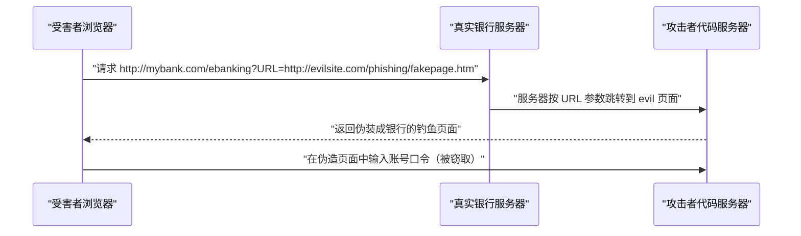

> [!IMPORTANT]
> XSS 三种形态：**HTML 内容替换 / 嵌入式脚本注入 / 强制加载外部脚本**。钓鱼者使用 XSS **控制服务端用户的浏览器的内容显示**，从而实施钓鱼意图。

##### 22.5 网站安全保护机制与技术方案

###### 🔎 网站安全保护机制（10 项）

| 序号 | 机制 | 目标与要点 |
| --- | --- | --- |
| **1** | **身份鉴别** | 常见的身份鉴别技术措施有**用户名/口令、U 盾、人脸识别**以及**基于证书的统一用户身份管理** |
| **2** | **访问控制** | 常见的网站访问控制技术措施是**防火墙、数据加密**以及**操作系统、数据库、Web 软件、Web 应用程序**等内置的访问控制措施**综合集成实现** |
| **3** | **网站内容安全** | 目标是确保网站符合所在区域的**法律法规及政策要求**，避免网站被恶意攻击者利用。技术措施主要是**网站文字内容安全检查、网页防篡改、敏感词汇过滤** |
| **4** | **网站数据安全** | 目标是确保网站所承载的**数据资源的安全性**，防止**数据泄露、完整性破坏**以及**用户隐私泄露**。技术措施主要有**用户数据隔离、数据加密、SSL、数据备份**以及**隐私保护** |
| **5** | **网站安全防护** | 目标是增强网站的**抗攻击能力**，能够**识别 Web 攻击类型及阻断攻击行为**，包括**非授权访问防护、暴力破解防护、Webshell 识别和拦截、目录遍历防护、SQL 注入攻击防护**。能够支持 **DDoS 清洗**，应能够正常防御 **SYN Flood、ACK Flood、ICMP Flood、UDP Flood、HTTP Flood、DNS Flood、CC 攻击**等拒绝服务类攻击 |
| **6** | **网站安全审计与监控** | 目标是掌握网站的**安全及运行状况**，保留相关**日志数据**，提供**事后攻击取证及应急恢复**指导。安全技术措施主要有 **SysLog、Web 流量截取、网页修改或挂马检查、Web 入侵监测、电子取证**等 |
| **7** | **网站应急响应** | 目标是针对网站意外事故，提供**应急响应服务**，保障网站的**持续运行**及相关资源的安全性。技术措施主要有**网页防篡改、网站域名服务灾备、网络流量清洗、灾备中心、网络攻击取证**等 |
| **8** | **网站合规管理** | 目标是确保网站符合相关规定要求，保证网站的**合法性**。网站合规管理包括**网站备案、网站防伪标识、网站等保测评**等 |
| **9** | **网站安全测评** | 目标是应及时有效地发现安全隐患，**指导安全整改**直至符合标准测评，避免重大网站安全事件出现。技术措施主要有**漏洞扫描、渗透测试、代码审核、风险分析**等 |
| **10** | **网站安全管理机制** | 目标是确保网站的**安全利益相关者**能承担网站安全责任，**落实网站安全措施、持续改进**网站安全管理工作。网站安全管理机制主要包括网站安全保障工作的**总体方针和安全策略**，建立**网站建设、网站运维、网站内容、网站域名、网站应急预案**等方面的安全管理制度，应确保各项安全管理制度的**有效执行、及时修订完善** |

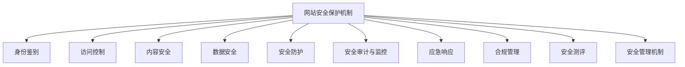

###### 🔎 网站构成组件安全加固

| 序号 | 组件 | 要点 |
| --- | --- | --- |
| **1** | **防火墙** | 是网站安全的**第一道技术屏障**，主要用于限制来自某些**特定 IP 地址**的网站连接请求，阻断常见的 **Web 应用攻击及 Web Services 攻击**。目前，可以使用的防火墙技术主要有**包过滤防火墙、Web 应用防火墙**。**包过滤防火墙**只能基于 **IP 层**过滤网站恶意包；**Web 应用防火墙**针对 **`80`、`443` 端口**、**Web Services** 攻击 |
| **2** | **漏洞扫描** | 用漏洞扫描工具**定期对网站服务器进行漏洞扫描**，及时发现网站的安全漏洞，产生**漏洞评估报告**，以指导网站管理员对网站服务器进行**升级或修改安全配置**。网站漏洞扫描技术主要有**端口扫描、Web 漏洞扫描、Webshell 恶意代码检测** |
| **3** | **网站防篡改** | 实现技术主要有两类：一是利用**操作系统的文件调用事件**来检测网页文件的**完整性变化**，以此防止网站被非授权修改；二是利用**密码学的单向函数**检测网站中的文件是否发生了变化。若检测到网页受到非法修改，则**启动网页恢复机制**，自动地用**正常的页面文件替换已破坏的页面** |
| **4** | **网络流量清洗** | 是指通过基于**网络流量的异常监测技术手段**，将对目标网络攻击的 **DoS、DDoS 等恶意网络流量过滤掉**，同时把**正常的流量转发到目标网络中** |
| **5** | **网站安全监测** | 掌握网站的安全状态，以便于网站管理人员**及时处置安全事件**，主要内容如下 |

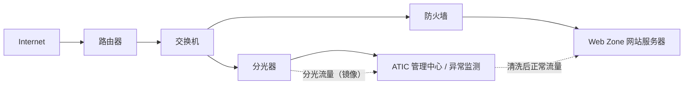

**网站安全监测的主要内容：**

| 监测项 | 要点 |
| --- | --- |
| **网站安全漏洞监测** | 通过**漏洞数据库信息匹配查找**及**漏洞扫描**，获取网站相关**操作系统、数据库、应用系统、Web 软件**等的安全漏洞情况 |
| **网站挂马监测** | 通过**网页爬虫及恶意代码检测技术**，对网站的网页进行安全检查，以确认网页是否存在 **Webshell 或恶意链接 URL** |
| **网站 ICP 备案监测** | 通过获取网站的**首页信息**，检查网站的 **ICP 备案号** |
| **网站合规性监测** | 通过获取网站的**页面信息**，利用**关键词匹配及敏感词分析技术**，监测网站合规性 |
| **网站性能监测** | 通过分析**网页请求信息及网站运行日志数据**，获取网站的性能 |
| **网站 DNS 监测** | 监测网站的**域名和 IP 地址对应关系**、**DNS 服务软件版本**、**DNS 的安全威胁** |
| **网站入侵检测** | 通过 **IDS/IPS** 监测正在进行的网站攻击行为，记录**黑客的来源及攻击方法** |

##### 22.6 网站安全综合应用案例分析 —— 政务网站安全保护

###### 🔎 政策与标准

| 项目 | 要点 |
| --- | --- |
| 相关文件 | 针对政府网站，国家颁布了《**关于加强政府网站域名管理的通知**》《**政府网站发展指引**》《**关于加强党政机关网站安全管理的通知**》《**信息安全技术 政府门户网站系统安全技术指南**》（**GB/T 31506-2015**）等 |
| 其中 | **GB/T 31506-2015** 提出政府门户网站系统**安全技术措施要求** |
| 等保要求 | 政府网站的信息安全等级**原则上不应低于二级**。**三级网站每年应测评一次，二级网站每两年应测评一次** |

###### 🔎 防护层次

| 层面防护 | 整体防护 |
| --- | --- |
| **Web 应用安全** | **服务器安全 / 运行支撑 / 攻击防范 / 安全监控 / 应急响应** |

###### 🔎 政府网站安全防护方案（7 项）

| 序号 | 方案 | 要点 |
| --- | --- | --- |
| **（1）** | **DDoS 防御** | 在政务网站与**互联网边界**处部署**防 DDoS 攻击系统**，用于防护来自互联网的**拒绝服务攻击** |
| **（2）** | **网络访问控制** | 利用**防火墙**进行访问控制 |
| **（3）** | **网页防篡改** | 对政务网站的网页和文件进行防护 |
| **（4）** | **Web 应用防火墙/入侵防护** | 清洗异常流量，有效控制政务网站应用的各类安全威胁 |
| **（5）** | **入侵防御和病毒防护** | 通过**入侵防御系统和防病毒网关系统**实现对**非法入侵行为和网络病毒**的有效检测和阻断 |
| **（6）** | **网络/数据库审计** | 通过网络/数据库审计系统实现对政务网站**访问行为**和网站**后台数据库的访问行为**进行**监控、记录和审计** |
| **（7）** | **网站安全监控** | 通过网站安全监控系统实现**漏洞扫描、网页木马监测、网页篡改监测、网页敏感信息监测**等功能 |

---

#### 第23章 云计算安全需求分析与安全保护工程

##### 23.1 云计算安全概念与威胁分析

###### 🔎 云计算概念

| 项目 | 要点 |
| --- | --- |
| 类比 | **国家电网，统一供电**；**自来水公司，统一供水**；**云计算服务商提供 IT 服务** —— 即像用电用水一样**按需取用 IT 资源** |

###### 🔎 云计算服务类型

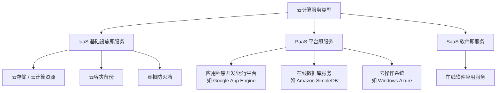

| 服务类型 | 典型内容 |
| --- | --- |
| **IaaS（基础设施即服务）** | **云容灾备份**、**虚拟防火墙**、服务器/存储/网络等基础设施资源 |
| **PaaS（平台即服务）** | **应用程序开发/运行平台**，如 **Google App Engine**；**在线数据库服务**，如**亚马逊在线简单数据库服务（Amazon SDB / SimpleDB）**；**云操作系统**，如 **Windows Azure** |
| **SaaS（软件即服务）** | 面向用户的在线应用/软件服务 |

> [!WARNING]
> 原文此页（Page 611）为竖排图，OCR 将 IaaS/PaaS/SaaS 三层标签与内容错位。上表按可辨认条目（Google App Engine、Amazon SDB、Windows Azure、云容灾备份、虚拟防火墙）归位整理。

###### 🔎 云计算四大特征

| 序号 | 特征 |
| --- | --- |
| **1** | **IT 资源以服务的形式提供** |
| **2** | **多租户共享 IT 资源** |
| **3** | **资源按需定制与按用付费** |
| **4** | **资源可伸缩性部署** |

###### 🔎 云计算四种部署模式

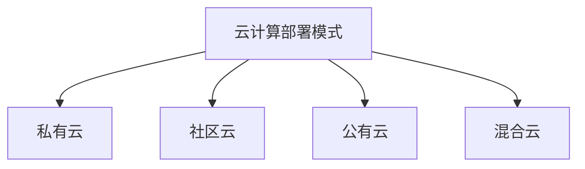

| 部署模式 | 要点 |
| --- | --- |
| **私有云** | 云计算设施为**某个特定组织单独运营**云服务，可能由**组织自身或委托第三方**进行管理 |
| **公有云** | 云计算设施**由某一组织拥有并进行云服务商业化**，对**社会公众、组织**提供服务 |
| **社区云** | 云计算设施由**多个组织共享**，用于支持**某个特定的社区团体**，可能由**组织自身或委托第三方**进行管理 |
| **混合云** | 云计算设施由**两个或多个云实体（公有云、私有云、社区云）构成**，绑定在一起，该技术使**数据和应用程序具备可移植性** |

###### 🔎 云计算安全分析 —— "端-管-云"威胁分析方法


| 序号 | 威胁层面 | 要点 |
| --- | --- | --- |
| **1** | **云"端"安全威胁** | 云终端是用户使用云计算服务的**终端设备**，云终端的安全性直接影响云服务的**安全体验**。云终端用户在使用云计算服务的过程中，**云用户设置弱口令，导致云用户的账号被盗**，或者**黑客攻击终端平台，假冒云用户**。**云终端设备存在安全漏洞**，导致黑客入侵终端等 |
| **2** | **云"管"安全威胁** | 网络是云计算平台连接云用户的**管道**，云计算平台通过网络把云服务传递到云用户。网络通信过程中，网络可能面临的安全威胁有**网络监听、网络数据泄露、中间人攻击、拒绝服务**等，从而导致**云计算平台出现安全问题** |
| **3** | **云计算平台安全威胁** | 见下表（11 项） |

###### 🔎 云计算平台安全威胁（11 项）

| 序号 | 威胁 | 要点 |
| --- | --- | --- |
| **（1）** | **云计算平台物理安全威胁** | 云计算促进了各种资源的**集中化**，极易形成**物理环境单点安全高风险** |
| **（2）** | **云计算平台服务安全威胁** | 云计算平台提供的服务对用户来说是**透明的**，但云用户**无法掌握技术细节、基础设施的配置情况、系统管理方式**等具体情况。云计算平台服务的安全性**依赖于云服务商的安全管理及维护** |
| **（3）** | **云平台资源滥用安全威胁** | 攻击者利用云服务平台的**虚拟主机漏洞**，非法入侵云平台的**虚拟主机**，构造**僵尸网络**，发动**拒绝服务攻击**。针对云平台**存储服务安全管理缺陷**，利用**云存储保存网络犯罪信息** |
| **（4）** | **云计算平台运维及内部安全威胁** | 云提供商**内部工作人员违反安全规定或误操作**，导致**数据丢失和泄露**；云计算平台**服务非正常关闭**等安全事件时有发生 |
| **（5）** | **数据残留** | 云租户的大量数据存放在云计算平台上的存储空间中，如果**存储空间回收后剩余信息没有完全清除**，存储空间**再分配给其他云租户**使用容易造成**数据泄露** |
| **（6）** | **过度依赖** | 不同云计算平台上**数据和应用系统难以迁移**。"**上云容易下云难，免费上云，慢慢收割**" |
| **（7）** | **利用共享技术漏洞进行的攻击** | 由于云服务是**多租户共享**，如果云租户之间的**隔离措施失效**，一个云租户有可能**侵入另一个云租户的环境**，或者**干扰其他云租户应用系统的运行** |
| **（8）** | **滥用云服务** | 面向公众提供的云服务**可向任何人提供计算资源**，如果管控不严格，不考虑使用者的目的，很可能被攻击者利用，如通过**租用计算资源发动拒绝服务攻击** |
| **（9）** | **云服务中断** | 云服务基于**网络**提供服务，当云租户把应用系统迁移到云计算平台后，一旦与云计算平台的**网络连接中断**或者**云计算平台出现故障**，造成**服务中断**，将影响云租户应用系统的**正常运行** |
| **（10）** | **利用不安全接口的攻击** | 攻击者利用**非法获取的接口访问密钥**，将能够**直接访问用户数据**，导致**敏感数据泄露**；通过接口实施**注入攻击**，进行**篡改或者破坏用户数据**；通过**接口的漏洞**，攻击者可**绕过虚拟机监视器的安全控制机制**，获取**系统管理权限**，将给云租户带来无法估计的损失 |
| **（11）** | **数据丢失、篡改或泄露** | 云计算数据的**实际存储位置可能在境外**，易造成数据泄露。云计算聚集了大量云租户的**应用系统和数据资源**，容易成为**被攻击目标**。一旦遭受攻击，会导致严重的**数据丢失、篡改或泄露** |

> [!TIP]
> 云平台 11 项威胁记忆分组：
> **平台自身**：物理集中 / 服务透明 / 资源滥用 / 运维内部 / 数据残留
> **平台关系**：过度依赖 / 共享隔离失效 / 滥用云服务 / 服务中断
> **接口与数据**：不安全接口 / 数据丢失篡改泄露

###### 🔎 云计算安全要求

| 项目 | 要点 |
| --- | --- |
| **传统计算平台安全** | 包括：**物理和环境安全、网络和通信安全、设备和计算安全、数据安全和应用安全** |
| **云计算新增安全需求** | **多租户安全隔离、虚拟资源安全、云服务安全合规、数据可信托管、安全运维及业务连续性保障、隐私保护** 等 |
| 原因 | 由于云计算系统**承载着不同用户的应用和数据**，相比于传统计算平台，其安全性要求更高 |

##### 23.2 云计算服务安全需求

###### 🔎 云计算技术安全需求（端-管-云三部分）

| 序号 | 需求 | 要点 |
| --- | --- | --- |
| **1** | **云端安全需求分析** | **云用户的身份标识和鉴别、云用户资源访问控制、云用户数据安全存储**以及**云端设备及服务软件安全** |
| **2** | **网络安全通信安全需求分析** | 包括**身份认证、密钥分配、数据加密、信道加密、防火墙、VPN、抗拒绝服务**等 |
| **3** | **云计算平台安全需求分析** | **物理环境安全、主机服务器安全、操作系统、数据库安全、应用及数据安全、云操作系统安全、虚拟机安全**和**多租户安全隔离**等 |

###### 🔎 云计算隐私保护需求（数据生命周期 6 环节）

| 序号 | 环节 | 要求 |
| --- | --- | --- |
| **（1）** | **数据采集** | **明确个人信息采集范围和用途**，告知用户相关安全风险 |
| **（2）** | **数据传输** | **敏感个人数据网络传输采用加密安全措施**，防止网络通信过程信息泄露 |
| **（3）** | **数据存储** | 采用**加密、认证、访问控制、备份**等多种措施保护好敏感个人数据安全，避免数据泄露。**个人数据信息按照规定保留相应时间** |
| **（4）** | **数据使用** | 制定相应**特权管理、个人信息披露**等安全控制策略规则，采用**实名认证、安全标记、特权控制**等措施，**限制个人数据使用范围、人员**，防止**内部人员滥用和非正当披露个人信息** |
| **（5）** | **数据维护** | 制定敏感个人数据**安全生命周期管理流程**，安全管理制度和措施**符合国家网络安全管理法律法规政策要求**，**相关人员签订保密协议**，敏感个人数据**按规定清除** |
| **（6）** | **数据安全事件处置** | 制订针对**个人信息安全事件的应急预案**，**阻止安全事件扩大** |

##### 23.3 云计算安全保护机制与技术方案

###### 🔎 云计算安全等级保护框架

| 项目 | 要点 |
| --- | --- |
| 前提 | 首先要求保证**云计算基础设施位于中国境内**，并从**技术、管理**两方面给出要求 |
| 原则 | 按照 **"一个中心，三重防护"** 的原则，构建云计算安全等级保护框架 |
| **一个中心** | **安全管理中心** |
| **三重防护** | **安全计算环境、安全区域边界、安全通信网络** |
| 层次 | 框架自下而上涵盖 **IaaS、PaaS、SaaS** 三层，以及**访问层安全**（租户 1…租户 n）与**通信网络安全** |

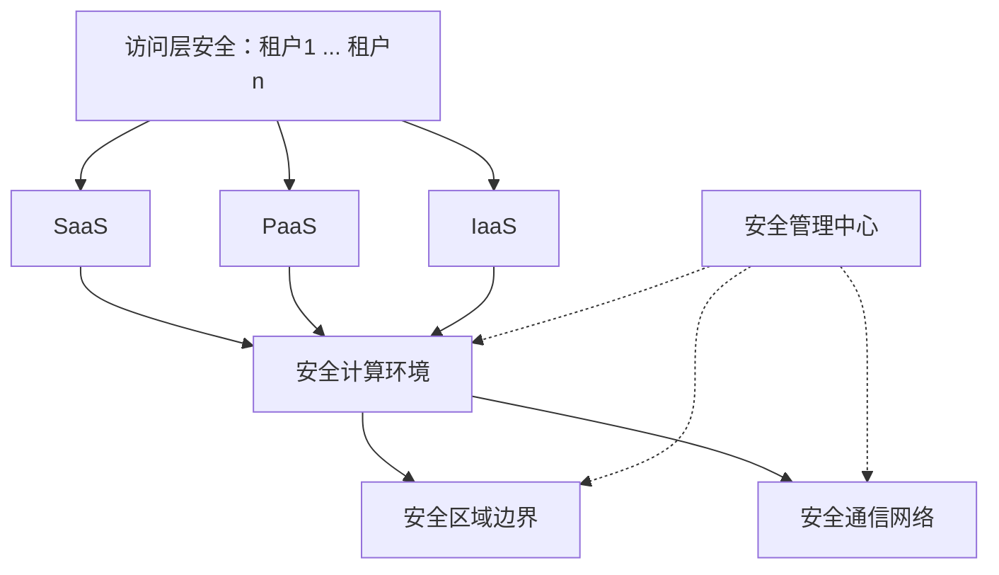

> [!IMPORTANT]
> **"一个中心、三重防护"** = 安全管理中心 + **安全计算环境 / 安全区域边界 / 安全通信网络**。

###### 🔎 表 23-2 云计算平台技术措施等级保护要求

| 保护对象类型 | 安全措施内容 |
| --- | --- |
| **物理和环境安全** | 物理位置选择、物理访问控制、防盗窃和防破坏、防雷击、防火、防水和防潮、防静电、温湿度控制、电力供应、电磁防护 |
| **网络和通信安全** | 网络架构、通信传输、边界防护、访问控制、入侵防范、恶意代码防范、安全审计、集中管控 |
| **设备和计算安全** | 身份鉴别、访问控制、安全审计、入侵防范、恶意代码防范、资源控制、**镜像和快照保护** |
| **应用和数据安全** | 身份鉴别、访问控制、安全审计、软件容错、资源控制、**接口安全**、数据完整性、数据保密性、数据备份恢复、剩余信息保护、个人信息保护 |

> [!TIP]
> 云计算相对通用要求的两项新增："**镜像和快照保护**"（设备与计算）与"**接口安全**"（应用与数据）。

###### 🔎 常见云计算网络安全机制（6 项）

| 序号 | 机制 | 要点 |
| --- | --- | --- |
| **（1）** | **身份鉴别认证机制** | **用户名/口令认证、强制密码策略、多因子认证、Kerberos** |
| **（2）** | **数据完整性机制** | 确保数据能用，而且能够**防止数据受到损害**。**数字签名**是保护云计算数据完整性的重要措施 |
| **（3）** | **访问控制机制** | 云计算资源的使用要在**一定的安全规则下经过授权**才能保证安全使用 |
| **（4）** | **入侵防范机制** | 为保护云计算平台的安全，通常使用 **IDS/IPS** 防范已知的漏洞攻击，或者采用**沙箱系统检测零日漏洞**。同时部署**抗拒绝服务攻击安全措施**，保障云计算平台的**业务连续性** |
| **（5）** | **安全审计机制** | 云计算平台对**安全日志进行集中管理**，以便于**事后分析问题** |
| **（6）** | **云操作系统安全增强机制** | 目前，商业和开源的**云操作系统**难以避免地存在安全漏洞，甚至有些漏洞将导致**虚拟机逃逸**。为此，针对**虚拟机管理程序（Hypervisor）** 的安全问题，提供**热补丁修复、恶意程序检测**，以防止云操作系统的漏洞被利用而**危及整个云计算平台的安全** |

###### 🔎 表 23-3 云计算平台安全组织管理保障措施等级保护要求

| 安全管理类型 | 安全管理要求 |
| --- | --- |
| **安全策略和管理制度** | 安全策略、管理制度**制定和发布**、**评审和修订** |
| **安全管理机构和人员** | **岗位设置、人员配备、授权和审批、沟通和合作、审核和检查、人员录用、人员离岗、安全意识教育和培训、外部人员访问管理** |
| **安全建设管理** | **系统定级和备案、安全方案设计、产品采购和使用、自行软件开发、外包软件开发、工程实施、测试验收、系统交付、等级测评、服务供应商选择、云服务商选择、供应链管理** |

###### 🔎 表 23-4 云计算服务安全运维保障要求

| 要求类型 | 内容 |
| --- | --- |
| **云计算环境与资产运维管理** | **环境管理、资产管理、介质管理、数据管理** |
| **云计算系统安全漏洞检查与风险分析** | 〔原文该单元格 OCR 失真，内容应为漏洞扫描、风险评估、安全测评等〕 |
| **云计算系统安全监管** | **网络和系统安全管理、恶意代码防范管理、密码管理、设备维护管理、配置〔管理〕**、**云计算系统安全测评、外包运维管理** |
| **云计算系统安全监测与应急响应** | **监控和审计管理、应急预案管理、安全事件处置、备份与恢复管理** |

###### 🔎 云计算安全运维的安全措施（5 项）

| 序号 | 安全措施 | 内容 |
| --- | --- | --- |
| **（1）** | **云计算安全风险评估机制** | 持续分析云计算平台的**资产清单、安全脆弱性、安全威胁以及安全措施**，对云计算平台安全进行**定量定性风险分析**，掌握云计算平台的风险 |
| **（2）** | **云计算内部安全防护机制** | 针对云计算平台的**运维安全风险**，采用**身份强认证、安全操作审计、远程安全登录**等措施保护运维操作的安全性。云计算平台通常采用**多因素认证、堡垒机、SSH、VPN** 等安全措施，强化运维操作的安全保护 |
| **（3）** | **云计算网络安全监测机制** | 通过收集云计算平台的**网络流量、系统日志、安全漏洞**等数据，分析云计算平台的**网络安全状况及趋势** |
| **（4）** | **云计算安全应急响应机制** | 针对云计算平台潜在的**网络安全事件**，事先制定**应急响应预案**。常见的安全事件有**端口扫描、暴力破解、恶意代码、拒绝服务、数据泄露、漏洞利用和 DNS 劫持**等。对于云计算平台来说，重点是保障平台的**可用性及数据安全**，能够**抵御拒绝服务攻击**，**防止云租户的数据丢失和泄露** |
| **（5）** | **云计算容灾备份机制** | 云计算平台承载大量应用，其业务的**安全持续运行**至关重要。安全事件导致停机事件时有报道，为此，建立**异构云容灾备份机制**非常重要。工业界常采用 **"两地三中心"** 的容灾机制。其中，**两地**是指**同城、异地**；**三中心**是指**生产中心、同城容灾中心、异地容灾中心** |

> [!IMPORTANT]
> **"两地三中心"**：两地 = **同城 + 异地**；三中心 = **生产中心 + 同城容灾中心 + 异地容灾中心**。

##### 23.4 云计算安全综合应用案例分析

###### 🔎 阿里云

| 项目 | 要点 |
| --- | --- |
| 安全机制 | 阿里云建立了**安全防护机制、监控机制、审计机制、身份认证机制**以及**安全运维机制** |
| 安全产品 | 阿里云提供**云盾、DDoS 高防 IP、Web 应用防火墙、态势感知、SSL 证书、云防火墙、加密服务、实人认证**等多种云安全服务产品 |
| 底层能力 | **操作系统加固、内核防提权、主机入侵防护、〔虚拟网络/东西向防护〕、可信计算实践** |

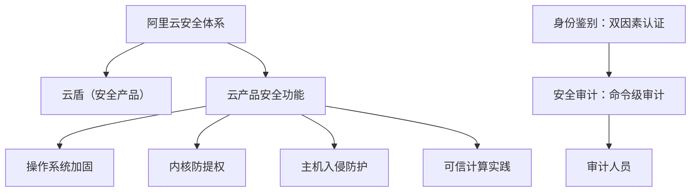

###### 🔎 腾讯云 —— 1. 网络安全

| 措施 | 要点 |
| --- | --- |
| **DDoS 防护** | 提供 **DDoS 高防包、DDoS 高防 IP** 等多种 DDoS 解决方案，应对 DDoS 攻击问题 |
| **云防火墙** | 基于公有云环境的 **SaaS 化防火墙**，为用户提供**互联网边界、VPC 边界**的网络访问控制，同时基于**流量**嵌入多种安全能力，实现**访问管控与安全防御的集成化与自动化** |
| **网络入侵防护系统** | 通过**旁路部署**方式，**无变更无侵入**地对网络 **4 层会话**进行**实时阻断**，并提供了**阻断 API**，方便其他安全检测类产品调用；此外，网络入侵防护系统提供**全量网络日志存储和检索、安全告警、可视化大屏**等功能，解决**等保合规、日志审计、行政监管以及云平台管控**等问题 |
| **腾讯云样本智能分析平台** | 依靠**深度沙箱**中自研的**动态分析模块、静态分析模块**以及稳定高效的**任务调度框架**，实现**自动化、智能化、可定制化**的样本分析；通过建设大规模分析集群，包括**深度学习**在内的多个**高覆盖率的恶意样本检测模型**，可以得知样本的**基本信息、触发的行为、安全等级**等信息，从而精准高效地对现网中的恶意样本进行打击 |

###### 🔎 腾讯云 —— 2. 终端安全

| 措施 | 要点 |
| --- | --- |
| **主机安全** | 基于腾讯安全积累的**海量威胁数据**，利用**机器学习**为用户提供**黑客入侵检测和漏洞风险预警**等安全防护服务，主要包括**密码破解拦截、异常登录提醒、木马文件查杀、高危漏洞检测**等安全功能 |
| **腾讯云反病毒引擎（Antivirus）** | 腾讯反病毒实验室**独立研发**的反病毒产品，运行于终端的杀毒程序，其包含**腾讯反病毒本地引擎**和**腾讯反病毒云**两大功能模块，开放多个功能性接口 **SDK**，可**支持多种平台使用且无须联网** |
| **腾讯终端安全管理系统** | 基于腾讯 20 年安全积累和腾讯电脑管家十余年数亿用户的产品、运营与技术沉淀，将**百亿量级云查杀病毒库、AI 杀毒引擎、大数据安全分析引擎**等安全技术和能力应用到政企内部，打造集**病毒查杀、桌面管控、安全运维、安全检测与响应**等新一代的一体化的终端安全解决方案 |
| **腾讯云零信任无边界访问控制系统（ZTAC，Zero Trust Access Control System）** | 依赖**终端安全、身份安全、链路安全**三大核心能力，实现终端在**任意网络环境**中**安全、稳定、高效**地访问**企业资源及数据** |
| **移动终端安全管理系统** | 用户可以根据自身需求，**集中管理、配置和保护**终端设备、应用程序及移动数据，提高 **IT 管理效率**，保障**移动环境安全** |

###### 🔎 腾讯云 —— 3. 应用安全

| 措施 | 要点 |
| --- | --- |
| **腾讯云 Web 应用防火墙** | 解决腾讯云内及云外用户应对 **Web 攻击、入侵、漏洞利用、挂马、篡改、后门、蠕虫、域名劫持**等网站及 Web 业务安全防护问题 |
| **腾讯应用级智能网关** | 基于**零信任策略**，对企业应用和服务提供**集中管控、统一防控和统一审计**，保障企业应用和服务更安全、更可靠 |
| **漏洞扫描服务** | 用于监测网站漏洞的安全服务，提供 **7×24 小时**准确、全面的漏洞监测服务 |
| **移动应用安全** | 涵盖**应用加固、安全测评、兼容性测试、盗版监控、崩溃监测、安全组件**等服务 |
| **手游安全** | 具备 **24 小时**安全保障能力，支持手游厂商快速应对**手游作弊、手游篡改破解**等常见的游戏安全问题 |

###### 🔎 腾讯云 —— 4. 业务安全

| 措施 | 要点 |
| --- | --- |
| **天御借贷反欺诈** | 识别**银行、证券、保险**等金融行业的欺诈风险。通过腾讯云的**人工智能和机器学习**能力，准确识别恶意用户与行为，解决客户在**支付、借贷、理财、风控**等业务环节遇到的欺诈威胁，提升**风险识别能力** |
| **保险反欺诈** | 通过 **AI 人工智能风控模型**，准确定位在**申保、核保、理赔**等业务环节中所遇到的欺诈威胁 |
| **登录保护服务** | 针对网站和 App 的用户登录场景，**实时检测是否存在盗号、撞库等恶意登录行为**，发现异常登录，降低（风险） |
| **腾讯云验证码** | 基于**十道安全栅栏**，为网页、App、小程序开发者打造**立体、全面的人机验证**，最大限度地保护（用户免受恶意程序侵扰） |
| **腾讯云活动防刷** | 针对**电商、O2O、P2P、游戏、支付**等行业在促销活动中遇到**"羊毛党"恶意刷取优惠福利**行为，通过**防刷引擎**，精准识别出"薅羊毛"恶意行为的**活动防刷服务**，避免了企业被刷带来的巨大经济损失 |
| **注册保护服务** | 针对网站、App 的线上注册场景，遇到**"恶意注册""小号注册""注册器注册"** 等恶意行为，提供基于**天御 DNA 算法**的恶意防护引擎，从**账号、设备和行为**三个维度有效识别"恶意注册"，从"**源头**"上（拦截） |
| **营销风控服务** | 通过腾讯**安全风控模型和 AI 关联算法**，快速识别恶意请求，精准打击"**羊毛党**"，提升**资金使用（效率）** |
| **文本内容安全服务** | 使用了**深度学习技术**，可有效识别**涉黄、涉政、涉恐**等有害内容，支持用户**配置词库**，打击自定义的违规文本。识别结果分为**正常、可疑与违规**三部分，建议**放行正常的图片，人工审查可疑的图片，屏蔽违规的图片**，节省人力成本，提高审核效率 |
| **营销号码安全** | 提供一站式、精准的**号码安全感知保护及预防服务**，涵盖**号码安全防护、风险号码识别及恶意呼叫治理**等多领域能力 |
| **业务风险情报** | 提供全面、实时、精准的业务风险情报服务。通过简单的 **API 接入**，即可获取业务中 **IP、号码、App、URL** 等的**画像数据**，对其风险进行精确评估，做到对业务风险、黑产攻击**实时感知、评估、应对、止损** |

###### 🔎 腾讯云 —— 5. 数据安全

| 措施 | 要点 |
| --- | --- |
| **腾讯云堡垒机** | 结合**堡垒机与人工智能技术**，为企业提供**运维人员操作审计**，对**异常行为进行告警**，防止**内部数据泄密** |
| **腾讯云数据安全审计** | 基于**人工智能**的数据库安全审计系统，可挖掘数据库运行过程中各类**潜在风险和隐患**，为数据库安全运行保驾护航 |
| **数据安全治理中心** | 通过**数据资产感知与风险识别**，对企业云上**敏感数据**进行**定位与分类分级**，并帮助企业针对风险问题**设置数据安全策略**，提高防护措施有效性 |
| **敏感数据处理（Data Mask, DMask）** | 提供**敏感数据脱敏与水印标记**工具服务，可为数据系统中的敏感信息进行**脱敏处理**，并在泄露时提供**追溯依据** |
| **云加密机** | 基于**国密局认证的物理加密机（HSM，Hardware Security Module）**，利用**虚拟化技术**，提供**弹性、高可用、高性能**的数据**加解密、密钥管理**等云上数据安全服务；符合**国家监管合规要求**，满足**金融、互联网**等行业加密需求，保障业务数据隐私安全 |

###### 🔎 腾讯云 —— 6. 安全管理（SOC）

| 措施 | 要点 |
| --- | --- |
| **安全运营中心 SOC（公有云）** | 腾讯云原生的**统一安全运营与管理平台**，提供**资产自动化盘点、互联网攻击面测绘、云安全配置风险检查、合规风险评估、流量威胁感知、泄漏监测、日志审计与检索调查、安全编排与自动化响应（SOAR）及安全可视**等能力，帮助云上用户实现**事前安全预防，事中事件监测与威胁检测，事后响应处置**的一站式、可视化、自动化的云上安全运营管理 |
| **安全运营中心（私有云）** | 以**安全检测**为核心，以**事件关联分析、腾讯威胁情报**为重点，以 **3D 可视化**为特色，以可靠服务为保障，可针对企业面临的**外部攻击和内部潜在风险**进行深度检测，为企业提供及时的安全告警。适用于多种安全运营管理场景，通过**海量数据多维度分析、及时预警**，对威胁及时做出**智能处置**，实现全网**安全态势可知、可见、可控**的闭环 |
| **密钥管理系统** | 让用户**创建和管理密钥**，保护密钥的**保密性、完整性和可用性**，满足用户**多应用多业务**的密钥管理需求，符合**监管和合规要求** |
| **凭据管理系统（Secrets Manager）** | 提供凭据的**创建、检索、更新、删除**等全生命周期的管理服务，结合**资源级角色授权**轻松实现对敏感凭据的统一管理。针对**敏感配置、敏感凭据硬编码**带来的泄露风险问题，用户或应用程序可通过调用 **Secrets Manager API** 来检索凭据，有效避免**程序硬编码和明文配置**等导致的敏感信息泄密以及**权限失控**带来的（风险） |

###### 🔎 腾讯云 —— 7. 安全服务 & 8. 用户身份验证

| 类别 | 措施 | 要点 |
| --- | --- | --- |
| **7. 安全服务** | **专家服务** | 由专业的安全专家团队提供**安全咨询、网站渗透测试、应急响应、等保合规**等服务 |
| — | **公共互联网威胁量化评估** | 提供实时的、客观的**网络安全风险量化与风险评估**的服务，通过**微信小程序**能够直观呈现企业**网络安全指数、安全等级及详细安全问题**等信息 |
| — | **威胁情报云查服务** | 提供**威胁情报（IoC）查询服务**、**IP/Domain/文件等信誉查询服务** |
| — | **网络资产风险监测系统** | 能够对**网络设备及应用服务的可用性、安全性与合规性**等进行定期的**安全扫描**、持续性的**风险预警和漏洞检测**，并且提供专业的**修复建议**，降低安全风险 |
| **8. 用户身份验证** | **身份核验** | 腾讯云拥有海量的**数据分析和人脸、图片的训练集**；腾讯云提供**身份 OCR、人脸比对、活体检测**等技术，在实现用户身份**秒级确认**，有效解决高风险行业线下复杂的身份验证问题，满足**核身要求极高**的业务场景需求 |

###### 🔎 华为云

| 项目 | 要点 |
| --- | --- |
| 服务范围 | 华为云提供**云计算、云存储、云网络、云安全、云数据库、云管理与部署应用**等基础设施云服务 |
| 安全体系 | 为保护云安全，华为云构建了**芯片、平台、系统、应用、数据、开发、生态、隐私**等安全防护技术体系 |

| 序号 | 技术措施 | 要点 |
| --- | --- | --- |
| **1** | **芯片级可信计算和安全加密** | 华为公司推出支持**国密算法**的**可信服务器和可信云平台**解决方案。基于**可信计算模块芯片**，华为云具备对云平台主机进行**完整性度量**及提供更多安全特性的能力，**降低云主机的软硬件被篡改的风险**，满足更高的安全需求 |
| **2** | **平台安全** | 华为云**统一虚拟化平台（UVP）**，直接运行于**物理服务器**之上，通过对服务器**物理资源的抽象**，在单个物理服务器上构建**多个同时运行、相互隔离的虚拟机执行环境**。UVP 基于**硬件辅助虚拟化技术**提供虚拟化能力，为虚拟机提供高效的运行环境，并且保证虚拟机运行在**合法的空间**内，避免虚拟机对 **UVP 或其他虚拟机**发起**非授权访问** |
| **3** | **系统安全** | **EulerOS** 能够提供**可配置的加固策略、内核级 OS 安全能力**等各种安全技术以防止入侵 |
| **4** | **应用安全** | 各应用通过华为公司自研的 **API 网关**向客户提供**标准化集成接口**，具备**严格的身份认证及鉴权、传输加密保护、细粒度流量控制**等安全能力，防范数据被**窃取和嗅探**。并且，华为云通过**深度学习、运行时应用自我保护（RASP）、去中心化认证**等技术的运用，进一步打造**用户行为画像、业务风险控制**等高级安全能力，实时监控和拦截**异常行为**，保护应用服务安全稳定运行 |
| **5** | **数据安全** | 华为云构建**全数据生命周期的安全防护能力**。通过**自动化敏感数据发现、动态数据脱敏、高性能低成本数据加密、快速异常操作审计、数据安全销毁**等多项技术的研究与应用，实现数据在**创建、存储、使用、共享、归档、销毁**等多个环节的管控，保障云上数据安全。具体的数据安全机制主要有**数据隔离、数据加密、数据（脱敏/审计/销毁）** |
| **6** | **开发安全** | 华为云通过完善的**制度和流程**以及自动化的**平台和工具**，对软硬件**全生命周期**进行端到端的管理，全生命周期包括**安全设计、安全编码和测试、安全验收和发布、漏洞管理**等环节 |
| **7** | **生态安全** | 华为云基于**严进宽用**的原则，保障**开源及第三方软件**的安全引入和使用。华为云对引入的开源及第三方软件制订了明确的**安全要求和完善的流程控制方案**，在**选型分析、安全测试、代码安全、风险扫描、法务审核、软件申请和软件退出**等环节，均实施严格的管控 |
| **8** | **隐私保护** | 华为云各服务产品的设计遵循**《隐私保护设计规范》**，该规范建立了**隐私基线、维护隐私的完整性**和**指导隐私风险分析**，制定对应措施并作为需求**融入**服务产品开发设计流程 |

| 安全服务产品 | — |
| --- | --- |
| 名录 | 华为云提供 **DDoS 高防、Anti-DDoS 流量清洗、数据库安全服务 DBSS、数据加密服务、企业主机安全、容器安全服务、安全专家服务、SSL 证书管理、云堡垒机、漏洞扫描服务、Web 应用防火墙 WAF** 等安全服务 |

###### 🔎 微软 Azure 云

| 序号 | 保障措施 | 要点 |
| --- | --- | --- |
| **1** | **数据仓储安全** | 所有客户数据、处理这些数据的应用程序**全部位于中国境内** |
| **2** | **业务连续性保障** | 位于**中国东部和中国北部**的数据中心在距离相隔 **1000 km 以上**的地理位置提供**异地复制**，为 Azure 服务提供了业务连续性支持，实现了数据的可靠性 |
| **3** | **物理环境安全** | 所有数据中心选取**国内电信运营商的顶级数据中心**，采用 **N+1 或者 2N 路不间断电源**保护。此外还有**大功率柴油发电机**为数据中心提供后备电力，配有**现场柴油存储和就近加油站** |
| **4** | **隐私保护** | **客户全权管理自己的客户数据以及权限**，决定客户数据的**存储位置** |
| **5** | **合规性** | 满足国际和行业特定标准 **ISO/IEC 27001**，**公安部信息系统安全等级保护评定第三级备案** |
| **6** | **基础结构安全** | 通过**加密通信、威胁管理和缓解实践**（包括**定期渗透测试**）来帮助保障客户数据的安全。主要网络安全技术措施如下 |
| **7** | **数据服务保障** | 通过安全技术和流程确保客户数据的**机密性、完整性和可用性**，提供有财务保障的**最高达 99.99% 的月度服务级别协议**以及**最多 6 个数据备份** |

**Azure 主要网络安全技术措施：**

| 措施 | 要点 |
| --- | --- |
| **密钥保管库** | 保护云应用程序和服务使用的**加密密钥及其他密文密码** |
| **Azure Active Directory** | 实现跨云应用程序的**单一登录（SSO）** |
| **应用程序网关** | 提供**高可用的 HTTP 负载均衡、Web 应用程序防火墙**等服务，多实例网关可实现 **`99.95%`** 持续运行时间 |
| **VPN 网关** | 提供**行业标准的站点到站点 IPSec VPN**，随处进行站点到站点的 VPN 访问。VPN 网关提供 **`99.9%`** 运行时间的服务级别协议保证，支持从任何位置连接到 Azure 的**虚拟网络或虚拟机** |

> [!WARNING]
> Azure 应用程序网关的"持续运行时间"原文 OCR 为"gg.g%"，结合行业惯例还原为 **`99.95%`**；VPN 网关为 **`99.9%`**。

---

#### 第24章 工控安全需求分析与安全保护工程

##### 24.1 工控系统安全威胁与需求分析

###### 🔎 工业控制系统概念及组成

| 项目 | 要点 |
| --- | --- |
| 定义 | 工业控制系统是由各种**控制组件、监测组件、数据处理与展示组件**共同构成的对**工业生产过程**进行**控制和监控**的业务流程管控系统 |
| 简称 | 工业控制系统通常简称**工控系统（ICS）** |
| 分类 | 工控系统通常分为**离散制造类**和**过程控制类**两大类 |
| 包含系统 | 控制系统包括 **SCADA 系统、分布式控制系统（DCS）、过程控制系统（PCS）、可编程逻辑控制器（PLC）、远程终端（RTU）、数控机床及数控系统**等 |

```mermaid
graph TD
    A["工控系统 ICS"] --> B["SCADA 数据采集与监视控制系统"]
    A --> C["DCS 分布式控制系统"]
    A --> D["PCS 过程控制系统"]
    A --> E["PLC 可编程逻辑控制器"]
    A --> F["RTU 远程终端设备"]
    A --> G["MTU 主终端设备"]
    A --> H["HMI 人机界面"]
    A --> I["工控通信网络"]
```

| 序号 | 组件 | 要点 |
| --- | --- | --- |
| **1** | **SCADA 系统** | 即**数据采集与监视控制系统**，作用是以**计算机为基础**对**远程分布运行的设备**进行监控，功能主要包括**数据采集、参数测量和调节**。SCADA 系统一般由设在控制中心的**主终端控制单元（MTU）**、**通信链路和设备**、**远程终端单位（RTU）** 等组成，系统作用主要是对**多层级、分散的子过程**进行**数据采集和统一调度管理** |
| **2** | **分布式控制系统（DCS）** | 是基于**计算机技术**对生产过程进行**分布控制、集中管理**的系统。DCS 系统一般包括**现场控制级、系统控制级和管理级**两/三个层次：**现场控制级**主要是对**单个子过程**进行控制；**系统控制级**主要是对**多个密切相关的过程**进行**数据采集、记录、分析和控制**，并通过统一的**人机交互处理**实现过程的**集中控制和展示**；系统**项目管理器**实现**组态的配置和分发**，并有统一的**对外数据接口** |
| **3** | **过程控制系统（PCS）** | 通过**实时采集被控设备状态参数**进行调节，以保证被控设备**保持某一特定状态**的控制系统。状态参数包括**温度、压力、流量、液位、成分、浓度**等。PCS 系统通常采用**反馈控制（闭环控制）** 方式 |
| **4** | **可编程逻辑控制器（PLC）** | 主要执行各类**运算、顺序控制、定时**等指令，用于控制**工业生产装备的动作**，是工业控制系统的**基础单元** |
| **5** | **主终端设备（MTU）** | 部署在**调度控制中心**，用于生产过程的**信息收集和监测**，通过**网络与 RTU 保持通信** |
| **6** | **远程终端设备（RTU）** | 用于生产过程的**信息采集、自动测量记录和传导**，通过**网络与 MTU 保持通信** |
| **7** | **人机界面（HMI）** | 是为**操作者和控制器**之间提供**操作界面和数据通信**的软硬件平台。目前工业控制系统主要采用**计算机终端**进行人机交互工作 |
| **8** | **工控通信网络** | 传统工业通信网络一般采取**专用的协议**来构建，形成**封闭网络**。常见的工控专用协议有 **OPC、Modbus、DNP3、工业以太网**等 |

###### 🔎 工控系统安全威胁（5 个方面）

| 序号 | 威胁 | 要点 |
| --- | --- | --- |
| **1** | **自然灾害及环境** | **洪水、雷电、台风**等是工控系统常见的自然灾害威胁，特别是分布在**室外**的工业控制设备 |
| **2** | **内部安全威胁** | **人为错误或疏忽大意**，如**命令输入错误、操作不当**，导致工业控制设备安全失效 |
| **3** | **设备功能安全故障** | 工业控制设备**质量不合格**，导致设备功能无法正常执行，从而产生故障，例如**磁盘故障、服务器硬件故障** |
| **4** | **恶意代码** | 随着工业控制网络的**开放性增加**，恶意代码成为工业控制系统面临的安全挑战难题。常见的恶意代码有**网络蠕虫、特洛伊木马、勒索软件**等。根据研究，针对 **PLC 攻击的网络蠕虫**已经出现，简称 **PLC Worm** |
| **5** | **网络攻击** | 由于工业控制系统的**高价值性**，常常是网络攻击者重要的**目标对象** |

###### 🔎 工业控制系统安全隐患类型（8 类）

| 序号 | 隐患类型 | 要点 |
| --- | --- | --- |
| **1** | **工控协议安全** | 工控协议设计之初**缺乏安全设计**，**无安全认证、加密、审计**。工控通信**明文传递信息**，数据传输**缺乏加密措施**，**地址和命令明文传输**，可以很容易地**捕获和解析**。（**CANBUS、MODBUS、PROFIBUS**） |
| **2** | **工控系统技术产品安全漏洞** | **PLC、SCADA、HMI、DCS** 等相关工控技术产品存在安全漏洞 |
| **3** | **工控系统基础软件安全漏洞** | 工控系统**通用操作系统、嵌入式操作系统、实时数据库**等存在安全漏洞 |
| **4** | **工控系统算法安全漏洞** | 工控系统**控制算法**存在安全缺陷 |
| **5** | **工控系统设备固件漏洞** | 工控系统设备**固件**存在安全缺陷，例如 **BIOS 漏洞** |
| **6** | **工控系统设备硬件漏洞** | 工控系统设备**硬件**存在安全缺陷，例如 **CPU 漏洞** |
| **7** | **工控系统开放接入漏洞** | 传统工控系统在**无物理安全隔离措施**的情况下接入互联网，工控设备**暴露在公共的网络**中，带来新的安全问题。如 **DDoS/DoS 拒绝服务攻击、漏洞扫描、敏感信息泄露、恶意代码网上传播**等。互联网上有专用的工控设备扫描平台 **Shodan**，可以实时发现在线的**工控设备及漏洞信息** |
| **8** | **工控系统供应链安全** | 工控系统依赖**多个厂商**提供设备和后续服务保障，供应链安全直接影响工控系统的**安全稳定运行**。一旦某个**关键设备或组件无法提供服务支撑**，工控系统就很有可能**中断运行** |

> [!IMPORTANT]
> 工控设备搜索引擎：**Shodan**（可实时发现在线工控设备及漏洞信息）。

###### 🔎 工业控制系统安全需求分析

| 项目 | 要点 |
| --- | --- |
| 范围 | 工业控制系统的安全除了**传统 IT 的安全**外，还涉及**控制设备及操作安全** |
| **需求顺序差异** | 传统 IT 网络信息安全要求侧重于 **"保密性 → 完整性 → 可用性"** 需求顺序，而工控系统网络信息安全偏重于 **"可用性 → 完整性 → 保密性"** 需求顺序 |
| 等保 | 国家网络安全**等级保护 2.0** 标准已将**工控系统列为等级保护对象** |
| 两大要求 | 工控系统的网络信息安全主要有**技术安全要求**和**管理安全要求**两方面 |
| **技术安全要求** | **安全物理环境、安全通信网络、安全区域边界、安全计算环境、安全管理中心** |
| **管理安全要求** | **安全管理制度、安全管理机构、安全管理人员、安全建设管理、安全运维管理** |
| 防护思路 | 工控系统的安全保护需求**不同于普通 IT 系统**，要根据工控业务的**重要性和生产安全**，**划分安全区域、确定安全防护等级**，然后持续提升**工控设备、工控网络和工控数据**的安全保护能力 |

> [!IMPORTANT]
> 需求优先级对比：**传统 IT = 保密性 > 完整性 > 可用性**；**工控 = 可用性 > 完整性 > 保密性**。

##### 24.2 工控系统安全保护机制与技术

###### 🔎 物理及环境安全防护

| 项目 | 要点 |
| --- | --- |
| 定位 | 物理及环境安全是工控系统的**安全基础** |
| 依据 | 为保护工业控制系统的物理及环境安全，**《工业控制系统信息安全防护指南》** 要求如下 |
| 要求（1） | 对重要**工程师站、数据库、服务器**等核心工业控制软硬件所在区域采取**访问控制、视频监控、专人值守**等物理安全防护措施 |
| 要求（2） | **拆除或封闭工业主机上不必要的 USB、光驱、无线等接口**。如确需使用，通过**主机外设安全管理技术手段**实施**严格访问控制** |

###### 🔎 安全边界保护

| 项目 | 要点 |
| --- | --- |
| 做法 | 为确保有安全风险的区域隔离及安全控制管理，工业企业应将工业控制系统划分为**若干安全域** |
| 环境分离 | 工业控制系统的**开发、测试和生产**应分别提供**独立环境**，避免把开发、测试环境中的安全风险**引入生产系统** |
| 隔离类型 | 安全隔离类型分为**物理隔离、网络逻辑隔离**等方式 |
| 常见设备 | 常见的工业控制边界安全防护设备包括**工业防火墙、工业网闸、〔正向/反向〕隔离装置**等 |
| 部署 | 企业按照实际情况，在**不同安全区域边界之间**部署边界安全防护设备，实现**安全访问控制**，**阻断非法网络访问** |

###### 🔎 身份认证与访问控制

| 项目 | 要点 |
| --- | --- |
| 常见认证技术 | **口令密码、USB-Key、智能卡、人脸、指纹、虹膜** 等 |
| 防范撞库 | 防范**口令撞库攻击及敏感认证信息泄露**影响，不同系统和网络环境下**禁止使用相同的身份认证证书信息**，减小身份信息暴露后对系统和网络的影响 |
| 口令管理 | 对于**工业控制设备、SCADA 软件、工业通信设备**等设定**不同强度的登录账户及密码**，并进行**定期更新**，避免使用（默认口令或弱口令） |
| 权限原则 | 针对内部威胁，工业企业的安全权限管理应遵循**最小特权原则**。具体内容如下 |

| 序号 | 具体要求 |
| --- | --- |
| **（1）** | 在**工业主机登录、应用服务资源访问、工业云平台访问**等过程中使用**身份认证管理**。对于**关键设备、系统和平台**的访问采用**多因素认证** |
| **（2）** | 合理**分类设置账户权限**，以**最小特权原则**分配账户权限 |
| **（3）** | 强化**工业控制设备、SCADA 软件、工业通信设备**等的**登录账户及密码**，**避免使用默认口令或弱口令**，**定期更新口令** |
| **（4）** | 加强对**身份认证证书信息**的保护力度，**禁止在不同系统和网络环境下共享** |

###### 🔎 远程访问安全

| 项目 | 要点 |
| --- | --- |
| 原则 | 原则上**严格禁止工业控制系统面向互联网开通 HTTP、FTP、Telnet 等高风险通用网络服务** |
| 加固 | 确需远程访问的，采用**数据单向访问控制**等策略进行安全加固，对**访问时限进行控制**，并采用**加标锁定策略** |
| 远程维护 | 确需远程维护的，采用**虚拟专用网络（VPN）** 等远程接入方式进行 |
| 审计 | **保留工业控制系统的相关访问日志**，并对操作过程进行**安全审计** |

###### 🔎 工控系统安全加固与安全审计

| 项目 | 要点 |
| --- | --- |
| **工控系统安全加固** | 通过**安全配置策略、身份认证增强、强制访问控制、程序白名单控制**等多种技术措施，对**工程师站、SCADA 服务器、实时数据库**等工控组件进行**安全增强保护**，减少系统**攻击面** |
| **工控安全审计** | 工业企业部署**安全审计设备**。保留**访问日志**，**定期进行备份**，通过审计**人员账户、访问时间、操作内容**等日志信息，**快速定位非授权访问行为** |

###### 🔎 恶意代码防范

《工业控制系统信息安全防护指南》对恶意代码防范的相关安全要求如下：

| 序号 | 要求 |
| --- | --- |
| **（1）** | 在**工业主机**上采用经过**离线环境中充分验证测试**的**防病毒软件或应用程序白名单软件**，只允许经过**工业企业自身授权和安全评估**的软件运行 |
| **（2）** | 工业企业需要建立**工业控制系统防病毒和恶意软件入侵管理机制**，对工业控制系统及**临时接入的设备**采用必要的安全预防措施。安全预防措施包括**定期扫描病毒和恶意软件、定期更新病毒库、查杀临时接入设备**（如临时接入 **U 盘、移动终端**等外设）等 |
| **（3）** | 密切关注**重大工控安全漏洞及其补丁发布**，及时采取**补丁升级措施**。在补丁安装前，需对补丁进行**严格的安全评估和测试验证** |

###### 🔎 工控数据安全

| 项目 | 要点 |
| --- | --- |
| 定位 | **工业生产数据是工业企业的核心资源** |

| 常见工业数据类型 | 内容 |
| --- | --- |
| **研发数据** | 研发设计数据、开发测试数据等 |
| **生产数据** | 控制信息、工况状态、工艺参数、系统日志等 |
| **运维数据** | 物流数据、产品售后服务数据等 |
| **管理数据** | 系统设备资产信息、客户与产品信息、产品供应链数据、业务统计数据等 |
| **外部数据** | 与其他主体共享的数据等 |

| 项目 | 要点 |
| --- | --- |
| 安全目标 | 保障数据全生命周期的**可用性、完整性、保密性和时效性**，防止遭受**未授权泄露、修改、移动、销毁**，特别是防止**实时数据延缓滞后** |

| 序号 | 防护措施 |
| --- | --- |
| **（1）** | 对**静态存储和动态传输过程中的重要工业数据进行保护**，根据**风险评估结果**对数据信息进行**分级分类管理** |
| **（2）** | **定期备份关键业务数据**。关键业务数据，如**工艺参数、配置文件、设备运行数据、生产数据、控制指令**等进行定期备份 |
| **（3）** | **对测试数据进行保护**。测试数据，包括**安全评估数据、现场组态开发数据、系统联调数据、现场变更测试数据、应急演练数据**等进行保护，如**签订保密协议、回收测试数据**等 |

###### 🔎 工控安全监测与应急响应

《工业控制系统信息安全防护指南》针对网络安全监测与应急响应的相关要求如下：

| 序号 | 要求 |
| --- | --- |
| **（1）** | 在**工业控制网络部署网络安全监测设备**，及时发现、报告并处理**网络攻击或异常行为** |
| **（2）** | 在**重要工业控制设备前端**部署具备**工业协议深度包检测功能**的防护设备，**限制违法操作** |
| **（3）** | 制订**工控安全事件应急响应预案**，当遭受安全威胁导致工业控制系统出现**异常或故障**时，应立即采取**紧急防护措施**，防止事态扩大，并**逐级报送**直至属地**省级工业和信息化主管部门**，同时注意**保护现场**，以便进行调查取证 |
| **（4）** | 定期对工业控制系统的**应急响应预案进行演练**，必要时对应急响应预案进行**修订** |
| **（5）** | 对**关键主机设备、网络设备、控制组件**等进行**冗余配置** |

###### 🔎 工控安全管理（6 项）

| 序号 | 管理要求 | 要点 |
| --- | --- | --- |
| **（1）** | **建设工业控制系统资产清单** | 明确**资产责任人**，以及**资产使用及处置规则**。工业企业应建设工业控制系统资产清单，包括**信息资产、软件资产、硬件资产**等 |
| **（2）** | **冗余配置** | 对**关键主机设备、网络设备、控制组件**等进行**冗余配置** |
| **（3）** | **安全软件选择与管理** | 一是在工业主机上采用经过**离线环境中充分验证测试**的防病毒软件或应用程序白名单软件。其中，**离线环境**指的是**与生产环境物理隔离的环境**。二是建立**防病毒和恶意软件入侵管理机制**，对工业控制系统及临时接入的设备采取**病毒查杀**等安全预防措施 |
| **（4）** | **配置和补丁管理** | 一是做好**工业控制网络、工业主机和工业控制设备**的安全配置，建立**工业控制系统配置清单**，定期进行**配置审计**。二是对**重大配置变更**制定**变更计划**并进行**影响分析**，配置变更实施前进行**严格安全测试**。其中，**重大配置变更**是指**重大漏洞补丁更新、安全设备的新增或减少、安全域的重新划分**等。同时，应对变更过程中可能出现的**风险进行分析**，形成**分析报告**，并在**离线环境**中对配置变更进行**安全性验证**。三是密切关注**重大工控安全漏洞及其补丁发布**，及时采取**补丁升级措施** |
| **（5）** | **供应链管理** | 一是选择工业控制系统**规划、设计、建设、运维或评估**等服务商时，优先考虑**具备工控安全防护经验**的企事业单位，以**合同**等方式明确服务商应承担的**信息安全责任和义务**。二是以**保密协议**的方式要求服务商做好保密工作，防范**敏感信息（泄露）** |
| **（6）** | **落实责任** | 通过建立**工控安全管理机制**、成立**信息安全协调小组**等方式，明确**工控安全管理责任人**，落实**责任制**，部署**工控安全防护措施** |

###### 🔎 工控安全典型产品技术（5 类）

| 序号 | 类型 | 要点 |
| --- | --- | --- |
| **1** | **防护类型** | 典型技术产品有**工控防火墙、工控加密、工控用户身份认证、工控可信计算、系统安全加固**等。其中：<br/>· **工控防火墙**区别于传统防火墙，工控防火墙对进入工业控制系统中的网络数据包进行**深度分析**，可以**解读工控协议数据包内容**；<br/>· **工控加密**有 **VPN、加密机、数据加密工具**等；<br/>· **工控用户身份认证**有传统的**口令认证、双因素认证**以及基于**人脸、指纹、虹膜**的生物认证等产品技术；<br/>· **工控可信计算**采取**密码、硬件安全**等技术，提供**可信的工控计算环境和网络通信**，保护**工控主机安全可信、工控设备网络连接可信**；<br/>· **系统安全加固**针对工控主机和终端设备的安全不足，采取**身份增强认证、强制访问控制、应用程序白名单、安全配置、恶意代码防护**等 |
| **2** | **物理隔离类型** | 针对工控系统的**不同安全区域**，为实现更强的安全保护，通过**物理隔离技术**防止不同安全域的**非安全通信**。常见技术产品有**网闸、正反向隔离装置**等 |
| **3** | **审计与监测类型** | 用于掌握工控系统的**安全状态**，主要产品有**工控安全审计**和**工控入侵检测系统** |
| **4** | **检查类型** | 工控安全检查类型产品技术主要有**工控漏洞扫描、工控漏洞挖掘、工控安全基线检查**等 |
| **5** | **运维和风险管控类型** | 主要有**工控堡垒机、工控风险管理系统**等。其中，**工控堡垒机**可以用于集中管理工控设备的**运行维护和运维过程审计**，减少安全隐患；**工控风险管理系统**则用于管理工控系统的**资产、安全威胁、安全漏洞及潜在安全影响** |

##### 24.3 工控系统安全综合应用案例分析

###### 🔎 案例一：电力监控系统

| 项目 | 要点 |
| --- | --- |
| 安全策略 | **"安全分区、网络专用、横向隔离、纵向认证"** |

```mermaid
graph TD
    subgraph P["生产控制大区"]
        P1["安全区 I（控制区）"]
        P2["安全区 II（非控制区）"]
    end
    subgraph M["管理信息大区"]
        M1["若干业务安全区"]
    end
    P1 <-->|"逻辑隔离 / 防火墙"| P2
    P <-->|"专用横向单向安全隔离装置"| M
    P <-->|"纵向加密认证装置"| N["电力调度数据网 / 广域网"]
```

| 序号 | 策略 | 要点 |
| --- | --- | --- |
| **1** | **安全分区** | 电力监控系统的安全区域主要分成**生产控制大区**和**管理信息大区**。其中，生产控制大区又细分为**控制区和非控制区**，管理信息大区分为**若干业务安全区**。**控制区与非控制区之间应采用逻辑隔离措施**，实现两个区域的**逻辑隔离、报文过滤、访问控制**等功能，其访问控制规则应当**正确有效**。生产控制大区应当选用**安全可靠的硬件防火墙**，其功能、性能、电磁兼容性必须经过**国家相关部门的检测认证** |
| **2** | **网络专用** | 电力监控系统的**调度控制网络**采用**专用网络**，以满足电力**控制实时性及高可信要求** |
| **3** | **横向隔离** | 是电力二次安全防护体系的**横向防线**。采用**不同强度的安全设备隔离各安全区**，在生产控制大区与管理信息大区之间必须设置经**国家指定部门检测认证**的**电力专用横向单向安全隔离装置**，隔离强度应当**接近或达到物理隔离**。生产控制大区内部的安全区之间应当采用具有**访问控制功能的网络设备、防火墙或者相当功能的设施**，实现**逻辑隔离** |
| **4** | **纵向认证** | 是电力监控系统安全防护体系的**纵向防线**。采用**认证、加密、访问控制**等技术措施实现**数据的远方安全传输**以及**纵向边界的安全防护**。在生产控制大区与广域网的**纵向连接处**应当设置经过国家指定部门检测认证的**电力专用纵向加密认证装置**或者**加密认证网关**及相应设施，实现**双向身份认证、数据加密和访问控制**。安全接入区内纵向通信应当采用基于**非对称密钥技术**的**单向认证**等安全措施，**重要业务可以采用双向认证** |

> [!IMPORTANT]
> 电力监控系统十六字方针：**安全分区、网络专用、横向隔离、纵向认证**。
> 图例四要素：**正向安全隔离装置 / 反向安全隔离装置 / 纵向加密认证装置 / 防火墙**。

###### 🔎 案例二：水厂工控安全集中监控

| 项目 | 要点 |
| --- | --- |
| 部署 | 在**工业交换机旁路**部署**工业集中监控管理平台**，通过**私有安全协议**实现〔对〕工控设备的**集中管理和监控** |
| 功能（1） | 对**异常行为、恶意代码攻击、威胁行为管理**等可实现**集中管理及预防** |
| 功能（2） | 〔部署〕**信息安全监控设备**，实现**网络结构风险和活动的即时可见**，对网络中的**可疑行为或攻击行为产生报警** |
| 功能（3） | 同时，对**网络通信行为**进行**翔实的审计记录**，定期**生成统计报表**，可用于**分析及展示** |

```mermaid
graph LR
    SW["工业交换机"] -->|"旁路镜像"| MP["工业集中监控管理平台"]
    MP --> A["异常行为 / 恶意代码攻击<br/>威胁行为管理 → 集中管理及预防"]
    MP --> B["网络结构风险与活动即时可见<br/>可疑/攻击行为报警"]
    MP --> C["网络通信行为审计记录<br/>定期生成统计报表"]
```

###### 🔎 案例三：工控安全防护厂商方案

| 项目 | 要点 |
| --- | --- |
| 需求背景 | 根据某客户工业控制系统的应用环境需求，需要提供专业化的**适用于工控环境**的相关安全防护及安全加固产品，全面护航工业控制系统信息（安全） |
| 网络架构（原图） | 上层：**〔监〕控制（SCADA 服务器）、工控安全管理平台**；中层：**授权服务器、历史站、多功能接口站、〔操作〕员站、多功能接口站**；下层：**过程控制站 1、过程控制站 2、RTU、全厂辅〔控〕、电网调度** |

| 序号 | 组成 | 要点 |
| --- | --- | --- |
| **（1）** | **InTrust 工控可信计算安全平台** | **可信计算与系统加固**，可信计算技术在工控安全领域的创新应用，**中国自主的可信计算模块及加密算法**，智能的**可信度量与管控白名单**，提高**系统免疫力**，**阻止一切非可信进程运行**，抗病毒、抗（木马/入侵） |
| **（2）** | **Guard 工业防火墙** | 内置 **90 多种工业协议**和常规控制网络模型，可对 **OPC、Modbus TCP** 等通信提供基于**工业协议的深度检查和管控**。同时采用 **Central Management Platform（CMP，中央管理平台）** 进行**集中配置、组态和管理**（可远程甚至跨国使用），可以**实时在线调整安全配置策略**，使之满足所保护区域及设备的安全要求 |
| **（3）** | **中央管理平台（CMP）** | **窗口化的中央管理平台系统及数据库**，用于 **Guard 工业防火墙**的**配置、组态和管理** |
| **（4）** | **安全管理平台（SMP）** | 安全管理中心以**底层工业防火墙以及其他第三方网络设备**为**探针**，利用内置的 **"工业控制网络通信行为模型库"** 核心模块，**智能监控、分析控制网络行为**，及时检测工业网络中出现的**工业攻击、非法入侵、设备异常**等情况，应用**数据库存储、分析和挖掘技术**，对危及系统网络安全的因素做出**智能预警分析**，给管理者提供**决策支持**，以总揽大局的方式为工厂网络信息安全故障的**及时排查、分析**提供了可靠的依据 |

---

#### 第25章 移动应用安全需求分析与安全保护工程

##### 25.1 移动应用安全威胁与需求分析

###### 🔎 移动应用系统组成

| 组成部分 | 要点 |
| --- | --- |
| **① 移动应用** | 简称 **App** |
| **② 通信网络** | 包括**无线网络、移动通信网络及互联网** |
| **③ 应用服务端** | 由相关的**服务器**构成，负责处理来自 **App** 的相关信息或数据 |

```mermaid
graph LR
    A["移动应用 App"] <-->|"通信网络<br/>无线网络 / 移动通信网 / 互联网"| B["应用服务端<br/>（服务器集群）"]
```

###### 🔎 移动应用的安全威胁（5 类）

| 序号 | 威胁 | 要点 |
| --- | --- | --- |
| **1** | **移动操作系统平台安全威胁** | （**谷歌 Android + 苹果 iOS + 华为鸿蒙**） |
| **2** | **无线网络攻击** | （**4G/5G 假冒基站** + **WiFi "钓鱼"**，或其他通信内容监听） |
| **3** | **恶意代码** | **恶意扣费、隐私窃取、远程控制、诱骗欺诈、系统破坏、恶意传播** 等 |
| **4** | **移动应用代码逆向工程** | 攻击者通过对移动应用程序的**二进制代码进行反编译分析**，获取移动应用源代码的**关键算法思路**或**窃取敏感数据** |
| **5** | **移动应用程序非法篡改** | 攻击者利用安全工具，**非法篡改移动应用程序**，实现恶意的攻击，**窃取用户信息** |

##### 25.2 Android 系统安全与保护机制

###### 🔎 Android 系统架构

| 层级 | 名称 |
| --- | --- |
| **第 1 层（最底层）** | **Linux 内核层（Linux Kernel）** |
| **第 2 层** | **系统运行库层（Libraries 和 Android Runtime）** |
| **第 3 层** | **应用程序框架层（Application Framework）** |
| **第 4 层（最上层）** | **应用程序层（Applications）** |

```mermaid
graph TD
    A["应用程序层 Applications"] --> B["应用程序框架层 Application Framework"]
    B --> C["系统运行库层 Libraries + Android Runtime"]
    C --> D["Linux 内核层 Linux Kernel"]
```

> [!TIP]
> Android 四层由下往上：**Linux 内核 → 系统运行库（含 Android Runtime）→ 应用框架 → 应用**。

> [!WARNING]
> 本 part 的 OCR 原文到第 25 章"Android 系统架构"为止（原书第 667 页），第 25 章后续小节（iOS 系统安全与保护机制、移动应用安全保护机制与技术方案等）不在本分片范围内。

---

#### ⚠️ 疑点与 OCR 修正清单

> 以下为整理过程中对 OCR 明显错字/失真处的**语义修正**，以及**无法还原、需要核对纸质原书**的疑点。
> 格式：**原文写法 → 修正后写法（所在位置）**

##### 一、按语义直接修正的 OCR 错别字

| 原文写法 | 修正后写法 | 位置 |
| --- | --- | --- |
| `3QL注入` / `3QL` / `SQL Server` 写作 `3QL保密9erver` | **SQL 注入** / **SQL** / **SQL Server** | 第18章 渗透测试定义；第20章 MS SQL |
| `仔企的主机安全漏洞` | **存在的**主机安全漏洞 | 18.1 安全渗透测试 |
| `评佑系统抗攻击能力` | **评估**系统抗攻击能力 | 18.1 安全渗透测试 |
| `胱意代码` / `还意` / `亚意` / `悉意` / `愁意` / `肪意` / `EH` | **恶意** | 多处 |
| `BMJ负责` | **保密局**（国家保密局）负责 | 18.1 涉密信息系统测评 |
| `涉M信息系统` / `非涉M` | **涉密** / **非涉密** | 18.1 |
| `网终安全测评沉程与内容` | 网络安全测评**流程**与内容 | 18.3 标题 |
| `SHAH:`（漏洞扫描条目起始） | **漏洞扫描** | 18.4 |
| `主机安全漏油扫描器` / `数据库安全漏洞归描器` / `漏洞扫摘` / `扫拉` / `扫朱` | **漏洞扫描器** / **扫描** | 18.4、20.2、21.4、22.5 |
| `党见` / `通单` / `通第` / `常见`写作`单见` / `弟见` | **常见 / 通常** | 多处 |
| `Apl误用` | **API 误用** | 18.4 代码安全审查 |
| 代码安全审查规范 `按照<、Java、OWASP` | 按照 **C/C++**、Java、OWASP | 18.4 |
| `ARE`（渗透测试三模型之一） | **白盒模型** | 18.4 |
| `1SO9000` | **ISO 9000** | 18.5 |
| `安全全略要求` | 安全**策略**要求 | 19.1 操作系统安全概念 |
| `抵御第见的网络安全威胁` | 抵御**常见**的网络安全威胁 | 19.1 |
| `防沁` / `防光` / `防学` / `防兆` | **防范** | 多处 |
| 安全机制表 `sap by is` | **标识与鉴别机制**（认证机制） | 19.1 表 |
| `人 防止资源小用` | 访问控制：**防止资源滥用** | 19.1 表 |
| `ee 防止权限滥用` | **最小特权管理**：防止权限滥用 | 19.1 表 |
| `安全宙计` | **安全审计** | 19.1 表 |
| `VO保护` / `I/O` 写作 `VO` | **I/O 保护** | 19.1 硬件安全 |
| `内核屋` | **内核层** | 19.2 Windows 架构 |
| `系统方更地移植` | 系统**方便地**移植 | 19.2 |
| `anit EE BUR`（Windows 安全机制表） | **审计/日志机制** | 19.2 表 |
| `这些日志文件通党存放在` | **通常**存放在 | 19.2 表 |
| `安全结构例外处理SafeSEH` | **安全结构化异常处理 SafeSEH** | 19.2 抗攻击机制 |
| `停止服务和印载软件` | 停止服务和**卸载**软件 | 19.2 增强方法（2） |
| `安全漏洞打补本` | 安全漏洞打**补丁** | 19.2 增强方法（1） |
| `基本步又` | 基本**步骤** | 19.2 表头 |
| `账户锁定闵值` | 账户锁定**阈值** | 19.2 账户策略 |
| `%System%'\Driver cache` | **`%System%\Driver Cache`** | 19.2 文件系统安全 |
| `第二方防护软件` | **第三方**防护软件 | 19.2 表 |
| `为COMS设置必要的密码` | 为 **CMOS** 设置必要的密码 | 19.2 Windows 2000 实例 |
| `A) lee Repl` / `8) HERE SRIETTS` | 〔不可辨，见"无法还原"部分〕 | 19.2 账号口令 9 条 |
| `用NET SHARE碍看` | 用 `NET SHARE` **查看** | 19.2 关闭默认共享 |
| `TCP/HP筛选` | **TCP/IP 筛选** | 19.2 |
| `Sys intemals` | **Sysinternals** | 19.2 典型工具 |
| `/usVadm` | **`/usr/adm`** | 19.3 审计日志目录 |
| `/varvadm` | **`/var/adm`** | 19.3 |
| `9bit` 位 | **9 bit**（属主3+属组3+其他3）权限位 | 19.3 访问控制 |
| `fnger` | **finger** | 19.3 最小化服务 |
| `SSH (S Shell)` / `3S3H` / `3sH` / `SSH`写作`SSH` | **SSH（Secure Shell）** | 19.3、21.2 |
| `LKM后门` 检测工具 `Kstat` | **Kstat**（保留） | 19.3 |
| `servlces` | **services** | 19.3 Linux 配置 |
| `chattr i /etc/inetd.conf` | **`chattr -i /etc/inetd.conf`** | 19.3 |
| `HISTF ILESIZE` | **`HISTFILESIZE`** | 19.3 用户超时注销 |
| `rm -f$HOME/.bash_hsitory` | **`rm -f $HOME/.bash_history`** | 19.3 |
| `ssh人多许单个ip` / `telnet人允许ip段` | **ssh 允许单个 IP** / **telnet 允许 IP 段** | 19.3 hosts.allow 表 |
| `在内核源代码中放置钧子` | 放置**钩子（hook）** | 19.3 LSM |
| `异单条件处理错误` | **异常条件**处理错误 | 19.4 内核漏洞 |
| `未局用系统安全功能` / `局用` / `司用` | **未启用 / 启用** | 多处 |
| `开放过多的服务站口` | 开放过多的**服务端口** | 19.4、20.3 国产数据库 |
| `目主研上系统组件` / `目主研友` | **自主研发**系统组件 | 19.4 |
| `人存储`、`人全`、`仔企`、`仔储` | **存储 / 安全 / 存在 / 存储** | 多处 |
| `阿由奇 (Apache)` | **阿帕奇（Apache）** | 22.2 案例 |
| `工业和信息化同工业和信息化部` | **工业和信息化部** | 22.2 案例 |
| `conf/srm.conf` 写作 `conf/srm.conf`（图注） | 保留 | 22.2 |
| `confaccess.conf` | **`conf/access.conf`** | 22.2 |
| `access.Conf` / `access.con人全置文件` | **`access.conf` / `httpd.conf`** | 22.2、22.2 连接耗尽 |
| `Apache Webitfubm...` | **Apache Web 日志机制**（`access.log` 与 `error.log`） | 22.2 安全机制 6 |
| `allow from pair 192.168.X.0/255.255.255.0` | **`allow from 192.168.X.0/255.255.255.0`**（`pair` 疑为噪声） | 22.2 目录访问控制 |
| `408（请求超时）` | 保留 | 22.2 |
| `RAMAAR`（XSS 攻击模式 2 标题） | 〔不可辨，按上下文为"**嵌入式脚本注入**"〕 | 22.4 XSS |
| `XS3` / `X9S9` / `路站脚本` | **XSS / 跨站脚本** | 22.4 |
| `3SysLog` | **SysLog** | 22.5 审计与监控 |
| `MARR SIME S CP...`（网站安全保护机制导语） | 〔不可辨，按后文还原为"身份鉴别、访问控制、内容安全…"〕 | 22.5 |
| `DoS9，DDos` | **DoS、DDoS** | 22.5 流量清洗 |
| `网站DN3监测` / `DNSs` | **DNS** | 22.5 安全监测 |
| `yunni0518`（云计算概念页） | 〔配图水印/噪声，已删〕 | 23.1 |
| `NY STATEGRID` | **国家电网**（配图文字） | 23.1 |
| `上和侍源以服务的形式提供` | **IT 资源**以服务的形式提供 | 23.1 四大特征 |
| `多租户共享上T资源` / `上资源按需定制` | **IT 资源** | 23.1 |
| `问-管-云` | **"端-管-云"** 安全威胁分析方法 | 23.1 |
| `云并安全威胁` / `云终稍` / `云终闯` / `终痛` / `终端`写作`终闯` | **云端 / 云终端 / 终端** | 23.1、23.4 |
| `坟计算` / `去计算` / `坟持` | **云计算 / 支持** | 23.1、23.4 |
| `价户网络` | **僵尸网络** | 23.1 云平台威胁（3） |
| `导臻数据委失` | 导致数据**丢失** | 23.1 威胁（4） |
| `云租己` / `云租户`写作`坟租户` | **云租户** | 23.1 |
| `复改` / `纂改` / `自改` / `算改` | **篡改** | 多处 |
| `瀣用云服务` | **滥用云服务** | 23.1 威胁（8） |
| `隐秘保护` | **隐私保护** | 23.1 安全要求 |
| `安全管理机得和人员` / `过xj久` | **安全管理机构和人员** / 〔表头失真，还原为"安全建设管理"〕 | 23.3 表 23-3 |
| `堡又机` / `堡爸机` / `堡难机` / `堡爹机` | **堡垒机** | 23.3、23.4、24.2 |
| `搞拒绝服务攻击` / `抗拒绝服务` | **抗拒绝服务** | 23.3 |
| `时力破解` | **暴力破解** | 23.3 应急响应 |
| `条分机后`（容灾机制条目标题） | 〔不可辨，按上下文为"**云计算容灾备份机制**"〕 | 23.3 安全措施（5） |
| `BiBaRSraMWARlaw - 阿里云` | **综合应用案例分析 —— 阿里云** | 23.4 |
| `IP/Domain` 写作 `I \| P` / ` \| P` | **IP** | 多处 |
| `羊毛党` 写作 `手毛党` / `廊手毛` | **羊毛党 / 薅羊毛** | 23.4 腾讯云业务安全 |
| `营销风控` / `营销号码安全` 写作 `车销` | **营销** | 23.4 |
| `IoC` 写作 `loC` | **IoC**（威胁情报） | 23.4 |
| `SEH`（腾讯云 6.安全管理标题） | **安全管理（SOC）** | 23.4 |
| `安全运言中心` | **安全运营中心** | 23.4 |
| `心片级` / `心月级` | **芯片级** | 23.4 华为云 |
| `EulerOs3` | **EulerOS** | 23.4 |
| `DB99` | **DBSS**（数据库安全服务） | 23.4 华为云 |
| `如密通信` | **加密通信** | 23.4 Azure |
| `gg.g%` | **`99.95%`**（Azure 应用程序网关持续运行时间，按行业惯例还原） | 23.4 |
| `IC3` / `DC3` / `DC9` / `3CADA` | **ICS / DCS / SCADA** | 24.1 |
| `终站控制单元` / `主终站` | **终端控制单元 / 主终端** | 24.1 SCADA |
| `远程终端单位` | **远程终端单元（RTU）** | 24.1 |
| `合理级` | **管理级** | 24.1 DCS 层次 |
| `下忽大意` | **疏忽大意** | 24.1 内部威胁 |
| `叶致` / `导臻` | **导致** | 多处 |
| `已经出`（PLC Worm） | **已经出现** | 24.1 |
| `上T系统的安全隐患` | **IT 系统**的安全隐患 | 24.1 |
| `上引` / `庶入式操作系统` | **嵌入式操作系统** | 24.1 |
| `人存企Webshell` | **存在 Webshell** | 22.5、24.x |
| `安全通信了网络` | **安全通信网络** | 24.1 技术安全要求 |
| `奶蹊定位` / `碍看` / `碍杀` | **快速定位 / 查看 / 查杀** | 24.2 |
| `见余配置` / `也余配置` | **冗余配置** | 24.2 |
| `寞弟或故障` / `正弟` / `非正单` / `正单` | **异常 / 正常** | 多处 |
| `加标锁定策略` | 保留（原文如此） | 24.2 远程访问 |
| `横同隅离` / `横向隅离` / `纵癌认证` / `纵回边界` | **横向隔离 / 纵向认证 / 纵向边界** | 24.3 电力监控 |
| `安全区乙间` | 安全区**之间** | 24.3 |
| `奉干业务安全区` | **若干**业务安全区 | 24.3 |
| `莞` / `也余` | **冗余** | 24.3 |
| `水广工控安全` / `水三工控` | **水厂工控** | 24.3 案例二 |
| `jd om QQ GAVf`（水厂案例噪声） | 〔不可辨，已删〕 | 24.3 |
| `Meodbus TCP` | **Modbus TCP** | 24.3 Guard 防火墙 |
| `ICS` 写作 `IC3` | **ICS** | 24.1 |
| `Androld系统架构` / `系红` | **Android 系统架构 / 系统** | 25.2 |
| `Linux Kenel` | **Linux Kernel** | 25.2 |
| `IOS` / `1OS` / `105系统` | **iOS** | 25.x 目录 |
| `RADIUS (Remote Authentication Dial In ser Service)` | **Remote Authentication Dial In User Service** | 21.2 |
| `Exec-timeoute` | **`exec-timeout`** | 21.2 CON 端口配置 |
| `SMMP` / `SMMP traps` | **SNMP** | 21.2 |
| `comunity` | **community** | 21.2 SNMP |
| `Router (config-l ine)` / `Router (Config-l ine)` | **`Router(config-line)`** | 21.2 |
| `X.Y.2.1`（CON 访问示例） | **`X.Y.Z.1`**（与正文一致） | 21.2 |
| `四 595.设置党理专网` | **5. 设置管理专网** | 21.2 |
| `路由器可以提供BOOTP...为了安全，建议天闭这些服务` | **关闭**这些服务 | 21.3 |
| `明确花止不使用的端口` | 明确**禁止**不使用的端口 | 21.3 路由器（3） |
| `S38 (Bypass something)` | **旁路（Bypass something）** | 21.4 漏洞（5） |
| `访类漏洞` | **该类漏洞** | 21.4 漏洞（7） |
| `METASPLOIT` 写作 `Metasploit` | 保留 | 21.4 |
| `CAT (Cisco Auditing Tool)` | 保留 | 21.4 |
| `MySQL` 写作 `My9SQL` / `MySQl` | **MySQL** | 20.3 |
| `col umns-priv` | **`columns_priv`** | 20.3 |
| `NGSSQuirrel` | 保留（产品名） | 20.2 |
| `XxSecure-DBScan` / `X-Secure-DBScan` | **X-Secure-DBScan** | 20.2 |
| `数据库理询` | 数据库**查询** | 20.2 SQL 注入（4） |
| `出镑` / `钳误` / `销误` / `脓试` | **错误 / 尝试** | 20.2 |
| `应屏散掉` / `屏贡` | **屏蔽掉 / 屏蔽** | 20.2 |
| `苦试攻击技术` | **尝试攻击技术** | 20.2 |
| `销误提示信息` | **错误提示信息** | 20.2 |
| `数据脐敏` / `脱敏`写作`脐敏` | **数据脱敏** | 20.2 |
| `密广形式` / `密铀` / `密人钥` / `密文密码` | **密文形式 / 密钥** | 21.2、23.4 |
| `BHA 无访问权限` | 〔文件权限示例图注，已按 `rwx` 标准还原〕 | 19.3 |
| `povossseseseceesieny` | 〔权限示意图噪声，已删〕 | 19.3 |
| `MWL` / `SUMMER tk` / `SUMMERiR =` / `TMV = 1 =` | 页眉页脚广告水印，**已删除** | 全文 |
| `最新多机构网课联系微信` / `至强老师` | 广告文字，**已删除** | 全文 |

##### 二、无法还原、需核对纸质原书的疑点

| 序号 | 位置 | 疑点说明 |
| --- | --- | --- |
| **1** | **第18章 章号** | 原文分片起始处（Page 486 附近）未出现"第 X 章"字样。按后续章节顺序（19 操作系统安全、20 数据库系统安全、21 网络设备安全、22 网站安全、23 云计算安全、24 工控安全、25 移动应用安全）**反推本章应为第 18 章**，标题为"网络安全测评技术与标准"。请以纸质原书核对 |
| **2** | **第21章 章号** | 原文 Page 547 起为"网络设备安全"，未直接出现章号，但页内插图编号为 **图 21-4 RADIUS 认证示意图**、**图 21-x**，可确认本章为**第 21 章**。章节标题原文仅见"网络设备安全概况 / 网络设备安全机制与实现技术 / 网络设备安全增强技术方法 / 网络设备常见漏洞与解决方法"，**章名未直接出现**，本文按惯例命名为"网络设备安全" |
| **3** | **Page 491 等保对比图** | "技术要求变化 / 管理要求变化"横向对比图（等保 1.0 → 等保 2.0 试行稿 → 等保 2.0 最新版）内容 **OCR 完全不可辨**（残留"物 网 + 应""全全全全""Raiae"等碎片），本文仅保留对比框架，**具体对比项缺失，需核对原书插图** |
| **4** | **Page 523 国产操作系统名录** | 原文形如"PRI. Pili, Ib. oe. TRE Linux、华为鸿蒙操作系统、阿里飞天云操作系统、统信UOs"。可确认的是**华为鸿蒙、阿里飞天云、统信 UOS**；前半部分按常见教材内容暂还原为"**银河麒麟 / 中标麒麟、普华 Linux、红旗 Linux**"，**存在不确定性** |
| **5** | **Page 510 Windows 2000 账号口令 9 条** | 第 **4）**、**5）** 两条 OCR 完全不可辨（形如"A) lee Repl""8) HERE SRIETTS"）。仅可确认 1）停掉 guest 账号 2）限制不必要的用户数量 3）把 Administrator 账号改名 6）设置屏幕保护口令 7）不显示上次登录用户名 8）开启口令安全策略 9）开启账号策略。**第 4、5 条需核对原书** |
| **6** | **Page 506 Windows 系统安全增强方法** | 原文编号直接由 **（4）跳到（6）**，**缺（5）** |
| **7** | **Page 562 网络设备安全增强** | 原文编号由 **1 跳到 3**，**缺 2** |
| **8** | **Page 553 RADIUS 示例 IP 不一致** | 正文写"RADIUS 服务器的 IP 地址为 **X.Y.Z.25**"，而配置命令写作 `radius-server host **X.Y.Z.5**`。二者不一致 |
| **9** | **Page 558 特权分级** | Cisco 的 **0~15 共 16 级** 与华为的"参观级 / 监控级 / 配置级 / 管理级"命令级别体系在 OCR 中**混排交错**，本文分开表述但层级对应关系可能有误 |
| **10** | **Page 600 网站安全保护机制导语** | 原文"MARR SIME S CP, BARS CPU RAS Sl. lee bIA"不可辨，后接"容安全、数据安全、安全防护、安全审计与监控、应急响应和灾备、合规管理、安全测评等"。本文按后文 10 项机制还原首两项为"**身份鉴别、访问控制**" |
| **11** | **Page 597 XSS 攻击模式（2）标题** | 原文"RAMAAR, BOR AAm"不可辨，按示例 URL（`?page=1&client=<SCRIPT>evilcode...`）推断为"**嵌入式脚本注入**" |
| **12** | **Page 611 云计算服务类型图** | IaaS / PaaS / SaaS 三层标签与内容在 OCR 中**错位**。可辨认条目为：Google App Engine、Amazon 在线简单数据库服务（SDB）、Windows Azure、云容灾备份、虚拟防火墙。本文按常规分类归位 |
| **13** | **表 23-4 漏洞检查单元格** | "云计算系统安全漏洞检查与风险分析"一行内容 OCR 失真（"SSSI. SRR Seems SERMON"），**具体条目缺失** |
| **14** | **Page 626 安全措施（3）（5）标题** | "Bis"（第 3 项）、"os) capteneye…条分机后"（第 5 项）不可辨，按上下文分别还原为"**云计算网络安全监测机制**"、"**云计算容灾备份机制**" |
| **15** | **Page 640 Azure 应用程序网关可用性** | 原文"gg.g%"，按行业惯例还原为 **`99.95%`**（VPN 网关原文为 `99.9%`） |
| **16** | **Page 642/648/659 第24章目录** | 原书目录页（Page 642、648、659）顶部误印为"网站安全需求分析与安全保护工程"，但其下列出的条目为**工控系统安全威胁与需求分析 / 工控系统安全保护机制与技术 / 工控系统安全综合应用案例分析**，且 Page 641 明确为"**第24章 工控安全需求分析与安全保护工程**"，**目录页章名为原书排印错误** |
| **17** | **第24章 Page 657 小节标题** | 原文"THRESH"（Page 657 顶部）不可辨，其下内容为**工控安全管理** 6 条（资产清单、冗余配置、安全软件选择与管理、配置和补丁管理、供应链管理、落实责任），本文归入 24.2"工控系统安全保护机制与技术"下的"工控安全管理" |
| **18** | **第25章覆盖范围** | 本分片 OCR 止于 **Page 667 "Android 系统架构"**。原书第 25 章后续小节（iOS 系统安全与保护机制、移动应用安全保护机制与技术方案等）**不在本分片内** |
| **19** | **第22章目录缺字条目** | 原书第 22 章目录中出现两条"安全分析与增强"（前接字缺失），分别为 **Apache Web 安全分析与增强** 与 **IIS 安全分析与增强** 之外的第三条，疑为 **Nginx / Tomcat / Web 服务器安全分析与增强**，**需核对原书** |
| **20** | **Page 497 认证证书页** | 该页为 ISO 9001 质量管理体系认证证书截图（非广告），本文完整保留其文字内容；其中"福州市国侯县"按常识应为**闽侯县**，"2017 年 06 A138"（颁证日期日）不可辨 |

---

> [!NOTE]
> 本文件由 `chunks/网络信息安全工程师教程_OCR__part04.txt`（4876 行 / 94926 字符）完整整理而成，未做内容删减；仅删除页眉页脚广告水印与纯粹的图像碎片噪声，凡删除或改写处均已在上方清单中登记。


---

## 📗 二、《网络信息安全工程师教程》官方教材精要（OCR） · 第 5 部分

### 《网络信息安全工程师教程》整理稿 · Part 05

> **来源**：`网络信息安全工程师教程_OCR__part05.txt`（扫描版 PDF 经 OCR 识别）
> **原文页码覆盖范围**：第 670 – 687 页
> **内容归属**：第 25 章（移动应用 / 智能终端安全，依据插图编号「图 25-3」「图 25-5」推定）+ 第 26 章（大数据安全需求分析与安全保护工程）
> **整理原则**：完整保留原文全部知识点（定义、分类、对比、机制流程、参数表、示例、数字 / 级别、备注），仅去除页眉页脚广告水印与纯乱码残块；对 OCR 错别字按语义修正，**所有修正均登记于文末「⚠️ 疑点与 OCR 修正」小节**。

---

#### 移动应用（智能终端）安全分析与保护

> **章节说明**：本部分为原教材第 25 章内容。原扫描件该章封面页缺失、章节标题未被 OCR 命中，但正文插图编号为 **图 25-3（Android 系统安全体系架构示意图）**、**图 25-5（iOS 系统架构示意图）**，据此可判定属第 25 章。

##### Android 系统安全与保护机制

Android 系统在**内核层**、**系统运行库层**、**应用程序框架层**以及**应用程序层**都采取了相应的安全措施。

> 参见：**图 25-3　Android 系统安全体系架构示意图**（扫描件图示缺失，仅保留标题）

###### 1. 应用程序层：权限声明机制

| 项目 | 要点 |
| --- | --- |
| 机制本质 | 为**操作权限**和**对象**之间设定了一些限制，只有把**权限和对象进行绑定**，才可以有权操作对象 |
| 配套制度 | 权限声明机制还制定了「**不同级别 → 不同的认证方式**」的制度 |
| 权限总数 | 应用程序层的权限共 **4 种** |

**应用程序层四种权限：**

| 权限级别 | 要点说明 |
| --- | --- |
| `normal` 权限 | 不会给用户带来**实质性的伤害** |
| `dangerous` 权限 | 可能会给用户带来**潜在威胁**，如**读取用户位置信息**、**读取电话簿**等；对于此类安全威胁，目前大多数手机会在**用户安装应用时提醒用户** |
| `signature` 权限 | 只有和**定义该权限者具有相同签名**的应用才可以申请该权限 |
| `signatureOrSystem` 权限 | **主要由设备商使用** |

###### 2. 应用程序框架层：应用程序签名机制

| 项目 | 要点 |
| --- | --- |
| 打包形式 | Android 将应用程序打包成 **APK 文件** |
| 机制规定 | 应用程序签名机制规定**对 APK 文件进行数字签名**，用来**标识应用程序开发者**（其后原文有一处无法还原的乱码残块，已在文末登记） |
| 强制要求 | 安装到 Android 系统中的应用程序**必须拥有一个数字证书**，用于标识应用程序的**作者**和应用程序之间的**信任关系** |

###### 3. 系统运行层：沙箱机制、SSL

| 项目 | 要点 |
| --- | --- |
| 沙箱隔离机制 | 应用程序和其相应运行的 **Dalvik 虚拟机**都运行在**独立的 Linux 进程空间**，**不与其他应用程序交叉**，实现**完全隔离** |
| 传输安全 | Android 支持使用 **SSL/TLS** 协议对网络数据进行传输加密，以防止敏感数据泄露 |

###### 4. 内核层：文件系统安全、地址空间布局随机化、SELinux

| 项目 | 要点 |
| --- | --- |
| 权限控制机制 | Android 系统的内核层采用**分区**和 **Linux ACL 权限控制机制** |
| 控制三要素 | 每个文件访问控制权限都由其①**所有者**、②**所属的组**、③**读写执行**三个方面**共同控制** |
| 应用 ID 隔离 | 文件在创建时被赋予了不同的**应用程序 ID**，只有拥有**相同应用程序 ID** 或被设置为**全局可读写**才能够被其他应用程序所访问 |
| 其他内核级机制 | **地址空间布局随机化（ASLR）**、**SELinux** |

---

##### iOS 系统组成概要

iOS 平台是苹果公司**封闭的生态系统**，分为**四个层次**：**核心操作系统层（Core OS Layer）**、**核心服务层（Core Services Layer）**、**媒体层（Media Layer）** 和 **可触摸层（Cocoa Touch Layer）**。

> 参见：**图 25-5　iOS 系统架构示意图**（扫描件中该图为四层结构框图，自顶向下依次为：可触摸层 → 媒体层 → 核心服务层 → 核心操作系统层）

| 层次（自顶向下） | 英文名称 | 职责要点 | 图中对应组成部件 |
| --- | --- | --- | --- |
| **可触摸层** | Cocoa Touch Layer | 负责用户在 **iOS 设备**上的**触摸交互操作** | UIKit 等界面框架 |
| **媒体层** | Media Layer | 提供应用中**视听方面**的技术 | 媒体数据库、**音频核心**、**视频核心**、**文字核心**、**图形读写**、**2D 渲染**、媒体访问、图形库系统、音频工具集等 |
| **核心服务层** | Core Services Layer | 提供给应用所需要的**基础的系统服务**，如**账户、数据存储、网络连接、地理位置、运动框架**等 | — |
| **核心操作系统层** | Core OS Layer | 提供**认证、安全、外部访问、系统**等服务 | — |

---

##### iOS 系统安全机制

iOS 平台的安全架构可以分为**硬件**、**固件**、**软件**三个部分。

| 架构层 | 构成要素 |
| --- | --- |
| **硬件 / 固件层** | 由**设备密钥**、**设备组密钥**、**苹果根认证**、**加密引擎**、**内核**组成 |
| **软件层** | 由**文件系统**、**操作系统分区**、**用户分区**、**应用沙箱**及**数据保护类**构成 |

**iOS 平台主要安全机制（共 6 项）：**

| 序号 | 安全机制 | 要点说明 |
| --- | --- | --- |
| **1** | **安全启动链** | iOS 启动过程使用的组件要求**完整性验证**，确保**信任传递可控** |
| **2** | **数据保护** | 针对移动设备因**丢失或被窃取**导致的泄露数据风险，提供了**数据保护 API**；API 让应用开发者尽可能简单地对**文件**和 **keychain 项**中存储的敏感用户数据施以足够的保护 |
| **3** | **数据的加密与保护机制** | iOS 内**所有用户数据都是强制加密的**；苹果的 **AES 加解密引擎**都是**硬件级**的 |
| **4** | **地址空间布局随机化** | 利用 **ASLR** 技术，确保 iOS 的**二进制文件、库文件、动态链接文件、栈和堆内存地址**的位置是**随机分布**的，从而增强抗攻击能力 |
| **5** | **代码签名** | 为防止应用攻击，iOS 系统要求**所有可执行程序必须使用苹果公司颁发的证书签名** |
| **6** | **沙箱机制** | 通过沙箱机制，可以**限制进程的恶意行为** |

---

##### 移动应用 App 安全加固

为保护移动应用 App 的安全性，通常采用以下 4 类措施：

| 序号 | 加固措施 | 要点说明 |
| --- | --- | --- |
| **1** | **防反编译** | 对移动应用程序文件进行**加密处理**，防止攻击者通过**静态的反编译工具**获取到应用的源代码。除了加密措施之外，还可以对移动应用程序进行**代码混淆**，增加破解者阅读代码的难度。常见的混淆方法有：**名字混淆**、**控制混淆**、**计算混淆**等 |
| **2** | **防调试** | 为防止应用程序**动态调试**，应用程序设置**调试检测功能**，以触发反调试安全保护措施，如**清除 / 销毁用户数据**、**报告程序所在设备的情况**、**禁止使用某些功能**甚至**直接退出运行** |
| **3** | **防篡改** | 通过**数字签名**和**多重校验**的防护手段，验证移动应用程序的**完整性**，防范移动应用程序 **APK 被二次打包**以及**盗版** |
| **4** | **防窃取** | 对移动应用相关的**本地数据文件**、**网络通信**等进行**加密**，防止数据被窃取 |

---

##### 移动应用 App 安全检测

**常见的移动应用 App 网络安全检测内容（共 11 项）：**

| 序号 | 检测项 |
| --- | --- |
| 1 | **身份认证机制**检测 |
| 2 | **通信会话安全机制**检测 |
| 3 | **敏感信息保护机制**检测 |
| 4 | **日志安全策略**检测 |
| 5 | **交易流程安全机制**检测 |
| 6 | **服务端鉴权机制**检测 |
| 7 | **访问控制机制**检测 |
| 8 | **数据防篡改能力**检测 |
| 9 | **防 SQL 注入能力**检测 |
| 10 | **防钓鱼安全能力**检测 |
| 11 | **App 安全漏洞**检测 |

###### App 收集个人信息的最小必要权限

为保护个人信息安全、规范 App 的应用，国家有关部门已发布了《**信息安全技术 移动互联网应用程序（App）收集个人信息基本规范（草案）**》。

其中，针对 **Android 6.0** 可收集个人信息的权限，给出了**服务类型的最小必要权限参考范围**，具体要求如下：

| 服务类型 | 最小必要权限 |
| --- | --- |
| **地图导航** | 位置权限、存储权限 |
| **网络约车** | 位置权限、拨打电话权限 |
| **即时通信** | 存储权限 |
| **博客论坛** | 存储权限 |
| **网络支付** | 存储权限 |
| **新闻资讯** | **无** |
| **网上购物** | **无** |
| **短视频** | 存储权限 |
| **快递配送** | **无** |
| **餐饮外卖** | 位置权限、拨打电话权限 |
| **交通票务** | （OCR 乱码，待核） |
| **婚恋相亲** | 存储权限 |
| **求职招聘** | 存储权限 |
| **金融借贷** | 存储权限 |
| **房屋租售** | 存储权限 |
| **二手车交易** | 存储权限 |
| **运动健身** | 位置权限、**传感器权限** |
| **问诊挂号** | （OCR 乱码，待核） |
| **网页浏览器** | **无** |
| **输入法** | **无** |
| **安全管理** | 存储权限、**获取应用账户**、**读取电话状态权限**、**短信权限** |

> **对比归纳（便于记忆）**：
> - **判定为「无」最小必要权限**的服务类型：**新闻资讯、网上购物、快递配送、网页浏览器、输入法**（共 5 类）。
> - **需「位置权限」**的服务类型：**地图导航、网络约车、餐饮外卖、运动健身**。
> - **需「拨打电话权限」**的服务类型：**网络约车、餐饮外卖**。
> - **权限项最多**的是**安全管理**（4 项：存储、获取应用账户、读取电话状态、短信）。
> - **唯一明确列出「传感器权限」**的是**运动健身**。

---

##### 移动应用安全综合应用案例分析 —— 金融移动安全

围绕**金融类 App** 的安全防护，安全保护方案内容如下：

| 序号 | 方案措施 | 要点说明 |
| --- | --- | --- |
| **1** | **实施移动 App 安全开发管理** | 移动应用**源代码进行安全性检查及风险排查**，减少 App 代码安全漏洞，及早发现金融业务安全风险 |
| **2** | **移动 App 网络通信内容安全加密保护** | 针对移动 App 应用**通信协议**进行**加密保护** |
| **3** | **移动 App 安全加固** | 对 App 进行安全加固，如 **dex 加密**、**smali 流程混淆**、**so 文件加密**、**关键函数加密**，增加**反调试**和**反编译**功能 |
| **4** | **移动 App 安全测评** | 对移动应用进行**渗透性测试服务**，挖掘移动应用的安全漏洞，避免安全风险 |
| **5** | **移动 App 安全监测** | 含 4 个子项，见下表 |

**「移动 App 安全监测」的 4 个子项：**

| 子项 | 要点说明 |
| --- | --- |
| **钓鱼监测及响应** | 对 App 的**仿冒、钓鱼**应用进行钓鱼监测及响应，**快速联系渠道下架**仿冒、钓鱼应用 App，避免安全影响 |
| **App 漏洞监测及响应** | 监测**移动设备、移动应用、服务器**等新增、**突发漏洞**，及时规避漏洞风险 |
| **盗版监测及响应** | 监测 **App 应用分发渠道**上出现的**盗版应用**，随时进行**盗版下架**处理 |
| **移动威胁安全态势感知** | **捕获针对 App 的攻击行为**，提供**可视化数据分析平台**及**实时安全防控技术** |

---

##### 移动应用安全综合应用案例分析 —— 移动办公安全

**移动办公面临的风险（共 5 类）：**

| 序号 | 风险类型 | 要点说明 |
| --- | --- | --- |
| 1 | **设备丢失** | **操控丢失设备接入企业内网**，窃取企业机密数据，破坏后台系统 |
| 2 | **信息泄露** | 存储在**本地设备中的敏感数据丢失或被窃取**，导致信息泄露 |
| 3 | **恶意攻击** | **植入恶意程序**，对组织机构服务器进行入侵攻击 |
| 4 | **共享访问** | 员工**分享设备、账号密码**，泄露组织机构机密信息 |
| 5 | **WiFi 监听** | 接入**钓鱼热点**，通信数据被**劫持监听** |

**应对措施与技术方案：**

针对移动办公安全问题，网络安全厂商提出以下技术方案：

| 技术方案 |
| --- |
| **移动设备安全接入** |
| **移动设备安全管理** |
| **移动恶意代码防范** |
| **移动 App 安全加固** |

**案例：360 天机移动终端安全管理系统方案**

| 项目 | 要点 |
| --- | --- |
| 系统构成 | 包括**安全管理平台**和**移动客户端**两个部分 |
| 管理方式 | 通过**管理平台**对装有**移动客户端的终端**进行安全管理 |
| 提供的服务 | 提供对**终端外设管理**、**配置推送**、**系统参数调整**等服务 |
| 管控增强 | 同时结合**管理员可控的安全策略机制**，实现更全面的安全管控特性 |

---

#### 第 26 章　大数据安全需求分析与安全保护工程

##### 本章目录（依据原文第 681 页目录页重建）

| 层级 | 标题 |
| --- | --- |
| **章** | 大数据安全需求分析与安全保护工程 |
| **节** | 大数据安全威胁与需求分析 |
| **节** | 大数据安全保护机制与技术方案 |

---

##### 大数据概念

| 项目 | 要点 |
| --- | --- |
| **4V 特性** | **海量的数据规模**、**快速的数据流转**、**多样的数据类型**、**价值密度低** |
| **数据来源与种类** | 大数据的**种类和来源非常多**，包括**结构化**、**半结构化**和**非结构化数据** |
| **支撑技术** | **大规模数据分析处理**、**数据挖掘**、**分布式文件系统**、**分布式数据库**、**云计算平台**、**互联网**和**存储系统** |

**大数据 4V 特征对照：**

| 特征（英文） | 要点说明 |
| --- | --- |
| **Volume**（海量的数据规模） | 数据量巨大 |
| **Velocity**（快速的数据流转） | **速度要求 / 数据输入输出的速度**快 |
| **Variety**（多样的数据类型） | **数据类型多样** —— **文本、图像、视频、音频** |
| **Value**（价值密度低 / 商业价值高） | 单个数据**价值密度低**，但整体**商业价值高** |

---

##### 大数据安全威胁分析

| 序号 | 威胁 / 风险 | 要点说明 |
| --- | --- | --- |
| **1** | **"数据集"安全边界日渐模糊，安全保护难度提升** | 数据边界难以界定，传统边界防护失效 |
| **2** | **敏感数据泄露安全风险增大** | 数据**丢失或被窃取**，有可能影响**国家安全、社会安全和经济安全** |
| **3** | **数据失真与大数据污染安全风险** | 如**电商产品的评分**、**网站访问流量**、**网页虚假排名**等；数据**污染**隐患也会导致**人工智能的安全问题** |
| **4** | **大数据处理平台业务连续性与拒绝服务** | 随着大数据的应用普及，许多**关键业务依赖**于大数据处理平台的**连续稳定运行**。例如**电商服务平台**、**金融服务平台**等 |
| **5** | **个人数据广泛分布于多个数据平台，隐私保护难度加大** | 数据多源分布导致隐私控制困难 |
| **6** | **数据交易安全风险** | 数据交易促进商业合作，但也形成潜在安全风险。如**非法数据交易**、**虚假数据交易**、**交易服务不完整**、**交易数据汇聚导致敏感数据泄露**、**跨境数据流动安全**等安全风险 |
| **7** | **大数据滥用** | 综合关联分析**微信图片数据**、**智能手机位置数据**，可以**识别到自然人**，挖掘出**个人隐私信息** |

---

##### 大数据安全需求分析

| 序号 | 安全需求 | 要点说明 |
| --- | --- | --- |
| **1** | **大数据自身安全** | 大数据安全涉及数据的**采集、仓储、使用、传输、共享、发布、销毁**等**全生命周期**的多个方面；具体安全包括数据的**真实性、实时性、机密性、完整性、可用性、可追溯性** |
| **2** | **大数据安全合规** | 建立**安全合规管理机制**，满足不同**国家和地区、行业部门**的数据安全**政策法规**要求 |
| **3** | **大数据跨境安全** | 随着**跨境电商、跨境交易**等国际应用发展，**数据跨境流动**成为必然。目前，不同**国家和地区**的数据保护法规对数据跨境流动的要求**存在差异性** |
| **4** | **大数据隐私保护** | 涉及的**敏感个人信息**，需要相应的**隐私保护技术**，防止个人敏感数据泄露 |
| **5** | **大数据处理平台安全** | 涉及**物理环境**、**网络通信**、**操作系统**、**数据库**、**应用系统**、**数据存储** 6 个方面 |
| **6** | **大数据业务安全** | 大数据产业应用的发展促进了**数据流动和共享**，需要新的数据安全措施保护数据的**安全流动和共享**，防止**数据滥用、数据盗用**问题。需要部署大数据**业务安全管理措施**，建立**数据滥用监测机制**、**数据受控使用机制**，防止数据**非法交易及恶意滥用** |
| **7** | **大数据安全运营** | 建立大数据**运营安全机制**，如**大数据分类分级**、**大数据安全服务**、**大数据平台的安全维护** |

---

##### 大数据安全保护机制

| 项目 | 要点 |
| --- | --- |
| **总体定位** | 大数据安全保护是一个**综合的、复杂性的安全工程** |
| **涉及范畴（6 个）** | 涉及**数据自身安全**、**数据处理平台安全**、**数据业务安全**、**数据隐私安全**、**数据运营安全**以及**数据安全法律政策与标准规范** |
| **基本安全机制（9 项）** | ①**数据分类分级**；②**数据源认证**；③**数据溯源**；④**数据用户标识和鉴别**；⑤**数据资源访问控制**；⑥**数据隐私保护**；⑦**数据备份与恢复**；⑧**数据安全审计与监测**；⑨**数据安全管理** |

---

##### 大数据安全保护技术方案

###### 1. 大数据自身安全保护技术

大数据自身安全是指有关**数据本身**的安全问题，如数据的**真实性**、数据的**完整性**、数据的**机密性**、数据的**准确性**等。

###### 2. 大数据平台安全保护技术

| 项目 | 要点 |
| --- | --- |
| 保护对象（6 个） | 大数据平台涉及**物理环境**、**网络通信**、**操作系统**、**数据库**、**应用系统**、**数据存储**等安全保护 |
| 常用技术 | 通常采用**安全分区**、**防火墙**、**系统安全加固**、**数据防泄露**等安全技术用于保护大数据平台安全 |

###### 3. 大数据业务安全保护技术

大数据业务安全涉及**业务授权**、**业务逻辑安全**、**业务合规性**等内容。

| 业务安全维度 | 要点说明 |
| --- | --- |
| **业务授权** | 主要基于**角色的访问控制（RBAC）**技术，按照**业务功能的执行所需要的权限**进行分配 |
| **业务逻辑安全** | 针对**业务流程**进行安全控制，**避免安全缺陷导致业务失控** |
| **业务合规性** | 指业务满足**政策法规及安全标准规范要求**；**敏感数据安全检查**、**系统安全配置基准数据监控**等技术常用于解决业务合规性安全需求 |

###### 4. 大数据隐私安全保护技术

常用技术（5 项）：**数据身份匿名**、**数据差分隐私**、**数据脱敏**、**数据加密**、**数据访问控制** 等。

###### 5. 大数据运营安全保护技术

| 运营环节 | 要点说明 |
| --- | --- |
| **大数据处理系统的安全维护** | 包括**安全策略更新**及**安全设备配置**、**数据资源容灾备份**、**安全事件监测与应急响应**等 |
| **平台运维安全常用技术** | **网络入侵检测**、**网络安全态势感知**、**网络攻击取证**、**网络威胁情报分析**、**安全堡垒机**等技术常用于大数据平台运维安全保护 |
| **数据资源经营过程安全** | 涉及**数据使用**、**数据交易**、**数据跨境流动**等安全问题；**数据脱敏**、**数据监控**、**数据安全网关**等常用于数据经营安全保护 |

###### 6. 大数据安全标准规范

已制定的国家标准主要有：

| 序号 | 标准名称 |
| --- | --- |
| 1 | 《**信息安全技术 个人信息安全规范**》 |
| 2 | 《**信息安全技术 大数据服务安全能力要求**》 |
| 3 | 《**信息安全技术 大数据安全管理指南**》 |
| 4 | 《**信息安全技术 数据交易服务安全要求**》 |
| 5 | 《**信息安全技术 个人信息去标识化指南**》 |

---

#### ⚠️ 疑点与 OCR 修正清单

以下为本次整理过程中对 OCR 原文的修正、推断与仍存疑之处，**全部列出以备核对**。

> **说明**：以下清单中的每一条「OCR 原文」均逐字对照源文件核对过，不含推测性条目；凡无法确定含义的残块，一律标记为「无法还原 / 待核」，不做虚构补全。

##### 一、已去除的非正文内容（页眉页脚广告水印 / 页码 / 纯乱码残块）

| 页码 | 被去除的原文残字 | 判断依据 |
| --- | --- | --- |
| 670 – 687 多页 | `SUMMER课堂`、`SUMMER课党`、`SUMMERik =`、`SUMMERiR =`、`SUMMER ie` | 扫描件页眉页脚的**网课广告水印**，非教材正文 |
| 670 | `°`、`—o` | 页眉装饰符号 |
| 670 / 671 / 672 / 673 | 重复出现的页眉式标题行 `Android系统安全与保护机制` | 同上，属自动页眉；正文中保留**一处**作为小节标题 |
| 671 / 674 / 675 / 676 / 677 / 678 / 679 / 682 / 683 / 686 / 687 | 页脚孤立字符 `-`、`10`、`1`、`12`、`i`、`15`、`16`、`3`、`4`、`7`、`8` | 装订页码（字体位置与正文分离），非正文内容 |
| 672 | `FON FARE ZS ERKA.` | 英文乱码残块，无法还原有效语义 |
| 674 | `媒体数据库 … Ui Rt AN` 行内的杂乱空格、 `[一` | PDF 图形 / 表格**排版错位**产生的残块 |
| 680 | `Ws`、`Re` | 位于「第 26 章」标题页上的孤立乱码字符，无法还原 |
| 681 | `， —`、`eal es - y i`、`\| 人 y 7`、`a ~` | 目录页页码列与装饰线的错位残块 |
| 682 | `4,`、`Velocity \|`、`6 ea 0`、`\|`、`(Mae Et` | **4V 示意图**文本框错位产生的残块（有效信息已整合入正文 4V 对照表） |
| 686 / 687 | 重复的小节标题行 `大数据安全保护扩术`（第 687 页开头重出一次） | **分页重复**的标题，正文合并为一节 |

##### 二、按语义还原而非忽略的乱码（重要）

| 页码 | OCR 原文 | 还原为 | 还原依据 |
| --- | --- | --- | --- |
| 686 | `a 大数据业务安全保护扩术: AGUAS REFS AAW, WHS, WHEAMWESREN` | 大数据业务安全保护**技术**：**业务授权、业务逻辑安全、业务合规性**等内容 | 紧接其后原文为「**容。其中，业务授权主要基于角色的访问控制技术 … 业务逻辑安全针对业务流程进行安全控制 … 业务合规性是指业务满足政策法规及安全标准规范要求**」，三项名称在后续正文中完整出现，可反推该乱码为这三项 标题的重叠识别结果 |
| 686 | `通常采用安全分区、防火墙、系统安全加固、数据防泄露等安全技术用于保护大` + `ae to.` | …用于保护**大数据平台安全** | 句末残字，按句法补全 |

##### 三、已按语义修正的 OCR 错别字

| 页码 | OCR 原文 | 修正为 | 修正依据 |
| --- | --- | --- | --- |
| 670 | 都**染取**了相应的安全措施 | 都**采取**了相应的安全措施 | 形近 + 常见搭配 |
| 671 | 操作权限和对象**乙间**设定了一些限制 | 对象**之间** | 形近 |
| 671 | 不会给**用尸市来**实质性的伤害 | 不会给**用户带来**实质性伤害 | 形近 |
| 671 | 可能会给用户**读来**潜在威胁 | 给用户**带来**潜在威胁 | 形近 |
| 671 | 读取电话**往** | 读取**电话簿** | 教材常见表述 |
| 671 | `signatureorSystem` 权限 | `signatureOrSystem` 权限 | Android 官方权限名（驼峰写法） |
| 672 | 安装到 **Androld** 系统中的应用程序 | **Android** | 专有名词 |
| 673 | 文件访问控制权限由其**荐有者** | 其**所有者** | 形近 |
| 673 | 拥有相同应用程序 **\|D** | 应用程序 **ID** | 术语 / 字符缺失 |
| 672 / 675 | Android **文持**使用 **SSLATSL** 协议 | **支持**使用 **SSL/TLS** 协议 | 术语 |
| 674 | **IO9S** 系统组成概要、**IO99S** 系统安全机制 | **iOS** | 苹果操作系统标准写法 |
| 674 | **UI** 工具集 **2D演染** | **2D 渲染** | 形近 |
| 674 | 核心服务层：账户、**数据人存储** | **数据存储** | 语义 |
| 675 | **1O0S** 平台的安全架构 | **iOS** 平台 | 同上 |
| 675 | **1O93局动**过程使用的组件 | **iOS 启动**过程 | 术语 |
| 675 | **安全局动链** | **安全启动链**（secure boot chain） | 术语 |
| 675 | 设备**密铀**、设备组**密铀** | 设备**密钥**、设备组**密钥** | 形近 |
| 675 | **加密引警** | **加密引擎** | 形近 |
| 675 | 应用**沙会**及数据保护类 | 应用**沙箱** | 术语 |
| 675 | 数据保护 **AP1** / **APl** 让应用开发者 | 数据保护 **API** | 术语 |
| 675 | **芋果**的 AES 加解密引擎、**芋果公司友放**的证书 | **苹果**的 AES 加解密引擎、**苹果公司颁发**的证书 | 形近 |
| 675 | 栈和堆**内人存**地址 | 栈和堆**内存**地址 | 语义 |
| 675 | **代码釜名** | **代码签名** | 形近 + 术语 |
| 676 | 控制**混消**、smali 流程**混消** | 控制**混淆**、smali 流程**混淆** | 术语 |
| 676 | 如**注里**用户数据 | 如**清除 / 销毁**用户数据 ⚠️**存疑** | 见第四节疑点 4 |
| 676 | **防算改** | **防篡改** | 形近 + 术语 |
| 676 | **防寡取** | **防窃取** | 形近 |
| 677 | **数据防自改**能力检测 | **数据防篡改**能力检测 | 与上一节「防篡改」统一 |
| 677 | 访问控制机制检**Ml** | 访问控制机制**检测** | 语义 |
| 677 | 即时通信：**人存储权限** | 即时通信：**存储权限** | 列项格式统一 |
| 678 | 对 App 的仿冒、**钩鱼**应用；进行**钩鱼**监测及响应 | **钓鱼** | 术语 |
| 678 | 新增、突发**漏词** | 突发**漏洞** | 术语 |
| 679 | 移动**还意代码防泄** | 移动**恶意代码防范** | 形近 + 语义 |
| 679 | 等**扩术方某** | 等**技术方案** | 形近 |
| 679 | 以 360 **移动终闯**安全管理系统方案为例 | 以 360 **移动终端**安全管理系统方案为例 | 形近 |
| 679 | **移动终靖**安全管理系统 | **移动终端**安全管理系统 | 形近 |
| 679 | 对**终病**进行安全管理 | 对**终端**进行安全管理 | 形近 |
| 679 | 对**半有**移动客户端的终端 | 对**装有**移动客户端的终端 | 形近 + 语义 |
| 682 / 全书 | **大效据**、**效据**、**效据库**、**效据人存储** | **大数据**、**数据**、**数据库**、**数据存储** | 形近 + 术语，全书通改 |
| 682 | 快速的**数据沉转** | 快速的**数据流转** | 4V 标准表述 |
| 682 | **数据蛤入输出**的速度 | **数据输入输出**的速度 | 形近 |
| 683 | 数据**委失或被次取** | 数据**丢失或被窃取** | 形近 |
| 683 | 网站访问**法量** | 网站访问**流量** | 形近 |
| 683 | 数据**狭取**隐患 ⚠️ | 数据**污染**隐患（**存疑**） | 见第四节疑点 5 |
| 683 | **天键**业务依赖于大数据处理平台 | **关键**业务 | 形近 |
| 683 | 大数据处理平台**业务和连续性**与拒绝服务 | 业务**连续性**与拒绝服务 | 语义 |
| 683 / 684 | **父易**数据汇聚、**跨境区易** | **交**易数据汇聚、跨境**交易** | 形近 |
| 683 | 跨境**效据沈动**安全 | 跨境**数据流动**安全 | 语义 |
| 683 | **大数据逝用** | **大数据滥用** | 形近 |
| 684 | 数据的**米集**、仓储、使用、传输、共享、**友布**、销毁 | 数据的**采集** … **发布** … | 全生命周期术语 |
| 684 | 数据**沅动和共享**、安全**法动和共享** | 数据**流动和共享**、安全**流动和共享** | 语义 |
| 684 | 防止数据**扩散**、数据**渴用**问题 ⚠️ | 防止数据**滥用**、数据**盗用**问题（**存疑**） | 见第四节疑点 6 |
| 684 | 建立数据**小用**监测机制 | 建立数据**滥用**监测机制 | 语义 |
| 684 | 防止数据**非法人交易及恶意得用** | 防止数据**非法交易及恶意滥用** | 语义 |
| 684 / 687 | 大数据安全**运宫**、大数据**运豆**安全保护技术 | 大数据安全**运营**、大数据**运营** | 术语 |
| 687 | 数据资源**容炎**备份 | 数据资源**容灾**备份 | 术语 |
| 687 | 网络安全态势**感向** | 网络安全态势**感知** | 术语 |
| 687 | **安全堡爹机** | **安全堡垒机** | 术语 |
| 687 | **己**制定的国家标准 | **已**制定的国家标准 | 形近 |
| 687 | 《信息安全技术 个人信息安全**规孝**》 | 《信息安全技术 个人信息安全**规范**》（GB/T 35273） | 国标名称 |
| 687 | 《信息安全**扩术** 大数据安全管理指南》 | 《信息安全**技术** 大数据安全管理指南》 | 术语统一 |
| 687 | 《信息安全技术 个人信息去标识化**提南**》 | 《信息安全技术 个人信息去标识化**指南**》 | 国标名称 |
| 687 | 大数据安全标准**规泄** | 大数据安全标准**规范** | 术语 |

##### 四、仍存疑、需对照原书核对的内容

| 序号 | 疑点 | 说明 |
| --- | --- | --- |
| 1 | **第 25 章章节标题缺失** | 源文件未 OCR 出第 25 章的封面 / 标题页；仅能从正文插图编号 **图 25-3（Android 系统安全体系架构示意图）**、**图 25-5（iOS 系统架构示意图）** 判定这部分属**第 25 章**。正文中「移动应用（智能终端）安全分析与保护」这一一级标题为整理者据内容拟定，**请以原书目录为准** |
| 2 | **App 最小必要权限表中「交通票务」一栏** | OCR 原文仅作 `JG`，无法还原；疑为「无」或某项具体权限，**待核** |
| 3 | **App 最小必要权限表中「问诊挂号」一栏** | OCR 原文仅作 `Fa MIR`，无法还原；疑为「无」或某项具体权限，**待核** |
| 4 | **防调试措施中的「注里用户数据」** | 已按语境（反调试触发后的处置动作）判为「**清除 / 销毁用户数据**」，但字形证据不足。正文中已以「清除 / 销毁」并列表述，**建议对照原书确认** |
| 5 | **「数据狭取隐患也会导致人工智能的安全问题」** | 该句位于「数据失真与大数据污染」小节下，按上下文统一还原为「数据**污染**隐患」；但 OCR 字形「狭取」更接近「窃取」，**两解均有可能，待核** |
| 6 | **「防止数据扩散、数据渴用问题」** | 已还原为「防止数据**滥用**、数据**盗用**问题」；其中「扩散」疑为「滥用」的误识，「渴用」疑为「滥用 / 盗用」的误识，**待核** |
| 7 | **图 25-3、图 25-5 的图形内容** | 扫描件插图未被有效识别，仅保留了图题。iOS 四层架构的组成部件（媒体层的「音频核心 / 视频核心 / 文字核心 / 图形读写 / 2D 渲染 / 媒体访问 / 图形库系统」等）系按 OCR 残字重建，**建议对照原图核对** |
| 8 | **第 681 页目录页与实际小节标题的对应关系** | 目录页仅 OCR 出两个二级条目：「大数据安全威胁与需求分析」「大数据安全保护机制与技术方案」；而正文实际小节标题为「大数据概念」「大数据安全威胁分析」「大数据安全需求分析」「大数据安全保护机制」「大数据安全保护技术（方案）」。整理时**以正文实际小节为准**，目录页原文已在正文「本章目录」小节中并列保留 |
| 9 | **「数据安全合规」项下的具体分项表述** | 第 684 页「大数据安全合规」一条 OCR 作「安全合规管理机制，满足不同国家和地区、行业部门的数据安全政策法规要求」，语句完整但**缺少与其他条目一致的展开说明**（其余各条均有 2 句以上阐述），疑似该处有 1 行未被识别，**建议对照原书补充** |

---

<div align="center">

[⬅ 上一卷](06_%E5%AE%98%E6%96%B9%E6%95%99%E6%9D%90.md)　·　[📚 总目录](README.md)　·　[下一卷 ➡](08_%E4%B8%89%E8%89%B2%E7%AC%94%E8%AE%B0.md)

</div>
