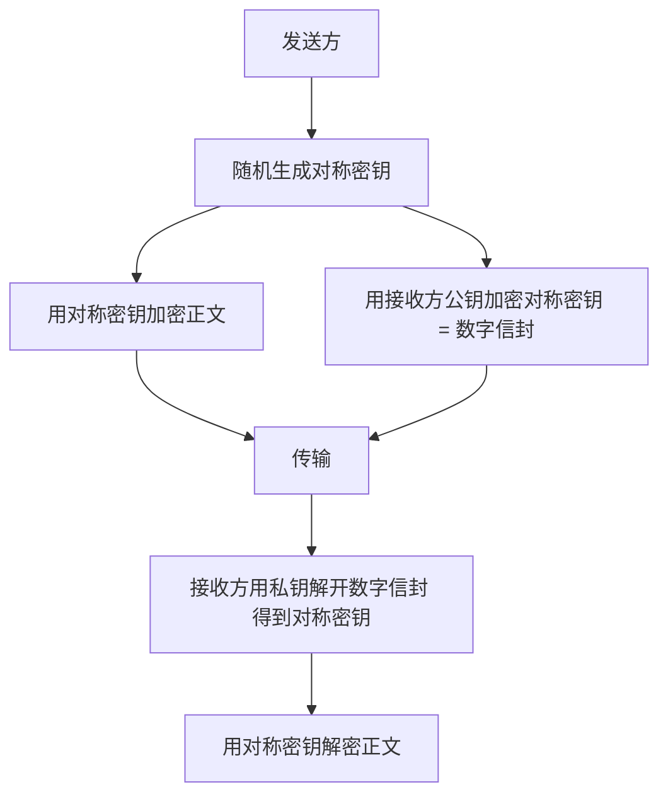
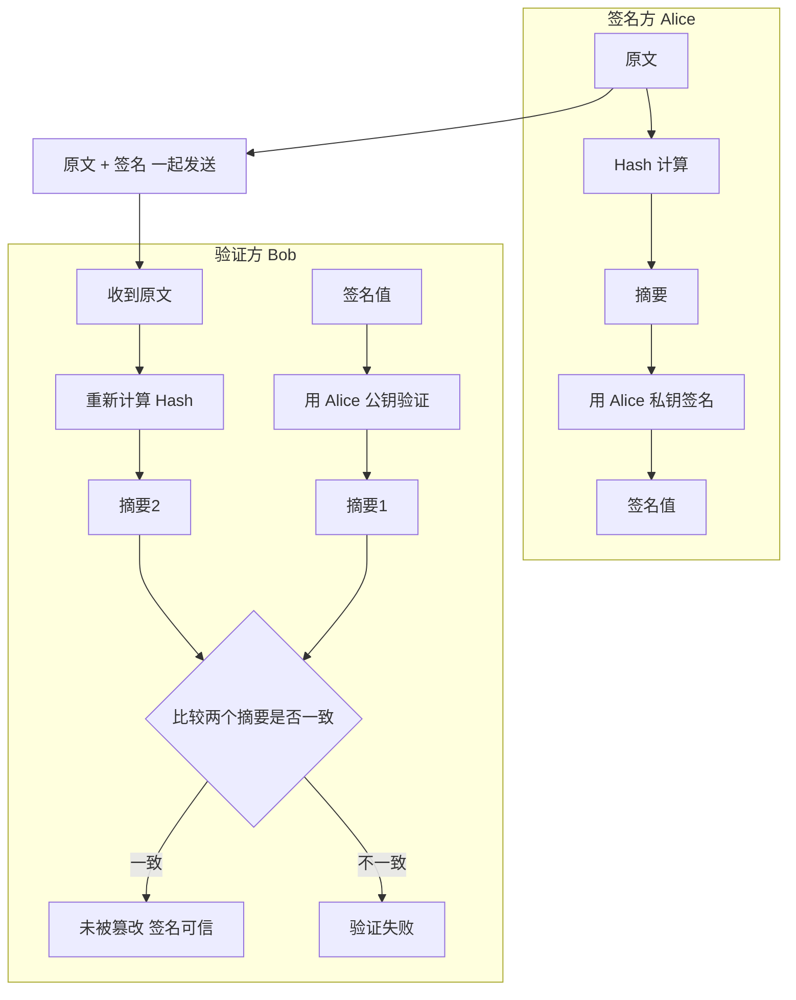
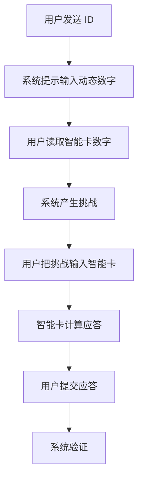
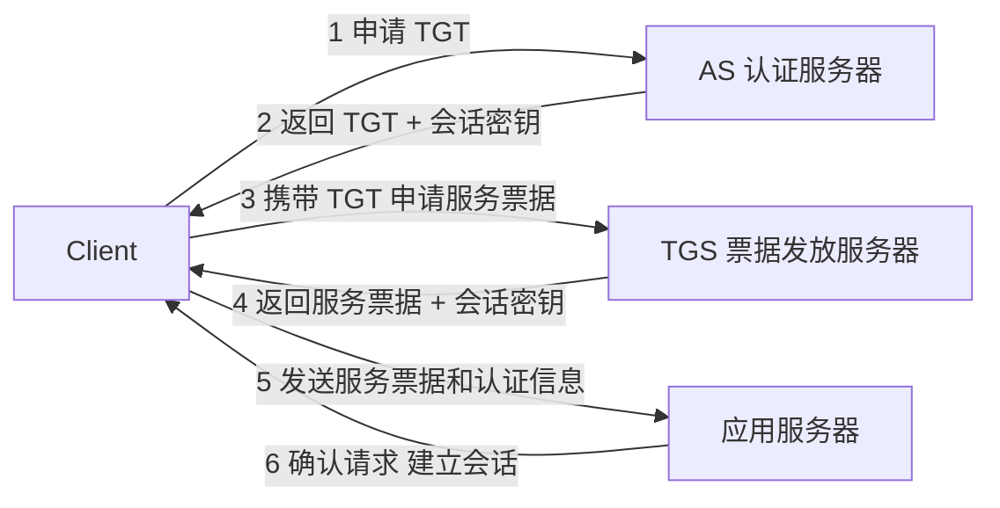
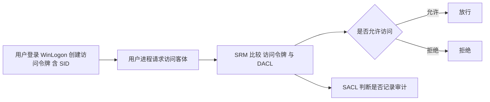
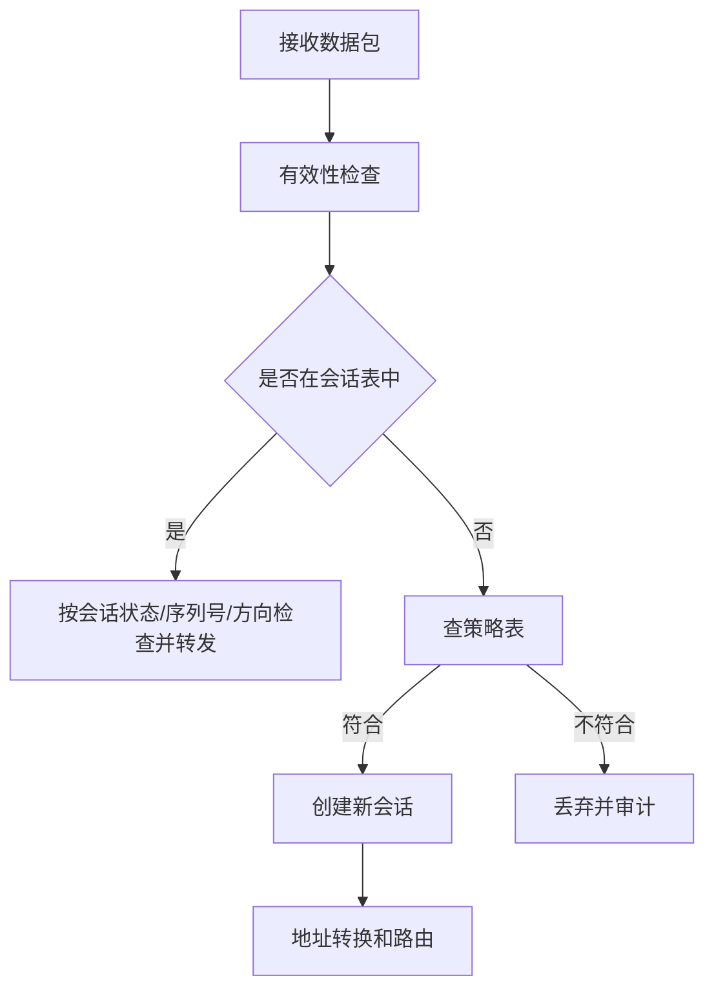
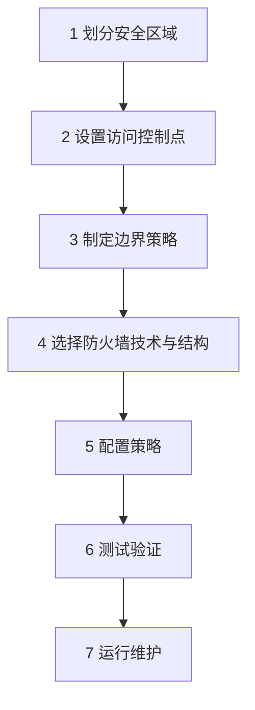
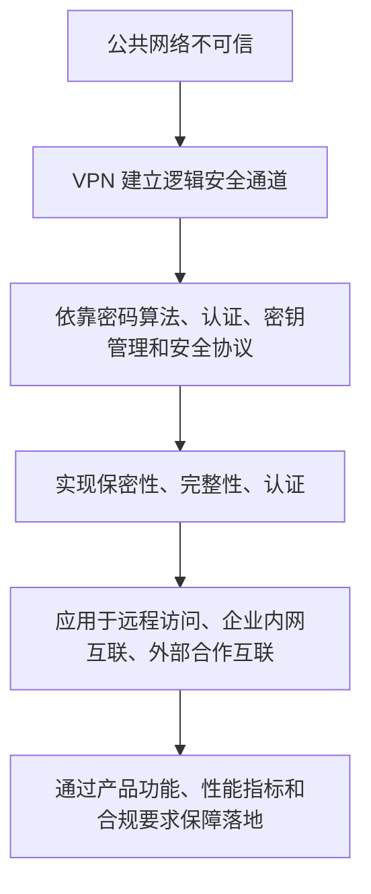
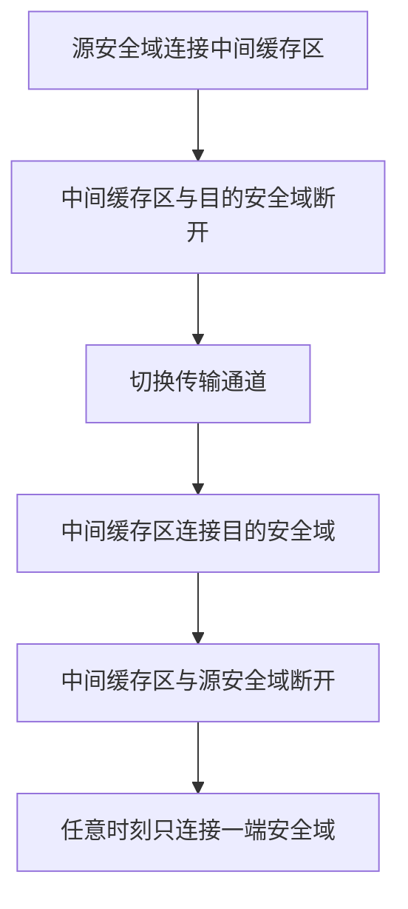

# 三色笔记（第 8 / 11 卷）

[⬅ 上一卷](07_%E5%AE%98%E6%96%B9%E6%95%99%E6%9D%90.md)　·　[📚 总目录](README.md)　·　[下一卷 ➡](09_%E4%B8%89%E8%89%B2%E7%AC%94%E8%AE%B0.md)

**本卷内容**：第 1 部分

> [!NOTE]
> 单文件体积超出 GitHub 渲染上限会导致整页不显示，故全文拆卷。**总目录、材料覆盖表与自检清单见 [README.md](README.md)**。

## 📑 本卷目录

- [📙 三、《2026 软考中级信息安全工程师 三色笔记》考点全解 · 第 1 部分](#-三2026-软考中级信息安全工程师-三色笔记考点全解--第-1-部分)
  - [2026 软考中级《信息安全工程师》三色笔记 · 整理版（Part 01：第 1—12 章）](#2026-软考中级信息安全工程师三色笔记--整理版part-01第-112-章)
    - [第一章 网络信息安全概述](#第一章-网络信息安全概述)
    - [第二章 网络攻击原理与常用方法](#第二章-网络攻击原理与常用方法)
    - [第三章 密码学基本理论](#第三章-密码学基本理论)
    - [第四章 网络安全体系与网络安全模型](#第四章-网络安全体系与网络安全模型)
    - [第五章 物理与环境安全技术](#第五章-物理与环境安全技术)
    - [第六章 认证技术原理与应用](#第六章-认证技术原理与应用)
    - [第七章 访问控制技术原理与应用](#第七章-访问控制技术原理与应用)
    - [第八章 防火墙技术原理与应用](#第八章-防火墙技术原理与应用)
    - [第九章 VPN 技术原理与应用](#第九章-vpn-技术原理与应用)
    - [第十章 入侵检测技术原理与应用](#第十章-入侵检测技术原理与应用)
    - [第十一章 网络物理隔离技术原理与应用](#第十一章-网络物理隔离技术原理与应用)
    - [第十二章 网络安全审计技术原理与应用](#第十二章-网络安全审计技术原理与应用)
    - [⚠️ 疑点（原文疑似错误 / 提取乱码，原样保留并说明）](#-疑点原文疑似错误--提取乱码原样保留并说明)

---

## 📙 三、《2026 软考中级信息安全工程师 三色笔记》考点全解 · 第 1 部分

### 2026 软考中级《信息安全工程师》三色笔记 · 整理版（Part 01：第 1—12 章）

> 来源：`2026软考中级《信息安全工程师》三色笔记.pdf`（共 **194** 页，本册覆盖第 1—70 页）
> 整理原则：**完整保留全部考点**，仅剔除页眉页脚/水印广告类噪音；原文疑似错误一律**原样保留**，统一汇总在文末「⚠️ 疑点」小节。
> 本册共整理 **179** 个编号考点（第一章 15、第二章 17、第三章 15、第四章 22、第五章 21、第六章 12、第七章 20、第八章 16、第九章 21、第十章 11、第十二章 9；第十一章原文未使用「考点N」编号），另含第五章「物理环境安全防护九项」、第九章「案例题高分答题模板 ×3」、第十一章「隔离机制与实现技术 ×11」等无编号小节。

---

#### 第一章 网络信息安全概述

##### 📌 本章备考口径校核（一、）

| 项目 | 内容 |
| --- | --- |
| 大纲比对结论 | 本章属于软考中级信息安全工程师的基础章，主要对应"网络安全基础知识、网络安全管理、网络安全法律法规、等级保护、密码与安全技术支撑"等基础范围，**未超出考试大纲** |
| 2026 趋势 | 客观题仍会考概念辨析；案例题更可能把**等保、数据安全、个人信息保护、关键信息基础设施、供应链安全、AI 安全风险**与传统安全属性、风险管理流程结合考查 |
| 重要修正 | 修正后的《网络安全法》已将**人工智能安全与发展**纳入网络安全法律体系，备考时不宜只停留在传统"病毒、防火墙、漏洞"层面 |

##### 🧭 本章知识主线（二、）

> [!TIP]
> 记忆时不要按章节死背，而要形成 **"对象—威胁—脆弱性—风险—措施—合规"** 的闭环。

##### 三、核心考点整理

---

##### 考点1：网络信息安全的概念与演变

网络信息安全的发展经历了**通信保密、计算机安全、信息保障、可信计算**等阶段。

- **狭义上**：强调网络信息系统的组成要素满足安全属性要求。
- **广义上**：已扩展为涉及**国家安全、经济安全、社会安全、生产安全、人身安全**的大安全问题。

教材明确指出：**网络安全**是通过必要措施防范**攻击、侵入、干扰、破坏、非法使用和意外事故**，使网络**稳定可靠运行**，并保障网络数据**完整性、保密性、可用性**的能力。

###### 🎯 真题对应

> 常以单选题考"网络安全定义""网络安全不是单纯技术问题"，多选题考"网络安全保障维度"。

> [!WARNING]
> 网络信息安全 ≠ 只保护计算机；网络安全 ≠ 只防病毒；广义网络安全已经上升到**国家安全、社会治理和数字经济安全**层面。

---

##### 考点2：网络安全重要性的五个高频关键词

教材强调，网络空间已经成为**信息传播新渠道、生产生活新空间、经济发展新引擎、社会治理新平台、国家主权新疆域**。考试不要求背长句，但要会提炼：**新空间、新平台、新引擎、新纽带、新疆域**。

###### 🔍 网络空间安全与传统安全相比的特点

| 项目 | 特点 | 考试理解 |
| --- | --- | --- |
| 要点 | 威胁高隐蔽性 | 攻击行为不易被直接发现 |
| 要点 | 技术高密集性 | 攻防依赖密码、漏洞、协议、系统等综合技术 |
| 要点 | 地理区域不可限制性 | 跨境攻击、跨域传播常见 |
| 要点 | 防护时间不可区分性 | 没有绝对"战时/平时"之分 |
| 要点 | 攻防非对称性 | 攻击成本低，防御成本高 |

###### 🎯 真题对应

> 常考"网络空间是第五疆域""没有网络安全就没有国家安全""网络安全为人民，网络安全靠人民"。

> [!WARNING]
> "地理区域不可限制性"不是说网络不受法律管辖，而是说攻击路径、攻击主体、攻击后果可能**跨地域、跨国界**。

---

##### 考点3：网络信息安全现状与十二类问题

教材将网络安全问题概括为**十二类**。备考时建议按"四组"记忆，而不是逐条硬背。

###### 🗂️ 四组记忆表

| 项目 | 分类 | 具体问题 | 记忆关键词 |
| --- | --- | --- | --- |
| 要点 | 依赖与供应链类 | 网络强依赖、供应链风险、产品同质化与技术滥用 | 依赖、受制、同质、滥用 |
| 要点 | 建设与数据类 | 建设管理不平衡、数据安全风险 | 重技术轻管理、数据失控 |
| 要点 | 攻击威胁类 | APT、恶意代码、漏洞、网络黑产、网络间谍与网络战 | 持续攻击、勒索、漏洞、DDoS、网军 |
| 要点 | 人员与运营类 | 安全意识风险、技术复杂性和运营风险 | 弱口令、U 盘摆渡、云边界模糊 |

**APT 考点**：APT 是**高级持续威胁**，常见攻击方式包括**鱼叉邮件、水坑攻击、流量劫持、中间人攻击**等，特点是**目标明确、持续潜伏、综合利用多种技术规避监测**。

###### 🎯 真题对应

> 常给出场景判断属于哪类风险：

| 项目 | 场景 | 归类 |
| --- | --- | --- |
| 判断 | "默认口令未改" | 建设与管理不足 |
| 判断 | "U 盘跨网拷贝导致感染" | 人员安全意识 / 物理隔离摆渡风险 |
| 判断 | "利用漏洞长期潜伏政府或金融系统" | APT |
| 判断 | "云平台边界模糊、补丁维护困难" | 云计算运营安全风险 |

> [!WARNING]
> 恶意代码风险与软件漏洞风险不同。**恶意代码是攻击载体**（病毒、蠕虫、木马、勒索软件）；**漏洞是系统弱点**，是攻击切入点。

---

##### 考点4：网络信息安全基本属性

本章最核心属性是：**机密性、完整性、可用性、抗抵赖性、可控性**。教材还补充**真实性、时效性、合规性、公平性、可靠性、可生存性、隐私性**等属性。

###### 🧩 属性总表

| 项目 | 属性 | 核心含义 | 典型场景 |
| --- | --- | --- | --- |
| 要点 | 机密性 C | 防止非授权获取信息 | 口令泄露、数据窃听、敏感信息外泄 |
| 要点 | 完整性 I | 防止非授权修改、删除、伪造、插入 | 邮件被篡改、交易金额被改 |
| 要点 | 可用性 A | 合法用户能及时获得服务 | DDoS 导致网站不可访问 |
| 要点 | 抗抵赖性 | 防止行为主体否认已发生行为 | 数字签名、电子合同、电子取证 |
| 要点 | 可控性 | 责任主体能管理、支配和控制系统行为 | 授权规则、访问控制、集中管理 |
| 要点 | 真实性 | 信息符合客观事实 | 谣言、伪造身份 |
| 要点 | 时效性 | 信息或服务满足时间约束 | 实时控制、智能驾驶 |
| 要点 | 合规性 | 符合法律法规、政策、标准 | 内容审核、数据合规 |
| 要点 | 可生存性 | 受损后仍保留必要服务 | 灾备、降级运行 |
| 要点 | 隐私性 | 个人敏感信息不被非法公开 | 身份证号、住址、疾病状况 |

**公式速记**：

> **CIA = Confidentiality + Integrity + Availability = 机密性 + 完整性 + 可用性**

###### 🎯 真题对应

| 项目 | 题干关键词 | 对应属性 |
| --- | --- | --- |
| 判断 | "防止泄露" | 多对应机密性 |
| 判断 | "防止篡改" | 多对应完整性 |
| 判断 | "防止拒绝服务" | 多对应可用性 |
| 判断 | "防止否认交易" | 多对应抗抵赖性 |
| 判断 | "管理者按授权规则掌握系统" | 多对应可控性 |

> [!WARNING]
> 数字签名常同时涉及**完整性、身份鉴别和抗抵赖**，但题目若强调"事后不能否认"，优先选**抗抵赖性**。

---

##### 考点5：网络信息安全目标与功能

网络安全目标分为**宏观目标**和**微观目标**。宏观目标服务于国家安全、网络主权、网络强国建设；微观目标则是保护具体网络、系统、数据和业务，使其满足安全属性并持续运行。教材将网络安全基本功能概括为**防御、监测、应急、恢复**四类。

###### ⚙️ 四大基本功能

| 项目 | 功能 | 关键词 | 考试判断 |
| --- | --- | --- | --- |
| 要点 | 防御 | 阻止、抵御已知威胁 | 防火墙、访问控制、加固 |
| 要点 | 监测 | 检测、发现已知或未知威胁 | IDS、日志审计、态势感知 |
| 要点 | 应急 | 响应和处置突发事件 | 应急预案、封堵、取证 |
| 要点 | 恢复 | 恢复系统运行 | 备份恢复、灾难恢复、业务连续性 |

###### 🎯 真题对应

> 常考流程排序：**先监测发现 → 再应急处置 → 最后恢复运行**；防御不等于监测，应急不等于恢复。

> [!WARNING]
> "发现攻击"是**监测**；"阻断攻击"偏**防御或应急**；"系统恢复上线"是**恢复**；"制定预案并响应事件"是**应急**。

---

##### 考点6：网络信息安全基本技术需求

教材列出**九项**基本技术需求：物理环境安全、认证、访问控制、安全保密、漏洞扫描、恶意代码防护、内容安全、监测与预警、应急响应。

###### 🛠️ 九项技术需求

| 项目 | 技术需求 | 核心作用 | 高频例子 |
| --- | --- | --- | --- |
| 要点 | 物理环境安全 | 保障硬件、环境、介质安全 | 机房、设备、存储介质 |
| 要点 | 安全认证 | 识别访问者真实身份 | 口令、证书、多因素认证 |
| 要点 | 访问控制 | 限制非法访问和越权访问 | 防火墙、ACL、权限控制 |
| 要点 | 安全保密 | 防止信息泄露 | 加密、DLP、物理隔离 |
| 要点 | 漏洞扫描 | 发现系统弱点 | 扫描器、漏洞报告、补丁管理 |
| 要点 | 恶意代码防护 | 防病毒、木马、蠕虫、勒索 | 杀毒、EDR、隔离 |
| 要点 | 内容安全 | 防不良信息和垃圾信息传播 | URL 过滤、垃圾邮件过滤 |
| 要点 | 监测与预警 | 发现入侵和安全措施失效 | IDS、SOC、态势感知 |
| 要点 | 应急响应 | 事件处置、恢复、取证 | 应急预案、电子取证 |

###### 🎯 真题对应

> 题干出现"防止用户假冒身份"→**认证**；"合法用户越权访问"→**访问控制**；"敏感数据外泄"→**加密 / DLP / 隔离**；"定期发现系统漏洞"→**漏洞扫描**。

> [!IMPORTANT]
> 认证解决"**你是谁**"；访问控制解决"**你能做什么**"；审计解决"**你做过什么**"；加密主要解决"**别人看不懂**"。

---

##### 考点7：网络信息安全管理内容与方法

网络信息安全管理不是单一技术工作，而是围绕**网络资产**采取适当措施，保障运行安全和信息安全。教材把管理内容概括为**概念、方法、依据、要素、流程、工具、评估**等方面。

常见管理方法包括：**风险管理、等级保护、纵深防御、层次化保护、应急响应、PDCA 方法**。

###### 🔄 PDCA 速记

| 项目 | 字母 | 含义 |
| --- | --- | --- |
| 要点 | **P** | Plan 计划 |
| 要点 | **D** | Do 实施 |
| 要点 | **C** | Check 检查 |
| 要点 | **A** | Act 改进 |

###### 🎯 真题对应

> 常考"网络安全管理重在过程"，不是一次建设完成后就结束。安全管理要贯穿网络信息系统**生命周期**。

> [!WARNING]
> "重技术、轻管理；重建设、轻运营；重硬件、轻软件"是**典型错误认识**。考试中出现这种表述，通常是反面选项。

---

##### 考点8：网络安全管理五要素与风险公式

教材将网络安全管理要素概括为：**管理对象、威胁、脆弱性、风险、保护措施**。网络安全管理实质上就是**风险控制**。

###### 🔗 风险形成逻辑

**公式速记**：

> **网络风险 = 威胁发生的概率 × 造成的影响**

###### 🧱 五要素表

| 项目 | 要素 | 含义 | 例子 |
| --- | --- | --- | --- |
| 要点 | 管理对象 | 有价值、需保护的资产 | 硬件、软件、账号口令、拓扑图、服务质量 |
| 要点 | 威胁 | 可能造成损害的因素 | 黑客、内部人员、自然灾害、恶意代码 |
| 要点 | 脆弱性 | 可被利用的弱点 | 弱口令、未打补丁、配置错误 |
| 要点 | 风险 | 价值受损的可能性和影响 | 数据泄露、系统瘫痪 |
| 要点 | 保护措施 | 降低风险的控制手段 | 访问控制、加密、审计、备份、应急响应 |

**风险控制方法**：避免风险、转移风险、减少威胁、消除脆弱点、减少影响、风险监测。

###### 🎯 真题对应

| 项目 | 措施 | 对应风险控制方法 |
| --- | --- | --- |
| 判断 | 购买保险或安全外包 | 转移风险 |
| 判断 | 打补丁 | 消除脆弱点 |
| 判断 | 安装防病毒软件 | 减少威胁 |
| 判断 | 多线路备份、应急预案 | 减少影响 |
| 判断 | 物理隔离内外网 | 避免风险 |

> [!WARNING]
> "安装防火墙"不是消除风险，只是降低风险；"风险管理"不是把风险降为零，而是控制在**可接受范围**。

---

##### 考点9：网络信息安全管理流程

教材给出的管理流程可以压缩为**八步**：

1. 确定管理对象
2. 评估对象价值
3. 识别威胁
4. 识别脆弱性
5. 确定风险级别
6. 制定防范体系和措施
7. 实施并落实防范措施
8. 运行、维护安全设备和配置

**口诀**：

> 定对象 → 估价值 → 找威胁 → 查弱点 → 定风险 → 订措施 → 去实施 → 常运维

###### 🎯 真题对应

> 流程排序题、案例补充题高频。尤其注意：应**先识别对象和价值**，再谈威胁、脆弱性和措施。

> [!WARNING]
> 不能先买设备再做风险评估。正确逻辑是**先定对象、定风险，再选措施**。

---

##### 考点10：生命周期中的安全管理

教材强调安全管理应贯穿系统全生命周期，包括**规划、设计、集成实现、运行维护、废弃**五个阶段。

###### 🔁 五阶段管理重点

| 项目 | 阶段 | 安全管理重点 |
| --- | --- | --- |
| 要点 | 规划 | 风险评估、确定安全目标和需求 |
| 要点 | 设计 | 选择控制方法、设计安全体系结构 |
| 要点 | 集成实现 | 部署安全设备、激活安全特性、验证需求 |
| 要点 | 运行维护 | 建立组织制度、定期评估、调整配置、修补漏洞、监测应急 |
| 要点 | 废弃 | 风险评估、安全处置、组件安全更新或销毁 |

###### 🎯 真题对应

> 常考"安全不是上线后补做"，而是从**规划设计阶段**就纳入。

> [!WARNING]
> 废弃阶段也有安全风险，如**硬盘、日志、备份介质、账号、密钥**未处理导致泄密。

---

##### 考点11：管理工具与评估

常见工具包括：**SOC、IT 资产管理系统、网络安全态势感知系统、漏洞扫描器、协议分析器、上网行为管理**等。
常见评估包括：**等级保护测评、ISMS 信息安全管理体系认证、SSE-CMM 系统安全工程能力成熟度模型**。

###### 🎯 真题对应

| 项目 | 对象 | 偏向 |
| --- | --- | --- |
| 判断 | SOC | 偏安全运营与集中监控 |
| 判断 | 漏洞扫描器 | 偏发现弱点 |
| 判断 | ISMS | 偏管理体系 |
| 判断 | 等保测评 | 偏按等级保护要求进行测评 |
| 判断 | SSE-CMM | 偏安全工程能力成熟度 |

> [!WARNING]
> **等保测评 ≠ ISMS 认证**。前者按等级保护要求测评系统，后者按管理体系标准评价组织的信息安全管理能力。

---

##### 考点12：网络信息安全法律与政策制度

教材第一章法规制度部分包括网络安全法律、等级保护、密码管理、网络产品和服务审查、互联网域名安全管理、工业控制信息安全、个人信息和重要数据保护等内容。

###### 📜 2026 应掌握口径

| 项目 | 制度 | 2026 应掌握口径 |
| --- | --- | --- |
| 要点 | 网络安全法 | **2016 通过、2017 施行，2025 修正，2026 年 1 月 1 日起施行** |
| 要点 | 数据安全法 | 建立数据分类分级、重要数据保护、数据安全审查等制度 |
| 要点 | 个人信息保护法 | 个人信息处理应遵循**合法、正当、必要和诚信**等原则 |
| 要点 | 关键信息基础设施保护 | 重点保护**公共通信、能源、交通、水利、金融、公共服务、电子政务**等重要行业领域重要网络设施和信息系统 |
| 要点 | 网络安全审查 | 关注关键信息基础设施**供应链安全**、网络平台数据处理活动影响国家安全等情形 |
| 要点 | 密码管理 | 《密码法》与 **2023 修订**《商用密码管理条例》共同构成商用密码应用与管理的重要依据 |
| 要点 | 等级保护 | 仍按"**定级、备案、建设整改、等级测评、运行维护**"理解 |

补充：**《关键信息基础设施安全保护条例》**明确了关键信息基础设施的范围，并自 **2021 年 9 月 1 日**起施行；**《网络安全审查办法》**自 **2022 年 2 月 15 日**起施行，并将影响或可能影响国家安全的数据处理活动纳入审查范围；**《商用密码管理条例》**已于 2023 年修订，自 **2023 年 7 月 1 日**起施行。

> [!WARNING]
> 教材表格中部分密码管理文件为旧口径，2026 答题若涉及《商用密码管理条例》，应优先按 **2023 年修订后的现行条例**表达。

---

##### 考点13：等级保护制度

等级保护是本章与后续安全管理、系统保护、安全测评连接最紧密的制度。教材将等级保护相关工作理解为：**定级、备案、建设整改、等级测评、运行维护**，并列出等级保护基本要求、设计技术要求、实施指南、测评过程指南、测评要求等标准规范。

**口诀**：

> 定 — 备 — 建 — 测 — 运

###### 🎯 真题对应

| 项目 | 题干 | 对应环节 |
| --- | --- | --- |
| 判断 | 系统按等级保护要求确定安全保护等级 | 定级 |
| 判断 | 向公安机关办理材料 | 备案 |
| 判断 | 按等级要求建设安全技术和管理体系 | 建设整改 |
| 判断 | 测评机构依据等级要求出具测评结论 | 等级测评 |
| 判断 | 持续监督、配置更新、风险处置 | 运行维护 |

> [!WARNING]
> 等级保护不是"买一套设备"，而是**技术措施和管理措施结合的制度化工程**。

---

##### 考点14：工业控制安全、个人信息与重要数据保护

工业控制系统涉及**电力、能源、交通、制造**等关键领域，一旦被攻击，后果可能从信息泄露扩大为**生产中断、设备损坏甚至人身安全事故**。教材列举了工控安全相关政策文件和标准规范，说明工控安全是本章法规制度中的重点之一。

个人信息和重要数据保护在 2026 备考中权重上升：

- 处理个人信息时，应结合《个人信息保护法》理解**合法、正当、必要、告知同意、最小必要、个人权利保护**等要求；
- 涉及重要数据时，应结合《数据安全法》理解**分类分级、风险监测、应急处置、数据安全审查**等制度。

###### 🎯 真题对应

| 项目 | 场景 | 归类 |
| --- | --- | --- |
| 判断 | 工控系统被攻击导致停电、停产 | 工控安全 / 关键信息基础设施安全 |
| 判断 | 泄露身份证号、住址、电话、病历 | 个人信息保护 |
| 判断 | 影响国家安全、国民经济命脉、重大公共利益的数据 | 重要数据保护 |

> [!WARNING]
> 个人信息保护不等于只保护"隐私"。**个人信息范围更广**，隐私只是其中敏感性较高的一类场景。

---

##### 考点15：网络安全科技信息获取与术语

教材最后强调，网络安全学习不能只看教材，还要关注**会议、期刊、网站和术语**。国际会议、期刊、CERT、OWASP、Black Hat 等都是常见信息来源；术语可分为**基础技术、风险评估、防护、检测、响应/恢复、测评技术**等类别。

###### 🔤 高频术语

| 项目 | 类型 | 高频术语 |
| --- | --- | --- |
| 要点 | 基础技术类 | encryption、decryption、public key、asymmetric cryptographic algorithm |
| 要点 | 防护技术类 | Access Control、Firewall、Intrusion Prevention System |
| 要点 | 检测技术类 | Intrusion Detection、Vulnerability Scanning |
| 要点 | 响应/恢复类 | Emergency Response、Disaster Recovery、Backup |
| 要点 | 测评技术类 | Black Box Testing、White Box Testing、Gray Box Testing、Penetration Testing、Fuzz Testing |

> [!WARNING]
> **IDS 是入侵检测，IPS 是入侵防御**；漏洞扫描是发现弱点，渗透测试是模拟攻击验证风险。

---

##### 📋 四、本章高频速记表

| 项目 | 高频考点 | 必背关键词 |
| --- | --- | --- |
| 要点 | 网络安全定义 | 攻击、侵入、干扰、破坏、非法使用、意外事故；稳定可靠运行；数据完整性、保密性、可用性 |
| 要点 | 安全属性 | CIA + 抗抵赖 + 可控 |
| 要点 | 基本功能 | 防御、监测、应急、恢复 |
| 要点 | 技术需求 | 物理、认证、访问控制、保密、漏洞扫描、恶意代码、内容安全、监测预警、应急响应 |
| 要点 | 管理方法 | 风险管理、等级保护、纵深防御、层次化保护、应急响应、PDCA |
| 要点 | 管理要素 | 对象、威胁、脆弱性、风险、保护措施 |
| 要点 | 风险公式 | 风险 = 威胁发生概率 × 影响 |
| 要点 | 管理流程 | 定对象、估价值、识威胁、识脆弱性、定风险、订措施、实施、运维 |
| 要点 | 等保流程 | 定级、备案、建设整改、等级测评、运行维护 |
| 要点 | 2026 法规趋势 | 网络安全法修正、数据安全、个人信息保护、关基保护、密码合规、AI 安全 |

---

#### 第二章 网络攻击原理与常用方法

##### 📌 一、本章考试定位与大纲比对结论

本章属于软考中级信息安全工程师的**核心基础章**，主要对应大纲中的网络攻击原理、网络安全威胁、漏洞利用、恶意代码、防护与应急、网络安全管理与综合应用等范围。内容**不属于偏门扩展**：

- **客观题**：可直接考概念、模型、攻击类型、工具分类；
- **案例题**：常把本章内容与**等级保护、漏洞管理、日志审计、应急响应、关键信息基础设施保护、数据安全与个人信息保护**结合考查。

##### 🧭 二、本章知识主线

> 攻击者 → 攻击工具 → 攻击访问 → 攻击效果 → 攻击意图 → 攻击过程 → 攻击技术 → 工具与案例 → 防御与合规

备考时不要孤立背"端口扫描、口令破解、SQL 注入、DDoS"，而要形成闭环：

##### ⚡ 三、核心速记框架

| 项目 | 速记项 | 记忆口径 | 考试价值 |
| --- | --- | --- | --- |
| 要点 | 攻击五要素 | 攻击者、攻击工具、攻击访问、攻击效果、攻击意图 | 常考表格型多选 |
| 要点 | 四类危害行为 | 信息泄露、完整性破坏、拒绝服务、非法使用 | 常考概念辨析 |
| 要点 | 攻击过程八步 | 藏、搜、挖、权、隐、打、门、清 | 案例分析高频 |
| 要点 | Kill Chain 七阶段 | 侦察、武器构造、投送、利用、植入、C2、目标行动 | 趋势型客观题 |
| 要点 | ATT&CK 核心 | 初始访问、执行、持久化、提权、防御规避、凭据访问、发现、横向移动、收集、C2、外泄、影响 | 红蓝对抗、威胁情报题 |
| 要点 | 防御闭环 | 资产梳理、漏洞修复、访问控制、日志监测、备份恢复、应急响应 | 案例题答题模板 |

---

##### 考点1：网络攻击概念

网络攻击是指**损害网络系统安全属性的危害行为**，会破坏系统的**机密性、完整性、可用性、可控性、真实性、抗抵赖性**等安全目标。教材将常见危害行为归纳为四类：**信息泄露攻击、完整性破坏攻击、拒绝服务攻击、非法使用攻击**。考试中最常见的考法是把攻击行为与安全属性对应起来。

###### 🎯 四类危害行为

| 项目 | 攻击类型 | 破坏重点 | 典型场景 |
| --- | --- | --- | --- |
| 要点 | 信息泄露攻击 | 机密性 | 监听账号口令、窃取数据库、泄露个人信息 |
| 要点 | 完整性破坏攻击 | 完整性 | 篡改网页、修改交易记录、植入恶意数据 |
| 要点 | 拒绝服务攻击 | 可用性 | DDoS、SYN Flood、资源耗尽 |
| 要点 | 非法使用攻击 | 可控性、授权边界 | 冒用账号、未授权调用服务、跳板攻击 |

> 常以单选题考"某攻击破坏了哪一安全属性"，以多选题考"网络攻击可能造成哪些安全属性受损"。

> [!WARNING]
> 信息泄露不等于完整性破坏；**DDoS 主要破坏可用性**，不是以窃取数据为主要目的；非法使用强调"未授权使用资源或服务"，不一定直接删除或篡改数据。

---

##### 考点2：攻击者、攻击工具、攻击效果与攻击意图

教材把攻击者按来源分为**内部人员、外部人员**；按动机常见可分为**黑客、间谍、恐怖主义者、公司职员、职业犯罪分子、破坏者**。考试更关注"**动机—行为—效果**"的对应关系，而不是背具体人物。

###### 🧩 五要素表

| 项目 | 要素 | 重点内容 | 记忆方法 |
| --- | --- | --- | --- |
| 要点 | 攻击者 | 内部人员、外部人员；黑客、间谍、犯罪分子等 | 看来源与动机 |
| 要点 | 攻击工具 | 用户命令、脚本或程序、自治主体、电磁泄漏 | 工具从手工到自动化 |
| 要点 | 攻击访问 | 本地访问、远程访问；合法访问、非法访问 | 核心是未授权访问或滥用授权 |
| 要点 | 攻击效果 | 破坏信息、信息泄密、窃取服务、拒绝服务 | 对应安全属性 |
| 要点 | 攻击意图 | 挑战、好奇、情报、经济利益、恐怖事件、报复 | 题目常考匹配 |

> 多选题常问"攻击效果包括哪些"，单选题常问"职业犯罪分子的主要动机"。

> [!WARNING]
> "攻击访问"不一定都是远程访问，内部人员可能利用**本地权限**；"攻击工具"也不一定是专用黑客软件，用户命令、脚本、配置错误利用都可能成为攻击工具。

---

##### 考点3：网络攻击模型

###### 1. 攻击树模型

攻击树模型用 **AND-OR 树结构**描述攻击目标和子目标。**OR** 表示多条路径任选其一即可达成目标，**AND** 表示多个条件必须同时满足。它适合做**威胁建模、渗透测试规划、防御方案分析**。

| 项目 | 维度 | 内容 |
| --- | --- | --- |
| 优点 | 优势 | 能融入专家经验，适合复杂场景建模，可进行概率分析或成本效益分析 |
| 缺点 | 局限 | 不擅长表达循环事件、时间依赖、多重尝试攻击、复杂访问控制，大规模网络中会变得复杂 |

> 常考"攻击树采用什么结构""攻击树适合做什么"。

> [!WARNING]
> 攻击树不是网络拓扑图，也不是漏洞扫描结果表；它强调"**达到攻击目标的路径分解**"。

###### 2. MITRE ATT&CK 模型

ATT&CK 模型来自**真实攻击行为抽象**，按攻击战术与技术组织知识库。教材列出的主要战术包括：**初始访问、执行、持久化、特权提升、防御规避、凭据访问、发现、横向移动、收集、指挥和控制、外泄、影响**。它的考试价值在于把传统攻击步骤升级为"**红蓝对抗、威胁情报、差距评估、渗透测试**"的分析框架。

> 趋势题可能考 ATT&CK 的应用场景，如**红蓝对抗模拟、网络防御差距评估、威胁情报收集**。

> [!WARNING]
> ATT&CK 不是单一攻击流程，而是**攻击行为知识库**；不要把它简单等同于 Kill Chain。

###### 3. 网络杀伤链模型（Kill Chain）

Kill Chain 把攻击过程分为**七阶段**：

> 目标侦察 → 武器构造 → 载荷投送 → 漏洞利用 → 安装植入 → 指挥与控制 → 目标行动

| 项目 | 阶段 | 考试理解 |
| --- | --- | --- |
| 要点 | 目标侦察 | 收集邮箱、组织结构、系统版本、公开信息 |
| 要点 | 武器构造 | 将恶意代码、漏洞利用、诱饵文档组合成攻击载荷 |
| 要点 | 载荷投送 | 邮件附件、网站、U 盘等投送方式 |
| 要点 | 漏洞利用 | 触发系统、应用或配置漏洞 |
| 要点 | 安装植入 | 安装木马、后门、持久化组件 |
| 要点 | 指挥与控制 | 建立 C2 通道，远程控制 |
| 要点 | 目标行动 | 窃取数据、破坏系统、横向扩展、加密勒索等 |

> 案例题常给出"钓鱼邮件—木马执行—建立远控—窃取数据"的描述，要求判断阶段或补充防护措施。

> [!WARNING]
> "载荷投送"不等于"漏洞利用"；"安装植入"不等于"指挥控制"；"**目标行动**"才是最终攻击目的。

---

##### 考点4：网络攻击发展趋势

教材归纳的趋势可以压缩为**八个关键词**：**自动化、普适化、多样化、资源化、持续化、快速化、扩大化、组织化**。

| 项目 | 趋势 | 备考解释 |
| --- | --- | --- |
| 要点 | 工具智能化、自动化 | 攻击工具集成信息搜集、漏洞利用、传播扩散等功能 |
| 要点 | 攻击者群体普适化 | 非专业人员借助工具也可发起攻击 |
| 要点 | 目标多样化和隐蔽性增强 | 从操作系统扩展到协议、DNS、路由、应用、安全设备、物理空间 |
| 要点 | 计算资源获取方便 | 僵尸网络、云计算、GPU 等提升攻击能力 |
| 要点 | 攻击活动持续性强化 | APT 长期潜伏，持续针对特定行业或机构 |
| 要点 | 攻击速度加快 | 漏洞公开后利用窗口缩短，防御被动性增强 |
| 要点 | 攻击影响扩大 | 从网络空间扩展到物理空间和社会空间 |
| 要点 | 攻击主体组织化 | 利益集团、犯罪团伙、甚至国家级力量参与 |

2026 趋势上，案例题更容易围绕 **APT、供应链攻击、关键信息基础设施、能源交通金融等重要行业、数据泄露、勒索攻击、AI 辅助攻击与 AI 安全治理**展开。修正后的《网络安全法》已增加**支持人工智能关键技术研发、风险监测评估和安全监管**，以及**运用人工智能等新技术提升网络安全保护水平**的内容，因此备考时不能只停留在传统病毒和防火墙层面。

> [!WARNING]
> APT 的核心不是"攻击一次很强"，而是**长期性、隐蔽性、针对性、组织化**；DDoS 的核心不是"入侵成功"，而是通过**资源消耗**使服务不可用。

---

##### 考点5：网络攻击一般过程

教材将网络攻击一般过程归纳为**八步**：**隐藏攻击源、收集目标信息、挖掘漏洞信息、获取目标访问权限、隐蔽攻击行为、实施攻击、开辟后门、清除攻击痕迹**。

**速记口诀**：

> 藏 — 搜 — 挖 — 权 — 隐 — 打 — 门 — 清

###### 🔍 攻防双视角对照表

| 项目 | 步骤 | 攻击视角 | 防御视角 |
| --- | --- | --- | --- |
| 要点 | 隐藏攻击源 | 代理、跳板、伪造身份 | 溯源分析、威胁情报、日志关联 |
| 要点 | 收集目标信息 | IP、域名、系统版本、用户信息 | 资产暴露面管理、最小公开信息 |
| 要点 | 挖掘漏洞信息 | 服务漏洞、配置漏洞、协议漏洞、用户弱点 | 漏洞扫描、补丁管理、安全基线 |
| 要点 | 获取访问权限 | 口令、漏洞、木马、窃听 | 强口令、MFA、最小权限 |
| 要点 | 隐蔽攻击行为 | 进程隐藏、日志篡改、文件隐藏 | EDR、完整性检测、日志集中管理 |
| 要点 | 实施攻击 | 窃密、篡改、停止服务、横向攻击 | 分区分域、访问控制、备份恢复 |
| 要点 | 开辟后门 | 后门、木马、隐蔽信道 | 后门排查、主机加固、基线核查 |
| 要点 | 清除痕迹 | 删除审计、干扰 IDS | 日志留存、远程日志、时间同步 |

> 案例题常要求"分析攻击过程""指出防御缺失""补充安全措施"。

> [!WARNING]
> 攻击不一定严格按八步线性发生；真实案例可能省略某些环节或多个环节并行。但考试中答题要按"**信息收集—漏洞利用—权限获取—攻击实施—痕迹清理—应急加固**"展开，逻辑更完整。

---

##### 考点6：漏洞来源与漏洞挖掘方向

教材把常见漏洞来源归纳为**五类**：

| 项目 | 漏洞类别 | 典型表现 | 防护重点 |
| --- | --- | --- | --- |
| 要点 | 系统或应用服务软件漏洞 | 远程服务、Web 服务、FTP、TFTP、邮件服务漏洞 | 补丁、服务最小化、版本管理 |
| 要点 | 主机信任关系漏洞 | 信任主机被突破后横向扩展 | 零信任、最小信任、访问控制 |
| 要点 | 使用者漏洞 | 钓鱼、弱口令、U 盘摆渡、恶意网页 | 安全培训、MFA、终端管控 |
| 要点 | 通信协议漏洞 | 明文传输、地址伪造、中间人攻击 | 加密传输、认证、协议加固 |
| 要点 | 网络业务系统漏洞 | 非实名、越权、业务逻辑缺陷 | 业务风控、权限校验、审计追踪 |

> 给出"邮件钓鱼导致员工泄密"，应归入**使用者漏洞**；给出"Telnet 明文传输口令"，应归入**通信协议漏洞**。

> [!WARNING]
> 漏洞不只存在于软件代码中，也可能存在于**配置、信任关系、业务流程和人员行为**中。

---

##### 考点7：端口扫描

端口扫描的目的是**识别目标系统开放的服务**，为后续攻击或安全评估提供依据。教材列出多种扫描方式，包括**完全连接扫描、半连接扫描、SYN 扫描、ID 头信息扫描、隐蔽扫描、SYN/ACK 扫描、FIN 扫描、ACK 扫描、NULL 扫描、XMAS 扫描**等。

###### 🔬 考试掌握层级

| 项目 | 扫描类型 | 记忆重点 |
| --- | --- | --- |
| 要点 | 完全连接扫描 | 完成 TCP 三次握手，结果可靠但容易留下痕迹 |
| 要点 | 半连接 / SYN 扫描 | 不完成完整连接，隐蔽性相对更强 |
| 要点 | FIN / NULL / XMAS 扫描 | 通过特殊标志位与返回信息判断端口状态 |
| 要点 | ACK 扫描 | 常用于判断过滤规则、防火墙状态 |
| 要点 | 隐蔽扫描 | 目标是绕过 IDS、防火墙或监控机制 |
| 要点 | ID 头信息扫描 | 借助第三方主机状态变化推断端口状态 |

> 常考"哪种扫描完成三次握手""哪种扫描只完成部分握手""扫描的目的是什么"。

> [!WARNING]
> 端口开放不等于一定存在漏洞；端口关闭也不等于系统安全。扫描结果只是**攻击面识别的起点**。

---

##### 考点8：口令破解

口令是访问控制第一道屏障。口令破解常见方式包括**弱口令猜测、字典攻击、穷举搜索、撞库攻击、远程服务口令猜测**。教材强调，**硬件算力提升会显著提高口令破解效率**。

###### 🔓 攻击方式与防护

| 项目 | 攻击方式 | 关键词 | 防护措施 |
| --- | --- | --- | --- |
| 要点 | 弱口令猜测 | 生日、电话、用户名、默认口令 | 复杂度策略、禁止默认口令 |
| 要点 | 字典攻击 | 常用词、常见变形 | 口令黑名单、登录失败限制 |
| 要点 | 穷举搜索 | 遍历可能组合 | 长口令、限速、锁定策略 |
| 要点 | 撞库攻击 | 已泄露账号密码复用 | 不同系统不同口令、MFA |
| 要点 | 明文传输窃听 | Telnet、FTP 等明文协议 | SSH、HTTPS、加密通道 |

> 常考"弱口令防护措施""撞库与暴力破解区别"。

> [!TIP]
> 复杂口令不等于绝对安全；如果存在明文传输、钓鱼、木马窃取，复杂口令也可能泄露。案例题答防护时要写：**强口令策略 + 多因素认证 + 加密传输 + 登录审计 + 异常锁定**。

---

##### 考点9：缓冲区溢出

缓冲区溢出攻击利用程序**没有正确检查输入长度**的问题，向缓冲区写入超出边界的数据，可能**覆盖返回地址或控制程序执行流程**，从而取得主机部分或全部控制权。教材配图说明了攻击代码、返回地址、局部变量空间、堆栈结构之间的关系。

###### 🧠 考试理解

> 缓冲区溢出的本质不是"数据太多"这么简单，而是：**输入边界控制失效 → 内存结构被覆盖 → 程序执行流程被劫持**。

**常见防护**：输入长度检查、安全函数、编译器保护、DEP/NX、ASLR、栈保护、补丁升级、最小权限运行。

> 常考"缓冲区溢出可能导致什么后果""属于哪类漏洞"。

> [!WARNING]
> 缓冲区溢出属于典型**软件实现缺陷**；不是配置错误，也不是拒绝服务的唯一形式。

---

##### 考点10：恶意代码

教材列出的恶意代码类型包括**计算机病毒、网络蠕虫、特洛伊木马、后门、逻辑炸弹、僵尸网络**等。

| 项目 | 类型 | 核心特征 | 易混点 |
| --- | --- | --- | --- |
| 要点 | 病毒 | 依附宿主文件传播 | 通常需要宿主 |
| 要点 | 蠕虫 | 自我复制、自主传播 | 不一定需要宿主文件 |
| 要点 | 木马 | 伪装正常程序，暗含恶意功能 | 重在欺骗安装 |
| 要点 | 后门 | 绕过正常认证，保持访问 | 常用于持续控制 |
| 要点 | 逻辑炸弹 | 满足条件后触发破坏 | 时间、事件触发 |
| 要点 | 僵尸网络 | 大量受控主机组成 | 常用于 DDoS、垃圾邮件 |

> 常考病毒、蠕虫、木马、后门的区别。

> [!IMPORTANT]
> **蠕虫**的高频关键词是**自动传播**；**木马**的高频关键词是**伪装诱骗**；**后门**的高频关键词是**绕过认证、保持控制**。

---

##### 考点11：拒绝服务与分布式拒绝服务

拒绝服务攻击的本质是使合法用户**无法及时获得服务或资源**，常见目标包括 **CPU、内存、网络带宽、连接队列、应用线程、磁盘空间**等。教材强调其本质特征是**延长服务等待时间**，当等待超过用户或系统可承受阈值时，服务就表现为不可用。

| 项目 | 类型 | 核心原理 |
| --- | --- | --- |
| 要点 | SYN Flood | 利用 TCP 连接建立过程制造大量半连接 |
| 要点 | UDP Flood | 制造大量 UDP 流量消耗带宽 |
| 要点 | Smurf 攻击 | 利用广播地址和 ICMP 放大流量 |
| 要点 | 邮件炸弹 | 大量邮件耗尽邮箱或系统资源 |
| 要点 | HashDoS | 利用算法复杂度缺陷消耗 CPU/内存 |
| 要点 | Ping of Death | 畸形超大 ICMP 包导致系统异常 |
| 要点 | Teardrop | IP 分片重组异常导致系统崩溃 |
| 要点 | DDoS | 多个被控主机协同攻击目标 |

> 常考 SYN Flood 利用三次握手缺陷，DDoS 利用僵尸网络或跳板主机集中消耗资源。

> [!WARNING]
> DoS 是**一对一或少量来源**攻击也可成立；DDoS 强调"**分布式、多来源、协同攻击**"。防护不能只靠封一个 IP，应结合**流量清洗、限速、黑洞牵引、CDN/WAF、弹性扩容、源验证、业务降级**。

---

##### 考点12：网络钓鱼、社交工程与个人信息保护

网络钓鱼通过**伪造可信机构、邮件、网站、登录页面**等方式诱骗用户提交口令、银行卡、身份证号、验证码等敏感信息。社交工程则更广，强调利用人的**信任、疏忽、权威服从心理**来获取信息或权限。教材还举到攻击者**冒充安全管理员索要口令**的场景。

2026 法规口径下，这类考点要与个人信息保护结合理解。《个人信息保护法》规定：自然人的个人信息受法律保护，任何组织、个人不得侵害自然人的个人信息权益；处理个人信息应遵循**合法、正当、必要和诚信**原则，**不得通过误导、欺诈、胁迫等方式**处理个人信息，也不得非法**收集、使用、加工、传输、买卖、提供或公开**个人信息。

> 案例题可能描述"员工点击钓鱼邮件导致账号泄露"，要求写防护措施。

> [!TIP]
> **答题模板**：安全意识培训、邮件网关过滤、反钓鱼演练、MFA、最小权限、异常登录告警、敏感操作二次确认、个人信息最小化收集、日志审计与应急处置。

> [!WARNING]
> 网络钓鱼不是单纯技术漏洞，属于"**技术手段 + 社会工程 + 个人信息非法获取**"的复合型攻击。

---

##### 考点13：网络窃听、电子监听与会话劫持

网络窃听利用**网络通信缺陷**获取他人通信内容，常见手段包括**网络嗅探、中间人攻击**。在广播式局域网、明文协议、弱认证环境下，攻击者更容易捕获账号口令和敏感数据。电子监听则强调通过设备**远距离监视电磁泄漏**。会话劫持是攻击者在**合法用户认证后接管会话**，从而使用合法用户权限。

| 项目 | 攻击方式 | 关键词 | 防护措施 |
| --- | --- | --- | --- |
| 要点 | 网络窃听 | 嗅探、明文传输、中间人 | 加密传输、交换网络、证书校验 |
| 要点 | 电子监听 | 电磁泄漏、远距离监视 | 电磁屏蔽、物理安全、涉密防护 |
| 要点 | 会话劫持 | 初始认证后接管会话 | HTTPS、Cookie 安全属性、会话超时、重新认证 |

> 常考"网络监听属于被动攻击还是主动攻击"。一般监听本身偏**被动攻击**；中间人篡改、会话劫持则可能转为**主动攻击**。

> [!WARNING]
> 加密可以防止内容被看懂，但**不能完全隐藏通信行为本身**；所以高安全场景还要结合**流量分析防护、访问控制和审计**。

---

##### 考点14：SQL 注入

SQL 注入发生在 **Web 应用对用户输入缺乏合法性检查**，攻击者把 SQL 语句插入**表单输入或 URL 参数**中，诱使服务器执行非预期数据库操作。教材用"**浏览器 + Web 服务器 + 数据库**"的三层架构解释其产生原因。

###### 🧮 考试理解公式

> **输入未校验 + SQL 拼接执行 + 权限控制不足 = SQL 注入风险**

**常见危害**：绕过登录、查询敏感数据、篡改数据、删除数据、提升权限、进一步控制服务器。

**防护措施**：参数化查询、预编译语句、输入校验、输出编码、最小数据库权限、错误信息隐藏、WAF、日志审计、代码安全测试。

> 案例题常给登录框、查询框、URL 参数异常，要求判断攻击类型或补充防护措施。

> [!WARNING]
> SQL 注入不是数据库本身"坏了"，而是**应用程序把不可信输入当成 SQL 代码执行**。

---

##### 考点15：漏洞扫描、代理技术与数据加密

漏洞扫描是**自动检测远程或本地主机安全漏洞**的软件技术，常见类型包括 **CGI 漏洞扫描、弱口令扫描、操作系统漏洞扫描、数据库漏洞扫描**等。代理技术在攻击视角中常被用于**隐藏真实身份或作为跳板**。数据加密在攻击视角中可能用于**隐藏攻击通信或逃避追踪**；在防御视角中，则是保护数据**机密性、完整性和传输安全**的重要技术。

###### 🔍 考试区分

| 项目 | 技术 | 攻击视角 | 防御视角 |
| --- | --- | --- | --- |
| 要点 | 漏洞扫描 | 发现可利用漏洞 | 资产检测、弱点评估、整改闭环 |
| 要点 | 代理技术 | 隐藏来源、增加溯源难度 | 代理日志、访问控制、威胁情报 |
| 要点 | 数据加密 | 隐藏恶意通信或攻击痕迹 | 保护数据、通信和备份 |

> [!TIP]
> 工具本身不必然违法，关键看**使用目的、授权范围和行为后果**。考试答题时应站在**合法安全评估、运维防护和合规管理**角度，不写攻击实施细节。

---

##### 考点16：黑客常用工具分类

教材把常用工具分为**扫描器、远程监控、密码破解、网络嗅探器、安全渗透工具箱**等。考试一般不要求深入掌握工具操作，而是**识别工具类型和用途**。

| 项目 | 工具类别 | 代表用途 | 考试记忆 |
| --- | --- | --- | --- |
| 要点 | 扫描器 | 地址扫描、端口扫描、漏洞扫描 | "黑客的眼睛" |
| 要点 | 远程监控 | 控制受害主机、形成肉鸡 | DDoS 跳板、远控木马 |
| 要点 | 密码破解 | 弱口令、字典、穷举、撞库 | 访问控制突破口 |
| 要点 | 网络嗅探器 | 捕获并分析网络数据包 | 明文协议风险 |
| 要点 | 渗透工具箱 | 漏洞验证、安全测试、攻防演练 | 合法授权下用于测试 |

> [!IMPORTANT]
> 《网络安全法》明确，任何个人和组织不得从事**非法侵入他人网络、干扰他人网络正常功能、窃取网络数据**等危害网络安全的活动；也不得提供**专门用于相关危害活动的程序、工具**，明知他人从事危害网络安全活动的，不得提供**技术支持、广告推广、支付结算**等帮助。因此备考时应把工具理解为"**安全测试与攻防认知对象**"，而不是操作指南。

---

##### 考点17：典型攻击案例

###### 1. DDoS 攻击案例

DDoS 攻击通常先控制大量存在漏洞的主机，使其成为**僵尸主机或代理攻击节点**，再由攻击者统一下发指令，对目标发起 **HTTP Flood、SYN Flood、DNS 放大**等攻击，最终造成目标服务瘫痪。教材将 DDoS 案例用于说明大型复杂攻击往往**不是一步到位**，而是经过扫描、入侵、植入、控制、集中攻击等多个阶段。

> [!TIP]
> **案例答题要点**：流量异常监测、僵尸网络识别、DDoS 清洗、弹性扩容、限速策略、源地址验证、日志保全、应急预案、业务降级。

###### 2. W32.Blaster.Worm 案例

Blaster 蠕虫利用 **DCOM RPC 漏洞**传播，感染后可导致系统不稳定、重启，并对特定目标发起拒绝服务攻击。该案例说明**漏洞未及时修补 + 蠕虫自动传播 + 后门控制 + 拒绝服务**可以形成复合型安全事件。

> [!TIP]
> **案例答题要点**：及时打补丁、关闭不必要端口、主机防护、边界过滤、恶意代码查杀、隔离感染主机、日志分析、恢复业务。

###### 3. 乌克兰停电事件

教材引用乌克兰电力系统遭攻击导致停电的事件，说明网络攻击可以从信息系统扩展到**物理空间**，影响能源、电力等关键行业。攻击过程涉及**钓鱼邮件、恶意代码、后门、远程控制、破坏主控系统、DDoS 干扰客服中心**等多个环节。

该类案例在 2026 考试中尤其容易与关键信息基础设施保护结合。《关键信息基础设施安全保护条例》明确，重点行业和领域的重要网络设施、信息系统属于关键信息基础设施，国家对其**重点保护**，要求**监测、防御、处置境内外网络安全风险和威胁**，保护其免受**攻击、侵入、干扰和破坏**。

> [!TIP]
> **案例答题要点**：专门安全管理机构、关键岗位人员管理、网络分区分域、工业控制系统隔离、白名单、备份恢复、监测预警、应急演练、供应链安全、年度检测评估、事件上报。

---

##### 📕 二十一、2026 法规统一口径补充

本章技术内容要与最新法规合规口径结合：

1. **网络安全法口径**：网络运营者应履行**等级保护义务**，采取防病毒、防攻击、防入侵、日志留存、数据备份和加密等措施；发生网络安全事件时，应立即启动应急预案、采取补救措施并按规定报告。
2. **网络数据安全口径**：《网络数据安全管理条例》自 **2025 年 1 月 1 日**起施行，明确网络数据处理者应在**等级保护基础上**加强网络数据安全防护，建立制度，采取**加密、备份、访问控制、安全认证**等措施，并对所处理网络数据安全承担**主体责任**。
3. **个人信息保护口径**：钓鱼、撞库、窃听、SQL 注入导致个人信息泄露时，要同时从**个人信息非法获取、非法提供、非法公开和处理者安全保障义务**角度分析。
4. **关键信息基础设施口径**：能源、交通、金融、电信、公共服务、电子政务等重要行业场景，不能只写一般防病毒措施，还要写**重点保护、监测预警、风险评估、应急演练、供应链审查**等。
5. **网络安全审查口径**：关键信息基础设施运营者采购网络产品和服务、网络平台运营者开展可能影响国家安全的数据处理活动，应关注**国家安全风险、供应链中断风险、核心数据、重要数据和大量个人信息被窃取、泄露、毁损、非法利用或非法出境风险**。

---

#### 第三章 密码学基本理论

##### 📌 一、2026 备考口径校核

本章属于信息安全工程师考试中的**基础高频章**，核心对应"密码学基础、密码算法、Hash 函数、数字签名、密钥管理、数字证书、CA、常见安全协议、密码技术应用"等内容。2026 年命题趋势上，单纯记概念仍然会考，但更容易把"**算法类型—安全属性—应用场景—法规合规**"组合成综合判断题。

##### 🧭 二、本章知识主线

> 密码学目标 → 密码攻击模型 → 密码体制分类 → 典型算法 → Hash 与数字签名 → 密钥与证书管理 → 安全协议 → 网络应用场景

###### 🔗 问题—技术对应关系（不要把 DES、RSA、Hash、数字签名、CA 当孤立知识点）

| 项目 | 问题 | 对应技术 | 考试关键词 |
| --- | --- | --- | --- |
| 要点 | 防止别人看懂 | 加密 | 机密性、明文、密文 |
| 要点 | 防止数据被改 | Hash、MAC、数字签名 | 完整性、摘要、校验 |
| 要点 | 确认对方是谁 | 认证、数字证书、CA | 身份真实性 |
| 要点 | 防止事后抵赖 | 数字签名 | 抗抵赖、不可否认 |
| 要点 | 安全分发密钥 | 公钥密码、DH、数字信封 | 密钥交换、混合体制 |

---

##### 考点1：密码学基本概念

密码学研究如何通过特定变换保护信息安全，目标通常包括**机密性、完整性、可用性、真实性、抗抵赖性**。教材将密码学分为**密码编码学**和**密码分析学**：前者研究如何构造密码系统保护信息，后者研究如何在不知道密钥的条件下从密文推断明文或密钥。

| 项目 | 概念 | 含义 | 考试判断 |
| --- | --- | --- | --- |
| 要点 | 明文 | 原始可读信息 | 加密前 |
| 要点 | 密文 | 加密处理后的结果 | 加密后 |
| 要点 | 加密 | 明文变密文 | 保护机密性 |
| 要点 | 解密 | 密文恢复明文 | 需要解密密钥 |
| 要点 | 加密算法 | 明文到密文的运算规则 | 通常可公开 |
| 要点 | 密钥 | 控制加解密过程的秘密参数 | 安全核心 |

> 题干问"攻击者不知道密钥但试图恢复明文"时，考的是**密码分析**；题干问"把明文变成密文"时，考的是**加密**。

> [!WARNING]
> **算法公开不等于系统不安全**。现代密码系统通常默认算法公开，安全性主要依赖**密钥安全**。

---

##### 考点2：密码安全性分析的五类攻击

教材按密码分析者掌握的信息多少，将攻击分为**五类**。难度一般从"唯密文"到"选择密文"逐步增强。

| 项目 | 攻击类型 | 攻击者掌握条件 | 高频判断 |
| --- | --- | --- | --- |
| 要点 | 唯密文攻击 | 只有一个或多个密文 | 条件最弱 |
| 要点 | 已知明文攻击 | 已知部分明文及对应密文 | 已经知道"样本对" |
| 要点 | 选择明文攻击 | 可选择明文并得到密文 | 主动构造明文 |
| 要点 | 密文验证攻击 | 可判断密文是否合法 | 只知道"合法/非法" |
| 要点 | 选择密文攻击 | 可选择密文并得到明文，挑战密文除外 | 条件最强之一 |

###### 🎯 真题对应

| 项目 | 题干 | 答案 |
| --- | --- | --- |
| 判断 | "攻击者知道若干明文—密文对" | 已知明文攻击 |
| 判断 | "攻击者能提交自己选择的明文让系统加密" | 选择明文攻击 |
| 判断 | "攻击者能提交密文并获得解密结果" | 选择密文攻击 |

> [!WARNING]
> "已知明文"不是知道全部明文；"选择明文"强调攻击者能**主动选择输入**；"选择密文"不是单纯截获密文，而是能**得到选定密文的解密结果**。

---

##### 考点3：密码体制分类

密码体制按密钥特点分为**私钥密码体制、公钥密码体制、混合密码体制**。教材第三章用图 3-1、图 3-2、图 3-3 分别说明了三类体制原理。

| 项目 | 类型 | 又称 | 密钥特点 | 优点 | 缺点 | 典型算法 |
| --- | --- | --- | --- | --- | --- | --- |
| 要点 | 私钥密码体制 | 对称密码 | 加密、解密使用同一密钥 | 速度快，适合大量数据加密 | 密钥分发难、密钥管理量大、不能天然认证来源 | DES、IDEA、AES、SM1、SM4 |
| 要点 | 公钥密码体制 | 非对称密码 | 公钥公开，私钥保密 | 密钥分发方便、支持数字签名 | 运算慢，不适合直接加密大数据 | RSA、ElGamal、ECC、SM2 |
| 要点 | 混合密码体制 | 数字信封思想 | 公钥分发对称密钥，对称密钥加密数据 | 兼顾效率与密钥分发安全 | 实现复杂度较高 | HTTPS、PGP、S/MIME |

###### 🔢 私钥密码体制的密钥数量公式

若网络中有 **n** 个用户，任意两用户之间都需要一把不同的共享密钥，则密钥总数为：

> **N = n(n−1) / 2**

> 看到"若干用户两两安全通信需要多少密钥"，优先套这个公式。

> [!WARNING]
> 这是**对称密钥体制**的密钥数量，不是公钥体制。公钥体制通常每个用户一对密钥，即**公钥、私钥各一把**。

###### 🔄 混合密码体制的流程

1. 发送方随机生成**对称密钥**；
2. 用对称密钥加密**正文**；
3. 用接收方**公钥**加密该对称密钥，形成**数字信封**；
4. 接收方用自己的**私钥**打开数字信封，得到对称密钥；
5. 再用对称密钥解密正文。

> "大量数据用什么加密、会话密钥用什么保护"——**大量数据用对称加密，会话密钥用公钥加密**。

> [!WARNING]
> 混合体制不是"同时用两个算法重复加密正文"，而是"**公钥保护密钥，对称密钥保护数据**"。

---

##### 考点4：DES、TDEA、IDEA、AES

###### 1. DES

DES 是经典**分组密码**算法，分组长度为 **64 bit**，实际密钥长度为 **56 bit**。教材说明 DES 因密钥长度不足，已不适合作为长期安全方案，后由 **AES** 取代。

| 项目 | 参数 | DES |
| --- | --- | --- |
| 要点 | 算法类型 | 对称分组密码 |
| 要点 | 分组长度 | **64 bit** |
| 要点 | 密钥长度 | **56 bit** |
| 要点 | 状态 | 已不适合长期安全使用 |
| 要点 | 易考点 | DES 不是公钥算法；DES 密钥不是 128 bit |

###### 2. TDEA / 3DES

TDEA 是三重 DES，典型机制为"**加密—解密—加密**"，即 **EDE** 结构：

> C = E_K3( D_K2( E_K1(P) ) )

解密过程相反：

> P = D_K1( E_K2( D_K3(C) ) )

> 题干出现"加密—解密—加密"一般指**三重 DES**。

> [!WARNING]
> 3DES 是 DES 的**过渡增强方案**，不是 AES。

###### 3. IDEA

IDEA 是**对称分组密码**，分组长度 **64 bit**，密钥长度 **128 bit**，曾用于 **PGP**。其设计思想强调**混合使用不同代数群上的运算**。

###### 4. AES

AES 是现代常用**对称分组密码**，来源于 **Rijndael** 算法。教材强调 AES 候选算法要求包括**公开、无密级、全球免费使用、分组长度至少 128 bit，支持 128/192/256 bit 密钥长度**。

###### 📊 对称算法对比总表

| 项目 | 算法 | 类型 | 分组长度 | 密钥长度 | 高频定位 |
| --- | --- | --- | --- | --- | --- |
| 要点 | DES | 对称分组 | **64 bit** | **56 bit** | 旧标准，不安全 |
| 要点 | IDEA | 对称分组 | **64 bit** | **128 bit** | PGP 曾用 |
| 要点 | AES | 对称分组 | **128 bit** | **128/192/256 bit** | 现行主流 |
| 要点 | SM4 | 对称分组 | **128 bit** | **128 bit** | 国产商密常用 |

---

##### 考点5：RSA 算法

RSA 是**非对称密码算法**，安全性基于**大整数因子分解困难问题**。教材给出了 RSA 的基本步骤和示例。

###### 🔑 RSA 密钥生成步骤

1. 选择两个大素数 **p、q**；
2. 计算：**n = p × q**
3. 计算欧拉函数：**φ(n) = (p−1)(q−1)**
4. 选择整数 **e**，满足：**1 < e < φ(n)，gcd(e, φ(n)) = 1**
5. 计算 **d**，使：**e·d ≡ 1 (mod φ(n))**
6. 公钥为 **(n, e)**，私钥为 **(n, d)**，其中 **p、q、d** 应保密。

###### 🧮 RSA 加密与解密公式

- 加密：**C = M^e mod n**
- 解密：**M = C^d mod n**

###### 📝 教材示例压缩记忆

给定 **p = 3, q = 17, e = 13**：

- n = 3 × 17 = **51**
- φ(n) = (3−1)(17−1) = **32**
- 因为：13 × 5 = 65 ≡ 1 (mod 32)，所以 **d = 5**
- 若明文 **M = 2**：
  - C = 2^13 mod 51 = **32**
  - M = 32^5 mod 51 = **2**

###### 🎯 真题对应

| 项目 | 提问 | 答案 |
| --- | --- | --- |
| 判断 | "RSA 安全基础是什么？" | 大整数分解困难 |
| 判断 | "RSA 公钥是什么？" | 通常是 (n, e) |
| 判断 | "RSA 私钥是什么？" | 通常是 (n, d) |
| 判断 | "用谁的公钥加密？" | 用接收方公钥 |
| 判断 | "用谁的私钥签名？" | 用发送方 / 签名者私钥 |

> [!IMPORTANT]
> 加密和签名方向不同：加密是"**接收方公钥加密、接收方私钥解密**"；签名是"**签名者私钥签名、签名者公钥验证**"。

---

##### 考点6：国产商用密码算法

教材列出的国产密码算法包括 **SM1、SM2、SM3、SM4、SM9**。2026 备考时，这部分不仅是算法分类题，还可能结合**商用密码合规、数字证书、国密改造、安全协议**考查。

| 项目 | 算法 | 类型 | 关键参数 / 作用 | 高频记忆 |
| --- | --- | --- | --- | --- |
| 要点 | SM1 | 对称分组密码 | 分组 128 bit，密钥 128 bit | 对称加密 |
| 要点 | SM2 | 椭圆曲线公钥密码 | 公钥加密、密钥交换、数字签名 | 非对称、ECC |
| 要点 | SM3 | 杂凑算法 | 输出 **256 bit** 摘要 | 国产 Hash |
| 要点 | SM4 | 对称分组密码 | 分组 128 bit，密钥 128 bit，**32 轮迭代** | 常见国产对称算法 |
| 要点 | SM9 | 标识密码算法 | 用户公钥由标识确定 | 基于身份 / 标识密码 |

###### 🎯 真题对应

| 项目 | 算法 | 定位 |
| --- | --- | --- |
| 判断 | SM2 | 公钥密码、数字签名、密钥交换 |
| 判断 | SM3 | 杂凑 / 摘要 |
| 判断 | SM4 | 对称分组加密 |
| 判断 | SM9 | 标识密码 |

> [!WARNING]
> **SM3 不是加密算法**，而是杂凑算法；**SM2 不是对称算法**；**SM4 不是 Hash 算法**。

---

##### 考点7：Hash 函数

Hash 函数又称**杂凑函数、散列函数、摘要函数**。它把**任意长度输入映射成固定长度输出**，常用于**完整性校验、数字签名、口令摘要存储**等。教材强调 Hash 函数应满足**输入任意长度、输出固定长度、容易计算、难以找到碰撞**等条件。

###### 🧩 Hash 性质

| 项目 | 性质 | 含义 | 考试关键词 |
| --- | --- | --- | --- |
| 要点 | 任意长度输入 | 文件、消息都可作为输入 | 任意长度 |
| 要点 | 固定长度输出 | 输出摘要长度固定 | 摘要、哈希值 |
| 要点 | 易计算 | 给定消息能快速算出摘要 | 高效 |
| 要点 | 抗碰撞 | 难以找到两个不同消息有相同 Hash 值 | 碰撞攻击 |
| 要点 | 单向性 | 难以由摘要反推原文 | 不可逆 |

###### 📊 常见 Hash 算法

| 项目 | 算法 | 输出长度 | 状态 / 特点 |
| --- | --- | --- | --- |
| 要点 | MD5 | **128 bit** | 已不安全，不宜用于安全场景 |
| 要点 | SHA-1 | **160 bit** | 安全性也已不足 |
| 要点 | SHA-2 | **224/256/384/512 bit** 等 | 仍常见 |
| 要点 | SHA-3 | 可变安全强度 | 新一代 SHA |
| 要点 | SM3 | **256 bit** | 国产商用密码杂凑算法 |

> "网页防篡改""文件完整性校验""下载文件校验值""消息摘要"通常考 **Hash**。

> [!WARNING]
> **Hash 不是加密**。Hash 一般不可逆，不能"解密恢复原文"；加密可通过密钥解密恢复明文。

---

##### 考点8：数字签名

数字签名是签名者用**私钥**对待签名数据的**杂凑值**进行密码运算得到的结果。它用于确认**数据完整性、签名者身份真实性和签名行为抗抵赖性**。教材图 3-4、图 3-5 分别说明了签名和验证流程。

###### ✍️ 签名流程

1. 发送方 Alice 对文件计算 **Hash**，得到消息摘要；
2. Alice 用自己的**私钥**对摘要进行签名；
3. Alice 将**原文和签名**一起发送给 Bob。

###### ✅ 验证流程

1. Bob 对收到的原文**重新计算 Hash**；
2. Bob 用 **Alice 的公钥**验证签名，恢复签名中的摘要；
3. 比较两个摘要：**一致**则说明文件未被篡改且签名可信；**不一致**则说明验证失败。

###### 🧾 数字签名能力表

| 项目 | 能力 | 数字签名能否提供 | 说明 |
| --- | --- | --- | --- |
| 要点 | 完整性 | **能** | 摘要一致说明未被篡改 |
| 要点 | 身份真实性 | **能** | 用签名者公钥验证 |
| 要点 | 抗抵赖 | **能** | 私钥只有签名者掌握 |
| 要点 | 机密性 | **不能单独保证** | 原文仍可能是明文 |

> "Alice 给 Bob 签电子合同，Alice 应用谁的密钥签名？"→ **Alice 私钥**。

> [!IMPORTANT]
> **数字签名不等于加密**。签名重点是"**谁发的、有没有被改、能不能抵赖**"；加密重点是"**别人能不能看懂**"。

---

##### 考点9：密钥管理

密码系统的安全性不仅取决于算法，更取决于**密钥管理**。教材将密钥管理贯穿密钥生命周期，包括**生成、存储、分发、使用、更新、撤销、备份、恢复、销毁、审计**。

| 项目 | 阶段 | 核心要求 | 易错点 |
| --- | --- | --- | --- |
| 要点 | 密钥生成 | 按算法和长度要求生成，记录关联信息 | 不能随意弱随机 |
| 要点 | 密钥存储 | 不应明文存储 | 明文保存密钥是高危问题 |
| 要点 | 密钥分发 | 通过安全通道交付 | 邮件明文发送密钥不安全 |
| 要点 | 密钥使用 | 验证有效性，防泄露、防替换 | 过期证书不能继续信任 |
| 要点 | 密钥更新 | 到期、泄露、算法缺陷时更新 | 不是永久使用 |
| 要点 | 密钥撤销 | 到期或风险事件后撤销 | 撤销后一般不重复使用 |
| 要点 | 密钥备份 | 保证机密性、完整性、可用性 | 备份密钥也要保护 |
| 要点 | 密钥恢复 | 丢失或损毁后恢复系统运行 | 恢复机制也可能成为风险点 |
| 要点 | 密钥销毁 | 不可逆销毁 | 删除文件不一定等于安全销毁 |
| 要点 | 密钥审计 | 全生命周期记录可追溯 | 审计不是加密，是留痕追责 |

###### 🎯 真题对应

| 项目 | 题干 | 答案 |
| --- | --- | --- |
| 判断 | "密钥到期、泄露、算法缺陷" | 密钥更新或撤销 |
| 判断 | "密钥丢失后恢复系统" | 密钥恢复 |
| 判断 | "记录密钥生命周期行为" | 密钥审计 |

> [!WARNING]
> 密钥备份不是降低安全要求，**备份密钥与正式密钥一样需要保护**。

---

##### 考点10：密码管理政策与密码测评

教材中的旧法规表述需按现行法规更新。2026 备考时，应掌握《密码法》"**分类管理**"思想，以及 **2023 年修订《商用密码管理条例》**对商用密码活动的规范。

| 项目 | 密码类别 | 用途 | 管理特点 |
| --- | --- | --- | --- |
| 要点 | 核心密码 | 保护国家秘密信息 | 属于国家秘密，严格统一管理 |
| 要点 | 普通密码 | 保护国家秘密信息 | 属于国家秘密，严格统一管理 |
| 要点 | 商用密码 | 保护**不属于国家秘密**的信息 | 公民、法人和其他组织可依法使用 |

密码测评是对**密码产品、密码系统、含密码技术的信息系统**进行安全性、合规性评估。考试常把"测评、认证、检测、合规、等级保护商用密码应用"放在一起考。

> "商用密码用于保护什么信息？"→ **不属于国家秘密的信息**。

> [!WARNING]
> 不要把商用密码理解成"商业秘密密码"，它是**法律意义上的密码技术、产品和服务类别**。

---

##### 考点11：数字证书与 CA

数字证书又称**公钥证书**，是由证书认证机构 CA 签名的数据结构，用于把"**实体身份**"和"**公钥**"绑定起来。教材列出了数字证书基本信息域，包括版本号、序列号、签名算法、颁发者、有效期、主体、主体公钥信息、颁发者唯一标识、主体唯一标识、扩展项等。

###### 🧾 证书字段

| 项目 | 字段 | 作用 |
| --- | --- | --- |
| 要点 | `version` | 证书版本 |
| 要点 | `serialNumber` | 证书序列号 |
| 要点 | `signature` | 签名算法 |
| 要点 | `issuer` | 颁发者 |
| 要点 | `validity` | 有效期 |
| 要点 | `subject` | 证书主体 |
| 要点 | `subjectPublicKeyInfo` | 主体公钥信息 |
| 要点 | `extensions` | 扩展项 |

###### 🗂️ 证书分类

| 项目 | 分类方式 | 类型 |
| --- | --- | --- |
| 要点 | 按主体 | 个人证书、机构证书、设备证书 |
| 要点 | 按用途 | 签名证书、加密证书 |

###### 🏛️ CA 的基本功能

CA 提供数字证书的**申请、审核、签发、查询、发布、吊销**等全生命周期服务。教材图 3-7 展示了数字证书认证系统构成及部署，涉及**目录服务器、OCSP 服务器、注册服务器、签发服务器**等。

###### 🎯 真题对应

| 项目 | 提问 | 答案 |
| --- | --- | --- |
| 判断 | "谁负责签发数字证书？" | CA |
| 判断 | "证书证明什么？" | 主体身份与公钥绑定关系 |
| 判断 | "证书过期或吊销后还能否信任？" | 不能继续按有效证书使用 |

> [!WARNING]
> **数字证书不是私钥**。证书里通常包含公钥及身份信息，**不应包含用户私钥**。

---

##### 考点12：Diffie-Hellman 密钥交换

Diffie-Hellman 是典型**密钥交换协议**，安全性基于**离散对数问题困难性**。它允许通信双方在不安全信道上协商出共享密钥，但其本身**不直接提供身份认证**，实际系统中通常需要结合证书或认证机制防止中间人攻击。教材第三章 3.6.1 给出了 Alice 与 Bob 的 DH 计算流程。

设公开参数为素数 **p** 和生成元 **a**：

| 项目 | 角色 | 计算 |
| --- | --- | --- |
| 要点 | Alice 选择私有随机数 a_A | Y_A = a^{a_A} mod p |
| 要点 | Bob 选择私有随机数 a_B | Y_B = a^{a_B} mod p |
| 要点 | Alice 计算共享密钥 | K = Y_B^{a_A} mod p |
| 要点 | Bob 计算共享密钥 | K = Y_A^{a_B} mod p |
| 要点 | 二者得到相同结果 | K = a^{a_A·a_B} mod p |

> "不安全信道上协商共享密钥""基于离散对数困难性"→ **DH**。

> [!WARNING]
> DH 不是加密算法本身，而是**密钥交换协议**；仅用 DH 不认证身份，可能受到**中间人攻击**。

---

##### 考点13：SSH 安全协议

SSH 是 **Secure Shell**，安全外壳协议。教材指出 SSH 由**传输层协议、用户认证协议、连接协议**三个子协议组成，可提供**加密、认证、完整性检查**等服务。SSH 用于替代 **Telnet、rlogin、FTP** 等不安全远程服务，常见端口为 **22**。

| 项目 | 子协议 | 作用 |
| --- | --- | --- |
| 要点 | SSH 传输层协议 | 算法协商、密钥交换、服务器认证，形成安全连接 |
| 要点 | SSH 用户认证协议 | 支持口令、公钥、主机等认证方式 |
| 要点 | SSH 连接协议 | 支持会话、隧道、TCP 转发、多逻辑通道 |

###### 🎯 真题对应

| 项目 | 题干 | 答案 |
| --- | --- | --- |
| 判断 | "安全远程登录" | SSH |
| 判断 | "Telnet 明文，不安全，替代方案是什么？" | SSH |
| 判断 | "SSH 默认端口" | **22** |

> [!WARNING]
> SSH 是安全协议，但不是绝对安全。教材提醒 SSH 仍可能面临**中间人攻击和拒绝服务攻击**。

---

##### 考点14：密码技术常见应用场景

教材将密码技术应用分为**网络用户安全、物理和环境安全、网络和通信安全、设备和计算安全、应用和数据安全、业务应用创新**等场景。

| 项目 | 场景 | 密码技术作用 | 高频例子 |
| --- | --- | --- | --- |
| 要点 | 网络用户安全 | 身份标识、个人敏感信息保护 | 数字证书、加密 |
| 要点 | 物理和环境安全 | 门禁身份鉴别、记录保护 | 门禁日志加密、视频完整性 |
| 要点 | 网络和通信安全 | 双向认证、报文加密、完整性保护 | TLS、SSH、VPN |
| 要点 | 设备和计算安全 | 登录认证、可信环境、程序来源验证 | Hash、数字签名、SSH |
| 要点 | 应用和数据安全 | 用户鉴别、访问控制信息保护、重要数据加密 | 证书登录、数据库加密 |
| 要点 | 业务应用创新 | 网络发票、区块链、电子证照 | 数字签名、Hash |

> [!TIP]
> 题干出现"通信双方身份真实性"→**认证 / 证书**；"通信报文防篡改"→**Hash/MAC/数字签名**；"敏感字段不可见"→**加密**。

---

##### 考点15：路由器、Web、电子邮件中的密码应用

###### 1. 路由器安全

教材指出，路由器面临**路由信息篡改和伪造、管理信息泄露、非法访问**等威胁。常见密码应用包括**口令 Hash 保存、管理通道加密、路由信息交换认证**等。

| 项目 | 问题 | 密码应用 |
| --- | --- | --- |
| 要点 | 管理员口令泄露 | 口令 Hash 存储 |
| 要点 | 管理流量被窃听 | SSH 等安全管理通道 |
| 要点 | 路由更新被篡改 | **MD5-HMAC** 等完整性校验 |

###### 2. Web 网站安全

Web 网站常见威胁包括**信息泄露、非授权访问、网站假冒、拒绝服务**等。教材指出重要网站可使用**数字证书和 SSL** 共同保护 Web 服务安全，防止浏览器与服务器之间的信息被**泄密、篡改和伪造**。

> [!IMPORTANT]
> **HTTPS = HTTP + TLS/SSL**；证书用于证明服务器身份；加密通道用于保护传输数据。

###### 3. 电子邮件安全

普通邮件通常**明文传递**，保密性和完整性不足。教材指出 **PGP** 可用于保护电子邮件安全，既可防止未授权阅读，也可通过数字签名确认发信人身份。

> [!WARNING]
> 邮件"**加密**"解决保密性；邮件"**签名**"解决身份真实性、完整性、抗抵赖，两者不要混。

---

#### 第四章 网络安全体系与网络安全模型

##### 📌 一、2026 备考口径校核

本章属于"网络安全基础、网络安全管理、网络安全模型、等级保护、安全体系建设、综合应用实践"范围。2026 年备考时，本章**基础概念、模型名称、模型规则仍以教材第 2 版为主**；涉及**法规、等级保护、关键信息基础设施、网络数据安全、个人信息保护、应急响应、密码应用**的内容，要按现行官方法规口径理解。

##### 🧭 二、本章知识主线

> 安全体系目标 → 法律法规与策略 → 组织管理 → 技术措施 → 标准规范 → 安全运营与应急 → 教育培训与产业生态 → 等保、智慧城市、智能交通、ISO、NIST 等应用框架

考试中最常见的问法不是"默写定义"，而是给一个组织或系统场景，问应建立哪些安全体系、采用什么模型、如何定级、如何组织管理、如何监测响应、如何恢复业务。

---

##### 考点1：网络安全体系的概念、特征与用途

网络安全体系是把**安全策略、技术措施、安全管理、人员素质、标准规范、法律法规、运营应急**等要素组合起来，形成整体安全保障能力。它不是单一安全产品，也不是只靠防火墙、杀毒软件或密码技术就能完成。

###### 🧩 五大特征速记：整、协、过、全、适

| 项目 | 特征 | 备考理解 |
| --- | --- | --- |
| 要点 | 整体性 | 从全局和长期角度设计安全，不是单点补丁 |
| 要点 | 协同性 | 多种机制互相配合，如访问控制、审计、加密、监测、应急 |
| 要点 | 过程性 | 覆盖规划、建设、运行、维护、废弃等生命周期 |
| 要点 | 全面性 | 覆盖防护、检测、响应、恢复等环节 |
| 要点 | 适应性 | 威胁变化时，策略、技术和管理要动态调整 |

**用途速记**：**降风险、强意识、护资产、促合作、助认证**。

> [!TIP]
> 考试中常以多选题考"网络安全体系的作用"，不要只选"技术防护"。它还包括**业务连续、人员行为规范、资产保护、商业合作信任和管理体系认证价值**。

> 常考"网络安全体系不是单纯技术体系"，多选题会把"法律法规、组织管理、教育培训、产业生态、安全投入"等放入选项。

> [!WARNING]
> **网络安全体系 ≠ 网络安全技术体系**。技术只是体系的一部分；体系还包括法律、组织、管理、人员、标准、运营和投入。

---

##### 考点2：BLP 机密性模型

BLP 模型解决的是**机密性**问题，目标是防止**高密级信息向低密级主体泄露**。考试中一句话记住：

> **BLP：不上读，不下写；保护机密性。**

| 项目 | 规则 | 记忆口径 | 含义 |
| --- | --- | --- | --- |
| 要点 | 简单安全特性 | **不上读** | 主体不能读取比自己密级更高的客体 |
| 要点 | 星特性 | **不下写** | 主体不能把信息写入比自己密级更低的客体 |

###### 🧮 公式化判断

设主体为 **S**，客体为 **O**。

- 读允许：**L_S ≥ L_O，Cat_S ⊇ Cat_O**
- 写允许：**L_S ≥ L_O，Cat_S ⊇ Cat_O**

其中 **L** 表示安全级，**Cat** 表示范畴集。教材中的安全级顺序可记为：

> **公开 < 秘密 < 机密 < 绝密**

###### 📝 考试判断例

某文件为"**机密：人事、财务**"，用户为"**绝密：人事**"。虽然用户密级更高，但缺少"**财务**"范畴，**不能读取**该文件。BLP 判断时必须**同时看密级 + 范畴集**，不能只看密级。

###### 🎯 真题对应

> 单选题常问"哪个模型保护机密性""哪个模型不允许向下写"；案例题可能给出用户等级、文件等级、部门范畴，让判断能否读写。

> [!WARNING]
> **BLP 不是完整性模型**；不要把"不上读、不下写"和 Biba 混淆。

---

##### 考点3：Biba 完整性模型

Biba 模型解决的是**完整性**问题，目标是防止**低完整性信息污染高完整性对象**。考试中一句话记住：

> **Biba：不下读，不上写；保护完整性。**

| 项目 | 规则 | 记忆口径 | 含义 |
| --- | --- | --- | --- |
| 要点 | 简单完整性规则 | **不下读** | 高完整性主体不读取低完整性客体，防止被污染 |
| 要点 | 星完整性规则 | **不上写** | 低完整性主体不能修改高完整性客体 |
| 要点 | 调用特性 | **低不调高** | 低完整性主体不能调用高完整性主体 |

###### ⚖️ BLP 与 Biba 对比

| 项目 | 模型 | 保护目标 | 读规则 | 写规则 |
| --- | --- | --- | --- | --- |
| 要点 | **BLP** | 机密性 | 不上读 | 不下写 |
| 要点 | **Biba** | 完整性 | 不下读 | 不上写 |

> 常以"防止机密信息泄露"对应 **BLP**，"防止非授权修改或低可信数据污染高可信数据"对应 **Biba**。

> [!IMPORTANT]
> BLP 和 Biba **方向相反**，是本章最高频易错点之一。背口诀即可：
> **机密 BLP：不上读、不下写；完整 Biba：不下读、不上写。**

---

##### 考点4：信息流模型 FM

信息流模型关注的是**信息从一个客体流向另一个客体是否安全**，它不只看主体是否访问客体，而是看系统执行一系列操作后，**信息流是否违反规定的流关系**。

###### 🧮 教材公式化表达

> **FM = (N, P, SC, ⊕, →)**

| 项目 | 符号 | 含义 |
| --- | --- | --- |
| 要点 | N | 客体集 |
| 要点 | P | 进程集 |
| 要点 | SC | 安全类型集 |
| 要点 | ⊕ | 支持结合、交换的二元运算 |
| 要点 | → | 流关系 |

**核心用途**：信息流模型常用于分析**隐蔽通道**。隐蔽通道的本质是：**低安全级主体通过间接方式获取高安全级信息，绕过正常访问控制**。

> [!TIP]
> 看到"**隐蔽通道**""敏感信息通过间接路径泄露""不检查主体直接存取，而检查客体间信息传输"，优先选**信息流模型**。

> [!WARNING]
> 信息流模型不是普通访问控制模型，它更强调"**信息流向是否违规**"。

---

##### 考点5：信息保障模型：PDRR、P2DR、WPDRRC

| 项目 | 模型 | 构成 | 考试关键词 |
| --- | --- | --- | --- |
| 要点 | **PDRR** | Protection、Detection、Recovery、Response | 保护、检测、恢复、响应 |
| 要点 | **P2DR** | Policy、Protection、Detection、Response | 策略是核心，策略统领防护、检测、响应 |
| 要点 | **WPDRRC** | 预警、保护、检测、响应、恢复、反击 | 比 PDRR 多"预警"和"反击" |

###### 🔁 PDRR 理解

传统安全只强调"保护"，PDRR 强调安全保障必须形成**闭环**。

| 项目 | 环节 | 内容 |
| --- | --- | --- |
| 要点 | 保护 | 加密、签名、访问控制、认证、防火墙 |
| 要点 | 检测 | 入侵检测、脆弱性检测、完整性检测 |
| 要点 | 恢复 | 备份、数据修复、系统恢复 |
| 要点 | 响应 | 应急策略、应急机制、入侵分析、安全状态评估 |

###### 🎯 P2DR 理解

P2DR 中的第一个 P 是 **Policy**，表示**安全策略**。考试中如果出现"安全策略描述系统安全需求，并组织各种安全机制实现安全需求"，对应 **P2DR**。

###### 🛡️ WPDRRC 理解

比 PDRR 更完整，强调从**预警到反击**的全过程安全能力，适合**网络攻防和主动防御**场景。

> 选择题常给英文缩写让匹配中文含义；案例题常要求从"防护、检测、响应、恢复"角度补充措施。

> [!WARNING]
> PDRR 中的 **R 有两个**：Recovery 和 Response。不要只写"保护、检测、响应"，漏掉**恢复**。

---

##### 考点6：能力成熟度模型 CMM 与相关安全成熟度模型

能力成熟度模型用于评价**组织过程能力**，级别越高，能力越成熟。

| 项目 | 等级 | 名称 | 备考解释 |
| --- | --- | --- | --- |
| 要点 | 1 级 | 非正式执行 | 随机、无序、被动 |
| 要点 | 2 级 | 计划跟踪 | 有计划，但不够体系化 |
| 要点 | 3 级 | 充分定义 | 过程正式、规范 |
| 要点 | 4 级 | 量化控制 | 可度量、可控制 |
| 要点 | 5 级 | 持续优化 | 持续改进、优化 |

###### 1. SSE-CMM

SSE-CMM 是**系统安全工程能力成熟度模型**，教材中按三类过程理解：

| 项目 | 过程类 | 主要内容 |
| --- | --- | --- |
| 要点 | 工程过程类 | 明确安全需求、提供安全输入、管理安全控制、监控安全态势、协调安全等 |
| 要点 | 项目过程类 | 保证质量、管理配置、管理项目风险、监视和控制技术活动、计划技术活动 |
| 要点 | 组织过程类 | 定义和改进组织系统工程过程、管理支持环境、培养技能知识、与供应商协调 |

SSE-CMM 中高频考点是：**工程过程、风险过程、保证过程**之间的关系。风险过程提供风险信息，工程过程形成安全解决方案，保证过程提供证据和保证论据。

###### 2. 数据安全能力成熟度模型

数据安全能力成熟度模型从**四个维度**评价：

| 项目 | 维度 | 备考关键词 |
| --- | --- | --- |
| 要点 | 组织建设 | 机构、职责、协作 |
| 要点 | 制度流程 | 制度规范、流程落地 |
| 要点 | 技术工具 | 技术手段、产品工具、自动化 |
| 要点 | 人员能力 | 安全意识、专业能力 |

该内容与 2026 法规趋势高度相关。《数据安全法》明确国家建立**数据分类分级保护制度**，对**重要数据加强保护**；《网络数据安全管理条例》也以**规范网络数据处理活动、保障网络数据安全**为核心。

###### 3. 软件安全能力成熟度模型

| 项目 | 等级 | 主要过程 |
| --- | --- | --- |
| 要点 | CMM1 | 补丁修补 |
| 要点 | CMM2 | 渗透测试、安全代码评审 |
| 要点 | CMM3 | 漏洞评估、代码分析、安全编码标准 |
| 要点 | CMM4 | 软件安全风险识别、SDLC 安全检查点 |
| 要点 | CMM5 | 改进软件安全风险覆盖率、评估安全差距 |

> 常考"成熟度等级排序""SSE-CMM 属于什么评估""数据安全能力成熟度的四个维度"。

> [!WARNING]
> 成熟度模型不是安全产品，也不是漏洞扫描工具；它评价的是**组织过程能力**。

---

##### 考点7：纵深防御模型

纵深防御的核心是：**多道防线、相互支撑、层层阻断**。教材按**四道防线**理解：

| 项目 | 防线 | 作用 |
| --- | --- | --- |
| 要点 | 安全保护 | 阻止入侵和危害 |
| 要点 | 安全监测 | 及时发现入侵和破坏 |
| 要点 | 实时响应 | 攻击发生时维持系统"打不垮" |
| 要点 | 恢复 | 事后尽快恢复，降低损失 |

> [!TIP]
> 给出"防火墙 + IDS + 应急预案 + 备份恢复"这类组合，问体现什么思想，优先选**纵深防御**。

> [!WARNING]
> 纵深防御不是"设备越多越安全"，而是**保护、监测、响应、恢复**之间形成体系化闭环。

---

##### 考点8：分层防护模型

分层防护模型以 **OSI 层次思想**为参考，对保护对象**分层布置安全措施**。教材典型层次为：

> **物理层 → 网络层 → 系统层 → 应用层 → 用户层 → 管理层**

| 项目 | 层次 | 常见措施 |
| --- | --- | --- |
| 要点 | 物理层 | 机房门禁、供电、消防、防雷、防盗 |
| 要点 | 网络层 | 防火墙、ACL、VPN、入侵防御、路由控制 |
| 要点 | 系统层 | 操作系统加固、补丁、主机审计、账号权限 |
| 要点 | 应用层 | 输入校验、身份认证、日志、代码安全 |
| 要点 | 用户层 | 安全意识、权限分配、口令策略、MFA |
| 要点 | 管理层 | 制度、流程、责任、审计、应急预案 |

###### ⚖️ 纵深防御 vs 分层防护

| 项目 | 项目 | 纵深防御 | 分层防护 |
| --- | --- | --- | --- |
| 要点 | 关注点 | 多道防线 | 不同层次 |
| 要点 | 常见关键词 | 保护、监测、响应、恢复 | 物理、网络、系统、应用、用户、管理 |
| 要点 | 典型题眼 | 攻击链被多道措施阻断 | 每层部署对应措施 |

---

##### 考点9：等级保护模型

等级保护模型是根据**系统重要程度、受破坏后的影响、风险和保护要求**，将保护对象划分为不同安全等级，并采取相应保护措施。2026 答题必须把等保理解为**制度 + 定级 + 备案 + 建设整改 + 等级测评 + 监督检查 + 持续运行维护**，不能只理解为一次测评。现行《网络安全法》明确**国家实行网络安全等级保护制度**，并列明网络运营者的基本安全保护义务。

**等保工作流程速记**：

> 定级 → 备案 → 建设整改 → 等级测评 → 监督检查

###### 🧮 定级判断公式

> **K0 = max（业务信息安全等级，系统服务安全等级）**

其中业务信息安全受破坏主要看**信息泄露、篡改、破坏**的影响；系统服务安全受破坏主要看**服务中断、性能下降、不可用**造成的影响。

###### 📈 等保 2.0 趋势掌握

| 项目 | 变化 | 备考理解 |
| --- | --- | --- |
| 要点 | 对象扩展 | 云计算、移动互联、物联网、工业控制、大数据等纳入范围 |
| 要点 | 架构强化 | 安全通信网络、安全区域边界、安全计算环境、安全管理中心 |
| 要点 | 可信验证 | 各级都强化可信验证要求 |
| 要点 | 持续运行 | 不再是"测完就完"，而是持续整改、监测、运维 |

> 案例题常给出某单位业务系统上线、被攻击、日志缺失、无备案、无测评，要求指出问题并补充整改措施。答题要写：**定级备案、按级建设整改、测评、日志留存、数据备份加密、应急预案和演练**。

> [!WARNING]
> "**定级**"不等于"**备案**"；"**等保测评**"不等于"**完成等保**"；"**买了安全设备**"不等于"**满足等保**"。

---

##### 考点10：网络生存模型

网络生存性是指系统**遭受入侵或攻击时，仍能持续提供必要服务的能力**。

###### 🧩 3R 模型

| 项目 | R | 含义 | 备考解释 |
| --- | --- | --- | --- |
| 要点 | Resistance | 抵抗 | 抵御攻击、降低入侵成功率 |
| 要点 | Recognition | 识别 | 发现攻击、识别异常和入侵模式 |
| 要点 | Recovery | 恢复 | 恢复必要服务和关键功能 |

网络生存模型通常把系统划分为**不可攻破的安全核**和**可恢复部分**，重点不是保证永不被攻击，而是在攻击下**仍能维持关键服务**。

> [!TIP]
> 看到"遭受入侵仍持续提供必要服务""屏蔽、隔离、重放、恢复关键服务"，对应**网络生存模型**。

> [!WARNING]
> **网络生存性 ≠ 绝对安全**；它强调**带攻击运行、容错、恢复和关键业务持续**。

---

##### 四、网络安全体系建设原则与安全策略

##### 考点11：网络安全体系建设八项原则

| 项目 | 原则 | 备考解释 |
| --- | --- | --- |
| 要点 | 系统性和动态性 | 安全是整体工程，威胁变化时措施也要变化 |
| 要点 | 纵深防护与协作性 | 多机制配合，形成评估、防护、监测、应急闭环 |
| 要点 | 风险和分级保护 | 安全不是绝对的，要按风险和等级适度防护 |
| 要点 | 标准化与一致性 | 遵循标准，保障互联互通和一致实施 |
| 要点 | 技术与管理结合 | 单靠技术或单靠管理都不够 |
| 要点 | 安全第一，预防为主 | 事前预防优于事后补救 |
| 要点 | 安全与发展同步，业务与安全等同 | 同步规划、同步建设、同步运行 |
| 要点 | 人机物融合和产业发展 | 人是关键要素，产业生态、自主可控、安全可信也重要 |

**2026 法规口径补强**：关键信息基础设施建设要确保支持业务稳定、持续运行，并保证安全技术措施**同步规划、同步建设、同步使用**；这与教材"安全与发展同步"原则一致。

> [!TIP]
> 多选题常把"**安全与业务割裂**""**先上线后补安全**""**只依赖技术产品**"等设置成错误项。

> [!WARNING]
> "**安全第一**"不是"安全压倒业务"，而是**安全与发展同步、业务与安全等同**。

---

##### 考点12：网络安全策略

网络安全策略是保护对象的**安全规则和要求**，是体系建设的"**总纲**"。

###### 📄 策略文件八项内容

| 项目 | 内容 | 备考解释 |
| --- | --- | --- |
| 要点 | 涉及范围 | 适用主题、组织区域、技术系统 |
| 要点 | 有效期 | 策略适用期限 |
| 要点 | 所有者 | 谁维护、谁签署、谁负责完整性 |
| 要点 | 责任 | 各安全单元责任人 |
| 要点 | 参考文件 | 引用的安全计划、标准、制度 |
| 要点 | 策略主体内容 | 具体安全规则 |
| 要点 | 复查 | 复查时间、方式、是否修订 |
| 要点 | 违规处理 | 不遵守策略的处理办法 |

###### 🔄 策略建设流程速记

> 需求调查 → 影响分析 → 获得领导支持 → 起草 → 征求意见 → 风险承担者评估 → 领导审批 → 发布 → 效果评估与修订

###### 🗂️ 常见八类策略

网络资产分级策略、密码管理策略、互联网使用安全策略、网络通信安全策略、远程访问策略、桌面安全策略、服务器安全策略、应用程序安全策略。

> 题目问"策略文件应包括哪些内容""策略发布前应做什么""远程访问应制定什么策略"，按上述表格答。

> [!WARNING]
> **安全策略不是技术方案**；技术方案回答"怎么做"，安全策略回答"规则、责任、范围、复查和违规处理"。

---

##### 五、网络安全体系框架与建设内容

##### 考点13：网络安全体系框架十一要素

教材框架可压缩为**十一项**：

| 项目 | 要素 | 备考关键词 |
| --- | --- | --- |
| 要点 | 网络安全法律法规 | 合规依据、行为边界 |
| 要点 | 网络安全策略 | 原则、方法、过程、措施 |
| 要点 | 网络安全组织 | 机构、岗位、职责 |
| 要点 | 网络安全管理 | 制度、流程、管理活动 |
| 要点 | 网络安全基础设施及服务 | CA、SOC、测评认证、安全服务 |
| 要点 | 网络安全技术 | 防护、监测、恢复、响应技术 |
| 要点 | 网络信息科技与产业生态 | 自主可控、安全可信、供应链安全 |
| 要点 | 网络安全教育与培训 | 意识、技能、岗位能力 |
| 要点 | 网络安全标准与规范 | 指标、接口、协议、测试、认证 |
| 要点 | 网络安全运营与应急响应 | 持续监测、预警、处置、恢复 |
| 要点 | 网络安全投入与建设 | 项目规划、预算、采购、验收 |

> [!TIP]
> 常以"下列哪些属于网络安全体系组成要素"考查。注意"**教育培训、产业生态、安全投入**"也属于体系要素。

---

##### 考点14：网络安全组织体系

网络安全组织分为**四层**：

| 项目 | 层级 | 主要职责 |
| --- | --- | --- |
| 要点 | 领导层 | 协调部门、批准安全策略、批准项目计划和预算、人员考察录用 |
| 要点 | 管理层 | 制定安全策略、项目计划、预算、流程，监督实施和应急处理 |
| 要点 | 执行层 | 落实策略和制度，负责设备、系统、业务安全运行和日常维护 |
| 要点 | 外部协作层 | 安全专家、合作伙伴，提供趋势、培训、风险分析、建设建议和事件协调 |

###### 🎯 真题对应

| 项目 | 题干 | 答案 |
| --- | --- | --- |
| 判断 | "批准安全策略和预算" | 领导层 |
| 判断 | "制定策略、监督实施" | 管理层 |
| 判断 | "维护设备、执行制度" | 执行层 |

> [!WARNING]
> 领导层负责**批准**，不是亲自做技术配置；执行层负责**落实**，不是制定总体策略。

---

##### 考点15：网络安全管理体系

网络安全管理体系涉及**五个方面**：

| 项目 | 方面 | 备考解释 |
| --- | --- | --- |
| 要点 | 管理目标 | 政治、经济、文化、国防等宏观安全；系统保密、可用、可控等微观目标 |
| 要点 | 管理手段 | 安全评估、监管、应急、协调、标准、认证、访问控制等 |
| 要点 | 管理主体 | 国家职能部门、单位负责人、安全管理员等 |
| 要点 | 管理依据 | 法律、行政法规、部门规章、技术规范、合同要求 |
| 要点 | 管理资源 | 人员、经费、设备、制度、技术服务等 |

###### 🧱 管理建设十项重点

| 项目 | 项目 | 考点 |
| --- | --- | --- |
| 要点 | 网络安全管理策略 | 制定、评审、批准、发布、修订 |
| 要点 | 第三方安全管理 | 风险评估、安全协议、身份识别与授权 |
| 要点 | 资产分类与控制 | 硬件、软件、介质、信息、服务、支撑系统 |
| 要点 | 人员安全 | 录用审查、保密协议、培训、考核、奖惩 |
| 要点 | 物理与环境安全 | 门禁、登记、机房区域控制、供电消防 |
| 要点 | 通信与运行 | 保证网络处理设施安全、稳定、无误 |
| 要点 | 访问控制 | 身份认证、网络连接控制、路由控制、子网划分 |
| 要点 | 应用开发与维护 | 输入输出验证、日志、变更控制、密钥管理 |
| 要点 | 持续性运营 | 业务连续性、应急计划、备份恢复、状态监测 |
| 要点 | 合规性管理 | 法律识别、知识产权、个人信息、审计、防滥用 |

###### 👥 人员安全三原则

| 项目 | 原则 | 含义 |
| --- | --- | --- |
| 要点 | 多人负责 | 关键安全活动至少两人或多人共同完成 |
| 要点 | 任期有限 | 安全岗位不宜长期固定，需轮岗、强制休假、培训 |
| 要点 | 职责分离 | 操作、开发、管理、介质保管、安全管理等相互分离 |

> [!TIP]
> "访问证件发放与回收、介质发放与回收、处理保密信息、重要程序删除销毁"适合**多人负责**；"计算机操作与编程、安全管理与系统管理"适合**职责分离**。

> [!WARNING]
> 第三方访问**不能只签合同**，还要先做**风险评估**，并进行**身份识别和授权**。

---

##### 考点16：网络安全基础设施、服务与技术体系

**网络安全基础设施**：数字认证服务中心、网络安全运营中心、网络安全测评认证中心。

**网络安全服务能力**：预警、评估、防护、监测、应急、恢复、测试、追溯。

**网络安全服务类型**：监测预警、风险评估、数字认证、安全保护、安全检查、安全审计、应急响应、容灾备份、测评认证、电子取证。

###### 🛠️ 网络安全技术四类

| 项目 | 技术类型 | 例子 |
| --- | --- | --- |
| 要点 | 保护类 | 加密、访问控制、认证、防火墙、隔离 |
| 要点 | 监测类 | IDS/IPS、日志审计、态势感知、漏洞扫描 |
| 要点 | 恢复类 | 备份、容灾、系统恢复、数据修复 |
| 要点 | 响应类 | 应急处置、攻击溯源、取证、联动封堵 |

> [!TIP]
> 看到 SOC、态势感知、日志审计，多数**偏运营监测**；看到备份容灾，**偏恢复**；看到数字证书、身份认证，**偏基础设施或认证服务**。

> [!WARNING]
> **SOC 不是单一防火墙**，它偏**集中监测、运营、告警、处置和报告**。

---

##### 考点17：网络安全教育培训、标准规范、运营应急与投入建设

###### 🎓 教育培训

目标是提升**安全意识和岗位技能**。现行《网络安全法》规定，各级人民政府及有关部门应组织**经常性的网络安全宣传教育**；国家支持企业、高校、职业学校等开展网络安全教育培训。**关键信息基础设施运营者还应定期对从业人员进行网络安全教育、技术培训和技能考核**。

###### 📐 标准规范

常见对象包括**等级保护标准、设备安全配置基准、操作系统安全配置基准、Web 安全配置基准、数据库安全配置基准、代码编写安全规范**。

###### 🚨 运营与应急响应

重点是**策略修订、态势监测、配置检查、设备维护、服务实施、应急预案、应急演练、事件处置、平台支撑**。现行《网络安全法》要求网络运营者**制定网络安全事件应急预案**，及时处置**漏洞、病毒、网络攻击、网络侵入**等风险，发生事件时启动预案并按规定报告。

###### 💰 投入建设

包括**专家咨询、测评、研发、产品采购、服务外包、培训、资料、应急响应、人力成本**等。

> [!TIP]
> 案例题问"某单位网络安全体系不完善，应补充哪些建设内容"，可从**组织、制度、技术、标准、教育、运营、应急、投入**八个方面答。

---

##### 六、网络安全体系建设参考案例

##### 考点18：网络安全等级保护体系应用

等级保护体系包括**风险管理体系、安全管理体系、安全技术体系、网络信任体系、法律法规体系、政策标准体系**等。教材强调等保工作主要包括**定级、备案、建设整改、等级测评、监督检查**五个阶段。

> [!TIP]
> **2026 答题模板**：某系统应先确定等级保护对象，根据业务信息安全和系统服务安全受破坏后的**侵害客体、侵害程度**确定初步等级；完成备案后，按相应等级开展**安全通信网络、安全区域边界、安全计算环境和安全管理中心**建设；再进行**等级测评、整改闭环、监督检查和持续运维**。

> [!WARNING]
> 教材中部分旧等级名称可以作为识别性内容掌握，但 2026 案例答题更推荐写"**第一级至第五级、定级备案、建设整改、测评、监督检查、持续运维**"，避免使用过时或不必要的旧称。

---

##### 考点19：智慧城市安全体系

智慧城市安全体系按**五类保障**理解：

| 项目 | 保障类别 | 内容 |
| --- | --- | --- |
| 要点 | 战略保障 | 法律法规、政策文件、标准规范 |
| 要点 | 管理保障 | 决策规划、组织管理、协调监督、评价改进 |
| 要点 | 技术保障 | 物联感知、网络通信、计算存储、数据服务融合、智慧应用 |
| 要点 | 建设与运营保障 | 工程实施、监测预警、应急处置、灾难恢复 |
| 要点 | 基础支撑 | 密钥证书、身份管理、监测通报、容灾备份、时间同步、安全服务 |

> [!TIP]
> 如果题干出现"智慧城市、物联感知、数据融合、智慧应用、基础支撑"，答题要体现**分层技术保障和运营保障**。

---

##### 考点20：智能交通网络安全体系

智能交通网络安全体系可按**四个体系**理解：

| 项目 | 体系 | 考点 |
| --- | --- | --- |
| 要点 | 管理体系 | 组织、决策、执行、运营、安全治理 |
| 要点 | 技术体系 | 身份认证、访问控制、加密、防泄漏、防恶意代码、安全监控、安全审计 |
| 要点 | 运营体系 | 预防、监控、响应闭环 |
| 要点 | 评价体系 | 持续评估、持续改进 |

**方法论速记**：

> 识别风险 → 设计规划 → 指导落实 → 持续改进

> [!WARNING]
> 智能交通不仅保护平台和服务器，也要保护**车联网终端、通信链路、数据层和服务支撑层**。

---

##### 考点21：ISO 27000 信息安全管理体系

ISO 27000 系列核心是 **ISMS 信息安全管理体系**，教材重点是 **PDCA 循环**：

| 项目 | 阶段 | 内容 |
| --- | --- | --- |
| 要点 | Plan 计划 | 识别信息资产和安全需求，评估风险，选择控制措施 |
| 要点 | Do 执行 | 实施控制，运行和管理 ISMS |
| 要点 | Check 检查 | 监测和评估 ISMS 表现 |
| 要点 | Act 处理 | 纠正、预防、维持和改进 ISMS |

教材列出的 **ISO 27001 信息安全管理目标领域**包括：安全策略、安全组织、资产管理、人力资源安全、物理与环境安全、通信与运行管理、访问控制、信息系统获取开发与维护、信息安全事件管理、业务持续运行、符合性。

> [!TIP]
> **2026 口径提醒**：实务中 ISO/IEC 27001 已存在新版标准，但软考教材没有明确替换考试口径时，仍按教材中的 **PDCA 和管理目标领域**掌握；如果题干明确问新版标准，再按题干处理。

---

##### 考点22：NIST 网络安全框架

教材中的 NIST 框架核心功能是**五个**：

> **Identify 识别 → Protect 保护 → Detect 检测 → Respond 响应 → Recover 恢复**

| 项目 | 功能 | 备考解释 |
| --- | --- | --- |
| 要点 | 识别 | 认识系统、资产、数据和风险 |
| 要点 | 保护 | 制定并实施安全措施 |
| 要点 | 检测 | 发现网络安全事件 |
| 要点 | 响应 | 对已发现事件采取行动 |
| 要点 | 恢复 | 修复功能和服务，增强韧性 |

> [!TIP]
> **2026 趋势提醒**：NIST CSF 2.0 已在 **2024 年发布**，核心功能扩展为**六项**：Govern、Identify、Protect、Detect、Respond、Recover，即新增"**治理**"。但软考教材第四章仍按**五功能**讲解，所以考试中若题干没有明确"CSF 2.0"或"最新版 NIST 框架"，仍按**教材五功能**答；若题干明确是 **NIST CSF 2.0**，则要把 **Govern 治理**加入答案。

---

#### 第五章 物理与环境安全技术

> [!NOTE]
> 本章原文在各小节内**重新开始编号「考点N」**（如"核心考点整理 考点1—4"、"机房安全分析与防护 考点1—3"等）。为便于检索，下表标题保留原文编号并括注所属小节。

##### 📌 一、章节前瞻

考试不会只考"机房要防火防水"这种常识，而是更喜欢把场景写成：**机房断电、空调故障、光纤被挖断、硬盘报废未清除、核心交换机单点故障、CA 机房人员进出无记录、采购设备可能影响国家安全**，让考生判断对应的风险类型、控制措施、合规要求、易错点。

##### 📌 二、2026 备考口径校核

| 项目 | 项目 | 2026 备考结论 |
| --- | --- | --- |
| 要点 | 大纲范围 | 属于网络物理环境安全、运行安全、网络安全管理、数据备份与恢复、供应链安全等基础范围 |
| 要点 | 教材主线 | 物理安全不是孤立机房管理，而是支撑网络系统安全、可靠、不间断运行的基础 |
| 要点 | 法规更新 | 《网络安全法》应按 **2025 修正**、现行文本处理，教材旧条号需校正 |
| 要点 | 标准口径 | 教材列示的 **GB/T 2887—2011、GB/T 9361—2011、GB/T 21052—2007** 在国家标准全文公开系统中仍显示为现行标准；答题时可按教材标准体系记忆 |
| 要点 | 命题趋势 | 客观题考概念、分类、等级、数值；案例题考机房/数据中心/线路/存储/供应链的综合防护 |

---

##### 考点1：物理安全的概念（三、核心考点整理）

物理安全，也叫**实体安全**，保护对象不是单纯"机房"，而是支撑网络信息系统运行的**环境、设备、记录介质、通信线路、供电、空调、消防、人员访问**等硬件和配套条件。它的目标是保障系统**安全、可靠、连续运行**，防止因人为或自然因素造成**信息丢失、泄露、破坏或服务中断**。

广义物理安全还包括由**硬件、软件、人员、环境**组成的**网络信息物理系统安全**。

> [!TIP]
> 常考"物理安全保护对象包括什么""物理安全与网络安全关系"。正确理解是：**物理安全是网络安全基础**，不是网络安全的外围小项。

> [!WARNING]
> 物理安全 ≠ 只防盗；机房安全 ≠ 只管空调和消防；**存储介质、通信线路、设备供应链**也属于本章范围。

---

##### 考点2：物理安全威胁分类

教材将物理安全威胁概括为**两大类**：

| 项目 | 类型 | 常见威胁 | 考试判断关键词 |
| --- | --- | --- | --- |
| 要点 | 自然安全威胁 | 地震、洪水、火灾、鼠害、雷电 | 不以攻击者主观恶意为必要条件 |
| 要点 | 人为安全威胁 | 盗窃、爆炸、毁坏、硬件攻击 | 可能由内部人员、外部攻击者或供应链引发 |

随着**云计算、大数据、物联网和智能设备**普及，物理安全不再只是传统机房管理，还包括**硬件木马、硬件协同恶意代码、CPU 硬件漏洞、软件漏洞攻击物理实体、环境攻击计算机实体**等新型风险。

> [!TIP]
> 题干出现"光缆被挖断、空调系统故障、核心设备被盗、雷击、温度过高、湿度过大、电磁干扰"，优先判断为**物理与环境安全问题**。

> [!WARNING]
> "**熔断 Meltdown、幽灵 Spectre**"属于**硬件安全漏洞利用**；"**震网**"是利用软件/控制系统影响物理实体，不是普通网页攻击。

---

##### 考点3：硬件攻击的五类典型方式

| 项目 | 类型 | 核心含义 | 高频考法 |
| --- | --- | --- | --- |
| 要点 | 硬件木马 | 在 IC、IP、PCB、COTS 组件等生命周期环节植入恶意逻辑 | 问"可能发生在哪些阶段" |
| 要点 | 硬件协同恶意代码 | 硬件配合恶意代码突破软件权限边界 | 问"为什么传统软件检测难发现" |
| 要点 | 硬件漏洞利用 | 利用 CPU、缓存、预执行、侧信道等硬件缺陷 | 问"Meltdown/Spectre 类型" |
| 要点 | 软件漏洞攻击硬件实体 | 通过控制系统漏洞改变物理设备状态 | 问"工控系统、震网" |
| 要点 | 环境攻击计算机实体 | 利用电磁、磁场、温湿度等环境条件破坏系统运行 | 问"电磁泄漏/干扰/温湿度异常" |

> [!TIP]
> 案例题可能描述"设备来源不明、芯片可能被替换、固件可被篡改、控制系统参数被修改、机房电磁环境异常"，要求提出防护措施。

> [!WARNING]
> 硬件攻击**不一定需要物理接触**，供应链、固件、侧信道、替换设备都可能形成**非临近攻击**。

---

##### 考点4：物理安全保护三大对象

| 项目 | 对象 | 重点内容 | 记忆关键词 |
| --- | --- | --- | --- |
| 要点 | 设备物理安全 | 标志标记、电磁信息泄露防护、抗电磁干扰、电源保护、振动/碰撞/冲击适应性、供应链安全、固件可信 | 设备本体 |
| 要点 | 环境物理安全 | 选址、屏蔽、防火、防水、防雷、防鼠、防盗、防毁、供配电、空调、布线、区域防护 | 机房环境 |
| 要点 | 系统物理安全 | 存储介质安全、灾难备份恢复、物理访问、设备管理保护、资源利用 | 系统连续性 |

**物理安全保护方法**可概括为：**合规、访问控制、屏蔽、容错、监测预警、供应链管理、容灾备份**。

> [!TIP]
> 多选题常把"访问控制、灾备、冗余、电磁屏蔽、供应链安全"混在一起，问哪些属于物理安全措施。

> [!WARNING]
> "**供应链安全**"在 2026 考试趋势中明显更重要，不能只按传统机房防火防水理解本章。

---

##### 四、物理环境安全防护九项

###### 1. 防火

机房火灾原因包括：**电线破损、电气短路、抽烟失误、接线错误、外部火情蔓延、蓄意放火、管理或技术缺陷**。防火措施按"**四步法**"记忆：

| 项目 | 措施 | 重点 |
| --- | --- | --- |
| 要点 | 消除隐患 | 墙、地板、屋顶、隔断、吸热/消音材料采用难燃或不燃材料；禁止易燃物进入机房 |
| 要点 | 火灾报警 | 安全机房、介质库、活动地板下、吊顶、空调管道、视线不易到达处设置探测报警 |
| 要点 | 灭火设备 | 关键区域配置灭火设备；计算机机房更重视**不污染设备和介质**的灭火方式 |
| 要点 | 管理训练 | 消防教育、演练、维护报警系统和灭火装置 |

> [!TIP]
> "机房内堆放纸箱、易燃物""报警探测器只装在明显位置""灭火系统长期不维护"，均属于**防火管理缺陷**。

> [!WARNING]
> 灭火设备不是装上就完成，还要**定期维护、培训人员、形成操作规范**。

###### 2. 防水

防水重点是防止**电缆浸泡、绝缘破坏、设备短路**。措施包括：机房内避免铺设水管和蒸汽管道；必要铺设时采取**防渗漏**；墙壁、天花板、地面具备**防水防潮**性能；有水管处设置**止水阀和排水沟**；机房尽量**不设在底层或地下室**；电缆沟应**防雨水倒灌**。

> [!TIP]
> "机房设在地下室且无排水沟""电缆沟雨天进水""水管穿越主机房未做防渗漏"，均为典型判断题。

> [!WARNING]
> 防水不是只防洪水，也包括**管道渗漏、潮湿、冷凝水、电缆沟进水**。

###### 3. 防震

重点措施：建筑物具备**抗震能力**；机柜和设备**固定牢靠**；安装**防震装置**；禁止搬动**在线运行设备**。

> [!WARNING]
> "**在线运行设备不能随意搬动**"常被忽略，它属于操作管理层面的防震措施。

###### 4. 防盗

防盗措施包括：**报警器、锁定装置、摄像监控、物理访问控制、安全监控**。2026 备考时，**人脸识别**等技术可以作为物理访问控制手段，但涉及人员信息采集时还要遵守个人信息保护的**合法、正当、必要**原则。

> [!TIP]
> 题干出现"无门禁、无访客登记、监控盲区、外来人员可直接进入主机房"，答案通常指向**物理访问控制不足**。

> [!WARNING]
> 摄像监控是"**记录与威慑**"，不能替代门禁审批；门禁也不能替代**人员访问制度**。

###### 5. 防鼠虫害

鼠虫害危害主要是**咬坏电缆、引发漏电短路、筑窝排粪导致断线、接触不良或部件腐蚀**。措施包括**封堵洞口、超声波驱鼠、捕鼠器械、药物和防鼠剂**。

> [!WARNING]
> 鼠虫害属于**物理环境安全**，不属于恶意代码或普通设备故障。

###### 6. 防雷

防雷措施包括：安装**避雷针**；网络设备**安全接地**，并接入机房地线网；重要设备安装**专用防雷设施**。

> [!TIP]
> "雷击后核心交换机损坏、网络中断"对应**防雷与接地**问题。

> [!WARNING]
> 防雷核心不是只装避雷针，还包括**接地、等电位联结、专用防雷设施**。

###### 7. 防电磁

电磁防护有**两个目标**：一是防止**电磁干扰影响设备运行**；二是防止**信息通过电磁泄漏**。措施包括**接地、屏蔽信号线和重要设备、远离电磁干扰源**。

> [!TIP]
> "通信异常但线路未断、附近有强电磁设备""机要部门担心射频泄漏"，均属于**防电磁**考点。

> [!WARNING]
> 电磁问题有**两面**：干扰影响**可用性**，泄漏影响**保密性**。

###### 8. 防静电

措施包括：人员服装与鞋采用**不易产生静电材料**；控制机房**温湿度**；地板阻值满足**防触电与防静电**要求；工作台柜选用**静电小材料**；操作设备**戴防静电手套**。

> [!TIP]
> "核心板卡维护时未佩戴防静电手套"，对应**防静电措施缺失**。

###### 9. 安全供电

造成供电不可靠的因素有**电压瞬变、瞬时停电、电压不足**。措施包括：**专用供电线路、UPS、备用发电机**。

| 项目 | 措施 | 作用 | 易错点 |
| --- | --- | --- | --- |
| 要点 | 专用供电线路 | 减少干扰，保障重要设备供电 | 不等于不间断供电 |
| 要点 | UPS | 应对停电、瞬变、噪声、电压下降 | 蓄电池供电时间有限 |
| 要点 | 备用发电机 | 应对长时间断电 | 不能替代 UPS 的瞬时切换能力 |

> [!TIP]
> "短暂停电导致业务中断"优先考虑 **UPS**；"长时间停电仍需运行"考虑**备用发电机**。

---

##### 五、机房安全分析与防护

##### 考点1：机房功能区域组成（机房安全分析与防护）

| 项目 | 房间类型 | 典型组成 |
| --- | --- | --- |
| 要点 | 主要工作房间 | 主机房、终端室 |
| 要点 | 第一类辅助房间 | 低压配电间、UPS 室、蓄电池室、空调机室、发电机室、气体钢瓶室、监控室 |
| 要点 | 第二类辅助房间 | 资料室、维修室、技术人员办公室 |
| 要点 | 第三类辅助房间 | 储藏室、缓冲间、技术人员休息室、盥洗室 |

> [!WARNING]
> **UPS 室、蓄电池室、空调机室、发电机室是第一类辅助房间，不是主要工作房间**。

---

##### 考点2：机房安全等级 A/B/C

根据教材引用的《计算机场地安全要求》，机房安全等级分为 **A、B、C 三级**。国家标准全文公开系统显示 **GB/T 9361—2011《计算机场地安全要求》仍为现行**。

| 项目 | 等级 | 判断标准 | 记忆口径 |
| --- | --- | --- | --- |
| 要点 | **A 级** | 系统中断会对国家安全、社会秩序、公共利益造成**严重损害** | 严重损害，要求严格，措施完善 |
| 要点 | **B 级** | 系统中断会造成**较大损害** | 较大损害，较严格，较完善 |
| 要点 | **C 级** | 不属于 A、B 的情况 | 基本要求，基本措施 |

> 单选题常问"某系统中断造成公共秩序严重混乱，应按什么级别？"答案应选 **A 级**。

> [!WARNING]
> 机房等级可以**综合执行**，不一定所有项目统一一个等级。例如**电磁干扰按 A 级、火灾报警及灭火按 C 级**。

---

##### 考点3：机房场地选择五类要求

| 项目 | 要求 | 应避开内容 |
| --- | --- | --- |
| 要点 | 环境安全性 | 易燃易爆区、污染区、盐雾区、落雷区 |
| 要点 | 地质可靠性 | 杂填土、淤泥、流砂层、断裂带、滑坡、泥石流、雪崩、溶洞、采矿崩落区、低洼潮湿区 |
| 要点 | 抗电磁干扰性 | 广播电视发射台、雷达站、微波线路、强电流冲击、高压传输线、高频炉、大电机等 |
| 要点 | 防振动与噪声 | 冲床、锻床、爆炸成形场所、机场、火车站、建筑工地、影剧院、主通道临街 |
| 要点 | 建筑位置 | 避免高层、用水设备下层或隔壁；大楼内设置时**宜选二层**，一层作动力、配电、空调等 |

###### 🔢 数字考点

- 机房内无线电干扰场强在 **0.15 MHz～1000 MHz** 范围内不大于 **126 dBμV**；
- 磁场干扰场强不大于 **800 A/m**；
- 应距离电气化铁路、高压传输线、高频炉、大电机、大功率开关等强干扰设备 **200 m** 以上。

> [!TIP]
> 题干若给出"机房靠近高压线/雷达站/化工库/地下室/用水设备隔壁"，通常要求指出**选址不当**。

> [!WARNING]
> 机房选址如果不能避开不利因素，应采取相应防护措施；考试中不能只写"不能建设"，还要补充"**屏蔽、加固、防渗、防雷、隔离**"等措施。

---

##### 六、数据中心与 IDC

##### 考点1：数据中心规模分类

| 项目 | 类型 | 标准机架规模 | 建设导向 |
| --- | --- | --- | --- |
| 要点 | 超大型数据中心 | **≥ 10000 个**标准机架 | 重点考虑气候环境、能源供给，优先寒冷、能源充足地区 |
| 要点 | 大型数据中心 | **≥ 3000 且 < 10000 个**标准机架 | 鼓励在一类、二类地区，也可靠近能源富集地区 |
| 要点 | 中小型数据中心 | **< 3000 个**标准机架 | 面向当地、实时应用，靠近用户和能源便利地区 |

> [!TIP]
> "某数据中心 12000 个标准机架"属于**超大型**；"5000 个标准机架"属于**大型**；"2000 个标准机架"属于**中小型**。

> [!WARNING]
> "**灾备等实时性要求不高的应用**"更适合优先考虑气候、能源条件；"**面向当地实时应用**"的中小型数据中心更重视靠近用户。

---

##### 考点2：数据中心 A/B/C 级

| 项目 | 数据中心级别 | 划分条件 |
| --- | --- | --- |
| 要点 | **A 级** | 运行中断造成**重大经济损失**，或公共场所秩序**严重混乱** |
| 要点 | **B 级** | 运行中断造成**较大经济损失**，或公共场所秩序**混乱** |
| 要点 | **C 级** | 不属于 A 级或 B 级 |

> [!WARNING]
> **机房安全等级 A/B/C** 与**数据中心等级 A/B/C** 名称相同，但**适用对象和依据不同**。做题时看题干是"**计算机机房**"还是"**数据中心**"。

---

##### 考点3：数据中心强制性条文记忆

教材列出的《**数据中心设计规范 GB 50174—2017**》强制性条文，考试按关键词记：

| 项目 | 条文方向 | 记忆关键词 |
| --- | --- | --- |
| 要点 | 等电位联结与接地 | 金属外壳、金属管道、金属线槽、建筑金属结构均应联结并接地 |
| 要点 | 耐火等级 | 数据中心耐火等级**不低于二级** |
| 要点 | 与其他用房隔离 | **2.0 h** 防火隔墙、**1.5 h** 楼板、**甲级防火门** |
| 要点 | 灭火联动 | 气体/细水雾主机房，**两组独立火灾探测器**，报警与灭火、视频监控联动 |
| 要点 | 呼吸器 | 设置气体灭火系统的主机房配置**专用空气呼吸器或氧气呼吸器** |

> [!TIP]
> 案例题可能要求指出"气体灭火主机房只有一组探测器""未配置呼吸器""与其他用房无防火隔离"的问题。

---

##### 考点4：IDC 逻辑组成与 R1/R2/R3

IDC 由**六大逻辑部分**组成：**机房基础设施、网络系统、资源系统、业务系统、管理系统、安全系统**。

| 项目 | IDC 级别 | 能力要求 | 可用性要求 |
| --- | --- | --- | --- |
| 要点 | **R1** | 主要部分具备一定**冗余**能力 | **≥ 99.5%** |
| 要点 | **R2** | 基础设施和网络系统具备**冗余**能力 | **≥ 99.9%** |
| 要点 | **R3** | 基础设施和网络系统具备**容错**能力 | **≥ 99.99%** |

> 问"R3 级 IDC 与 R2 级的区别"，核心答"**容错能力**"而不是简单"更多设备"。

> [!IMPORTANT]
> **冗余 ≠ 容错**。冗余是有备份；容错强调**出现故障时仍能保持业务连续**。

---

##### 考点5：IDC 工程强制性要求

教材列出《**互联网数据中心工程技术规范 GB 51195—2016**》中的强制性要求，记忆重点：

1. 抗震设防烈度 **7 度以上（含 7 度）**地区，IDC 工程主要电信设备必须经**抗震性能检测合格**。
2. 施工前必须全面检查机房安全条件：**有效灭火器材、消防系统完工且状态良好、孔洞用非燃材料盖板或封堵、机房内严禁易燃易爆物、电源设备和插座应有明显电压区别标志**。

> [!WARNING]
> 施工前检查**不是形式审查**，而是满足 **IT 设备安装、调测施工条件**。

---

##### 七、CA 机房物理安全控制

CA 机房是电子认证服务机构的核心物理区域，考试常与**密码、认证、访问控制、日志审计、介质销毁**结合考查。商用密码管理条例已于 **2023 年修订并自 2023 年 7 月 1 日起施行**，条例规定**电子政务电子认证服务机构应依法取得资质**，并对电子认证服务、密码使用、检测认证等提出要求。

###### 🔐 CA 机房控制要点

| 项目 | 控制项 | 备考口径 |
| --- | --- | --- |
| 要点 | 物理环境 | 屏蔽、消防、访问控制、入侵检测报警；**屏蔽室至少每五年检测一次** |
| 要点 | 身份标识 | 机房及办公场地人员佩戴身份标识 |
| 要点 | 权限审批 | 进入 CA 机房的物理权限经安全管理人员按策略批准 |
| 要点 | 进出记录 | 监控录像、门禁记录等安全保存；无安全用途后**专项销毁** |
| 要点 | 访问监督 | 建立访问制度，对访客监督监控，定期内审权限 |
| 要点 | 电源与通信 | 防止电源故障、网络通信异常影响设备 |
| 要点 | 介质处理 | 含硬盘等存储介质的设备再利用前检查敏感数据，必要时**物理销毁或安全覆盖** |
| 要点 | 安全检查 | 制定内部敏感/关键业务信息、办公电脑、CA 财产等保护要求 |

> [!TIP]
> 题干若出现"外来人员直接进入 CA 机房""门禁记录未保存""硬盘再利用前未清除敏感数据"，答案要从**访问控制、审计留痕、介质销毁**三方面回答。

> [!WARNING]
> CA 机房安全不是单纯门禁问题，还涉及**密码服务连续性、介质数据安全、日志记录、屏蔽检测和权限内审**。

---

##### 八、网络通信线路安全

##### 考点1：线路三类威胁

| 项目 | 威胁 | 表现 | 对应属性 |
| --- | --- | --- | --- |
| 要点 | 线路被切断 | 鼠虫咬断、人为割断、自然灾害损坏 | **可用性** |
| 要点 | 电磁干扰 | 非正常传输、误码、通信不稳定 | **可用性、完整性** |
| 要点 | 电磁泄漏 | 传输信息被泄露 | **保密性** |

---

##### 考点2：线路防护

通信线路安全措施包括两个层面：

1. **通信设备冗余**：核心路由器、交换机互为备份，避免单点故障。
2. **通信线路冗余**：采用多路通信、多出口，例如专线、电话线、多个外联出口等。

> [!TIP]
> "核心交换机故障导致全网瘫痪"考**设备冗余**；"唯一出口光纤被挖断导致业务中断"考**链路冗余和多出口设计**。

> [!WARNING]
> 冗余要覆盖**设备和线路**两个层面，只做核心设备双机，外联只有一条线路，**仍有单点故障**。

---

##### 九、设备实体安全

##### 考点1：设备实体威胁

| 项目 | 威胁类型 | 例子 |
| --- | --- | --- |
| 要点 | 环境关联威胁 | 空调故障导致温度过高、湿度过大导致硬件吸附灰尘 |
| 要点 | 被盗或损害 | 缺少访问控制，设备被外部人员盗取或错误搬动 |
| 要点 | 电磁干扰 | 设备无法正常运行 |
| 要点 | 供应链中断 | 部件供应断裂，故障无法修补 |
| 要点 | 固件遭攻击 | BIOS 被破坏，智能硬件操作系统漏洞被利用 |
| 要点 | 硬件攻击 | 硬件木马、CPU 漏洞 |
| 要点 | 控制组件漏洞 | 存储设备控制软件被利用 |
| 要点 | 非法外联 | 涉密设备接入互联网或非安全区域 |

> [!TIP]
> "涉密笔记本接入互联网"属于**设备非法外联**，不是单纯网络配置错误。

---

##### 考点2：设备实体防护措施

按 **GB/T 21052—2007** 记忆**六类**技术措施，该标准在国家标准全文公开系统中显示为现行。

| 项目 | 防护项 | 内容 |
| --- | --- | --- |
| 要点 | 标志和标记 | 产品名称、型号、厂商、商标、安全符号、3C 标志 |
| 要点 | 电磁辐射防护 | 辐射骚扰、辐射抗扰、传导骚扰、传导抗扰 |
| 要点 | 静电及用电安全 | 静电放电抗扰、浪涌抗扰、电快速瞬变脉冲群抗扰、电压暂降/短时中断抗扰、抗电强度、泄漏电流等 |
| 要点 | 磁场抗扰 | 工频磁场、脉冲磁场抗扰 |
| 要点 | 环境安全保护 | 防过热、阻燃、防爆裂 |
| 要点 | 适应性与可靠性 | 温度、湿度、冲击、碰撞、可靠性 |

**2026 法规校正**：教材中关于网络关键设备、关键信息基础设施采购的《网络安全法》条号应按现行法更新：

| 项目 | 事项 | 现行《网络安全法》条号 |
| --- | --- | --- |
| 要点 | 网络关键设备和网络安全专用产品 | **第 25 条** |
| 要点 | 关键信息基础设施采购可能影响国家安全的产品和服务 | **第 37 条** |
| 要点 | 安全保密协议 | **第 38 条** |

---

##### 考点3：供应链安全与审查

2026 年备考必须把**设备安全与供应链安全**结合。现行《网络安全审查办法》自 **2022 年 2 月 15 日**起施行，规定关键信息基础设施运营者采购网络产品和服务、网络平台运营者开展数据处理活动，影响或可能影响国家安全的，应进行网络安全审查；审查重点包括**产品服务使用后的被非法控制、干扰、破坏风险，供应中断风险，供应渠道可靠性**，以及**核心数据、重要数据或大量个人信息被窃取、泄露、毁损、非法利用、非法出境风险**等。

> [!TIP]
> 题干出现"核心网络设备采购、重要通信产品、服务器、大容量存储设备、云计算服务、供应商可能中断支持"，要想到**供应链安全和网络安全审查**。

> [!WARNING]
> 设备安全不是买到设备后才开始，**供应商选择、测试、交付、技术支持、固件更新、替代方案**都属于安全控制范围。

---

##### 十、设备硬件攻击防护

##### 考点1：硬件木马检测

| 项目 | 方法 | 核心思想 |
| --- | --- | --- |
| 要点 | 反向分析法 | 拆解/扫描芯片电路，重建电路结构，与原始设计比对 |
| 要点 | 功耗分析法 | 提取芯片功耗特征，与"纯净芯片"特征比对 |
| 要点 | 侧信道分析法 | 比对功率、时序、电磁、热等物理特性变化，发现电路异常 |

> [!TIP]
> 问"哪种方法通过逆向工程逐层扫描电路检测硬件木马？"答案是**反向分析法**。问"通过功耗特征生成芯片指纹比对？"答案是**功耗分析法**。

> [!WARNING]
> 侧信道分析不只用于攻击，也可用于**检测硬件变化**；硬件电路改变往往会反映在**功率、时序、电磁、热**等参数上。

---

##### 考点2：硬件漏洞处理

硬件漏洞与软件漏洞不同，硬件修补具有**不可逆、成本高、周期长**等特点。通常思路不是简单"打补丁"，而是**破坏漏洞利用条件，降低可利用性，阻断攻击链**。

> [!TIP]
> 题干问"硬件漏洞处理一般思路"，不要只答"安装补丁"，应答"**破坏漏洞利用条件、防止攻击者利用**"。

---

##### 十一、存储介质安全

##### 考点1：存储介质威胁

| 项目 | 威胁 | 表现 |
| --- | --- | --- |
| 要点 | 存储管理失控 | 无制度、无审批、无登记、随意保管或拷贝 |
| 要点 | 存储数据泄密 | 离线介质被非授权查看、复制 |
| 要点 | 存储介质/设备故障 | 缺少容错或控制系统配合异常 |
| 要点 | 数据非安全删除 | 被数据恢复工具还原 |
| 要点 | 恶意代码攻击 | 勒索病毒等导致存储操作无法进行 |

> [!TIP]
> "报废硬盘未清除数据就丢弃""U 盘随意借用无登记""备份介质未加密"，均属于**存储介质安全问题**。

---

##### 考点2：存储介质防护

| 项目 | 措施 | 重点 |
| --- | --- | --- |
| 要点 | 强化管理 | 专区存放、专人保管、借用审批登记、分类存放 |
| 要点 | 多份备份 | 重要数据复制备份**两份以上**，分开备份 |
| 要点 | 防非法拷贝 | 敏感、重要、关键数据贴封条或采取有效控制 |
| 要点 | 报废处理 | 光盘、磁盘、磁带、硬盘、移动盘按规定**完全消除敏感数据** |
| 要点 | 加密保存 | 高价值、高机密数据采用**加密存储** |
| 要点 | 容错容灾 | 磁盘阵列、双机在线备份、离线备份 |

现行《网络安全法》也将**数据分类、重要数据备份和加密**纳入网络运营者等级保护义务，案例题中可把"存储介质安全"与"等级保护、日志留存、重要数据备份、加密保护"合并考查。

> [!IMPORTANT]
> **删除文件 ≠ 安全删除**；**格式化 ≠ 彻底销毁**；**加密存储 ≠ 备份**；**备份 ≠ 容灾**。考试中要区分"防泄密、保完整、保可用、可恢复"。

---

#### 第六章 认证技术原理与应用

##### 🧭 一、本章知识主线

考试最常见的命题不是直接问"认证是什么"，而是把题干写成：**用户登录、Web 访问、VPN 接入、路由器邻居交换、校园统一身份、电子证书、eID、门禁刷脸、短信验证码、12306 图形验证码、Kerberos 单点登录**，让考生判断使用的是哪类认证依据、哪种认证协议思想、能防什么攻击、不能防什么攻击。

---

##### 考点1：认证、标识、鉴别的关系

认证是一个实体向另一个实体证明"**我就是我所声称的那个身份**"的过程。被证明身份的一方叫**声称者**，检查确认的一方叫**验证者**。教材把认证拆成**标识 Identification** 和**鉴别 Authentication** 两部分。

- **标识**解决"这个实体叫什么、如何唯一表示"。常见标识包括**用户名、用户 ID、IP 地址、MAC 地址、设备编号、证书主体名**等。
- **鉴别**解决"这个实体是否真是它声称的对象"。常见凭据包括**口令、电子签名、数字证书、令牌、生物特征、行为特征**。

###### 🎯 真题对应

| 项目 | 题干 | 优先判断 |
| --- | --- | --- |
| 判断 | "确认用户身份真实性""验证访问者身份""防止身份假冒" | 认证 |
| 判断 | "限制用户能访问哪些资源" | 访问控制 |
| 判断 | "事后追踪用户行为" | 审计 |

> [!IMPORTANT]
> **认证不是授权**。认证回答"**你是谁**"；授权回答"**你能访问什么**"；访问控制执行"**允许或拒绝**"；审计回答"**你做过什么**"。

---

##### 考点2：四类认证依据

教材把常见认证依据概括为**四类**。

| 项目 | 认证依据 | 核心含义 | 典型例子 | 高频考法 |
| --- | --- | --- | --- | --- |
| 要点 | 所知道的秘密信息 | 用户记住或掌握的秘密 | 口令、PIN、验证码 | 口令认证、弱口令、暴力猜解 |
| 要点 | 所拥有的实物凭证 | 用户持有的物理或电子凭证 | 智能卡、U 盾、令牌、手机 | 双因素认证、网银认证 |
| 要点 | 所具有的生物特征 | 用户自身稳定生理特征 | 指纹、人脸、虹膜、声音 | 生物识别、误识率、活体检测 |
| 要点 | 所表现的行为特征 | 用户行为模式或环境上下文 | 键盘节奏、鼠标习惯、地理位置、设备行为 | 持续认证、风险感知认证 |

###### 🎯 真题对应

> "手机短信验证码"通常属于**动态口令 / OTP**，仍可归入认证凭据；"U 盾 + 口令"是**双因素**；"指纹 + 口令 + 短信码"是**多因素**。

> [!WARNING]
> "**验证码**"不一定都是人机识别。**短信验证码更偏 OTP**；图形验证码、滑块验证码、识别图片验证码更偏 **CAPTCHA 人机识别**。

---

##### 考点3：认证机制三要素与认证强度

认证机制一般由三部分组成：**验证对象、认证协议、鉴别实体**。验证对象是声称者；认证协议规定双方如何交换认证信息；鉴别实体根据凭据判断身份真实性。教材还按凭据数量划分**单因素、双因素、多因素认证**，并指出**多因素认证可提升认证安全强度**。

###### ⏱️ 按时间特征分类

| 项目 | 类型 | 含义 | 典型例子 | 主要作用 |
| --- | --- | --- | --- | --- |
| 要点 | 一次性口令 OTP | 每次认证使用不同口令 | 短信验证码、动态令牌码 | 防止口令重用攻击 |
| 要点 | 持续认证 | 会话过程中连续验证用户特征 | 行为轨迹、设备状态、地理位置 | 防止会话被接管、身份冒用 |

###### 🎯 真题对应

| 项目 | 题干 | 答案 |
| --- | --- | --- |
| 判断 | "每次登录口令不同""动态变化""防重放" | 多半考 **OTP** |
| 判断 | "整个会话持续监测用户行为" | 多半考**持续认证**或**基于行为的身份鉴别** |

> [!WARNING]
> OTP 可以降低**口令重放**风险，但**不能自动解决钓鱼网站、中间人代理、手机木马窃取验证码**等问题。多因素认证提高强度，但**不是绝对安全**。

---

##### 考点4：单向认证、双向认证、第三方认证

教材按认证双方角色和外部依赖，把认证类型分为**单向认证、双向认证、第三方认证**。

| 项目 | 类型 | 认证关系 | 典型场景 | 考试关键词 |
| --- | --- | --- | --- | --- |
| 要点 | 单向认证 | B 验证 A，A 不验证 B | 用户向服务器登录 | 只验证客户端身份 |
| 要点 | 双向认证 | A、B 相互验证 | HTTPS 双向证书、VPN 双向认证 | 客户端也验证服务器真实性 |
| 要点 | 第三方认证 | A、B 借助可信第三方 TTP | Kerberos、CA、KDC | 可信第三方、共享密钥、票据 |

###### 🔄 单向认证常见流程

> **A → B**：发送身份标识和凭据；B 检查凭据；**B → A**：返回验证结果

###### 🔐 挑战/响应思想

B 先发随机数挑战 **R_B**，A 用共享秘密或私钥等对挑战进行处理后返回响应；B 检查响应是否与挑战匹配。核心目的是**避免固定凭据被简单重放**。

###### 🏛️ 第三方认证核心思想

A 和 B 不直接预先互信，而是**各自信任第三方 P**；P 帮助 A、B 建立**会话密钥或可信凭证**，然后 A、B 再用该凭证保护后续认证消息。

###### 🎯 真题对应

| 项目 | 题干 | 答案 |
| --- | --- | --- |
| 判断 | "服务器也要证明自己不是假冒网站" | 双向认证或服务器证书认证 |
| 判断 | "可信第三方分发票据/会话密钥" | 第三方认证 |
| 判断 | "只验证用户口令，不验证服务器身份" | 单向认证，容易被钓鱼或假服务器利用 |

> [!WARNING]
> 双向认证不是"两次输入口令"，而是**通信双方互相验证身份**。第三方认证不是"第三个人人工审核"，而是依赖**可信第三方实体或基础设施**。

---

##### 考点5：口令认证技术

口令认证基于"**用户所知道的秘密**"，是最常见的认证方式。教材指出**网络设备、操作系统、邮件、Web、FTP** 等均可使用口令认证；服务端通常保存用户口令信息，但安全要求是**加密变换后存储、非明文传输**。

###### 🔄 基本流程

> 用户 A → 服务方 B：**(U_A, P_A)**
> B 检查用户名和口令是否正确；正确则认证通过；返回认证结果。

| 项目 | 维度 | 内容 |
| --- | --- | --- |
| 优点 | 优点 | 简单、成本低、易部署、用户熟悉 |
| 攻击 | 主要攻击 | 窃听、重放、中间人攻击、口令猜测、暴力破解、撞库、社工获取、弱口令 |
| 要求 | 安全要求 | 口令不要明文存储；传输通道要加密；认证协议要防重放、防中间人；口令策略要避免弱口令；应限制失败次数、加入验证码或多因素认证 |

###### 🎯 真题对应

| 项目 | 题干 | 答案 |
| --- | --- | --- |
| 判断 | "口令明文传输" | 容易被嗅探 |
| 判断 | "服务端保存明文口令" | 数据库泄露后危害极大 |
| 判断 | "123456、生日、手机号后六位" | 弱口令 |
| 判断 | "多次失败后锁定账户" | 防暴力破解 |

> [!WARNING]
> **口令 Hash 存储不等于"加密存储"**。严格说 Hash 是单向摘要，常配合**盐值和慢哈希算法**；考试里看到"口令不明文保存"即可判断为**正确安全方向**。

---

##### 考点6：智能卡认证与挑战/响应

智能卡是带有**存储器和微处理器**的集成电路卡，可安全存储认证信息并具备一定计算能力。教材以智能卡挑战/响应认证为例说明：系统向用户发起挑战，智能卡根据挑战计算应答，系统验证应答是否正确。

###### 🔄 流程压缩

###### 🛡️ 安全价值

凭据**不完全依赖用户记忆**；挑战**每次不同**，可降低重放风险；适合和口令组合成**双因素认证**。

> [!TIP]
> "U 盾、智能卡、令牌"属于"**所拥有的凭证**"。"挑战/响应"强调**随机挑战、动态应答、防重放**。

> [!WARNING]
> 智能卡可能**丢失、被盗、被复制或被旁路攻击**，因此高安全场景通常还要配合 **PIN、口令、生物特征、证书吊销和设备绑定**。

---

##### 考点7：生物特征认证

生物特征认证利用人的**生理或行为特征**识别身份。教材列举**指纹、人脸、视网膜、语音**等，并介绍指纹、人脸、虹膜识别系统的**采集、处理、登记、比对、识别结果**等流程。

| 项目 | 生物特征 | 核心依据 | 高频考点 |
| --- | --- | --- | --- |
| 要点 | 指纹 | 指纹纹线特征 | 采集、登记、比对 |
| 要点 | 人脸 | 面部特征 | 活体检测、质量检测、可信环境 |
| 要点 | 虹膜 | 虹膜纹理特征 | 稳定性强、识别精度高 |
| 要点 | 语音 | 声音频率、声纹特征 | 容易受环境噪声影响 |

###### 📐 指标熟记

> **FAR = 被错误接受的冒名者次数 / 冒名者尝试次数**
> **FRR = 被错误拒绝的合法用户次数 / 合法用户尝试次数**

**FAR 高**说明容易把假用户放进来；**FRR 高**说明容易把真用户挡在外面。

###### 🎯 真题对应

| 项目 | 题干 | 答案 |
| --- | --- | --- |
| 判断 | "把非法用户误认为合法用户" | 认假（FAR） |
| 判断 | "把合法用户误拒绝" | 拒真（FRR） |
| 判断 | "照片、人脸视频欺骗" | 需要**活体检测** |
| 判断 | "采集质量差、光照差、手指磨损" | 影响识别准确性 |

> [!WARNING]
> 生物特征安全性高，但**不是"更容易实现"**。教材和考试常考：生物识别实现复杂，涉及**采集设备、算法、模板保护、隐私保护、活体检测、误识率**等问题。

---

##### 考点8：Kerberos 认证技术

Kerberos 是基于**对称密码和可信第三方**的网络认证协议，目标是为客户端/服务器应用提供**强身份认证**，并在用户和服务器之间建立安全信道。教材明确 Kerberos 涉及**四个基本实体**：Kerberos 客户机、AS 认证服务器、TGS 票据发放服务器、应用服务器；**AS 与 TGS 通常统称为 KDC**。

###### 🧩 四个实体

| 项目 | 实体 | 作用 |
| --- | --- | --- |
| 要点 | Client | 用户访问服务的客户端 |
| 要点 | AS | 初始认证用户身份，发放 **TGT** |
| 要点 | TGS | 根据 TGT 发放访问具体服务的票据 |
| 要点 | Application Server | 提供实际业务服务 |

###### 🔄 六步流程压缩

1. **Client → AS**：申请 TGT。
2. **AS → Client**：验证用户后返回 TGT 和会话密钥。
3. **Client → TGS**：携带 TGT 申请访问某应用服务器的服务票据。
4. **TGS → Client**：返回服务票据和客户端—服务器会话密钥。
5. **Client → 应用服务器**：发送服务票据和认证信息。
6. **应用服务器 → Client**：确认请求，建立会话。

###### ✅ Kerberos 两重认证优点

减少用户密钥密文暴露次数；支持**单点登录 SSO**，用户取得未过期 TGT 后可访问多个授权服务而不必反复输入密码。

###### ⚠️ 不足

依赖**时间同步**；KDC/服务器异常可能影响整体认证；仍需考虑**拒绝服务攻击**；对**跨域、密钥管理、票据生命周期**有要求。教材也指出 **Windows 系统和 Hadoop 支持 Kerberos**。

###### 🎯 真题对应

| 项目 | 题干关键词 | 答案 |
| --- | --- | --- |
| 判断 | "AS、TGS、TGT、Ticket、KDC" | Kerberos |
| 判断 | "单点登录、票据、对称密钥、时间戳" | Kerberos |
| 判断 | "时间不同步导致认证失败" | Kerberos 易错点 |

> [!IMPORTANT]
> **Kerberos 不是 PKI**。Kerberos 主要基于**对称密钥和票据**；PKI 基于**公钥证书和 CA**。

---

##### 考点9：PKI 公钥基础设施

PKI 用来解决**公钥真实性和所有权问题**。公钥证书把实体与公钥绑定起来，由可信 **CA** 担保身份。教材定义 PKI 是**创建、管理、存储、分发、撤销公钥证书**所需的**硬件、软件、人员、策略和过程**组成的安全服务设施；主要安全服务包括**身份认证、完整性保护、数字签名、会话加密管理、密钥恢复**。

###### 🏛️ PKI 核心组成

| 项目 | 组成 | 作用 |
| --- | --- | --- |
| 要点 | CA | 证书授权机构，签发、管理、撤销证书 |
| 要点 | RA | 注册机构，核验身份并辅助证书注册 |
| 要点 | 目录服务器 | 发布、查询证书和相关信息 |
| 要点 | 终端实体 | 证书持有者，如用户、服务器、设备 |
| 要点 | 客户端 | 使用 PKI 安全服务的用户或进程 |

教材进一步说明 **CA 负责证书颁发、废止和更新**；**RA 将公钥与证书持有者身份及属性联系起来**；**目录服务器提供证书管理和分发服务**。

###### 📜 PKI 与电子认证法规口径

提供电子认证服务涉及**电子签名、电子认证、商用密码使用**等合规要求。国家密码管理局行政许可事项清单明确，采用商用密码技术提供电子认证服务，应具备相应**场所、设施、人员、专业能力和管理体系**，并依法取得**国家密码管理部门同意使用密码的证明文件**；采用商用密码技术从事**电子政务电子认证服务**的机构，还应依法取得**电子政务电子认证服务机构资质**。

###### 🎯 真题对应

| 项目 | 题干 | 答案 |
| --- | --- | --- |
| 判断 | "证书证明公钥属于谁" | PKI / CA |
| 判断 | "证书申请、签发、撤销、更新" | CA / RA |
| 判断 | "数字签名法律效力、身份认证" | 电子签名法 + PKI |
| 判断 | "SSL 证书、服务器真实性" | PKI 应用 |

> [!WARNING]
> **证书不是加密算法**，证书是绑定"实体身份 + 公钥"的数据结构；**CA 不是密钥交换算法**，CA 是可信第三方认证机构。

---

##### 考点10：SSO、CAPTCHA、多因素、行为鉴别

###### 1. 单点登录 SSO

SSO 指用户访问不同系统时，只需**一次身份认证**，就可根据该认证身份访问多个授权资源。它解决**多系统重复登录、多口令管理困难**问题。

> [!TIP]
> "一次登录，多系统访问"→ **SSO**。"多个系统共用统一认证中心"→**统一身份认证 / SSO**。

> [!WARNING]
> **SSO 不等于所有系统无需权限控制**。SSO 解决**认证复用**，授权仍需按**角色、资源、策略**控制。

###### 2. CAPTCHA 人机识别

CAPTCHA 利用计算机求解某些问题的困难性**区分人和程序**，用于防止**恶意注册、暴力猜解口令、自动化刷票**等。教材列出**文本、图像、语音 CAPTCHA**，并举 **12306 登录**应用。

> [!TIP]
> "图形验证码、滑块、识别图片"→ **CAPTCHA**。"防止程序自动注册、自动登录尝试"→**人机识别**。

> [!WARNING]
> CAPTCHA 不是身份认证的充分条件。它只能证明"**更可能是人**"，不能证明"**是谁**"。

###### 3. 多因素认证 MFA

MFA 使用**多种鉴别信息组合**，提升认证强度。典型组合包括"**口令 + 短信码**""**口令 + U 盾**""**口令 + 指纹**""**证书 + PIN**"。

> [!TIP]
> "知道的 + 拥有的 + 具有的"组合越多，认证强度通常越高。

> [!IMPORTANT]
> **两个口令不算真正双因素**，因为都属于"所知道的信息"。"口令 + 密保问题"仍主要是同一类因素。

###### 4. 基于行为的身份鉴别

行为鉴别根据用户**行为和风险大小**进行身份识别，典型依据包括**键盘节奏、鼠标轨迹、设备使用习惯、登录地点、访问时间、业务行为模式**等。它常与**持续认证、风险感知认证**结合。

> [!TIP]
> "异常地点登录、非常用设备、异常交易行为"→**风险感知 / 行为鉴别**。"会话过程中持续判断是否本人操作"→**持续认证**。

> [!WARNING]
> 行为鉴别偏**辅助和增强**，不宜单独替代强认证；其准确性依赖**数据、模型、阈值和隐私合规**。

---

##### 考点11：认证产品类型与技术指标

教材把认证产品类型概括为**系统安全增强、生物认证、电子认证服务、网络准入控制、身份认证网关**。

| 项目 | 产品类型 | 技术特点 | 典型场景 |
| --- | --- | --- | --- |
| 要点 | 系统安全增强 | 用多因素增强操作系统、数据库、网站登录 | U 盘登录、U 盾、指纹登录 |
| 要点 | 生物认证 | 用指纹、人脸、语音等鉴别身份 | 门禁、人证核验、指纹采集 |
| 要点 | 电子认证服务 | 基于 PKI 和密码算法提供证书申请、颁发、查询、废止 | CA、SSL 证书、时间戳服务 |
| 要点 | 网络准入控制 | 基于 **802.1X、RADIUS、VPN** 等验证入网设备和用户 | 企业内网准入、终端合规检查 |
| 要点 | 身份认证网关 | 统一认证、重定向、数据同步、单点登录、安全审计 | 统一身份认证平台 |

###### 📊 主要技术指标

教材把认证产品评价指标归纳为**安全功能要求、性能要求、安全保障要求**，并列出**密码算法支持、认证准确性、用户支持数量、安全保障级别**等。

| 项目 | 指标 | 考试理解 |
| --- | --- | --- |
| 要点 | 密码算法支持 | 是否支持 DES/3DES、AES、SHA-1、RSA、SM1/SM2/SM3/SM4 等 |
| 要点 | 认证准确性 | 认假率、拒真率 |
| 要点 | 用户支持数量 | 最大用户数、并发能力 |
| 要点 | 安全保障级别 | 抗攻击能力、可靠性、安全保障措施 |

> [!WARNING]
> 性能指标不是只看"登录速度"，还包括**并发、容量、可用性**；安全指标不仅看算法强度，还要看**密钥管理、协议设计、审计、抗攻击能力**。

---

##### 考点12：认证技术应用场景

教材把认证技术应用归纳为**三类**：**用户身份验证、信息来源证实、信息安全保护**。认证不仅用于登录，还用于证明**信息来源、防假冒、防篡改、防重放、防延迟**。

###### 1. 校园信任体系

校园网场景中，**数字证书认证中心**可为师生和业务系统建立数字身份凭证体系，通过证书**申请、发放、吊销、更新**等管理数字身份，并实现**统一认证、授权、安全策略和审计**。

> [!TIP]
> "统一身份、数字证书、角色授权、责任认定"→**校园 / 组织 PKI 信任体系**。

###### 2. 路由认证

教材指出路由安全是网络安全基础，**路由器访问和路由消息交换**都需要认证。路由邻居认证包括 **OSPF、RIP、EIGRP** 等认证，认证模式有**明文认证和消息摘要认证**；明文认证不安全，一般推荐**消息摘要认证**。

> [!TIP]
> "防止恶意路由更新、伪造路由信息"→**路由邻居认证**。"明文认证容易被监听"→不安全。"消息摘要认证"→更适合保护路由交换**真实性和完整性**。

###### 3. eID 身份验证

**eID** 是公民网络电子身份标识，与个人真实身份对应，由**非对称密钥和含公钥及相关信息的数字证书**组成。教材说明 eID 身份验证涉及 **eID 服务平台、应用服务提供商和持有 eID 的用户**，流程包括**服务请求、挑战、验证请求、返回验证结果**。

> [!TIP]
> "网络电子身份、真实身份绑定、挑战验证、服务平台"→ **eID**。

> [!WARNING]
> eID 不是普通网站账号，它强调**国家网络可信身份、真实身份绑定和数字证书支撑**。

###### 4. HTTP 认证

HTTP 支持**基本访问认证 BAA、摘要认证、NTLM、Negotiate** 等。教材给出 HTTP 认证框架：客户端请求资源，服务器返回 **401** 要求认证，客户端带 **Authorization** 凭证再次请求，服务器验证后返回 **200 OK** 或 **403 Forbidden**。

| 项目 | 状态码 / 字段 | 含义 |
| --- | --- | --- |
| 要点 | **401 Unauthorized** | 需要身份认证 |
| 要点 | **Authorization** | 客户端携带认证凭证 |
| 要点 | **403 Forbidden** | 已理解请求但拒绝访问，常与权限不足有关 |
| 要点 | **200 OK** | 认证/授权通过并返回资源 |

> [!WARNING]
> **HTTP Basic 认证本身不是加密协议**，若不配合 HTTPS，凭据容易被窃听；HTTPS 中证书主要用于**服务器身份认证和密钥协商支撑**。

---

#### 第七章 访问控制技术原理与应用

##### 📌 一、2026 备考口径校核

| 项目 | 项目 | 内容 |
| --- | --- | --- |
| 要点 | 大纲比对结论 | 本章属于软考中级信息安全工程师大纲中的**网络安全基本技术、身份认证与授权、访问控制、操作系统安全、网络安全管理、等级保护、应用系统安全**等范围，属于**高频基础章** |
| 要点 | 2026 命题趋势 | 客观题仍会重点考"**模型识别、概念辨析、流程排序、策略原则、UNIX/Linux 权限、Windows 访问令牌、4A 含义**"；案例题更可能把访问控制与**等级保护、最小权限、日志审计、个人信息保护、网络数据安全、关键信息基础设施保护、第三方访问管理**结合考查 |

**法规口径需同步更新**：2026 年答题时，《网络安全法》应按 **2025 年修正后的现行文本**理解；现行法明确**国家实行网络安全等级保护制度**，网络运营者要防止未经授权访问、防止数据泄露或被窃取篡改，并落实**日志留存不少于六个月**、数据分类、重要数据备份和加密等措施；同时要求**网络关键设备和网络安全专用产品经安全认证或安全检测合格后销售或提供**，并支持**电子身份认证互认**。《网络数据安全管理条例》进一步把**访问控制、安全认证、加密、备份**等作为网络数据处理者的重要技术措施；《个人信息保护法》强调处理个人信息应遵循**合法、正当、必要和诚信**原则，收集个人信息应限于实现处理目的的**最小范围**。因此本章"**最小特权、按需授权、审计留痕、权限撤销**"在 2026 考试中会更容易与合规场景结合。

##### 🧭 二、本章知识主线

> 主体是谁 → 客体是什么 → 允许做什么 → 根据什么规则判断 → 谁来执行控制 → 是否记录审计 → 权限如何维护与撤销

**最核心的答题公式**：

> **访问控制 = 身份认证 + 授权决策 + 操作控制 + 安全审计**

###### 🔍 三件事要区分开

| 项目 | 问题 | 对应机制 | 关键词 |
| --- | --- | --- | --- |
| 要点 | 你是谁 | **身份认证** | 账号、口令、证书、生物特征、MFA |
| 要点 | 你能做什么 | **访问控制** | 权限、角色、ACL、安全级别、属性 |
| 要点 | 你做过什么 | **审计** | 日志、留痕、追责、异常监测 |

> [!WARNING]
> **认证不是访问控制本身**，而是访问控制的**前提**；审计也不是授权本身，而是授权与操作后的**记录、追踪和责任认定**。

---

##### 考点1：访问控制概念与目标

访问控制是对资源对象的访问者进行**授权、限制和监督**的机制。访问者称为**主体**，可以是**用户、进程、应用程序、设备**等；被访问资源称为**客体**，可以是**文件、数据库、服务、网络设备、业务数据**等；权限体现为**读、写、删除、追加、执行、发送、接收**等操作。教材把访问控制放在**认证与审计协同关系**中理解：先验证身份，再根据授权数据库判断能否访问，同时把关键操作写入审计记录。

###### 🎯 访问控制目标（只有两类，必须背熟）

| 项目 | 目标 | 考试表达 | 典型场景 |
| --- | --- | --- | --- |
| 要点 | 防止非法用户进入系统 | **未授权访问控制** | 外部攻击者、匿名用户、冒名登录 |
| 要点 | 防止合法用户非法使用资源 | **越权访问控制** | 普通员工读取财务库、医生访问无关病历 |

> [!TIP]
> 题干出现"防止用户冒充身份登录"，优先选**认证**；题干出现"已登录用户访问不该访问的数据"，优先选**访问控制**；题干出现"追踪谁在何时访问过数据"，优先选**审计**。

> [!WARNING]
> 访问控制不只防外部黑客，也防**内部合法用户越权**；软考常把"非法进入"和"合法越权"一起放进选项考查。

---

##### 考点2：访问控制参考模型

访问控制参考模型由**五个要素**组成：**主体、客体、参考监视器、访问控制数据库、审计库**。教材明确，主体是操作实施者，客体是被操作对象，**参考监视器**负责对主体到客体的每一次访问进行**决策与执行**，访问控制数据库保存权限与访问方式，审计库保存访问成功、失败及操作信息。

###### 🧮 速记公式

> **主体 S + 客体 O + 操作 T + 策略 P → 参考监视器判定 Yes/No → 审计记录**

| 项目 | 要素 | 作用 | 考试关键词 |
| --- | --- | --- | --- |
| 要点 | 主体 Subject | 发起访问的一方 | 用户、进程、应用、设备 |
| 要点 | 客体 Object | 被访问的资源 | 文件、数据库、服务、数据 |
| 要点 | 参考监视器 | 决策与执行核心 | 每次访问都检查 |
| 要点 | 访问控制数据库 | 保存授权依据 | ACL、策略库、权限表 |
| 要点 | 审计库 | 保存访问证据 | 成功、失败、操作内容 |

> [!TIP]
> 问"访问控制的决策单元和执行单元集合体是什么"，答**参考监视器**；问"访问控制判断依据存放在哪里"，答**访问控制数据库或策略库**；问"访问成功和失败信息保存在哪里"，答**审计库**。

> [!WARNING]
> 参考监视器**不是单纯日志模块**，它既判断又执行；审计库**不是授权数据库**，审计库负责记录证据。

---

##### 考点3：访问控制模型发展

教材列出多种访问控制模型：**DAC、MAC、RBAC、基于使用、基于地理位置、ABAC、基于行为、基于时态**等。考试重点仍是 **DAC、MAC、RBAC、ABAC**，其他模型一般作为趋势题或场景识别题出现。

| 项目 | 模型 | 核心依据 | 典型应用 | 记忆关键词 |
| --- | --- | --- | --- | --- |
| 要点 | DAC | 客体所有者授权 | 文件系统、普通资源共享 | 谁拥有谁授权 |
| 要点 | MAC | 安全级别、范畴、标记 | 军事、政府、金融、高安全系统 | 系统强制判定 |
| 要点 | RBAC | 用户承担的角色 | 企业系统、操作系统、业务系统 | 岗位决定权限 |
| 要点 | ABAC | 主体属性、客体属性、环境条件、策略 | Web 服务、云、分布式系统 | 属性 + 条件综合判定 |
| 要点 | 基于地理位置 | 位置或区域 | 移动互联网、打车、区域授权 | 位置约束 |
| 要点 | 基于行为 | 行为风险 | 上网行为管理、支付风控 | 行为异常 |
| 要点 | 基于时态 | 时间条件 | 限时服务、下班禁止访问 | 时间约束 |

> [!WARNING]
> **RBAC 强调"角色"，ABAC 强调"属性和环境"**；基于时间、地点、行为的限制可以作为 **ABAC 策略条件**，也可以作为独立规则理解，考试看题干问法。

---

##### 考点4：自主访问控制 DAC

DAC 的核心是：**客体所有者按照自己的安全策略，把访问权授予其他主体**。教材把 DAC 实现分为两大类：**基于行和基于列**。

| 项目 | 类型 | 实现方式 | 站在谁的角度看 | 记忆 |
| --- | --- | --- | --- | --- |
| 要点 | 基于行 | 能力表、前缀表、口令 | **主体视角** | 一个主体能访问哪些客体 |
| 要点 | 基于列 | 保护位、ACL | **客体视角** | 一个客体允许哪些主体访问 |

###### 🧩 DAC 重点细分

| 项目 | 形式 | 含义 | 常考点 |
| --- | --- | --- | --- |
| 要点 | 能力表 Capability List | 主体持有访问客体的"钥匙" | 决定能否访问和访问模式 |
| 要点 | 前缀表 Profiles | 主体表中列出受保护客体及权限 | 访问前检查是否有请求权限 |
| 要点 | 口令 Password | 客体有口令，提供正确才可访问 | 安全性依赖口令保护 |
| 要点 | 保护位 Protection Bits | 用比特位表示权限 | **UNIX/Linux 典型** |
| 要点 | ACL | 客体上附主体明细和权限 | 文件、目录、网络设备常见 |

> [!TIP]
> 题干说"每个**客体**上附加可访问主体明细表"，选 **ACL**；题干说"每个**主体**上附加可访问客体明细表"，选**能力表或基于行 DAC**；题干说"UNIX/Linux 文件权限用比特位表示"，选**保护位**。

> [!WARNING]
> DAC 灵活但**安全强度有限**，因为授权很大程度依赖用户安全意识。用户误把敏感文件发给外部人员，DAC 本身未必能阻止，这正是教材指出 **DAC 不适合高安全等级需求**的原因。

---

##### 考点5：强制访问控制 MAC

MAC 的核心是：**系统根据主体和客体的安全属性，以强制方式决定能否访问**。教材给出的典型判定逻辑是：**主体安全级别不低于客体安全级别，并且主体范畴包含客体范畴时，才允许访问**。

###### 🧮 速记公式

> **MAC 允许访问 ≈ 主体级别 ≥ 客体级别 且 主体范畴 ⊇ 客体范畴**

###### ⚖️ DAC 与 MAC 对比

| 项目 | 对比项 | DAC | MAC |
| --- | --- | --- | --- |
| 要点 | 决策依据 | 所有者授权 | 系统安全标签、级别、范畴 |
| 要点 | 灵活性 | 高 | 相对低 |
| 要点 | 安全性 | 一般 | 更严格 |
| 要点 | 适用场景 | 普通系统、文件共享 | 政府、军事、金融、高等级系统 |
| 要点 | 风险 | 用户误授权、误操作 | 配置复杂、管理要求高 |

> [!TIP]
> 题干出现"安全级别、范畴、标签、强制策略"，优先选 **MAC**；题干出现"所有者自行授权"，优先选 **DAC**。

> [!WARNING]
> MAC 不是"管理员临时批准一下"，而是**系统依据强制策略执行**；MAC 可防止普通用户随意改变敏感客体的访问范围。

---

##### 考点6：基于角色的访问控制 RBAC

RBAC 的核心是：**根据岗位、职责、分工来分配权限**。教材给出 RBAC 四要素：**用户 U、角色 R、会话 S、权限 P**。用户与角色之间、角色与权限之间通常是**多对多**关系。

###### 🧮 速记公式

> **用户 → 角色 → 权限 → 客体操作**

| 项目 | 要素 | 含义 | 考试理解 |
| --- | --- | --- | --- |
| 要点 | 用户 U | 实际人员或账号 | 张三、李四、管理员账号 |
| 要点 | 角色 R | 岗位或职责集合 | 医生、护士、药剂师、审计员 |
| 要点 | 权限 P | 对资源的操作能力 | 读、写、修改、执行、审批 |
| 要点 | 会话 S | 用户激活角色的上下文 | 登录后启用某个角色 |

RBAC 考试价值很高，因为它适合**组织型系统**：医院、银行、企业 OA、政务系统、运维平台。题干若写"**按岗位授权**""**按职责分配**""**用户调岗后调整角色**"，基本就是 RBAC。

> [!WARNING]
> 角色类似用户组，但**不完全等同**。考试中可以把 Windows 组、备份操作员组、管理员组理解为类似 RBAC 的实现方式，但概念上 RBAC 强调"**职责—权限**"的授权管理。

---

##### 考点7：基于属性的访问控制 ABAC

ABAC 的核心是：**根据主体属性、客体属性、环境条件和访问策略综合判断是否允许访问**。教材将 ABAC 定位为面向**分布式网络环境和 Web 服务**的新兴访问控制方法。

###### 🧮 速记公式

> **ABAC 判定 = 主体属性 + 客体属性 + 环境条件 + 策略规则**

| 项目 | 属性类别 | 例子 | 考试关键词 |
| --- | --- | --- | --- |
| 要点 | 主体属性 | 部门、岗位、等级、身份、设备可信状态 | 谁在访问 |
| 要点 | 客体属性 | 数据级别、文件类型、资源归属、敏感程度 | 访问什么 |
| 要点 | 环境条件 | 时间、地点、网络区域、风险等级 | 在什么条件下 |
| 要点 | 策略 | 允许、拒绝、审批、脱敏、只读 | 如何处置 |

> [!TIP]
> 题干出现"同一用户在内网工作时间可访问，外网夜间不可访问；敏感数据只允许本部门经理审批后查看"，应想到 **ABAC** 或**基于属性/环境的细粒度访问控制**。

> [!WARNING]
> ABAC 不是只看用户属性，也不是简单的 RBAC 升级版；它能把**用户、资源、环境、策略**一起纳入判定。

---

##### 考点8：访问控制策略设计

访问控制策略是规定"**谁能访问什么、在什么条件下访问、能做什么操作、如何审批和审计**"的规则体系。教材要求策略设计考虑**应用安全需求、通信端口、IP 地址、信息级别与分类、不同系统策略一致性、法规合同义务、权限更新维护**等。

> [!IMPORTANT]
> **核心原则必须背**：
> **▌未经明确允许的都是禁止的。**
> 这比"未经明确禁止的都是允许的"更安全，属于**默认拒绝原则**。

| 项目 | 策略要素 | 备考解释 |
| --- | --- | --- |
| 要点 | 控制对象 | 机房、服务器、路由器、交换机、防火墙、主机、数据库、客户端、网络服务 |
| 要点 | 访问规则 | 身份、角色、地址、时间、异常事件、服务数量 |
| 要点 | 用户权限 | 读、写、执行、删除、上传、下载、审批 |
| 要点 | 安全要求 | 审批、审计、加密、日志、复查、撤销 |

> [!TIP]
> 题干问"访问控制规则制定应以前提是什么"，选"**未经明确允许的都是禁止的**"；题干问"策略发布前应做什么"，选**管理人员批准或授权**。

> [!WARNING]
> **访问控制策略不是设备配置清单**。策略回答"允许什么、禁止什么、谁负责、如何审批、如何维护"；技术配置回答"ACL 怎么写、端口怎么放行"。

---

##### 考点9：访问控制规则类型

教材列出**六类**常见访问控制规则：**用户身份、角色、地址、时间、异常事件、服务数量**。

| 项目 | 规则类型 | 判断依据 | 典型题干 |
| --- | --- | --- | --- |
| 要点 | 用户身份 | 账号名、口令、证书 | 输入正确账号口令才允许登录 |
| 要点 | 角色 | 岗位职责所需权限 | 财务人员可审批报销，普通员工只能提交 |
| 要点 | 地址 | IP、域名、物理位置 | 只允许内网 IP 访问管理后台 |
| 要点 | 时间 | 工作时间、有效期 | 下班后禁止访问服务器 |
| 要点 | 异常事件 | 登录失败、违规行为 | 三次失败冻结账号 |
| 要点 | 服务数量 | 连接数、并发数、阈值 | 服务接近阈值时拒绝新请求 |

> [!TIP]
> 看到"三次登录失败冻结"，选**异常事件规则**；看到"只允许本地访问服务器"，选**地址规则**；看到"下班时间不允许访问"，选**时间规则**；看到"网站接近服务能力阈值时拒绝新连接"，选**服务数量规则**。

> [!WARNING]
> **IP 访问限制属于地址规则，不是身份认证**；登录失败锁定属于**异常事件触发**，不是单纯口令复杂度策略。

---

##### 考点10：访问控制实施过程

访问控制管理一般**五步**：

1. 明确需要保护的资产，如路由器、Web 服务、数据库、核心业务系统。
2. 分析资产安全需求，如保密性、完整性、可用性要求。
3. 制定访问控制策略，确定规则和权限分配。
4. 实现访问控制策略，建立身份认证系统并按用户类型授权。
5. 运行维护访问控制系统，持续调整策略。

> [!TIP]
> 流程排序题常把"制定策略、实现策略、运行维护"打乱。正确逻辑是：**先识别资产和安全需求，再定策略，再落地实施，最后运行维护**。

> [!WARNING]
> 访问控制不是一次配置完成后不再调整；**用户岗位变化、系统上线下线、数据分类变化、法规要求变化**，都会导致权限更新和策略维护。

---

##### 考点11：最小特权管理

最小特权原则指：系统中每个主体**只拥有完成任务所必需的权限集**。教材强调特权有利于维护和配置，但不利于安全；**超级用户口令泄露会造成严重后果**，因此要把高权限拆分、分配给不同管理员，并限制额外权限。

###### 🧮 速记公式

> **最小特权 = 只给完成任务所需权限，不给额外权限**

| 项目 | 管理措施 | 备考解释 |
| --- | --- | --- |
| 要点 | 按需使用 | Need to Use，只在需要时授予 |
| 要点 | 权限拆分 | 超级权限拆成若干子权限 |
| 要点 | 职责分离 | 管理、审计、运维、开发相互制约 |
| 要点 | 定期复查 | 检查是否有多余权限 |
| 要点 | 离岗撤权 | 调岗、离职、过期账号及时撤销 |

> [!TIP]
> 题干出现"超级管理员权限过大""所有运维人员共用 root 账号""普通用户拥有删除系统日志权限"，答**最小特权、权限分离、账号实名、审计追踪**。

> [!WARNING]
> **最小特权不是不给权限，而是不给多余权限**；安全管理员、系统管理员、审计员**不宜共用一个超级账号**。

---

##### 考点12：用户访问管理

用户访问管理包括：**用户登记、权限申请或分配、权限审查、权限批准与分配、用户责任确认、按权限提供服务、审计操作、检查异常、撤销过期或调动账号、警告或阻止违规行为**。教材图 7-8 给出的流程本质是"**账号全生命周期管理**"。

> [!TIP]
> **考试答题模板**：
> 登记身份 → 分配权限 → 审批确认 → 提供服务 → 记录审计 → 监测异常 → 定期复查 → 变更/撤销权限

###### 🚨 高频场景

| 项目 | 场景 | 应答措施 |
| --- | --- | --- |
| 要点 | 员工离职后仍可登录 | 立即禁用账号，撤销权限，审计历史操作 |
| 要点 | 第三方人员长期保留 VPN 权限 | 设定有效期，最小授权，合同约束，日志审计 |
| 要点 | 多人共用一个管理员账号 | 实名账号，分权管理，禁止共享，启用审计 |
| 要点 | 发现 FTP 异常访问 | 分析日志，阻断来源，取消权限，修复配置 |

> [!WARNING]
> 用户管理不等于只"开户注册"；更重要的是**权限分配、审查、撤销和审计**。

---

##### 考点13：口令安全管理

教材口令管理原则可压缩为**九点**：长度**至少 8 字符**、大小写字母/数字/特殊字符组合、禁止与账号相同、修改默认口令、限制登录次数（建议 **3 次**）、禁止共享、口令文件加密存放、禁止明文传输、口令有时效并禁止重用、用口令破解工具检查弱口令。

> [!TIP]
> **2026 备考要这样写**：教材口径仍记"**至少 8 位、复杂度、3 次失败限制**"；案例题可补充**多因素认证、弱口令扫描、默认口令清理、明文协议替换、登录失败告警、异常登录阻断**。

###### ❌ 错误做法 → ✅ 正确措施

| 项目 | 错误做法 | 正确措施 |
| --- | --- | --- |
| 要点 | admin/admin | 修改默认口令 |
| 要点 | 账号与口令相同 | 禁止弱口令 |
| 要点 | Telnet 明文传输口令 | 改用 SSH / 加密通道 |
| 要点 | 多人共用账号 | 独立账号、实名审计 |
| 要点 | 永不过期口令 | 定期更换、禁止复用 |
| 要点 | 口令文件明文保存 | 加密存放并限制读取 |

> [!TIP]
> 题干出现"默认口令未修改、口令明文传输、共享管理员账号"，基本都属于**口令安全管理问题**，也可延伸到**身份认证、访问控制和审计管理**。

---

##### 考点14：访问控制产品与技术指标

教材列出三类主要产品：**4A 系统、安全网关、系统安全增强**；主要技术指标包括**支持的策略规则类型、规则最大数量、规则检查速度、产品自身安全与质量保障级别**。

| 项目 | 产品 | 含义 | 关键词 |
| --- | --- | --- | --- |
| 要点 | **4A 系统** | Authentication、Authorization、Account、Audit | **认证、授权、账号、审计** |
| 要点 | 安全网关 | 利用数据包信息和威胁特征库控制通信 | 防火墙、UTM、边界访问控制 |
| 要点 | 系统安全增强 | 利用 MAC 等增强操作系统或数据库安全 | SELinux、Windows 加固、防特权滥用 |

###### 📊 技术指标速记

| 项目 | 指标 | 考试理解 |
| --- | --- | --- |
| 要点 | 支持规则类型 | 类型越多，控制越细 |
| 要点 | 规则最大数量 | 规则容量越大，控制能力越强 |
| 要点 | 规则检查速度 | 性能指标，影响吞吐和延迟 |
| 要点 | 自身安全与质量级别 | 产品抗攻击能力与合规等级 |

> [!IMPORTANT]
> **4A 不是"四种认证方式"**，而是**认证、授权、账号、审计**四类集中安全管理能力。

---

##### 考点15：访问控制应用场景

教材按控制对象把应用场景分为**五类**：**物理访问控制、网络访问控制、操作系统访问控制、数据库/数据访问控制、应用系统访问控制**。

| 项目 | 场景 | 控制对象 | 典型措施 |
| --- | --- | --- | --- |
| 要点 | 物理访问控制 | 机房、设备、区域 | 门禁、警卫、证件、门锁、区域划分 |
| 要点 | 网络访问控制 | 网络资源 | 接入控制、通信连接控制、区域划分、路由控制 |
| 要点 | 操作系统访问控制 | 文件、进程、内存 | 文件权限、进程权限、系统加固 |
| 要点 | 数据库/数据访问控制 | 表、字段、数据 | 数据库权限、数据分发控制、审计 |
| 要点 | 应用系统访问控制 | 业务操作、业务文件 | 菜单权限、接口权限、审批权限 |

> [!TIP]
> 题干说"门禁、警卫、证件"，选**物理访问控制**；题干说"防火墙、路由器、网关控制通信流"，选**网络访问控制**；题干说"文件读写执行权限"，选**操作系统访问控制**；题干说"业务审批、菜单权限"，选**应用系统访问控制**。

---

##### 考点16：UNIX/Linux 访问控制

UNIX/Linux 常用 **9 比特位模式**表示文件访问权限：**owner、group、other** 三类主体，每类都有 **r、w、x** 三种权限。教材表 7-1 明确：**r** 表示读，**w** 表示写，**x** 表示执行。

###### 🧮 速记表

| 项目 | 主体类别 | 权限位 | 含义 |
| --- | --- | --- | --- |
| 要点 | owner | r w x | 文件拥有者权限 |
| 要点 | group | r w x | 同组用户权限 |
| 要点 | other | r w x | 其他用户权限 |

###### 🔢 扩展记忆

> **r = 4，w = 2，x = 1**
> **rwx = 7，rw- = 6，r-x = 5，r-- = 4**

> [!TIP]
> **rw-r--r--** 表示拥有者可读写，同组和其他用户只读；**rwxr-x---** 表示拥有者可读写执行，同组可读执行，其他用户无权限。

> [!WARNING]
> Linux 文件权限属于 **DAC 中的保护位方式**；不要把它误判为 MAC。**SELinux** 等安全增强才更接近强制访问控制思想。

---

##### 考点17：Windows 访问控制

Windows 访问控制核心链路：用户登录后，**WinLogon** 为用户创建**访问令牌**，令牌中包含用户及所属组的 **SID**；文件等客体包含 **DACL** 和 **SACL**；用户进程请求访问客体时，**安全参考监视器 SRM** 比较访问令牌与 DACL，决定是否允许访问，并根据 SACL 判断是否审计。

| 项目 | 组件 | 作用 |
| --- | --- | --- |
| 要点 | SID | 用户或组的安全标识 |
| 要点 | Access Token | 访问令牌，携带用户身份和组信息 |
| 要点 | **DACL** | 自主访问控制列表，**决定谁能访问** |
| 要点 | **SACL** | 系统访问控制列表，**决定哪些访问要审计** |
| 要点 | SRM | 安全参考监视器，执行访问判定 |

> [!TIP]
> 问"Windows 中决定谁有权访问客体的是哪类 ACL"，答 **DACL**；问"哪些访问需要记录由什么控制"，答 **SACL**；问"核心安全参考监视器做什么"，答**比较访问令牌与 DACL 并执行访问控制**。

> [!WARNING]
> **DACL 负责授权，SACL 负责审计**；二者都在安全描述符体系中，但作用不同。

---

##### 考点18：IIS FTP、网络通信与 Web 服务访问控制

IIS FTP 提供**账号认证、匿名访问控制、IP 地址限制**等访问控制手段。FTP 目录权限重点只有两类：**读取对应下载，写入对应上传**；目录权限对所有 FTP 用户有效。

网络通信连接控制通常依靠**防火墙、路由器、网关**等设备，把它们部署在不同网络连接处，使通信流经过控制器，只有符合规则的通信才允许通过。Web 服务访问控制可以由**网络通信、用户认证、操作系统、数据库、Web 服务器自身**多环节实现，Web 服务器还可按 **IP 地址、IP 网段或域名**限制资源访问。

| 项目 | 场景 | 控制点 | 高频考法 |
| --- | --- | --- | --- |
| 要点 | FTP 匿名访问 | 是否允许匿名用户 | 匿名不等于无风险 |
| 要点 | FTP 目录权限 | 读取 / 写入 | **读取 = 下载，写入 = 上传** |
| 要点 | 网络通信控制 | 防火墙、路由器、网关 | 按 IP、端口、协议、方向过滤 |
| 要点 | Web 服务控制 | 用户认证、证书、IP/域名限制 | 多层控制组合 |
| 要点 | 数据库访问 | 数据库账号、表权限、字段权限 | 防越权查询和误操作 |

> [!WARNING]
> Web 访问控制不只在应用代码里做，也可以在网络边界、Web 服务器、操作系统、数据库等多个层面**协同完成**。

---

##### 考点19：RBAC 权限分配应用

教材引用的 RBAC 系统管理方案强调：先**把权限分配给角色**，再把**角色委派给用户**，动态产生主体能力表，经过**重新审查确认**后形成最终主体权限集。

> [!TIP]
> **答题模板**：
> 梳理资源 → 定义权限 → 设计角色 → 权限赋予角色 → 用户绑定角色 → 生成权限集 → 审查修订 → 审计运行

> 题干出现"管理员权限既集中管理又分散管理""岗位变化后重新委派角色""权限先分配给角色再分配给用户"，答 **RBAC**。

> [!WARNING]
> RBAC 不是给每个用户单独堆权限，而是通过**角色承载权限**，降低授权复杂度。

---

##### 考点20：等级保护中的访问控制设计

教材第 7 章引用《**信息安全技术 网络安全等级保护安全设计技术要求 GB/T 25070—2019**》，说明等保对象中的 **DAC 和 MAC** 设计。DAC 设计中，安全管理中心登记主体和客体，并根据策略形成访问控制列表；MAC 设计中，安全管理中心实施**身份管理、标记管理、授权管理、策略管理和审计管理**。

| 项目 | 设计类型 | 核心工作 | 关键词 |
| --- | --- | --- | --- |
| 要点 | 自主访问控制结构 | 主体/客体登记、授权、形成 ACL | 登记、授权、ACL |
| 要点 | 强制访问控制结构 | 身份、标记、授权、策略、审计 | 安全级别、范畴、标记 |
| 要点 | 安全管理中心 | 统一配置、策略管理、审计管理 | 等保、安全管理中心 |
| 要点 | 审计管理 | 制定审计策略、记录访问行为 | 留痕、追责、合规 |

> [!TIP]
> **2026 案例题答题模板**：
> ▌对等保对象应先进行**资产与主体客体梳理**，建立**统一身份管理和权限管理机制**；普通资源可采用 **DAC/ACL** 控制；高敏感数据或高等级系统应结合 **MAC 安全标记、级别和范畴**控制；同时落实**最小权限、默认拒绝、账号实名、权限定期复核、日志审计和异常告警**。

> [!WARNING]
> 等保访问控制不是只写"装防火墙"。必须体现**身份鉴别、权限控制、边界控制、主机/应用/数据库权限、审计留痕、权限复核**等完整闭环。

---

#### 第八章 防火墙技术原理与应用

##### 📌 一、2026 备考口径校核

2026 答题口径上，防火墙的**技术概念仍以教材原文为基础**；涉及**合规、等保、日志、安全事件、数据安全、人工智能安全治理**等内容时，应按现行官方法规更新。

- 现行《网络安全法》已根据 **2025 年 10 月 28 日修正决定**重新公布；网络运营者应按**等级保护制度**履行安全保护义务，采取防范网络攻击、网络侵入、**监测、记录网络运行状态和安全事件**、**日志留存不少于六个月**、数据分类、重要数据备份和加密等措施。
- 2026 年还应注意《网络安全法》新增**人工智能安全与发展**相关内容，考试趋势上更可能把防火墙与 **AI 辅助安全管理、威胁监测、自动化响应、等保整改、数据安全防护**结合考查。
- 《**网络数据安全管理条例**》自 **2025 年 1 月 1 日**起施行，明确网络数据处理者应在等级保护基础上加强网络数据安全防护，采取**加密、备份、访问控制、安全认证**等技术措施；因此本章的防火墙不应只理解为"挡攻击的设备"，还要理解为**访问控制、边界隔离、日志审计、数据防护、应急阻断**的技术支撑。

##### 🧭 二、本章知识主线

> 安全区域划分 → 边界控制点设置 → 防火墙策略制定 → 包过滤/状态检测/代理/NAT/DPI 等技术实现 → 防火墙产品选型 → 防御体系结构部署 → 日志审计与运维应急

###### 🔍 考试可用的判断框架

> **保护谁？部署在哪里？控制什么流量？依据什么规则？能防什么？不能防什么？日志和策略如何维护？**

---

##### 考点1：防火墙的基本概念

防火墙是部署在**不同安全区域边界处**的网络访问控制设备或软件系统，用于控制安全区域之间的通信。常见安全区域包括：**公网、内联网、外联网、DMZ**。DMZ 一般位于**外网和内网之间**，用于放置需要向外提供服务的服务器，例如 **Web、邮件、DNS** 等公共服务设备。教材明确把防火墙定位为**网络安全区域边界保护的重要技术**。

> [!IMPORTANT]
> 防火墙不是单独保护某台主机的软件，而是**边界安全控制机制**。其核心任务是根据安全规则对通信流量进行**允许、拒绝、审计、转发**等处理。

> [!TIP]
> 常考"DMZ 放在哪里""防火墙部署在什么位置""内联网、外联网、DMZ 区别""防火墙属于访问控制还是加密技术"。

> [!WARNING]
> **DMZ 不是内网，也不是公网；它是缓冲区。** 公共服务器放 DMZ，不代表可以让外网直接访问内网数据库。

---

##### 考点2：防火墙工作原理与两类策略

防火墙依据网络包中的信息进行访问控制：**如果通信符合策略就放行，否则拒绝或丢弃**。教材将防火墙策略归纳为两类：**白名单策略和黑名单策略**。

| 项目 | 策略 | 判定逻辑 | 安全性 | 考试关键词 |
| --- | --- | --- | --- | --- |
| 要点 | **白名单** | 只允许规则明确许可的通信，其余禁止 | 更严格 | 默认拒绝、最小权限 |
| 要点 | **黑名单** | 禁止规则明确列出的通信，其余允许 | 依赖规则更新 | 默认允许、规则滞后风险 |

###### 🧮 公式化速记

> **白名单 = 默认拒绝 + 命中允许才放行**
> **黑名单 = 默认允许 + 命中禁止才阻断**

> [!TIP]
> 题干出现"只允许业务所需端口访问，其余全部禁止"，优先判断为**白名单策略**；题干出现"封堵已知恶意 IP/端口，其余流量照常"，优先判断为**黑名单策略**。

> [!WARNING]
> 黑名单不是"不安全"，但它对**威胁情报和规则更新**依赖更强；白名单更符合**最小权限原则**，但配置成本更高，**容易误拦业务**。

---

##### 考点3：防火墙的主要功能

防火墙的功能可以压缩为**六个关键词**：**过滤、限制、审计、带宽、联动、隔离**。

| 项目 | 功能 | 备考解释 | 题眼 |
| --- | --- | --- | --- |
| 要点 | 过滤非安全访问 | 阻断未授权通信 | 非法访问、恶意流量 |
| 要点 | 限制网络访问 | 只允许访问指定主机或服务 | 只开放 Web/邮件/FTP |
| 要点 | 网络访问审计 | 记录通过防火墙的访问 | 日志、取证、统计 |
| 要点 | 带宽控制 | 分配和限制流量 | QoS、关键业务优先 |
| 要点 | 协同防御 | 与 IDS/IPS/SOC 联动 | 联动封堵、自动策略 |
| 要点 | 边界隔离 | 分隔不同安全域 | 内外网隔离、DMZ |

> [!TIP]
> 案例题常给出"外部用户只能访问 Web 服务器，不能访问数据库；防火墙记录全部访问日志；发现攻击后封禁源 IP"，要求判断采取了哪些安全措施。

> [!WARNING]
> 防火墙有审计功能，但它**不是专门的入侵检测系统**；能记录日志不等于能发现所有未知攻击。

---

##### 考点4：防火墙安全风险与局限

防火墙不是万能安全设备。教材列出的风险可归纳为**五类**：**旁路、功能缺陷、单点故障、内部威胁、规则失效**。

| 项目 | 风险 | 含义 | 高频判断 |
| --- | --- | --- | --- |
| 要点 | 网络安全旁路 | 流量未经过防火墙，防火墙无法控制 | 私接 4G 路由器、拨号上网、旁路线路 |
| 要点 | 功能缺陷 | 对病毒文件、数据驱动攻击、隐蔽后门等防护有限 | 不能替代杀毒、EDR、代码审计 |
| 要点 | 单点故障 | 所有流量集中经过防火墙，设备故障影响全网 | 需双机热备、高可用 |
| 要点 | 内部威胁 | 内部人员误操作或主动连接绕过控制 | 内鬼、钓鱼后反连 C2 |
| 要点 | 规则失效 | 规则更新不及时或配置错误 | 黑名单过期、策略冲突 |

> [!TIP]
> 问"部署防火墙后仍被攻击的原因"，不能只答"防火墙配置错误"，还要想到：**旁路接入、内部主机中毒主动外联、规则未更新、加密隧道绕过、后门通道、设备单点故障**。

> [!IMPORTANT]
> 防火墙主要控制"**经过它的流量**"。凡是没有经过防火墙的通信，防火墙基本无能为力。

---

##### 考点5：防火墙发展趋势

教材中防火墙发展趋势可概括为**四个方向**：**控制粒度细化、检测能力增强、产品专用化、规则智能化**。

| 项目 | 趋势 | 备考解释 |
| --- | --- | --- |
| 要点 | 控制粒度细化 | 从 IP、端口扩展到应用、内容、用户、行为 |
| 要点 | 检测能力增强 | DPI、协议分析、应用识别成为核心能力 |
| 要点 | 产品专用化 | WAF、数据库防火墙、工控防火墙等细分产品 |
| 要点 | 智能化增强 | 结合大数据、AI、威胁情报动态更新策略 |

**2026 趋势提醒**：现行《网络安全法》已明确支持**运用人工智能等新技术提升网络安全保护水平**，因此"**下一代防火墙 + AI 辅助检测 + 自动化策略响应**"可能成为场景化考点。

---

##### 考点6：包过滤技术

包过滤是在**网络层/传输层附近**进行控制的典型防火墙技术，主要依据**源 IP、目的 IP、源端口、目的端口、协议类型、通信方向**等包头信息判断是否允许通过。教材将包过滤规则概括为"**规则号、匹配条件、匹配操作**"三部分。

###### 🧮 公式化速记

> **包过滤规则 = 规则号 + 匹配条件 + 匹配操作**
> **匹配条件 = 源 IP + 目的 IP + 源端口 + 目的端口 + 协议 + 方向 + 运算符**
> **匹配操作 = 允许 / 拒绝 / 审计**

| 项目 | 维度 | 内容 |
| --- | --- | --- |
| 优点 | 优点 | 低负载、高通过率、对用户透明 |
| 缺点 | 缺点 | 不能很好识别用户身份，难以防止 IP 地址伪造，无法深入理解应用层语义 |

> [!TIP]
> 题干给出"只允许外部访问内部 Web 服务器 **80** 端口""禁止外部访问内部数据库 **1521** 端口""只允许内网访问外网 DNS **53** 端口"，多半考包过滤规则理解。

> [!WARNING]
> 包过滤看的是**包头**，不是用户真实身份；"**源 IP 合法**"不代表"**用户合法**"。

---

##### 考点7：Cisco ACL 与通配符掩码

教材举例说明 Cisco IOS 有**标准 IP 访问表**和**扩展 IP 访问表**。标准访问表主要按**源 IP** 控制；扩展访问表可以按**协议、源地址、目的地址、端口**等更细条件控制。

| 项目 | 项目 | 标准 ACL | 扩展 ACL |
| --- | --- | --- | --- |
| 要点 | 编号范围 | **1～99** | **100～199** |
| 要点 | 控制条件 | 主要按源 IP | 源/目的 IP、协议、端口等 |
| 要点 | 精细程度 | 较粗 | 较细 |
| 要点 | 高频考法 | 识别编号与功能差异 | 判断规则是否能限制具体服务 |

###### 🔢 通配符掩码速记

> **0 = 必须匹配**
> **1 = 可以忽略**
> **any = 任意来源或任意目的**

> [!WARNING]
> **通配符掩码不是子网掩码。** 子网掩码中 **1 表示网络位**，ACL 通配符中 **0 才表示需要匹配**。

---

##### 考点8：状态检查技术

状态检查防火墙维护一张**会话表**。若数据包属于已允许会话的一部分，就按会话状态继续检查并转发；若不是已有会话，则查策略表，符合策略才创建会话。教材给出的流程是：**接收数据包 → 有效性检查 → 查会话表 → 查策略表 → 地址转换和路由 → 转发或丢弃并审计**。

###### 🧮 公式化速记

> **状态检查 = 会话表 + 策略表 + 包有效性检查**
> 已有会话：查状态、序列号、方向
> 新建连接：先查策略，允许后再建会话

> [!TIP]
> 题干出现"只允许已建立连接的返回流量进入内网""根据 TCP 会话状态判断是否放行"，基本对应**状态检查防火墙**。

> [!WARNING]
> 状态检查不是简单包过滤。包过滤**逐包看规则**，状态检查还要看"**这个包是否属于合法会话**"。

---

##### 考点9：应用服务代理

应用服务代理防火墙位于**内部主机和外部服务器之间**，代替内部主机向外请求服务，并把响应结果返回内部主机。它能在**应用层**进行控制，可支持 **FTP 代理、Telnet 代理、HTTP 代理、Socket 代理、邮件代理**等。

| 项目 | 项目 | 内容 |
| --- | --- | --- |
| 要点 | 工作位置 | 应用层 |
| 要点 | 核心角色 | 中间人、代理转发 |
| 要点 | 优点 | 隐藏内网、支持认证、可分析应用命令、审计详细 |
| 要点 | 缺点 | 速度较慢、对用户不透明、依赖具体协议 |

> [!TIP]
> 题干出现"外部主机看不到内部真实主机，只能看到代理服务器""需要对 HTTP 命令、FTP 命令做应用级检查"，优先想到**应用代理**。

> [!WARNING]
> 代理防火墙安全控制更细，但**性能通常不如包过滤**；不是所有协议都有对应代理。

---

##### 考点10：NAT 网络地址转换

NAT 最初用于**缓解公网 IP 地址不足**，也能**隐藏内部网络结构**，提高内网安全性。教材列出三种主要方式：**静态 NAT、NAT 池、PAT**。

| 项目 | 类型 | 映射关系 | 备考关键词 |
| --- | --- | --- | --- |
| 要点 | 静态 NAT | 内网主机与公网地址**固定一对一** | 永久映射 |
| 要点 | NAT 池 | 多个公网地址**动态分配**给内网主机 | 地址池、动态映射 |
| 要点 | PAT | 多个内网地址映射到一个公网 IP 的**不同端口** | 端口复用、最常见 |

###### 🧮 公式化速记

> **静态 NAT = 1 : 1**
> **NAT 池 = 多内网 : 多公网动态分配**
> **PAT = 多内网 : 1 公网 IP + 不同端口**

> [!TIP]
> 问"企业内网大量主机共享一个公网 IP 访问互联网"，答案通常是 **PAT**。

> [!WARNING]
> NAT 可以隐藏内网地址，但**不是完整安全机制**；不能替代访问控制、漏洞修复、身份认证和日志审计。

---

##### 考点11：WAF、数据库防火墙、工控防火墙、下一代防火墙

| 项目 | 类型 | 保护对象 | 核心技术 | 常见攻击/场景 |
| --- | --- | --- | --- | --- |
| 要点 | **WAF** | Web 服务器和 Web 应用 | HTTP 协议与内容过滤 | SQL 注入、XSS、CSRF、Webshell、扫描 |
| 要点 | 数据库防火墙 | 数据库服务器 | 数据库协议深度分析、SQL 行为控制、虚拟补丁 | 违规 SQL、越权查询、注入后数据拖库 |
| 要点 | 工控防火墙 | 工控设备和控制系统 | 工控协议深度分析 | **Modbus TCP、IEC 61850、OPC、DNP3** 等 |
| 要点 | 下一代防火墙 | 综合网络边界 | 应用识别、IPS、DLP、恶意代码防护、URL 过滤、加密流量分析 | 复杂威胁、应用层控制、统一安全策略 |

教材明确下一代防火墙不仅集成传统**包过滤、状态检测、地址转换**，还具有**应用识别、入侵防护、数据防泄露、恶意代码防护、URL 分类过滤、带宽管理、加密通信分析**等能力。

> [!TIP]
> 题干出现"HTTP 请求头、URL 关键字、SQL 注入、XSS"，选 **WAF**；出现"SQL 语句、数据库会话、虚拟补丁"，选**数据库防火墙**；出现"Modbus、OPC、PLC、实时控制"，选**工控防火墙**；出现"应用识别、IPS、DLP、URL 分类、恶意代码防护"，选**下一代防火墙**。

> [!WARNING]
> **WAF 不是普通网络防火墙**；数据库防火墙也不是数据库账号权限管理。WAF 保护 **Web 应用流量**，数据库防火墙保护**数据库访问行为**。

---

##### 考点12：DPI 深度包检测

DPI 不仅检查**包头**，还检查包的**数据内容**，可深入应用层进行**模式匹配、协议异常检测**等。教材指出 DPI 已被用于**下一代防火墙、WAF、数据库防火墙、工控防火墙**等，是防火墙核心技术之一。

| 项目 | 优势 | 局限 |
| --- | --- | --- |
| 要点 | 能识别应用内容、协议异常、攻击特征 | 策略维护复杂 |
| 要点 | 支持更细粒度控制 | 加密流量影响检测 |
| 要点 | 可用于专用防火墙 | 性能开销大 |
| 要点 | 支持威胁检测 | 涉及隐私与合规问题 |

> [!TIP]
> 题干出现"检查数据包内容""深入应用层""模式匹配""协议异常检测"，优先选 **DPI**。

> [!WARNING]
> DPI 不是越深越好。检测越深，**性能压力越大**；面对 SSL/TLS 加密流量时，还涉及**解密、证书、隐私和合规**问题。

---

##### 考点13：防火墙产品类型

教材列出的主要防火墙产品包括：**网络防火墙、Web 应用防火墙、数据库防火墙、主机防火墙、工控防火墙、下一代防火墙、家庭防火墙**。

| 项目 | 产品 | 部署位置/对象 | 关键词 |
| --- | --- | --- | --- |
| 要点 | 网络防火墙 | 不同安全域之间 | 网络层访问控制 |
| 要点 | WAF | Web 服务器前 | HTTP 过滤、Web 攻击防护 |
| 要点 | 数据库防火墙 | 数据库服务器前 | SQL 控制、危险操作阻断 |
| 要点 | 主机防火墙 | 终端计算机 | 本机流量、应用访问 |
| 要点 | 工控防火墙 | 工控环境边界 | 工控协议、实时性 |
| 要点 | 下一代防火墙 | 综合安全边界 | 应用识别、IPS、DLP |
| 要点 | 家庭防火墙 | 智能路由器 | MAC 限制、儿童保护、防蹭网 |

> [!WARNING]
> "防火墙"不是一个固定形态。考试题干会通过**保护对象、部署位置、识别内容**来区分产品类型。

---

##### 考点14：防火墙主要技术指标

教材将防火墙评价指标分为四类：**安全功能要求、性能要求、安全保障要求、环境适应性要求**；并补充防火墙**自身安全指标**。

| 项目 | 指标类别 | 重点内容 |
| --- | --- | --- |
| 要点 | 安全功能 | 网络接口、协议支持、路由、虚拟化、加密、认证、访问控制、流量管理、攻击防护、管理、审计报表 |
| 要点 | 性能 | 吞吐率、延迟、并发连接数、最大规则数等 |
| 要点 | 安全保障 | 开发、指导文档、生命周期支持、测试、脆弱性评定 |
| 要点 | 环境适应性 | IPv4/IPv6、云、工控网络、气候、电磁、接地、机械适应性 |
| 要点 | 自身安全 | 身份鉴别、管理审计、异常处理、操作系统安全、抗攻击能力 |

教材技术指标中还列出**访问控制、流量管理、应用层控制、攻击防护、管理功能、审计和报表**等安全功能指标。

###### 🧮 公式化速记

> **防火墙选型 = 功能够不够 + 性能够不够 + 自身安不安全 + 环境能不能适配**

> [!TIP]
> 题干出现"并发连接数、吞吐量、延迟、最大规则数"，考**性能指标**；出现"身份鉴别、审计、异常处理、抗攻击"，考**自身安全或安全保障**；出现"工控现场、电磁、接地、温湿度"，考**环境适应性**。

> [!WARNING]
> **吞吐率高不代表安全性高。** 安全产品选型不能只看性能，还要看**策略能力、审计能力、自身安全和适用环境**。

---

##### 考点15：防火墙防御体系结构

教材列出**三类**典型结构：**双宿主主机防火墙、代理型防火墙、屏蔽子网防火墙**。

| 项目 | 结构 | 核心特点 | 优点 | 缺点 |
| --- | --- | --- | --- | --- |
| 要点 | 双宿主主机 | 主机至少两块网卡，内外网不能直接通信 | 基础、结构简单 | 性能和可靠性受主机影响 |
| 要点 | 代理型结构 | 通过代理服务器进行应用级访问 | 应用控制细、隐藏内网 | 速度慢、配置复杂 |
| 要点 | 屏蔽子网结构 | 外网与内网之间设置 **DMZ/被屏蔽子网** | **安全级别最高** | 成本高、配置复杂 |

> [!TIP]
> 题干出现"外网只能访问 DMZ，DMZ 不能直接访问内网，内外访问都要经过代理或过滤路由器"，基本对应**屏蔽子网结构**。

> [!WARNING]
> 屏蔽子网不是简单"一个防火墙加一台服务器"，而是通过**多个控制点**把外网、DMZ、内网**分层隔离**。

---

##### 考点16：防火墙应用场景与部署步骤

教材列出的防火墙应用场景包括：**上网保护、网站保护、数据保护、网络边界保护、终端保护、网络安全应急响应**。

| 项目 | 场景 | 典型用法 |
| --- | --- | --- |
| 要点 | 上网保护 | 过滤恶意流量、阻断不良网址 |
| 要点 | 网站保护 | WAF 代理 Web 请求、清洗异常流量 |
| 要点 | 数据保护 | 数据库防火墙过滤恶意 SQL 操作 |
| 要点 | 网络边界保护 | 安全域之间访问控制 |
| 要点 | 终端保护 | 主机防火墙阻断本机风险连接 |
| 要点 | 应急响应 | 封禁恶意源 IP、过滤攻击流量 |

###### 🔄 部署步骤（七步）

> [!TIP]
> **答题模板**：
> - 先**分区分域**，再确定边界控制点；
> - 按业务**最小必要原则**制定访问策略；
> - 根据保护对象选择**网络防火墙、WAF、数据库防火墙或工控防火墙**；
> - 配置**白名单、日志审计、告警联动和高可用**；
> - 上线前测试，运行中**定期审计、更新规则、复核日志**。

> [!WARNING]
> 部署防火墙不是"买设备接上线"就完成。考试案例中如果没有**安全区域划分、策略测试、日志审计、维护更新**，通常都属于不完整措施。

---

##### 📦 十九、IPtables 考点压缩

IPtables 是 Linux 系统常见防火墙工具，可支持**数据包过滤、转发、地址转换、基于 MAC 地址过滤、基于状态过滤、包速率限制**等功能，可用于**主机防火墙和网络防火墙**。

**考试掌握层级**：不需要把每条命令完整背成实操水平，但要知道它属于 **Linux 防火墙工具**，能做**包过滤、NAT、状态过滤、限速**等。

> [!WARNING]
> **IPtables 不是一种硬件设备**，而是 Linux 中的**防火墙机制 / 工具体系**。

---

#### 第九章 VPN 技术原理与应用

##### 🧭 一、本章知识主线

考试不会只问"VPN 是什么"，更常见的是把 VPN 与 **IPSec、SSL/TLS、AH、ESP、隧道模式、远程办公、分支互联、合作伙伴接入、密码算法、密钥管理、访问控制、日志审计、性能指标**组合成判断题或案例题。

##### 📌 二、2026 备考口径校核

第九章属于软考中级信息安全工程师大纲中的**网络安全通信技术、密码技术应用、安全协议、访问控制、网络安全设备与安全管理**范围。教材原文中的**协议名称、分类和产品指标**仍应作为考试识别口径；但涉及**商用密码、弱算法、产品合规、密评要求**时，2026 答题应统一到现行《**密码法**》《**商用密码管理条例**》《**商用密码应用安全性评估管理办法**》和现行《网络安全法》的合规框架下。

###### ⚠️ 特别注意两类口径

| 项目 | 场景 | 作答口径 |
| --- | --- | --- |
| 要点 | 题目问"教材中 VPN 技术、IPSec、SSL、PPTP、L2TP 的概念、分类、功能" | 按**教材原文体系**答，重点区分 **AH/ESP**、**传输/隧道模式**、**Access/Intranet/Extranet VPN** |
| 要点 | 题目问"实际工程安全方案、合规整改、商用密码应用、重要系统保护" | 不机械套用旧参数，应强调使用**合规商用密码产品、合规算法与密钥管理、访问控制、日志审计、密评和持续运维** |

---

##### 考点1：VPN 的概念

VPN 即 **Virtual Private Network**，虚拟专用网。核心思想是在**不可信的公共网络**上，用**密码算法、身份鉴别和安全协议**构造一条逻辑上的"专用安全通道"。

- "**虚拟**"强调它不是重新铺设物理专线，而是在公共物理网络上形成**逻辑隔离**；
- "**专用**"强调访问范围、通信对象和安全策略具有**受控性**；
- "**安全**"主要依赖**加密、认证、完整性校验和密钥管理**。

> 常考单选："VPN 的基本原理是什么？""虚拟的含义是什么？""VPN 是否等同于物理专线？"
> 常考多选："VPN 依赖哪些安全技术？"答案通常涉及**密码算法、身份鉴别、安全协议、密钥管理**。

> [!WARNING]
> **VPN ≠ 绝对安全；VPN ≠ 物理专线；VPN ≠ 只提供加密。** VPN 更准确地说是"在公共网络上建立**受控的安全通信机制**"。

---

##### 考点2：VPN 的三项基本安全服务

教材将 VPN 的安全服务概括为**三项**：**保密性、完整性、认证**。

| 项目 | 安全服务 | 解决的问题 | 常见实现 |
| --- | --- | --- | --- |
| 要点 | 保密性 | 防止数据被窃听 | 对称加密、会话密钥、ESP、SSL/TLS 加密 |
| 要点 | 完整性 | 防止数据被篡改 | MAC、Hash、ICV、数字签名 |
| 要点 | 认证 | 防止非法接入、伪装通信方 | 用户认证、设备认证、证书、公私钥、双向认证 |

> [!TIP]
> "防止传输信息被监听"对应**保密性**；"防止信息被修改"对应**完整性**；"防止非法用户或设备接入"对应**认证**。

> [!WARNING]
> VPN 常讲 CIA，但本章教材明确列出的核心服务是**保密性、完整性、认证**。可用性是网络安全总体属性，但**不是本章 VPN 安全服务列表中的教材原文重点**。

---

##### 考点3：VPN 的发展趋势与技术风险

教材指出 VPN 产品会向**零客户端、网关一体化、可信网络产品、接入 SOC 管理中心**方向演进。2026 考试趋势上，可结合**远程办公、移动办公、云接入、零信任访问、统一身份认证、日志审计、态势感知**来理解，但答题不要脱离教材基本点。

###### ⚠️ VPN 的三类风险

| 项目 | 风险类型 | 典型表现 | 应对措施 |
| --- | --- | --- | --- |
| 要点 | 代码实现缺陷 | 协议栈漏洞、缓冲区错误、OpenSSL 类漏洞 | 补丁管理、安全开发、漏洞扫描、版本升级 |
| 要点 | 算法或参数缺陷 | 弱算法、短密钥、不安全参数 | 采用合规算法、足够密钥长度、定期更新密钥 |
| 要点 | 管理不当 | 口令泄露、权限过大、非授权访问 | 最小权限、MFA、证书管理、日志审计、账号生命周期管理 |

> [!TIP]
> 案例题常给出"VPN 已部署但仍被入侵"，让考生分析原因。答案不要只写"加密不强"，还要写**实现漏洞、算法参数、管理配置、账号权限、日志审计、密钥更新**。

> [!WARNING]
> 部署 VPN 只是建立安全通道，不代表**终端安全、账号安全、服务器安全、访问权限**就自动安全。

---

##### 考点4：VPN 的类型

按 **TCP/IP 协议层次**，VPN 可分为**链路层 VPN、网络层 VPN、传输层 VPN**。

| 项目 | 类型 | 实现层次 | 教材典型技术 | 记忆方式 |
| --- | --- | --- | --- | --- |
| 要点 | 链路层 VPN | 数据链路层 | ATM、Frame Relay、MPLS | 偏运营商/专线/标签转发 |
| 要点 | 网络层 VPN | IP 层 | 受控路由过滤、隧道技术、**IPSec** | **考试最高频** |
| 要点 | 传输层 VPN | TCP/传输层之上 | **SSL** | 常对应远程访问、Web 应用 |

###### 🎯 真题对应

| 项目 | 提问 | 答案 |
| --- | --- | --- |
| 判断 | "IPSec 属于哪一层的 VPN 技术？" | 一般按**网络层**理解 |
| 判断 | "SSL VPN 属于哪类实现？" | 按**传输层/应用层之间**的安全通信机制理解 |
| 判断 | "MPLS VPN 属于哪类？" | 链路层或运营商网络层面的 VPN 实现，考试按教材归入**链路层 VPN** |

> [!WARNING]
> 不要把所有 VPN 都叫 IPSec VPN；也不要把 **SSL VPN 与 IPSec VPN 混为一种**。

---

##### 考点5：密码算法与密钥管理

VPN 的核心技术是**密码算法**，密钥是加解密、认证和完整性保护的基础。教材将密钥分发方式概括为**手工配置**和**密钥交换协议动态分发**。

| 项目 | 密钥分发方式 | 优点 | 缺点 | 适用场景 |
| --- | --- | --- | --- | --- |
| 要点 | 手工配置 | 简单、直观、可控 | 更新慢、规模化困难、易管理失误 | 小规模、固定连接、实验环境 |
| 要点 | 动态协商 | 自动生成、更新快、安全性高 | 协议复杂、配置要求高 | 大规模 VPN、企业网、生产环境 |

教材提到的密钥管理相关协议包括 **SKIP、ISAKMP/Oakley**，IPSec 场景中还要掌握 **IKE、ISAKMP、Oakley** 的组合关系。

> 常考"哪种方式更适合复杂网络？"答案是**动态密钥交换**。
> 常考"手工配置密钥的问题是什么？"答案是**更新慢、管理困难、扩展性差**。

> [!WARNING]
> 密钥管理不是"生成一个密钥就结束"，还包括**密钥生成、分发、协商、存储、更新、撤销、销毁、审计**。

---

##### 考点6：认证访问控制

VPN 连接中的认证分为两类：**用户身份认证**和**数据完整性/合法性认证**。

- **用户身份认证**解决"**谁能连进来**"；
- **数据完整性和合法性认证**解决"**数据是否来自可信源、传输中是否被改动**"。

> [!TIP]
> **2026 案例题常见补充点**：远程访问 VPN 不应只用弱口令，宜采用**证书 + MFA + 最小权限 + 终端安全检查 + 日志审计**。合作伙伴接入时，应**限制访问范围，只开放必要系统和端口**，避免"接入 VPN 后可横向访问整个内网"。

> 题干出现"远程员工只凭口令接入核心系统、离职账号未禁用、外包人员可访问全部网段"，应答：**身份认证薄弱、权限过大、账号生命周期管理缺失、访问控制不细、审计不足**。

> [!WARNING]
> **身份认证 ≠ 访问授权。** 认证证明"你是谁"，授权决定"你能访问什么"。

---

##### 四、IPSec 高频考点

##### 考点7：IPSec 的定位

IPSec 是 **IP 层安全协议族**，用于解决 IP 协议本身存在的**地址假冒、篡改、窃听**等安全问题。教材强调 IPSec 的核心组成包括 **AH、ESP、密钥交换协议**。

| 项目 | 维度 | 内容 |
| --- | --- | --- |
| 优点 | 优点 | 对上层应用**透明**，不需要修改应用程序 |
| 缺点 | 缺点 | 配置和安全管理复杂，并可能降低网络传输性能 |

> 常考"IPSec 为什么透明？"因为它在 **IP 层**提供安全服务，上层应用无需感知。
> 常考"IPSec 的代价是什么？"**网络管理复杂度增加、性能开销增加**。

---

##### 考点8：AH 与 ESP 的区别

| 项目 | 项目 | AH | ESP |
| --- | --- | --- | --- |
| 要点 | 中文含义 | **认证头** | **封装安全有效负荷** |
| 要点 | 主要目标 | 完整性、数据源认证、抗重放 | 保密性为核心，也可配合完整性与认证 |
| 要点 | 是否提供加密保密 | 教材重点：**不提供保密性** | **提供加密保护** |
| 要点 | 保护对象 | IP 包部分内容及认证信息 | IP 数据域或整个 IP 包封装 |
| 要点 | 高频考法 | "哪个不提供保密性？" | "哪个用于加密封装？" |

###### 🧠 一句话速记

> **AH 管"真不真、改没改"；ESP 管"看不看得懂"，并可兼顾"改没改"。**

> [!WARNING]
> 看到"**认证头**"不要误以为它提供加密；**AH 的核心是认证和完整性，不是保密**。

---

##### 考点9：传输模式与隧道模式

IP AH 和 IP ESP 都有**传输模式**与**隧道模式**。

| 项目 | 模式 | 保护范围 | 典型用途 | 记忆 |
| --- | --- | --- | --- | --- |
| 要点 | 传输模式 Transport Mode | 主要保护原 IP 包的**数据域** | 主机到主机 | 不新建完整外层 IP 包头 |
| 要点 | 隧道模式 Tunnel Mode | 保护原 IP **包头和数据域**，并封装成新 IP 包 | 网关到网关、主机到网关 | 原包整体变成新包的数据部分 |

> [!TIP]
> 分支机构互联、企业总部与分部通过公网互联，优先想到 **IPSec 隧道模式**。主机之间端到端通信，可考虑传输模式，但考试中**隧道模式更常见**。

> [!WARNING]
> "**隧道模式保护范围更大**"，因为它把旧 IP 包整体封装到新 IP 包中。

---

##### 考点10：IPSec 密钥交换与安全关联

IPSec 通信双方需要建立**安全关联 SA**，其中包含**算法、密钥、参数**等。建立方式可以是**手工配置**，也可以**自动协商**。教材提到相关协议包括 **IKE、ISAKMP、Oakley**。

> 题干问"通信双方如何协商 IPSec 安全参数？"答案应落到**安全关联、密钥管理协议、IKE/ISAKMP/Oakley**。

> [!WARNING]
> **SA 不是"一个安全软件"**，而是通信双方就安全参数达成的**一组约定**。

---

##### 五、SSL / SSL VPN 高频考点

##### 考点11：SSL 的位置与组成

SSL 是位于**应用层与 TCP 层之间**的安全通信协议，用于构建客户端与服务端之间的安全通道。教材列出 SSL 的组成：**握手协议、密码规格变更协议、报警协议、记录层协议**。

| 项目 | 组成 | 作用 |
| --- | --- | --- |
| 要点 | SSL 握手协议 | 身份鉴别、安全参数协商、算法与密钥协商 |
| 要点 | Change Cipher Spec | 通知后续通信开始使用协商后的密码参数 |
| 要点 | Alert Protocol | 错误报警、关闭通知 |
| 要点 | SSL Record Protocol | 分段、压缩/解压缩、MAC、加密/解密、完整性校验 |

> [!TIP]
> "SSL 中负责传输数据分段、压缩、加密、完整性校验的是哪个？"答：**记录层协议**。"负责身份鉴别和安全参数协商的是哪个？"答：**握手协议**。

> [!WARNING]
> 教材仍使用 **SSL** 术语；实际工程中更多使用 **TLS**。考试若按教材问，仍答 SSL；若问现实安全方案，可补充"采用 **TLS 及合规密码套件**"。

---

##### 考点12：SSL 提供的三类安全通信服务

教材列出 SSL 提供三类安全服务：**保密性通信、点对点身份认证、可靠性通信**。

| 项目 | 服务 | 技术基础 | 考试表述 |
| --- | --- | --- | --- |
| 要点 | 保密性 | 握手后产生秘密密钥，使用对称加密 | 防窃听 |
| 要点 | 身份认证 | 非对称密码、证书机制 | 防伪装 |
| 要点 | 可靠性/完整性 | MAC、Hash | 防篡改 |

> [!WARNING]
> SSL 的数据加密**通常不是一直用非对称算法**。非对称算法主要用于**认证、密钥交换或数字签名**；**大量数据传输一般用对称算法**。

---

##### 考点13：SSL 记录协议数据处理顺序

教材给出的 SSL 记录协议**发送过程**可以记为：

**接收过程反向**：

> 常考排序题或选择题："SSL 记录协议先加 MAC 还是先加密？"按教材流程，**先加 MAC，再加密**。

> [!WARNING]
> "**压缩**"在现代安全协议中可能因安全风险被禁用或弱化，但教材流程中仍列为**可选步骤**，考试按教材识别。

---

##### 六、PPTP 与 L2TP 高频考点

##### 考点14：PPTP

PPTP 是 **Point-to-Point Tunneling Protocol**，点到点隧道协议，是 **PPP 的扩展**，教材中强调其目标是给**电话拨号上网用户**提供 VPN 安全服务，使远程用户在客户机和 PPTP 服务器之间形成安全隧道。

> [!TIP]
> **2026 趋势补充**：PPTP 属于**偏早期**的 VPN 技术，现实工程中安全性不宜作为首选；考试中主要作为**概念识别考点**。

> [!WARNING]
> 看到 PPTP，不要把它当成当前最推荐的**企业级安全 VPN 方案**。

---

##### 考点15：L2TP

L2TP 是 **Layer 2 Tunneling Protocol**，二层隧道协议。教材强调客户端需安装 L2TP 软件，协议运行在 **UDP 1701** 端口。

> [!TIP]
> **2026 趋势补充**：L2TP 本身更偏"**隧道**"，实际安全通信常与 IPSec 组合，即 **L2TP/IPSec**。
> "L2TP 使用哪个 UDP 端口？"答：**UDP 1701**。

> [!WARNING]
> **L2TP ≠ IPSec**；L2TP 主要提供**隧道**，IPSec 负责更强的**加密和认证**保护。

---

##### 七、VPN 产品与技术指标

##### 考点16：主要 VPN 产品

教材列出的商业产品包括 **IPSec VPN 网关、SSL VPN 网关、集成 IPSec/SSL 功能的防火墙或路由器**；开源产品示例包括 **StrongSwan、OpenSwan、OpenSSL**。

| 项目 | 产品 | 工作模式 | 典型应用 |
| --- | --- | --- | --- |
| 要点 | IPSec VPN | 隧道模式、传输模式 | 分支机构互联、站点到站点 |
| 要点 | SSL VPN | 客户端—服务端、网关—网关 | 远程办公、Web 应用安全访问 |
| 要点 | 安全网关/防火墙集成 VPN | 与边界防护联动 | 企业统一边界安全 |

> [!WARNING]
> **IPSec VPN 更常见于网关互联；SSL VPN 更常见于远程用户访问应用**，但二者不是绝对排斥。

---

##### 考点17：VPN 产品功能要求

教材中 **IPSec VPN** 的主要功能包括**随机数生成、密钥协商、安全报文封装、NAT 穿越、身份鉴别**，并要求身份认证数据支持**数字证书或公私钥对**方式，IP 协议版本支持 **IPv4 或 IPv6**。

**SSL VPN** 的主要功能包括**随机数生成、密钥协商、安全报文传输、身份鉴别、访问控制、密钥更新、客户端主机安全检查**。

> [!TIP]
> 题干出现 **NAT 环境下 VPN 无法建立**，可能考 **NAT 穿越**。题干出现**远程终端中毒后接入企业内网**，应答中要写**客户端主机安全检查、终端准入控制**。

---

##### 考点18：性能指标与公式

本章没有复杂计算公式，但性能指标要会"**看懂、会套、会解释**"。

| 项目 | 指标 | 适用产品 | 含义 | 公式化理解 |
| --- | --- | --- | --- | --- |
| 要点 | 加解密吞吐率 | IPSec VPN | 单位时间内可加解密处理的双向最大数据量 | **吞吐率 = 通过数据量 ÷ 时间** |
| 要点 | 加解密时延 | IPSec VPN | 明文→密文→明文平均耗时 | **平均时延 = 总处理耗时 ÷ 测试次数** |
| 要点 | 加解密丢包率 | IPSec VPN | 错误或丢失包占总发送包比例 | **丢包率 = 错误或丢失包数 ÷ 总发送包数 × 100%** |
| 要点 | 每秒新建连接数 | IPSec/SSL VPN | 单位时间内新建隧道或 SSL 连接能力 | **新建连接数/s = 新建连接总数 ÷ 秒数** |
| 要点 | 最大并发用户数 | SSL VPN | 同时在线用户最大数量 | 看用户承载能力 |
| 要点 | 最大并发连接数 | SSL VPN | 同时在线 SSL 连接最大数量 | 看连接处理能力 |
| 要点 | 吞吐率 | SSL VPN | 丢包率为 0 条件下内网口双向最大流量 | **数据量 ÷ 时间** |

> [!TIP]
> 如果题目问"反映产品同时服务多少用户的指标"，答**最大并发用户数**。
> 如果题目问"反映每秒接入新 SSL 连接能力的指标"，答**每秒新建连接数**。
> 如果题目问"反映 VPN 对网络传输性能影响的指标"，可从**吞吐率、时延、丢包率**回答。

> [!IMPORTANT]
> **吞吐率**看"能传多少"；**时延**看"慢不慢"；**丢包率**看"丢不丢"；**并发用户数**看"多少人同时用"；**并发连接数**看"多少连接同时处理"。

---

##### 八、VPN 三类应用场景

##### 考点19：Access VPN——远程安全访问

Access VPN 解决**远程用户安全办公**问题。典型结构是**远程用户客户端 + VPN 接入设备 + 企业内部网**。

| 项目 | 维度 | 内容 |
| --- | --- | --- |
| 要点 | 适用场景 | 员工出差、居家办公、移动办公、远程运维 |
| 要点 | 安全控制点 | MFA、证书认证、终端安全检查、最小权限、访问控制、日志审计、异常登录告警、离职账号禁用 |

> [!TIP]
> **案例题答法**："远程办公用户通过公网访问公司系统" → 选择 **Access VPN / SSL VPN 或 IPSec VPN 远程接入** → 配置**身份认证、访问控制、加密通信、终端检查和审计**。

---

##### 考点20：Intranet VPN——企业内部安全专网

Intranet VPN 用于把企业**总部与不同地理位置的分支机构**通过公共网络安全互联，实现企业内部信息共享和办公自动化。

| 项目 | 维度 | 内容 |
| --- | --- | --- |
| 要点 | 适用场景 | 总部—分公司、数据中心—分支机构、跨地域办公网互联 |
| 要点 | 常见方案 | **IPSec VPN 网关到网关，通常使用隧道模式** |

> [!TIP]
> "总部和分支机构通过互联网互联，需要保护内部业务流量" → 选 **Intranet VPN**，优先想到 **IPSec 隧道模式、网关互联、证书认证、密钥协商、路由控制、日志审计**。

---

##### 考点21：Extranet VPN——外部网络安全互联

Extranet VPN 用于把**合作伙伴、供应商、外部机构**的网络或主机安全接入企业内部网，以便共享必要信息和服务。

| 项目 | 维度 | 内容 |
| --- | --- | --- |
| 要点 | 适用场景 | 供应商访问订单系统、合作单位访问接口平台、外包运维访问指定服务器 |
| 要点 | 安全控制点 | 边界隔离、专用账号、最小权限、访问白名单、接口访问控制、操作审计、合同与安全保密协议、数据最小化 |

> [!WARNING]
> **合作伙伴接入不能等同于内部员工接入。** Extranet VPN 必须**限制访问范围**，避免外部网络成为攻击跳板。

---

##### 九、案例题高分答题模板

###### 📝 模板1：远程办公 VPN 方案

**题干**：员工在外地通过互联网访问公司办公系统。

1. **类型选择**：远程用户访问企业内网，属于 **Access VPN**，可采用 **SSL VPN 或远程接入 IPSec VPN**。
2. **认证措施**：采用**账号口令 + 数字证书 + MFA**，必要时双向认证。
3. **通信保护**：使用**合规加密算法和密钥协商机制**，保证保密性、完整性和身份认证。
4. **访问控制**：按岗位、角色、业务系统**最小授权**，不允许接入后访问全部内网。
5. **终端安全**：客户端主机安全检查，检查**补丁、防病毒、基线、非法外联**。
6. **审计运维**：记录登录、访问、操作日志，异常行为告警，**离职账号及时停用**。
7. **合规要求**：涉及重要网络与信息系统时，关注**商用密码应用方案、产品合规与密评要求**。

###### 📝 模板2：总部与分支机构互联

**题干**：总部和分支机构通过公网互联，要求业务数据安全传输。

1. 属于 **Intranet VPN**，推荐 **IPSec VPN 网关到网关**。
2. 工作模式优先采用**隧道模式**，保护原 IP 包头和数据域。
3. 使用 **ESP** 提供加密保护，必要时结合完整性认证和抗重放。
4. 使用 **IKE/ISAKMP/Oakley** 等机制协商安全关联和密钥。
5. 配置**访问控制、路由策略、NAT 穿越、日志审计和密钥更新**。
6. 按业务流量评估**吞吐率、时延、丢包率、每秒新建连接数**。

###### 📝 模板3：VPN 安全整改

**题干**：企业已有 VPN，但发生账号盗用、数据泄露、非法访问。

1. **风险原因**：弱口令、单因素认证、账号未回收、权限过大、终端不安全、日志审计不足、算法或密钥参数不合规、产品漏洞未修补。
2. **技术整改**：启用 **MFA、证书认证、强密码策略、终端准入、最小权限、访问白名单、补丁升级、强算法与密钥定期更新**。
3. **管理整改**：账号生命周期管理、第三方接入审批、操作审计、安全培训、应急预案。
4. **合规整改**：使用**合规商用密码产品**，重要系统按要求开展**商用密码应用安全性评估**。

---

#### 第十章 入侵检测技术原理与应用

##### 📌 一、2026 备考口径校核

本章属于软考中级信息安全工程师考试大纲中的**网络安全监测、入侵检测、网络安全产品、网络安全运行维护、态势感知与应急响应**范围，**未超出既定考纲边界**。教材第十章主线为：

> 入侵检测概念 → 检测模型 → 检测技术 → IDS 组成与分类 → 产品与指标 → 应用部署

教材将 IDS 定位为网络空间"**预警机**"，属于安全保障体系中"**检测**"环节的重要技术。

2026 复习仍应按现行软考考试体系准备：**信息安全工程师列入 2026 年下半年计算机技术与软件专业技术资格考试安排，考试方式为计算机化考试，具体批次以准考证为准**。

**法规口径**：本章涉及 IDS、日志、监测预警、安全产品时，应统一到现行《网络安全法》口径：网络运营者应采取**防范网络攻击、网络侵入**的技术措施，并采取**监测、记录网络运行状态和网络安全事件**的技术措施，相关网络日志按规定**留存不少于六个月**。涉及**网络安全专用产品**时，列入目录的产品应经**安全认证合格或安全检测符合要求**后，方可销售或提供。

##### 🧭 二、本章知识主线

> [!IMPORTANT]
> 备考时不要把 IDS 理解成"单纯拦截设备"。IDS 的核心职责是**发现、报警、辅助响应、支撑取证与态势感知**；是否直接阻断攻击，要看是否与 **IPS、防火墙、UTM、联动处置模块**结合。

---

##### 考点1：入侵与入侵检测的基本概念

- **入侵**：违背访问目标**安全策略**的行为。判断一个操作是不是入侵，不只看"是否造成破坏"，更要看它是否**超出目标安全策略允许范围**。
- **入侵检测**：通过收集**操作系统、系统程序、应用程序、网络数据包**等信息，发现系统中违反安全策略或危及系统安全的行为。
- **IDS**：具有入侵检测功能的系统，称为**入侵检测系统**。

> [!TIP]
> 题干出现"收集日志、网络包、系统调用，发现违背安全策略的行为"，一般选**入侵检测**；出现"阻止未授权访问、控制访问边界"，更偏向**防火墙 / 访问控制**。

> [!WARNING]
> IDS 的直接目的通常不是"**阻止入侵发生**"，而是**发现企图或已经发生的入侵行为**。考试中把 IDS 直接说成"防止一切攻击发生"通常不严谨。

---

##### 考点2：入侵检测模型与 CIDF 框架

###### 1. Denning 入侵检测模型

早期模型主要基于**主机审计记录数据**，形成**系统行为轮廓**，然后监测轮廓变化，发现异常或入侵。

**考试关键词**：审计数据、系统轮廓、规则匹配、攻击状态。

###### 2. CIDF 通用入侵检测框架

CIDF 将 IDS 分为**四类组件**：

| 项目 | 组件 | 英文 | 作用 |
| --- | --- | --- | --- |
| 要点 | 事件产生器 | **E-boxes / Event Generators** | 从计算环境中获取事件 |
| 要点 | 事件分析器 | **A-boxes / Event Analyzers** | 分析事件并形成检测结果 |
| 要点 | 响应单元 | **R-boxes / Response Units** | 根据分析结果报警、断开连接、修改属性等 |
| 要点 | 事件数据库 | **D-boxes / Event Databases** | 存放原始、中间、最终数据 |

CIDF 中的"**事件**"可以是**网络数据包**，也可以是**系统日志、审计记录或其他安全数据**。教材强调 CIDF 具有较强**扩展性**，便于不同 IDS 之间**共享攻击信息**。

> [!TIP]
> 给出"事件产生、事件分析、响应、数据库"四个模块，问属于什么模型，选 **CIDF**。

> [!WARNING]
> **事件数据库不是只存"报警结果"**，也可以存中间数据、原始事件、分析结果；**响应单元不一定只报警**，也可能执行中断连接、修改文件属性等动作。

---

##### 考点3：入侵检测的作用

IDS 在网络安全体系中类似"**预警机**"或"**安全巡逻人员**"，作用包括：

| 项目 | 作用 | 考试理解 |
| --- | --- | --- |
| 要点 | 发现入侵或异常行为 | 最核心作用 |
| 要点 | 检验安全保护措施有效性 | 判断防火墙、访问控制、加固是否有效 |
| 要点 | 分析受保护系统面临的威胁 | 支撑风险评估 |
| 要点 | 防止安全事件扩大 | 报警后触发应急响应 |
| 要点 | 指导安全策略制定 | 根据报警优化策略 |
| 要点 | 支撑网络犯罪取证 | 报警、日志、流量可作为证据线索 |
| 要点 | 支撑态势感知 | 汇聚多区域报警并做关联分析、趋势判断 |

> [!TIP]
> 案例题常要求补充"安全监测措施"，答案可写：**部署 IDS、采集日志和流量、实时报警、联动应急响应、支撑取证与态势感知**。

> [!WARNING]
> "报警信息可用于取证"不等于"报警信息天然就是完整证据链"。考试答题可写"**支撑取证**"，不要绝对化写成"直接定罪依据"。

---

##### 考点4：基于误用的入侵检测技术

###### 1. 基本原理

**误用检测 = 基于特征/攻击模式的检测**。它根据**已知攻击模式**识别入侵行为，检测过程本质上是**模式匹配**。

其检测能力取决于**攻击模式库大小、攻击方法覆盖面、规则质量和匹配效率**。**模式库太小会漏检，模式库过大会影响性能**。

###### 2. 误用检测常见方法

| 项目 | 方法 | 核心思想 | 优点 | 缺点/易错点 |
| --- | --- | --- | --- | --- |
| 要点 | 基于条件概率 | 用事件序列和贝叶斯推理判断入侵概率 | 有概率推理基础 | 先验概率难给，事件独立性难满足 |
| 要点 | 基于状态迁移 | 用状态图描述攻击从初始状态到危害状态的迁移 | 适合描述多步骤攻击 | 建模复杂 |
| 要点 | 基于键盘监控 | 匹配特定击键序列 | 可针对交互式攻击 | 难可靠捕获击键，不能检测自动化恶意程序 |
| 要点 | 基于规则 | 将攻击行为表示为规则，符合规则则报警 | 简单、常用 | 受规则库限制，难发现未知攻击 |

**Snort** 是典型的**基于规则的误用检测**应用实例。

###### 3. 公式：条件概率误用检测

设：

- **I**：发生入侵；
- **ES**：观察到某事件序列；
- **P(I)**：入侵先验概率；
- **P(ES∣I)**：入侵时出现该事件序列的概率；
- **P(ES)**：该事件序列出现的总概率。

**核心公式**：

> **P(I ∣ ES) = P(ES ∣ I) × P(I) / P(ES)**

通常可写成：

> **P(ES) = P(ES∣I)P(I) + P(ES∣¬I)P(¬I)**

或等价写法：

> **P(ES) = [P(ES∣I) − P(ES∣¬I)]P(I) + P(ES∣¬I)**

> [!TIP]
> 题干出现"已知攻击模式、特征库、规则库、模式匹配"，优先选**误用检测/特征检测**。

> [!WARNING]
> 误用检测对**已知攻击**效果好，但不是"智能发现未知攻击"的首选；**未知攻击**更偏向**异常检测、规范检测、大数据关联、沙箱动态分析**等。

---

##### 考点5：基于异常的入侵检测技术

###### 1. 基本原理

**异常检测 = 建立正常行为轮廓，再检测偏离正常轮廓的行为**。

常用监测对象包括：**命令、系统调用、应用类型、活动度量、CPU 使用、网络连接**等。

异常检测的前提是：**入侵行为往往会表现出异常**。但现实中存在**四种情况**：

| 项目 | 情况 | 含义 | 检测结果风险 |
| --- | --- | --- | --- |
| 要点 | 入侵但不异常 | 隐蔽攻击 | **漏报** |
| 要点 | 不入侵但异常 | 合法异常操作 | **误报** |
| 要点 | 不入侵且不异常 | 正常行为 | 正确放行 |
| 要点 | 入侵且异常 | 典型攻击 | 正确报警 |

###### 2. 异常检测常见方法

| 项目 | 方法 | 核心思想 | 高频关键词 |
| --- | --- | --- | --- |
| 要点 | 基于统计 | 建立用户/系统正常行为统计轮廓，用偏差和门限判断异常 | 均值、方差、频度、门限 |
| 要点 | 基于模式预测 | 认为事件序列存在可识别模式，通过规则预测后续事件 | 时间规则、TIM、事件序列 |
| 要点 | 基于文本分类 | 将系统调用视为"字"，进程调用集合视为"文档"，用 K 近邻等算法识别异常 | 系统调用、文档、KNN |
| 要点 | 基于贝叶斯推理 | 观测多个异常变量，推断系统是否遭受入侵 | 先验概率、条件独立、后验概率 |

教材对异常检测的说明重点在于：**异常行为集合与入侵行为集合现实中并不完全相等**，因此异常检测天然存在**误报与漏报**风险。

###### 3. 公式：贝叶斯异常检测

设：

- **I**：系统正在遭受入侵；
- **A₁, A₂, …, Aₙ**：多个异常测量变量；
- **P(I)**：入侵先验概率；
- **P(Aᵢ∣I)**：入侵发生时第 i 个异常变量出现的概率。

**核心公式**：

> **P(I ∣ A₁, A₂, …, Aₙ) = P(A₁, A₂, …, Aₙ ∣ I) · P(I) / P(A₁, A₂, …, Aₙ)**

在条件独立假设下：

> **P(A₁, A₂, …, Aₙ ∣ I) = ∏ᵢ₌₁ⁿ P(Aᵢ ∣ I)**

可用似然比形式记忆：

> **P(I ∣ A₁,…,Aₙ) / P(¬I ∣ A₁,…,Aₙ) = P(I)/P(¬I) × ∏ᵢ₌₁ⁿ P(Aᵢ∣I) / P(Aᵢ∣¬I)**

> [!TIP]
> 题干出现"建立正常行为模型、偏离正常轮廓、统计门限、异常行为"，选**异常检测**。

> [!IMPORTANT]
> 异常检测能发现**未知攻击**，但**误报率可能较高**；误用检测**误报通常较低**，但对未知攻击能力弱。选择题经常考二者优缺点对比。

---

##### 考点6：其他入侵检测技术

| 项目 | 技术 | 核心理解 | 考试关键词 |
| --- | --- | --- | --- |
| 要点 | 基于规范的检测 | 预先定义安全操作序列，不符合规范则报警 | 介于误用与异常之间，既可发现已知也可发现未知攻击 |
| 要点 | 基于生物免疫 | 模仿免疫系统，区分 self 与 non-self | 自我、非自我、标志演变 |
| 要点 | 基于攻击诱骗 | 设置虚假系统或漏洞信息诱导攻击者暴露 | 蜜罐、诱骗、跟踪来源 |
| 要点 | 基于入侵报警关联 | 对 IDS 原始报警做分类、相关性分析，发现复杂攻击 | 去冗余、关联关系、前提条件与结果 |
| 要点 | 基于沙箱动态分析 | 在受控环境中运行可疑程序，观察行为 | 沙箱、动态信息、恶意文件 |
| 要点 | 基于大数据分析 | 汇聚日志、IDS 报警、防火墙日志、DNS 日志、威胁情报、流量等，结合 AI/机器学习发现攻击 | 数据挖掘、深度学习、数据关联、可视化 |

教材明确把这些作为入侵检测实现技术的**扩展方向**，尤其强调**报警关联、大数据分析与态势感知**的结合。

> [!TIP]
> "将可疑文件放入受控环境运行"→**沙箱动态分析**；"设置虚假漏洞诱使攻击者访问"→**攻击诱骗**；"海量报警去重并找出攻击链"→**报警关联**；"汇聚多源日志和威胁情报做机器学习"→**大数据分析**。

> [!WARNING]
> **攻击诱骗不是主动攻击对方**，而是通过诱饵系统、诱饵漏洞、虚假信息**发现并跟踪攻击行为**。答题不要写成"反向攻击入侵者"。

---

##### 考点7：IDS 系统组成

一个通用 IDS 通常包括：

| 项目 | 模块 | 作用 |
| --- | --- | --- |
| 要点 | 数据采集模块 | 收集审计日志、应用日志、网络包等 |
| 要点 | **入侵分析引擎模块** | 按算法和规则分析数据，判断是否存在入侵，是**核心模块** |
| 要点 | 应急处理模块 | 报警、关闭服务、中断连接、启动备份等 |
| 要点 | 管理配置模块 | 配置规则、策略、参数，是用户与系统接口 |
| 要点 | 辅助模块 | 提供攻击特征库、漏洞信息等支撑信息 |

教材把**入侵分析引擎模块**明确作为 IDS 的**核心模块**。

> [!TIP]
> 问"IDS 核心模块是什么"，选**入侵分析引擎模块**；问"提供攻击模式库、漏洞信息的是哪个模块"，选**辅助模块**。

> [!WARNING]
> 数据采集模块很重要，但**不是分析决策核心**；管理配置模块是**接口**，不是检测算法核心。

---

##### 考点8：HIDS、NIDS、DIDS 分类

###### 1. HIDS：基于主机的入侵检测系统

HIDS 通过收集**主机日志、系统调用、应用使用情况、系统资源、网络通信、用户行为**等信息判断主机是否被入侵。常见依据包括 **CPU 利用率、内存利用率、磁盘空间、网络端口、注册表、文件完整性、进程信息、系统调用**等。

**适合检测**：

- 主机端口或漏洞扫描；
- 重复失败登录；
- 远程口令破解；
- 用户账号新增；
- 服务启动或停止；
- 系统重启；
- 文件完整性或权限变化；
- 注册表修改；
- 重要系统启动文件变化；
- 程序异常调用；
- 拒绝服务攻击。

**典型工具**：

| 项目 | 工具/系统 | 作用 |
| --- | --- | --- |
| 要点 | SWATCH | 实时监视日志，匹配触发器后通知管理员 |
| 要点 | Tripwire | 文件和目录完整性检测 |
| 要点 | 网页防篡改系统 | 检测网页文件完整性，发现篡改后报警并恢复 |

###### 2. NIDS：基于网络的入侵检测系统

NIDS 通过**侦听网络、捕获数据包**，依据攻击特征或网络通信流异常识别入侵。通常包括**探测器和管理控制器**。

**适合检测**：

- SYN Flood；
- DDoS；
- 网络扫描；
- 缓冲区溢出；
- 协议攻击；
- 流量异常；
- 非法网络访问。

**Snort** 是轻量级 NIDS，基于 **libpcap** 抓包，主要使用**规则审计分析和内容匹配**，可检测**缓冲区溢出、端口扫描、CGI 攻击、SMB 探测**等。

###### 3. DIDS：分布式入侵检测系统

DIDS 从**多台主机、多个网段或多个 IDS** 收集数据并综合分析。适合**大型网络、跨区域网络、复杂协同攻击**场景。

| 项目 | 类型 | 组成 | 适用场景 |
| --- | --- | --- | --- |
| 要点 | **HDIDS** | 主机探测器 + 入侵管理控制器 | 保护关键服务器、敏感主机 |
| 要点 | **NDIDS** | 网络探测器 + 管理控制器 | 大规模网络、地理分散网络、服务器网段/DMZ 监测 |

分布式 IDS 能结合主机与网络检测优点，数据源更丰富，但也会增加**通信安全、集中管理、配置复杂度**等问题。

###### 4. HIDS 与 NIDS 对比

| 项目 | 项目 | HIDS | NIDS |
| --- | --- | --- | --- |
| 要点 | 数据来源 | 主机日志、系统调用、文件、进程、注册表 | 网络流量、数据包、协议行为 |
| 要点 | 保护对象 | 单台主机或服务器 | 网段、边界、DMZ、网络区域 |
| 要点 | 优点 | 可检测主机内部变化；适合加密通信到达主机后检测 | 可监控大范围网络；部署对主机影响小；对攻击者较隐蔽 |
| 要点 | 缺点 | 每台主机需安装维护；可能被主机攻击者破坏；消耗主机资源 | 高速网络可能漏包；加密流量难分析；难判断攻击是否成功 |
| 要点 | 高频题眼 | 文件完整性、注册表、系统调用、用户登录 | SYN Flood、端口扫描、网络包、探测器、SPAN/Probe 端口 |

> [!WARNING]
> 加密通信场景下，NIDS 因无法解密可能难以分析数据包；**HIDS 可在数据到达主机并解密后进行检测**。因此"加密网络中一定无法检测"是**错误**表述。

---

##### 考点9：入侵检测相关产品

教材列出的入侵检测相关产品包括：

| 项目 | 产品类型 | 技术原理 | 高频场景 |
| --- | --- | --- | --- |
| 要点 | 主机入侵检测系统 | 分析主机活动、重要文件、系统规则、数字指纹等 | EDR、主机监控、文件完整性 |
| 要点 | 网络入侵检测系统 | 分析网络流量，进行特征检测、协议异常检测 | 网络边界、DMZ、服务器网段 |
| 要点 | UTM 统一威胁管理 | 集成多种安全能力，统一策略部署 | 边界网关、透明网桥、路由转发、NAT 网关 |
| 要点 | APT 检测系统 | 静态/动态分析可疑文件，关联网络安全大数据 | 恶意 Office/PDF/邮件附件、沙箱、威胁感知 |
| 要点 | Web IDS | 检测 Webshell、SQL 注入、RFI、XSS 等 | 网站安全 |
| 要点 | 数据库 IDS | 检测口令攻击、SQL 注入、数据库漏洞利用 | 数据库访问行为 |
| 要点 | 工控 IDS | 基于工控协议、异常报文、漏洞规则检测攻击 | PLC、工控协议、工业控制系统 |

教材指出 **UTM** 通常部署在**内部网络与外部网络边界**，部署方式包括**透明网桥、路由转发、NAT 网关**；**APT 检测**则常针对嵌入 **Word、Excel、PPT、PDF、电子邮件**中的恶意代码，通过**静态/动态分析和大数据关联**发现高级持续威胁。

> [!TIP]
> "恶意代码隐藏在 Office/PDF 附件中，绕过普通安全检查"→**APT 检测/沙箱动态分析**；"统一网关设备，集成多种安全功能，边界部署"→**UTM**；"检测 Webshell、SQL 注入、XSS"→**Web IDS**。

> [!WARNING]
> **UTM 不是单一 IDS**，而是集成多种安全功能的**统一威胁管理平台**；**APT 检测不是只靠特征库**，还强调静态/动态分析、沙箱、威胁情报和关联分析。

---

##### 考点10：IDS 主要技术指标

教材列出 IDS 的主要指标为：

| 项目 | 指标 | 含义 | 备考关键词 |
| --- | --- | --- | --- |
| 要点 | 可靠性 | 能连续运行，具备容错能力 | 不间断监测、容错 |
| 要点 | 可用性 | 开销小，不明显影响主机和网络性能 | 资源占用、性能影响 |
| 要点 | 可扩展性 | 易于配置、修改、部署，适应新攻击和环境变化 | 规则更新、环境迁移 |
| 要点 | 时效性 | 尽快分析报警并传送到控制台，便于及时响应 | 实时、快速报警 |
| 要点 | 准确性 | 正确检测入侵，降低误警率和漏警率 | 误报、漏报 |
| 要点 | 安全性 | IDS 自身能抗攻击、抗干扰 | 自保护、抗破坏 |

> [!IMPORTANT]
> 教材特别强调：若 **IDS 自身被攻破**，可能导致报警失灵，使攻击行为无法被记录，因此 **IDS 本身也必须具备安全性**。

> [!TIP]
> "误把合法行为当成入侵"→**误报**；"把入侵行为当成正常行为"→**漏报**；"能否快速报警并传到控制台"→**时效性**；"IDS 自身被破坏后报警失灵"→**安全性**。

> [!WARNING]
> **准确性不是"检测速度"**；检测速度对应**时效性**。可用性强调**性能影响小**，不等于"系统一定永不宕机"，永不间断更偏**可靠性**。

---

##### 考点11：IDS 应用场景与部署

教材列出的常见应用场景包括：

| 项目 | 应用场景 | 作用 |
| --- | --- | --- |
| 要点 | 上网保护 | 采集域名请求、结合威胁情报，检测不良网址 |
| 要点 | 网站入侵检测与保护 | 检测 Web 请求和 Web 访问日志，发现网站威胁 |
| 要点 | 网络攻击阻断 | 在边界处检测攻击特征并阻断 |
| 要点 | 主机/终端恶意代码检测 | 在主机或终端部署检测模块 |
| 要点 | 网络安全监测预警与应急处置 | 发现异常、追踪攻击源、防止事件扩大 |

教材还给出典型部署：**NIDS 可部署在内部网络交换机 Probe/SPAN 端口**，用于内网威胁检测；也可部署在**网络边界处**，用于分析来自外部的入侵行为。态势感知场景则通过汇聚 **IDS 报警、系统日志**等，结合大数据分析判断网络安全状况。

> [!TIP]
> 案例题问"某单位需要发现内网横向移动、异常扫描"，可答：在**核心交换机镜像口部署 NIDS**，采集内网流量，结合主机日志做关联分析。案例题问"网站频繁遭受 SQL 注入、Webshell 上传"，可答：部署 **Web IDS/WAF**，监测 HTTP 请求和 Web 日志，联动告警与封禁。

> [!WARNING]
> NIDS 部署在**交换网络**中时，普通端口不一定能看到全部流量，通常需要**镜像端口、Probe 端口、旁路接入或流量汇聚设备**。

---

#### 第十一章 网络物理隔离技术原理与应用

> [!NOTE]
> 本章原文**未使用「考点N」编号**，而是按"概念 → 风险 → 系统与类型 → 机制与实现技术 → 产品与指标 → 应用场景"组织。以下按原文章节结构完整保留。

##### 📌 一、2026 备考口径校核

**法规口径**上，涉及国家秘密的信息系统仍应严格坚持"**不得直接或间接连接国际互联网或其他公共信息网络，必须实行物理隔离**"的要求；**2024 年修订并施行**的《保守国家秘密法》强化了保密工作整体要求，因此考试中遇到"涉密系统能否通过普通网闸、VPN、防火墙接互联网"的表述，应按**涉密不上网、上网不涉密、不得直接或间接相连**处理。

2026 趋势上，本章不会只考"背概念"，更容易结合**政务、税务、内外网办公、数据单向导入、移动介质摆渡、恶意文档、隔离产品指标**等场景考查。答题时要同时体现《网络安全法》中"保障网络数据**完整性、保密性、可用性**"的基本安全目标，以及《数据安全法》《关键信息基础设施安全保护条例》下对**重要系统、重要数据、电子政务**等场景的安全保护要求。

##### 🧭 二、本章知识体系总览

> 安全域不同 → 不能直接互联 → 又需要数据交换 → 用**物理隔离、协议隔离、信息摆渡、网闸、单向导入**等技术实现"**隔离下的受控交换**"

###### 🔍 四组核心关系

| 项目 | 关系 | 应试理解 |
| --- | --- | --- |
| 要点 | 物理隔离与逻辑隔离 | 物理隔离强调**物理链路或连接状态上的断开**；逻辑隔离依赖访问控制、协议控制、策略控制等手段 |
| 要点 | 隔离与交换 | 物理隔离不是永远不交换，而是在**阻断直接攻击**的前提下实现**受控交换** |
| 要点 | 单向与双向 | 单向强调**只能从发送域到接收域，无反馈**；双向强调两侧可按策略交换，但必须经隔离控制 |
| 要点 | 安全与可用 | **隔离越彻底，交换越困难；交换越便利，控制要求越高** |

---

##### 三、网络物理隔离概念

网络物理隔离的核心目的，是避免两个安全域之间存在**直接在线连接**，阻断从外部网络到内部网络的直接攻击路径，同时防止内部敏感数据未经授权流出。教材中强调，现代单位之间数据交换需求越来越强，**完全切断信息交换已经不现实**，因此物理隔离技术的重点不是"永不交换"，而是在安全域之间建立**受控、可信、可审查**的数据交换机制。

###### 🧮 应试表达

> **物理隔离 = 阻断直接物理连接 + 阻断直接在线攻击 + 防止敏感数据外泄 + 支持受控信息交换**

> [!WARNING]
> 物理隔离**不是万能安全措施**。它可以大幅降低网络直接攻击风险，但**不能自动解决人员违规、移动介质摆渡、恶意文件、隐蔽信道、设备漏洞**等问题。

---

##### 四、网络物理隔离安全风险

###### 1. 网络非法外联

隔离网络中的用户**私自连接互联网、第三方网络、无线热点、手机共享网络**等，会使原本的物理隔离措施失效。考试中常把"已部署物理隔离产品"与"用户私接外网"放在一起考，正确判断是：**管理失控会绕过技术隔离，隔离措施不再可靠**。

###### 2. U 盘摆渡攻击

**U 盘、移动硬盘、光盘**等介质在内外网之间交叉使用，可能成为攻击代码或敏感数据的"**摆渡工具**"。典型风险包括：恶意程序自动复制内网文件、木马通过移动介质进入内网、内部人员将数据复制到外部介质。这里常考"物理隔离环境是否还需要防病毒、介质管控、审计"，答案是**必须需要**。

###### 3. 隔离产品自身漏洞

**网闸、隔离卡、单向导入设备、协议隔离设备**本身也可能存在漏洞。攻击者可能利用漏洞造成 **DoS/DDoS**，或者通过构造**恶意文档、异常协议字段、嵌入式脚本**等绕过检查，使内部网络受到攻击。考试判断句"**只要使用网闸就不会被恶意代码攻击**"是**错误**的。

###### 4. 针对物理隔离的隐蔽信道攻击

物理隔离并不代表信息无法被"**侧信道**"带出。教材提到攻击者可将隔离计算机中的数据转化为**声波、热量、电磁波**等模拟信号，再在接收端恢复数据。典型例子是利用温度变化建立隐蔽信道的 **Bitwhisper**。应试时掌握结论即可：**物理隔离能阻断直接网络连接，但不能绝对阻断一切信息泄漏通道**。

---

##### 五、网络物理隔离系统与类型

###### 1. 网络物理隔离系统

网络物理隔离系统，是在不同安全域之间建立的，能够实现**物理隔离、信息交换、可信控制**的系统。它的设计目标不是简单断开网络，而是解决"**安全域之间必须交换信息，但不能形成直接攻击路径**"的矛盾。

> **隔离系统 = 物理隔离 + 信息交换 + 可信控制**

###### 2. 按隔离对象分类

| 项目 | 类型 | 保护对象 | 典型场景 |
| --- | --- | --- | --- |
| 要点 | 单点隔离系统 | 单台计算机或单个终端 | 一台办公机需要在内网和外网之间切换 |
| 要点 | 区域隔离系统 | 一个网络区域或多个安全域 | 政务内外网、税务内外网、企业生产网与办公网之间交换数据 |

###### 3. 按信息传递方向分类

| 项目 | 类型 | 核心特点 | 易考点 |
| --- | --- | --- | --- |
| 要点 | 双向网络物理隔离系统 | 两个安全域可按策略双向交换 | 重点是访问控制、内容检查、审计、协议隔离 |
| 要点 | 单向网络物理隔离系统 | 数据只能从一端到另一端 | **反方向无反馈、无返回信道，是常考判断点** |

---

##### 六、网络物理隔离机制与实现技术

###### 1. 专用计算机上网

在内部网络中指定一台计算机**专门连接外网**，不与内网连接。用户只能到该计算机上网。优点是**结构简单、物理边界清晰**；缺点是**使用不方便，无法满足大量用户日常办公需求**。

> [!WARNING]
> 专用计算机上网**不等于内网用户直接上网**，而是把"**上网行为**"集中到一个**不接内网**的终端。

###### 2. 多 PC 方式

同一用户桌面配置**两台计算机**，一台连接内网，一台连接外网，两台计算机连接不同物理网络。优点是**物理隔离明确**；缺点是**成本高、维护量大、管理复杂**。

> 题干若强调"两台 PC 分别接两个独立网络"，优先判断为**多 PC 物理隔离**。

###### 3. 外网代理服务

指定一台或多台计算机负责**从外网搜集特定信息**，再通过**人工或受控方式导入内网**，供内网用户使用。它本质上是让内网用户"**不直接接触外网**"，减少外网攻击面。

> [!WARNING]
> 外网代理服务**不是传统意义上的网络代理服务器转发访问**，而是通过**指定外网采集节点与人工/受控导入**实现隔离。

###### 4. 内外网线路切换器

在终端上使用**物理线路 A/B 切换盒**，通过开关控制计算机连接内网或外网。它强调"**同一时刻只连接一个网络**"。

> [!IMPORTANT]
> 常考判断：若某方案允许一台机器**同时连内外网**，就**不符合**线路切换器的基本隔离思想。

###### 5. 单硬盘内外分区

将一个硬盘划分为**内区和外区**，通过控制卡在**物理层**控制磁盘通道，使操作系统在某一时刻只能访问指定分区。连接内网时只能使用内部分区，连接外网时只能使用外部分区。

| 项目 | 维度 | 内容 |
| --- | --- | --- |
| 优点 | 优点一 | 可以对数据分类存放和处理 |
| 优点 | 优点二 | 可以减少外部直接窃取内部数据的风险 |
| 优点 | 优点三 | 节省硬件资源 |
| 风险 | 风险 | 用户误把敏感数据放到外部分区，驱动程序存在缺陷，病毒或木马潜入，内部人员故意泄密 |

> [!WARNING]
> 单硬盘内外分区**不是绝对安全**，尤其怕**误操作、驱动漏洞和内部人员泄密**。

###### 6. 双硬盘方式

一台计算机安装**两个硬盘**，通过控制卡切换。连接外网时挂接外网硬盘，内网办公时**重新启动**并挂接内网硬盘。理论上可减少内网数据流向外网，但使用中需要**频繁重启切换**，用户体验差，也不便于统一管理。

> [!IMPORTANT]
> **对比记忆**：单硬盘内外分区是"**一个硬盘分区隔离**"；双硬盘是"**两个硬盘分别承载内外环境**"。

###### 7. 网闸

网闸利用 **Air Gap / GAP** 思想，使两个或两个以上网络在**不直接连通**的情况下实现安全数据交换。典型结构通过具有控制功能的**开关和存储介质**，让两侧主机**不能同时建立通信连接**，只能以"读""写"等受控方式交换数据。

> **网闸 = 两侧主机互斥连接 + 中间存储/隔离部件 + 安全检查 + 受控交换**

网闸能降低在线攻击可能性，但仍可能受到**恶意文档、恶意数据驱动攻击、内容绕过**等威胁。因此网闸通常要配合**协议检查、代码扫描、身份认证、审计、内容过滤**等措施。

> [!WARNING]
> "**网闸等同于防火墙**"**错误**。防火墙主要是**逻辑访问控制**，网闸强调**隔离环境下的信息交换**。
> "**网闸部署后绝对安全**"**错误**。网闸降低直接在线攻击风险，但**不能消除恶意数据、内部人员、移动介质**等风险。

###### 8. 协议隔离技术

协议隔离指不同安全域之间在物理上**可能存在连接**，但通过**协议剥离、重建和专用协议转换**，实现逻辑隔离。它把公共网络协议中的**应用数据剥离出来**，封装为系统**专用协议**传到另一端，再还原成需要的格式。

> [!WARNING]
> **协议隔离不是完全物理断开。** 它有连接，但通过**协议转换和内容限制**实现隔离控制。

###### 9. 单向传输部件

单向传输部件由**独立发送部件**和**接收部件**构成，只能**单工传输**。发送端只发送，接收端只接收，**不存在任何反馈信号**。

> **单向传输 = 发送端 → 接收端，反馈 = 0**

> 题干出现"无反馈、单工、唯一方向、可信单向信道"，一般指**单向传输或网络单向导入**。

###### 10. 信息摆渡技术

信息摆渡是在不同安全域之间通过**中间缓存区域**进行交换。传输时，源安全域先把信息传到中间缓存区，此时中间缓存区与目的安全域**断开**；随后中间缓存区再连接目的安全域，把信息传过去，此时又与源安全域**断开**。**任何时刻，中间缓存区只与一端安全域连接**。

> [!WARNING]
> **信息摆渡不是让源域、缓存区、目的域三者同时连通**，而是**分阶段、互斥连接**。

###### 11. 物理断开技术

物理断开是指不同安全域之间**不能以直接或间接方式相连**，并在**物理传导、物理存储**等方面确保断开。通常由**电子开关**实现。

**考试关键词**：直接或间接不相连、物理传导断开、物理存储断开、电子开关。

---

##### 七、主要产品类型与技术指标

###### 1. 终端隔离产品

终端隔离产品用于在同一终端上连接两个不同安全域，常见形态是**安全隔离卡或安全隔离计算机**。隔离卡通过**电子开关**以互斥方式连接不同安全域及对应硬盘，从而实现**终端层面**的物理隔离。

| 项目 | 维度 | 内容 |
| --- | --- | --- |
| 要点 | 适用场景 | 少量工作站需要安全上网或在内外网之间切换 |
| 要点 | 关键词 | 终端、隔离卡、双硬盘、互斥连接、物理断开 |

###### 2. 网络隔离产品

网络隔离产品用于连接两个不同安全域，实现**应用代理、协议转换、信息流访问控制、内容过滤和信息摆渡**等功能。教材中强调其常用"**2+1**"架构，即**两台主机加一个专用隔离部件**。

> **网络隔离产品 = 主机 A + 专用隔离部件 + 主机 B**

**适用场景**：政务内外网、企业内外网、业务网与管理网之间的数据交换。

###### 3. 网络单向导入产品

网络单向导入产品位于两个不同安全域之间，通过**电信号或光信号**等方式构造**唯一的单向通道**，只允许策略允许的信息从**发送方安全域进入接收方安全域**，**反方向没有信息传输或反馈**。

**适用场景**：**低安全域向高安全域导入数据**，或者只允许**监测数据、日志、业务数据单向流入**的重要系统。

###### 4. 安全功能主要技术指标

| 项目 | 产品 | 主要安全功能指标 |
| --- | --- | --- |
| 要点 | 终端隔离产品 | 访问控制、**不可旁路**、**客体重用** |
| 要点 | 网络隔离产品 | 访问控制、抗攻击、安全管理、标识和鉴别、审计、**域隔离**、容错、数据完整性、密码支持 |
| 要点 | 网络单向导入产品 | 访问控制、抗攻击、安全管理、标识和鉴别、审计、域隔离、配置数据保护、运行状态监测 |

其中：

- "**不可旁路**"表示访问**必须经过安全机制**，不能绕开控制；
- "**客体重用**"强调存储对象**再次使用前应消除残留信息**；
- "**域隔离**"强调不同安全域之间**边界清晰、交换受控**。

###### 5. 安全保障与性能指标

**安全保障指标**主要关注产品质量和服务保障，例如**配置管理、交付与运行、开发文档、指导性文档、测试、脆弱性评定**等。
**性能指标**主要关注**交换速率**和**硬件切换时间**。

> [!IMPORTANT]
> **考试提醒**：安全功能指标考"有哪些功能"；安全保障指标考"产品开发、交付、测试、文档、脆弱性评定"；性能指标考"**交换效率和切换时间**"。

---

##### 八、网络物理隔离应用场景

###### 1. 工作机安全上网

某些部门需要上网获取资料，但业务计算机涉及敏感信息，不能直接接入互联网。可在需要上网的工作站上安装**物理隔离卡**，使工作站上网时**从物理上断开与内部网的连接**。该方案适合**小规模上网用户**，尤其是少量工作站单独拨号或单独接入外网的场景。

> [!IMPORTANT]
> **应试结论**：工作机安全上网的核心**不是让内网直接访问互联网**，而是让终端在**上网状态下与内网物理断开**。

###### 2. 电子政务中的网闸应用

电子政务场景中，**政务内网、政务外网、互联网**之间安全等级不同，但又需要数据交换。传统**手工拷贝**安全性较高但效率低，难以适应大量数据交换需求，因此可采用**网闸或安全隔离与信息交换系统**，在物理隔离基础上实现**受控交换**。

教材中的**税务网络案例**体现了典型思路：税务外网与税务内网之间**没有其他逻辑通道**，数据交换必须通过**安全隔离系统**；网闸将通用协议连接切断，把数据包**分解或重组为静态数据**，进行**协议检查、代码扫描、内容审查**，再允许安全数据流入内部单元；内部用户还需通过**身份认证**获取数据。

> [!IMPORTANT]
> **常考点**：电子政务网闸**不是**为了让内外网"自由互通"，而是在物理隔离基础上解决"**安全交换、实时交换、受控交换**"的矛盾。

---

#### 第十二章 网络安全审计技术原理与应用

##### 📌 一、2026 备考口径校核

本章属于软考中级信息安全工程师大纲中的**网络安全管理、网络安全监测、等级保护、安全产品应用、日志分析、入侵检测、运维审计、数据库安全、电子取证**等范围，**不属于超纲内容**。2026 命题不会只考"审计是什么"，更可能把审计与**等保日志留存、堡垒机、数据库违规访问、非法外联、密码破解、DDoS、电子取证、数据安全合规**结合考查。

**现行合规口径需要注意三点**：

1. 网络日志"**不少于六个月**"属于高频法规数字；
2. 《**网络数据安全管理条例**》已自 **2025 年 1 月 1 日**起施行，网络数据处理活动、重要数据、个人信息、跨境数据等均要放入**统一数据安全治理框架**理解；
3. **等保 2.0** 仍是审计类题目的核心背景，**GB/T 22239—2019《信息安全技术 网络安全等级保护基本要求》**当前标准状态为**现行**，考试中遇到**安全审计、日志留存、集中审计、异常告警**，应按等保运行安全要求理解。

##### 🧭 二、本章知识主线

###### 🧮 应试记忆公式

> **审计 = 留痕 + 发现 + 追责 + 取证 + 合规**

其中：

- **留痕**解决"做没做过"
- **发现**解决"是否异常"
- **追责**解决"谁做的"
- **取证**解决"能否证明"
- **合规**解决"是否满足法律、等保和制度要求"

> [!WARNING]
> **审计不是单纯"日志保存"。** 没有**统一时间、身份、来源、操作结果、完整性保护和查询分析能力**的日志，很难形成有效审计。

---

##### 考点1：网络安全审计概念

网络安全审计是对网络信息系统中与安全有关的活动信息进行**获取、记录、存储、分析和利用**的工作。它属于"**事后安全保障**"和"**持续安全监测**"的结合，核心价值是为**安全事件分析、风险管理、责任追踪和电子取证**提供线索和证据。教材明确将审计系统组成概括为**审计信息获取、存储、分析、展示利用和系统管理**等部分。

> [!TIP]
> 题干出现"保存安全事件和行为信息、为事件分析提供证据、发现潜在威胁"，通常选**安全审计**；题干出现"实时阻断非法连接"，更偏**防火墙 / IPS / 访问控制**。

> [!WARNING]
> **审计不等于认证。** 认证问"你是谁"，访问控制问"你能做什么"，审计问"**你做过什么、是否可追溯**"。

---

##### 考点2：审计标准与法规要求

教材从 **TCSEC、GB 17859、等级保护技术规范**以及网络安全法律要求引出审计。**TCSEC 从 C2 级开始提出安全审计要求**；**GB 17859 从第二级"系统审计保护级"开始要求提供审计安全机制**。教材表 12-1 还体现了从"无审计"到"记录用户、事件、时间、成功失败、客体、安全级别、阈值告警"的**逐级增强**逻辑。

###### 📊 应试压缩表

| 项目 | 层次 | 审计要求关键词 | 考试判断 |
| --- | --- | --- | --- |
| 要点 | 用户自主保护级 | **无** | 最低级别不要求审计 |
| 要点 | 系统审计保护级 | 日期、时间、用户、事件类型、成功失败、来源、客体名 | 最基础的完整审计记录 |
| 要点 | 安全标记保护级 | 客体名 + **客体安全级别** | 与安全标记、级别控制有关 |
| 要点 | 结构化保护级 | **隐蔽存储信道**相关事件 | 与隐蔽信道审计有关 |
| 要点 | 访问验证保护级 | **阈值监控、立即报警、必要时中止** | 高等级实时告警和响应 |

> [!TIP]
> 题干问"审计记录至少应包括哪些字段"，优先答：**时间、用户、事件类型、成功/失败、来源、客体**。题干问"超过阈值报警"，通常指**更高保护等级的增强审计能力**。

> [!WARNING]
> **"记录日志"不是越多越好。** 考试更重视**关键字段完整、可查询、可关联、防篡改、可追溯**。

---

##### 考点3：网络安全审计系统组成

网络安全审计系统一般由**五个部分**构成：

| 项目 | 组成部分 | 核心作用 | 关键词 |
| --- | --- | --- | --- |
| 要点 | 审计信息获取 | 从主机、数据库、网络设备、安全设备、应用系统采集日志或流量 | Syslog、SNMP Trap、Agent、镜像、TAP |
| 要点 | 审计信息存储 | 分散或集中保存审计数据 | 日志服务器、集中存储、长期留存 |
| 要点 | 审计信息分析 | 进行检索、匹配、关联、统计、可视化 | grep、Elasticsearch、关联分析 |
| 要点 | 展示及利用 | 告警、报表、仪表盘、取证 | 日报、周报、KPI、电子取证 |
| 要点 | 系统管理 | 配置策略、用户权限、数据保护 | 分权、加密、完整性保护 |

> [!TIP]
> 题干出现"统一采集不同系统日志、集中存储、统一检索、关联分析、告警展示"，一般指**综合日志审计系统**。

> [!WARNING]
> **单个系统自带日志 ≠ 综合审计系统。** 前者数据来源单一，关联分析弱；后者强调**多源采集、统一分析、集中管理**。

---

##### 考点4：网络安全审计系统类型

按审计对象分类，主要包括：

| 项目 | 类型 | 审计对象 | 常考内容 |
| --- | --- | --- | --- |
| 要点 | 操作系统审计 | 用户、进程、服务、文件、系统事件 | 登录/注销、服务启动关闭、特权使用 |
| 要点 | 数据库审计 | SQL 操作、数据库访问行为 | 读、写、查询、添加、修改、删除、回放 |
| 要点 | 网络通信审计 | 网络流量和协议内容 | 源/目的 IP、端口、协议、传输内容 |
| 要点 | 应用系统审计 | Web、业务系统、应用操作 | 登录、操作、业务流程异常 |
| 要点 | 网络安全设备审计 | 防火墙、IDS、VPN、WAF 等 | 设备日志、告警、策略变更 |
| 要点 | 工控安全审计 | 工控协议、PLC、工业控制行为 | 协议还原、异常操作 |
| 要点 | 运维安全审计 | 管理员和第三方运维操作 | 堡垒机、SSH、RDP、数据库运维 |
| 要点 | 代码安全审计 | 源代码或程序逻辑 | 漏洞、后门、不安全函数 |

> [!TIP]
> "记录 DBA 直接修改数据库表"→**数据库审计**；
> "记录管理员通过 SSH 登录服务器执行命令"→**运维审计**；
> "记录网页访问、FTP 传输、DNS 请求"→**网络通信审计**；
> "记录 PLC 控制指令"→**工控审计**。

> [!WARNING]
> 数据库审计与运维审计会**交叉**。看题干重点：如果核心是"**数据库操作行为**"，偏数据库审计；如果核心是"**管理员登录设备做维护**"，偏运维审计。

---

##### 考点5：系统日志数据采集技术

系统日志采集是把**操作系统、数据库、网络设备、安全设备、应用系统**产生的事件信息汇聚到**统一服务器**，便于查询分析与管理。教材列出常见方式包括 **Syslog、SNMP Trap** 等，其中 **Syslog 最常见**。

| 项目 | 技术 | 作用 | 高频判断 |
| --- | --- | --- | --- |
| 要点 | **Syslog** | 设备或系统向日志服务器发送事件消息 | 网络设备、安全设备日志汇聚 |
| 要点 | SNMP Trap | 设备主动向管理端发送告警 | 网络管理、设备异常告警 |
| 要点 | Agent | 主机或数据库安装代理采集行为 | 主机监控、数据库审计、细粒度采集 |
| 要点 | 文件采集 | 读取本地日志文件 | 应用系统、操作系统日志 |
| 要点 | API/JDBC/WMI 等 | 通过接口拉取或接收日志 | 异构系统日志整合 |

> [!TIP]
> 题干出现"路由器、防火墙、交换机把日志发送到统一日志服务器"，通常选 **Syslog**。

> [!WARNING]
> **Syslog 适合日志汇聚，但不等于完整审计体系**；完整审计还要有**存储、分析、告警、权限控制和防篡改**。

---

##### 考点6：网络流量数据获取技术

网络通信安全审计的关键是获取网络流量。教材列出**三种**典型方式：**共享网络监听、交换机端口镜像、网络分流器 TAP**。

| 项目 | 方法 | 原理 | 优点 | 局限 |
| --- | --- | --- | --- | --- |
| 要点 | 共享网络监听 | 通过 Hub 等共享介质获取流量 | 原理简单 | 现代交换网络中少见，性能和安全性较弱 |
| 要点 | 端口镜像 | 交换机把指定端口流量复制到审计设备 | 常见、部署方便 | 依赖交换机支持，可能丢包或影响性能 |
| 要点 | 网络 TAP | 通过硬件分流器复制链路流量 | 独立、可靠、适合关键链路 | 成本较高，需要链路接入改造 |

###### 🧰 常用抓包工具链

| 项目 | 工具/库 | 平台 | 作用 |
| --- | --- | --- | --- |
| 要点 | **Libpcap** | 类 Unix/Linux | 抓包编程接口 |
| 要点 | **WinPcap** | Windows | Windows 抓包支持 |
| 要点 | **tcpdump** | Linux | 命令行抓包分析 |
| 要点 | **Windump** | Windows | 类 tcpdump 工具 |
| 要点 | **Wireshark** | 多平台 | 图形化抓包与协议分析 |

> [!TIP]
> 题干问"不改变网络通信、复制链路流量给审计设备"，多选 **TAP / 端口镜像**；题干问"Linux 下常用命令行抓包工具"，选 **tcpdump**；题干问"图形化抓包分析工具"，选 **Wireshark**。

> [!WARNING]
> **端口镜像不是访问控制技术**，它只是**流量复制**；**TAP 也不是防火墙**，它不负责阻断，只负责**导流或分流**。

---

##### 考点7：审计数据安全分析技术

教材列出的安全分析技术包括**字符串匹配、全文搜索、数据关联、统计报表、可视化分析**。

| 项目 | 分析技术 | 作用 | 高频工具/关键词 |
| --- | --- | --- | --- |
| 要点 | 字符串匹配 | 按关键字或正则匹配日志 | grep、regexp |
| 要点 | 全文搜索 | 用搜索引擎技术检索海量日志 | Elasticsearch、Elastic Stack |
| 要点 | 数据关联 | 多源日志、流量、威胁情报综合分析 | 关联前端 IP、用户、数据库访问 |
| 要点 | 统计报表 | 对事件、阈值、基线统计并输出报告 | 日报、周报、月报 |
| 要点 | 可视化分析 | 用图表、仪表盘显示状态和异常 | 饼图、柱状图、折线图、地图、KPI |

###### 🧮 应试记忆公式

> **异常发现 = 关键字匹配 + 全文检索 + 多源关联 + 阈值统计 + 可视化告警**

> [!TIP]
> "从海量日志中快速搜索关键词"→**全文搜索**；
> "把 Web 登录、数据库访问、用户 IP 串联起来识别绕过业务系统访问数据库"→**数据关联**；
> "生成日报、周报、月报"→**统计报表**；
> "仪表盘突出异常 KPI"→**可视化分析**。

> [!WARNING]
> **单条日志未必能证明攻击。** 考试中的"高级分析"通常靠**多源关联**，例如**主机日志 + 网络流量 + 数据库日志 + 账号行为**。

---

##### 考点8：审计数据存储与保护

审计数据存储分为两类：一类是各系统**分散保存**日志；另一类是**集中采集**后由专用服务器或存储设备保存，便于查询、分析和电子取证。**集中存储**更符合合规审计、统一运维和事件溯源需求。

###### 🛡️ 审计数据保护措施

| 项目 | 措施 | 作用 | 考试关键词 |
| --- | --- | --- | --- |
| 要点 | 用户分权管理 | 操作员、安全员、审计员职责分离 | 三权分立、互相制约 |
| 要点 | 强制访问控制 | 对审计数据设置安全标记 | 安全级别、授权访问 |
| 要点 | 审计数据加密 | 防止非授权查看和泄露 | 加密存储、敏感日志 |
| 要点 | 隐私保护 | 防止日志泄露个人隐私 | 脱敏、最小必要 |
| 要点 | 完整性保护 | 防篡改、可验证 | Hash、数字签名、SM3、SM2/SM9 |

> [!TIP]
> 题干出现"管理员不能修改自己的操作记录，审计员不能执行系统操作"，考**职责分离/分权管理**；题干出现"防止日志被篡改"，考**完整性保护、Hash、数字签名**。

> [!WARNING]
> **MD5、SHA、SM3 属于 Hash/摘要算法**；**SM2、SM9 可用于数字签名**。**Hash 本身不等于加密，不能直接实现保密性**。

---

##### 考点9：日志安全审计产品

日志安全审计产品围绕**日志采集、集中存储、分析、查询、告警、报表、系统管理**展开。教材列出的采集技术包括 **Syslog、SNMP Trap、NetFlow、Telnet、SSH、WMI、FTP、SFTP、SCP、JDBC、文件**等。

###### 🎯 考试重点

| 项目 | 功能 | 关键词 |
| --- | --- | --- |
| 要点 | 日志采集 | 多源异构、分布采集 |
| 要点 | 日志存储 | 集中保存、合规留存 |
| 要点 | 日志分析 | 检索、关联、统计 |
| 要点 | 日志查询 | 条件查询、追溯 |
| 要点 | 事件告警 | 阈值、规则、异常 |

---

#### ⚠️ 疑点（原文疑似错误 / 提取乱码，原样保留并说明）

> 以下条目均为**原文存疑之处**，整理时**未修改原文结论**，仅在此统一说明，供使用者自行核对教材。

| 序号 | 位置 | 疑点说明 |
| --- | --- | --- |
| 1 | 第三章 考点3 私钥密码体制密钥数量公式 | 原文显示为乱码（`�= ��−1 / 2`），按通行公式补全为 **N = n(n−1)/2**，请核对教材原文 |
| 2 | 第三章 考点4 TDEA/3DES 公式 | 原文 EDE 公式与反过程公式均为乱码，按"加密—解密—加密"结构补全为 `C = E_K3(D_K2(E_K1(P)))`，需核对教材下标顺序 |
| 3 | 第三章 考点5 RSA 欧拉函数 | 原文 `��= �−1 / �−1` 为乱码，按 RSA 定义补全为 **φ(n) = (p−1)(q−1)** |
| 4 | 第四章 考点2 BLP 公式 | 原文"读允许"与"写允许"两个公式均写作 `L_S ≥ L_O, Cat_S ⊇ Cat_O`，两式完全相同。按 BLP"不上读、不下写"的通行表述，写允许通常应写作 `L_O ≥ L_S` 方向，**原文疑有排版缺失/笔误** |
| 5 | 第四章 考点4 信息流模型公式 | 原文 `��= �, �, ��, ⊕, →` 符号缺失，按通行定义补全为 **FM = (N, P, SC, ⊕, →)** |
| 6 | 第四章 考点9 定级判断公式 | 原文 `�0 = max(...)` 首字符缺失，按等保定级惯例记为 **K0 = max（业务信息安全等级，系统服务安全等级）** |
| 7 | 第四章 考点2 处页码穿插 | 原文"第 19 页/第 20 页"页码出现在公式与正文之间，属 PDF 页码噪音，已剔除 |
| 8 | 第五章 考点3 机房场地选择数字考点 | 原文单位乱码（`0.15 ���～1000 ���`、`126 ����`、`800 �/�`），已补全为 **0.15 MHz～1000 MHz、126 dBμV、800 A/m**，需核对教材单位 |
| 9 | 第一章 考点3 "十二类问题" | 原文标题为"十二类问题"，但表格按"四组"给出，**未逐条列出 12 类具体条目**，疑为原文压缩 |
| 10 | 第一章 考点12 / 第二章 考点17 等引用标记 | 原文含 `([江苏省人民政府][3])`、`([中央网信办][4])`、`(国家标准公开信息平台[5])`、`(国家市场监督管理总局[6])` 等引用编号，系原文标注，已保留在正文相应位置 |
| 11 | 第二章 考点16 前小标题 | "十九、考点16：黑客常用工具分类"前，原文工具表跨页，表格无缺项 |
| 12 | 第二章 结尾"二十一、2026 法规统一口径补充" | 该节**无考点编号**，为法规补充，已单列小节保留 |
| 13 | 第三章 考点4 AES 表 | 表中含 **SM4** 一行（分组 128 bit、密钥 128 bit），而 SM4 在考点6 再次出现，两处一致 |
| 14 | 第六章 考点7 生物特征指标 | 原文小标题写作"指标熟练"，按语义应为"**指标熟记**"，未改 |
| 15 | 第七章 考点13 口令管理 | 原文称"可压缩为**九点**"，但随后列出的条目为 **10 项**（含"用口令破解工具检查弱口令"），数量与点数表述不一致 |
| 16 | 第八章 考点8 状态检查 | 原文"公式化速记"前有"**提示｜**"等版面提示词，属排版提示，已转为 Markdown 引用块 |
| 17 | 第九章 考点18 性能指标 | 原文公式部分为 LaTeX 片段乱码（`LaTeX：�= � / �` 等），已按语义补全为文字公式 |
| 18 | 第九章 考点2 | 原文提示"**可用性是网络安全总体属性，但不是本章 VPN 安全服务列表中的教材原文重点**"，与一般 CIA 表述存在差异，答题时以教材为准 |
| 19 | 第十章 贝叶斯公式 | 原文条件概率与贝叶斯公式中部分下标/分数线缺失，已按通行形式补全 |
| 20 | 第十一章 | 本章原文**未使用「考点N」编号**，而是按"三、四、五…"小节组织（共 11 项隔离机制与实现技术、4 类产品指标、2 个应用场景），已按原文结构保留 |
| 21 | 第五章 | 本章原文在"核心考点整理""机房安全分析与防护""数据中心与 IDC""网络通信线路安全""设备实体安全""设备硬件攻击防护""存储介质安全"各节内**重复从"考点1"开始编号**，已保留原编号并括注所属小节 |
| 22 | 第五章 四、物理环境安全防护 | 其中"**防震**"小节原文**无"真题对应"**块，仅含"易错提醒"，非遗漏 |
| 23 | 第五章 七、CA 机房物理安全控制 | 该节原文**无考点编号**，为独立小节 |
| 24 | 第十二章 | 原文在本册（第 70 页）止于"考点9 日志安全审计产品"的表格前半部分，后续内容应在后续分册 |

---

> **整理说明**：本文件由 `chunks/2026软考中级《信息安全工程师》三色笔记__part01.txt`（原文约 9 万字符，覆盖 PDF 第 1—70 页）完整整理而成，覆盖**第一章至第十二章全部内容**，共整理 **179 个编号考点**（另有第五章"物理环境安全防护九项"、第九章"案例题高分答题模板 ×3"、第十一章 11 项隔离机制等无编号小节）。所有"真题对应""易错提醒""2026 答题模板""记忆口诀"均按原样保留，未做删减。

---

[⬅ 上一卷](07_%E5%AE%98%E6%96%B9%E6%95%99%E6%9D%90.md)　·　[📚 总目录](README.md)　·　[下一卷 ➡](09_%E4%B8%89%E8%89%B2%E7%AC%94%E8%AE%B0.md)

