<div align="center">

# 三色笔记（第 9 / 11 卷）

[⬅ 上一卷](08_%E4%B8%89%E8%89%B2%E7%AC%94%E8%AE%B0.md)　·　[📚 总目录](README.md)　·　[下一卷 ➡](10_%E4%B8%89%E8%89%B2%E7%AC%94%E8%AE%B0%C2%B7%E8%80%83%E7%82%B9%E9%80%9F%E8%AE%B0.md)

**本卷内容**：第 2 部分

</div>

> [!NOTE]
> 单文件体积超出 GitHub 渲染上限会导致整页不显示，故全文拆卷。**总目录、材料覆盖表与自检清单见 [README.md](README.md)**。

## 📑 本卷目录

- [📙 三、《2026 软考中级信息安全工程师 三色笔记》考点全解 · 第 2 部分](#-三2026-软考中级信息安全工程师-三色笔记考点全解--第-2-部分)
  - [2026 软考中级《信息安全工程师》三色笔记 · Part 02](#2026-软考中级信息安全工程师三色笔记--part-02)
    - [第十二章 网络安全审计技术原理与应用（续）](#第十二章-网络安全审计技术原理与应用续)
    - [第十三章 网络安全漏洞防护技术原理与应用](#第十三章-网络安全漏洞防护技术原理与应用)
    - [第十四章 恶意代码防范技术原理](#第十四章-恶意代码防范技术原理)
    - [第十五章 网络安全主动防御技术与应用](#第十五章-网络安全主动防御技术与应用)
    - [第十六章 网络安全风险评估技术原理与应用](#第十六章-网络安全风险评估技术原理与应用)
    - [第十七章 网络安全应急响应技术原理与应用](#第十七章-网络安全应急响应技术原理与应用)
    - [第十八章 网络安全测评技术与标准](#第十八章-网络安全测评技术与标准)
    - [第十九章 操作系统安全保护](#第十九章-操作系统安全保护)
    - [第二十章 数据库系统安全](#第二十章-数据库系统安全)
    - [第二十一章 网络设备安全](#第二十一章-网络设备安全)
    - [第二十二章 网站安全需求分析与安全保护工程](#第二十二章-网站安全需求分析与安全保护工程)
    - [第二十三章 云计算安全需求分析与安全保护工程（本部分起始片段）](#第二十三章-云计算安全需求分析与安全保护工程本部分起始片段)
    - [⚠️ 疑点（原样保留，未作修改）](#-疑点原样保留未作修改)

---

## 📙 三、《2026 软考中级信息安全工程师 三色笔记》考点全解 · 第 2 部分

### 2026 软考中级《信息安全工程师》三色笔记 · Part 02

> 本部分覆盖原书 **第十二章（后半）～第二十三章（开头）**：网络安全审计、网络安全漏洞防护、恶意代码防范、网络安全主动防御、网络安全风险评估、网络安全应急响应、网络安全测评技术与标准、操作系统安全保护、数据库系统安全、网络设备安全、网站安全需求分析与安全保护工程、云计算安全需求分析与安全保护工程。
> 整理原则：完整保留全部考点、真题对应、易错提醒、答题模板、数字/级别/端口；仅去除页眉页脚水印广告。

---

#### 第十二章 网络安全审计技术原理与应用（续）

> 说明：本部分接续 Part 01，从第十二章**日志审计产品（考点9）尾部**开始，至**考点15**与常考对比表结束。

##### 考点9（承上·尾部）：日志审计产品功能收尾

🧩 **要点｜功能模块（尾部）**

| 项目 | 要点 |
| --- | --- |
| 统计报表 | 日报、周报、月报 |
| 系统管理 | 用户、权限、策略、备份 |

🎯 **真题对应**

> “多个厂商设备日志格式不同，需要统一采集、集中分析、生成报表”，选**日志审计系统/综合日志审计平台**。

> [!WARNING]
> 日志审计产品不是只服务安全事件，也服务**合规、运维、故障定位和取证**。

---

##### 考点10：主机监控与审计产品

📌 **要点｜产品定位与功能**

| 项目 | 要点 |
| --- | --- |
| 实现方式 | 通常通过 **Agent** 采集主机行为信息 |
| 作用 | 帮助管理员记录系统行为、评估操作系统风险、调整安全策略 |
| 主要功能 | 用户监控、系统配置管理、补丁管理、准入控制、存储介质管理、非法外联管理 |

🎯 **真题对应**

> 题干出现“**U 盘管理、非法外联、补丁管理、主机配置审计**”，一般选**主机监控与审计产品**，不是网络流量审计。

> [!WARNING]
> **主机审计**粒度更细，能看到本机用户、进程、文件和外设行为；**网络审计**更关注通信流量和协议内容。

---

##### 考点11：数据库审计产品

📌 **要点｜产品定位**

数据库审计产品对数据库访问行为进行采集和分析，记录违规或敏感操作，为数据库安全策略调整提供依据。

🔧 **要点｜三种实现方式对比**

| 方式 | 优点 | 缺点 |
| --- | --- | --- |
| 网络监听审计 | 不影响数据库服务器，旁路部署 | 加密流量难审计，本地操作难覆盖 |
| 数据库自带审计 | 能覆盖网络和本地操作 | 影响性能，策略和粒度不够统一，本地日志易被删 |
| 数据库 Agent | 可覆盖网络和本地访问，粒度较细 | 需安装在数据库服务器，可能影响性能、稳定性 |

🎯 **真题对应**

> [!TIP]
> - “不能影响数据库服务器性能，旁路监听数据库流量” → **网络监听审计**；
> - “要审计本地 DBA 操作” → **自带审计或 Agent**；
> - “加密数据库流量无法解析” → **网络监听方式的局限**。

> [!WARNING]
> 数据库审计不是数据库备份。审计关注“**谁在什么时候对什么数据做了什么操作**”，备份关注“**数据能否恢复**”。

---

##### 考点12：网络安全审计产品

📌 **要点｜产品定位**

网络安全审计产品通过**流量采集和深度内容分析**，记录网络通信和网络应用活动。教材列出的网络审计内容包括：**邮件、网页浏览、文件共享、文件传输、远程访问、DNS** 等。

🔧 **要点｜协议/场景 → 审计内容**

| 协议/场景 | 审计内容 |
| --- | --- |
| SMTP/POP3 | 邮件收发时间、地址、主题、附件、收发人、内容回放 |
| HTTP | 访问时间、URL、域名、网页内容 |
| NetBIOS | 文件共享操作 |
| FTP | 登录时间、读写、添加、修改、删除、过程回放 |
| Telnet | 登录时间、操作命令、过程回放 |
| DNS | DNS 请求信息、解析记录 |

⚙️ **要点｜性能指标（重点）**

| 项目 | 要点 |
| --- | --- |
| 指标1 | 支持**网络带宽大小** |
| 指标2 | **协议识别种类** |
| 指标3 | **原始数据包查询响应时间** |

🎯 **真题对应**

> 题干出现“能够回放 FTP 操作过程、网页浏览内容、DNS 请求记录”，多指**网络安全审计产品**。题干出现“带宽、协议识别数量、查询响应时间”，考**性能指标**。

> [!WARNING]
> 网络安全审计不是上网行为管理的全部，但**上网行为管理、全流量分析系统**常包含网络审计能力。

---

##### 考点13：工控系统网络审计产品

📌 **要点｜产品定位**

工业控制系统网络审计产品面向工业控制网络中的**协议、数据和行为**，利用流量采集和协议识别技术还原工控操作，形成操作记录并进行分析。

🔧 **要点｜两种实现形态**

| 项目 | 要点 |
| --- | --- |
| 形态1 | **一体化集中产品** |
| 形态2 | **采集端 + 分析端分离产品** |

🎯 **真题对应**

> 题干出现“**工业控制协议还原、PLC 操作记录、工控网络行为分析**”，优先判断为**工控安全审计**。

> [!WARNING]
> 工控审计不能简单套普通办公网审计。工控系统更强调**连续性、实时性、安全生产和物理后果**，不能只看数据泄露。

---

##### 考点14：运维安全审计产品

📌 **要点｜产品定位**

运维安全审计产品关注网络设备和服务器维护过程，记录“**什么终端、什么时间、登录什么设备、做了什么操作、返回什么结果、什么时候登出**”等行为信息，用于发现权限滥用、违规操作、绕过堡垒机等问题。

🔧 **要点｜运维审计产品功能**

| 功能 | 协议/对象 | 审计内容 |
| --- | --- | --- |
| 字符会话审计 | SSH、Telnet | 用户、IP、设备、命令、危险等级 |
| 图形操作审计 | RDP、VNC、HTTP/HTTPS | 远程桌面、图形操作内容 |
| 数据库运维审计 | Oracle、SQL Server、DB2、PostgreSQL 等 | 数据库运维操作 |
| 文件传输审计 | FTP、SFTP | 文件名、目标 IP、传输命令 |
| 合规审计 | 运维制度 | 对照制度进行符合性检查 |

🎯 **真题对应**

> [!TIP]
> - “管理员绕过堡垒机直接登录服务器” → 运维审计发现违规；
> - “记录 SSH 命令和 RDP 图形操作” → **堡垒机/运维安全审计**；
> - “第三方外包人员维护服务器需要全程留痕” → 运维审计。

> [!WARNING]
> 堡垒机不是单纯跳板机。考试中堡垒机的核心价值是**统一入口、身份认证、授权控制、操作审计、会话回放、违规告警**。

---

##### 考点15：网络安全审计应用场景

📌 **要点｜教材 12.5 节四类典型应用**

| 应用场景 | 解决的问题 | 应试关键词 |
| --- | --- | --- |
| 安全运维保障 | 防范内部人员和第三方外包运维风险 | 堡垒机、绕行操作、命令审计 |
| 数据访问监测 | 发现数据库违规或异常访问 | 直接访问数据库、绕过业务系统 |
| 网络入侵检测 | 发现入侵、扫描、暴力破解、蠕虫、DDoS | 认证失败、扫描日志、实时告警 |
| 网络电子取证 | 为案件调查提供线索和证据 | IP 追踪、日志文件、证据链 |

🔄 **流程图｜审计案例答题闭环**

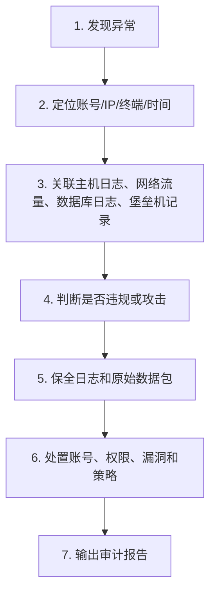

🎯 **真题对应**

> [!TIP]
> - “连续多次认证失败” → 可能是**暴力破解**；
> - “用户未经过前台系统登录却直接修改后台数据库” → **数据库违规访问**；
> - “路由器日志定位攻击源 IP，结合嫌疑人计算机日志取证” → **电子取证**。

> [!WARNING]
> 审计日志作为证据时，要注意**完整性、来源可靠性、时间一致性、保全过程**。随意导出的普通文本日志，证明力可能不足。

---

##### 常考对比表（第十二章）

🔀 **要点｜易混项对比**

| 易混项 | 区别 |
| --- | --- |
| 日志审计 vs 入侵检测 | 日志审计偏记录、分析、追溯；入侵检测偏发现攻击行为 |
| 运维审计 vs 主机审计 | 运维审计关注管理员/第三方操作过程；主机审计关注主机本地行为和配置 |
| 数据库审计 vs 网络审计 | 数据库审计关注 SQL 和数据库对象；网络审计关注网络协议和通信内容 |
| 端口镜像 vs TAP | 端口镜像依赖交换机复制流量；TAP 是硬件分流 |
| Hash vs 加密 | Hash 保护完整性；加密保护机密性 |
| 审计员 vs 操作员 | 审计员看日志和维护审计；操作员维护系统但不能改自身记录 |

---

#### 第十三章 网络安全漏洞防护技术原理与应用

##### 本章知识主线

本章可以压缩为一条闭环：**资产暴露 → 漏洞产生 → 漏洞分类 → 漏洞信息发布/获取 → 漏洞扫描 → 风险评估排序 → 修补或缓解 → 防利用拦截 → 复测跟踪 → 持续治理**。

> [!IMPORTANT]
> **考试答题总原则**：考试不要只背“漏洞扫描器、CVE、CVSS”，而要形成系统治理思维。**漏洞不是风险本身**，风险来自威胁主体利用漏洞作用于资产后造成影响。

---

##### 核心速记公式

📐 **公式1：漏洞风险形成公式**

```
漏洞风险 = 资产价值 × 暴露程度 × 漏洞可利用性 × 影响后果
```

> 考试解释：资产越重要、暴露面越大、漏洞越容易被远程利用、影响越涉及**机密性、完整性、可用性**，风险越高。

📐 **公式2：漏洞处置优先级公式**

```
处置优先级 = CVSS 分值 + 公开利用代码 + 互联网暴露 + 核心业务影响 + 补丁状态
```

> 考试解释：不是所有漏洞都按发现顺序修。核心系统、远程可利用、已有利用工具、影响可用性或敏感数据的漏洞，应优先整改。

📐 **公式3：漏洞管理闭环**

```
资产确认 → 漏洞信息采集 → 漏洞评估与排序 → 漏洞消除或控制 → 复测验证 → 变化跟踪
```

🔄 **流程图｜漏洞管理闭环**

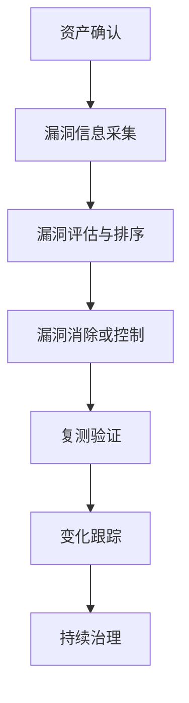

> 教材将漏洞管理过程概括为**资产确认、漏洞信息采集、漏洞评估、漏洞消除和控制、漏洞变化跟踪**。考试案例题常把这套流程放到“未建资产台账、漏扫后未整改、补丁未验证、整改后未复测”的场景中考查。

---

##### 考点1：网络安全漏洞的概念

📌 **要点｜定义**

网络安全漏洞又称**脆弱性**，是网络信息系统中与安全策略相冲突的缺陷或安全隐患。漏洞可能存在于**硬件、系统、网络、数据、应用、业务、人机交互**等多个层面，不限于软件代码。

⚠️ **要点｜漏洞造成的影响**

| 项目 | 要点 |
| --- | --- |
| 影响1 | 机密性受损 |
| 影响2 | 完整性破坏 |
| 影响3 | 可用性降低 |
| 影响4 | 抗抵赖性缺失 |
| 影响5 | 可控性下降 |
| 影响6 | 真实性不保 |

🔧 **要点｜漏洞类型**

| 类型 | 含义 | 考试重点 |
| --- | --- | --- |
| 普通漏洞 | 信息已公开，厂商或安全机构已有修补方案。 | 重点是及时补丁、升级、配置加固。 |
| 零日漏洞 | 新发现且尚未提供补丁的漏洞。 | 常用于定向攻击、APT 攻击、供应链攻击。 |

🎯 **真题对应**

> [!TIP]
> - 题干出现“尚无补丁”“新发现漏洞”“被定向攻击利用”，优先判断为**零日漏洞**。
> - 题干出现“厂商已发布补丁但单位未安装”，重点不是零日，而是**补丁管理失效**。

> [!WARNING]
> 漏洞不等于病毒，不等于攻击。**漏洞是弱点；攻击是利用弱点的行为**；病毒、蠕虫、勒索软件只是可能利用漏洞传播或破坏的载体。

---

##### 考点2：漏洞威胁与典型安全事件

📌 **要点｜攻击者利用漏洞后的四类结果**

| 项目 | 要点 |
| --- | --- |
| 结果1 | 敏感信息泄露 |
| 结果2 | 非授权访问 |
| 结果3 | 身份假冒 |
| 结果4 | 拒绝服务 |

> 教材列举了 **Internet 蠕虫、红色代码、Slammer、冲击波、震网、WannaCry** 等事件，核心不是背年份，而是理解“**重大安全事件往往以漏洞为突破口**”。

🔧 **要点｜事件类型**

| 事件类型 | 利用点 | 考试理解 |
| --- | --- | --- |
| 蠕虫传播 | 系统、服务或协议漏洞。 | 自动扩散，常造成大范围影响。 |
| DDoS | 协议漏洞、僵尸主机控制。 | 目标是可用性破坏。 |
| 勒索病毒 | 系统漏洞、弱口令、钓鱼入口。 | 加密数据、索取赎金。 |
| 工控攻击 | 操作系统漏洞 + 工控软件漏洞。 | 可能造成物理后果。 |

🎯 **真题对应**

> 案例题给出“未修补 SMB 漏洞导致勒索病毒横向传播”，答题要点一般包括：**关闭不必要服务、安装补丁、网络分区、备份恢复、终端防护、日志溯源、应急隔离**。

> [!WARNING]
> 拒绝服务关注**可用性**；敏感信息泄露关注**机密性**；篡改配置或数据关注**完整性**。不要把三者混写。

---

##### 考点3：漏洞来源

📌 **要点｜两大类来源**

漏洞来源分为两大类：**非技术性漏洞**和**技术性漏洞**。教材对非技术性来源强调**责任、制度、人员、监督、特权控制**；对技术性来源强调**设计错误、输入验证错误、缓冲区溢出、异常处理错误、访问验证错误、配置错误、竞争条件、环境错误**。

🔧 **要点｜来源对比**

| 大类 | 典型表现 | 防护重点 |
| --- | --- | --- |
| 非技术性漏洞 | 责任主体不清、策略缺失、培训不足、监督缺失、特权账号失控。 | 组织制度、岗位职责、审计、培训、权限约束。 |
| 技术性漏洞 | 设计缺陷、输入未校验、缓冲区溢出、配置错误、访问控制绕过。 | 安全设计、代码审计、补丁升级、基线加固、测试验证。 |

📐 **考试理解公式**

```
制度缺陷 + 人员弱点 + 技术缺陷 + 配置不当 = 综合性漏洞风险
```

🎯 **真题对应**

> [!TIP]
> - 题干说“超级管理员账号长期共用，无操作审计”，属于**特权控制不完备**。
> - 题干说“Web 参数未校验导致 SQL 注入”，属于**输入验证错误**。
> - 题干说“服务器默认口令未修改”，通常属于**配置错误或安全管理失效**。

> [!WARNING]
> 不要把漏洞狭义理解为“软件 Bug”。管理制度、业务流程、权限配置、人员操作也会形成漏洞。

---

##### 考点4：CVE、CWE、CVSS、CNNVD、CNVD、OWASP

###### 1. CVE

CVE 是**公开漏洞的统一标识和描述机制**，核心价值是统一编号、便于共享、便于检索。CVE 条目通常包含编号、简要描述、公开参考等内容。教材示例中 CVE ID 采用“**CVE-年份-编号**”的形式。

###### 2. CWE

CWE 偏“**缺陷类型库**”，用于描述软件架构、设计、编码中常见弱点。考试中可理解为：**CVE 偏具体漏洞，CWE 偏漏洞类型或弱点类别**。

###### 3. CVSS

CVSS 是**通用漏洞评分系统**，采用 **0—10 分**度量漏洞严重性，分值越高，通常表示危害越大。教材以 **CVSS v3.0** 为例，将评分因素概括为**基本度量、时序度量、环境度量**；基本度量涉及**攻击向量、攻击复杂性、权限要求、用户交互、机密性/完整性/可用性影响**等。

🧠 **要点｜记忆口径**

| 项目 | 记忆口径 |
| --- | --- |
| CVE | 漏洞身份证。 |
| CWE | 弱点类型库。 |
| CVSS | 漏洞严重性评分。 |
| CNNVD | 国家信息安全漏洞库。 |
| CNVD | 国家信息安全漏洞共享平台。 |
| OWASP Top 10 | Web 应用高频漏洞清单。 |

###### 4. CNNVD 与 CNVD

- **CNNVD** 分类更偏漏洞类型体系，涉及**配置错误、代码问题、资源管理错误、信息泄露、输入验证、缓冲区错误、SQL 注入、XSS、命令注入、访问控制错误**等。
- **CNVD** 按产生原因可分为**输入验证错误、访问验证错误、意外情况处理错误、边界条件错误、配置错误、竞争条件、环境错误、设计错误、缓冲区错误、其他错误、未知错误**，并按行业和应用场景划分漏洞。

###### 5. OWASP Top 10

OWASP Top 10 面向 Web 应用安全，常见类型包括**注入、失效身份认证、敏感信息泄露、访问控制失效、安全配置错误、XSS、不安全反序列化、使用含已知漏洞组件、日志和监控不足**等。

🎯 **真题对应**

> [!TIP]
> - 选择题常考“CVE/CVSS/CWE/CNVD/CNNVD 的作用区分”。
> - 案例题常把 SQL 注入、XSS、弱口令、越权访问、安全配置错误放在 Web 系统场景中考查。

> [!WARNING]
> **CVE 不是评分系统；CVSS 不是漏洞库；OWASP 不是国家漏洞平台；CNVD 和 CNNVD 不要混为同一个机构职能。**

---

##### 考点5：漏洞发布与漏洞信息获取

📌 **要点｜发布目的与信息内容**

漏洞发布的目的，是让用户和安全管理人员及时获知漏洞、采取修补或缓解措施。漏洞信息通常包括：**漏洞编号、发布日期、危害级别、漏洞名称、影响平台、解决建议、补丁信息、参考链接**等。发布渠道包括**网站、邮件、安全论坛、安全公告**等。

🔧 **要点｜来源与作用**

| 来源 | 作用 |
| --- | --- |
| CERT/CNCERT 等应急响应机构 | 安全事件响应、漏洞预警、应急通报。 |
| CNNVD | 国家级漏洞数据管理、风险评估支撑。 |
| CNVD | 漏洞收集验证、预警发布、应急处置协同。 |
| 厂商安全公告 | 产品漏洞、补丁、升级建议。 |
| 安全组织和安全厂商 | 威胁情报、漏洞通报、检测规则。 |

⚖️ **法规答题口径**

> [!IMPORTANT]
> 漏洞发布不是“越快越好、越细越好”。根据《网络产品安全漏洞管理规定》，漏洞信息发布应遵循**必要、真实、客观、有利于防范风险**的原则。
> - 不得在厂商提供修补措施前擅自发布漏洞细节；
> - 发布时应同步发布修补或防范措施；
> - 不得向境外组织或个人提供未公开漏洞信息。

> [!WARNING]
> 考试遇到“安全研究人员发现漏洞后立即公开攻击细节和利用工具”，应判断为**不符合漏洞发布合规要求**。

---

##### 考点6：漏洞管理过程

> [!IMPORTANT]
> 漏洞管理不是一次漏扫，而是**持续运维闭环**。

🔧 **要点｜环节与核心任务**

| 环节 | 核心任务 | 案例答题关键词 |
| --- | --- | --- |
| 资产确认 | 摸清 IP、系统、应用、数据库、网络设备、业务重要性。 | 资产台账、责任人、系统边界。 |
| 漏洞信息采集 | 漏扫、人工检查、威胁情报、厂商公告。 | 漏洞类型、影响资产、补丁级别。 |
| 漏洞评估 | 评估业务影响、可利用性、修补难度。 | CVSS、公开利用、远程可利用。 |
| 消除和控制 | 打补丁、升级、关闭服务、调整配置、IPS/WAF 规则。 | 补丁、加固、隔离、缓解。 |
| 变化跟踪 | 新资产上线、系统变更、软件升级后持续复测。 | 复测、闭环、变更管理。 |

🔄 **漏洞管理考试答题流程**

```
资产 → 扫描 → 评估 → 整改 → 复测 → 跟踪 → 制度
```

🎯 **真题对应**

> 案例题常问“某单位漏洞管理流程有哪些问题”。标准答题可写：**未建立资产台账、未定期扫描、未按风险排序整改、补丁未测试验证、整改后未复测、未纳入变更管理、未持续跟踪新增资产**。

> [!WARNING]
> 只写“安装杀毒软件、防火墙”不够。漏洞管理题必须写出“**发现—评估—整改—验证—跟踪**”的闭环。

---

##### 考点7：漏洞扫描器组成与类型

📌 **要点｜定义**

漏洞扫描器是通过远程或本地检查系统是否存在已知漏洞的软件或设备。

🧩 **要点｜主要模块**

| 模块 | 功能 |
| --- | --- |
| 用户界面 | 设置策略、启动/停止扫描、查看报告。 |
| 扫描引擎 | 执行扫描任务，读取策略，保存结果。 |
| 结果分析 | 形成扫描报告、漏洞列表、风险等级。 |
| 漏洞库/参数库 | 存储漏洞特征、插件、配置参数。 |

🔧 **要点｜漏洞扫描器三类**

| 类型 | 工作方式 | 代表特点 |
| --- | --- | --- |
| 主机漏洞扫描器 | 在本机检查关键文件、配置、账号、补丁。 | 信息更细，但只能检查本机。 |
| 网络漏洞扫描器 | 通过网络连接向目标发送请求并识别漏洞。 | 适合远程检查，但受权限和网络可达性限制。 |
| 专用漏洞扫描器 | 面向数据库、Web、网络设备、工控等特定对象。 | 针对性强，适合专项检查。 |

> 教材举例中，**Nmap** 偏端口与服务识别，**Nessus** 偏网络漏洞扫描，**X-scan** 为 Windows 环境下的漏洞扫描工具；专用扫描器可面向数据库、Web、网络设备、工控系统等。

🎯 **真题对应**

> [!TIP]
> - 题干说“检查本机 passwd、group、弱口令、配置文件”，偏**主机漏洞扫描**。
> - 题干说“远程检查 Web、FTP、SSH、SNMP 服务漏洞”，偏**网络漏洞扫描**。
> - 题干说“只检查 Oracle 数据库或工控系统漏洞”，偏**专用漏洞扫描**。

> [!WARNING]
> **端口扫描 ≠ 漏洞扫描**。端口扫描主要识别开放服务；漏洞扫描要进一步判断版本、配置、漏洞特征和风险。

---

##### 考点8：漏洞扫描应用流程

🔄 **远程漏洞扫描应用流程图**

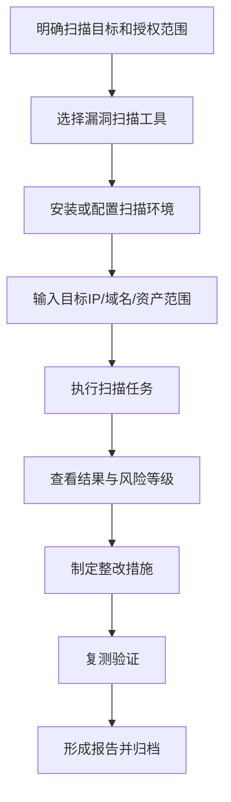

> 教材示例说明，漏洞扫描常用于**服务器、网站、网络设备、数据库**等安全检查，并可作为风险评估依据。

🎯 **真题对应**

> 案例题可能要求补充漏洞扫描步骤。答题不要写成“下载黑客工具直接扫描全网”，应写“**经授权、明确范围、选择工具、设置策略、执行扫描、分析报告、整改复测**”。

> [!WARNING]
> 漏洞扫描必须有**授权范围**。未授权扫描可能触及违法违规风险；考试答题应站在合法安全评估和运维防护角度。

---

##### 考点9：漏洞发现技术

📌 **要点｜与漏洞扫描的区别**

漏洞发现不同于漏洞扫描。漏洞扫描多是“查已知漏洞”；漏洞发现更强调“**发现潜在或未知漏洞**”。

🔧 **要点｜发现方法**

| 方法 | 考试理解 |
| --- | --- |
| 文本搜索/Grep | 按危险函数或模式检索。 |
| 词法分析 | 从源代码词法层面发现危险调用。 |
| 范围检查 | 检查数组、缓冲区、边界条件。 |
| 状态机检查 | 检查状态转换是否违反安全规则。 |
| 错误注入/模糊测试 | 输入异常数据观察程序崩溃或异常。 |
| 动态污点分析 | 跟踪不可信输入传播路径。 |
| 形式化验证 | 用数学方法证明安全属性。 |

> 常见工具包括 **Flawfinder、Splint、ITS4、Grep、MOPS、W3AF、Wireshark、Metasploit、OllyDBG** 等。

🎯 **真题对应**

> 问“发现未知软件漏洞可采用什么技术”，优先想到**模糊测试、代码审计、动态分析、形式化验证**，而不是只写 Nmap。

> [!WARNING]
> **Metasploit** 更偏漏洞验证与渗透测试框架；**Wireshark** 偏抓包分析；**Nmap** 偏端口服务探测。不要把所有工具都笼统写成“漏洞扫描器”。

---

##### 考点10：漏洞修补技术与补丁管理

> [!IMPORTANT]
> 补丁管理是**周而复始**的系统工作，教材将其流程概括为：**现状分析、补丁跟踪、补丁验证、补丁安装、应急处理、补丁检查**。

```
现状分析 → 补丁跟踪 → 补丁验证 → 补丁安装 → 应急处理 → 补丁检查
```

🔄 **补丁管理流程图**

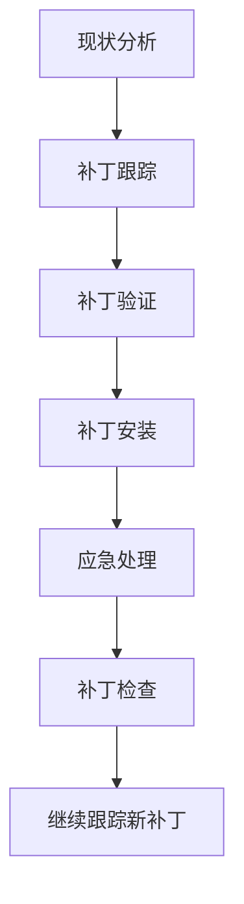

🔧 **要点｜环节重点**

| 环节 | 重点 |
| --- | --- |
| 现状分析 | 明确系统版本、补丁状态、业务影响。 |
| 补丁跟踪 | 关注厂商公告、漏洞库、应急通报。 |
| 补丁验证 | 在测试环境验证兼容性和稳定性。 |
| 补丁安装 | 按变更流程、维护窗口实施。 |
| 应急处理 | 出现故障可回退、隔离、临时缓解。 |
| 补丁检查 | 确认补丁生效，复测漏洞是否消除。 |

🎯 **真题对应**

> 题干说“管理员看到高危漏洞后直接在核心业务系统安装补丁，导致业务中断”，不妥点是缺少**测试验证、变更审批、备份回退、维护窗口和应急预案**。

> [!WARNING]
> 打补丁不是“越快越直接越好”。高危漏洞要快，但生产系统仍需**风险评估、验证、备份、回退和复测**。

---

##### 考点11：漏洞利用防范技术

📌 **要点｜核心定位**

漏洞利用防范技术**不是修复漏洞本身**，而是干扰或阻断漏洞被触发利用。教材列出 **ASLR、DEP、SEHOP、堆栈保护、虚拟补丁**等。

🔧 **要点｜技术原理与关键词**

| 技术 | 原理 | 考试关键词 |
| --- | --- | --- |
| ASLR 地址空间随机化 | 程序加载地址随机化，使攻击者难以预测返回地址。 | 降低缓冲区溢出成功率。 |
| DEP 数据执行阻止 | 将特定内存区域标记为不可执行。 | 阻止堆栈/数据区执行代码。 |
| SEHOP | 防止结构化异常处理覆盖攻击。 | 异常处理保护。 |
| 堆栈保护 | 设置完整性标记检测返回地址是否被篡改。 | 栈完整性、返回地址保护。 |
| 虚拟补丁 | 不改程序本体，通过 IPS/WAF 等过滤攻击流量。 | 临时防护、未正式修补前缓解。 |

> [!IMPORTANT]
> **虚拟补丁**的重点是：不修改目标程序，在网络侧或应用层拦截攻击流量，争取修复窗口。它适合暂时无法立即打补丁的系统，但**不能替代最终修复**。

🎯 **真题对应**

> 题干说“核心系统无法停机打补丁，但已知 Web 漏洞正在被利用”，可答：先通过 **WAF/IPS 配置规则、虚拟补丁、访问控制、临时隔离**等缓解，再安排验证和正式补丁。

> [!WARNING]
> **虚拟补丁 ≠ 真正修复漏洞**。它是防利用措施，不是根因修复。

---

##### 考点12：漏洞防护产品与指标

###### 1. 漏洞扫描器指标

漏洞扫描器利用公开漏洞信息和漏洞特征，对目标系统自动化分析，判断是否存在对应漏洞。常见指标包括**扫描主机数量、并发数、扫描速度、漏洞检测能力、数据库漏洞检查能力、Web 应用漏洞检查能力、口令检查能力、标准兼容性、部署难易程度**等。

⚙️ **要点｜指标与考试解释**

| 指标 | 考试解释 |
| --- | --- |
| 扫描主机数量 | 能覆盖多少 IP、域名、资产。 |
| 并发数 | 同时执行多少扫描任务。 |
| 扫描速度 | 单位时间扫描效率。 |
| 漏洞检测能力 | 漏洞库覆盖范围和准确性。 |
| 数据库检查 | Oracle、MySQL、SQL Server 等支持情况。 |
| Web 检查 | SQL 注入、XSS、挂马、CGI 漏洞等。 |
| 口令检查 | 弱口令、字典、协议支持。 |
| 标准兼容性 | 是否兼容 CVE、CNVD、CNNVD 等。 |

###### 2. 漏洞服务平台

教材提到**漏洞盒子、补天漏洞响应平台、网络威胁情报服务**等。考试理解为：把**白帽报告、SRC、众测、威胁情报、漏洞响应机制**纳入企业安全治理。

###### 3. 漏洞防护网关

漏洞防护网关通过识别网络流量中的漏洞利用特征，阻断攻击者对目标系统漏洞的利用。常见形式包括 **IPS、WAF、UTM**。主要指标包括**可阻断漏洞攻击的种类和数量、准确率、阻断性能、带宽支持能力**等。

🎯 **真题对应**

> [!TIP]
> - 问“Web 系统防 SQL 注入、XSS、Webshell 上传，应选什么产品”，优先想到 **WAF**。
> - 问“网络层阻断漏洞利用特征”，可想到 **IPS**。
> - 问“统一边界安全能力”，可想到 **UTM**。

> [!WARNING]
> 漏洞扫描器偏“**发现问题**”；WAF/IPS 偏“**拦截利用**”；补丁管理偏“**消除根因**”；威胁情报偏“**提前获知风险**”。

---

#### 第十四章 恶意代码防范技术原理

##### 2026 备考口径校核

本章属于软考中级信息安全工程师考试中**网络安全威胁、恶意代码防护、主机安全、网络安全产品、漏洞管理、监测预警、应急响应**等范围，未超出既定考试大纲边界。

教材第十四章主线为：**恶意代码概念与模型 → 病毒 → 木马 → 蠕虫 → 僵尸网络 → 其他恶意代码 → 防护产品与指标 → 终端防护与 APT 防护**。

> [!IMPORTANT]
> 2026 年答题时，法规口径要统一到现行有效规范：网络运营者应制定网络安全事件应急预案，及时处置**系统漏洞、计算机病毒、网络攻击、网络侵入**等风险；同时不得提供专门用于**网络侵入、干扰、防护绕过、窃取网络数据**等危害网络安全活动的程序和工具。网络数据安全治理中，恶意代码导致的数据泄露、篡改、破坏，应结合**数据分类分级、重要数据、个人信息保护和安全事件处置**要求理解。

##### 本章知识主线

本章不要按病毒、木马、蠕虫孤立记忆，而要形成一条完整闭环：**先理解恶意代码是什么，再理解它如何入侵、如何生存、如何攻击、如何分析、如何防范，最后落到典型类型、产品指标、终端与 APT 防护**。

> 考试中常把本章与**网络攻击、安全管理、入侵检测、安全审计、漏洞管理**联动考查。案例题常见场景是：邮件附件传播木马、Web 挂马、漏洞蠕虫横向扩散、僵尸网络 DDoS、终端被控、日志发现异常端口、应急隔离与恢复。

---

##### 考点1：恶意代码的概念与分类

📌 **要点｜定义**

恶意代码是**违背目标系统安全策略的程序代码**，可能造成**信息泄露、资源滥用、完整性破坏、可用性破坏**，并能通过网络或存储介质传播。

> [!IMPORTANT]
> 注意：**病毒只是恶意代码的一类，恶意代码范围更大**。

> 教材列举的主要类型包括：**计算机病毒、网络蠕虫、特洛伊木马、逻辑炸弹、细菌、恶意脚本、恶意 ActiveX 控件、间谍软件**等。

🔧 **要点｜分类**

| 分类 | 典型类型 | 考试理解 |
| --- | --- | --- |
| 被动传播 | 病毒、木马、间谍软件、逻辑炸弹 | 通常依赖用户执行、文件携带、安装诱骗、邮件附件。 |
| 主动传播 | 网络蠕虫等 | 可利用漏洞或网络机制自动扫描、复制、扩散。 |

🎯 **真题对应与易错提醒**

> - 单选常考：病毒是不是所有恶意代码。正确口径：**病毒只是恶意代码的一类**。
> - 多选常考：哪些属于恶意代码。**病毒、蠕虫、木马、逻辑炸弹、间谍软件**均可入选。

> [!WARNING]
> **木马不以自我复制为本质特征；蠕虫可独立运行并主动传播；逻辑炸弹强调触发条件；细菌强调消耗资源。**

---

##### 考点2：恶意代码攻击模型

📌 **要点｜六步攻击过程**

恶意代码攻击过程可归纳为六步：**侵入系统、维持或提升权限、隐蔽自身、潜伏等待条件、实施破坏或控制、重复攻击新目标**。该模型既可用于选择题判断，也可用于案例题组织应急处置思路。

🔄 **流程图｜恶意代码攻击模型**

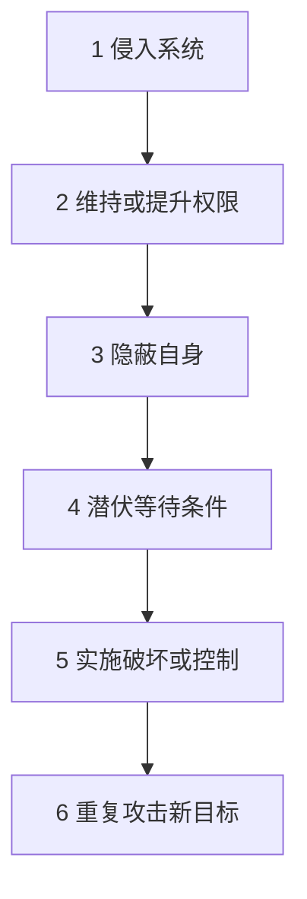

🔧 **要点｜阶段关键词**

| 阶段 | 关键词 | 常见题眼 |
| --- | --- | --- |
| 侵入系统 | 下载程序、邮件附件、U 盘、漏洞植入 | 用户打开附件后中招。 |
| 权限维持/提升 | 盗用合法权限、提权 | 获得管理员权限。 |
| 隐蔽 | 改名、删源文件、改策略、隐藏进程 | 任务管理器看不到。 |
| 潜伏 | 时间、日期、文件数、外部命令触发 | 到某日发作。 |
| 破坏 | 泄密、删除、加密、远控、DDoS | 数据丢失、系统不可用。 |
| 扩散 | 重复前述过程 | 继续感染其他主机。 |

📐 **答题公式**

```
恶意代码攻击过程 = 入口 + 权限 + 隐蔽 + 触发 + 破坏 + 扩散
```

> [!WARNING]
> **潜伏不是不活动，而是等待条件成熟；隐蔽不等于加密，加密只是隐藏或反分析的一种手段。**

---

##### 考点3：恶意代码生存技术

📌 **要点｜核心目标**

恶意代码的生存技术核心目标是：**不被发现、不被分析、不被清除、不被阻断**。教材重点包括**反跟踪、加密、模糊变换、自动生产、变形、三线程、进程注入、通信隐藏、内核级隐藏**等。

🔧 **要点｜生存技术**

| 技术 | 核心作用 | 考试关键词 |
| --- | --- | --- |
| 反跟踪技术 | 对抗调试与分析 | 反动态跟踪、反静态分析、伪指令。 |
| 加密技术 | 防止直接读取代码或数据 | 信息加密、数据加密、程序代码加密。 |
| 模糊变换技术 | 让同一恶意代码样本形态不同 | 指令替换、压缩、扩展、伪指令、重编译。 |
| 自动生产技术 | 自动生成多态样本 | 多态性发生器、变换引擎。 |
| 变形技术 | 改变特征码逃避特征查杀 | 重汇编、压缩、膨胀、伪指令、重编译。 |
| 三线程技术 | 防止进程被停止 | 主线程、监视线程、守护线程。 |
| 进程注入技术 | 隐藏与自启动 | 注入系统服务或网络服务进程。 |
| 通信隐藏技术 | 隐藏通信内容或状态 | 端口定制、端口复用、通信加密、隐蔽通道。 |
| 内核级隐藏技术 | 提升隐藏深度 | LKM Rootkit、Hook 系统调用、内存映射。 |

🔀 **要点｜易混点辨析**

| 易混点 | 正确区分 |
| --- | --- |
| 加密 vs 变形 | 加密侧重看不懂；变形侧重特征不固定。 |
| 通信加密 vs 隐蔽通道 | 通信加密只能隐藏内容；隐蔽通道可隐藏内容和通信状态。 |
| 进程注入 vs 三线程 | 进程注入侧重隐藏/启动；三线程侧重持续存活。 |
| Rootkit vs 普通木马 | Rootkit 更偏底层隐藏，可修改系统调用、隐藏文件/进程/连接。 |

🎯 **真题对应与易错提醒**

> [!TIP]
> - 题干出现木马复用 **80/443** 端口通信，应联想到**端口复用或通信隐藏**。
> - 题干出现进程被杀后自动重启，应联想到**三线程、守护线程或持久化机制**。
> - 题干出现杀毒软件检测不到变形样本，应联想到**多态、变形、加密、混淆**对特征码检测的绕过。

> [!WARNING]
> **基于特征码的检测对普通已知样本有效，但对多态、变形、加密、混淆样本能力有限。**

---

##### 考点4：恶意代码攻击技术

教材归纳的攻击技术主要包括：**进程注入、超级管理、端口反向连接、缓冲区溢出攻击**。考试常通过具体行为描述要求判断对应技术。

🔧 **要点｜攻击技术**

| 攻击技术 | 作用 | 场景题判断 |
| --- | --- | --- |
| 进程注入 | 将恶意代码嵌入系统服务或网络服务进程 | 系统启动自动加载、长期活跃。 |
| 超级管理技术 | 攻击反恶意代码软件，使其失效 | 杀毒软件、防火墙被关闭或拒绝服务。 |
| 端口反向连接 | 被控端主动连接控制端，绕过入站防火墙限制 | 内网主机主动连外部控制端。 |
| 缓冲区溢出攻击 | 利用系统/服务漏洞植入执行攻击代码 | 远程漏洞利用、获取主机控制权。 |

> [!WARNING]
> **端口反向连接不是攻击者从外网直接连入内网，而是受害主机主动向外连接控制端。**
> **缓冲区溢出攻击常与漏洞利用、远程执行、蠕虫主动传播结合考查。**

---

##### 考点5：恶意代码分析技术

📌 **要点｜两大分析类型**

恶意代码分析分为**静态分析**和**动态分析**。

- **静态分析**包括：反恶意代码软件检查、字符串分析、脚本分析、静态反编译分析、静态反汇编分析；
- **动态分析**包括：文件监测、进程监测、网络活动监测、注册表监测、动态反汇编分析等。

🔄 **流程图｜恶意代码分析方法**

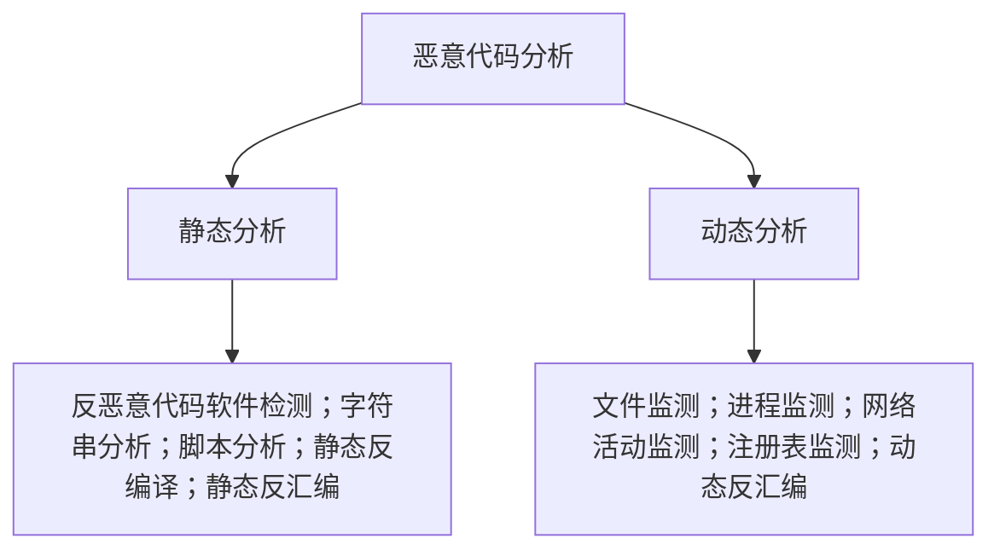

🔧 **要点｜方法优缺点**

| 方法 | 优点 | 局限 |
| --- | --- | --- |
| 静态分析 | 不运行样本，较安全，可分析结构和字符串。 | 对加密、混淆、变形样本效果差。 |
| 动态分析 | 能观察真实行为，如文件、进程、网络、注册表变化。 | 可能触发破坏，需要隔离沙箱；只能观察实际执行路径。 |
| 反汇编/反编译 | 可分析控制流和逻辑。 | 可读性差，易受反分析技术干扰。 |
| 网络监测 | 发现 C2、扫描、异常连接。 | 加密通信和隐蔽通道会增加难度。 |

🎯 **真题对应与易错提醒**

> [!TIP]
> - 题干出现查看样本字符串、导入函数、反汇编代码，多指**静态分析**。
> - 题干出现沙箱运行、监测文件、注册表、网络连接，多指**动态分析**。

> [!WARNING]
> 动态分析不等于一定安全，必须在**隔离环境**中运行；静态分析不等于只用杀毒软件扫描。

---

##### 考点6：恶意代码防范策略总框架

教材防范框架可归纳为三条线：**用户安全意识、恶意代码安全管理、恶意代码防御技术**。案例题答题要体现**组织管理和技术措施并重**。

🔄 **流程图｜恶意代码防范框架**

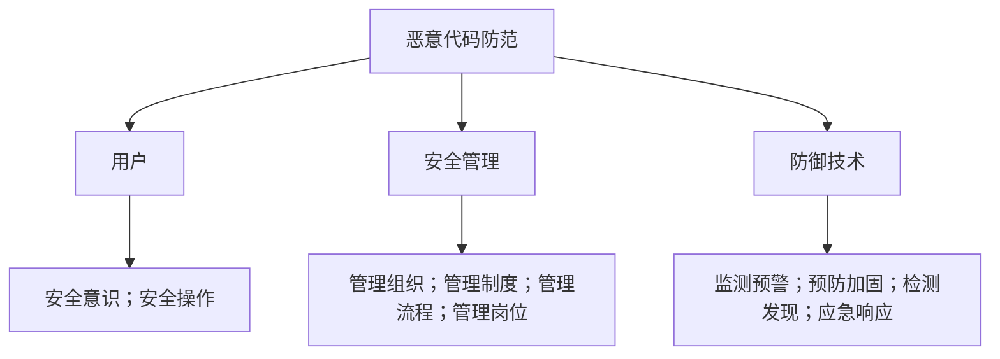

🔧 **要点｜处置步骤与答题要点**

| 处置步骤 | 答题要点 |
| --- | --- |
| 1 隔离 | 断开受感染主机或网段，防止横向传播。 |
| 2 检测 | 查杀样本、分析日志、检查端口、进程、注册表、文件完整性。 |
| 3 清除 | 删除恶意文件、终止进程、恢复注册表和系统配置。 |
| 4 修补 | 修复漏洞、更新补丁、关闭不必要服务。 |
| 5 恢复 | 从可信备份恢复业务和数据。 |
| 6 加固 | 最小权限、白名单、终端防护、邮件网关、Web 网关、IDS/IPS。 |
| 7 复盘 | 溯源传播路径、完善制度、培训用户、更新应急预案。 |

---

##### 考点7：计算机病毒分析与防护

📌 **要点｜定义**

计算机病毒是具有**自我复制、传播能力**的程序代码，常依附于**文件、文档、引导区**等载体。教材强调病毒具有四个基本特性：**隐蔽性、传染性、潜伏性、破坏性**。

🔧 **要点｜四特性**

| 特性 | 记忆口径 | 易错点 |
| --- | --- | --- |
| 隐蔽性 | 附着在正常软件、文档、邮件、网页等载体。 | 不等于一定不可检测。 |
| 传染性 | 自我复制并感染其他对象。 | 病毒区别于普通恶意程序的关键。 |
| 潜伏性 | 等触发条件满足后发作。 | 触发条件可为日期、时间、感染数量等。 |
| 破坏性 | 破坏数据、系统、网络或使用体验。 | 破坏结果不可完全预测。 |

###### 1. 病毒组成与生命周期

🧩 **要点｜部件与功能**

| 部件 | 功能 |
| --- | --- |
| 复制传染部件 replicator | 控制病毒向其他文件或对象传播。 |
| 隐藏部件 concealer | 防止病毒被检测到。 |
| 破坏部件 bomb | 条件满足后执行破坏操作。 |

🔄 **流程图｜计算机病毒生命周期**


###### 2. 常见病毒类型

🔧 **要点｜病毒类型**

| 类型 | 核心特点 | 代表题眼 |
| --- | --- | --- |
| 引导型病毒 | 感染系统引导区，启动时获得控制权。 | 引导区、MBR、内存驻留。 |
| 宏病毒 | 利用 Office 宏语言传播，文档可作为载体。 | Word、Excel、Normal.dot、AutoOpen。 |
| 多态病毒 | 每次感染更换加密算法或形态。 | 无固定特征、启发式检测。 |
| 隐蔽病毒 | 隐藏文件大小、日期、时间、加密等变化。 | 系统和杀毒软件看不出变化。 |

###### 3. 计算机病毒防范策略

🛡️ **要点｜策略与措施**

| 策略 | 措施 |
| --- | --- |
| 查找病毒源 | 比较法、搜索法、特征字识别法、分析法。 |
| 阻断传播途径 | 不运行未知程序、不打开可疑附件、禁用不必要服务、区域隔离。 |
| 主动查杀 | 定期扫描主引导区、引导扇区、中断向量表、模板文件、注册表。 |
| 应急与灾备 | 备份、数据修复、网络隔离、应急预案。 |

🎯 **真题对应与易错提醒**

> [!TIP]
> - **宏病毒**常考：文档也可作为病毒载体。
> - **多态病毒**常考：逃避特征码检测。
> - 应急题常考：**先隔离、后查杀、再恢复**。

> [!WARNING]
> 防病毒不只是安装杀毒软件，还包括**补丁、备份、隔离、邮件网关、权限控制和用户培训**。

---

##### 考点8：特洛伊木马分析与防护

📌 **要点｜定义与关键区别**

特洛伊木马是具有**伪装能力、隐蔽执行非法功能**的恶意程序。它与病毒、蠕虫相比，关键区别是：**木马通常不具备自我传播能力**，而依赖诱骗、捆绑、漏洞植入等机制进入系统。

🔄 **流程图｜木马运行机制**


###### 1. 木马植入方式

🔧 **要点｜植入方式**

| 方式 | 类型 | 说明 |
| --- | --- | --- |
| 文件捆绑 | 被动植入 | 随常用软件安装进入系统。 |
| 邮件附件 | 被动植入 | 用户执行附件后植入。 |
| Web 网页 | 被动植入/挂马 | 点击网页或脚本触发。 |
| 漏洞利用 | 主动植入 | 利用系统或服务漏洞自动安装。 |

###### 2. 木马隐藏技术

🕵️ **要点｜隐藏对象与方法**

| 隐藏对象 | 方法 |
| --- | --- |
| 文件 | 修改系统调用，隐藏文件或路径。 |
| 进程 | 拦截进程查看命令，隐藏木马进程。 |
| 网络连接 | 拦截 netstat 等连接查看结果。 |
| 通信内容 | 加密木马控制通信。 |
| 通信方式 | 端口复用、隐蔽通道。 |

###### 3. 木马检测与清除

🔍 **要点｜检测方向与典型方法**

| 检测方向 | 典型方法 |
| --- | --- |
| 开放端口 | netstat、端口扫描。 |
| 重要系统文件 | 检查自启动文件、`System.ini`、`Win.ini` 等。 |
| 注册表 | 检查 `Run`、`RunOnce`、`RunServices` 等启动项。 |
| Rootkit | 已知特征、执行路径分析、直接读取内核数据。 |
| 网络通信 | IDS、协议分析、异常连接检测。 |

🎯 **真题对应与易错提醒**

> [!TIP]
> - 题干出现 `shell=explorer.exe` 后面跟着异常程序，应联想到**木马自启动或系统配置被篡改**。
> - 题干出现 `Run` 键值异常，应联想到**注册表自启动项**。
> - 题干出现受害机主动连外部控制端，应联想到**端口反向连接**。

> [!WARNING]
> 木马清除不是只删一个 exe，还要**恢复注册表、系统文件、启动项、服务、网络通信策略**，并检查是否存在**后门账号或持久化组件**。

---

##### 考点9：网络蠕虫分析与防护

📌 **要点｜定义与组成**

网络蠕虫是具有**自我复制、传播能力、可独立自动运行**的恶意程序，通常综合漏洞利用、扫描、传播和攻击负载。教材将网络蠕虫组成归纳为四个模块：**探测模块、传播模块、蠕虫引擎模块、负载模块**。

🔄 **流程图｜网络蠕虫运行机制**

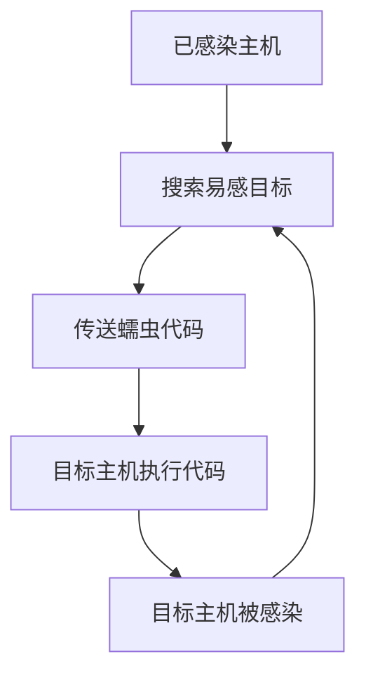

###### 1. 蠕虫扫描技术

🔧 **要点｜扫描方式**

| 扫描方式 | 核心特点 | 典型题眼 |
| --- | --- | --- |
| 随机扫描 | 随机选择 IP 地址扫描。 | Slammer。 |
| 顺序扫描 | 按本地优先或地址递增/递减扫描。 | Blaster、子网扫描。 |
| 选择性扫描 | 依据目标列表、路由、DNS 等信息扫描。 | 更快、更精准、更隐蔽。 |

> 选择性扫描又可细分为：**选择性随机扫描、目标列表扫描、基于路由扫描、基于 DNS 扫描、分而治之扫描**。

###### 2. 蠕虫漏洞利用方式

🔧 **要点｜利用点**

| 利用点 | 说明 |
| --- | --- |
| 主机信任关系漏洞 | 利用信任关系复制传播。 |
| 程序漏洞 | 缓冲区溢出、远程执行。 |
| 默认用户和口令 | 弱口令直接登录上传。 |
| 用户安全意识薄弱 | 邮件伪装诱导执行。 |
| 客户端配置漏洞 | 自动执行下载程序。 |

###### 3. 蠕虫防范技术

🛡️ **要点｜防范技术**

| 防范技术 | 作用 |
| --- | --- |
| 监测与预警 | 探测器收集连接数、ICMP 错误包、流量、端口、CPU、内存等信息。 |
| 传播抑制 | 蜜罐、虚假漏洞、诱捕传播。 |
| 漏洞检测与系统加固 | 漏洞扫描、补丁、关闭不必要服务、弱口令治理。 |
| 蠕虫免疫 | 预设感染标记，欺骗蠕虫不重复感染。 |
| 阻断与隔离 | 防火墙、路由器、网段隔离、过滤特征包。 |
| 清除 | 删除文件、结束进程、修改注册表、使用专杀工具。 |

🎯 **真题对应与易错提醒**

> 案例题常给出**内网大量主机扫描同一端口、ICMP 异常增多、CPU 占用升高、短时间横向传播**，要求判断为网络蠕虫并给出处置措施。

> [!WARNING]
> 蠕虫防护的关键是**漏洞管理和传播抑制**，不能只写安装杀毒软件。

---

##### 考点10：僵尸网络分析与防护

📌 **要点｜定义与构建方式**

僵尸网络是攻击者将僵尸程序植入大量目标主机后，通过**控制通道**操纵受害主机执行恶意活动的网络。构建方式包括**远程漏洞攻击、弱口令扫描、邮件附件、恶意文档、文件共享、网页挂马**等。

🔄 **流程图｜僵尸网络运行机制**


🛡️ **要点｜防范技术**

| 防范技术 | 说明 |
| --- | --- |
| 威胁监测 | 蜜罐捕获 Bot 样本，分析 C2 服务器、端口、频道、口令。 |
| 僵尸网络检测 | 基于通信内容和行为特征识别异常流量。 |
| 主动遏制 | 路由封禁、DNS 黑名单、屏蔽恶意 IP/域名。 |
| 僵尸程序查杀 | 在受害终端清除 Bot 程序。 |

> [!WARNING]
> **僵尸网络不是单台中毒主机**，而是被集中或分布式控制的一组受害主机网络。其典型危害是 **DDoS、垃圾邮件、窃密和代理攻击**。

---

##### 考点11：其他恶意代码

🔧 **要点｜类型与易错点**

| 类型 | 定义与特点 | 易错点 |
| --- | --- | --- |
| 逻辑炸弹 | 附着在软件中，满足条件后触发破坏。 | 不能自我复制、不能感染其他程序。 |
| 陷门 | 绕过安全机制访问系统的代码或入口。 | 常用于调试/维护，但被滥用即成风险。 |
| 细菌 | 独立自复制程序，通过复制消耗资源。 | 不直接攻击软件，重点是资源耗尽。 |
| 间谍软件 | 用户不知情安装，收集信息、弹窗、重定向浏览器。 | 一般不具备自我复制能力。 |

🎯 **真题对应**

> [!TIP]
> - 到某日期删除文件，多为**逻辑炸弹**。
> - 隐藏维护入口绕过认证，多为**陷门**。
> - 指数复制耗尽磁盘、CPU、内存，多为**细菌**。
> - 记录键盘、窃取账号、弹广告，多为**间谍软件**。

---

##### 考点12：恶意代码防护产品与指标

教材列出的主要产品包括**终端防护产品、安全网关产品、恶意代码监测产品、补丁管理系统、恶意代码应急响应工具**等。

🔧 **要点｜产品类型**

| 产品类型 | 部署位置 | 作用 |
| --- | --- | --- |
| 终端防护产品 | PC、服务器、移动终端 | 查杀、行为防护、主机加固。 |
| 安全网关 | 网络边界、邮件/Web 入口 | 拦截传播、防止破坏扩大。 |
| 恶意代码监测产品 | 网络流量监测点 | 发现异常节点、异常连接、蠕虫/木马/僵尸网络。 |
| 补丁管理系统 | 终端或企业统一平台 | 修补漏洞，降低蠕虫和漏洞木马风险。 |
| 应急响应工具 | 事件处置阶段 | 专杀、Rootkit 检测、隐藏端口/进程排查。 |

###### 1. 技术指标

⚙️ **要点｜指标**

| 指标 | 考试解释 |
| --- | --- |
| 检测能力 | 能否发现恶意代码，静态检测 + 动态检测。 |
| 检测准确性 | 误报率、漏报率。 |
| 阻断能力 | 能否从网络、主机、应用层阻断，是否及时。 |

> [!WARNING]
> **检测能力强不等于准确率高。能检测不等于能阻断。阻断及时性是产品评价的重要指标。**

---

##### 考点13：终端防护与 APT 防护

###### 1. 终端防护

终端防护通常是在终端安装**代理程序**，由**终端管理中心**统一下发策略，实现**查杀、加固、补丁、策略控制、病毒库更新**等集中管理。适合回答单位如何统一管控终端恶意代码风险。

###### 2. APT 防护

APT 常通过**定向电子邮件、恶意附件、恶意链接、恶意文档**进入目标系统，随后远控终端、横向渗透、长期潜伏、窃取数据。APT 防护中应强调对**电子邮件和电子文档中的恶意代码**进行检测，以防止通过邮件和文档渗透入侵。

🔄 **流程图｜APT 邮件攻击链**

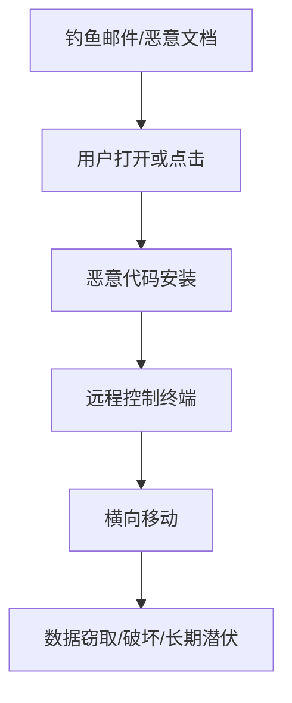

🛡️ **要点｜APT 邮件攻击防护措施**

| 措施 | 说明 |
| --- | --- |
| 邮件网关检测 | 检测附件、链接、宏、脚本。 |
| 沙箱分析 | 分析可疑文档行为。 |
| 终端 EDR/杀毒 | 监测进程、注册表、网络连接。 |
| 限制宏和脚本 | 禁用或限制 Office 宏、脚本自动执行。 |
| 最小权限和白名单 | 降低恶意程序执行和扩散风险。 |
| 分区分域 | 关键资产分区分域、访问控制。 |
| 日志审计和威胁情报 | 异常外联告警，识别 C2 通信。 |
| 应急处置 | 隔离终端、封禁 C2、溯源恢复。 |

---

#### 第十五章 网络安全主动防御技术与应用

##### 2026 备考口径校核

2026 年备考时，考试大纲和教程信息仍以官方发布口径为准。法规口径上，**网络安全、数据安全、个人信息保护、商用密码和等级保护要求应统一理解**；本章技术原理如 **IPS、白名单、流量清洗、可信计算、数字水印、蜜罐、入侵容忍**等，按教材原文技术框架掌握。

> 隐私保护部分要结合现行个人信息保护、网络数据安全治理要求理解：**匿名化、去标识化、加密、访问控制、数据最小化**等属于个人信息和网络数据安全治理的重要技术措施。**可信计算、可信密码模块、同态加密**等涉及密码技术时，应与商用密码管理和国产密码算法支撑体系统一理解。

##### 本章总逻辑：从“挡住攻击”到“主动识别、诱骗、容忍、恢复”

> [!IMPORTANT]
> 一句话抓主线：本章不是传统“被动防护”章节，而是讲网络安全从**防火墙、IDS、补丁**走向**阻断、白名单、清洗、可信、诱骗、容忍、隐私保护、威胁情报**的主动防御体系。

##### 高频考点总表

🧭 **要点｜模块总览**

| 模块 | 核心关键词 | 技术目标 | 常见考法 | 易错点 |
| --- | --- | --- | --- | --- |
| 入侵阻断 | IPS、SPS、旁路阻断、热补丁 | 检测并阻断攻击流量 | IPS 与 IDS、防火墙对比 | IDS 只检测，IPS 能阻断 |
| 软件白名单 | 可信列表、Hash、数字签名 | 只允许运行可信软件 | 白名单与黑名单比较 | 白名单不是“查病毒特征库” |
| 流量清洗 | DPI、牵引、清洗、回注 | 抵御 DDoS 和恶意流量 | 流程题、DDoS 题 | 不是简单丢弃全部流量 |
| 可信计算 | TPM/TCM、信任根、信任链、可信验证 | 保证平台完整性和身份可信 | TPM/TCM 组成、等保可信验证 | 可信计算不是普通杀毒 |
| 数字水印 | 嵌入、提取、LSB、DCT | 版权保护、隐藏、溯源、访问控制 | 水印应用场景辨析 | 水印不等同数字签名 |
| 攻击陷阱 | 蜜罐、陷阱网络、虚拟蜜罐 | 欺骗攻击者、获取情报 | 蜜罐类型、陷阱网络功能 | 蜜罐不是业务服务器 |
| 入侵容忍 | 3R、门限密码、主动恢复、区块链 | 被入侵后仍能服务 | 安全 1.0/2.0/3.0、3R | 容忍入侵不是放任入侵 |
| 隐私保护 | k-匿名、l-多样性、差分隐私、匿名化、去标识化 | 降低识别与推断风险 | 匿名化/去标识化区别 | 去标识化后仍可能属于个人信息 |
| 前沿技术 | 威胁情报、DNSSEC、同态加密 | 提前感知、保障 DNS、密文计算 | 概念辨析与应用场景 | 同态加密不是普通加密 |

---

##### 15.1 入侵阻断技术与应用

###### 1. 考点清晰

入侵阻断是主动防御的基础技术之一，其目的**不是事后记录攻击**，而是在攻击流量到达目标前或攻击发生过程中进行**识别、控制、阻断**。

🔧 **要点｜传统防护的不足**

| 技术 | 作用 | 局限 |
| --- | --- | --- |
| 防火墙 | 按规则控制访问 | 规则静态、粒度较粗、响应滞后 |
| IDS | 检测、告警、记录攻击 | 不能直接阻断，误报会影响联动 |
| 补丁修复 | 消除已知漏洞 | 业务连续性和补丁风险导致难以及时修复 |
| IPS | 检测并阻断攻击 | 需处理性能瓶颈和高可用问题 |

> **IPS（Intrusion Prevention System）**根据网络包特征和上下文判断攻击行为，并控制包转发，兼具检测与阻断能力。
> **SPS（Side Prevent System）**是旁路阻断系统，旁路监听流量，再通过**注入报文**等方式阻断攻击，通常对网络延迟影响较小。

###### 2. IPS/SPS 主要功能

⚙️ **要点｜功能与记忆关键词**

| 功能 | 记忆关键词 |
| --- | --- |
| 屏蔽指定 IP 地址 | 封 IP |
| 屏蔽指定端口 | 封端口 |
| 屏蔽指定域名 | 封域名 |
| 封锁指定 URL | 封 URL |
| 阻断特定攻击类型 | 攻击特征阻断 |
| 为零日漏洞提供热补丁 | 虚拟补丁、临时防护 |

###### 3. 真题对应

> [!TIP]
> 真题式考法通常给出“系统能识别攻击并直接阻断攻击流量”，应优先判断为 **IPS**；如果只说“记录、报警、生成日志”，则更可能是 **IDS**；如果强调“旁路监听、注入报文阻断”，则是 **SPS**。

###### 4. 易错提醒

> [!WARNING]
> IPS 不是“更高级的防火墙”这么简单，它的题眼在于**攻击行为检测 + 阻断入侵行为**。防火墙侧重访问控制，IDS 侧重检测告警，IPS 侧重检测后阻断。

---

##### 15.2 软件白名单技术与应用

###### 1. 考点清晰

软件白名单技术通过建立**可信软件列表**，只允许运行经过授权的软件，阻止恶意软件安装、运行和修改系统。教材强调白名单常依据**进程名、文件名、发行商、二进制文件、数字签名、Hash 值**等形成身份标识。

###### 2. 标准流程图

> 流程图2｜软件白名单技术工作流程（原文仅给出图题，未给出图中节点文字）

###### 3. 白名单与黑名单对比

🔀 **要点｜对比**

| 项目 | 黑名单 | 白名单 |
| --- | --- | --- |
| 基本思想 | 已知坏的不允许 | 未经信任的不允许 |
| 典型技术 | 病毒特征库、恶意代码库 | Hash、数字签名、可信发布者 |
| 优点 | 适合开放环境 | 适合稳定、可控环境 |
| 缺点 | 对未知威胁、零日攻击弱 | 管理成本较高 |
| 适用场景 | 普通终端、开放互联网环境 | 工控、电力监控、服务器、专用终端 |

###### 4. 应用场景

🧩 **要点｜场景与答题要点**

| 场景 | 答题要点 |
| --- | --- |
| 移动互联网白名单生态 | App 开发、应用商店、终端安全软件协同，降低恶意 App 传播 |
| 恶意代码防护 | 只允许可信程序安装和执行，特别适合软件变化小的电力监控主机 |
| “白环境”保护 | 可信设备才能接入，可信消息才能传输，可信软件才能执行 |

###### 5. 真题对应

> [!TIP]
> 题干若出现“系统较封闭、软件变化少、只允许授权程序运行、阻止未知恶意程序”，优先选**软件白名单**。若题干出现“病毒特征库匹配”，优先选**黑名单或杀毒软件**。

###### 6. 易错提醒

> [!WARNING]
> 白名单不是“更大的病毒库”，而是**默认拒绝、显式允许**。考试中经常把“黑名单基于已知恶意特征”与“白名单基于可信身份标识”混淆。

---

##### 15.3 网络流量清洗技术与应用

###### 1. 考点清晰

网络流量清洗用于应对 **DoS/DDoS** 等恶意流量攻击，目标是把异常流量**牵引到清洗中心**，过滤恶意流量，再把正常流量**回送**给目标系统。

###### 2. 标准流程图

> 流程图3｜网络流量清洗标准流程（原文仅给出图题，未给出图中节点文字）

###### 3. 三个核心步骤

🔧 **要点｜步骤与关键词**

| 步骤 | 内容 | 高频关键词 |
| --- | --- | --- |
| 流量检测 | 基于 DPI 监测和分析流量 | SYN Flood、UDP Flood、ICMP Flood、DNS Query Flood、HTTP Get Flood、CC 攻击 |
| 流量牵引与清洗 | 将目标流量转发到清洗中心 | BGP、DNS、动态牵引 |
| 流量回注 | 把清洗后的干净流量送回源站 | 业务不中断、正常访问 |

###### 4. 应用场景

🧩 **要点｜应用与说明**

| 应用 | 说明 |
| --- | --- |
| 畸形报文过滤 | LAND、Smurf、Ping of Death、Tear Drop 等 |
| 抗拒绝服务攻击 | 清洗 DDoS 流量，保障服务可用 |
| Web 应用保护 | 过滤 HTTP Get Flood、HTTP Post Flood、HTTP Slow Header/Post、HTTPS Flood 等 |
| DDoS 高防 IP | 代理转发源站流量，过滤攻击后回注正常业务流量 |

###### 5. 真题对应

> [!TIP]
> 题干出现“大规模 DDoS 攻击、业务流量牵引到清洗中心、过滤后回注源站”，标准答案就是**网络流量清洗**或 **DDoS 高防 IP 服务**。

###### 6. 易错提醒

> [!WARNING]
> 流量清洗不是“把所有流量都拦截”，而是**识别恶意流量、清洗攻击流量、保留正常流量**。考试中看到“**回注**”二字，要立刻联想到流量清洗。

---

##### 15.4 可信计算技术与应用

###### 1. 考点清晰

可信计算的核心思想是：先建立**信任根**，再通过**信任链**逐级传递信任，从底层硬件、BIOS、操作系统到应用程序，形成“**一级度量一级、一级信任一级**”的可信环境。教材将可信计算与**等级保护 2.0 中的可信验证要求**相结合，属于本章高频考点。

###### 2. 标准流程图：信任链

> 流程图4｜可信计算信任链（原文仅给出图题，未给出图中节点文字）

###### 3. TPM/TCM 核心区别与联系

🔀 **要点｜TPM vs TCM**

| 项目 | TPM | TCM |
| --- | --- | --- |
| 全称 | Trusted Platform Module | Trusted Cryptography Module |
| 来源 | TCG 可信计算体系 | 中国自主可信计算密码支撑体系 |
| 重点 | 平台可信、完整性度量 | 以国产密码算法支撑可信计算 |
| 相关概念 | RTM、RTS、RTR | SM2、SM3、SMS4/SM4、HMAC、随机数 |
| 考法 | 国际可信计算标准 | 国产密码与可信支撑平台 |

###### 4. 三个信任根

🔑 **要点｜信任根**

| 信任根 | 英文缩写 | 作用 |
| --- | --- | --- |
| 可信度量根 | RTM | 负责完整性度量 |
| 可信存储根 | RTS | 存储可信状态与密钥相关信息 |
| 可信报告根 | RTR | 对可信状态进行报告和证明 |

###### 5. TCM 组成速记

🧩 **要点｜TCM 组成**

| 组成 | 功能 |
| --- | --- |
| I/O | 输入输出接口 |
| SM2 引擎 | 公钥加密、解密、签名 |
| SM3 引擎 | 杂凑运算 |
| SMS4/SM4 引擎 | 对称密码运算 |
| HMAC 引擎 | 消息认证码 |
| 随机数产生器 | 生成随机数 |
| 执行引擎 | 执行运算 |
| 非易失存储器 | 存储永久数据 |
| 易失存储器 | 存储运行时临时数据 |

###### 6. 可信网络连接 TNC

TNC 用于解决传统网络准入控制中的三类问题：**安全状态伪造、接入后配置修改、设备假冒接入**。

🔧 **要点｜TNC 层次**

| 层次 | 作用 |
| --- | --- |
| 完整性度量层 | 收集和验证访问请求者 AR 的完整性信息 |
| 完整性评估层 | 按安全策略评估 AR 是否可信 |
| 网络访问层 | 处理访问请求、执行策略、完成授权 |

###### 7. 真题对应

> [!TIP]
> 题干若出现“基于可信根，对**系统引导程序、系统程序、重要配置参数**进行可信验证，并将结果送安全管理中心”，这是**等级保护 2.0 可信验证**。若出现“TPM/TCM、安全芯片、完整性度量、信任链”，答案通常指向**可信计算**。

###### 8. 易错提醒

> [!WARNING]
> 可信计算不是普通访问控制，也不是普通杀毒。它强调的是**平台是否可信、组件是否被篡改、信任是否能从硬件逐级传递到应用**。

---

##### 15.5 数字水印技术与应用

###### 1. 考点清晰

数字水印是在数字媒体中嵌入特定标记，用于**版权保护、信息隐藏、信息溯源、访问控制**。数字水印通常包括两个过程：**水印嵌入**和**水印提取**。

###### 2. 标准流程图

> 流程图5｜数字水印嵌入与提取过程（原文仅给出图题，未给出图中节点文字）

###### 3. 嵌入方法

🔧 **要点｜嵌入方法**

| 方法 | 原理 | 典型算法 | 记忆点 |
| --- | --- | --- | --- |
| 空间域方法 | 直接在载体空间域中嵌入 | LSB、Patchwork | 简单、直观 |
| 变换域方法 | 先做变换，再在变换系数中嵌入 | DCT、NEC | 鲁棒性通常更强 |

###### 4. 应用场景

🧩 **要点｜应用**

| 应用 | 说明 |
| --- | --- |
| 版权保护 | 将版权信息嵌入作品，作为权属标识或电子证据 |
| 信息隐藏 | 将敏感信息嵌入图像、音频等载体 |
| 信息溯源 | 将使用者身份标识嵌入文件，追踪泄露来源 |
| 访问控制 | 访问前检测水印，判断是否有权访问 |

###### 5. 真题对应

> [!TIP]
> 题干若说“把文件使用者身份嵌入电子文件，泄露后追踪来源”，答案是数字水印的**信息溯源**。若说“把版权信息嵌入数字作品”，答案是**版权保护**。

###### 6. 易错提醒

> [!WARNING]
> 数字水印不等于数字签名。数字签名主要用于**身份认证、完整性、不可否认性**；数字水印更侧重**嵌入式标记、版权、隐藏、溯源、访问控制**。

---

##### 15.6 网络攻击陷阱技术与应用

###### 1. 考点清晰

网络攻击陷阱技术通过改变保护目标的信息状态，构造**虚假目标或欺骗环境**，使攻击者消耗资源、暴露行为、降低攻击效率。教材将其归入主动防御技术，并重点讲**蜜罐主机**和**陷阱网络**。

###### 2. 蜜罐主机类型

🍯 **要点｜类型**

| 类型 | 特点 | 考点 |
| --- | --- | --- |
| 空系统 | 真实操作系统和应用，作为诱饵 | 简单、真实 |
| 镜像系统 | 与真实服务主机高度相似 | 欺骗性强 |
| 虚拟系统 | 一台物理机模拟多台主机 | Honeyd、VMware、多系统模拟 |

###### 3. 陷阱网络功能

🔧 **要点｜功能**

| 功能 | 说明 |
| --- | --- |
| 蜜罐系统 | 提供诱骗目标 |
| 数据控制 | 防止蜜罐被攻击者作为跳板 |
| 数据捕获 | 记录攻击流量和攻击行为 |
| 数据记录 | 保存日志、击键、屏幕、系统调用等 |
| 数据分析 | 分析攻击工具、路径、来源和行为 |
| 数据管理 | 管理陷阱网络数据和安全策略 |

###### 4. 陷阱网络代际

📈 **要点｜代际**

| 代际 | 特点 |
| --- | --- |
| 第一代 | 防火墙、路由器、IDS、日志服务器组合 |
| 第二代 | 集成数据控制和数据捕获，便于部署管理 |
| 第三代 | 虚拟陷阱网络，将多项功能集中到一个物理设备中 |

###### 5. 标准流程图

> 流程图6｜网络攻击陷阱技术流程（原文仅给出图题，未给出图中节点文字）

###### 6. 真题对应

> [!TIP]
> 题干若出现“欺骗攻击者、诱导攻击者进入虚假目标、收集攻击行为、增强态势感知”，优先选择**蜜罐、陷阱网络或网络攻击陷阱技术**。

###### 7. 易错提醒

> [!WARNING]
> 蜜罐不是为了提供真实业务，而是为了**诱骗、监测、分析、取证、威慑**。陷阱网络必须**限制蜜罐对外攻击**，否则可能被攻击者当成跳板。

---

##### 15.7 入侵容忍及系统生存技术与应用

###### 1. 考点清晰

入侵容忍及系统生存技术的核心思想是：**假定系统可能被入侵**，在这种情况下仍尽量保持关键业务可用，并具备恢复能力。

> [!IMPORTANT]
> 教材将其上升为安全理念演变：**安全 1.0 是防止入侵，安全 2.0 是检测、阻止、隔离，安全 3.0 是容忍入侵、响应、恢复。**

###### 2. 3R 方法

🔁 **要点｜3R**

| 3R | 中文 | 含义 |
| --- | --- | --- |
| Resistance | 抵抗 | 尽量抵御攻击 |
| Recognition | 识别 | 发现入侵和异常 |
| Recovery | 恢复 | 在受损后恢复服务 |

###### 3. 标准流程图

> 流程图7｜入侵容忍与系统生存技术流程（原文仅给出图题，未给出图中节点文字）

###### 4. 关键技术

🔧 **要点｜关键技术**

| 技术 | 作用 |
| --- | --- |
| 分布式共识 | 避免单点故障和单点被攻破 |
| 主动恢复 | 周期性迁移到可信状态，破坏攻击链 |
| 门限密码 | 秘密分散保存，避免单点泄密 |
| 多样性设计 | 避免同构系统被同一漏洞同时攻破 |
| 区块链 | 通过共识与密码机制维护数据一致性和完整性 |

###### 5. 公式熟练：门限密码

📐 **门限密码常用：**

```
(k, n)
```

> 其中，**n** 表示参与者总数，**k** 表示门限值，即恢复秘密或完成密码操作至少需要 **k** 个参与者。

> 弹性 CA 中，可将私钥拆分为：

```
d = d1 + d2 + ⋯ + dn
```

> 每台服务器只保存部分私钥，签名时由多台服务器协同完成。单台服务器被攻破，不应直接导致完整 CA 私钥泄露。

###### 6. 真题对应

> [!TIP]
> - 题干若说“CA 私钥不能集中保存在单台服务器，一台或多台设备被攻破仍能保证 PKI 运行”，优先联想到**门限密码、弹性 CA、入侵容忍**。
> - 题干若说“去中心化分布式账本、共识机制、密码算法保障一致性”，答案通常是**区块链**具备较强入侵容忍能力。

###### 7. 易错提醒

> [!WARNING]
> 入侵容忍不是“不防御”，而是承认绝对安全不可实现，在**抵抗、识别、恢复**之间建立弹性。考试中“**被攻击后仍能维持关键服务**”是入侵容忍的典型题眼。

---

##### 15.8 隐私保护技术与应用

###### 1. 考点清晰

教材将隐私类型分为：**身份隐私、属性隐私、社交关系隐私、位置轨迹隐私**。

> [!IMPORTANT]
> 2026 答题时，这部分要与个人信息保护中的**个人信息、敏感个人信息、匿名化、去标识化**统一理解。
> - **去标识化**是指在不借助额外信息的情况下不能识别特定自然人；
> - **匿名化**是处理后不能识别特定自然人且不能复原。

###### 2. 隐私类型

🔒 **要点｜类型**

| 类型 | 风险 | 保护目标 |
| --- | --- | --- |
| 身份隐私 | 识别真实身份 | 降低被识别概率 |
| 属性隐私 | 推断年龄、薪资、疾病、购物史等 | 防止敏感属性泄露 |
| 社交关系隐私 | 推断关系网络 | 匿名化社交节点或关系 |
| 位置轨迹隐私 | 推断出行规律、真实身份、私密关系 | 隐藏或处理位置轨迹 |

###### 3. 标准流程图：隐私保护处理

> 流程图8｜隐私保护处理流程（原文仅给出图题，未给出图中节点文字）

###### 4. 公式熟练：k-匿名与 l-多样性

📐 **k-匿名的应试表达：**

```
∀q ∈ T′, count(q) ≥ k
```

> 含义：处理后的数据集中，每条记录在准标识符组合上至少能与另外 **k-1** 条记录混在一起，攻击者不能唯一定位某个人。

📐 **l-多样性的应试表达：**

```
SensitiveValues(等价类) ≥ l
```

> 含义：每个等价类中的敏感属性至少有 **l** 个不同值，用来缓解 k-匿名的一致性攻击问题。

> 差分隐私的核心思想：向查询结果或数据集加入**随机噪声**，使攻击者难以判断某个具体个体是否在原始数据集中。

###### 5. 常见技术措施

🛠️ **要点｜技术措施**

| 技术 | 作用 |
| --- | --- |
| 抑制 | 将部分数据置空或不发布 |
| 泛化 | 降低数据精度，如具体日期变为年份范围 |
| 置换 | 改变数据属主或对应关系 |
| 扰动 | 加入噪声或变换数据 |
| 裁剪 | 将敏感数据分开发布 |
| 加密 | 防止未授权访问 |
| Hash | 常用于口令、身份证号等标识处理 |

###### 6. 匿名化与去标识化辨析

🔀 **要点｜辨析**

| 项目 | 去标识化 | 匿名化 |
| --- | --- | --- |
| 是否可借助额外信息重新识别 | 可能 | 不应能复原 |
| 保护强度 | 较强 | 更强 |
| 法律性质 | 通常仍按个人信息管理 | 匿名化后通常不再指向特定自然人 |
| 考试关键词 | 假名、加密、Hash、额外信息 | 不能识别、不能复原 |

###### 7. 真题对应

> [!TIP]
> - 题干若说“用 Hash 替代身份证号，在不借助额外信息时不能识别个人”，优先判断为**去标识化**。
> - 题干若说“处理后不能识别且不能复原”，优先判断为**匿名化**。

###### 8. 易错提醒

> [!WARNING]
> “脱敏”“去标识化”“匿名化”不能混用。2026 备考中，涉及个人信息保护时，应优先使用**个人信息保护法**的规范表述。

---

##### 15.9 网络安全前沿技术发展动向

###### 15.9.1 网络威胁情报服务

###### 1. 考点清晰

网络威胁情报是关于网络安全威胁的信息集合，常见内容包括：**安全漏洞、攻击来源 IP、恶意邮箱、恶意域名、攻击工具、EXP/POC、恶意程序、恶意地址**等。

🧭 **要点｜情报类型**

| 情报类型 | 用途 |
| --- | --- |
| 漏洞情报 | 提前修复或加固 |
| 恶意 IP/域名 | 阻断访问、封禁通信 |
| 恶意邮箱 | 防钓鱼、防社工 |
| 攻击工具/EXP/POC | 判断攻击趋势与风险 |
| 开源社区敏感信息 | 发现密钥泄露、代码泄露 |

###### 2. 真题对应

> 题干若出现“收集恶意 IP、漏洞、攻击工具、恶意域名并共享给组织用于预警”，答案是**网络威胁情报服务**。

###### 3. 易错提醒

> [!WARNING]
> 威胁情报不是普通日志。日志偏向**本系统已发生事件的记录**，威胁情报更强调**外部威胁信息、共享、预警、态势感知**。

###### 15.9.2 域名服务安全保障

###### 1. 考点清晰

DNS 是**逐级授权的分布式查询系统**，用于完成域名到 IP 地址的解析。域名服务体系包括：**递归域名服务系统、根域名服务系统、顶级域名服务系统、其他各级权威域名服务系统**。

###### 2. DNS 安全风险

⚠️ **要点｜风险**

| 风险 | 说明 |
| --- | --- |
| 域名信息篡改 | 注册、WHOIS、解析系统任一环节被利用 |
| 解析配置错误 | 主/辅权威服务器配置不当导致故障 |
| 域名劫持 | 攻击者控制管理密码或邮箱，篡改 NS 记录 |
| DNS 软件漏洞 | 域名服务软件漏洞导致服务受损 |

###### 3. DNSSEC

> [!IMPORTANT]
> DNSSEC 为 DNS 解析提供：**数据源身份认证 + 数据完整性验证**。

###### 4. 真题对应

> [!TIP]
> - 题干若说“为 DNS 解析结果提供来源认证和完整性验证”，答案是 **DNSSEC**。
> - 若说“域名 NS 记录被攻击者改到其控制服务器”，答案是**域名劫持**。

###### 5. 易错提醒

> [!WARNING]
> DNSSEC 不解决所有 DNS 安全问题，它主要解决**解析数据的真实性和完整性**问题，不等于抗 DDoS 服务。

###### 15.9.3 同态加密技术

###### 1. 考点清晰

同态加密允许在**密文上进行某种运算**，解密后的结果与直接在明文上运算的结果一致。教材给出同态加密的一般关系式，是本章最重要的公式之一。

###### 2. 公式熟练

📐 **同态加密一般关系式：**

```
Dec(En(a) ⊗ En(b)) = a ⊕ b
```

🔣 **要点｜符号含义**

| 符号 | 含义 |
| --- | --- |
| En | 加密运算 |
| Dec | 解密运算 |
| a, b | 明文 |
| ⊗ | 密文域上的运算 |
| ⊕ | 明文域上的对应运算 |

🔧 **要点｜类型**

| 类型 | 含义 |
| --- | --- |
| 加同态 | 支持加法同态 |
| 乘同态 | 支持乘法同态 |
| 全同态 | 同时支持加法和乘法，可组合完成复杂计算 |

###### 3. 应用

同态加密适合“**不信任第三方计算**”场景，例如云计算外包处理敏感数据：数据以**密文形式存储和计算**，第三方无法直接获得明文。

###### 4. 真题对应

> 题干若说“数据在云端不解密也能计算，计算结果解密后与明文计算一致”，答案是**同态加密**。

###### 5. 易错提醒

> [!WARNING]
> 同态加密不是普通加密。普通加密保护**传输或存储**，同态加密强调**密文可计算**。

---

#### 第十六章 网络安全风险评估技术原理与应用

##### 2026 备考口径校核

本章属于软考中级信息安全工程师考试大纲中的**网络安全管理、风险评估、漏洞管理、安全运维、等级保护、数据安全、应急响应、工业控制系统安全、供应链安全和人工智能安全风险**等范围。

> [!IMPORTANT]
> **法规与标准口径要特别更新**：
> - 教材中出现的“信息安全风险评估规范（征求意见稿）”表述，备考时应统一到现行国家标准 **GB/T 20984-2022《信息安全技术 信息安全风险评估方法》**。
> - 现行《网络安全法》已根据最新修改决定修正，并新增**人工智能风险监测评估和安全监管**等表述，备考时应把传统风险评估与新技术风险监管结合理解。
> - **数据安全方向是 2026 年新增趋势重点**。《数据安全法》要求重要数据处理者定期开展风险评估并报送风险评估报告，报告包括**重要数据种类、数量、处理活动、面临风险和应对措施**等内容。
> - 《网络数据安全管理条例》明确重要数据处理者**每年度**开展网络数据处理活动风险评估并报送报告，报告内容覆盖**处理活动、制度和技术措施、风险与事件处置、数据出境**等。
> - 《网络数据安全风险评估办法》将网络数据安全风险评估定义为对网络数据和网络数据处理活动安全进行的**风险识别、风险分析和风险评价**；重要数据处理者**每年度**开展风险评估，一般数据处理者被鼓励**至少每 3 年**开展一次。
> - **人工智能安全风险**也应纳入本章复习。提供具有舆论属性或者社会动员能力的生成式人工智能服务，应按规定开展安全评估，并履行**算法备案**等手续；监督检查中可能要求说明**训练数据来源、规模、类型、标注规则、算法机制机理**等。

##### 本章知识主线

第十六章可以压缩成一句话：**识别资产 → 识别威胁 → 识别脆弱性 → 确认已有措施 → 计算风险 → 处置风险 → 复评残余风险 → 形成报告和管理闭环**。

---

##### 考点1：风险评估的基本概念

📌 **要点｜定义**

网络安全风险不是漏洞本身，而是“**威胁利用脆弱性，作用于有价值资产后造成损失的可能性和影响**”。考试中经常把资产、威胁、脆弱性、影响、风险、安全措施混在一个场景里让你判断。

📐 **核心公式：**

```
R = P × L
```

> 其中，**R** 表示风险值，**P** 表示安全事件发生的可能性，**L** 表示安全事件发生后的损失或影响。

> 教材示例中，某网站被攻击概率为 **0.8**，经济影响为 **2 万元**，则风险量化值为：

```
0.8 × 2 = 1.6 万元
```

🎯 **真题对应**

> [!TIP]
> - 看到“黑客攻击、火灾、恶意代码、内部人员误操作”，优先判断为**威胁**；
> - 看到“弱口令、未打补丁、端口开放、默认配置”，优先判断为**脆弱性**；
> - 看到“数据库、网站、服务器、核心交换机、业务数据”，优先判断为**资产**；
> - 看到“中断、泄密、篡改、经济损失、声誉损失”，优先判断为**影响或损失**。

> [!WARNING]
> **漏洞不等于风险。** 一个漏洞如果没有对应威胁、没有暴露条件、资产价值很低，风险可能较低；但一个高价值资产上的中等漏洞，在高频攻击环境下也可能形成高风险。

---

##### 考点2：风险评估要素与评估模式

📌 **要点｜要素关系**

风险评估要素的关系可以记成：

```
资产有价值 → 价值导致资产成为攻击目标 → 威胁利用脆弱性 → 形成安全事件 → 造成影响 → 安全措施降低风险
```

🔧 **要点｜要素**

| 要素 | 考试识别关键词 | 作用 |
| --- | --- | --- |
| 资产 | 网站、系统、数据、主机、服务器、文档、网络设备 | 被保护对象 |
| 威胁 | 黑客、恶意代码、火灾、断电、内部违规、供应链问题 | 可能造成损害的因素 |
| 脆弱性 | 弱口令、未补丁、配置错误、接口暴露、管理缺失 | 可被利用的弱点 |
| 安全措施 | 防火墙、访问控制、加密、备份、审计、培训 | 降低可能性或降低影响 |
| 风险 | 泄密、篡改、中断、经济损失、合规处罚 | 综合结果 |

🔧 **要点｜三种评估模式**

| 模式 | 发起/实施主体 | 典型场景 |
| --- | --- | --- |
| 自评估 | 系统拥有者依靠自身力量 | 单位内部年度安全检查、整改前摸底 |
| 检查评估 | 网络安全主管机关或业务主管机关 | 监管检查、行业合规检查、等级保护相关检查 |
| 委托评估 | 使用单位委托专业机构 | 第三方风险评估、上线前安全评估、专项测评 |

🎯 **真题对应**

> [!TIP]
> - “主管机关依据法规标准进行检查”选**检查评估**；
> - “单位自己组织信息中心和安全部门检查”选**自评估**；
> - “委托有资质或能力的专业机构实施”选**委托评估**。

---

##### 考点3：风险评估准备

📌 **要点｜首要任务**

评估准备的首要任务是**明确对象和范围**，否则后续资产清单、漏洞扫描、访谈、报告都没有边界。

🧩 **要点｜范围界定通常包括**

| 项目 | 要点 |
| --- | --- |
| 网络方面 | 网络拓扑、通信协议、地址分配、网络设备、网络服务 |
| 业务方面 | 业务类型与业务流程 |
| 防护方面 | 安全防护措施 |
| 系统方面 | 操作系统 |
| 人员与物理 | 相关人员、物理环境 |

> 阶段性成果是**网络风险评估范围界定报告**。它不是最终评估报告，而是后续工作的“**边界文件**”。

> [!WARNING]
> 风险评估不能一上来就漏洞扫描。正式流程应先**明确范围**，再识别资产、威胁和脆弱性。案例题中如果出现“未签保密协议、未明确范围、未备份配置即开始测试”，都属于**评估准备或实施管理问题**。

---

##### 考点4：资产识别与资产赋值

📌 **要点｜两个动作**

资产识别包含两个动作：**资产鉴定**和**资产价值估算**。

🧩 **要点｜常见资产六类**

| 资产类别 | 例子 |
| --- | --- |
| 网络设备 | 路由器、交换机、防火墙、网闸 |
| 主机 | 终端、工作站、堡垒机 |
| 服务器 | Web 服务器、数据库服务器、认证服务器 |
| 应用 | OA、ERP、电子商务平台、政务系统 |
| 数据 | 用户信息、交易数据、日志、配置数据、重要数据 |
| 文档 | 拓扑图、制度文件、应急预案、配置手册 |

> [!IMPORTANT]
> 资产价值估算不是看**购买价格**，而是看资产安全属性被破坏后**对业务和组织的影响**。资产价值主要从**保密性、完整性、可用性**三个维度评估，通常按 **1—5 级**赋值。

📊 **要点｜级别赋值**

| 级别 | 标识 | 记忆含义 |
| --- | --- | --- |
| 5 | 很高 | 一旦破坏，可能造成灾难性或无法接受影响 |
| 4 | 高 | 造成严重影响，恢复困难 |
| 3 | 中等 | 造成明显影响，但一般可弥补 |
| 2 | 低 | 影响较小，容易弥补 |
| 1 | 很低 | 影响可忽略 |

> **保密性看泄露后果，完整性看篡改后果，可用性看中断后果。**

⏱️ **要点｜可用性赋值（易出数字题）**

| 级别 | 教材参考口径 |
| --- | --- |
| 5 级 | 年度可用度 **99.9%** 以上或不允许中断 |
| 4 级 | 每天 **90%** 以上或允许中断小于 **10 分钟** |
| 3 级 | 正常工作时间 **70%** 以上或允许中断小于 **30 分钟** |
| 2 级 | 正常工作时间 **25%** 以上或允许中断小于 **60 分钟** |
| 1 级 | 影响可忽略 |

🎯 **真题对应**

> [!TIP]
> - “核心交易系统中断 5 分钟造成重大经济影响”通常偏**高可用性**；
> - “公开宣传网页被篡改造成声誉影响”偏**完整性**；
> - “客户身份证号、联系方式泄露”偏**保密性**和**个人信息保护**。

---

##### 考点5：威胁识别

📌 **要点｜六维分析**

威胁识别要从**六个维度**展开（原文给出流程图题《威胁识别六维分析》，未列出六个维度文字）。

🔧 **要点｜威胁来源**

| 来源 | 内容 |
| --- | --- |
| 自然威胁 | 雷电、洪水、地震、火灾等 |
| 人为威胁 | 盗窃、破坏、误操作、网络攻击、恶意代码、越权访问、泄密、篡改、抵赖、供应链问题等 |

> 威胁效果常抽象为三类：**非法访问、欺骗、拒绝服务**。例如口令威胁途径可以整理为（原文给出流程图《口令威胁途径示意》）。

📊 **要点｜威胁频率分级**

| 级别 | 含义 |
| --- | --- |
| 1 | 很低 |
| 2 | 低 |
| 3 | 中等 |
| 4 | 高 |
| 5 | 很高 |

> 判断依据包括**已发生安全事件、行业统计、监测数据、IDS 日志、安全审计日志**等。

🎯 **真题对应**

> [!TIP]
> - 题干出现“日志中同类攻击每周出现多次”“行业内已多次发生”“当前漏洞已被公开利用”，威胁频率一般**偏高**；
> - 如果“仅理论上存在，未有证据发生”，频率**偏低**。

> [!WARNING]
> **威胁频率不是漏洞严重度。** 漏洞严重但从未暴露在外网，威胁频率可能不高；攻击频繁但资产防护完善，事件发生可能性也未必最高。

---

##### 考点6：脆弱性识别

📌 **要点｜定义**

脆弱性识别是找出资产中可能被威胁利用的**缺陷清单**，包括**技术缺陷和管理缺陷**。

🔧 **要点｜常用方法**

| 方法 | 适用重点 | 注意点 |
| --- | --- | --- |
| 漏洞扫描 | 端口、服务、系统漏洞、弱口令 | 不能替代人工判断 |
| 人工检查 | 配置、制度、流程、基线 | 需有检查表和记录 |
| 问卷调查 | 管理制度、安全意识、使用习惯 | 适合大范围收集信息 |
| 安全访谈 | 管理执行情况、责任分工 | 用于验证制度是否落地 |
| 渗透测试 | 验证漏洞可利用性、攻击路径 | 必须授权，避免破坏业务 |
| 审计数据分析 | 识别异常行为和攻击迹象 | 依赖日志质量 |
| 入侵监测 | 获取实时威胁状态 | 可辅助判断威胁频率 |

🔧 **要点｜脆弱性两类**

| 类型 | 重点 |
| --- | --- |
| 技术脆弱性 | 防护措施是否合理有效，如端口开放、补丁缺失、协议明文传输、弱口令 |
| 管理脆弱性 | 组织结构、人员、制度、培训、设备管理、应急响应、操作规程是否有效 |

> [!WARNING]
> **渗透测试不是“随便攻击”，必须经过授权**；工业控制系统、生产系统、敏感系统测试前更要做**备份、审批、仿真环境验证**，不能影响业务连续性。

---

##### 考点7：已有安全措施确认

📌 **要点｜核心问题（只有两个）**

> [!IMPORTANT]
> 一是这些措施能否**防止脆弱性被利用**；二是这些措施能否**抵御已识别的威胁**。

> 常见安全措施包括**防火墙、IDS/IPS、访问控制、强认证、加密、备份、日志审计、补丁管理、安全培训、应急预案、物理防护**等。

🎯 **真题对应**

> [!TIP]
> - 如果系统已有防火墙，但弱口令仍可远程登录，说明防火墙**并未有效降低该风险**；
> - 如果有备份但从未恢复演练，说明**备份措施有效性不足**。

---

##### 考点8：风险分析与计算

📌 **要点｜定义**

风险分析是在**资产、威胁、脆弱性、安全措施和影响评估**基础上，确定风险大小和等级。

###### 1. 风险分析六步

> 原文给出流程图《网络安全风险分析六步》，未列出六步文字。

###### 2. 三类分析方法

🔧 **要点｜方法**

| 方法 | 特点 | 输出 |
| --- | --- | --- |
| 定性方法 | 很高、高、中等、低、很低等主观等级 | 定性结论，如可接受、待观察、不可接受 |
| 定量方法 | 尽量用经济损失、概率等数字量化 | 风险数值 |
| 综合方法 | 先等级赋值，再计算风险值并给出定性结论 | 数值 + 等级结论 |

> [!IMPORTANT]
> **考试中最常考的是综合方法。**

###### 3. 相乘法

📐 **教材示例采用：**

```
事件可能性 = 威胁频率 × 脆弱性严重度
事件损失   = 资产价值 × 脆弱性严重度
风险值     = 事件可能性 × 事件损失
```

📊 **示例：资产价值 A=4，威胁频率 T=1，脆弱性严重度 V=3**

| 计算项 | 计算过程 | 结果 |
| --- | --- | --- |
| 事件可能性 | 1 × 3 | 3 |
| 事件损失 | 4 × 3 | 12 |
| 风险值 | 3 × 12 = 36 | **6**（教材口径） |

📐 **公式速记：**

```
R = T × V × A × V
```

> 其中，**T** 为威胁频率，**V** 为脆弱性严重度，**A** 为资产价值。

###### 4. 矩阵法

矩阵法不要求死背所有矩阵，更重要的是掌握**查表流程**（原文给出流程图《矩阵法风险值计算流程》）。

📊 **要点｜风险等级常按 1—5 级理解**

| 风险值区间 | 等级 |
| --- | --- |
| 1—5 | 1 级 |
| 6—10 | 2 级 |
| 11—15 | 3 级 |
| 16—20 | 4 级 |
| 21—25 | 5 级 |

> 考试如果给出题目自带矩阵，应**优先按题目矩阵计算**。

> [!WARNING]
> **相乘法和矩阵法不要混用。** 相乘法按公式算；矩阵法按矩阵查。题目给矩阵时，不要自己代公式。

---

##### 考点9：风险处置与残余风险管理

📌 **要点｜处置目标**

风险处置目标是将风险**降低到可接受范围**。不可接受风险应制定**风险处理计划**，计划应明确：**安全措施、预期效果、实施条件、进度安排、责任部门**等。

🧩 **要点｜风险管理控制措施十大类**

| 序号 | 措施 |
| --- | --- |
| 1 | 制定明确安全策略 |
| 2 | 建立安全组织 |
| 3 | 实施网络资产分类控制 |
| 4 | 加强人员安全管理 |
| 5 | 保证物理实体和环境安全 |
| 6 | 加强通信运行安全 |
| 7 | 采取访问控制机制 |
| 8 | 进行安全系统开发与维护 |
| 9 | 保证业务持续运行 |
| 10 | 遵循法律法规并进行一致性检查 |

> [!IMPORTANT]
> **残余风险**是实施控制措施后仍然存在的风险。安全措施不是把风险清零，而是**降低脆弱性、降低事件发生可能性或降低损失影响**。若残余风险仍不可接受，应继续增加措施或由管理层明确**风险接受**。

🎯 **真题对应**

> [!TIP]
> - **备份、容灾、应急演练**主要降低**影响**；
> - **补丁、加固、关闭端口**主要降低**脆弱性**；
> - **培训、审批、权限分离**主要降低**人为威胁和管理脆弱性**；
> - **保险、外包合同责任约定**常体现**风险转移**。

---

##### 考点10：风险评估技术方法与工具

🛠️ **要点｜技术方法与工具（第一部分）**

| 技术方法 | 考点定位 | 常见工具/例子 | 易错点 |
| --- | --- | --- | --- |
| 资产信息收集 | 掌握资产分布和业务关联 | IT 资产管理系统、调查表、资产库 | 不是只统计硬件，还要统计数据和文档 |
| 网络拓扑发现 | 明确资产连接关系 | ping、traceroute、网管平台 | 拓扑用于理解攻击路径和边界 |
| 漏洞扫描 | 自动发现脆弱性 | Nmap、Nessus、X-Scan、SQLMap、AppScan、AWVS | 扫描结果要交叉验证 |
| 人工检查 | 基线核查、制度核查 | CheckList、安全基线 | 需形成书面记录 |

🛠️ **要点｜技术方法与工具（第二部分）**

| 技术方法 | 考点定位 | 常见工具/例子 | 易错点 |
| --- | --- | --- | --- |
| 渗透测试 | 验证深层漏洞和攻击路径 | Metasploit、Cobalt Strike、John the Ripper 等 | 必须授权，不等于破坏性攻击 |
| 问卷调查 | 管理类和技术类信息收集 | 安全意识问卷、管理问卷 | 适合大范围收集，但可信度需验证 |
| 安全访谈 | 证实制度执行情况 | 与管理员、使用人员、负责人访谈 | 访谈结论需与记录、日志互证 |
| 审计数据分析 | 发现异常行为和攻击迹象 | grep、Log Parser、日志平台 | 日志缺失会影响判断 |
| 入侵监测 | 威胁识别和状态监测 | Wireshark、Tcpdump、Snort、Suricata、Tripwire、MD5sum | IDS 偏检测，IPS 才偏阻断 |

> [!WARNING]
> 工具名称经常作为客观题考查：**Nmap** 偏端口扫描；**SQLMap** 偏数据库注入测试；**Wireshark/Tcpdump** 偏协议分析；**Tripwire/MD5sum** 偏完整性检查；**Snort/Suricata** 偏入侵检测。

---

##### 考点11：风险评估项目流程

> [!IMPORTANT]
> 项目流程不是技术流程，而是**工程实施流程**。

###### 1. 前期准备

重点包括**确定需求目标、评估对象、范围、粒度、时间**，签订**合同和保密协议**，成立**评估工作组**，选择**评估模式**。

###### 2. 方案设计与论证

方案应包括**评估方法、人员组织、工具选择、预期风险分析、实施计划**。方案要经过**双方讨论和论证**，不能评估人员单方面决定。

###### 3. 方案实施

实施时应**避免擅自改变系统设置**，确需操作前要**备份原配置**；全过程要有**工作备忘录**。敏感系统测试**至少两人参加**，并需**领导签字批准**。

###### 4. 报告撰写

报告一般包括**评估范围、风险计算方法、安全问题描述、风险等级、安全建议、风险控制措施、残余风险**等。报告是风险管理依据，也是一种**可审计文档**。

###### 5. 评审与认可

**最高管理层或其委托机构**组织评审，确认评估活动**适宜、充分、有效**。认可后，评估数据、方案、报告等应**归档**。

🎯 **真题对应**

> 题干出现“评估人员未签保密协议”“未获得授权扫描核心业务系统”“未记录测试过程”“未备份配置”“单人测试敏感系统”，通常都属于**流程不合规**。

---

##### 考点12：典型应用场景

###### 1. 网络安全规划和设计

风险评估是安全建设的基础，用于**识别安全需求、确定安全投资重点、选择防护措施**。答题关键词：**需求识别、风险控制、投资决策、安全体系建设**。

###### 2. 网络安全等级保护

风险评估有助于**定级备案、分级防护、重点保护**。

> [!WARNING]
> 注意：**风险评估不是等保测评本身**，但能支撑等保建设和整改。

###### 3. 网络安全运维与应急响应

漏洞、攻击、恶意代码、业务变更不断变化，因此风险评估要**持续开展**。答题关键词：**持续监测、日志分析、应急预案、动态调整安全措施**。

###### 4. 数据安全管理与运营

数据安全风险评估重点关注**数据资产识别、分类分级、重要数据、个人信息、数据处理活动、数据出境、数据生命周期保护**。

---

##### 考点13：OWASP 风险评估方法

OWASP 方法适合 **Web 应用风险场景**。

🔧 **要点｜可能性因素与影响因素**

| 类别 | 因素 |
| --- | --- |
| 可能性因素——攻击者因素 | 技术水平、动机、机会、成本 |
| 可能性因素——漏洞因素 | 发现难易、利用难易、公开程度、入侵检测情况 |
| 影响因素——技术影响 | 保密性、完整性、可用性、问责性 |
| 影响因素——业务影响 | 财务损失、声誉损失、不合规、隐私侵犯 |

> 风险等级可理解为：**低、中、高**，并进一步形成**注意、低、中、高、关键**等优先级。

🎯 **真题对应**

> [!WARNING]
> 如果题目问“应优先修复什么”，不要选择“最容易修复”的漏洞，而应优先修复**风险最高、影响最大、利用可能性高**的问题。

---

##### 考点14：ICT 供应链安全风险

📌 **要点｜管理目标**

ICT 供应链风险管理目标是**完整性、保密性、可用性、可控性**。

⚠️ **要点｜主要威胁**

| 威胁类型 | 典型表现 |
| --- | --- |
| 恶意篡改 | 植入恶意代码、硬件木马、篡改组件、未授权配置 |
| 假冒伪劣 | 假冒产品、侵权复制、质量低劣、非授权渠道 |
| 供应中断 | 补丁停止、服务停止、物流中断、国际环境影响 |
| 信息泄露或违规操作 | 共享信息泄露、违规收集用户数据、商业秘密泄露 |
| 其他威胁 | 合规差异、内部破坏、外包管理挑战 |

> [!WARNING]
> 供应链风险不是单纯“采购风险”。它贯穿**设计、开发、采购、生产、物流、销售、维护、退役**等全生命周期。

---

##### 考点15：工业控制系统平台脆弱性

📌 **要点｜总体特点**

工业控制系统风险评估更强调**连续性、实时性、安全生产和物理后果**。不能把工控系统简单当作普通办公网。

🔧 **要点｜工控平台脆弱性四类**

| 类别 | 常见问题 |
| --- | --- |
| 硬件脆弱性 | 远程服务设备保护不足、不安全物理端口、无冗余、双网卡连接不同网络、设备未登记、后门 |
| 软件脆弱性 | 缓冲区溢出、默认关闭安全功能、DoS、OPC/RPC/DCOM 问题、明文协议、未装防护软件、病毒库过期 |
| 配置脆弱性 | 关键配置未备份、口令策略缺失、空口令、明文存储口令、远程访问不安全、未启用审计 |
| 管理脆弱性 | 安全策略不具体、管理文档缺失、应急预案缺失、审计不足、变更管理缺失、运维策略不清 |

🎯 **真题对应**

> 工控题看到“**Modbus、DNP3、OPC、SCADA、HMI、工程师站、操作站、实时数据库**”，要联想到工控系统**协议明文、远程维护、补丁测试、连续运行、仿真环境验证、最小权限、审计与应急**。

---

##### 考点16：人工智能安全风险

人工智能安全风险可按**五类**记忆：

🤖 **要点｜五类风险**

| 类型 | 风险表现 |
| --- | --- |
| 训练数据风险 | 数据污染、数据投毒、恶意样本影响模型判断 |
| 算法模型风险 | 对抗样本、闪避攻击、后门攻击、模型误判 |
| 代码实现风险 | 深度学习框架或依赖库漏洞导致数据泄露、模型失控 |
| 技术滥用风险 | 过度采集个人数据、深度伪造、精准钓鱼、社会工程攻击 |
| 高度自治风险 | 自动驾驶、无人机、机器人异常运行导致人身和社会安全风险 |

> [!IMPORTANT]
> **2026 趋势**：人工智能风险会与**数据安全、个人信息保护、算法备案、安全评估、供应链和模型安全**结合考查，不应只按传统“病毒/漏洞”理解。

---

#### 第十七章 网络安全应急响应技术原理与应用

> 说明：本章原文未使用“考点N”编号，而是按“一、二、三……”小节组织。为保留原结构，以下沿用原小节编号。

##### 一、2026 备考口径校核

本章属于软考中级信息安全工程师中“**网络安全管理、网络安全事件处置、应急响应、灾难恢复、入侵取证、网络安全监测**”等范围。学习时要把本章理解为：**事件发生前如何预防与演练，事件发生时如何确认、抑制、根除、恢复，事件结束后如何取证、报告、总结和改进**。

> [!IMPORTANT]
> **需要特别注意最新法规与标准口径变化：**
> - 教材第十七章引用《网络安全法》时使用的是旧条文编号，如**第五十二条、第五十三条、第五十五条**。
> - 现行《中华人民共和国网络安全法》已根据 **2025 年 10 月 28 日修正决定**更新，监测预警与应急处置相关条文编号已调整：
>   - 现行法**第五十四条**对应关键信息基础设施行业领域监测预警和信息通报；
>   - 现行法**第五十五条**对应风险评估与应急工作机制、应急预案和演练；
>   - 现行法**第五十七条**对应发生网络安全事件后立即启动预案并采取处置措施。
> - 考试遇到教材原文型题目可按教材理解，遇到“现行法规”或案例分析题，应按**现行法条编号和内容**表述。
> - 标准方面也有更新：
>   - 教材提到的《信息安全技术 信息安全事件分类分级指南》旧版 **GB/Z 20986—2007** 已被 **GB/T 20986—2023**《信息安全技术 网络安全事件分类分级指南》代替，现行标准自 **2023 年 12 月 1 日**实施；
>   - 教材提到的 **GB/T 20988—2007**《信息安全技术 信息系统灾难恢复规范》已被 **GB/T 20988—2025**《网络安全技术 信息系统灾难恢复规范》代替，现行标准自 **2026 年 1 月 1 日**实施。
> - 备考时，教材中的分类、流程、六级灾难恢复能力仍要掌握，但法规标准名称与现行状态要按新口径识别。

> [!WARNING]
> - 教材原文型题目通常按教材主线理解；明确出现“现行法规”“最新标准”“2026 口径”时，应按现行法规标准名称与条文编号处理。
> - 网络安全应急响应不是只在事件发生后杀毒，而是覆盖**事前预防、事中处置和事后恢复总结**。

##### 二、本章知识主线

本章的核心不是背工具名称，而是建立一条完整链路：

```
监测预警 → 事件确认 → 启动预案 → 抑制扩散 → 根除隐患 → 恢复业务 → 取证报告 → 总结改进 → 演练优化
```

```
应急响应主线 = 监测预警 → 事件确认 → 启动预案 → 抑制 → 根除 → 恢复 → 取证报告 → 总结改进
```

> 考试常见考法包括：**概念辨析、事件类型识别、事件等级判断、应急流程排序、工具用途匹配、恶意代码、网页篡改、DDoS、断电等场景处置选择**，以及“处置时是否应先保护证据、是否应立即恢复业务”的易错判断。

📋 **本章考试能力对应表**

| 能力维度 | 需要掌握的内容 | 常见题型 |
| --- | --- | --- |
| 概念识别 | 网络安全应急响应的定义、目标、范围、组织构成。 | 单选、判断式单选 |
| 流程排序 | 报警、确认、启动预案、处理、报告、总结；准备、检测、抑制、根除、恢复、总结。 | 单选、综合案例 |
| 分类分级 | 七类事件、四级事件等级、按危害程度和影响范围判断。 | 单选、多选 |
| 技术工具 | 访问控制、评估、监测、恢复、取证及常见工具用途。 | 单选、多选、案例 |
| 场景处置 | 恶意程序、黑客入侵、DDoS、网页篡改、电源中断、永恒之蓝。 | 案例分析 |

---

##### 三、网络安全应急响应概述

###### 1. 概念

网络安全应急响应，是指相关人员或组织为应对网络安全事件，开展**监测、预警、分析、响应、处置、恢复**等工作。它解决的是“**安全事件不可完全避免时，如何把损害控制在最小范围**”的问题。

📐 **应急响应公式**

```
应急响应 = 组织 + 预案 + 技术 + 流程 + 演练 + 复盘
```

🧩 **要点｜六要素**

| 要素 | 解决的问题 |
| --- | --- |
| 组织 | 谁来指挥 |
| 预案 | 按什么规则处理 |
| 技术 | 怎么发现和处置 |
| 流程 | 先后顺序 |
| 演练 | 临场能力 |
| 复盘 | 持续改进 |

###### 2. 发展脉络

教材以 **1988 年“小莫里斯网络蠕虫”事件**引出 CERT 的形成，说明应急响应不是单一单位行为，而是逐渐发展成**国家级、行业级、企业级、厂商级联动体系**。

> 我国的国家级网络安全应急机构主要是**国家计算机网络应急技术处理协调中心**，即 **CNCERT 或 CNCERT/CC**，其工作主线可概括为：

```
工作方针 = 积极预防 + 及时发现 + 快速响应 + 力保恢复
```

###### 3. 法规要求

按现行《网络安全法》，网络运营者应**制定网络安全事件应急预案**，及时处置**系统漏洞、计算机病毒、网络攻击、网络侵入**等安全风险；关键信息基础设施运营者还应制定应急预案并**定期演练**。国家建立**监测预警和信息通报制度**，相关部门建立**风险评估与应急工作机制**，发生网络安全事件时应**立即启动预案、调查评估、采取技术措施和其他必要措施、防止危害扩大**。

> [!WARNING]
> - 不要把应急响应理解成事后杀毒。它覆盖**事前预防、事中处置、事后恢复和总结**。
> - 不要把启动预案放在确认事件之前。通常应先**报警、确认**，再决定是否启动应急预案。
> - 真题对应：若题干问“网络安全应急响应包括哪些工作”，应选择**监测、预警、分析、响应、恢复**等，不应只选漏洞修补或杀毒。

---

##### 四、网络安全应急响应组织与工作机制

###### 1. 组织构成

一般由两类核心力量构成：**应急领导组**和**应急技术支撑组**。领导组偏指挥协调，技术支撑组偏技术处置。成员通常来自**管理、业务、技术、行政后勤**等部门。

👥 **应急响应组织构成表**

| 组成 | 主要职责 | 考试关键词 |
| --- | --- | --- |
| 应急领导组 | 指挥、协调、决策、资源调度、对外报告。 | 领导、协调、决策 |
| 应急技术支撑组 | 技术分析、现场处置、恢复系统、取证支持。 | 分析、处置、恢复、取证 |

> 考试中如果问“应急响应不是安全部门单独完成的原因”，答案应强调：事件会影响**业务连续性、法律责任、舆情、数据安全和系统恢复**，因此需要**跨部门协同**。

###### 2. 工作内容

重点记忆**九类工作**：威胁情报分析、事件监测分析、预警发布、预案编写修订、知识库管理、应急演练、事件响应处置、事件分析总结、教育培训。

📋 **应急响应组织工作内容速记表**

| 序号 | 工作内容 | 备考理解 |
| --- | --- | --- |
| 1 | 网络安全威胁情报分析研究 | 为预警、溯源和防护策略提供依据。 |
| 2 | 网络安全事件的监测与分析 | 发现异常、确认事件、判断影响范围。 |
| 3 | 网络安全预警信息发布 | 把风险及时通报到相关部门或用户。 |
| 4 | 网络安全应急响应预案编写与修订 | 确保有章可循，并在复盘后持续改进。 |
| 5 | 网络安全应急响应知识库开发与管理 | 积累事件样本、工具、流程、处置经验。 |
| 6 | 网络安全应急响应演练 | 检验预案可用性和人员协同能力。 |
| 7 | 网络安全事件响应和处置 | 隔离、封堵、修复、恢复、取证。 |
| 8 | 网络安全事件分析和总结 | 查明原因，提出整改措施。 |
| 9 | 网络安全教育与培训 | 提升人员安全意识和应急能力。 |

###### 3. 组织类型

🏢 **网络安全应急响应组织类型表**

| 类型 | 服务对象 | 特点 | 例子/考法 |
| --- | --- | --- | --- |
| 公益性应急响应组 | 社会公众或广泛用户 | 公共服务、漏洞通告、事件统计、培训。 | 国家级或公益组织。 |
| 内部应急响应组 | 本单位内部 | 现场处置、补丁分发、内部培训、安全政策参与。 | 企业、机关内部 IRT。 |
| 商业性应急响应组 | 付费客户 | 服务质量保障、7×24 小时、现场处理。 | 安全服务公司。 |
| 厂商应急响应组 | 自身产品用户及内部成员 | 产品漏洞响应、补丁、安全公告。 | 软件厂商、互联网厂商 SRC 或 PSIRT。 |

> [!WARNING]
> - **厂商应急响应组**重点不是面向所有公众，而是围绕自家产品提供漏洞响应和安全支持。
> - **内部应急响应组**服务对象限于本组织内部。
> - **商业性应急响应组**强调付费服务、服务质量保障和 **7×24 小时**响应。

---

##### 五、网络安全事件类型与分级

###### 1. 教材事件分类

教材依据《国家网络安全事件应急预案》列出**七类**：**恶意程序事件、网络攻击事件、信息破坏事件、信息内容安全事件、设备设施故障、灾害性事件、其他网络安全事件**。国家预案中应急响应分为**四级**，对应**特别重大、重大、较大、一般**网络安全事件，**I 级为最高响应级别**。

📋 **网络安全事件七类分类表**

| 事件类型 | 典型表现 | 备考关键词 |
| --- | --- | --- |
| 恶意程序事件 | 病毒、蠕虫、木马、僵尸网络传播或破坏。 | 恶意代码、感染、传播、异常流量 |
| 网络攻击事件 | 扫描、暴力破解、漏洞利用、入侵攻击。 | 探测、破解、漏洞攻击 |
| 信息破坏事件 | 信息被篡改、删除、伪造、泄露。 | 完整性、可用性、保密性受损 |
| 信息内容安全事件 | 违法有害信息、非法页面、钓鱼或不良内容传播。 | 内容安全、非法页面 |
| 设备设施故障 | 网络设备、服务器、机房设备、电源等故障。 | 硬件故障、系统中断 |
| 灾害性事件 | 自然灾害、火灾、断电等造成系统不可用。 | 灾害、机房、供电 |
| 其他网络安全事件 | 不能归入上述类型但造成网络安全影响的事件。 | 兜底分类 |

###### 2. 事件分级判断

📊 **网络安全事件分级判断表**

| 等级 | 判断重点 | 关键词 |
| --- | --- | --- |
| 特别重大 | 重要网络和信息系统大面积瘫痪、丧失业务处理能力；国家秘密、重要敏感信息、关键数据遭严重危害；对国家安全和社会稳定构成特别严重威胁。 | 大面积、丧失能力、特别严重 |
| 重大 | 系统长时间中断或局部瘫痪，业务能力受到极大影响；对国家安全和社会稳定构成严重威胁。 | 长时间、局部瘫痪、严重 |
| 较大 | 系统中断或效率明显下降，业务能力受到影响；造成较严重威胁。 | 明显影响、较严重 |
| 一般 | 对国家安全、社会秩序、经济建设和公众利益造成一定威胁或一定影响。 | 一定影响 |

📐 **分级公式**

```
事件级别 = 系统损失程度 + 数据受损程度 + 影响范围 + 社会危害程度
```

> [!WARNING]
> - 分级不是只看是否被攻击，而是看**危害程度和影响范围**。
> - 同样是网页篡改，普通测试站被篡改可能是**一般事件**，重要门户在重大活动期间被篡改可能升级为**较大、重大甚至特别重大事件**。
> - 真题对应：看到“大面积瘫痪、丧失业务处理能力、特别严重威胁”通常对应**特别重大**；看到“长时间中断、局部瘫痪、严重影响”通常对应**重大**。

---

##### 六、应急响应预案内容与类型

###### 1. 预案基本内容

应急响应预案是事先设计的处置步骤。基本内容包括：**系统紧急情况的类型及处理措施；事件处理基本流程；应急处理的具体步骤和操作顺序；执行预案人员及相关部门联系方式**。

📋 **应急响应预案基本内容表**

| 内容 | 具体要求 | 考点提示 |
| --- | --- | --- |
| 紧急情况类型及处理措施 | 列明可能发生的安全事件类型，并给出对应处置措施。 | 不是只写“发生事件后处理”。 |
| 事件处理基本流程 | 规定报警、确认、启动、处置、报告、总结等流程。 | 常考流程排序。 |
| 具体步骤及操作顺序 | 写清楚隔离、封堵、备份、恢复、取证等操作先后。 | 案例题常问“下一步怎么做”。 |
| 人员及联系方式 | 列明执行预案人员、职责、联系方式和相关职能部门。 | 不要漏掉人员联络信息。 |

> 考试常考“预案应规定什么”：答案不能只写“处理措施”，还要写**事件类型、流程、操作步骤、人员联系方式**。

###### 2. 预案类型

按管理区域分为：**国家级、区域级、行业级、部门级**。高层级预案偏指导，低层级预案偏操作。

> 国家层面《国家网络安全事件应急预案》明确**预警分级、事件报告、应急响应、调查评估和预防工作**等；公共互联网突发事件预案适用于**基础电信企业、域名机构、互联网企业**等发生网络中断、系统异常、数据泄露、病毒传播等突发事件的应对。

📋 **预案层级表**

| 预案类型 | 管理范围 | 特点 |
| --- | --- | --- |
| 国家级 | 国家层面重大网络安全事件。 | 偏宏观指导和统一协调。 |
| 区域级 | 地方行政区域内网络安全事件。 | 结合地方管理和应急资源。 |
| 行业级 | 行业领域内网络安全事件。 | 结合行业特点、监管要求和业务连续性。 |
| 部门级 | 具体单位或系统。 | 偏具体操作规程和岗位职责。 |

###### 3. 典型专项预案

🚨 **典型专项预案处置要点表**

| 场景 | 核心处置 |
| --- | --- |
| 核心业务系统中断或硬件故障 | 判断故障节点，启用备用设备或线路，导入备份配置，验证连通性与策略。 |
| 门户网站被篡改或完整性破坏 | 断开互联网连接，停止系统，隔离服务器，保护现场，恢复系统数据，上报主管部门或公安机关。 |
| 外网系统遭黑客入侵 | 断网，防火墙封堵攻击源，保存日志，上报，修复后恢复使用。 |
| 拒绝服务攻击 | 防火墙封堵，DNS 分流，记录日志，必要时断网并请运营商或公安机关协助。 |
| 外部电源中断 | 切换备用供电，查明原因，UPS 短时支撑，超过预定时间则有序关闭设备。 |

> [!WARNING]
> - 发生安全事件后**不要急于清理痕迹**。
> - 正确顺序是**保护现场、保存日志、控制扩散、再根除恢复**。
> - 删除木马之前应尽量**保存样本、日志和现场证据**。

---

##### 七、标准流程图：网络安全应急处理总流程

🔄 **流程图1：网络安全应急处理总流程**

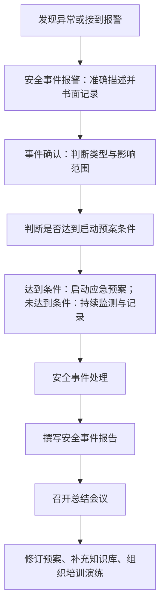

🔀 **流程图1 补充：启动预案判断分支**

| 流程节点 | 判断/处置 | 后续方向 |
| --- | --- | --- |
| 事件确认 | 未达到启动条件 | 持续监测、记录、跟踪风险变化。 |
| 事件确认 | 达到启动条件 | 启动应急预案，通知相关人员，进入正式处置流程。 |
| 处置完成 | 事件影响仍存在 | 继续抑制、根除、恢复和取证。 |
| 处置完成 | 业务恢复且风险受控 | 撰写报告并总结改进。 |

---

##### 八、常见网络安全应急事件场景

###### 1. 恶意程序事件

恶意程序事件包括**病毒、蠕虫、木马、僵尸网络**等。常见现象是**系统变慢、网络流量异常、异常进程、异常连接、文件被加密或破坏**。处置重点是：**隔离主机、分析样本、保护现场、必要时断网、清除恶意代码、修补漏洞、恢复业务**。

###### 2. 网络攻击事件

🔍 **网络攻击事件识别表**

| 现象 | 事件类型 |
| --- | --- |
| 大量端口探测、服务探测。 | 安全扫描 |
| 多次登录失败、口令猜测。 | 暴力破解 |
| 利用系统或应用缺陷执行命令。 | 系统漏洞攻击 |
| 管理员权限被非法获取。 | 入侵攻击 |

###### 3. Web 应用安全事件

Web 应用安全事件包括**网页篡改、网页挂马、非法页面、SQL 注入、上传漏洞、XSS、越权访问、域名服务劫持**等。

> [!TIP]
> Web 类事件常考“应先断开连接还是恢复页面”：若已造成公开影响或可能继续传播恶意代码，应**先隔离或断开，再取证和恢复**。

###### 4. 拒绝服务事件

DoS 或 DDoS 的本质是**让系统无法正常对外提供服务**。处置重点是：**识别攻击流量、封堵源、限速或清洗、DNS 调度或分流、运营商协同、日志保全、业务恢复**。

🚨 **常见事件场景处置关键词表**

| 事件场景 | 处置关键词 | 易错点 |
| --- | --- | --- |
| 恶意程序事件 | 隔离主机、分析样本、清除恶意代码、修补漏洞、恢复业务。 | 不要先重启或直接删除样本。 |
| 网页篡改 | 断网隔离、保护现场、恢复页面、排查漏洞、上报、加固。 | 不要只恢复页面而不查攻击路径。 |
| DDoS | 封堵、清洗、DNS 分流、运营商协同、日志保存。 | 不要把单机杀毒当成主要处置手段。 |
| 黑客入侵 | 断网、封堵源、记录连接、保存日志、修复漏洞、恢复使用。 | 不要清理痕迹后才取证。 |
| 电源中断 | 备用线路、UPS、查因、有序关闭设备。 | 不要突然断电关闭核心设备。 |

---

##### 九、事件处理内部流程：六个技术动作

教材将“安全事件处理”细化为**准备、检测、抑制、根除、恢复、总结**。这个顺序非常适合考流程排序。

🔄 **流程图2：安全事件处理内部流程**

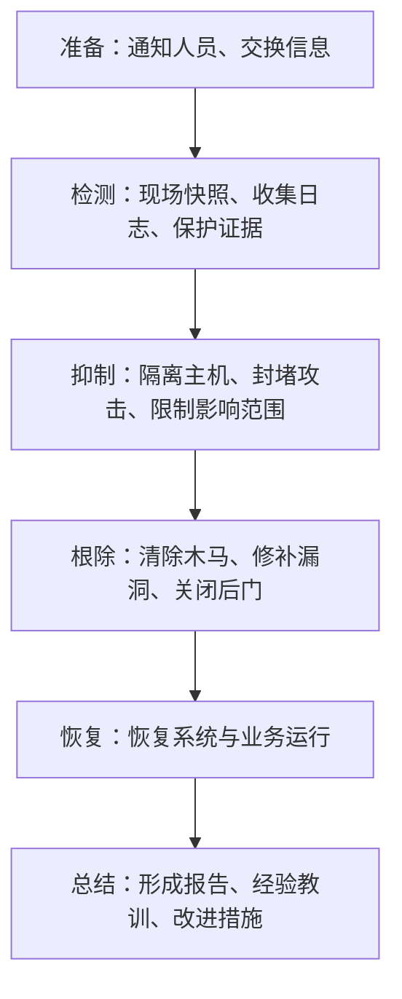

🔧 **六个技术动作细化表**

| 动作 | 核心含义 | 考试提示 |
| --- | --- | --- |
| 准备 | 通知相关人员，交换必要信息，明确职责和资源。 | 不是技术处置的开始，而是协同准备。 |
| 检测 | 对现场做快照，保护系统事件、行动记录、外部沟通记录等证据。 | 优先保护原始信息。 |
| 抑制 | 采取隔离、封堵、限速等围堵措施，尽量限制攻击范围。 | 先控制扩散。 |
| 根除 | 解决问题根因，清除恶意代码、关闭后门、修补漏洞、修复配置。 | 不是简单恢复页面。 |
| 恢复 | 恢复系统，使业务正常运行。 | 恢复前应确认风险受控。 |
| 总结 | 提交事故处理报告，复盘问题和改进措施。 | 不是可有可无。 |

> [!WARNING]
> - **抑制和根除不要混淆。** 抑制是先把损害控制住，例如**断网、封堵、隔离**；根除是解决根因，例如**清除后门、修补漏洞、修复配置**。
> - 检测阶段要保护证据，不应立即清除所有日志或重装系统。

---

##### 十、应急报告与总结

安全事件报告一般包括：**发生日期、参加人员、发现途径、事件类型、涉及范围、现场记录、损失和影响、处理过程、经验教训**。

📋 **安全事件报告内容表**

| 报告要素 | 写作要点 |
| --- | --- |
| 安全事件发生日期 | 记录事件发生、发现、上报、处置和恢复的关键时间点。 |
| 参加人员 | 记录参与处置、指挥、取证、恢复的人员和职责。 |
| 事件发现途径 | 说明由监测系统、用户反馈、值班巡检或外部通报发现。 |
| 事件类型 | 归类为恶意程序、网络攻击、信息破坏等类型。 |
| 事件涉及范围 | 说明影响系统、主机、账号、业务、用户或数据范围。 |
| 现场记录 | 记录日志、截图、样本、网络连接、操作过程等证据。 |
| 损失和影响 | 说明业务中断、数据泄露、数据篡改、社会影响等。 |
| 事件处理过程 | 按时间顺序记录报警、确认、隔离、根除、恢复等步骤。 |
| 经验与教训 | 总结原因、整改措施、预案修订和后续培训。 |

> [!TIP]
> **考试答题模板**：本事件报告应记录**事件发生时间、发现方式、事件类型、影响范围、现场证据、处置过程、损失影响、恢复情况、原因分析和改进建议**。

> 应急总结重点不是“写完报告就结束”，而是要**复盘问题原因，修订制度和预案，完善监测、备份、权限、日志、补丁和培训机制**。

---

##### 十一、网络安全事件应急演练

###### 1. 演练分类

🎬 **网络安全事件应急演练分类表**

| 划分依据 | 类型 | 特点 |
| --- | --- | --- |
| 组织形式 | 桌面演练 | 利用流程图、沙盘、会议推演，重在职责和决策。 |
| 组织形式 | 实战演练 | 使用真实设备、物资和操作，重在实战处置能力。 |
| 内容 | 单项演练 | 针对某一功能或环节。 |
| 内容 | 综合演练 | 涉及多项或全部响应功能。 |
| 目的与作用 | 检验性演练 | 检查预案可行性、准备充分性、协同能力。 |
| 目的与作用 | 示范性演练 | 展示能力、示范教学。 |
| 目的与作用 | 研究性演练 | 研究重点难点，试验新方案、新技术、新装备。 |

###### 2. 演练流程图

🔄 **流程图3：网络安全事件应急演练流程**

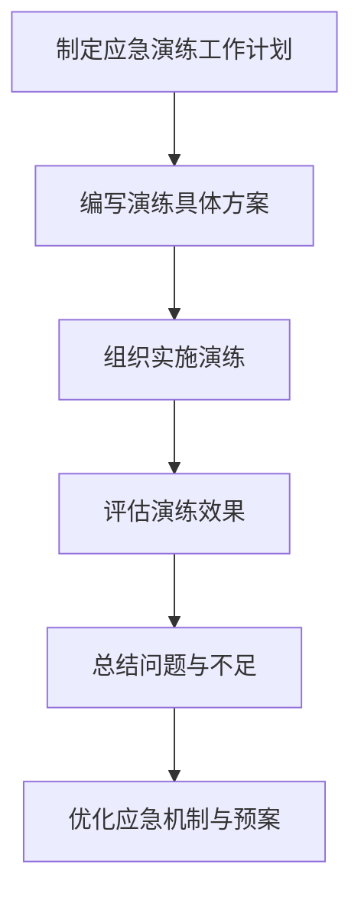

> [!WARNING]
> - **桌面演练不是低级演练**，它适合检验决策流程和职责分工。
> - **实战演练不是无脚本乱打**，仍应有目标、场景、边界和安全控制。
> - 真题对应：问“检验预案可行性和人员处置能力”的演练通常是**检验性演练**；问“展示应急能力”的通常是**示范性演练**。

---

##### 十二、网络安全应急响应技术与工具

###### 1. 技术分类总表

🛠️ **应急响应技术分类表**

| 技术类型 | 作用 | 工具/实例 |
| --- | --- | --- |
| 访问控制 | 阻断攻击、限制影响范围。 | 防火墙、代理、路由器、VLAN、认证授权。 |
| 网络安全评估 | 掌握攻击途径和系统状态。 | 漏洞扫描、木马检测、完整性检查。 |
| 网络安全监测 | 事前预警和事中分析。 | 抓包、流量分析、IDS、日志监测。 |
| 系统恢复 | 恢复受害系统和业务。 | 启动盘、补丁、备份、灾备系统。 |
| 入侵取证 | 追究责任、形成证据链。 | 日志提取、磁盘克隆、内存或网络连接采集。 |

###### 2. 网络安全评估

网络安全评估的目标是弄清楚“**系统到底被破坏到什么程度**”。主要方法包括**恶意代码检测、漏洞扫描、文件完整性检查、系统配置检查、网卡混杂模式检查、文件系统检查和日志审查**。

🔍 **网络安全评估方法表**

| 方法 | 检查内容 | 常见工具/命令 |
| --- | --- | --- |
| 恶意代码检测 | 病毒、木马、蠕虫、WebShell。 | D 盾_Web 查杀、chkrootkit、rkhunter、杀毒工具。 |
| 漏洞扫描 | 开放端口、系统漏洞、服务弱点。 | Nmap、Nessus。 |
| 文件完整性检查 | 文件是否被篡改，内核或二进制是否被替换。 | cmp、MD5 或 Hash 校验。 |
| 系统配置检查 | `passwd`、`services`、`inetd`、SUID/SGID、启动项。 | find、事件查看器、PCHunter、火绒剑。 |
| 网卡混杂模式检查 | 是否存在嗅探器。 | CPM、ifstatus。 |
| 文件系统检查 | 隐藏目录、异常文件、可疑目录名。 | 手工检查、find。 |
| 日志审查 | 登录、操作、入侵路径。 | grep、sed、awk、find。 |

> [!WARNING]
> - **文件完整性检查不是看文件名是否正常，而是比较文件内容或 Hash 值。**
> - 配置检查不只检查用户，还要检查**启动项、服务、SUID/SGID、远程信任配置**等。

###### 3. 网络安全监测

📡 **网络安全监测对象与工具表**

| 监测对象 | 目的 | 工具 |
| --- | --- | --- |
| 网络流量 | 发现异常连接、远控、蠕虫、勒索传播。 | TCPDump、Wireshark、Snort、netstat、TCPView。 |
| 网络连接 | 查看监听端口和连接状态。 | netstat、TCPView。 |
| 进程活动 | 找异常进程、后门进程。 | ps、Process Explorer、Autoruns。 |
| 在线用户 | 查看当前登录用户。 | who。 |
| 地址解析 | 检查 ARP 缓存和异常映射。 | arp。 |
| 进程资源 | 查看进程打开文件、端口、用户。 | lsof、fport。 |

###### 4. 系统恢复

系统恢复方法包括：**系统紧急启动、恶意代码清除、漏洞修补、删除文件恢复、系统备份容灾**。

> [!IMPORTANT]
> **删除文件恢复的考点**：普通删除通常只是将文件目录项或分配表标记为可用，并不立即物理擦除数据，因此在**未被覆盖前**有恢复可能。

> 灾难恢复方面，教材讲到**六级能力**：**基本支持、备用场地支持、电子传输和部分设备支持、电子传输及完整设备支持、实时数据传输及完整设备支持、数据零丢失和远程集群支持**。
> 2026 备考时要知道：教材引用的 **GB/T 20988—2007 已废止**，现行标准为 **GB/T 20988—2025**，但“**灾难恢复能力逐级增强**”的考试逻辑仍然适用。

📐 **灾备能力公式**

```
灾备能力越高 = 数据越实时 + 设备越完整 + 切换越自动 + 业务中断越短 + 数据丢失越少
```

📈 **灾难恢复能力递进理解表**

| 能力方向 | 低级能力表现 | 高级能力表现 |
| --- | --- | --- |
| 数据传输 | 离线备份或周期备份。 | 实时数据传输。 |
| 设备准备 | 备用场地或部分设备。 | 完整设备支持。 |
| 业务切换 | 人工恢复，时间较长。 | 远程集群或快速切换。 |
| 数据丢失 | 可能存在较大恢复点差距。 | 趋向数据零丢失。 |

###### 5. 入侵取证

入侵取证是从计算机和网络系统中提取攻击证据。证据信息分为**易失信息**和**非易失信息**。证据来源包括：**操作系统日志、网络访问日志、文件属性与内容、进程、用户活动、系统状态、网络连接记录、路由器日志、硬盘、光盘、U 盘**等。

📋 **入侵取证证据信息表**

| 类型 | 特点 | 例子 |
| --- | --- | --- |
| 易失信息 | 断电或重启后可能丢失。 | 内存、网络连接、当前进程、在线用户。 |
| 非易失信息 | 不随断电立即消失。 | 日志、文件、磁盘、系统配置、备份介质。 |

🔄 **流程图4：入侵取证六步流程**

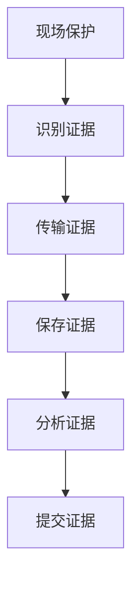

> [!WARNING]
> - **取证优先采集易失信息。** 不要先重启、格式化、清理系统后再取证。
> - 证据保存要保证完整性，可使用 **Hash 校验、只读介质、镜像克隆**等方式。

---

#### 第十八章 网络安全测评技术与标准

##### 一、2026 备考口径校核

本章属于软考中级信息安全工程师大纲中“**网络安全管理、等级保护、风险评估、安全测评、安全产品与标准、渗透测试、漏洞扫描、代码审查、协议分析、性能测试**”等范围。

> 教材本章主线是：**测评是什么 → 测评分哪几类 → 等保测评和渗透测试怎么做 → 常用测评工具怎么选 → 测评质量和标准体系如何对应**。

> [!IMPORTANT]
> **2026 法规与标准口径需要更新：**
> - 现行《网络安全法》已根据 **2025 年修改决定**重新公布，并自 **2026 年 1 月 1 日**起施行；答题时涉及网络运营者安全保护义务、等级保护、日志、数据保护、关键信息基础设施、网络产品服务安全等内容，应按现行法理解，**不强背旧条号**。
> - **等保 2.0 仍是本章核心口径**，**GB/T 22239—2019**《网络安全等级保护基本要求》、**GB/T 28448—2019**《网络安全等级保护测评要求》均为现行国家标准。
> - 风险评估标准应同步到 **GB/T 20984—2022**《信息安全技术 信息安全风险评估方法》。
> - 密码应用相关测评应结合 **GB/T 39786—2021** 及《商用密码应用安全性评估管理办法》。
> - 产品安全评估方面，教材中 **GB/T 18336—2015** 口径在 2026 备考时应注意新版 **GB/T 18336.1/.2/.3/.4—2024** 已发布并实施；考试若不明确要求新版细节，仍按教材“**CC/ISO 15408、功能要求、保证要求、EAL 保障级**”主线掌握即可。

##### 二、本章知识主线

🧭 **【流程图】第十八章总框架**

| 中心主题 | 一级分支 | 二级细项/记忆点 |
| --- | --- | --- |
| 网络安全测评 | 测评对象 | 信息技术产品；信息系统 |
| 网络安全测评 | 测评类型 | 等级测评；验收测评；风险测评；涉密/非涉密测评 |
| 网络安全测评 | 测评实施 | 安全功能检测；安全管理检测；代码安全审查；渗透测试；攻击测试 |
| 网络安全测评 | 工具与技术 | 漏洞扫描；协议分析；性能测试；代码审查工具 |
| 网络安全测评 | 质量与标准 | ISO 9000/CNAS；等保标准；产品测评标准；风险评估/密码应用/工控标准 |

> 备考时要把本章理解为“**安全建设闭环中的检验环节**”。测评不是单纯扫漏洞，也不是只出报告，而是依据**法规、标准和合同目标**，对系统或产品的安全状态作出**综合判定**，并形成**整改、复测、持续改进闭环**。

---

##### 考点1：网络安全测评的基本概念

📌 **要点｜定义**

网络安全测评是依据一定**标准、规范或安全目标**，采用**技术和管理方法**，获取测评对象的安全状态信息，并对其安全状况作出**综合判断**的活动。

🧩 **要点｜测评对象两类**

| 类别 | 例子 |
| --- | --- |
| 信息技术产品 | 操作系统、数据库、路由器、交换机、应用软件、防火墙、IDS、安全审计、VPN、网络隔离设备等 |
| 信息系统 | 业务系统、等级保护对象、待验收系统、待风险评估系统、待渗透测试系统等 |

> 考试关键词：**标准依据、技术方法、管理方法、安全状态、综合判定、整改建议、复测确认**。

🎯 **真题对应**

> [!TIP]
> - 题干出现“依据等级保护标准，对某单位系统安全技术和安全管理状况进行检测评估，并提出整改建议”，优先判断为**等级保护测评**。
> - 题干出现“项目上线前，按照合同和安全建设方案检查安全指标是否达标”，优先判断为**安全验收测评**。
> - 题干出现“分析资产、威胁、脆弱性、影响并提出风险控制措施”，优先判断为**风险测评**。

> [!WARNING]
> **漏洞扫描 ≠ 网络安全测评。** 漏洞扫描只是测评中的一种技术手段；完整测评还包括**标准依据、范围确认、现场核查、文档审查、人工分析、报告编制、整改复测**等。

---

##### 考点2：网络安全测评的发展与标准脉络

国际上常见标准脉络可按“**产品可信评估 → 通用准则 → 管理体系**”理解。**TCSEC** 是早期可信计算机系统评估准则；**ITSEC、CTCPEC、FC** 等推动了不同国家和地区的信息技术安全评估；**CC** 即 Common Criteria，后来被 **ISO/IEC 15408** 吸收，提出**保护轮廓、功能要求和保证要求**，是产品安全评估的重要基础。**ISO/IEC 27001** 则偏信息安全管理体系，不是单个产品测评标准。

> 国内脉络要重点记：**GB 17859—1999** 把计算机信息系统安全保护能力划分为**五级**：**用户自主保护级、系统审计保护级、安全标记保护级、结构化保护级、访问验证保护级**。等级越高，保护能力越强，**第五级最高**。教材第十八章还列出了我国等级保护、产品测评、风险评估、密码应用、工控安全等标准体系。

📚 **要点｜标准/概念定位**

| 标准/概念 | 主要定位 | 考试记忆点 |
| --- | --- | --- |
| TCSEC | 可信计算机系统早期评估准则 | 早期可信评估代表 |
| CC / ISO/IEC 15408 | 信息技术产品安全评估通用准则 | 保护轮廓；功能要求；保证要求；EAL |
| ISO/IEC 27001 | 信息安全管理体系标准 | 偏组织管理体系，不是单个产品测评 |
| GB 17859—1999 | 安全保护能力等级划分 | 五级：自主、审计、标记、结构化、访问验证 |
| 等保 2.0 标准体系 | 非涉密等级保护对象建设、测评、监督管理 | GB/T 22239、GB/T 22240、GB/T 28448 等 |

🎯 **真题对应**

> [!TIP]
> - 问“CC 标准主要把评估分为什么？”答题抓：**功能要求 + 保证要求**。
> - 问“ISO/IEC 27001 偏什么？”答题抓：**信息安全管理体系**。
> - 问“GB 17859 五级从低到高？”答题抓：**自主、审计、标记、结构化、访问验证**。

> [!WARNING]
> **CC/ISO 15408 偏产品安全评估，ISO/IEC 27001 偏组织管理体系，等保测评偏信息系统等级保护符合性，不要混成一个概念。**

---

##### 考点3：按测评目标分类

🎯 **要点｜类型**

| 类型 | 核心目的 | 典型内容 | 考试题眼 |
| --- | --- | --- | --- |
| 等级保护测评 | 判断系统是否符合相应安全等级要求 | 安全技术、安全管理、整改建议、复测确认 | 等保 2.0、等级要求、技术和管理 |
| 验收测评 | 判断项目是否满足验收安全指标 | 对照安全建设方案、合同、验收目标 | 上线前、项目验收、安全指标 |
| 风险测评 | 识别风险并提出控制措施 | 资产、威胁、脆弱性、安全功能、风险分析 | 风险管理、可接受风险、资产影响 |

📐 **风险测评的考试公式**

```
风险 ≈ 威胁发生可能性 × 脆弱性可利用程度 × 资产影响程度
```

也可以简化为：

```
风险 = 发生概率 × 影响程度
```

> 考试中不必机械追求数学精确，关键是能说明：**资产越重要、威胁越强、脆弱性越严重，风险越高；控制措施越有效，残余风险越低**。

🔄 **【流程图】网络信息系统安全风险测评基本流程**

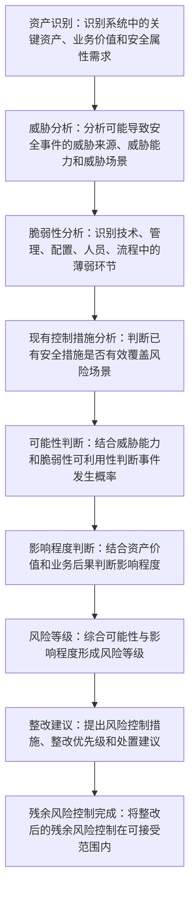

🎯 **真题对应**

> [!TIP]
> - 题干说“对系统面临的威胁、脆弱性及安全事件影响进行分析”，选择**风险测评**；
> - 题干说“系统整改后再次确认是否满足等级基本要求”，选择**等级测评复测**。

> [!WARNING]
> **风险不是漏洞本身。** 漏洞是脆弱性，威胁利用脆弱性并造成影响才形成风险。

---

##### 考点4：按测评内容分类

网络安全测评按内容分为**技术安全测评**和**管理安全测评**。

🧩 **要点｜测评内容**

| 类别 | 关注内容 |
| --- | --- |
| 技术安全测评 | 物理环境、网络通信、操作系统、数据库、应用系统、数据及存储系统、安全管理中心等 |
| 管理安全测评 | 管理机构、管理制度、管理流程、人员管理、系统建设、系统运维等 |

> [!IMPORTANT]
> 等保 2.0 中：
> - **技术要求**常按五块记：**安全物理环境、安全通信网络、安全区域边界、安全计算环境、安全管理中心**。
> - **管理要求**常按五块记：**安全管理制度、安全管理机构、安全管理人员、安全建设管理、安全运维管理**。

🧭 **【流程图】等保测评内容示意图**

| 中心主题 | 一级分支 | 二级细项/记忆点 |
| --- | --- | --- |
| 等保测评基本要求 | 技术要求 | 安全物理环境 |
| 等保测评基本要求 | 技术要求 | 安全通信网络 |
| 等保测评基本要求 | 技术要求 | 安全区域边界 |
| 等保测评基本要求 | 技术要求 | 安全计算环境 |
| 等保测评基本要求 | 技术要求 | 安全管理中心 |
| 等保测评基本要求 | 管理要求 | 安全管理制度 |
| 等保测评基本要求 | 管理要求 | 安全管理机构 |
| 等保测评基本要求 | 管理要求 | 安全管理人员 |
| 等保测评基本要求 | 管理要求 | 安全建设管理 |
| 等保测评基本要求 | 管理要求 | 安全运维管理 |

🎯 **真题对应**

> **机房、防雷、防火、供电**归**安全物理环境**；**边界访问控制、入侵防范、恶意代码防范**归**安全区域边界**；**制度、岗位、人员培训、外包管理、变更管理**归**管理要求**。

> [!WARNING]
> 技术测评不是只测网络设备；管理测评不是只看制度文本。考试常把“**制度存在但未执行、账号未审批、日志未审计、外包人员无保密协议**”写成管理缺陷。

---

##### 考点5：按实施方式分类

按实施方式，本章列出**五类**：**安全功能检测、安全管理检测、代码安全审查、安全渗透测试、信息系统攻击测试**。

🔧 **要点｜实施方式**

| 实施方式 | 核心含义 | 常用方法 | 易混点 |
| --- | --- | --- | --- |
| 安全功能检测 | 检查安全功能是否达到目标和设计要求 | 访谈、现场查看、文档审查、漏洞扫描、渗透测试、形式化验证 | 偏“功能符合性” |
| 安全管理检测 | 检查管理目标、管理机制是否落实 | 访谈、现场查看、文档审查、安全基线对比、社会工程 | 偏“制度流程人员” |
| 代码安全审查 | 对源代码或二进制代码进行安全符合性检查 | 静态扫描、人工审查、规范比对 | 偏“编码缺陷” |
| 安全渗透测试 | 模拟攻击者验证防护有效性 | 信息收集、漏洞验证、权限获取、影响分析 | 必须授权 |
| 攻击测试 | 按用户攻击性测试要求验证抗攻击能力 | DDoS、恶意代码等专项测试 | 更偏抗攻击能力指标 |

🎯 **真题对应**

> [!TIP]
> - 题干出现“缓冲区溢出、代码注入、危险函数、输入验证不足”，多半考**代码安全审查**。
> - 题干出现“模拟黑客、SQL 注入、XSS、弱口令、敏感信息泄露”，多半考**渗透测试**。
> - 题干出现“拒绝服务攻击、恶意代码攻击、防御攻击能力”，多半考**攻击测试**。

> [!WARNING]
> 渗透测试必须有**授权、范围、时间窗口、人员配合、保密要求和报告交付**。未经授权的“测试”可能构成违法或违规行为。

---

##### 考点6：涉密与非涉密测评

按保密性质分为**涉密信息系统测评**和**非涉密信息系统测评**。涉密系统测评依据**国家保密标准**，从风险评估角度分析威胁、脆弱性和安全保密隐患，为保密行政审批提供依据。非涉密系统测评依据**公开国家标准、行业标准、安全规范或业务安全需求**，给出安全状况评价和改进建议。

🔀 **要点｜对比**

| 类型 | 依据 | 核心目的 | 题干识别词 |
| --- | --- | --- | --- |
| 涉密信息系统测评 | 国家保密标准 | 发现安全保密隐患和风险，为行政审批提供依据 | 国家秘密、保密标准、行政审批、安全保密隐患 |
| 非涉密信息系统测评 | 公开国家标准、行业标准、安全规范或业务安全需求 | 评估网络安全状况并提出改进建议 | 公开标准、行业规范、业务安全需求、等级保护 |

🎯 **真题对应**

> [!TIP]
> - 题干出现“国家秘密、保密标准、行政审批、安全保密隐患”，优先选**涉密测评**；
> - 题干出现“公开标准、行业规范、业务安全需求”，优先选**非涉密测评**。

> [!WARNING]
> 涉密系统不能简单套普通等保测评流程，更不能把“**非涉密等保测评**”当作“**涉密系统安全审批**”的替代。

---

##### 考点7：等级保护测评流程

教材第十八章给出的等保测评过程可压缩为**四个基本活动**：**测评准备 → 方案编制 → 现场测评 → 报告编制**。

🔄 **【流程图】网络安全等级保护测评闭环流程**

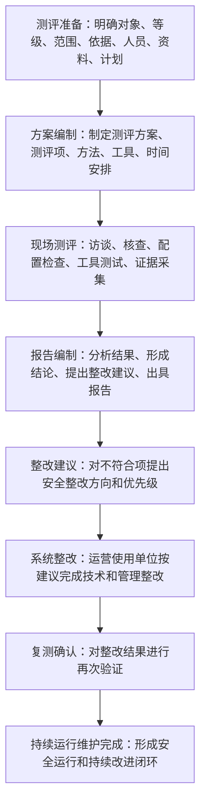

📋 **要点｜阶段与重点任务**

| 阶段 | 重点任务 |
| --- | --- |
| 测评准备 | 明确对象、等级、范围、依据、人员、资料、计划 |
| 方案编制 | 制定测评方案、测评项、方法、工具、时间安排 |
| 现场测评 | 访谈、核查、配置检查、工具测试、证据采集 |
| 报告编制 | 分析结果、形成结论、提出整改建议、出具报告 |
| 整改复测 | 对不符合项整改后再次验证 |

🎯 **真题对应**

> [!TIP]
> - 题干若问“等级测评现场活动包括什么”，不要只写漏洞扫描，还要写**访谈、文档审查、配置核查、现场查看、工具测试**等。
> - 题干若问“测评发现不符合项后怎么办”，答题抓：**提出整改建议 → 整改实施 → 复测确认**。

> [!WARNING]
> 等保测评不是“一次通过制”。发现问题后**提出整改建议并复测**，是保证保护措施达到相应等级要求的重要环节。

---

##### 考点8：渗透测试流程

教材将渗透测试过程分为**五个阶段**：**委托受理、准备、实施、综合评估、结题**。

🔄 **【流程图】网络安全渗透测试流程**

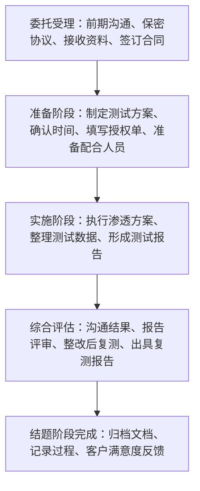

> 考试关键词：**保密协议、合同、授权单、测试方案、测试时间、客户陪同、报告评审、整改复测、归档**。

🎯 **真题对应**

> [!TIP]
> - 题干说“测试人员未取得授权直接对生产系统扫描并利用漏洞”，错误点是**未授权、未限定范围、未确定时间窗口、可能影响业务连续性**。
> - 题干说“客户整改后要求再次验证”，对应**复测报告**。

> [!WARNING]
> 渗透测试的目标是**验证安全风险和防护有效性**，不是“破坏系统”。考试中凡出现“**越权扩大范围、植入后门、长时间占用资源、未清理测试账号和文件**”，都属于不规范行为。

---

##### 考点9：漏洞扫描技术与工具

漏洞扫描用于获取测评对象的安全漏洞信息。教材列出的扫描对象可分为：**网络安全漏洞扫描、主机安全漏洞扫描、数据库安全漏洞扫描、Web 应用安全漏洞扫描**。

🔧 **要点｜扫描类型**

| 类型 | 关注对象 | 常见工具/例子 | 考试识别 |
| --- | --- | --- | --- |
| 网络漏洞扫描 | 网络设备、端口、服务、远程漏洞 | Nmap、Nessus、OpenVAS | 远程探测、端口服务 |
| 主机漏洞扫描 | 主机补丁、配置、系统漏洞 | MBSA、COPS 等 | 装在目标主机或检查主机基线 |
| 数据库漏洞扫描 | 数据库账号、配置、版本、弱口令 | SQLMap、THC-Hydra 等 | 数据库账号、SQL 注入、口令 |
| Web 漏洞扫描 | Web 应用漏洞 | w3af、Nikto、AppScan、Acunetix WVS | XSS、SQL 注入、目录遍历 |

🎯 **真题对应**

> [!TIP]
> - 问“发现 Web 应用 SQL 注入、XSS 等漏洞可用什么”，优先想到 **Web 应用安全漏洞扫描器或渗透测试工具**。
> - 问“探测目标开放端口和服务”，优先想到 **Nmap**。
> - 问“数据库弱口令、账号配置”，优先想到**数据库漏洞扫描或口令检测工具**。

> [!WARNING]
> **Nmap** 偏端口和服务探测，不等于万能漏洞扫描器；**SQLMap** 偏 SQL 注入检测利用；**Wireshark** 偏抓包协议分析；**Metasploit** 偏漏洞验证和渗透测试框架。

---

##### 考点10：渗透测试的黑盒、白盒、灰盒模型

🎨 **要点｜模型对比**

| 模型 | 已知信息 | 适用场景 | 考试关键词 |
| --- | --- | --- | --- |
| 黑盒 | 只提供目标地址或少量信息 | 模拟外部攻击者 | 信息少、外部视角 |
| 白盒 | 提供详细系统信息、架构、代码、账号等 | 深度安全测试、高级威胁模拟 | 信息充分、深度验证 |
| 灰盒 | 提供部分信息 | 模拟内部人员或部分授权攻击者 | 部分信息、折中 |

🎯 **真题对应**

> [!TIP]
> - “只给目标 IP，让测试团队从指定测试点攻击”是**黑盒**；
> - “提供代码、架构、接口、账号等详细资料”是**白盒**；
> - “提供部分账号或部分接口资料”是**灰盒**。

> [!WARNING]
> 白盒不是“更简单”，而是能做更深入的安全验证；黑盒更贴近外部攻击者视角，但可能遗漏内部逻辑缺陷。

---

##### 考点11：代码安全审查

代码安全审查依据**安全编程规范和业务安全规范**，对**源代码或二进制代码**进行安全符合性检查。

🐛 **要点｜典型缺陷**

| 项目 | 内容 |
| --- | --- |
| 典型缺陷 | 缓冲区溢出、代码注入、跨站脚本、输入验证不足、API 误用、密码管理不当、配置错误、危险函数使用 |
| 参考规范 | CERT C/C++/Java、MISRA C/C++、ISO/IEC TR 24772、CWE、OWASP Top 10、CWE/SANS Top 25 |
| 工具 | Fortify、AppScan Source、Checkmarx、FindBugs、PMD |

🔍 **要点｜审查对象与判断**

| 审查对象 | 典型缺陷 | 参考规范/工具 | 考试判断 |
| --- | --- | --- | --- |
| 源代码或二进制代码 | 缓冲区溢出、代码注入、XSS、输入验证不足 | CERT、MISRA、CWE、OWASP Top 10 | 编码缺陷、开发阶段安全问题 |
| 安全配置与密码管理 | 硬编码口令、配置错误、危险函数、API 误用 | Fortify、Checkmarx、FindBugs、PMD | 静态扫描 + 人工审查 |

🎯 **真题对应**

> [!TIP]
> - 题干出现“开发人员未对输入参数做边界检查导致缓冲区溢出”，答题应落到**代码安全审查、输入验证、边界检查**。
> - 题干出现“危险函数、硬编码口令、异常信息泄露”，也属于**代码安全缺陷**。

> [!WARNING]
> 代码安全审查偏“**源头治理**”，不是等系统上线后再靠防火墙补救。安全编码、静态扫描、人工审查、单元安全测试应**尽早介入**。

---

##### 考点12：协议分析与 TCPDump

协议分析用于检测和分析网络协议安全性。常见工具包括 **TCPDump** 和 **Wireshark**。**TCPDump** 偏命令行抓包，支持过滤表达式；**Wireshark** 偏图形化抓包和协议解析。

🔑 **TCPDump 表达式核心记三类关键字**

| 关键字类型 | 典型关键字 | 含义 |
| --- | --- | --- |
| 类型关键字 | host、net、port | 指定主机、网络、端口 |
| 方向关键字 | src、dst、src or dst、src and dst | 指定源或目的方向 |
| 协议关键字 | ip、arp、tcp、udp 等 | 指定协议类型 |

💻 **常用表达式记忆**

```
tcpdump host X.Y.Z.61
tcpdump tcp port 23 host X.Y.Z.1
tcpdump src X.Y.Z.2
tcpdump dst net X.Y.Z.0
```

🎯 **真题对应**

> [!TIP]
> - 问“抓取某主机收发的所有数据包”，选或写 **host**；
> - 问“抓取 Telnet 流量”，抓 **tcp port 23**；
> - 问“只看源地址”，用 **src**；
> - 问“只看目的网络”，用 **dst net**。

> [!WARNING]
> **host 是主机，net 是网络，port 是端口；src 是源，dst 是目的。** 不要把 Wireshark 当漏洞扫描器，它主要是协议分析和抓包工具。

---

##### 考点13：性能测试

性能测试用于评估测评对象的**承载能力、处理能力**以及**安全机制对性能的影响**。常见工具包括**操作系统自带监测工具、ping、tracert/traceroute、UnixBench、Apache JMeter、LoadRunner、SmartBits** 等。

> 教材将 **JMeter** 定位为 Web 应用性能和功能测试工具，可支持 **Web、FTP、数据库、LDAP** 等性能测试；**LoadRunner** 用于评估系统在不同压力下的性能状况；**SmartBits** 用于网络及设备性能测试和评估。

📐 **考试公式**

```
吞吐量 = 单位时间内成功处理的数据量或请求量
响应时间 = 请求发出到收到响应的时间
并发用户数 ≠ 每秒请求数
安全设备性能下降判断 = 启用安全策略前后吞吐、延迟、丢包率、连接数变化
```

⚙️ **要点｜工具/指标**

| 工具/指标 | 主要用途 | 考试识别 |
| --- | --- | --- |
| ping | 连通性、时延初步判断 | 能否到达、基本延迟 |
| tracert/traceroute | 路径跟踪 | 链路路径、跳数 |
| Apache JMeter | Web、FTP、数据库、LDAP 等性能测试 | 开源、Web 性能、并发压测 |
| LoadRunner | 不同压力下系统性能评估 | 虚拟用户、负载生成、测试分析 |
| SmartBits | 网络及设备性能测试评估 | 网络设备性能、吞吐与转发 |

🎯 **真题对应**

> [!TIP]
> - 问“评估 Web 系统并发访问能力”，优先 **JMeter 或 LoadRunner**；
> - 问“网络设备性能测试”，可想到 **SmartBits**；
> - 问“链路连通性和路径”，想到 **ping、tracert/traceroute**。

> [!WARNING]
> 性能测试不是安全漏洞测试，但安全产品开启**深度检测、加密、审计、过滤**后，可能影响**吞吐量、时延、并发连接数和丢包率**。

---

##### 考点14：测评质量管理

网络安全测评可信的基础是质量管理。教材列出的质量管理要素包括：**测评机构建立质量管理体系、人员管理、设备管理、方法管理、文件控制、非符合性工作控制、体系运行监督、持续改进**等。**CNAS** 负责对**认证机构、实验室、检查机构**等开展认可，对质量管理体系和技术能力进行确认。

📋 **要点｜质量管理要素**

| 质量管理要素 | 具体含义 | 考试抓手 |
| --- | --- | --- |
| 质量管理体系 | 建立机构级质量控制和持续改进机制 | ISO 9000、制度化管理 |
| 人员管理 | 测评人员能力、资质、岗位职责、保密要求 | 人是测评质量关键 |
| 设备管理 | 测评设备、工具版本、校准和使用记录 | 工具可信、版本可追溯 |
| 方法管理 | 测评方法、测试步骤、基线和证据规则 | 方法一致、证据充分 |
| 文件控制 | 方案、记录、报告、归档受控 | 文档完整、可追溯 |
| 非符合性工作控制 | 发现测评偏差或不符合项时纠正处理 | 纠正、复核、持续改进 |
| 体系运行监督 | 内部审核、管理评审、持续改进 | 质量闭环 |

🎯 **真题对应**

> 题干出现“测评报告可信性、测评机构能力、实验室认可、测评过程质量控制”，优先想到**质量管理体系、CNAS 认可、人员设备方法文件控制**。

> [!WARNING]
> 质量管理不是只看报告格式，而是覆盖“**人、机、料、法、环、测**”的全过程控制。测评工具版本、测试记录、证据链、报告复核、非符合项处理都可能成为考点。

---

##### 考点15：网络安全测评标准体系

本章标准体系可以按**五类**记忆：

📚 **要点｜标准类别**

| 标准类别 | 代表内容 | 备考重点 |
| --- | --- | --- |
| 等级保护测评标准 | GB 17859、GB/T 22239、GB/T 22240、GB/T 25070、GB/T 25058、GB/T 28448、GB/T 36627 | 定级、基本要求、设计、实施、测评 |
| 产品测评标准 | GB/T 18336、路由器、服务器、交换机、数据库、操作系统等安全技术/评估标准 | CC、EAL、功能要求、保障要求 |
| 风险评估标准 | GB/T 20984—2022 | 资产、威胁、脆弱性、风险分析 |
| 密码应用安全 | GB/T 39786—2021、密评管理办法 | 合规性、正确性、有效性，三同步一评估 |
| 工控安全评估 | 工业控制系统安全扩展要求、防护能力评估 | 连续控制、批量控制、离散控制，安全生产影响 |

> [!IMPORTANT]
> 其中，**GB/T 28448—2019**《网络安全等级保护测评要求》、**GB/T 36627—2018**《网络安全等级保护测试评估技术指南》目前均显示为现行标准；**GB/T 20984—2022** 是现行信息安全风险评估方法；**GB/T 39786—2021** 是信息系统密码应用基本要求。

🎯 **真题对应**

> [!TIP]
> - 问“等保对象安全建设和监督管理基本要求”对应 **GB/T 22239**；
> - 问“定级方法和定级流程”对应 **GB/T 22240**；
> - 问“等级测评要求”对应 **GB/T 28448**；
> - 问“测试评估技术指南”对应 **GB/T 36627**；
> - 问“风险评估方法”对应 **GB/T 20984**；
> - 问“密码应用基本要求”对应 **GB/T 39786**。

> [!WARNING]
> 教材中的标准编号和版本如果与现行标准有差异，考试一般不会要求死背所有版本号；但遇到法规标准口径题，应**优先按现行有效官方标准理解**。

---

#### 第十九章 操作系统安全保护

> 说明：本章原文按 19.1～19.4 小节组织，未使用“考点N”编号，以下沿用原小节编号。

##### 一、2026 备考口径校核

本章属于软考中级信息安全工程师大纲中“**系统安全、操作系统安全、访问控制、身份认证、安全审计、安全加固、安全运行维护**”等范围。主线是：**操作系统为什么不安全 → 操作系统如何提供安全机制 → Windows/UNIX/Linux 如何防护 → 国产操作系统如何增强安全可控**。本笔记在不照搬教材原文的基础上，按考试答题逻辑重构。

> [!IMPORTANT]
> 法规口径上，2026 答题不能只停留在“装补丁、关端口、杀病毒”的技术层面，还要能上升到现行《网络安全法》的等保义务：网络运营者应采取**防病毒、防攻击、防侵入、监测记录网络运行状态和网络安全事件、日志留存不少于六个月、数据分类、重要数据备份和加密**等措施；网络产品和服务不得设置恶意程序，发现缺陷漏洞应及时**补救、告知用户并按规定报告**。

##### 二、本章知识主线

> 操作系统安全不是单点工具问题，而是“**身份鉴别—访问控制—最小特权—安全审计—安全加固—持续监测**”的体系化保护。

---

##### 三、19.1 操作系统安全概述

###### 1. 操作系统安全的本质

操作系统是**计算资源管理者**，也是**应用程序运行的基础平台**。操作系统一旦失守，应用、数据、网络服务、账户权限都会被连带破坏。因此，操作系统安全的本质是：**让系统在既定安全策略约束下，能够抵御常见威胁，保护自身运行安全和资源安全**。

> 教材引用 **GB/T 20272—2019**，将操作系统安全等级分为**五级**：**用户自主保护级、系统审计保护级、安全标记保护级、结构化保护级、访问验证保护级**。记忆时按“**自主—审计—标记—结构—验证**”递进理解。

###### 2. 操作系统安全需求

📋 **要点｜安全需求**

| 安全需求 | 速记 | 考试理解 |
| --- | --- | --- |
| 标识和鉴别 | 先识别是谁 | 用户、进程、主体必须有唯一身份 |
| 访问控制 | 再判断能不能访问 | 防止越权读取、修改、删除、执行 |
| 系统资源安全 | 保护数据和资源 | 保密性、完整性、可用性 |
| 网络安全 | 控制网络访问 | 网络通信、端口、服务、连接都要受控 |
| 抗攻击 | 防病毒、防入侵、防恶意代码 | 面向缓冲区溢出、蠕虫、木马、勒索软件等 |
| 自身安全 | 系统不能被轻易篡改 | 完整性保护、可信恢复、自保护 |

> [!WARNING]
> “**系统资源安全**”强调信息和数据的 CIA；“**网络安全**”强调网络访问、通信数据和服务可用性；“**自身安全**”强调操作系统本体完整性和可信恢复，三者不要混淆。

###### 3. 操作系统安全机制

🔧 **要点｜安全机制**

| 机制 | 核心作用 | 高频辨析 |
| --- | --- | --- |
| 硬件安全 | 提供底层保障 | 存储保护、I/O 保护、CPU 安全、物理环境 |
| 标识与鉴别 | 证明主体身份 | 标识是“你是谁”，鉴别是“证明你是谁” |
| 访问控制 | 防止资源滥用 | 常见为 DAC、MAC |
| 最小特权 | 只给必要权限 | root/Administrator 权限过大是典型风险 |
| 可信路径 | 防假登录、防口令窃取 | 防特洛伊木马伪造登录界面 |
| 安全审计 | 记录、检查、追踪 | 为追责、取证、合规提供依据 |
| 系统安全增强 | 也叫安全加固 | 优化配置、安装组件、减少攻击面 |

> 教材将操作系统安全机制归纳为**硬件安全、标识鉴别、访问控制、最小特权、安全审计、可信路径、系统安全增强**等，这也是选择题最常考的归类点。

###### 4. 操作系统安全保护总流程图

🔄 **流程图：操作系统安全保护总流程**

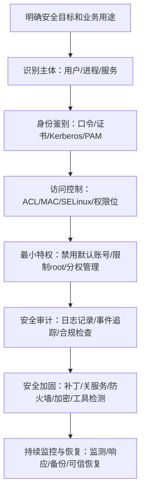

---

##### 四、19.2 Windows 操作系统安全分析与防护

###### 1. Windows 系统架构与安全子系统

教材以 **Windows XP / Windows 2000** 为例讲结构，考试不要求背完整图，但要知道其分层思想和安全子系统。

> Windows XP 是**层次结构与客户机/服务器结构的混合体**，底层有**硬件抽象层**，内核层提供**中断、异常、同步**等支持，上层由**系统服务模块**组成。Windows 2000 的安全子系统主要包括 **LSA、SAM、SRM**。

🧩 **要点｜安全组件**

| 组件 | 全称 | 功能速记 |
| --- | --- | --- |
| LSA | Local Security Authority，本地安全授权 | 产生令牌、管理本地安全策略、交互式登录认证、审计策略 |
| SAM | Security Account Manager，安全账户管理 | 维护用户和组数据库，参与本地登录认证，分配 SID |
| SRM | Security Reference Monitor，安全参考监视器 | 执行访问控制和审计，检查主体访问客体是否被允许 |
| SID | Security Identifier，安全标识符 | 唯一标识用户、组、主体 |
| ACE | Access Control Entry，访问控制项 | 描述单条访问许可或拒绝 |
| ACL | Access Control List，访问控制列表 | 由多个 ACE 组成 |
| DACL | Discretionary ACL | 决定谁能访问对象 |
| SACL | System ACL | 决定哪些访问行为需要审计 |

> [!IMPORTANT]
> **高频考点**：没有 ACL 的客体，意味着**访问控制缺失或默认可访问风险**；有 ACL 的客体，由 **SRM** 按 **ACE** 检查并作出访问决策。

###### 2. Windows 访问控制流程图

🔄 **流程图：Windows 访问控制流程**

```mermaid
flowchart TD
    A["用户登录成功"] --> B["系统生成访问令牌"]
    B --> C["令牌包含用户SID/组SID/权限列表"]
    C --> D["用户进程请求访问文件/目录/对象"]
    D --> E["读取客体安全描述符"]
    E --> F["检查DACL中的ACE"]
    F --> G{"判断：是否匹配允许规则？"}
    G -->|是| H["允许访问"]
    G -->|否| I["继续检查或拒绝访问"]
    H --> J["根据SACL产生审计记录"]
    I --> J
```

###### 3. Windows 安全机制

🔧 **要点｜安全机制**

| 机制 | 重点内容 | 考试提示 |
| --- | --- | --- |
| 认证机制 | 本地认证、网络认证；Kerberos V5、公钥证书、NTLM | Kerberos、证书、NTLM 常作为选项出现 |
| 访问控制 | SID、ACL、ACE、DACL、SACL、安全描述符 | 重点考“主体—客体—访问控制项” |
| 审计/日志 | 系统日志、应用程序日志、安全日志 | 日志用于运行记录、审计、取证 |
| 协议过滤与防火墙 | 包过滤、ICF、防火墙规则 | 用于限制网络包进入主机 |
| 文件加密系统 EFS | 对磁盘文件透明加密 | 防物理读取绕过文件访问控制 |
| 抗攻击机制 | Stack Protection、SafeSEH、DEP、ASLR、PatchGuard、驱动签名 | 现代 Windows 安全趋势考点 |

> 教材还列出 **Windows 10** 减少攻击面规则，如**阻止 Office 创建子进程、阻止 Office 宏调用 Win32 API、阻止 JS/VBS 启动下载内容、防御勒索软件、保护 LSASS 凭据、限制 PsExec/WMI 创建进程、限制 USB 不受信任程序**等。备考时不需要逐字背 15 条，但要能归类为：**防邮件附件执行、防 Office 宏滥用、防脚本下载执行、防凭据窃取、防横向移动、防勒索软件、防持久化**。

###### 4. Windows 典型安全问题

⚠️ **要点｜问题与措施**

| 问题 | 风险表现 | 应试措施 |
| --- | --- | --- |
| 口令/账号风险 | 弱口令、默认账号、空连接枚举账号 | 强口令、账户锁定、禁用 Guest、隐藏上次登录名 |
| 恶意代码 | 病毒、蠕虫、木马、勒索软件 | 杀毒、防火墙、补丁、最小权限 |
| 应用软件漏洞 | IE、Office、Outlook 等被利用 | 及时更新、禁用危险宏、限制脚本 |
| 系统程序漏洞 | RPC 等系统服务漏洞引发溢出 | 打补丁、关闭不必要服务 |
| 注册表安全 | 权限配置不当导致启动项被篡改 | 收紧注册表权限、监控关键项 |
| 文件共享安全 | IPC$、默认共享导致信息泄露 | 关闭默认共享、禁用空连接 |
| 物理临近攻击 | 光盘/USB 启动绕过系统访问控制 | BIOS/UEFI 口令、禁用外部启动、磁盘加密 |

> [!WARNING]
> Windows 的“**文件共享安全**”和“**文件系统安全**”不是一回事。前者强调网络共享和 `IPC$` 风险；后者强调 **NTFS 权限、EFS、文件访问控制**。

###### 5. Windows 安全增强方法

教材归纳的 Windows 安全增强方法有**六类**：**打补丁、停止服务/卸载软件、升级或更换程序、修改配置或权限、清除特洛伊等恶意程序、安装安全工具软件**。这些方法在案例题中通常要写成“**组合拳**”，不能只写“安装杀毒软件”。

###### 6. Windows 安全加固标准流程图

🔄 **流程图：Windows 安全加固标准流程**

```mermaid
flowchart TD
    A["确认安全目标与业务用途"] --> B["最小化安装操作系统"]
    B --> C["安装最新系统补丁"]
    C --> D["配置必要系统服务"]
    D --> E["配置安全策略：账号/审计/远程访问/共享"]
    E --> F["禁用NetBIOS或限制135～139/445端口"]
    F --> G["账户安全：禁用默认账号/锁定Guest/定期检查"]
    G --> H["文件系统安全：NTFS权限/EFS/共享口令"]
    H --> I["TCP/IP筛选与防火墙"]
    I --> J["禁用外部介质启动"]
    J --> K["屏幕保护口令与应用软件安全"]
    K --> L["安装第三方安全工具"]
    L --> M["持续审计与更新"]
```

###### 7. Windows 案例答题模板

> [!TIP]
> 遇到“某单位 Windows 服务器被攻击/存在弱口令/开放共享/未打补丁/被勒索”的案例题，可按以下顺序作答：
> 1. **账户口令**：禁用 Guest 和默认无用账号，重命名 Administrator，启用复杂口令、口令历史、账户锁定策略，不显示上次登录用户名。
> 2. **补丁更新**：及时安装操作系统和应用补丁，重点关注 Office、浏览器、远程服务。
> 3. **服务端口**：关闭无关服务，限制 **135～139、445** 等高风险端口，按业务最小开放端口。
> 4. **共享与远程访问**：关闭默认共享、禁止空连接、限制远程登录来源。
> 5. **文件与注册表**：采用 NTFS 权限、EFS、关键注册表权限加固。
> 6. **防护工具**：启用防火墙、杀毒、入侵检测、漏洞扫描、安全基线核查工具。
> 7. **审计日志**：启用安全日志、登录失败审计、策略变更审计，**日志留存不少于六个月**。

---

##### 五、19.3 UNIX/Linux 操作系统安全分析与防护

###### 1. UNIX/Linux 系统架构

UNIX/Linux 通常分为三层：**硬件层、系统内核、应用层**。其安全特点是**多用户、多任务**，因此核心目标是：**不同用户之间相互隔离，防止非授权访问系统资源**。

###### 2. UNIX/Linux 认证机制

🔑 **要点｜认证方式**

| 认证方式 | 说明 | 易错点 |
| --- | --- | --- |
| 口令认证 | 最常见，用户名 + 口令 | 弱口令是主要突破口 |
| 终端认证 | 限制超级用户从远程登录 | 常用于限制 root 远程登录 |
| 主机信任 | `.rhosts`、`hosts.equiv` | 方便但风险大，易被假冒 |
| 第三方认证 | S/Key、Kerberos、PAM | PAM 是插件式身份认证框架 |

> [!IMPORTANT]
> **考试抓手**：**PAM** 的价值是**不用修改原登录程序**，就能把新的认证方式“插件式”接入 Login、FTP、Telnet 等服务。

###### 3. UNIX/Linux 访问控制与权限计算

UNIX/Linux 常用“**9bit 权限位**”控制文件访问：三组权限分别对应**文件属主、同组用户、其他用户**，每组权限由 **r、w、x** 组成。

📐 **公式1：权限位基础赋值**

```
r = 4, w = 2, x = 1
```

📐 **公式2：权限值计算**

```
权限值 = r + w + x
```

📐 **公式3：常见权限组合**

```
rwx = 7, r-x = 5, r-- = 4
```

📐 **公式4：权限表示示例**

```
-rwxr-xr-- = 754
```

> 例：`-rwxr-xr--` 表示文件属主可读写执行，同组用户可读和执行，其他用户只可读。教材也用该例说明 9bit 权限控制。

> [!WARNING]
> **`chmod 777` 不是“权限大一点更方便”，而是高危配置**；`/etc/shadow` 若被普通用户读取，会导致口令散列泄露风险。

###### 4. UNIX/Linux 审计机制

📋 **要点｜日志文件**

| 日志文件 | 作用 |
| --- | --- |
| `lastlog` | 记录用户最近成功登录时间 |
| `loginlog` | 记录不良登录尝试 |
| `messages` | 记录系统消息和 syslog 输出 |
| `utmp` / `utmpx` | 记录当前登录用户 |
| `wtmp` / `wtmpx` | 记录登录和注销历史 |
| `sulog` | 记录 su 命令使用情况 |
| `acct` | 记录用户执行过的命令 |
| `xferlog` | 记录 FTP 存取情况 |

> 教材指出不同 UNIX/Linux 版本日志目录不同，常见位置包括 `/usr/adm`、`/var/adm`、`/var/log`。考试中重点不是背路径，而是知道审计用于**发现入侵、追踪异常、辅助取证**。

###### 5. UNIX/Linux 典型安全问题

⚠️ **要点｜问题与防护**

| 安全问题 | 风险 | 防护思路 |
| --- | --- | --- |
| 口令/账号安全 | root 口令泄露即系统失守 | 强口令、禁 root 远程、限制 su、PAM/Kerberos |
| 可信主机文件 | `.rhosts`、`hosts.equiv` 配置不当 | 禁用或严格限制主机信任 |
| 应用软件漏洞 | Sendmail、BIND 等被利用 | 补丁、升级、替换、最小化服务 |
| SUID 文件 | 普通用户借程序获得属主权限 | 查找并取消不必要 SUID |
| 恶意代码/rootkit | 后门、木马、内核模块隐藏 | 完整性检测、Chkrootkit、Rootkit Hunter |
| 文件系统权限 | 关键文件权限过宽 | chmod/chown/chattr 加固 |
| 网络服务风险 | finger、rlogin、rsh、tftp 暴露信息或明文传输 | 关闭服务、用 SSH 替代 Telnet |
| 系统程序漏洞 | 普通用户提权 | 补丁、最小权限、审计 |

> 教材将 UNIX/Linux 风险集中在**口令账号、可信主机、应用漏洞、SUID、恶意代码、文件系统、网络服务、系统程序漏洞**等方面。

###### 6. UNIX/Linux 安全增强方法

教材归纳的 UNIX/Linux 安全增强方法与 Windows 类似，主要包括：**打补丁、停止不必要服务、升级或更换软件包、修改系统配置、安装专用安全工具**。

###### 7. UNIX/Linux 安全加固流程图

🔄 **流程图：UNIX/Linux 安全加固流程**

```mermaid
flowchart TD
    A["确认UNIX/Linux系统安全目标"] --> B["最小化安装系统"]
    B --> C["配置系统安全策略"]
    C --> D["用户与口令策略/主机信任控制/文件访问权限/网络服务最小化/系统审计"]
    D --> E["安装第三方安全工具"]
    E --> F["安全检查：Nmap/COPS/Crack等"]
    F --> G{"判断：检查是否通过？"}
    G -->|否| H["修正安全策略和配置 → 再次安全检查"]
    H --> F
    G -->|是| I["系统安全运行"]
    I --> J["进程监控/用户监控/网络连接监控/日志分析"]
```

> [!IMPORTANT]
> UNIX/Linux 安全加固流程强调“**检查—修正—再检查**”的闭环，而不是一次性配置完成。教材流程中也把“安全检查是否通过”作为进入安全运行的前置条件。

###### 8. UNIX/Linux 安全增强技术

🛠️ **要点｜技术/措施**

| 技术/措施 | 重点记忆 |
| --- | --- |
| 安装系统补丁 | 安装前校验数字签名或完整性，防止补丁包被植入恶意代码 |
| 最小化网络服务 | 关闭 finger、echo、chargen、rsh、rlogin、tftp 等无关服务 |
| 开机保护口令 | 防止物理临近攻击进入单用户模式 |
| 弱口令检查 | 使用授权的弱口令审计工具检查账号安全，不作为攻击步骤掌握 |
| 禁用默认账号 | 默认账号可能成为后门入口 |
| SSH 替代 Telnet/FTP 明文登录 | SSH 提供认证和加密通道 |
| tcp_wrapper | 对 inetd 服务进行访问控制和过滤 |
| iptables/netfilter | 构建主机防火墙，过滤不必要通信 |
| Tripwire/MD5Sum | 完整性检测，发现系统文件被篡改 |
| LKM 后门检测 | 检测可加载内核模块型 rootkit |
| 系统安全监测 | Netstat、lsof、Snort 等用于运行监控 |

> 教材特别强调**补丁包应做完整性校验**，网络服务应最小化，`inetd.conf`、`services` 等配置文件要设置合理权限，且只开放业务需要的网络端口。

###### 9. Linux 典型配置参考

⚙️ **要点｜配置点**

| 配置点 | 考试答题写法 |
| --- | --- |
| 保护关键文件 | 对 `inetd.conf`、`services`、`lilo.conf` 等限制权限，属主设为 root |
| 禁止不必要 SUID | 查找 root 所属 SUID/SGID 程序，取消不必要的 s 位 |
| 启动口令 | 为 LILO/启动管理器增加口令，并限制配置文件可读写权限 |
| 口令策略 | 增加最小长度，限制口令使用周期 |
| 远程访问控制 | 通过 `hosts.allow` / `hosts.deny` 控制允许和拒绝来源 |
| 用户超时注销 | 设置长时间无操作自动注销 |
| 命令历史处理 | 教材有注销清理命令记录的配置示例，但 2026 答题遇到合规审计场景，应优先强调审计留痕、日志保护和集中审计，不应把“删除历史”当作替代审计的措施 |

> [!IMPORTANT]
> **法规统一口径提醒**：现行网络安全义务强调日志记录和留存，涉及服务器安全运营、入侵追踪、等保合规时，答案应写“**启用审计、保护日志、防篡改、按规定留存**”，不能只写“清空历史记录”。

---

##### 六、Linux 安全模块：LSM、PAM、SELinux

###### 1. LSM 工作逻辑

Linux 安全模块 **LSM** 是内核提供的通用访问控制框架，通过在内核关键位置设置**钩子**，对内核对象访问进行安全检查。用户进程发起系统调用后，系统先进行常规检查和 **DAC 检查**，在真正访问索引节点前，由 **LSM 钩子**调用安全模块策略引擎判断是否允许。

🔄 **流程图：LSM 工作逻辑**

```mermaid
flowchart TD
    A["用户级进程发起系统调用"] --> B["查找索引节点"]
    B --> C["错误检查"]
    C --> D["DAC 自主访问控制检查"]
    D --> E["触发 LSM 钩子"]
    E --> F["LSM 安全模块策略引擎"]
    F --> G{"判断：是否符合安全策略？"}
    G -->|是| H["允许访问内核对象/索引节点"]
    G -->|否| I["拒绝访问并可记录审计"]
```

###### 2. PAM

PAM 是**插件式身份认证框架**。它的意义是：**不修改原有 Login、FTP、Telnet 等服务程序**，也可以接入新的认证方式，例如 Kerberos、一令一密等。

###### 3. SELinux

SELinux 是基于 LSM 的**强制访问控制增强机制**。其核心不是普通文件权限，而是通过**安全标签、域、类型、角色、策略规则**控制主体访问客体。SELinux 的安全策略主要包括：**类型实施 TE、基于角色的访问控制 RBAC、可选多级安全 MLS**。

🧩 **要点｜SELinux 概念**

| 概念 | 含义 |
| --- | --- |
| 主体 domain | 进程运行所在安全域 |
| 客体 type | 文件、目录、端口等对象的安全类型 |
| 安全服务器 | 保存并判断安全策略 |
| 对象管理器 | 执行访问控制决定 |
| MAC | 强制访问控制，用户不能随意改变策略 |

> [!WARNING]
> **Linux 普通权限位属于 DAC；SELinux 属于 MAC。** 题目问“强制访问控制增强”时，优先选 **SELinux**。

---

##### 七、19.4 国产操作系统安全分析与防护

###### 1. 国产操作系统的定位

国产操作系统强调**自主可控、安全可信、可持续保障**。教材指出，国产操作系统多基于 **Linux** 等开源操作系统进行深度分析、安全增强和产品化，已形成**桌面、通用、高级、安全、增强安全、移动设备**等多个方向。

###### 2. 国产操作系统主要安全风险

⚠️ **要点｜风险来源**

| 风险来源 | 表现 |
| --- | --- |
| Linux 内核风险 | 输入验证错误、缓冲区溢出、边界错误、访问验证错误、竞争条件、配置错误等 |
| 自主研发组件风险 | 自研模块复杂，可能存在实现漏洞 |
| 第三方组件风险 | 依赖库、网络组件、服务包存在 CVE 漏洞 |
| 安全配置风险 | 弱口令、服务端口过多、未启用安全功能、明文远程登录 |
| 硬件风险 | CPU 设计缺陷、推测执行/乱序执行导致隔离被破坏 |

###### 3. 国产操作系统安全增强措施

国产操作系统的安全增强主要包括：**管理员分权、最小特权、结合角色的基于类型访问控制、细粒度自主访问控制、多级安全、身份鉴别、可信路径、安全审计、可信计算、国密算法支持**等。教材提到**中科方德、中标麒麟**等产品通过 **GB/T 20272—2019** 中相应等级认证或满足相关等级要求。

###### 4. 国产安全操作系统答题模板

> [!TIP]
> 遇到“为什么国产操作系统更强调安全可控”或“如何增强国产操作系统安全”时，可答：
> 1. **安全可控**：掌握系统源码、组件、补丁、漏洞修复和供应链控制能力。
> 2. **分权管理**：将超级管理员权限拆分为系统管理员、安全管理员、审计管理员。
> 3. **最小特权**：主体只获得完成任务所必需的权限。
> 4. **强制访问控制**：通过安全标签、角色、类型、策略限制访问。
> 5. **审计不可绕过**：在内核层记录用户和应用操作。
> 6. **可信计算**：建立信任链，对软硬件完整性进行度量。
> 7. **国密支持**：支持 **SM2、SM3、SM4** 等密码算法。
> 8. **兼容适配**：兼容主流软硬件和自主 CPU 平台，保证可用性。

---

#### 第二十章 数据库系统安全

📐 **核心公式**

```
数据库安全目标 = C + I + A = 机密性 + 完整性 + 可用性
```

> 结合 2026 年软考中级信息安全工程师考试趋势，将数据库系统安全的概念、威胁、隐患、需求、安全机制、实现技术和典型数据库产品防护实践进行压缩重构，目标是帮助备考人员在减少阅读量的前提下建立完整知识体系，并能够迁移到选择题、案例题和综合应用题中。

##### 一、2026 备考口径校核

本章主线为：**数据库安全概念 → 数据库威胁与隐患 → 安全需求 → 安全机制与实现技术 → Oracle / MS SQL Server / MySQL / 国产数据库安全防护**。该内容属于软考中级信息安全工程师大纲中“**信息系统安全、网络安全技术与应用、数据安全、访问控制、安全审计、备份恢复、安全产品应用**”等范围。

> 2026 答题口径上，教材中的技术概念仍按原文口径掌握；但涉及**数据处理者责任、个人信息、重要数据、网络数据安全保护、事件处置、加密、备份、访问控制、安全认证**等内容时，应统一纳入现行法规框架理解。

> [!IMPORTANT]
> - 《数据安全法》明确数据处理包括**收集、存储、使用、加工、传输、提供、公开**等活动；数据安全是通过必要措施确保数据处于**有效保护和合法利用**状态，并具备持续安全保障能力。
> - 《网络数据安全管理条例》已自 **2025 年 1 月 1 日**起施行，要求网络数据处理者在等级保护基础上采取**加密、备份、访问控制、安全认证**等措施，保护网络数据免遭**篡改、破坏、泄露、非法获取和非法利用**。
> - 本章备考重点不是背数据库产品名称，而是能在题目场景中判断：**攻击点在哪里、控制措施是什么、对应哪类安全机制、为什么不能只靠单一技术解决**。例如“数据库被批量导出”不能只答“加密”，还应同时想到**访问控制、最小权限、数据库防火墙、审计、脱敏、备份、漏洞修补、账号管理**。

##### 二、本章知识体系总览

🧭 **表1｜本章知识体系总览**

| 模块 | 核心考点 | 高频题眼 | 应试结论 |
| --- | --- | --- | --- |
| 数据库安全概念 | 机密性、完整性、可用性 | 数据库承载关键数据、支撑应用系统 | 数据库安全不仅是“数据加密”，还包括管理、应用、运行安全 |
| 数据库安全威胁 | 越权、推断汇聚、伪装、旁路、隐蔽信道、SQL 注入、口令破解、介质攻击 | 合法用户滥用权限、输入未校验、撞库、默认口令 | 先识别威胁，再匹配防护 |
| 数据库安全隐患 | 默认账号、弱口令、扩展存储过程、漏洞、权限过大、明文通信、安全机制不足 | sa、xp_cmdshell、1433、3306、明文传输 | 默认配置是常见考点 |
| 数据库安全需求 | 鉴别、访问控制、审计、备份恢复、加密、资源限制、安全加固、安全管理 | “记录谁在什么时间操作了什么对象” | 审计回答要包含用户、时间、操作、对象 |
| 实现技术 | 加密、防火墙、脱敏、漏洞扫描 | 库内/库外加密、屏蔽替换、虚拟补丁 | 区分技术目标：防泄露、防攻击、防误操作、发现漏洞 |
| 典型数据库 | Oracle、MS SQL Server、MySQL、国产数据库 | TDE、DV、Windows 认证、grant/revoke、Chrooting | 各产品安全实践要会对比 |

---

##### 考点1：数据库安全的定义与范围

📌 **要点｜定义**

数据库是网络信息系统的基础软件，承担**数据存储、管理**和**支撑业务应用**的作用。数据库安全的目标是保障数据库及其中数据的**机密性、完整性、可用性**。教材将数据库安全涉及范围概括为：**数据库管理安全、数据安全、数据库应用安全、数据库运行安全**。

📐 **应试公式**

```
数据库安全 = 数据安全 + 数据库管理安全 + 数据库应用安全 + 数据库运行安全
数据库安全目标 = C + I + A = 机密性 + 完整性 + 可用性
```

🎯 **真题对应**

> 题目若问“数据库安全是否等于数据库加密”，答案通常是否定的。**加密只解决一部分机密性问题**，不能替代身份鉴别、访问控制、审计、备份恢复、漏洞修补和安全管理。

> [!WARNING]
> “数据库安全”不是单纯保护数据库文件，也不是只防外部黑客。**内部越权、误操作、权限滥用、批量导出、明文传输、默认账号**同样属于数据库安全风险。

---

##### 考点2：数据库安全威胁

###### 1. 授权误用

合法用户或管理员**越权访问、误用权限、滥授权**，导致敏感数据泄露或被破坏。

> 题眼：合法用户、内部人员、权限过大、越权访问、把权限授予他人。
> 对应措施：**最小权限、角色分离、访问控制、审计、权限复核**。

###### 2. 逻辑推断与数据汇聚

单个数据项可能不敏感，但**多个低敏感数据组合后**可推断出敏感信息。

> 题眼：单项不敏感、组合后敏感、统计查询、推断隐私。
> 对应措施：**推理控制、脱敏、查询限制、最小必要原则、差异化访问控制**。

###### 3. 伪装

攻击者**冒充合法用户身份**访问数据库。

> 题眼：冒名登录、盗用账号、撞库成功。
> 对应措施：**强认证、多因素认证、口令策略、账号锁定、异常登录审计**。

###### 4. 旁路控制

攻击者**绕过数据库访问控制机制**，例如后门、直接访问数据库文件、绕过应用系统直连数据库。

> 题眼：后门、绕过控制、直接连库、直接读数据库文件。
> 对应措施：**数据库防火墙、网络隔离、访问路径限制、透明数据加密、操作系统权限控制**。

###### 5. 隐蔽信道

利用**非正常通信途径**传输数据，绕过数据库安全控制。

> 题眼：共享内存、临时文件、非正常通道。
> 对应措施：**安全数据库、高安全等级控制、审计、隐蔽信道分析**。

###### 6. SQL 注入攻击

输入未校验或动态拼接 SQL，导致数据库执行恶意 SQL 语句。

> 题眼：用户输入未校验、动态拼接 SQL、数据库执行恶意语句。
> 对应措施：**参数化查询、输入校验、最小权限、数据库防火墙、错误信息隐藏、Web 应用防护、审计告警**。

###### 7. 数据库口令破解

通过**字典、暴力破解、撞库**方式获取数据库账号。

> 题眼：口令字典、手动猜测、撞库、批量登录。
> 对应措施：**强口令、口令复杂度、登录失败锁定、禁止默认口令、多因素认证、审计异常登录**。

###### 8. 硬件及介质攻击

攻击数据库服务器**硬件、磁盘、备份介质或存储设备**。

> 题眼：磁盘丢失、备份介质被盗、物理攻击。
> 对应措施：**物理安全、介质加密、备份加密、介质销毁、机房安全、灾备**。

📐 **SQL 注入应试公式**

```
未校验输入 + 动态拼接 SQL → SQL 注入风险
```

---

##### 考点3：数据库安全隐患

⚠️ **表2｜数据库安全隐患与防护措施**

| 隐患类型 | 教材口径 | 应试关键词 | 防护措施 |
| --- | --- | --- | --- |
| 默认账号与默认口令 | 许多数据库存在公开默认账号和默认密码 | Oracle 默认账号、sa 空口令 | 删除/禁用默认账号、强口令、账号锁定 |
| 扩展存储过程 | 扩展存储过程可能成为后门 | `xp_cmdshell`、执行操作系统命令 | 删除不必要存储过程、限制高危过程 |
| 软件与应用漏洞 | DBMS 或应用漏洞导致远程攻击 | 蠕虫、溢出、补丁 | 漏洞扫描、补丁更新、虚拟补丁 |
| 权限分配过大 | 管理员给用户过多权限 | 误删、泄密、越权 | 最小权限、角色管理、权限复核 |
| 用户安全意识弱 | 弱口令、口令泄露、历史命令暴露密码 | 明文密码、口令保管不当 | 安全培训、口令策略、凭据保护 |
| 明文通信 | 数据库与应用间未加密 | 登录凭据被窃听 | SSL/TLS、传输加密 |
| 安全机制不足 | 不支持账号重命名、锁定、登录限制等 | sa 默认空口令 | 安全加固、升级版本、外部防护 |

🎯 **真题对应**

> 看到“**sa**”“**xp_cmdshell**”“默认端口 **1433**”“**3306 端口**”“**LOAD DATA LOCAL INFILE**”“**root 默认用户**”等关键词，要立刻联想到**数据库默认配置和权限滥用风险**。

> [!WARNING]
> “打补丁”不能解决弱口令；“加密”不能阻止授权用户越权查询；“审计”通常用于事后追踪和威慑，不能单独替代访问控制。

---

##### 考点4：数据库安全需求与安全机制

教材列出的数据库安全需求包括：**标识与鉴别、访问控制、安全审计、备份与恢复、数据库加密、资源限制、安全加固、安全管理**。

📋 **表3｜数据库安全需求与典型考法**

| 安全需求 | 解决什么问题 | 典型考法 |
| --- | --- | --- |
| 标识与鉴别 | 确认访问者身份 | 用户名口令、多因素认证、失败锁定 |
| 访问控制 | 控制谁能访问什么、能做什么 | 自主访问控制、强制访问控制、角色访问控制 |
| 安全审计 | 记录和追踪操作行为 | 用户、时间、操作类型、客体对象、结果 |
| 备份与恢复 | 故障后恢复数据和业务 | 完全备份、差异备份、日志恢复、灾备 |
| 数据库加密 | 防止文件或备份介质被直接读取 | 存储加密、传输加密、密钥管理 |
| 资源限制 | 防止资源滥用和拒绝服务 | CPU、缓存、存储、会话数、事务时间 |
| 安全加固 | 降低漏洞和弱配置风险 | 漏洞修补、弱口令限制、关闭不必要服务 |
| 安全管理 | 集中配置安全策略 | 角色配置、安全功能管理 |

> 《网络安全法》要求网络运营者按照**等级保护制度**履行安全保护义务，保障网络免受干扰、破坏或未经授权访问，防止网络数据**泄露、被窃取、篡改**；对于关键信息基础设施，还明确提出对**重要系统和数据库进行容灾备份**等要求。

> [!WARNING]
> 审计记录不是随便记日志。考试中应答“数据库审计”时，至少要写出：**用户标识、操作时间、操作类型、访问对象、执行结果、来源 IP**。

> [!TIP]
> **答题模板**：数据库安全防护应形成闭环：**先识别资产和敏感数据，再进行身份鉴别、访问控制和最小授权；对传输和存储数据加密；通过数据库防火墙、脱敏、资源限制防止攻击和泄露；通过审计、漏洞扫描、备份恢复和应急处置实现持续安全。**

---

##### 考点5：数据库加密

数据库加密分为两大类：**传输加密**和**存储加密**。教材指出，网上传输数据通常可利用 **SSL 协议**实现，存储数据则通过数据库存储加密实现；按加密组件与 DBMS 的关系，存储加密又可分为**库内加密**和**库外加密**。

🔐 **表4｜数据库加密分类**

| 分类 | 含义 | 考点 |
| --- | --- | --- |
| 传输加密 | 保护应用与数据库之间通信 | 防窃听、防凭据泄露，常见 SSL/TLS |
| 存储加密 | 保护数据库文件、备份文件 | 防止绕过 DBMS 直接读取文件 |
| 库内加密 | 加密模块在 DBMS 内部 | 与数据库系统结合紧密 |
| 库外加密 | DBMS 外部专门加密部件完成 | 可由独立加密组件实现 |
| 文件级加密 | 整个数据库文件加密 | 粒度粗，保护整体文件 |
| 记录级加密 | 每条记录加密 | 粒度中等 |
| 字段级加密 | 对敏感字段加密 | 粒度细，适合身份证号、银行卡号等 |

🎯 **真题对应**

> [!TIP]
> - 题目说“攻击者绕过数据库，直接从磁盘读取表空间文件”，优先想到**透明数据加密/存储加密**；
> - 题目说“网络嗅探数据库登录凭据”，优先想到**传输加密**。

> [!WARNING]
> 加密保护的是**机密性**，不天然解决越权访问、SQL 注入和误删除问题。**密钥管理失败时，加密机制本身也会失效。**

---

##### 考点6：数据库防火墙

数据库防火墙位于**应用服务器与数据库服务器之间**，通过 **SQL 协议分析**，按预设的**许可/禁止策略**放行合法 SQL、阻断违规 SQL，实现 SQL 危险操作的**主动预防和实时审计**。教材还强调其可提供 **SQL 注入禁止**和**数据库虚拟补丁**功能。

🛡️ **表5｜数据库防火墙七大作用**

| 作用 | 应试理解 |
| --- | --- |
| 屏蔽直接访问数据库通道 | 防止绕过应用直连数据库 |
| 增强认证 | 应用访问数据库需经过防火墙和数据库两层控制 |
| 攻击检测 | 检测 SQL 注入、缓冲区溢出并告警/阻断 |
| 防止漏洞利用 | 利用特征库或虚拟补丁阻断已知漏洞攻击 |
| 防止内部高危操作 | 限制无 Where 更新/删除、drop、truncate 等 |
| 防止敏感数据泄露 | 限制批量查询、下载数量、访问时间地点 |
| 数据库安全审计 | 记录用户名、程序名、IP、数据库名、连接时间、结果等 |

> [!WARNING]
> **数据库防火墙不是普通网络防火墙。** 普通防火墙主要看 IP、端口、协议状态；数据库防火墙重点分析 **SQL 语句、数据库用户、操作对象和危险操作行为**。

---

##### 考点7：数据库脱敏

数据库脱敏是对敏感数据进行**变换处理**，使数据在满足使用目标的同时避免泄露敏感信息。教材列出的常见脱敏方法包括：**屏蔽、变形、替换、随机、加密**。

🎭 **表6｜数据库脱敏方法**

| 方法 | 示例 | 适用场景 |
| --- | --- | --- |
| 屏蔽 | `138****8888` | 展示页面、客服查询 |
| 替换 | 张三 → 用户A | 测试数据、开发环境 |
| 随机 | 真实编号随机化 | 统计分析、训练数据 |
| 变形 | 日期偏移、地址泛化 | 保留趋势但隐藏真实值 |
| 加密 | 密文存储或传输 | 需授权解密的敏感字段 |

> 《个人信息保护法》要求个人信息处理者采取**加密、去标识化**等安全技术措施，合理确定操作权限，并制定个人信息安全事件应急预案；该法同时区分**去标识化**和**匿名化**，匿名化要求**无法识别特定自然人且不能复原**。

🎯 **真题对应**

> 题目说“开发测试环境需要使用生产数据，但不能泄露真实身份信息”，优先答**数据脱敏、匿名化、去标识化**，而不是只答“备份”。

> [!WARNING]
> **脱敏不是删除数据。** 脱敏强调在保留一定可用性的同时降低敏感性；匿名化要求更高，处理后**不能识别且不能复原**。

---

##### 考点8：数据库漏洞扫描

数据库漏洞扫描模拟攻击者的漏洞发现技术，对目标数据库进行安全探测，收集**漏洞、弱配置、弱口令、补丁状态、权限信息**等，建立**安全基线**并跟踪风险变化。

🔍 **表7｜数据库漏洞扫描检查对象**

| 检查对象 | 典型内容 |
| --- | --- |
| 账号口令 | 弱口令、默认口令、口令策略 |
| 补丁状态 | DBMS 版本、已知漏洞、补丁缺失 |
| 权限配置 | DBA 权限、Public 权限、角色滥用 |
| 存储过程 | 高危扩展存储过程 |
| 配置项 | 远程访问、端口、审计、加密 |
| 安全基线 | 与组织安全规范比对 |

> [!WARNING]
> 漏洞扫描是**发现问题**，不等于自动修复问题。扫描结果需要配合**补丁修复、配置加固、权限调整和复测闭环**。

---

##### 考点9：Oracle 数据库安全

###### 1. Oracle 安全机制

🔧 **表8｜Oracle 安全机制**

| 安全机制 | 教材要点 | 应试关键词 |
| --- | --- | --- |
| 用户认证 | 数据库认证、操作系统认证、网络认证、多级认证、SSL 认证 | 用户名+口令、强认证、口令文件 |
| 访问控制 | 网络访问控制、数据对象授权、细粒度访问控制 | select/insert/update/delete 策略 |
| Database Vault | 保护敏感数据，防未授权变更，职责隔离，最小特权 | Realm、Command Rules |
| 安全审计与数据库防火墙 | 审计登录尝试、数据库活动、对象存取；SQL 语法分析 | 白名单、黑名单、例外名单 |
| 高级安全功能 | 透明数据加密、数据屏蔽 | TDE、Data Masking |

###### 2. Oracle 最佳实践

✅ **表9｜Oracle 最佳实践**

| 实践 | 记忆关键词 |
| --- | --- |
| 增强操作系统安全 | 最小服务、补丁、关闭端口 |
| 最小化安装 | 只装必要组件 |
| 安装最新补丁 | 关注安全公告 |
| 删除或修改默认账号密码 | 默认账号是高频隐患 |
| 启用认证机制 | 防非法访问 |
| 设置口令策略 | 错误次数、锁定时间、有效期、复杂度 |
| 最小化权限 | 撤销 Public 不必要权限 |
| 限制连接 IP | 控制 TNS 监听器暴露面 |
| 传输加密 | TNS 通信建议 SSL 加密 |
| 启用审计 | 重点审计失败登录 |
| 定期查漏洞信息 | 及时修补 |
| 灾备计划 | 备份、监测、应急预案 |

⚠️ **表10｜Oracle 高危程序包**

| 程序包 | 风险 |
| --- | --- |
| `UTL_FILE` | 读取服务器文件 |
| `UTL_HTTP` | 访问外部 Web 资源 |
| `UTL_TCP` | 建立 TCP 连接 |
| `UTL_SMTP` | 通过邮件转发信息 |

> [!WARNING]
> Oracle 的 **DBA** 并不应天然拥有所有敏感数据的读取权。**Database Vault** 强调**职责隔离和最小特权**，可限制 DBA 对特定安全域的操作。

---

##### 考点10：MS SQL Server 数据库安全

###### 1. MS SQL Server 安全机制

🔧 **表11｜MS SQL Server 安全机制**

| 安全机制 | 教材要点 | 应试关键词 |
| --- | --- | --- |
| 用户身份认证 | Windows 认证、混合认证 | Windows Authentication |
| 访问控制 | 基于角色的访问控制 | 固定服务器角色、固定数据库角色、应用角色 |
| 数据库加密 | Transact-SQL 函数、对称/非对称密钥、证书、透明数据加密 | 服务主密钥、数据库主密钥、数据库加密密钥 |
| 备份恢复 | 文件和文件组备份、事务日志备份、完全备份、差异备份 | 简单恢复、完全恢复、批量日志恢复 |
| 安全审计 | 内置审计机制 | 权限使用审计 |

###### 2. MS SQL Server 最佳实践

✅ **表12｜MS SQL Server 最佳实践**

| 措施 | 对应风险 |
| --- | --- |
| 设置强口令策略 | 防 sa 空口令、弱口令 |
| 删除不必要扩展存储过程 | 防 `xp_cmdshell` 等被滥用 |
| 网上传输加密 | 防 TDS 明文泄露 |
| 修改默认 1433 端口 | 降低暴露面 |
| IP 访问限制 | 只允许授权 IP 访问 |
| 启用日志审计 | 记录成功/失败登录 |
| 及时补丁 | 防已知 CVE 漏洞 |
| 加固操作系统 | 防 OS 层被突破 |
| 制定备份计划 | 防数据损坏和勒索攻击 |

🎯 **真题对应**

> 题目出现“SQL Server 默认端口”“**sa** 账号”“**xp_cmdshell**”“**TDS 明文传输**”，基本都指向 **MS SQL Server 安全加固**。

> [!WARNING]
> 修改默认端口只能**降低被扫描概率**，不能代替强认证、补丁和访问控制。

---

##### 考点11：MySQL 数据库安全

###### 1. MySQL 安全机制

🔧 **表13｜MySQL 安全机制**

| 安全机制 | 教材要点 |
| --- | --- |
| 用户身份认证 | 用户名/口令认证 |
| 访问授权 | `user`、`db`、`host`、`tables_priv`、`columns_priv` 五个授权表 |
| 权限命令 | `grant` 授权，`revoke` 撤权 |
| 安全审计 | 记录 MySQL 运行状况 |

###### 2. MySQL 最佳实践

✅ **表14｜MySQL 最佳实践**

| 措施 | 应试理解 |
| --- | --- |
| 单独用户和组运行 MySQL | 降低系统权限影响 |
| 建立 Chrooting 运行环境 | 沙箱保护机制 |
| 关闭远程连接 | 降低 3306 暴露风险 |
| 禁止 `LOAD DATA LOCAL INFILE` | 防本地文件被读入数据库 |
| 修改 root 用户 ID 和密码 | 防默认管理员被暴力破解 |
| 删除默认用户和 test 库 | 减少默认攻击面 |
| 更改 root 用户名 | 降低撞库和暴力破解成功率 |
| 应用独立数据库和账号 | 防一个应用账号访问全部库 |
| 安全监测 | 发现异常运行和漏洞 |
| 安全备份 | 定期备份数据 |

> [!WARNING]
> MySQL 的 `grant`/`revoke` 不是“加密机制”，而是**授权控制机制**。关闭 **3306** 远程连接是网络暴露面控制，不等于删除数据库账号。

---

##### 考点12：国产数据库安全

国产数据库具有**自主可控和安全可控**优势，教材涉及**人大金仓、达梦、神舟数据、安捷实时数据库**等，并提到《信息安全技术 数据库管理系统安全技术要求》（**GB/T 20273—2019**）规定数据库管理系统安全等级及技术要求。

###### 1. 国产数据库面临的安全风险

⚠️ **表15｜国产数据库安全风险**

| 风险 | 说明 |
| --- | --- |
| 自身安全漏洞 | 设计和代码实现可能存在漏洞 |
| 第三方组件漏洞 | 如 OpenSSL 等组件漏洞影响传输安全 |
| 安全配置不当 | 未启用安全功能、弱口令、开放过多端口 |
| 支撑平台风险 | 操作系统漏洞导致数据库文件被窃取或破坏 |

###### 2. 国产数据库增强措施

🛡️ **表16｜国产数据库增强措施**

| 措施 | 说明 |
| --- | --- |
| 安全漏洞挖掘与扫描 | 发现国产数据库漏洞和弱配置 |
| 数据库加密 | 如达梦支持内部算法加密、第三方加密、透明/半透明/非透明加密 |
| 国产安全数据库 | 如人大金仓安全版、中科院 LOIS SDBMS、南京大学 Softbase 等安全数据库 |

> [!WARNING]
> **国产数据库不是“天然无漏洞”。** 考试中应按统一安全工程思路处理：**漏洞发现、补丁修复、安全配置、加密、审计、访问控制、备份恢复**。

🔄 **流程图｜数据库安全事件处置答题模板**

```mermaid
flowchart TD
    A["保全数据库审计日志和系统日志"] --> B["定位异常账号、来源IP、操作时间和访问对象"]
    B --> C["临时禁用可疑账号或限制来源IP"]
    C --> D["检查弱口令、SQL注入、权限过大或未修补漏洞"]
    D --> E["根据备份和事务日志恢复数据"]
    E --> F["完成补丁、口令策略、最小权限、数据库防火墙、脱敏和审计策略加固"]
```

> [!TIP]
> **案例题答题句式**：应立即保全数据库审计日志和系统日志，定位异常账号、来源 IP、操作时间和访问对象；临时禁用可疑账号或限制来源 IP；检查是否存在弱口令、SQL 注入、权限过大或未修补漏洞；根据备份和事务日志恢复数据；完成补丁、口令策略、最小权限、数据库防火墙、脱敏和审计策略加固。

---

##### 十七、数据库产品安全对比表

🆚 **表17｜数据库产品安全对比**

| 项目 | Oracle | MS SQL Server | MySQL | 国产数据库 |
| --- | --- | --- | --- | --- |
| 认证 | 数据库认证、OS 认证、网络认证、多级认证、SSL | Windows 认证、混合认证 | 用户名/口令 | 多重身份鉴别等 |
| 授权 | 细粒度访问控制、DV | 服务器角色、数据库角色、应用角色 | grant/revoke、授权表 | 按安全等级要求实现 |
| 加密 | TDE、数据屏蔽 | TDE、密钥、证书 | 通常需结合配置/插件/传输加密 | 达梦等支持多种加密 |
| 审计 | 登录、活动、对象存取 | 内置审计机制 | 运行状况审计 | 审计与入侵检测等 |
| 高频风险 | 默认账号、TNS、Public 权限 | sa、xp_cmdshell、1433、TDS 明文 | root、3306、LOAD DATA LOCAL INFILE | 漏洞、第三方组件、配置不当 |
| 高频措施 | 删除默认账号、限制 IP、启用审计、TDE | 强口令、删扩展存储过程、改端口、SSL | 关闭远程、Chrooting、删默认库、授权隔离 | 漏洞扫描、加密、配置加固 |

---

#### 第二十一章 网络设备安全

##### 一、2026 备考口径校核

本章按“**2020 版信息安全工程师考试大纲沿用至 2026**”的口径整理，内容属于**网络设备安全、网络安全管理、访问控制、认证机制、安全通信、日志审计、漏洞防护、运行维护安全**等范围，不超纲。教材第 21 章主线是：**交换机/路由器面临什么威胁 → 网络设备用什么安全机制防护 → 交换机和路由器如何安全加固 → 常见漏洞如何发现与处置**。

> [!IMPORTANT]
> 法规口径上，2026 备考应同步采用现行网络安全保护要求：
> - 网络运营者应履行网络安全保护义务，按等级保护要求采取**防范攻击、监测记录、日志留存、数据备份和加密**等措施，其中**网络日志留存要求为不少于六个月**；
> - **网络关键设备和网络安全专用产品**应经**安全认证或安全检测**符合要求后方可销售或提供。
> - 对**关键信息基础设施**场景，采购可能影响国家安全的网络产品和服务应通过**安全审查**，并与提供者签订**安全保密协议**；**未经批准或授权，不得对关键信息基础设施实施漏洞探测、渗透测试**等可能影响其安全的活动。

##### 二、本章知识主线

> 网络设备安全不是单独配置一个口令，而是围绕“**谁能登、从哪登、用什么协议登、登了能做什么、做了能不能追溯、设备漏洞能不能及时补**”建立闭环。

---

##### 考点1：交换机安全威胁

⚠️ **表1｜交换机安全威胁与防护思路**

| 威胁类型 | 攻击逻辑 | 考试关键词 | 防护思路 |
| --- | --- | --- | --- |
| MAC 地址泛洪 | 伪造大量 MAC 地址填满交换机 MAC 地址表，使交换机退化为泛洪转发 | MAC 表满、泛洪、监听其他端口流量 | 端口安全、限制端口可学习 MAC 数量、合理设置老化时间、日志告警 |
| ARP 欺骗 | 伪造 ARP 报文污染主机 ARP 缓存，造成中间人攻击或通信异常 | 虚假 ARP、地址欺骗、网关 MAC 被篡改 | 静态 ARP、ARP 防护、VLAN 隔离、端口绑定、审计 |
| 口令威胁 | 弱口令、明文传输、明文保存导致非授权登录 | 弱口令、Telnet 明文、配置文件泄露 | AAA 认证、强口令、SSH 替代 Telnet、口令加密、最小权限 |
| 漏洞利用 | 利用交换机系统、Web 管理、协议处理漏洞 | 拒绝服务、越权访问、信息泄露、会话劫持 | 升级补丁、关闭不必要服务、ACL 限制管理源、漏洞扫描 |

🎯 **真题对应**

> [!TIP]
> - 题干出现“交换机 MAC 地址表被大量伪造地址占满，随后报文向多个端口转发”，优先判断为 **MAC 地址泛洪攻击**。
> - 题干出现“主机网关 MAC 地址被篡改、访问流量被中间人截获”，优先判断为 **ARP 欺骗**。

> [!WARNING]
> **MAC 泛洪不是 ARP 欺骗。** MAC 泛洪攻击对象偏向**交换机地址表**；ARP 欺骗攻击对象偏向**主机 ARP 缓存或网关映射关系**。

---

##### 考点2：路由器安全威胁

⚠️ **表2｜路由器安全威胁**

| 威胁类型 | 典型表现 | 考试判断点 |
| --- | --- | --- |
| 漏洞利用 | 拒绝服务、非授权访问、信息泄露、会话劫持、安全旁路 | 路由器厂商漏洞、安全旁路、远程触发 |
| 口令安全威胁 | 口令被猜测、监听、破解 | 弱口令、Telnet、配置文件明文密码 |
| 路由协议安全威胁 | 恶意路由更新导致路由混乱 | BGP 前缀劫持、AS 路径欺骗、伪造路由更新 |
| DoS/DDoS | 恶意包或大流量导致路由器瘫痪 | 僵尸网络流量、处理异常包宕机 |
| 依赖性威胁 | 认证服务器、日志服务器、管理网络故障影响路由器正常运行 | 外部依赖失效导致无法登录或无法审计 |

🎯 **真题对应**

> [!TIP]
> - 题干出现“某 AS 伪称自己拥有目标前缀，使流量被错误引导”，判断为 **BGP 前缀劫持**。
> - 题干出现“伪造 AS 路径，使其他自治系统相信下一跳路径为攻击者控制路径”，判断为 **BGP AS 路径欺骗**。

> [!WARNING]
> 路由协议威胁不是普通的链路故障。它的关键在于**错误路由信息被接收、传播或优先选择**，导致网络路径错误、流量绕行、黑洞或劫持。

---

##### 考点3：网络设备安全机制总表

🛡️ **表3｜网络设备安全机制**

| 安全机制 | 解决的问题 | 典型技术 |
| --- | --- | --- |
| 认证机制 | 确认“谁在访问设备” | Console/AUX/VTY 口令、本地用户、AAA、TACACS+、RADIUS |
| 访问控制 | 限制“从哪里访问、能访问什么服务” | ACL、access-class、HTTP 访问控制、SNMP 访问控制、管理专网 |
| 信息加密 | 防止配置文件中的敏感口令明文暴露 | `service password-encryption`、`enable secret` |
| 安全通信 | 防止远程管理过程被窃听或篡改 | SSH、IPSec VPN |
| 日志审计 | 追踪安全事件和管理员操作 | Console logging、Buffered logging、AAA 审计、Syslog |
| 安全增强 | 减少攻击面，提高抗攻击能力 | 关闭不必要服务、过滤恶意路由、协议认证、RPF |
| 物理安全 | 防止直接接触设备导致篡改或破坏 | 授权安装、维护、连接、控制台访问、恢复流程 |

---

##### 考点4：认证机制——AAA、TACACS+、RADIUS

网络设备认证的基础形式包括 **Console 口令、AUX 口令、VTY 口令、user 口令、privilege-level 口令**。考试不要求死背每一条命令，但要掌握配置逻辑：

```
启用认证 → 指定认证源 → 设置密钥 → 定义认证方法 → 应用于具体线路
```

> 教材将 **TACACS+、RADIUS** 作为网络设备集中认证管理的重要方式。

###### 1. TACACS+ 认证流程

> 图2｜TACACS+ 认证、授权、审计流程（原文仅给出图题）

###### 2. RADIUS 认证流程

> 图3｜RADIUS 认证流程（原文仅给出图题）

🆚 **表4｜TACACS+ 与 RADIUS 对比**

| 对比项 | TACACS+ | RADIUS |
| --- | --- | --- |
| 核心特点 | 认证、授权、审计分离较清晰 | 认证与授权过程相对简单 |
| 适用场景 | 网络设备管理、命令级授权、精细审计 | 远程接入认证、统一账号认证 |
| 考试关键词 | 认证后再授权和审计、命令参数授权 | 访问请求/访问接受、属性中带授权 |
| 易错点 | 不只是验证用户名密码 | 不等于没有授权，只是过程更简化 |

📐 **配置答题公式**

```
AAA 集中认证 = aaa new-model + 指定服务器 host + 配置共享密钥 key + 定义 default 认证方法 + 应用到 line
```

> [!WARNING]
> **TACACS+、RADIUS 都不是“加密通信的万能替代品”。** 它们解决的是**集中认证、授权、审计**问题；远程管理通信仍应优先使用 **SSH 或 VPN** 保护。

---

##### 考点5：访问控制——带外、带内、管理入口

网络设备访问分为**带外访问**和**带内访问**。带外访问不依赖业务网络，典型如 **Console、AUX**；带内访问依赖网络连通，典型如 **VTY、HTTP、SNMP、TFTP**。考试常把“访问入口”与“安全控制措施”组合考查。

🚪 **表5｜网络设备访问方式与安全控制**

| 访问方式 | 类型 | 特点 | 安全控制 |
| --- | --- | --- | --- |
| Console | 带外/本地 | 需要物理接触设备 | 物理门禁、Console 口令、本地认证、超时退出 |
| AUX | 带外/远程 | 可通过调制解调器或终端服务器访问 | 强口令、ACL、禁用不必要 AUX |
| VTY | 带内/远程 | Telnet 或 SSH 远程登录 | ACL 限制源 IP、SSH 替代 Telnet、exec-timeout |
| HTTP/Web | 带内 | Web 管理方便但攻击面大 | 限制源 IP、强认证、必要时关闭 |
| TFTP | 带内 | 用于配置文件上传下载 | 限制源、避免传输敏感配置、优先安全替代 |
| SNMP | 带内 | 可读/读写设备状态和配置 | 强社区串、RO/RW 区分、ACL 限制、关闭默认 public/private |

> 图4｜网络设备远程管理安全访问流程（原文仅给出图题）

🎯 **真题对应**

> [!TIP]
> - “只能允许指定 IP 通过 VTY 登录路由器” → 配置 `access-list` + `line vty` + `access-class in`。
> - “远程访问路由器时口令被监听” → 说明使用了 Telnet 等明文方式，应改为 **SSH 或 VPN**。

💻 **常见配置理解**

```
Router(config)#access-list 10 permit X.Y.Z.12
Router(config)#access-list 10 permit X.Y.Z.5
Router(config)#access-list 10 deny any
Router(config)#line vty 0 4
Router(config-line)#access-class 10 in
Router(config-line)#exec-timeout 5 0
Router(config-line)#transport input ssh
```

---

##### 考点6：SNMP 安全

SNMP 常考三件事：**社区字符串、访问源限制、关闭默认或不必要 SNMP 服务**。

⚠️ **表6｜SNMP 安全风险与防护**

| 风险点 | 说明 | 防护 |
| --- | --- | --- |
| 默认 community | public/private 容易被猜测 | 修改为强社区串 |
| RO/RW 混用 | RW 可修改配置，风险高 | 能 RO 不 RW，RW 严格限制 |
| 无访问控制 | 任意主机可探测设备信息 | ACL 限制管理主机 IP |
| 未关闭 SNMP | 不使用仍开放 | 删除 community 或关闭 SNMP 服务 |

> [!WARNING]
> SNMP 社区字符串类似“口令”，但**不等于强认证体系**；SNMP 读写权限一旦泄露，攻击者可能读取设备信息甚至修改配置。考试中看到 **public/private、RO/RW、community strings**，要立即联想到 SNMP 安全。

💻 **SNMP 配置示例**

```
Router(config)#snmp-server community UnGuessableStringReadOnly RO
Router(config)#snmp-server community UnGuessableStringWriteable RW
Router(config)#access-list 6 permit X.Y.Z.8
Router(config)#access-list 6 permit X.Y.Z.7
Router(config)#access-list 6 deny any
Router(config)#snmp-server community UnGuessableStringReadOnly RO 6
Router(config)#no snmp-server community UnGuessableStringReadOnly RO
```

---

##### 考点7：信息加密与安全通信

###### 1. 配置文件口令保护

教材强调网络设备配置文件中含有敏感口令，若以明文形式存在，配置泄露就可能导致设备失控。启用 `service password-encryption` 后，可对配置文件中的部分口令进行加密显示。

> [!WARNING]
> 考试按教材可答“启用口令加密保护配置文件敏感信息”；但在实际安全理解上，**不应把它等同于高强度口令哈希**。高权限口令应优先使用 `enable secret`，并配合**配置文件访问控制、备份保护和最小权限**。

###### 2. SSH 替代 Telnet

🎯 **真题对应**

> [!TIP]
> - “远程维护网络设备，要求防止口令被嗅探” → 优先答**禁用 Telnet，启用 SSH**。
> - “VTY 只允许安全远程登录” → 答 `transport input ssh` 思路。

💻 **SSH 配置示例**

```
Router(config)#hostname RouterOne
RouterOne(config)#ip domain-name mydomain.com
RouterOne(config)#crypto key generate rsa
How many bits in the modulus [512]: 1024
RouterOne(config)#ip ssh time-out 60
RouterOne(config)#ip ssh authentication-retries 2
RouterOne(config)#line vty 0 4
RouterOne(config-line)#transport input ssh
```

###### 3. IPSec VPN 保护管理通信

IPSec 配置步骤可记为：**预共享密钥 → ACL 定义保护流量 → transform-set → crypto map → 应用到接口**。

> 图6｜IPSec VPN 保护管理通信配置流程（原文仅给出图题）

> [!WARNING]
> **SSH** 主要保护“远程登录会话”；**IPSec VPN** 可保护“管理工作站与网络设备之间的网络通信通道”。二者都是安全通信手段，但**层次和使用场景不同**。

---

##### 考点8：日志审计

网络设备日志方式包括 **Console logging、Buffered logging、Terminal logging、SNMP traps、AAA 审计、Syslog 审计**。由于设备自身存储有限，生产环境一般将日志发送到**专用日志服务器**集中保存。教材第 21 章也强调利用日志服务器保存路由器审计记录。

> [!IMPORTANT]
> **2026 法规化答题要点**：涉及网络运营者运行安全时，应补充“**监测、记录网络运行状态和网络安全事件，并按规定留存网络日志不少于六个月**”。这不是单纯技术建议，而是现行网络安全法等级保护义务之一。

> 图7｜网络设备日志审计闭环（原文仅给出图题）

🎯 **真题对应**

> 题干出现“设备被改配置但无法确认操作者”“日志因设备重启丢失”，应答：**启用 AAA 审计、Syslog 集中日志、时间同步、日志备份、日志留存策略**。

---

##### 考点9：安全增强——关闭服务、过滤、协议认证、RPF

###### 1. 关闭非安全服务

网络设备通常可能开放 **Telnet、Finger、HTTP、BOOTP、CDP、SNMP、TFTP** 等服务。考试答题原则：**不用就关闭，必须用就限制范围并加强认证与审计**。

🚫 **常见关闭对象**

> Telnet、Finger、HTTP、BOOTP、CDP、TCP/UDP small servers、IP source-route、Proxy ARP、Directed Broadcast、默认 SNMP community。

###### 2. 信息过滤

教材中通过 **ACL** 和路由协议**分发列表**过滤恶意路由信息。答题时可写成：**ACL 定义不可信路由/地址 → distribute-list in/out 控制接收或传播 → 日志审计与验证路由表**。

> [!WARNING]
> **`distribute-list in` 偏向限制“接收路由更新”；`distribute-list out` 偏向限制“对外传播路由更新”。**

💻 **配置示例**

```
Router(config)#access-list 10 deny 192.168.1.0 0.0.0.255
Router(config)#access-list 10 permit any

Router(config)#router ospf 100
Router(config-router)#distribute-list 10 in

Router(config)#router ospf 100
Router(config-router)#distribute-list 10 out

Router(config)#no ip proxy-arp
Router(config-if)#no ip proxy-arp
```

###### 3. 路由协议认证

🔑 **表7｜路由协议认证要点**

| 协议 | 认证要点 | 易错点 |
| --- | --- | --- |
| OSPF | 可启用认证，推荐消息摘要认证 | 明文认证不安全 |
| RIP | RIP v2 支持认证，推荐 MD5 | RIP v1 不支持认证 |
| EIGRP | 可进行邻居认证 | 注意认证保护的是路由更新来源 |
| BGP | 关注前缀劫持、AS 路径欺骗等威胁 | 不要只写“配置静态路由” |

🎯 **真题对应**

> “防止恶意路由器发送虚假 RIP/OSPF 更新” → 答**启用路由协议认证**，优先**消息摘要认证**，并限制邻居和路由更新来源。

💻 **配置示例**

```
Router(config)#router ospf 100
Router(config-router)#network 192.168.100.0 0.0.0.255 area 100
Router(config-router)#area 100 authentication message-digest
Router(config)#interface eth0/1
Router(config-if)#ip ospf message-digest-key 1 md5 routerospfkey

Router(config)#key chain mykeychainname
Router(config-keychain)#key 1
Router(config-keychain-key)#key-string MyFirstKeyString
Router(config)#router rip
Router(config-router)#version 2
Router(config-router)#network 192.168.100.0
Router(config)#interface eth0/1
Router(config-if)#ip rip authentication mode md5
Router(config-if)#ip rip authentication key-chain mykeychainname
```

###### 4. Unicast Reverse-Path Verification

**Unicast RPF** 用于检查源 IP 地址的合理性，可一定程度防止 **IP 源地址欺骗**。教材提示其依赖 **CEF** 环境。

💻 **配置示例**

```
Router(config)#ip cef
Router(config)#interface eth0/1
Router(config-if)#ip verify unicast reverse-path
```

> [!WARNING]
> **RPF 不是万能防火墙。** 它依赖路由表判断源地址回程路径，复杂非对称路由环境下要谨慎配置。

---

##### 考点10：物理安全

物理安全是网络设备安全的底座。教材要求严格控制网络设备的物理访问，包括**授权人员安装、移动、维护、改变物理配置、连接网络线缆、使用控制台**，以及明确**设备损坏或配置被篡改后的恢复过程**。

> [!TIP]
> **答题模板**：网络设备应部署在受控机房或机柜内，实施**门禁、监控、登记、授权维护、线缆标识、控制台访问控制和配置备份**；发生设备损坏、被篡改或异常重启时，应按恢复流程进行**配置核验、备份恢复、日志分析和责任追溯**。

---

##### 考点11：交换机安全增强技术方法

🔧 **表8｜交换机安全增强技术方法**

| 增强措施 | 考试理解 |
| --- | --- |
| 配置访问口令和 ACL | 第一级用 ACL 过滤连接来源，第二级用口令/AAA 完成身份认证 |
| 镜像技术 | 将端口或流量复制到监控端口，用于分析、检测、排障 |
| MAC 地址控制 | 限制端口最大 MAC 学习数，合理配置 MAC 老化时间 |
| 关闭不必要服务 | 减少攻击面 |
| 启用 SSH | 代替 Telnet，保护远程管理 |
| 登录安全检查 | 登录失败锁定、延迟、成功/失败日志 |
| SNMP 限制 | 强 community、RO 优先、ACL 限制源 IP |
| 安全保存系统镜像和配置 | 防止 IOS 镜像或配置被篡改 |
| 端口安全 | 关闭不用端口，限制端口学习 MAC 数量 |
| banner 警示 | 提示未授权访问禁止并可被记录 |

⏱️ **MAC 地址老化时间易错点**

> [!WARNING]
> - 老化时间**过长**：旧 MAC 表项长期存在，占用表项资源，影响更新。
> - 老化时间**过短**：有效 MAC 表项被频繁删除，导致广播增多。
> - 教材建议一般使用默认值 **300 秒**。

🎯 **真题对应**

> [!TIP]
> - “交换机某端口被接入小交换机或攻击工具，大量 MAC 地址进入 MAC 表” → 答**端口安全、限制最大 MAC 数、配置老化时间、关闭不用端口、日志告警**。
> - “需要旁路分析某端口流量” → 答**端口镜像/流量镜像**，不是 ACL 拦截。

---

##### 考点12：路由器安全增强技术方法

🔧 **表9｜路由器安全增强技术方法**

| 增强措施 | 备考要点 |
| --- | --- |
| 升级操作系统和补丁 | 修复 IOS/固件漏洞，提升稳定性 |
| 关闭不需要服务 | 关闭 CDP、Finger、HTTP、BOOTP、small servers、SNMP 等 |
| 关闭不用接口 | `shutdown` 明确禁用未使用端口 |
| 禁止 IP 直接广播 | 防范 Smurf 类攻击 |
| 禁止源路由 | 防止攻击者指定绕行路径 |
| 增强 VTY 安全 | 强认证、ACL 限制来源、SSH 替代 Telnet、超时退出 |
| 阻断恶意数据包 | 过滤伪造内网源地址、loopback、广播、ICMP redirects 等 |
| 口令安全 | 使用密文口令，优先 `enable secret` |
| 传输加密 | 使用 IPSec 保护路由器间通信 |
| SNMP 安全 | 修改默认 community，限制 RO/RW 权限和访问源 |

🧠 **恶意数据包识别口诀**

> “**内源外来、回环伪造、广播滥用、重定向欺骗、源目相同**”——这些都应通过 ACL 或安全策略阻断。

> [!WARNING]
> 路由器安全不是“只要能转发就行”。路由器处在网络关键路径上，其**可用性、路由正确性、管理安全和日志审计**都会影响全网安全。

🔢 **特殊数学符号：Cisco 权限等级**

```
Cisco 权限等级：0～15, 0=最低, 15=最高
```

---

##### 考点13：网络设备常见漏洞

🐛 **表10｜网络设备常见漏洞类型**

| 漏洞类型 | 危害 | 考试关键词 |
| --- | --- | --- |
| 拒绝服务漏洞 | 设备停止服务，影响网络可用性 | DoS、异常包、80/443 端口 |
| CSRF | 借用户身份发起伪造请求 | Cross-Site Request Forgery |
| 格式化字符串漏洞 | 可能导致崩溃、执行异常或信息泄露 | format string |
| XSS | Web 管理界面脚本注入 | Cross-Site Scripting |
| 旁路漏洞 | 绕过访问控制或安全机制 | bypass |
| 代码执行 | 攻击者远程执行命令，危害极高 | Code Execution |
| 溢出漏洞 | 可能导致拒绝服务、提权、旁路 | Overflow |
| 内存破坏 | 干扰设备运行，常导致 DoS | Memory Corruption |

---

##### 考点14：漏洞解决方法

> 图8｜网络设备漏洞解决闭环（原文仅给出图题）

⚖️ **合规提醒**

> [!IMPORTANT]
> 教材鼓励通过**漏洞信息库、厂商公告和漏洞扫描**了解设备风险，但 2026 答题遇到**关键信息基础设施**场景时，应补充“**漏洞扫描、渗透测试须经授权并避免影响业务运行**”。关键信息基础设施保护口径明确，**未经批准或授权，不得对关键信息基础设施实施漏洞探测、渗透性测试**等可能影响或危害安全的活动。

---

#### 第二十二章 网站安全需求分析与安全保护工程

##### 一、2026 备考口径校核

本章属于软考中级信息安全工程师考试大纲中**网络安全技术与应用、Web 安全、系统安全加固、应用安全、等级保护、安全测评、应急响应与综合案例分析**范围。2026 年备考仍应以官方考试大纲与教程信息为准，公开报考文件也明确有关考试大纲及教程信息在**中国计算机技术职业资格网**发布。

> [!IMPORTANT]
> 法规口径上，本章涉及网站、Web 应用、日志、数据、个人信息、等级保护、关键信息基础设施时，应按现行法规统一理解：
> - 现行《网络安全法》已按 **2025 年修正文本**重新公布，自 **2026 年 1 月 1 日**起施行；
> - 网络运营者仍应按**等级保护制度**履行安全保护义务，采取防范网络攻击、网络侵入、监测记录网络运行状态和网络安全事件等措施，并按规定**留存网络日志不少于六个月**；
> - 《网络数据安全管理条例》自 **2025 年 1 月 1 日**起施行，网站涉及个人信息、重要数据、网络数据处理活动时，应纳入**分类分级、风险报告、事件处置、个人信息保护**等治理框架；
> - 等级保护基本要求仍以现行 **GB/T 22239—2019** 为核心标准口径。

##### 二、本章知识主线

> 教材第 22 章主线是：**网站安全威胁与需求 → Apache/IIS Web 服务器安全分析与增强 → Web 应用漏洞分析与防护 → 网站安全保护机制与技术方案 → 政务网站和网上银行案例**。重点用于应试建立知识体系。

🧭 **要点｜阶段与核心内容**

| 阶段 | 核心内容 |
| --- | --- |
| 1. 网站作为 B/S 综合服务平台 | 浏览器/应用、互联网、Web 服务器、应用服务器、数据库服务器以及域名、HTML、XML、SSL/TLS、Web Services 等共同组成网站运行环境。 |
| 2. 识别安全目标 | 机密性、完整性、可用性、可控性。 |
| 3. 分析安全威胁 | 非授权访问、网页篡改、数据泄露、网页挂马/恶意代码、网站假冒/钓鱼/中间人、DoS/DDoS、后台管理失控。 |
| 4. 形成安全需求 | 物理/网络/主机/数据库/应用/数据、组织管理/运维工具/安全平台、等保/测评/内容安全/数据合规。 |
| 5. 服务器与应用防护 | Apache 加固、IIS 加固、SQL 注入防护、文件上传防护、XSS 防护、业务逻辑漏洞治理。 |
| 6. 网站综合防护 | 身份鉴别、访问控制、内容与数据安全、WAF、漏洞扫描、IDS/IPS、防篡改、日志审计、应急恢复。 |

---

##### 考点1：网站安全概念与安全属性

📌 **要点｜定义**

网站本质上是基于 **B/S 架构的综合信息服务平台**，通常包括**浏览器/应用、互联网、Web 服务器、应用服务器、数据库服务器**以及**域名、HTML、XML、SSL/TLS、Web Services** 等相关协议和组件。

> [!IMPORTANT]
> 考试中不要把网站安全狭义理解成网页不被改，它实际覆盖**网络通信、操作系统、数据库、Web 服务器软件、Web 应用、浏览器、域名服务、安全设备与安全运维**。

🔐 **要点｜安全属性**

| 属性 | 考试理解 | 典型题眼 |
| --- | --- | --- |
| 机密性 | 网站信息、账号、隐私、业务数据不得被非授权查看或泄露。 | 数据泄露、窃听、SQL 注入下载数据库。 |
| 完整性 | 网页、业务数据、服务流程不得被非授权修改或劫持。 | 网页篡改、交易参数篡改、DNS 劫持。 |
| 可用性 | 网站能持续对合法用户提供服务。 | DDoS、HTTP Flood、连接耗尽。 |
| 可控性 | 网站责任主体能管理、控制网站，网站不能被恶意利用。 | 后台失控、被挂马、被用作钓鱼站。 |

🎯 **真题对应**

> [!TIP]
> - 题干出现银行页面被替换、首页被改成非法宣传，优先判断为**完整性破坏或网页篡改**。
> - 题干出现用户无法访问、服务器资源耗尽、HTTP 请求暴增，优先判断为**可用性破坏或拒绝服务**。
> - 题干出现数据库被拖库、用户口令泄露，优先判断为**机密性破坏或数据泄露**。

> [!WARNING]
> 网站的**可控性**不是访问控制本身，而是责任主体对网站**运行、内容、权限、后台、发布流程**的管理控制能力。

---

##### 考点2：网站七类典型安全威胁

教材归纳的网站安全威胁包括：**非授权访问、网页篡改、数据泄露、恶意代码、网站假冒、拒绝服务、网站后台管理安全威胁**。

⚠️ **要点｜威胁与防护**

| 威胁 | 攻击入口 | 破坏目标 | 防护关键词 |
| --- | --- | --- | --- |
| 非授权访问 | 弱口令、撞库、认证缺陷。 | 账号与权限。 | 强口令、MFA、登录失败锁定、访问控制。 |
| 网页篡改 | 上传漏洞、系统漏洞、WebShell。 | 页面完整性。 | 防篡改、文件完整性监测、发布审核。 |
| 数据泄露 | SQL 注入、越权、访问控制不当。 | 数据机密性。 | 参数化查询、最小权限、数据库审计、加密。 |
| 恶意代码 | 网页挂马、恶意脚本。 | 用户终端与账号。 | 恶意代码检测、WebShell 扫描、内容安全。 |
| 网站假冒 | 域名欺骗、域名劫持、中间人。 | 用户信任与敏感信息。 | HTTPS 证书、DNS 安全、反钓鱼、证书校验。 |
| 拒绝服务 | UDP/ICMP/SYN/HTTP Flood。 | 服务可用性。 | 清洗、防火墙、限速、动态 IP 限制、CDN。 |
| 后台管理威胁 | 后台暴露、认证绕过、权限过大。 | 网站控制权。 | 后台白名单、分权分岗、审计、堡垒机。 |

🎯 **真题对应**

> [!TIP]
> - 管理员后台任何外部 IP 都能访问并尝试登录，属于**后台管理入口暴露与弱认证风险**。
> - 用户点击正常网站后被跳转到攻击网站，属于**网页挂马或重定向恶意代码**。
> - 访问银行页面时证书名称与站点不匹配，属于**网站假冒或中间人风险**。

---

##### 考点3：网站安全需求分析

网站安全需求不是单点设备采购，而是围绕网站全生命周期形成**对象—威胁—措施—运维—合规**的闭环。教材指出，网站安全需求涉及**物理环境、网络通信、操作系统、数据库、应用服务器、Web 服务软件、Web 应用程序、数据**等方面，还需要**组织管理体系、安全运维工具和平台**，并符合**内容安全、等级保护、安全测评、数据存储安全**等要求。

🔄 **流程图2：网站安全需求分析流程**

| 流程节点 | 具体说明 |
| --- | --- |
| 业务与资产识别 | 明确网站承载的业务、用户、数据、主机、网络、应用、第三方接口和管理边界。 |
| 威胁识别 | 识别非授权访问、网页篡改、数据泄露、恶意代码、网站假冒、拒绝服务、后台管理失控等威胁。 |
| 脆弱性识别 | 检查弱口令、配置错误、补丁缺失、输入校验缺陷、上传漏洞、权限过大、日志不足等问题。 |
| 安全需求确定 | 形成物理、网络、主机、数据库、Web 服务器、Web 应用、数据、管理和合规需求。 |
| 安全方案设计 | 围绕分区分域、访问控制、加密、审计、WAF、漏洞扫描、防篡改、备份恢复设计方案。 |
| 建设与加固 | 实施补丁升级、最小权限、账号治理、安全配置、Web 应用修复和安全设备部署。 |
| 检测与测评 | 开展漏洞扫描、渗透测试、安全测评、等级测评和整改复测。 |
| 运维监测 | 持续开展日志审计、告警监控、流量监测、DNS 监测、WebShell 检测。 |
| 应急响应与持续改进 | 建立预案、演练、处置、恢复、复盘、优化闭环。 |

> [!TIP]
> **应试答题模板**：网站安全需求应从**物理安全、网络边界安全、主机与操作系统加固、数据库安全、Web 服务器安全、Web 应用安全、数据安全、账号权限管理、日志审计、漏洞扫描、入侵检测、防篡改、备份恢复、应急响应、等级保护合规**等方面提出。

> [!WARNING]
> 不要只答安装防火墙、杀毒软件。网站安全是综合工程，案例题通常要从**管理、技术、运维、合规**四个层面回答。

---

##### 考点4：Apache Web 安全分析与增强

**Apache Httpd** 是常见 Web 服务器软件。教材列出的 Apache 配置文件包括：**`httpd.conf` 主配置文件、`srm.conf` 数据配置文件、`access.conf` 访问控制配置文件、`mime.conf` MIME 类型配置文件**。考试常考配置文件作用、Apache 威胁类型和安全增强措施。

###### 1. Apache 主要安全威胁

⚠️ **要点｜威胁类型**

| 威胁类型 | 题眼 |
| --- | --- |
| 软件程序漏洞 | 缓冲区溢出、远程执行、服务失控。 |
| 软件配置威胁 | 目录索引、资源位置可预测、信息泄露。 |
| 安全机制威胁 | 暴力破解、授权不当、弱口令恢复验证。 |
| 应用程序威胁 | SQL 注入、输入验证错误。 |
| 通信威胁 | HTTP 明文传输、监听窃取。 |
| 服务内容威胁 | 网页篡改、网络钓鱼。 |
| DoS 威胁 | HTTP 应答拒绝、CPU/内存耗尽。 |

###### 2. Apache 安全机制与加固

🛡️ **要点｜加固方向**

| 加固方向 | 核心措施 |
| --- | --- |
| 本地文件安全 | 设置文件属主和权限，保护配置、日志、执行文件。 |
| 模块管理 | 按最小化原则禁用不必要模块，如 autoindex、status、include 等。 |
| 认证机制 | 通过目录配置、`.htaccess`、`htpasswd` 实现目录访问认证。 |
| 连接耗尽防护 | 减小 `Timeout`、合理设置 `MaxClients`、限制单 IP 连接数。 |
| 访问控制 | 默认拒绝，再按 IP/域名白名单放行。 |
| 审计日志 | 关注 `access.log` 和 `error.log`。 |
| DoS 防护 | 使用防 DoS 模块、限速、联动防火墙。 |
| 安全增强 | 打补丁、隐藏版本号、禁止目录索引、限制重载、删除默认样例、沙箱、SSL/TLS、TCP Wrappers。 |

⚙️ **Apache 配置类题眼**

| 配置或文件 | 考试含义 |
| --- | --- |
| `ServerSignature Off` | 隐藏服务器签名，减少版本信息暴露。 |
| `ServerTokens Prod` | 隐藏 Apache 详细版本信息，只返回较少产品信息。 |
| `Options -Indexes` | 禁止目录索引，避免暴露 Web 目录结构。 |
| `AllowOverride None` | 禁止用户通过 `.htaccess` 重载目录配置。 |
| `.htaccess + htpasswd` | 实现目录级认证。 |
| `access.log` / `error.log` | 分别对应访问日志和错误日志。 |

💻 **Apache 常见配置示例**

```
# 隐藏Apache Web 软件版本信息
ServerSignature Off
ServerTokens Prod

# 禁止目录索引
Options -Indexes FollowSymLinks

# 禁止用户重载目录配置
AllowOverride None

# 连接耗尽防护示例
Timeout 30
MaxClients 256
```

> [!WARNING]
> **隐藏版本号不是修补漏洞**，只是降低攻击者指纹识别效率；真正的漏洞处置仍是**升级、补丁、配置加固和最小化**。

---

##### 考点5：IIS 安全分析与增强

**IIS** 是 Microsoft 提供的 Web 服务软件。教材给出的 IIS 请求处理过程围绕 **`HTTP.sys`、WAS、`applicationHost.config`、WWW Service、应用池、工作进程 `W3WP.exe`** 展开，考试常把这些组件和访问控制流程结合考。

###### 1. IIS 典型安全威胁

⚠️ **要点｜威胁**

| 威胁 | 典型表现 |
| --- | --- |
| 非授权访问 | 配置失误、弱口令、系统漏洞导致非法访问。 |
| 网络蠕虫 | 利用 IIS 缓冲区溢出漏洞传播。 |
| 网页篡改 | 利用站点漏洞修改页面。 |
| 拒绝服务 | 导致 HTTP 服务无法响应。 |
| IIS 软件漏洞 | 代码执行、溢出、提权、XSS、信息泄露等。 |

###### 2. IIS 认证机制

IIS 支持多种认证方式：**匿名认证、基本验证、证书认证、摘要认证、IIS 证书映射认证、Windows 认证**。考试中重点区分**匿名访问**和需要身份验证访问。匿名认证适合公开资源；涉及后台、敏感数据、管理接口时应禁用或严格限制匿名访问。

🔑 **要点｜认证方式**

| 认证方式 | 应试理解 |
| --- | --- |
| 匿名认证 | 适合公开资源；不要求用户提供身份凭据。 |
| 基本验证 | 提供基础身份认证，需注意凭据传输安全。 |
| 证书认证 | 基于证书进行身份鉴别，可结合活动目录。 |
| 摘要认证 | 通过摘要机制进行认证，避免口令简单明文暴露。 |
| IIS 证书映射认证 | 按照 IIS 配置开展证书映射认证。 |
| Windows 认证 | 集成 NTLM 等 Windows 身份验证机制。 |

###### 3. IIS 访问控制流程图

🚦 **流程图3：IIS 访问控制流程**

| 判断顺序 | 判断内容 | 结果 |
| --- | --- | --- |
| 1 | 用户浏览器所在计算机的 IP 地址是否受限。 | 如果来自受限 IP，拒绝访问；否则进入身份验证。 |
| 2 | 用户身份验证是否通过。 | 如果使用非法账号，拒绝访问；否则进入 Web 权限判断。 |
| 3 | IIS 中指定的 Web 权限是否允许用户访问。 | 如果试图进行未授权访问，拒绝访问；否则进入 NTFS 权限判断。 |
| 4 | 用户操作请求是否符合相应 Web 文件或文件夹的 NTFS 许可权限。 | 如果不符合，拒绝访问；如果符合，允许访问。 |

> [!TIP]
> **IIS 访问控制记忆口诀：先看 IP，再看身份；再看 Web 权限，最后看 NTFS 权限。**

###### 4. IIS 安全增强

🛡️ **要点｜加固措施**

| 加固措施 | 作用 |
| --- | --- |
| 及时安装补丁 | 修复 IIS 和 Windows 相关漏洞。 |
| 动态 IP 限制 | 缓解 DoS 和暴力口令猜测。 |
| URLScan/请求过滤 | 限制危险 HTTP 请求。 |
| IIS Web 应用防火墙 | 阻断 SQL 注入、XSS、CSRF、DoS 等 Web 攻击。 |
| SSL/TLS | 保护浏览器与服务器之间通信安全。 |
| 日志审计 | 记录 Web 访问、错误、攻击行为，支撑溯源。 |

> [!WARNING]
> **IIS 权限判断不是只看 IIS 界面里的 Web 权限。** 即使 Web 权限允许，如果底层 **NTFS 权限不允许**，仍然不能访问。

---

##### 考点6：Web 应用漏洞分析与防护

Web 应用安全是网站安全的核心组成部分。教材把 Web 应用漏洞分为两类：一类是**技术安全漏洞**，如 SQL 注入、XSS、恶意文件执行、不安全对象引用；另一类是**业务逻辑安全漏洞**，如找回密码缺陷、短信接口滥用、登录凭证绕过、交易数据未校验等。

###### 1. OWASP Top 10 口径

> 教材按 **OWASP Top 10 2017** 讲解 Web 应用高频漏洞，2026 备考时仍应以教材列法为基础；但现实安全趋势中，OWASP 官方项目页显示目前已有更新版本，公开页面标注当前发布版为 **OWASP Top 10 2025**。因此，考试中若问教材中的 OWASP Top 10，按教材；若案例涉及现实 Web 安全治理，可把**访问控制失效、加密失败、不安全设计、组件过时、SSRF、日志监控不足**等新趋势作为补充理解，但不能替代教材原题口径。

📋 **教材 2017 类目**

| 教材 2017 类目 | 应试关键词 |
| --- | --- |
| 注入 | SQL 注入、命令注入、LDAP 注入。 |
| 失效身份认证 | 弱口令、会话管理缺陷、撞库。 |
| 敏感数据泄露 | 明文传输、未加密存储。 |
| XML 外部实体 | XXE、外部实体读取。 |
| 访问控制失效 | 越权、水平越权、垂直越权。 |
| 安全配置错误 | 默认配置、目录列表、错误信息泄露。 |
| XSS | 反射型、存储型、DOM 型脚本。 |
| 不安全反序列化 | 对象反序列化导致执行或篡改。 |
| 使用含已知漏洞组件 | 过期框架、第三方组件漏洞。 |
| 日志和监控不足 | 不能发现、告警、响应攻击。 |

###### 2. SQL 注入

SQL 注入的本质是：**用户输入未校验 + 动态拼接 SQL + 数据库执行恶意语句**。教材示例中，攻击者通过构造类似**恒真条件**的输入，使查询条件失效，从而获取更多数据。

🔄 **流程图4：SQL 注入形成与防护流程**

| 环节 | 错误做法 | 安全做法 |
| --- | --- | --- |
| 用户输入 | 直接信任用户输入参数。 | 进行输入校验、类型校验、长度限制、白名单过滤。 |
| SQL 构造 | 动态拼接 SQL 语句。 | 使用参数化查询和预编译语句。 |
| 数据库权限 | Web 账号拥有过大权限。 | 数据库账号最小权限、分库分表分权。 |
| 错误处理 | 直接回显数据库错误信息。 | 隐藏详细错误，记录日志并统一返回友好错误。 |
| 监测防护 | 缺少 SQL 注入检测与告警。 | 部署 WAF、日志审计、漏洞扫描和代码安全测试。 |

> [!TIP]
> **防护措施**：优先写**参数化查询/预编译语句**，再写**输入校验、输出错误隐藏、数据库最小权限、敏感表权限隔离、Web 应用防火墙、日志审计、代码安全测试**。

🎯 **真题对应**

> 题干出现 `' or 1=1--`、登录绕过、数据库错误回显、查询条件被拼接，基本判断为 **SQL 注入**。

###### 3. 文件上传漏洞

文件上传漏洞是 Web 应用未严格检查用户上传文件，攻击者上传**可执行脚本或 WebShell**，从而获取网站控制权限。教材防护要点包括：**严格检查上传文件安全性，并将上传目录设置为不可执行**，避免上传文件被远程触发执行。

> [!TIP]
> **防护措施速记**：**白名单限制扩展名、校验 MIME 和文件内容、重命名文件、限制大小、上传目录不可执行、文件与应用分离存储、杀毒/木马扫描、权限最小化、日志监控。**

> [!WARNING]
> **只检查后缀名不够。** 攻击者可能使用**双后缀、大小写变形、MIME 伪造、图片马、解析漏洞**绕过。

###### 4. XSS 跨站脚本

XSS 是攻击者利用网站**输出过滤不足**，将恶意脚本注入页面或 URL，诱导用户浏览器执行。教材列举了 **HTML 内容替换、嵌入脚本、强制加载外部脚本**等形式。

🔧 **要点｜XSS 类型**

| 类型 | 考试题眼 | 防护 |
| --- | --- | --- |
| 反射型 XSS | 恶意 URL 参数立即反射到页面。 | 输入校验、输出编码。 |
| 存储型 XSS | 恶意脚本存入数据库，其他用户访问时触发。 | 入库校验、输出编码、富文本过滤。 |
| DOM 型 XSS | 前端脚本处理 URL/DOM 不当。 | 前端安全编码、避免危险 API。 |

> [!TIP]
> **防护措施**：**输出编码、输入过滤、CSP 内容安全策略、Cookie 设置 `HttpOnly`/`Secure`/`SameSite`、富文本白名单、避免直接拼接 HTML、WAF 检测。**

> [!WARNING]
> **SQL 注入主要攻击数据库；XSS 主要控制用户浏览器执行脚本。** 不要混淆数据库被拖库和用户浏览器弹窗/窃取 Cookie。

---

##### 考点7：网站安全保护机制与技术方案

教材将网站安全保护机制概括为：**身份鉴别、访问控制、内容安全、数据安全、安全防护、安全审计与监控、应急响应和灾备、合规管理、安全测评**等。

🛡️ **要点｜机制与技术措施**

| 机制 | 核心目标 | 常见技术措施 |
| --- | --- | --- |
| 身份鉴别 | 确认用户、管理员、接口调用方身份。 | 口令、证书、U 盾、人脸、MFA、统一身份管理。 |
| 访问控制 | 防止非授权访问资源。 | 防火墙、ACL、RBAC、数据库权限、后台白名单。 |
| 内容安全 | 防止违法违规内容、篡改、挂马。 | 内容审核、敏感词过滤、防篡改。 |
| 数据安全 | 防止数据泄露、篡改、隐私暴露。 | 加密、备份、隔离、SSL/TLS、脱敏。 |
| 安全防护 | 阻断攻击链。 | 防火墙、WAF、IDS/IPS、漏洞修复。 |
| 审计与监控 | 发现攻击、留痕溯源。 | access log、error log、主机日志、数据库审计、SOC。 |
| 应急与灾备 | 降低事件影响、恢复业务。 | 预案、演练、备份、应急处置。 |
| 合规与测评 | 满足监管和标准要求。 | 等保定级备案、等级测评、风险评估。 |

🔄 **流程图5：网站安全保护工程流程**

| 工程步骤 | 落实要点 |
| --- | --- |
| 确定网站安全等级与业务边界 | 明确网站服务对象、数据类型、业务重要性、系统边界和责任主体。 |
| 资产梳理与数据分类 | 梳理服务器、数据库、应用、接口、账号、证书、日志和敏感数据。 |
| 威胁建模与漏洞评估 | 结合非授权访问、篡改、泄露、挂马、钓鱼、DoS、后台失控等威胁评估风险。 |
| 安全架构设计 | 分区分域、最小权限、边界防护、身份鉴别、访问控制、日志审计、备份恢复。 |
| 服务器与数据库加固 | 补丁、配置、权限、服务最小化、数据库账号分权、敏感数据加密。 |
| Web 应用安全开发与测试 | 安全编码、代码审计、参数化查询、上传控制、XSS 防护、业务逻辑校验。 |
| 部署防火墙/WAF/IDS/防篡改/扫描 | 建立网络层、应用层、主机层和内容层综合防护。 |
| 日志审计与监测告警 | 持续采集、分析、告警和留存日志，支撑溯源。 |
| 等级测评与整改 | 按等级保护要求开展测评、整改、复测和闭环管理。 |
| 应急预案/备份/演练 | 制定应急流程，定期演练，确保事件后能够快速恢复。 |
| 持续运维与复盘改进 | 持续监控、漏洞管理、风险复盘、策略优化。 |

---

##### 考点8：网站攻击防护与安全监测

教材将网站攻击防护和安全监测重点放在**防火墙、漏洞扫描、WebShell 检测、DNS 监测、入侵检测**等方面。包过滤防火墙偏网络层过滤，**WAF** 偏 HTTP/HTTPS 与 Web 应用攻击防护；漏洞扫描可发现端口、Web 漏洞、WebShell 等问题；**IDS/IPS** 用于监测正在发生的网站攻击并记录攻击来源和方法。

🔧 **要点｜工具/技术**

| 工具/技术 | 主要作用 | 易错点 |
| --- | --- | --- |
| 包过滤防火墙 | 基于 IP、端口、协议控制访问。 | 对 SQL 注入、XSS 等应用层攻击识别有限。 |
| WAF | 防 SQL 注入、XSS、WebShell 上传、恶意请求。 | 不能替代代码修复。 |
| 漏洞扫描 | 发现端口、服务、Web 漏洞、配置弱点。 | 扫描报告要整改闭环。 |
| WebShell 检测 | 发现网页木马、后门文件。 | 需要结合文件完整性和日志分析。 |
| IDS/IPS | 发现、告警、阻断或联动处置攻击。 | IDS 偏检测，IPS 偏阻断。 |
| DNS 监测 | 发现域名解析异常、劫持、服务风险。 | DNS 安全影响网站可信访问。 |
| 防篡改 | 发现或阻止网页文件被非法修改。 | 不等于防止全部入侵。 |

🎯 **真题对应**

> [!TIP]
> - 网站被频繁 SQL 注入探测，应答 **WAF + 代码修复 + 输入校验 + 日志监控**。
> - 首页被改但服务器仍能访问，应判断为**网页篡改 + 完整性监测 + 防篡改 + 溯源**。
> - 访问域名跳到假网站，应判断为 **DNS 劫持或域名安全问题 + DNS 监测 + 域名管理加固**。
> - Web 目录出现可疑脚本文件，应判断为 **WebShell + 上传漏洞排查 + 上传目录不可执行**。

---

##### 考点9：政务网站与网上银行案例

政务网站安全保护涉及**法律法规、政策文件、组织管理、标准规范、运行环境、产品技术、应用开发、安全测评、应急响应**等多个方面。教材引用政府门户网站安全技术措施，将防护层面划分为**网站层、数据层、主机层、网络层、物理层**，并强调整体防护、Web 应用安全、域名安全、内容发布及数据安全、服务器安全、攻击防范、安全监控、应急响应等内容。

> 网上银行案例突出**加密通信、数字证书、账号认证、验证码、防暴力猜测**等措施。考试中看到网银、电子交易、客户隐私、金融数据，应优先想到 **HTTPS/TLS、服务器证书校验、交易完整性、用户身份鉴别、日志审计、风控监测、敏感数据加密**。

> [!IMPORTANT]
> **2026 应试补充**：政务、金融、公共服务、电子政务等重要网站如果属于**关键信息基础设施**相关场景，还应结合《**关键信息基础设施安全保护条例**》理解。该条例将**公共通信和信息服务、能源、交通、水利、金融、公共服务、电子政务**等重要行业和领域中一旦遭破坏、丧失功能或数据泄露可能严重危害国家安全、国计民生、公共利益的重要网络设施、信息系统纳入关键信息基础设施范围。

🏛️ **要点｜案例类型**

| 案例类型 | 高频风险 | 应试防护要点 |
| --- | --- | --- |
| 政务网站 | 网页篡改、内容违规、数据泄露、域名劫持、后台失控。 | 等保合规、内容审核、防篡改、WAF、漏洞扫描、日志审计、DNS 监测、应急响应。 |
| 网上银行 | 钓鱼网站、中间人、账号盗用、交易篡改、暴力猜测。 | HTTPS/TLS、数字证书、MFA、验证码、防撞库、交易完整性校验、风控监测、日志审计。 |
| 关键信息基础设施相关网站 | 功能丧失、数据泄露、公共利益受损。 | 重点保护、风险评估、安全监测、供应链安全、应急演练、合规测评。 |

> [!WARNING]
> 官方未明确说明或公开表明变更的基础概念，应以教材原文口径为准；但涉及**现行法规、现行标准名称和实施状态**的内容，应按官方最新公布口径统一表述。

---

#### 第二十三章 云计算安全需求分析与安全保护工程（本部分起始片段）

> 说明：本章内容在原始 PDF 分页中被截断，**本部分只到 4.3「云计算平台安全威胁」的"侧信道攻击"条目为止**，后续内容属于 Part 03 范围。原文在本章出现了标题与小节错序（章标题“第二十三章”出现在 3.3 与 3.4 之间），整理时按“章标题 → 备考口径校核 → 知识体系总览 → 基本概念 → 端—管—云威胁”重新排列，内容未删减。

##### 1. 2026 备考口径校核

本章按《信息安全工程师教程（第 2 版）》第二十三章整理，教材主线是：**云计算概念 → 端-管-云威胁 → 云计算安全需求 → 等保 2.0 保护框架 → 技术防护/管理/运维 → 云厂商安全案例 → 隐私保护**。本章内容属于软考中级信息安全工程师大纲中“**网络安全技术与应用、信息系统安全保障、等级保护、安全管理与运维、数据安全与隐私保护**”等范围，2026 备考仍应以 2020 版大纲沿用口径与本教材第 2 版为基础。

> [!IMPORTANT]
> **需要特别校正的是**：教材中列举的 **GB/T 31167—2014**《云计算服务安全指南》和 **GB/T 31168—2014**《云计算服务安全能力要求》，在现行标准口径下已分别由 **GB/T 31167—2023、GB/T 31168—2023** 全部代替。考试若考“现行标准”或“2026 合规口径”，应按 **2023 版**标准表述。
>
> 等级保护口径上，**GB/T 22239—2019**《网络安全等级保护基本要求》仍为等保 2.0 的核心标准之一；教材引用的 **GA/T 1390.2—2017**《网络安全等级保护基本要求 第 2 部分：云计算安全扩展要求》仍可作为云计算安全扩展要求的备考口径。因此，本章“**一个中心、三重防护**”的等保 2.0 框架仍是备考核心。
>
> 法规口径上，2026 答题不能只停留在教材出版时点。云计算涉及网络运营、关键信息基础设施、重要数据、个人信息和数据出境，应同时对接《**网络安全法**》《**数据安全法**》《**个人信息保护法**》《**关键信息基础设施安全保护条例**》《**网络数据安全管理条例**》以及数据出境相关规定。

##### 2. 本章知识体系总览

> [!IMPORTANT]
> 一句话总纲：**云计算安全不是单纯“把传统安全搬到云上”**，而是要在传统五类安全基础上，重点解决**虚拟化、多租户、资源池化、数据托管、云服务合规、弹性运维、业务连续性和隐私保护**等云环境特有问题。

##### 3. 云计算基本概念

###### 3.1 云计算的本质

云计算是通过**虚拟化技术**和**网络通信技术**，把**计算、存储、网络、平台、软件**等 IT 资源组织成可统一调度的资源池，并以服务形式向用户提供的一种计算模式。考试中要抓住三个关键词：**按需服务、资源池化、弹性伸缩**。

###### 3.2 云计算主要特征

☁️ **要点｜主要特征**

| 特征 | 备考理解 | 常见考点 |
| --- | --- | --- |
| IT 资源以服务形式提供 | 计算、存储、平台、软件等不再单独购买部署，而是按服务使用。 | IaaS、PaaS、SaaS、DaaS、STaaS |
| 多租户共享资源 | 多个组织或个人共享云平台资源，但逻辑上必须隔离。 | 功能隔离、性能隔离、故障隔离 |
| 按需定制与按用付费 | 用户按资源需求购买或释放资源。 | 即开即用、按量计费 |
| 可伸缩性部署 | 可随业务变化增加或释放资源。 | 弹性扩容、资源调度 |

> [!WARNING]
> “**多租户共享**”不是“多个租户可以相互访问数据”，而是共享底层资源但必须通过**隔离机制**保证租户之间互不干扰。

###### 3.3 云计算服务模式

🧩 **要点｜服务模式**

| 服务模式 | 提供内容 | 用户主要负责 | 记忆方式 |
| --- | --- | --- | --- |
| IaaS 基础设施即服务 | 虚拟机、存储、网络等基础资源。 | 操作系统、应用、数据。 | 租“机器” |
| PaaS 平台即服务 | 开发、运行平台和中间件。 | 应用代码、业务数据。 | 租“平台” |
| SaaS 软件即服务 | 可直接使用的软件应用。 | 账号、配置、数据使用。 | 租“软件” |
| DaaS 数据即服务 | 数据资源或数据能力。 | 数据使用合规。 | 租“数据” |
| STaaS 存储即服务 | 云存储空间和存储能力。 | 数据管理与访问授权。 | 租“存储” |

###### 3.4 云计算部署模式

🏗️ **要点｜部署模式**

| 部署模式 | 含义 | 高频辨析 |
| --- | --- | --- |
| 私有云 | 为某一特定组织单独提供云服务，可自建也可委托第三方管理。 | 不等于一定在本单位机房。 |
| 公有云 | 面向社会公众或组织提供商业化云服务。 | 多租户、开放性强。 |
| 社区云 | 多个具有共同需求的组织共享云设施。 | 面向特定社区团体。 |
| 混合云 | 两个或多个云实体通过标准化或适当技术绑定。 | 关键词是“可移植性、互联互通”。 |

🎯 **真题对应**

> 选择题常把“服务模式”和“部署模式”混在一起考。**IaaS、PaaS、SaaS 是服务模式**；**私有云、公有云、社区云、混合云是部署模式**。

---

##### 4. 云计算安全威胁分析：端—管—云

教材采用“**端—管—云**”分析方法：**端是用户终端，管是连接云用户与云平台的网络，云是云计算服务平台**。该模型是本章最容易出选择题、案例题的主线。

🔄 **流程图2：端—管—云安全威胁分析**

```mermaid
flowchart TD
    A["端：用户终端"] --> D["弱口令、账号劫持、终端漏洞、隐私暴露 → 强认证、终端加固、隐私保护"]
    B["管：网络通道"] --> E["监听、泄露、中间人、DoS、DNS劫持 → 加密传输、VPN、防火墙、抗DDoS"]
    C["云：云计算平台"] --> F["物理故障、服务漏洞、虚拟机逃逸、数据残留、接口攻击、服务中断 → 等保防护、多租户隔离、安全审计、容灾备份"]
```

🧭 **要点｜层面与威胁**

| 层面 | 典型威胁/内容 | 备考关键词 |
| --- | --- | --- |
| 云端：用户终端 | 弱口令、账号劫持、终端漏洞、隐私暴露。 | 强认证、终端加固、隐私保护 |
| 云管：网络通道 | 监听、泄露、中间人、DoS、DNS 劫持。 | 加密传输、VPN、防火墙、抗 DDoS |
| 云：云计算平台 | 物理故障、服务漏洞、虚拟机逃逸、数据残留、接口攻击、服务中断。 | 等保防护、多租户隔离、安全审计、容灾备份 |

###### 4.1 云端安全威胁

云端威胁主要发生在用户使用云服务的**终端侧**，典型表现包括：**弱口令、账号被劫持、终端漏洞、黑客假冒用户、个人隐私暴露**。例如，用户终端泄露地理位置、行为特征、登录凭据后，攻击者可能进一步访问云资源。

> [!TIP]
> **防护关键词**：强口令、多因子认证、终端安全加固、最小权限、异常登录检测、隐私最小化采集。

###### 4.2 云“管”安全威胁

网络通道负责把云服务传递给用户，因此主要风险集中在**通信链路和网络入口**。典型威胁包括：**网络监听、数据泄露、中间人攻击、拒绝服务攻击、DNS 或入口网站劫持、明文协议传输、网卡混杂模式窃听**。教材还列举了**同步风暴、ICMP 风暴、UDP 风暴**等拒绝服务攻击。

> [!TIP]
> **防护关键词**：TLS/SSL、VPN、信道加密、DNS 安全、防火墙、抗 DDoS、入侵检测与防御、网络访问控制。

###### 4.3 云计算平台安全威胁

云平台是威胁最集中的对象，因为它汇聚了大量应用、数据和基础资源。考试中不要只记“大概不安全”，要能按类型归类。

⚠️ **要点｜威胁类型**

| 威胁类型 | 含义 | 高频考点 |
| --- | --- | --- |
| 物理安全威胁 | 数据中心、服务器、交换机、电力、环境等出现故障或灾害。 | 单点故障、硬件失效、雷击、断电 |
| 服务安全威胁 | 云服务漏洞、API 漏洞、虚拟机不可信、云服务配置不当。 | API 安全、服务漏洞 |
| 镜像污染 | 客户操作系统镜像存在漏洞或被污染，风险可扩散到计算池、存储池甚至云数据中心。 | Guest OS 镜像污染 |
| 虚拟机逃逸 | 攻击者从虚拟机突破到虚拟机管理程序或宿主机。 | Hypervisor 安全 |
| 侧信道攻击 | 利用共享硬件环境推断其他虚拟机敏感（信息）。 | 同宿主机攻击 |

> 说明：原文在本条目处被 PDF 分页截断（“利用共享硬件环境推断其他虚拟机敏感”后缺字），后续内容未包含在本部分内。

---

#### ⚠️ 疑点（原样保留，未作修改）

以下为原文中**疑似错误、缺失或需注意口径冲突**之处，整理时**一律原样保留**，仅在此处集中标注，供备考时自行判断：

1. **PDF 提取造成的符号缺失（数学公式）**
   - 第十六章考点1 风险公式原文呈现为 `□= □× □`，按上下文应为 **R = P × L**（R 风险值、P 可能性、L 损失）。
   - 第十六章考点8 公式速记原文为 `□= □× □× □× □`，按上下文应为 **R = T × V × A × V**（T 威胁频率、V 脆弱性严重度、A 资产价值）。
   - 第十六章考点8 示例中“风险值 = 3 × 12 = 36 = 6”，**36 与 6 的关系原文未说明**（疑为开方或等级换算），原样保留。
   - 第十五章 15.7 门限密码原文为 `□, □`（按上下文为 **(k, n)**）与 `□= □1 + □2 + ⋯+ □□`（按上下文为 **d = d1 + d2 + ⋯ + dn**）。
   - 第十五章 15.8 k-匿名原文为 `∀□∈□′,  □□□ ≥ □`，l-多样性原文为 `SensitiveValues □□ ≥ □`；本笔记按上下文补全为 `∀q ∈ T′, count(q) ≥ k` 与 `SensitiveValues(等价类) ≥ l`，**补全部分属于整理者推断**。
   - 第十五章 15.9.3 同态加密原文为 `Dec En □⊗En □ = □⊕□`，本笔记补全为 `Dec(En(a) ⊗ En(b)) = a ⊕ b`，**补全部分属于整理者推断**。
   - 第二十章核心公式原文为 `数据库安全目标= □+ □+ □= 机密性+ 完整性+ 可用性`，按上下文应为 **C + I + A**。
   - 第二十章 SQL 注入应试公式原文为 `未校验输入+ 动态拼接□□□→□□□注入风险`。
   - 第十四章/第十七章等处 `□□□□□□工作方针= 积极预防+ 及时发现+ 快速响应+ 力保恢复` 前缀符号缺失（疑为 CNCERT 名称重复或图标占位）。

2. **章节/小节编号错序或缺失**
   - 第二十章在“考点4”之后**直接跳到“八、考点5”**，缺少“五、六、七”的编号（原文如此）。
   - 第二十章末尾“十七、数据库产品安全对比表”与前文“考点12”编号不连续（原文如此）。
   - 第二十三章标题“第二十三章 云计算安全需求分析与安全保护工程”在原文中出现在 3.3 与 3.4 之间，且序号重新从“1. 2026 备考口径校核”开始，存在**排版错序**（原文如此）。
   - 第二十二章“二、本章知识主……线”被分页拆断（原文如此）。

3. **流程图只有图题、无节点文字**
   - 第十五章 15.2 流程图2、15.3 流程图3、15.4 流程图4、15.5 流程图5、15.6 流程图6、15.7 流程图7、15.8 流程图8；
   - 第十六章“威胁识别六维分析”“口令威胁途径示意”“网络安全风险分析六步”“矩阵法风险值计算流程”；
   - 第二十一章 图2（TACACS+ 流程）、图3（RADIUS 流程）、图4（远程管理安全访问）、图6（IPSec VPN 配置）、图7（日志审计闭环）、图8（漏洞解决闭环）；
   - 第二十二章 流程图3（IIS 访问控制，表格形式给出）、流程图5（网站安全保护工程，表格形式给出）。
   以上原文均未给出图中节点文字，本笔记仅保留图题，未臆造内容。

4. **法规/标准新旧口径冲突（原文已自述，备考需自行切换）**
   - 第十七章：教材引用《网络安全法》旧条文编号（第五十二、五十三、五十五条），现行法已调整为第五十四、五十五、五十七条。
   - 第十七章：GB/Z 20986—2007 → GB/T 20986—2023；GB/T 20988—2007 → GB/T 20988—2025。
   - 第十八章：GB/T 18336—2015 → GB/T 18336.1/.2/.3/.4—2024。
   - 第十六章：风险评估规范（征求意见稿）→ GB/T 20984—2022。
   - 第二十三章：GB/T 31167—2014、GB/T 31168—2014 → GB/T 31167—2023、GB/T 31168—2023。
   - 第二十二章：OWASP Top 10 2017（教材） vs OWASP Top 10 2025（现行官方发布版）。

5. **可能的原文笔误（未修改）**
   - 第十六章考点8：“事件可能性 = 威胁频率 × 脆弱性严重度”与“事件损失 = 资产价值 × 脆弱性严重度”中，**脆弱性严重度被使用两次**，导致风险值含 `V²`，与常见教材口径可能存在差异。
   - 第十五章 15.5 变换域方法典型算法列为“**DCT、NEC**”，其中 NEC 疑为 DWT/其他算法之误。
   - 第十六章“风险等级常按 1—5 级理解：1—5 为 1 级，6—10 为 2 级……”与矩阵法常用 5×5 矩阵（1—25）口径一致，但与相乘法结果 36 不在同一区间，需注意两套算法不要混用（原文亦就此给出易错提醒）。
   - 第二十一章 Cisco 权限等级记为“0～15，0=最低，15=最高”，与常见 Cisco 分级一致，但原文标为“特殊数学符号”，保留原表述。

---

<div align="center">

[⬅ 上一卷](08_%E4%B8%89%E8%89%B2%E7%AC%94%E8%AE%B0.md)　·　[📚 总目录](README.md)　·　[下一卷 ➡](10_%E4%B8%89%E8%89%B2%E7%AC%94%E8%AE%B0%C2%B7%E8%80%83%E7%82%B9%E9%80%9F%E8%AE%B0.md)

</div>
