<div align="center">

# 三色笔记·考点速记（第 10 / 11 卷）

[⬅ 上一卷](09_%E4%B8%89%E8%89%B2%E7%AC%94%E8%AE%B0.md)　·　[📚 总目录](README.md)　·　[下一卷 ➡](11_%E8%80%83%E5%89%8DX%E9%A1%B5%C2%B7%E4%B8%93%E9%A2%98%E5%90%88%E9%9B%86.md)

**本卷内容**：第 3 部分 / 第 1 部分 / 第 2 部分

</div>

> [!NOTE]
> 单文件体积超出 GitHub 渲染上限会导致整页不显示，故全文拆卷。**总目录、材料覆盖表与自检清单见 [README.md](README.md)**。

## 📑 本卷目录

- [📙 三、《2026 软考中级信息安全工程师 三色笔记》考点全解 · 第 3 部分](#-三2026-软考中级信息安全工程师-三色笔记考点全解--第-3-部分)
  - [2026 软考中级《信息安全工程师》三色笔记 · 第三部分](#2026-软考中级信息安全工程师三色笔记--第三部分)
    - [第二十三章 云计算安全需求分析与安全保护工程（续）](#第二十三章-云计算安全需求分析与安全保护工程续)
    - [第二十四章 工控安全需求分析与安全保护工程](#第二十四章-工控安全需求分析与安全保护工程)
    - [第二十五章 移动应用安全需求分析与安全保护工程](#第二十五章-移动应用安全需求分析与安全保护工程)
    - [第二十六章 大数据安全需求分析与安全保护工程](#第二十六章-大数据安全需求分析与安全保护工程)
    - [⚠️ 疑点（原文疑似错误 / 缺失，未做修改，原样保留）](#-疑点原文疑似错误--缺失未做修改原样保留)
- [📕 四、《信息安全工程师 考点速记 V3》高频考点全录 · 第 1 部分](#-四信息安全工程师-考点速记-v3高频考点全录--第-1-部分)
  - [信息安全工程师 · 考点速记 V3（第 1 部分）](#信息安全工程师--考点速记-v3第-1-部分)
    - [手册使用说明](#手册使用说明)
    - [第一章 网络信息安全概述【选、案】](#第一章-网络信息安全概述选案)
    - [第二章 网络攻击原理与常用方法【选】](#第二章-网络攻击原理与常用方法选)
    - [第三章 密码学基本理论【选、案】](#第三章-密码学基本理论选案)
    - [第四章 网络安全体系与网络安全模型【选择、案例小题】](#第四章-网络安全体系与网络安全模型选择案例小题)
    - [第五章 物理与环境安全技术【选】](#第五章-物理与环境安全技术选)
    - [第六章 认证技术原理与应用【选，案】](#第六章-认证技术原理与应用选案)
    - [第七章 访问控制技术原理与应用【选】](#第七章-访问控制技术原理与应用选)
    - [第八章 防火墙技术原理与应用【选、案】](#第八章-防火墙技术原理与应用选案)
    - [第九章 VPN 技术原理与应用【选】](#第九章-vpn-技术原理与应用选)
    - [第十章 入侵检测技术原理与应用【选，案】](#第十章-入侵检测技术原理与应用选案)
    - [第十一章 网络物理隔离技术原理与应用【选】](#第十一章-网络物理隔离技术原理与应用选)
    - [第十二章 网络安全审计技术原理与应用【选、案】](#第十二章-网络安全审计技术原理与应用选案)
    - [第十三章 网络安全漏洞防护技术原理与应用【选】](#第十三章-网络安全漏洞防护技术原理与应用选)
    - [第十四章 恶意代码防范技术原理【选】](#第十四章-恶意代码防范技术原理选)
    - [第十五章 网络安全主动防御技术与应用【选】](#第十五章-网络安全主动防御技术与应用选)
    - [第十六章 网络安全风险评估技术原理与应用【选、案】](#第十六章-网络安全风险评估技术原理与应用选案)
    - [第十七章 网络安全应急响应技术原理与应用【选】](#第十七章-网络安全应急响应技术原理与应用选)
    - [第十八章 网络安全测评技术与标准【选】](#第十八章-网络安全测评技术与标准选)
    - [第十九章 操作系统安全保护【选、案】](#第十九章-操作系统安全保护选案)
    - [第二十章 数据库系统安全【选、案】](#第二十章-数据库系统安全选案)
    - [第二十一章 网络设备安全](#第二十一章-网络设备安全)
    - [第二十二章 网站安全需求分析与安全保护工程【选、案】](#第二十二章-网站安全需求分析与安全保护工程选案)
    - [⚠️ 疑点（原文疑似错误 / 缺失，**均按原文原样保留**）](#-疑点原文疑似错误--缺失均按原文原样保留)
- [📕 四、《信息安全工程师 考点速记 V3》高频考点全录 · 第 2 部分](#-四信息安全工程师-考点速记-v3高频考点全录--第-2-部分)
  - [信息安全工程师 · 考点速记 V3（片段二）](#信息安全工程师--考点速记-v3片段二)
    - [第二十二章 网站安全需求分析与安全保护工程【选、案】](#第二十二章-网站安全需求分析与安全保护工程选案-1)
    - [第二十三章 云计算安全需求分析与安全保护工程【选】](#第二十三章-云计算安全需求分析与安全保护工程选)
    - [第二十四章 工控安全需求分析与安全保护工程【选】](#第二十四章-工控安全需求分析与安全保护工程选)
    - [第二十五章 移动应用安全需求分析与安全保护工程【选，案】](#第二十五章-移动应用安全需求分析与安全保护工程选案)
    - [第二十六章 大数据安全需求分析与安全保护工程](#第二十六章-大数据安全需求分析与安全保护工程-1)
    - [⚠️ 疑点](#-疑点)

---

## 📙 三、《2026 软考中级信息安全工程师 三色笔记》考点全解 · 第 3 部分

### 2026 软考中级《信息安全工程师》三色笔记 · 第三部分

> 本部分覆盖：第二十三章（后半部分，云计算安全）、第二十四章（工控安全）、第二十五章（移动应用安全）、第二十六章（大数据安全）。
> 原文页码区间约 165–193 页。已去除页眉页脚与水印广告文字，知识点全部保留。

---

#### 第二十三章 云计算安全需求分析与安全保护工程（续）

> 说明：本片段自原文第 165 页开始，承接上一片段的第二十三章前半部分，首张表格（云计算安全威胁）的表头位于前一片段中，此处按正文行内容还原。

##### 4. 云计算安全威胁（续）

🧩 **云计算安全威胁（片段起始部分）**

| 威胁类型 | 典型表现 | 关键词 / 应对要点 |
| --- | --- | --- |
| 资源滥用 | 利用云资源构造僵尸网络、发起 DDoS 或存储非法信息。 | 滥用云服务 |
| 运维与内部威胁 | 内部人员违规、误操作、管理不善导致泄露或中断。 | 内部人员、特权账号 |
| 数据残留 | 存储空间回收后未彻底清除，重新分配给其他租户导致泄露。 | 剩余信息保护 |
| 过度依赖 | 缺乏统一接口和可迁移能力，导致供应商锁定。 | `Vendor lock-in` |
| 服务中断 | 网络连接中断或云平台故障导致业务不可用。 | 业务连续性 |
| 数据丢失、篡改、泄露 | 云中数据集中存放，攻击成功后影响范围大。 | 数据安全核心风险 |

> [!WARNING]
> **易错提醒**：「虚拟机逃逸」是攻击者突破虚拟机隔离，影响宿主机或虚拟化管理层；「侧信道攻击」是利用共享物理资源推断其他租户信息；「镜像污染」是从不安全镜像扩散风险，三者不要混淆。

---

##### 5. 云计算安全要求

###### 5.1 传统安全与云计算安全的关系

传统计算安全主要包括：**物理和环境安全、网络和通信安全、设备和计算安全、数据安全、应用安全**。
云计算环境在此基础上**新增或强化**：**虚拟资源安全、云服务安全合规、多租户安全隔离、数据可信托管、隐私保护、安全运维和业务连续性保障**。

📊 **传统计算安全 vs 云计算安全**

| 类型 | 传统计算安全 | 云计算安全 |
| --- | --- | --- |
| 物理和环境安全 | 有 | 有 |
| 网络和通信安全 | 有 | 有 |
| 设备和计算安全 | 有 | 有 |
| 数据安全 | 有 | 有，**更强调托管、备份、残留清除** |
| 应用安全 | 有 | 有，**更强调 API 和云服务接口** |
| 虚拟资源安全 | 弱 | **强** |
| 多租户安全隔离 | 弱 | **强** |
| 云服务安全合规 | 弱 | **强** |
| 数据可信托管 | 弱 | **强** |
| 隐私保护 | 有 | 更突出 |
| 安全运维 | 有 | 要求更高 |

###### 5.2 云计算技术安全需求

🎯 **三层技术安全需求**

| 层面 | 安全目标 | 主要安全需求 |
| --- | --- | --- |
| 云端 | 确保用户可信访问云服务。 | 身份标识与鉴别、资源访问控制、数据安全存储、终端设备与服务软件安全。 |
| 网络通信 | 确保访问及时性和通信安全。 | 身份认证、密钥分配、数据加密、信道加密、防火墙、VPN、抗 DDoS。 |
| 云平台 | 确保云服务可信和业务连续。 | 物理环境、主机、操作系统、数据库、应用与数据、云操作系统、虚拟机、多租户隔离。 |

###### 5.3 云计算合规需求

🧭 **流程图 3：云计算合规需求框架**

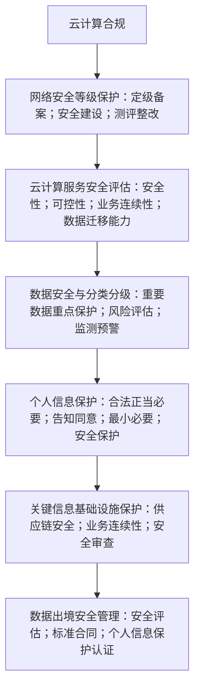

> [!TIP]
> **2026 备考口径校核**
> 备考时应把教材中的合规内容更新为 **2026 口径**：
> - 云服务采用、建设、评估和退出仍可按 **GB/T 31167** 的生命周期思路理解；
> - 云服务商安全能力按 **GB/T 31168** 理解；
> - 云计算平台和云租户业务系统按**等保 2.0** 和**云计算安全扩展要求**理解；
> - 教材中 **2014 版**标准名称可作为历史教材口径识别，但答「现行标准」时应使用 **2023 版**。
>
> 数据安全方面，要掌握「**分类分级保护、重要数据重点保护、风险评估、监测预警、事件处置**」等关键词；《网络数据安全管理条例》进一步把网络数据处理、重要数据、个人信息、数据跨境等要求体系化，云平台处理大量数据时尤其容易成为考点。

###### 5.4 云计算隐私保护需求

云平台承载**身份证号、手机号、账号、设备信息、位置信息、日志信息**等个人信息，因此隐私保护要按**数据生命周期**记忆。

🔄 **流程图 4：云计算隐私保护生命周期**


🔐 **隐私保护生命周期各环节安全要求**

| 生命周期环节 | 安全要求 | 记忆关键词 |
| --- | --- | --- |
| 采集 | 明确采集范围、用途，告知风险。 | 合法、正当、必要 |
| 传输 | 敏感个人数据传输加密。 | 加密传输 |
| 存储 | 加密、认证、访问控制、备份。 | 防泄露、防丢失 |
| 使用 | 特权管理、实名、安全标记、访问限制。 | 防滥用 |
| 维护 | 制定生命周期管理流程，按规清除。 | 保密协议、删除 |
| 事件处置 | 制定个人信息安全事件预案。 | 报告、告知、补救 |

> [!WARNING]
> **易错提醒**：个人信息保护不是只靠「加密存储」。考试更喜欢考**全生命周期**，包括采集告知、传输加密、访问控制、特权管理、清除、事件处置。

---

##### 6. 云计算安全等级保护框架

教材把云计算列为网络安全等级保护 2.0 的重要保护对象，核心框架是：**一个中心、三重防护**。

🏛️ **流程图 5：云计算等级保护框架**

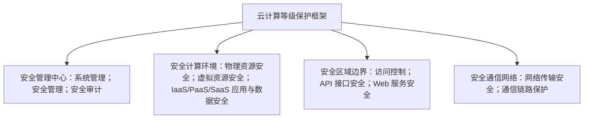

###### 6.1 一个中心

安全管理中心负责**统一安全策略、集中管控、日志审计、态势感知、账号权限管理、安全事件响应**等。

> [!IMPORTANT]
> 考试中看到「**集中管理、集中审计、集中监控、统一策略**」，优先联想到**安全管理中心**。

###### 6.2 三重防护

🛡️ **三重防护对照表**

| 三重防护 | 保护对象 | 典型措施 |
| --- | --- | --- |
| 安全计算环境 | 服务器、虚拟机、云操作系统、数据库、应用、数据。 | 身份鉴别、访问控制、安全审计、入侵防范、恶意代码防范、资源控制、镜像和快照保护。 |
| 安全区域边界 | 云平台边界、租户边界、API 边界、Web 服务边界。 | 访问控制、边界防护、入侵防御、API 安全、Web 防护。 |
| 安全通信网络 | 云内网络、用户到云平台链路、跨区域链路。 | 网络架构、通信传输、VPN、加密、抗 DDoS。 |

---

##### 7. 云计算安全防护机制

###### 7.1 等保技术措施总表

📋 **等保技术措施（按保护对象）**

| 保护对象 | 主要安全措施 |
| --- | --- |
| 物理和环境安全 | 物理位置选择、物理访问控制、防盗、防破坏、防雷、防火、防水、防潮、防静电、温湿度控制、电力供应、电磁防护。 |
| 网络和通信安全 | 网络架构、通信传输、边界防护、访问控制、入侵防范、恶意代码防范、安全审计、集中管控。 |
| 设备和计算安全 | 身份鉴别、访问控制、安全审计、入侵防范、恶意代码防范、资源控制、镜像和快照保护。 |
| 应用和数据安全 | 身份鉴别、访问控制、安全审计、软件容错、资源控制、接口安全、数据完整性、数据保密性、备份恢复、剩余信息保护、个人信息保护。 |

###### 7.2 常见安全机制

⚙️ **常见安全机制与典型技术**

| 安全机制 | 解决的问题 | 典型技术 |
| --- | --- | --- |
| 身份鉴别认证 | 谁在访问云资源。 | 用户名口令、强密码策略、多因子认证、`Kerberos`。 |
| 数据完整性 | 数据是否被篡改。 | 数字签名、完整性校验、镜像签名。 |
| 访问控制 | 谁能访问什么资源。 | `MAC`、`RBAC`、最小权限。 |
| 入侵防范 | 防漏洞利用、DoS、提权、恶意代码。 | `IDS/IPS`、沙箱、抗 DDoS、`SELinux/AppArmor`。 |
| 安全审计 | 事后追踪与责任认定。 | 集中日志、操作审计、告警分析。 |
| 云操作系统安全增强 | 防 `Hypervisor` 或云 OS 漏洞扩大影响。 | 热补丁、恶意程序检测、虚拟化层加固。 |

> [!TIP]
> **真题对应**
> - 题干出现「保护镜像不被篡改」→ 优先选**数字签名 / 完整性校验**；
> - 出现「不同角色拥有不同权限」→ 优先选 **RBAC**；
> - 出现「阻断已知漏洞攻击」→ 优先选 **IDS/IPS**；
> - 出现「防止运维人员越权」→ 优先选**堡垒机、强认证、操作审计**。

---

##### 8. 云计算安全管理

云计算安全管理不是单一技术问题，而是**组织、人员、制度、采购、开发、运维和供应链**的综合治理。
教材把安全组织管理分为三类：**安全策略和管理制度、安全管理机构和人员、安全管理对象**。

🗂️ **安全管理三类要求**

| 管理类型 | 主要要求 |
| --- | --- |
| 安全策略和管理制度 | 安全策略、管理制度制定与发布、评审和修订。 |
| 安全管理机构和人员 | 岗位设置、人员配备、授权审批、沟通合作、审核检查、人员录用、离岗管理、安全意识培训、外部人员访问管理。 |
| 安全管理对象 | 系统定级备案、安全方案设计、产品采购和使用、自行软件开发、外包软件开发、工程实施、测试验收、系统交付、等级测评、服务供应商选择、云服务商选择、供应链管理。 |

> [!WARNING]
> **易错提醒**：云服务商选择、供应链管理、外包开发、服务交付都属于**安全管理范围**，不是单纯「采购管理」或「项目管理」。

---

##### 9. 云计算安全运维

云计算安全运维的核心是：**持续识别风险、持续监测状态、持续维护策略、持续应急响应、持续保障业务连续性**。

🧰 **运维要求类型**

| 运维要求类型 | 内容 |
| --- | --- |
| 环境与资产运维管理 | 环境管理、资产管理、介质管理、数据管理。 |
| 漏洞检查与风险分析 | 漏洞监测、漏洞扫描、合规检查、风险分析。 |
| 安全设备及策略维护 | 网络和系统安全管理、恶意代码防范、密码管理、设备维护、配置管理、变更管理。 |
| 安全监管 | 安全测评、外包运维管理。 |
| 安全监测与应急响应 | 监控审计、应急预案、安全事件处置、备份恢复。 |

###### 9.1 运维安全措施

🔁 **流程图 6：云计算安全运维闭环**

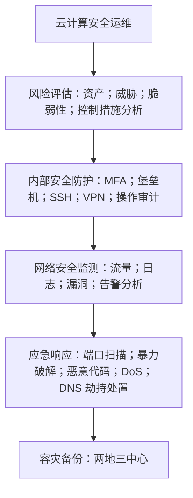

###### 9.2 记忆公式

本章没有复杂计算公式，但有大量「公式化记忆」。

```latex
云安全 ＝ 传统五类安全 ＋ 云新增六类安全
威胁分析 ＝ 端 ＋ 管 ＋ 云
等保框架 ＝ 一个中心 ＋ 三重防护
隐私保护 ＝ 采集 ＋ 传输 ＋ 存储 ＋ 使用 ＋ 维护 ＋ 处置
容灾备份 ＝ 两地三中心
```

🧠 **记忆公式与含义**

| 记忆公式 | 含义 |
| --- | --- |
| 云安全 = 传统五类安全 + 云新增六类安全 | 物理、网络、设备、数据、应用 + 虚拟资源、合规、多租户、可信托管、隐私、强运维。 |
| 威胁分析 = 端 + 管 + 云 | 终端、网络通道、云平台。 |
| 等保框架 = 一个中心 + 三重防护 | 安全管理中心 + 安全计算环境 / 安全区域边界 / 安全通信网络。 |
| 隐私保护 = 采集 + 传输 + 存储 + 使用 + 维护 + 处置 | 数据生命周期。 |
| 容灾备份 = 两地三中心 | 同城、异地 + 生产中心、同城容灾中心、异地容灾中心。 |

---

##### 10. 云计算安全综合应用案例

教材列举阿里云、腾讯云、华为云、Azure 等案例，考试一般不会要求死记某一厂商产品名称，而是要求把案例中的安全能力**抽象成通用防护思路**。

☁️ **各云厂商案例应掌握的抽象能力**

| 案例 | 应掌握的抽象能力 |
| --- | --- |
| 阿里云安全 | 防护机制、监控机制、审计机制、身份认证机制、安全运维机制；DDoS 防护、WAF、云防火墙、加密、实人认证等。 |
| 腾讯云安全 | 网络安全、终端安全、应用安全、业务安全、数据安全、安全管理、安全服务、身份验证；SOC、KMS、凭据管理、堡垒机、零信任等。 |
| 华为云安全 | 芯片级可信计算、虚拟化平台安全、系统加固、API 安全、数据生命周期保护、安全开发、生态供应链、隐私保护。 |
| Azure 云安全 | 境内数据存储、异地复制、物理环境安全、隐私隔离、合规认证、Key Vault、AAD、应用网关、VPN 网关、SLA 与备份。 |

📝 **流程图 7：云计算安全案例题答题模板**

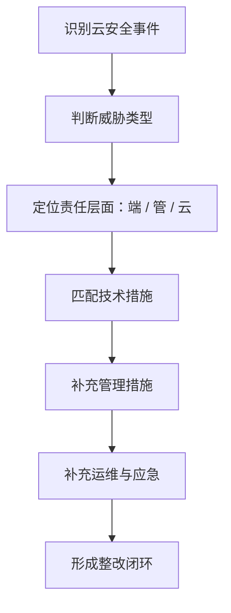

> [!TIP]
> **2026 答题模板（可直接套用句式）**
> 「该问题属于**云平台 / 网络通信 / 终端侧**安全风险，主要表现为……；应从**身份认证、访问控制、数据加密、安全审计、入侵防范、漏洞管理、备份恢复、应急响应和合规管理**等方面采取措施。」

---

#### 第二十四章 工控安全需求分析与安全保护工程

##### 一、2026 备考口径校核

本章属于软考中级信息安全工程师大纲中「**网络安全技术与应用、等级保护、安全防护工程、安全管理、应急响应、工业控制系统安全**」等范围，仍按你此前确定的 **2020 版《信息安全工程师考试大纲》**沿用口径处理。

教材第二十四章主线是：**认识工控系统 → 分析威胁和隐患 → 明确安全需求 → 设计安全防护机制 → 结合电力、水厂、厂商方案理解综合应用**。

法规与标准口径上，2026 备考需要注意三点：

1. **GB/T 22239—2019《网络安全等级保护基本要求》**仍为现行有效标准，国家标准信息平台显示其 **2025 年复审结论为「继续有效」**；
2. **工业和信息化部已于 2024 年印发《工业控制系统网络安全防护指南》**，新指南面向使用、运营工业控制系统的企业，围绕**安全管理、技术防护、安全运营、责任落实**提出基线要求；
3. 电力监控系统案例中教材引用旧版规定，2026 答题时电力行业应注意对接 **2024 年第 27 号令《电力监控系统安全防护规定》**，该规定自 **2025 年 1 月 1 日**起施行。

##### 二、本章知识主线

本章不要把 `SCADA`、`DCS`、`PLC`、工控防火墙、网闸、审计、应急响应孤立记忆，而要形成一条**工控业务安全闭环**。

> [!IMPORTANT]
> **一句话抓本章**：工控安全不是单纯防黑客，而是以**生产连续、安全可靠、实时可控**为核心，围绕**设备、网络、数据、人员和管理**建立纵深防护体系。

---

##### 三、工控系统概念与组成

###### 1. 工业控制系统 ICS

工业控制系统，简称 **ICS**，是由**控制组件、监测组件、数据处理与展示组件**共同构成，用于对工业生产过程进行**控制、监测和管理**的业务流程管控系统。

考试中要抓住两个关键词：**控制生产过程、监测运行状态**。教材将工控系统列为**等级保护 2.0 的重要保护对象**，说明其不仅是普通信息系统，更与**生产安全、经济运行和社会稳定**直接相关。

🏭 **工控系统两大类型**

| 类型 | 典型场景 | 记忆要点 |
| --- | --- | --- |
| 离散制造类 | 装配线、数控机床、智能制造 | 强调**动作、顺序、设备协同** |
| 过程控制类 | 电力、石化、水处理、冶金 | 强调**连续过程、实时参数、闭环调节** |

###### 2. 常见组成与易混点

🔧 **工控系统常见组成与考试易混点**

| 组成 | 中文含义 | 核心功能 | 考试易混提醒 |
| --- | --- | --- | --- |
| `SCADA` | 数据采集与监视控制系统 | 对远程、分散设备进行数据采集、监视和调度 | 重点是**远程分散 + 集中监控** |
| `DCS` | 分布式控制系统 | 分布控制、集中管理 | 重点是**现场控制级 + 系统控制级 + 管理级** |
| `PCS` | 过程控制系统 | 采集状态参数并调节过程 | 常采用**反馈控制、闭环控制** |
| `PLC` | 可编程逻辑控制器 | 运算、顺序控制、定时、动作控制 | 工控基础单元，**常被作为攻击目标** |
| `MTU` | 主终端设备 | 调度中心信息收集与监测 | 位于**控制中心**，常与 `RTU` 通信 |
| `RTU` | 远程终端设备 | 远程信息采集、测量、记录、传导 | 位于**现场或远程站点** |
| `HMI` | 人机界面 | 提供操作界面与数据通信 | **操作员与控制器交互入口** |
| 工控通信网络 | 工控设备连接网络 | `OPC`、`Modbus`、`DNP3`、现场总线、控制网络等 | 传统封闭，**现代逐步引入 TCP/IP** |

> [!WARNING]
> **易错提醒**：`SCADA` 不等于 `DCS`。`SCADA` 强调**远程分布设备的数据采集与调度**；`DCS` 强调**生产过程的分布式控制与集中管理**。`PLC` 是基础控制单元，不是完整安全防护系统。`HMI` 是交互界面，账户、口令、权限配置不当会成为入侵入口。

---

##### 四、工控安全威胁分析

教材将工控安全威胁概括为五类：**自然灾害及环境、内部安全威胁、设备功能安全故障、恶意代码、网络攻击**。
考试中常以「案例判断题」形式出现：给出一个水厂、电厂、生产线异常场景，让你判断属于哪类威胁。

⚠️ **工控安全五类威胁**

| 威胁类型 | 典型表现 | 应试关键词 |
| --- | --- | --- |
| 自然灾害及环境 | 洪水、雷电、台风、温湿度异常 | 室外设备、环境破坏、物理风险 |
| 内部安全威胁 | 误操作、错误命令、疏忽维护 | 人为错误、权限滥用、操作不当 |
| 设备功能安全故障 | 磁盘故障、服务器硬件故障、控制设备失效 | 质量不合格、硬件损坏、功能失效 |
| 恶意代码 | 震网、火焰、蠕虫、木马、勒索软件 | `PLC Worm`、工业主机感染 |
| 网络攻击 | `Dragonfly` 等针对能源、电力、管道的攻击 | 高价值目标、`APT`、网络间谍 |

> [!TIP]
> **真题对应**
> 常规考法不会只问「有哪些威胁」，而是会把**威胁与防护措施结合**考。

🦠 **发现工控主机感染恶意代码的处置逻辑**

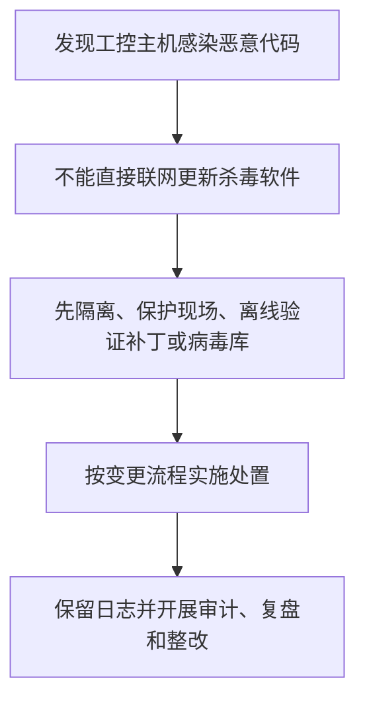

---

##### 五、工控系统安全隐患类型

工控系统的隐患既包括传统 IT 隐患，也包括工控系统自身特点导致的隐患。教材列出的核心隐患可以压缩为**协议、产品、软件、算法、固件、硬件、开放接入、供应链**八类。

🧱 **工控系统八类安全隐患**

| 隐患类型 | 核心问题 | 典型例子 | 应试判断 |
| --- | --- | --- | --- |
| 工控协议安全 | 设计早期缺少认证、加密、审计 | `Modbus` 明文、功能码可被利用 | 协议「能用」不等于「安全」 |
| 工控技术产品漏洞 | `PLC`、`SCADA`、`HMI`、`DCS` 存在漏洞 | 厂商设备被披露漏洞 | 工控产品也要漏洞管理 |
| 基础软件漏洞 | 通用 OS、嵌入式 OS、实时数据库漏洞 | `Windows`、嵌入式系统漏洞 | 工控系统不是封闭免疫 |
| 算法漏洞 | 控制算法缺陷、状态估计不准 | 缺少容忍攻击保护 | 影响控制决策 |
| 固件漏洞 | `BIOS`、设备固件缺陷 | 固件后门、弱认证 | 难发现、难修复 |
| 硬件漏洞 | `CPU` 等硬件缺陷 | 硬件侧信道、芯片风险 | 与供应链关联 |
| 开放接入漏洞 | 无隔离接入互联网 | `Shodan` 扫描、DDoS、敏感信息泄露 | 工控设备不能裸露公网 |
| 供应链安全 | 多厂商设备和服务依赖 | 关键组件断供、服务商泄密 | 合同、保密、资质、责任 |

> [!WARNING]
> **易错提醒**：工控协议的核心弱点不是「传输速度慢」，而是**缺少安全设计**。开放接入漏洞的关键不是「能被扫描」本身，而是**工控设备暴露公网后可能引发漏洞利用、恶意代码传播、拒绝服务和敏感信息泄露**。

---

##### 六、工控安全需求分析：AIC 优先

传统 IT 系统常按 `CIA` 顺序理解，即**保密性、完整性、可用性**；工控系统通常更强调 **`AIC`**，即**可用性、完整性、保密性**。
原因是工控系统直接控制生产过程，系统停机、指令延迟、数据失真可能造成**设备损坏、生产事故甚至公共安全事件**。教材明确工控系统还涉及**控制设备及操作安全**，并已纳入**等级保护 2.0 保护对象**。

```latex
普通 IT：C > I > A
工控 ICS：A > I > C
```

🔑 **AIC 含义**

| 字母 | 含义 |
| --- | --- |
| **A 可用性** | 生产不能随意停、控制不能中断、实时性不能丢 |
| **I 完整性** | 工艺参数、控制指令、传感数据不能被篡改 |
| **C 保密性** | 工艺参数、配置文件、生产数据、客户数据不能泄露 |

📐 **等保 2.0 中的工控安全需求**

| 维度 | 技术安全要求 | 管理安全要求 |
| --- | --- | --- |
| 等保基本要求 | 安全物理环境、安全通信网络、安全区域边界、安全计算环境、安全管理中心 | 安全管理制度、安全管理机构、安全管理人员、安全建设管理、安全运维管理 |
| 工控落地理解 | 控制中心、控制网络、现场设备、工程师站、历史数据库、实时数据库、`HMI`、`PLC`、`RTU` 等均要纳入保护 | 资产清单、权限管理、补丁测试、供应链合同、运维审计、应急演练均要制度化 |

> [!IMPORTANT]
> 答题时，还应把**工业数据**纳入数据安全治理。《工业和信息化领域数据安全管理办法（试行）》要求工业和信息化领域数据实施**分类分级管理**，并按危害程度分为**一般数据、重要数据和核心数据**三级；工控场景中的工艺参数、控制指令、配置文件、设备运行数据等，应结合**数据分类分级、备份、访问控制、加密传输和应急处置**理解。

---

##### 七、工控安全保护机制与技术

###### 1. 物理及环境安全防护

核心目标：保护**工程师站、数据库、服务器、控制中心、通信设备、现场控制设备**不受物理破坏和非法接触。

🏗️ **物理及环境安全应掌握措施**

- 重要区域访问控制
- 视频监控
- 专人值守
- 拆除或封闭不必要 `USB`、光驱、无线接口
- 确需使用外设时实施严格访问控制

> [!WARNING]
> **易错提醒**：工控安全不是只装防火墙。工程师站被人插入 U 盘、控制柜被随意接触、无线接口未关闭，都可能绕过网络边界防护。

###### 2. 安全分区及边界保护

工控系统应按**业务重要性、实时性和风险**划分安全域。开发、测试、生产环境应相互独立，避免测试环境风险进入生产系统。常见边界设备包括**工业防火墙、工业网闸、单向隔离设备、边界安全网关**等。

🗺️ **工控安全分区流程图**

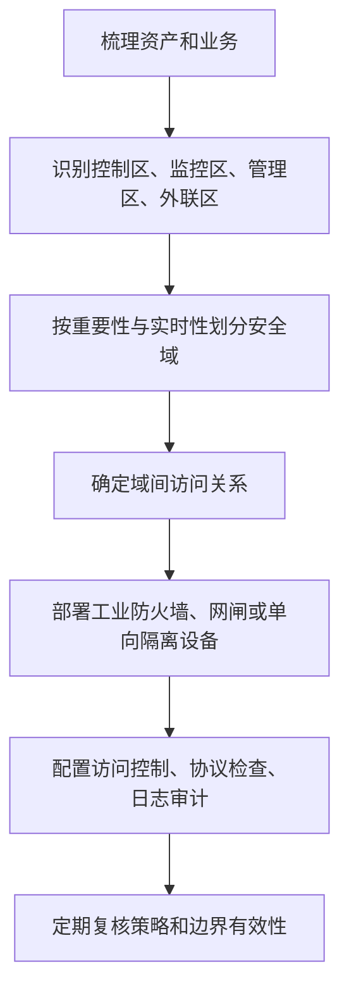

> [!TIP]
> **真题对应**：题干出现「办公网可直接访问 `PLC`」「生产网与互联网直接连通」「开发测试环境与生产系统共用服务器」等，通常应判断为**安全域划分不清、边界隔离不足**。

###### 3. 身份认证与访问控制

🔐 **身份认证与访问控制核心要求**

- 关键设备、系统、平台访问采用身份认证
- 关键场景采用多因素认证
- 账户权限按**最小特权原则**分配
- 避免默认口令、弱口令
- 口令定期更新
- **不同系统和网络环境不得共享认证凭据**

常见认证方式包括**口令、`USB-Key`、智能卡、人脸、指纹、虹膜**等。考试中重点不是背认证方式，而是知道**关键设备和平台访问要强认证，账户权限要最小化，默认口令必须禁止**。

###### 4. 远程访问安全

远程访问是工控考试高频考点。

🌐 **远程访问安全口径**

| 项目 | 口径 |
| --- | --- |
| 原则 | **严格限制，不得随意开放**。 |
| 禁止 | 面向互联网开通 `HTTP`、`FTP`、`Telnet` 等高风险通用服务。 |
| 确需远程访问 | 采用 `VPN`、单向访问控制、访问时限控制、加标锁定等措施。 |
| 确需远程维护 | 经过审批，保留日志，审计操作过程。 |

🛠️ **远程维护标准流程图**

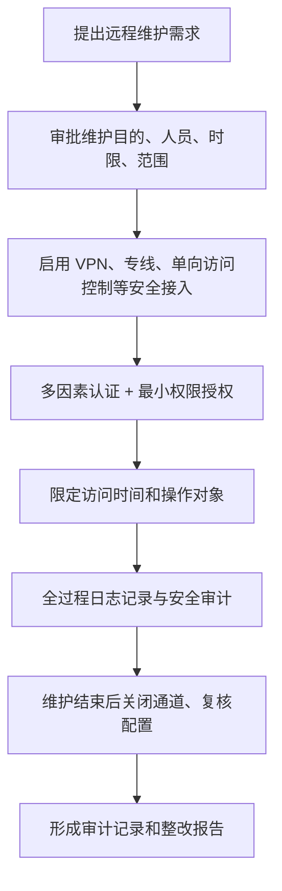

> [!WARNING]
> **易错提醒**：`VPN` 不是万能合规答案。`VPN` 只能作为远程接入方式之一，还必须配合**身份认证、权限控制、访问时限、日志审计和审批流程**。

###### 5. 工控系统安全加固

安全加固的目的：**减少攻击面**，提高工程师站、`SCADA` 服务器、实时数据库、`HMI`、工业主机等组件的安全性。

🧱 **工控系统安全加固措施**

| 序号 | 加固措施 |
| --- | --- |
| 1 | 安全配置策略 |
| 2 | 身份认证增强 |
| 3 | 强制访问控制 |
| 4 | 应用程序白名单 |
| 5 | 关闭高风险服务 |
| 6 | 禁用不必要端口 |
| 7 | 恶意代码防护 |
| 8 | 补丁测试后升级 |

> [!TIP]
> **高频判断**：`Telnet`、`FTP`、`TFTP`、`HTTP` 等通用服务在工控系统中若无必要应关闭；确需使用时要经过安全评估和隔离控制。

###### 6. 工控安全审计

工控安全审计用于保留工业控制系统**设备、应用、用户访问和操作日志**，通过**账户、访问时间、操作内容**等追踪非授权访问行为。

🔍 **审计闭环流程图**

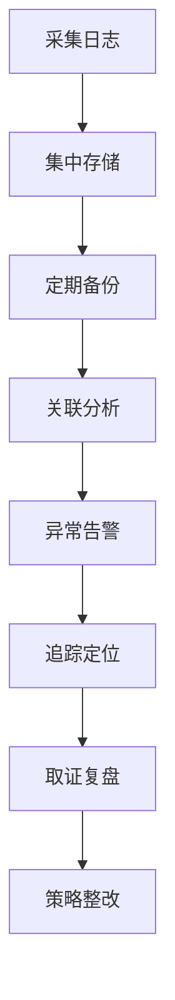

###### 7. 恶意代码防范

工控系统恶意代码防范**不能简单写「安装杀毒软件」**。标准答题应体现**离线验证、白名单、临时介质查杀、补丁评估、管理机制**。

🦠 **恶意代码防范流程图**

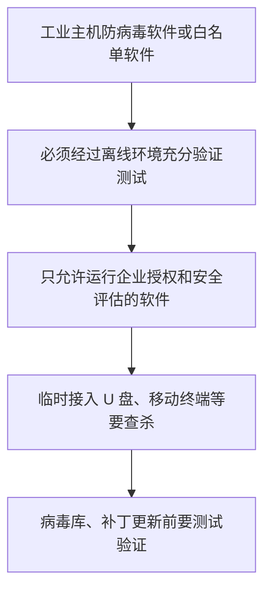

> [!WARNING]
> **易错提醒**：工控系统不能像办公电脑一样随意在线升级杀毒软件或补丁。因为未经测试的补丁可能影响控制软件兼容性，导致**生产中断**。

###### 8. 工控数据安全

工业数据包括**研发数据、生产数据、运维数据、管理数据、外部共享数据**。教材强调工业生产数据的目标是保障全生命周期的**可用性、完整性、保密性和时效性**，尤其要防止**实时数据延缓滞后**。

💾 **工业数据类型与防护重点**

| 数据类型 | 例子 | 防护重点 |
| --- | --- | --- |
| 研发数据 | 研发设计、开发测试数据 | 防泄密、防篡改 |
| 生产数据 | 控制信息、工况状态、工艺参数、系统日志 | 完整性、实时性、备份 |
| 运维数据 | 物流数据、售后服务数据 | 权限控制、审计 |
| 管理数据 | 资产信息、客户与产品信息、供应链数据 | 分类分级、访问控制 |
| 外部数据 | 与其他主体共享的数据 | 共享审批、传输保护 |

🗄️ **工控数据安全标准措施**

- 静态重要数据：**加密存储 + 访问控制**
- 动态重要数据：**加密传输 + VPN 或隔离保护**
- 关键业务数据：**定期备份**
- 测试数据：**保密协议 + 回收测试数据**
- 数据治理：**分类分级 + 风险评估 + 制度化管理**

###### 9. 工控安全监测与应急响应

监测对象包括**病毒、木马、端口扫描、暴力破解、异常流量、异常指令、伪造工控协议包**等。重要工业控制设备前端可部署具备**工业协议深度包检测能力**的防护设备，用于识别异常操作。

🚨 **工控安全事件应急响应流程图**

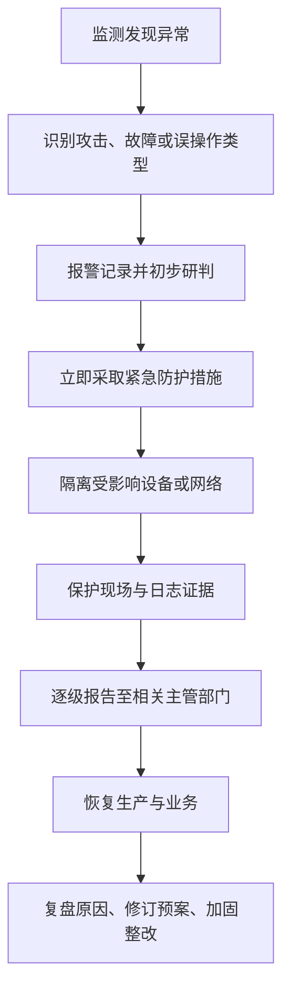

> [!IMPORTANT]
> 《关键信息基础设施安全保护条例》要求运营者**建立健全网络安全保护制度和责任制**，开展**监测、检测、风险评估**，制定**应急预案并定期演练**；若工控系统属于关键信息基础设施支撑系统，答题时应体现**更高等级的责任落实和应急处置要求**。

###### 10. 工控安全管理

工控安全管理是技术措施落地的前提。教材将管理要求概括为**资产管理、冗余配置、安全软件选择与管理、配置和补丁管理、供应链管理、责任落实**等。

📋 **工控安全管理事项**

| 管理事项 | 应掌握内容 |
| --- | --- |
| 资产管理 | 建立资产清单，明确责任人，记录信息资产、软件资产、硬件资产 |
| 冗余配置 | 关键主机、网络设备、控制组件配置冗余电源、冗余设备、冗余网络 |
| 安全软件管理 | 离线验证防病毒软件或白名单软件，临时接入设备要查杀 |
| 配置管理 | 建立配置清单，审计 `VLAN` 隔离、端口禁用、远程控制、默认账户、口令策略 |
| 补丁管理 | 关注 `CNVD`、`CNNVD` 和厂商补丁，离线测试通过后升级 |
| 供应链管理 | 选择有工控安全经验的服务商，合同明确安全责任，签订保密协议 |
| 责任落实 | 建立工控安全管理机制，企业负责人牵头，形成跨部门协调小组 |

---

##### 八、工控安全典型产品技术

🧰 **工控安全典型产品技术**

| 产品类型 | 典型产品 | 考试理解 |
| --- | --- | --- |
| 防护类型 | 工控防火墙、工控加密、身份认证、可信计算、系统加固 | 工控防火墙能理解**工控协议和功能码**，不只是 IP/端口过滤 |
| 物理隔离类型 | 网闸、正向 / 反向隔离装置 | 用于不同安全域之间受控交换，**隔离强度高** |
| 审计与监测类型 | 工控安全审计、工控 `IDS` | 发现异常操作、攻击行为，支持告警、取证、追溯 |
| 检查类型 | 漏洞扫描、漏洞挖掘、基线检查 | 用于发现漏洞和合规差距 |
| 运维与风险管控 | 工控堡垒机、风险管理系统 | 集中运维、过程审计、资产威胁漏洞管理 |

> [!WARNING]
> **易错提醒**：传统防火墙主要基于 `IP`、端口、协议进行控制；**工控防火墙还要能解析工控协议**，对**功能码、控制命令、操作行为**进行细粒度控制。

---

##### 九、电力监控系统安全总体方案

教材中的电力监控系统安全策略可压缩为四句话：**安全分区、网络专用、横向隔离、纵向认证**。

⚡ **电力监控系统安全防护框架**

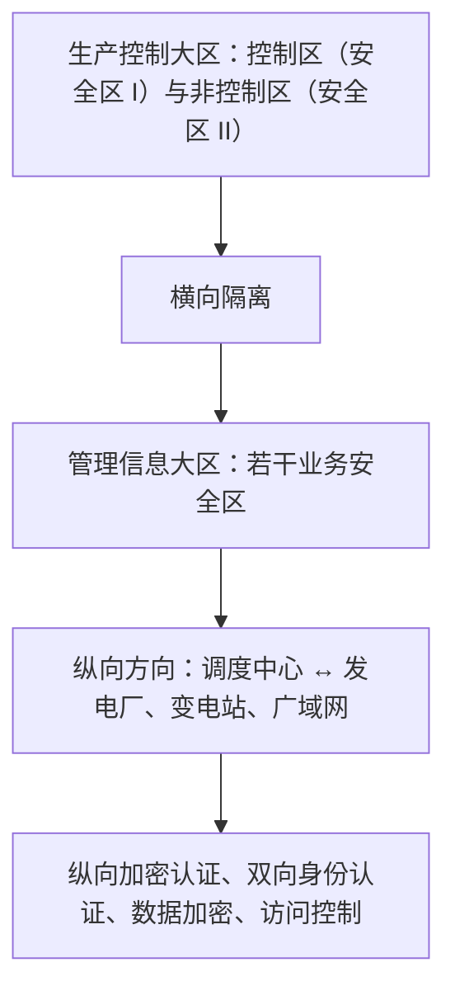

🔌 **电力监控系统四项核心策略**

| 策略 | 含义 | 答题关键词 |
| --- | --- | --- |
| 安全分区 | 生产控制大区、管理信息大区；生产控制大区再分控制区、非控制区 | 分区分域、逻辑隔离、访问控制 |
| 网络专用 | 调度控制网络采用专用网络 | 实时性、高可信 |
| 横向隔离 | 生产控制大区与管理信息大区之间采用专用横向单向安全隔离装置 | 接近或达到物理隔离 |
| 纵向认证 | 纵向边界采用加密认证装置或网关 | 双向身份认证、数据加密、访问控制 |

> [!TIP]
> **2026 法规提醒**：教材电力案例引用旧版规定，2026 答题时如果涉及「最新规定」，应注意《电力监控系统安全防护规定》（国家发展改革委 **2024 年第 27 号令**）已自 **2025 年 1 月 1 日**起施行；但**安全分区、网络专用、横向隔离、纵向认证**仍是电力监控系统安全防护的核心应试框架。

---

##### 十、水厂工控安全集中监控案例

水厂案例核心是**旁路监测 + 集中管理 + 审计告警**。教材示例中，在工业交换机旁路部署**工业集中监控管理平台**和 **ICS 信息安全监控设备**，通过安全加密连接实现对工业防火墙和监控设备的集中管理，对异常行为、恶意代码、威胁行为进行监控、预警、审计和报表分析。

💧 **水厂工控安全监管流程图**

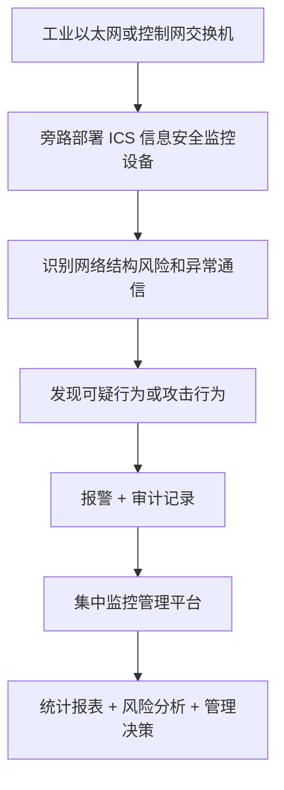

> [!TIP]
> **真题对应**：如果题干出现「**不能中断生产通信，但要监控异常行为**」，优先想到**旁路部署监测设备**；如果题干要求**阻断非法操作**，则需要在关键设备前端部署具备**工业协议深度包检测和访问控制能力**的防护设备。

---

##### 十一、厂商方案案例：综合防护架构

教材厂商方案体现了工控安全产品组合应用：**可信计算平台、工业防火墙、中央管理平台、安全管理平台**。

🧩 **厂商综合防护方案组件**

| 组件 | 作用 | 应试提炼 |
| --- | --- | --- |
| 工控可信计算安全平台 | 可信度量、白名单、阻止非可信进程 | 主机免疫、可信执行 |
| 工业防火墙 | 支持 `OPC`、`Modbus TCP` 等协议深度检查 | 工控协议级访问控制 |
| `CMP` 中央管理平台 | 配置、组态、集中管理工业防火墙 | 统一配置、策略管理 |
| `SMP` 安全管理平台 | 监控控制网络行为，检测攻击、入侵、设备异常 | 态势感知、预警分析 |

> [!TIP]
> **综合方案答题模板**
> 1. 应先梳理工控资产和网络拓扑，划分**控制区、监控区、管理区和外联区**；
> 2. 在区域边界部署**工业防火墙、网闸或单向隔离设备**；
> 3. 在工业主机侧采用**可信计算、白名单、安全加固和恶意代码防护**；
> 4. 在网络侧部署**工控 IDS、安全审计和集中监控平台**；
> 5. 对**远程维护、账户权限、补丁变更、供应链服务**进行安全管理；
> 6. 最后建立**日志审计、应急响应、备份恢复和责任落实**机制。

---

#### 第二十五章 移动应用安全需求分析与安全保护工程

##### 一、2026 备考口径校核

本章属于软考中级信息安全工程师大纲中「**网络安全技术与应用、应用系统安全、终端安全、移动互联安全、数据安全与隐私保护、安全工程实践**」等范围。

法规口径需要更新：本章涉及 App 个人信息收集、权限调用、日志、账号注销、数据传输、敏感信息保护等内容，2026 答题**不能只按教材中「草案」表述机械记忆**，应统一到《**个人信息保护法**》《**网络数据安全管理条例**》《**移动互联网应用程序信息服务管理规定**》《**App 违法违规收集使用个人信息行为认定方法**》等正式口径。

- 个人信息处理应坚持**合法、正当、必要、诚信、目的明确、最小范围、公开透明**等原则；
- 收集个人信息**不得过度收集**；
- 移动应用提供者和分发平台应建立**信息内容安全、数据安全和个人信息保护**等制度。

> [!IMPORTANT]
> **2026 趋势**：本章不会只考「Android 有沙箱、iOS 有签名」这种记忆题，更容易结合**移动支付、政企移动办公、App 过度索权、SDK 违规收集、钓鱼 WiFi、APK 二次打包、移动端与服务端鉴权缺陷**等场景考查。

##### 二、本章知识主线

> [!IMPORTANT]
> **一句话记忆**：移动应用安全不是只保护 App，而是保护「**端—管—云/服**」全链路。

- 先识别资产：**账号、口令、交易数据、个人信息、业务接口、密钥**。
- 再识别威胁：**恶意代码、无线攻击、逆向、篡改、越权、数据泄露**。
- 再配置措施：**系统机制、App 加固、通信加密、服务端鉴权、安全检测、合规治理**。
- 最后落到合规：**最小必要、明示告知、用户同意、撤回同意、日志审计、漏洞整改**。

---

##### 三、考点1：移动应用系统组成

教材将移动应用系统概括为三部分：**移动 App、通信网络、应用服务端**。考试中经常把这三部分混在一个案例里，例如「用户使用手机银行 App 通过公共 WiFi 登录后台服务」，此时不能只写「安装杀毒软件」，而要**分层回答**。

📱 **表 1 移动应用系统三部分组成**

| 组成部分 | 作用 | 常见风险 | 应试防护关键词 |
| --- | --- | --- | --- |
| 移动 App | 用户侧交互入口，承载登录、支付、办公、查询等功能 | 反编译、调试、篡改、重打包、本地数据泄露 | 代码混淆、加固、签名校验、反调试、本地加密 |
| 通信网络 | App 与服务端之间的数据通道，包括 WiFi、蜂窝网络、互联网 | 监听、钓鱼 WiFi、中间人攻击、`DNS` 欺骗、假基站 | `TLS/SSL`、证书校验、防中间人、`VPN`、网络准入 |
| 应用服务端 | 处理业务逻辑、鉴权、数据存储、接口调用 | 越权、注入、弱鉴权、接口滥用、数据泄露 | 身份认证、访问控制、输入校验、日志审计、接口风控 |

> [!TIP]
> **真题对应**
> 客观题常考「三部分组成」「威胁分类」；案例题常给出「App 被重打包 + 公共 WiFi + 后台接口越权」，要求写安全风险和改进措施。

> [!WARNING]
> **易错提醒**
> 移动应用安全 ≠ 手机安全；App 安全也不是只做「代码混淆」。真正考试要按**客户端、通信链路、服务端、数据合规**四条线组织答案。

---

##### 四、考点2：移动应用主要安全威胁

本章将移动应用威胁归纳为五类，备考时建议按「**平台、网络、代码、完整性、数据**」理解。

🚨 **表 2 移动应用主要安全威胁**

| 威胁类型 | 考试理解 | 典型表现 | 防护方向 |
| --- | --- | --- | --- |
| 移动操作系统平台威胁 | App 依赖 `iOS`/`Android` 系统，系统漏洞会影响 App 安全 | 提权、越狱 / `Root`、内核漏洞利用 | 系统升级、权限控制、沙箱、`SELinux`、最小权限 |
| 无线网络攻击 | 攻击者利用无线环境监听或伪造通信 | WiFi 钓鱼、假基站、`DNS` 欺骗、网络钓鱼、蓝牙 / `NFC` 攻击 | 加密通信、证书校验、禁用不安全热点、`VPN` |
| 恶意代码 | 恶意程序窃取信息、远控、扣费、传播 | 隐私窃取、资费消耗、恶意扣费、远程控制 | 应用市场审核、恶意代码检测、行为监测 |
| 代码逆向工程 | 攻击者反编译二进制代码，分析算法和密钥 | 获取源代码逻辑、算法、接口、密钥 | 代码混淆、加壳、关键逻辑服务端化 |
| App 非法篡改 | 攻击者修改 App 后重新打包发布 | 植入木马、绕过付费、窃取账号 | 数字签名、完整性校验、防重打包、渠道监测 |

> [!TIP]
> **真题对应**
> - APK 被二次打包后植入恶意代码 → 归入**非法篡改 / 恶意代码**；
> - 通过反编译获取接口地址和密钥 → 归入**代码逆向工程**；
> - 连接免费 WiFi 后账号被盗 → 归入**无线网络攻击 / 中间人攻击**。

> [!WARNING]
> **易错提醒**
> 不要把恶意代码和 App 篡改完全等同。**篡改是手段，恶意代码是结果或载荷**；二者常同时出现，但考试问分类时要看题干重点。

---

##### 五、考点3：Android 系统组成与安全机制

###### 1. Android 系统四层结构

教材按四层结构讲 Android：**Linux 内核层、系统运行库层、应用程序框架层、应用程序层**。考试中最常考的是「每一层对应什么安全机制」。

🤖 **表 3 Android 系统层次与安全关注点**

| 层次 | 主要内容 | 安全关注点 |
| --- | --- | --- |
| 应用程序层 | 浏览器、联系人、电话、第三方 App 等 | 权限声明、敏感权限、恶意 App |
| 应用程序框架层 | `Activity` 管理器、内容提供器、包管理器、位置管理器等 | 组件调用、组件暴露、应用签名 |
| 系统运行库层 | `libc`、`SSL`、`SQLite`、媒体库、`Android Runtime` 等 | 沙箱、运行时隔离、加密通信 |
| Linux 内核层 | 驱动、进程、文件系统、内存管理 | `UID` 隔离、`ACL`、`NX`、`ASLR`、`SELinux` |

> [!WARNING]
> **易错提醒**
> 教材仍使用 `Dalvik` 虚拟机口径描述沙箱机制。实际 Android 版本演进中运行时机制已有变化，但软考没有官方明确替换教材表述时，考试仍应按教材「**应用进程隔离 + Linux UID + 虚拟机 / 运行时隔离**」的核心逻辑作答。

###### 2. Android 核心安全机制

🔒 **表 4 Android 核心安全机制**

| 安全机制 | 考点解释 | 常考判断 |
| --- | --- | --- |
| 权限声明机制 | App 默认不自动获得所有权限，权限由 `Manifest` 声明及系统授权控制 | `normal`、`dangerous`、`signature`、`signatureOrSystem` |
| 应用程序签名机制 | APK 安装需数字签名，用于标识开发者和建立信任关系 | 签名用于**完整性与身份标识**，不等于内容绝对安全 |
| 沙箱机制 | 每个 App 拥有独立 `UID` 和进程空间，默认不能访问其他 App 资源 | 默认隔离，授权访问 |
| 网络通信加密 | 使用 `SSL/TLS` 保护传输数据 | 防监听、防中间人、防敏感数据泄露 |
| 内核安全机制 | Linux 文件权限、分区保护、`ACL`、`NX`、`ASLR`、`SELinux` | 防提权、防内存攻击、防跨进程非法访问 |

> [!TIP]
> **真题对应**
> 题干出现「App 不能默认读取另一个 App 的数据」「每个 App 具有独立用户 ID」「通过 `Manifest` 声明权限」，答案多指向 **Android 沙箱机制或权限声明机制**。题干出现「同一开发者应用之间建立信任关系」，多指向**签名机制**。

> [!WARNING]
> **易错提醒**
> 1. **权限声明机制**解决「能不能访问」的问题；**签名机制**解决「是谁发布 / 是否同源信任」的问题。
> 2. **沙箱不是杀毒软件**，不负责识别恶意代码；它主要负责**隔离和限制访问范围**。
> 3. `SSL/TLS` 保护的是**传输链路**，不解决服务端越权、弱口令、App 重打包问题。

---

##### 六、考点4：iOS 系统组成与安全机制

###### 1. iOS 四层结构

🍎 **表 5 iOS 系统层次与作用**

| 层次 | 作用 | 应试关键词 |
| --- | --- | --- |
| 可触摸层 | 提供界面和触摸交互相关框架 | `UI`、交互、应用框架 |
| 媒体层 | 图像、音频、视频、图形渲染等 | `Core Graphics`、`Core Audio`、媒体播放 |
| 核心服务层 | 账户、数据存储、网络连接、位置等基础服务 | 数据、网络、位置、系统服务 |
| 核心操作系统层 | 本地认证、安全、系统服务、外部访问 | 安全根基、底层保护 |

###### 2. iOS 安全架构与机制

iOS 安全架构可理解为三层：**硬件 / 固件层、系统软件层、应用层保护机制**。教材强调**安全启动链、数据保护、加密、`ASLR`、代码签名、沙箱机制**。

🔐 **表 6 iOS 主要安全机制**

| 安全机制 | 考点解释 | 应试关键词 |
| --- | --- | --- |
| 安全启动链 | 从引导 `ROM` 开始逐级验证组件完整性，确保可信启动 | 信任链、签名验证、启动完整性 |
| 数据保护 `API` | 保护文件和 `Keychain` 中的敏感数据，降低设备丢失泄露风险 | `Data Protection API`、`Keychain` |
| 数据加密机制 | 用户数据强制加密，`AES` 硬件加密引擎提升效率 | `AES`、硬件加密、`File Data Protection` |
| `ASLR` | 随机化二进制、库、动态链接、栈、堆地址 | 防内存攻击 |
| 代码签名 | 可执行程序需使用苹果证书签名 | 防未授权代码执行 |
| 沙箱机制 | 限制进程行为，降低恶意代码影响范围 | 隔离、限制、最小权限 |

⛓️ **图 5 iOS 安全启动链简图（依据正文描述绘制）**

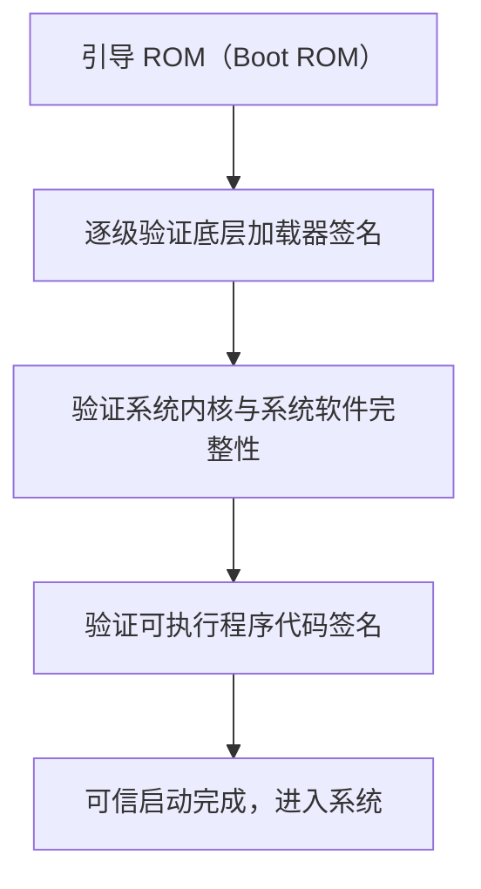

> [!TIP]
> **真题对应**
> - 逐级验证启动组件完整性 → **安全启动链**；
> - 所有可执行程序必须有苹果证书签名 → **代码签名**；
> - 设备丢失后保护文件和 `Keychain` 数据 → **数据保护机制**。

> [!WARNING]
> **易错提醒**
> iOS 的封闭生态、代码签名和沙箱机制增强安全性，但**不代表 iOS 绝对安全**。越狱、漏洞利用、钓鱼 App、弱口令、服务端漏洞仍可造成安全事件。

---

##### 七、考点5：Android 与 iOS 安全机制对比

⚖️ **表 7 Android 与 iOS 安全机制对比**

| 对比点 | Android | iOS | 考试判断 |
| --- | --- | --- | --- |
| 生态特点 | 开源、设备厂商多、分发渠道复杂 | 封闭生态、官方签名控制较强 | Android 更常考**重打包、恶意 APK**；iOS 更常考**安全启动链、代码签名** |
| 权限控制 | `Manifest` 声明、危险权限授权 | 系统授权与沙箱控制 | 都强调**最小权限** |
| 应用隔离 | `UID` + Linux 进程 + 沙箱 | App 沙箱 | 都是**隔离机制** |
| 签名机制 | APK 必须签名 | 可执行程序需苹果证书签名 | 签名用于**身份和完整性**，不等于没有漏洞 |
| 内存保护 | `NX`、`ASLR`、`SELinux` 等 | `ASLR`、代码签名、硬件加密等 | 都有**抗攻击机制** |
| 数据保护 | 文件权限、本地加密、`TLS` | `Keychain`、`Data Protection`、硬件 `AES` | iOS 数据保护体系常考更集中 |

> [!WARNING]
> **易错提醒**
> **签名机制不是加密机制**。签名解决**身份认证、完整性校验、来源可信**；加密解决**保密性**。

---

##### 八、考点6：移动 App 安全风险与加固技术

教材将 App 安全风险概括为：**反编译、调试、篡改、数据窃取**。对应的加固技术可压缩成「**四防**」。

🛡️ **表 8 移动 App 安全加固技术**

| 加固方向 | 技术措施 | 解决的问题 | 易错点 |
| --- | --- | --- | --- |
| 防反编译 | 代码加密、代码混淆、名字混淆、控制流混淆、计算混淆 | 提高逆向分析难度 | 混淆不等于绝对不可破解 |
| 防调试 | 调试器检测、断点检测、`Root` / 越狱检测、异常退出或限制功能 | 防动态分析和运行时篡改 | 反调试不能替代服务端鉴权 |
| 防篡改 | 数字签名校验、多重完整性校验、防重打包 | 防盗版、木马植入 | 签名校验要结合服务端风控 |
| 防窃取 | 本地文件加密、数据库加密、传输加密、密钥保护 | 防敏感数据泄露 | **不应把密钥硬编码在客户端** |

> [!TIP]
> **真题对应**
> - 题干出现「攻击者反编译 APK 获取源代码」→ 答**防反编译、混淆、加壳**。
> - 题干出现「攻击者使用调试器设置断点并修改寄存器值」→ 答**防调试**。
> - 题干出现「正版 App 被二次打包后分发」→ 答**防篡改、签名校验、完整性校验、渠道监测**。
> - 题干出现「App 明文保存 `Token`、身份证号、交易记录」→ 答**本地数据加密、最小化存储、敏感信息脱敏、密钥安全**。

> [!WARNING]
> **易错提醒**
> App 加固是「**提高攻击成本**」，不是「修复业务漏洞」。如果服务端存在越权、SQL 注入、弱鉴权，客户端加固再强也不能从根本上解决。

---

##### 九、考点7：移动 App 安全检测内容

移动 App 安全检测常考「**检测什么**」和「**工具怎么归类**」。不要死记工具名，重点掌握**检测维度**。

🔬 **表 9 移动 App 安全检测维度**

| 检测维度 | 检测重点 | 常见问题 |
| --- | --- | --- |
| 身份认证机制 | 登录、口令、验证码、多因素认证 | 弱口令、验证码绕过、会话固定 |
| 通信会话安全 | `TLS`、证书校验、`Token`、`Cookie` | 明文传输、中间人攻击、`Token` 泄露 |
| 敏感信息保护 | 本地数据库、日志、缓存、剪贴板 | 明文存储、日志泄密 |
| 日志安全策略 | 客户端日志、服务端日志、审计记录 | 记录敏感信息、日志缺失 |
| 交易流程安全 | 支付、转账、下单、审批 | 参数篡改、重复提交、越权交易 |
| 服务端鉴权 | 接口鉴权、权限校验、角色校验 | 只在客户端判断权限 |
| 访问控制 | 水平越权、垂直越权 | 修改用户 ID 查看他人数据 |
| 数据防篡改 | 请求参数、响应数据、安装包完整性 | 重放、改包、改参数 |
| 注入检测 | `SQL` 注入、命令注入、接口注入 | 输入未校验 |
| 防钓鱼能力 | 仿冒 App、假网站、假渠道 | 用户账号被钓取 |
| App 漏洞检测 | 组件暴露、`WebView` 风险、弱加密 | 组件被外部调用 |

🧪 **表 10 移动 App 安全测试工具归类**

| 工具类型 | 示例 | 用途 |
| --- | --- | --- |
| 逆向 / 反编译 | `Jeb`、`apktool`、`Android Killer` | 分析 `APK` 结构、代码、资源 |
| 抓包 / 通信分析 | `Tcpdump`、`Wireshark`、`Burp Suite` | 分析 `HTTP`/`HTTPS`、接口、参数 |
| `Hook` / 动态分析 | `Xposed`、`Inject` | 运行时修改、监控函数调用 |
| 静态分析 | `Androguard`、`FlowDroid` | 权限、数据流、代码结构分析 |
| 劫持检测 | `HijackActivity` | 检测 `Activity` 劫持等风险 |

> [!TIP]
> **真题对应**
> 案例题可能要求「设计 App 安全检测方案」，答案应覆盖：**客户端静态分析、动态调试检测、通信抓包分析、服务端接口安全测试、个人信息合规检查、整改复测**。

> [!WARNING]
> **易错提醒**
> **只测 APK 不测服务端是不完整的**。很多 App 安全事件本质是服务端接口**鉴权、越权、注入、风控**不足。

---

##### 十、考点8：App 个人信息与权限合规

2026 答题时，个人信息保护不能只写「加密保存」，还要写**收集前告知、用户同意、最小必要、权限对应功能、撤回同意、账号注销、SDK 清单、数据删除**。

📜 **表 11 App 个人信息与权限合规要求**

| 合规要求 | 考试表达 |
| --- | --- |
| 合法、正当、必要、诚信 | 不得通过诱导、欺诈、强迫方式处理个人信息 |
| 目的明确、最小必要 | 收集范围应与业务功能直接相关，不得过度索权 |
| 公开透明 | 隐私政策应醒目、清晰、易懂 |
| 明示同意 | 不能默认勾选，不能未同意先收集 |
| 权限按需申请 | 摄像头、通讯录、位置、麦克风、短信等权限应与功能相关 |
| 用户权利保障 | 提供查询、更正、删除、撤回同意、注销账号等途径 |
| `SDK` 合规 | 第三方 `SDK` 收集个人信息也要说明目的、方式、范围 |
| 安全措施 | 加密、访问控制、审计、脱敏、最小化存储 |

> [!TIP]
> **真题对应**
> 题干出现「App 首次运行即读取通讯录」「不同意隐私政策仍继续收集」「更新后自动恢复权限」「不给注销入口」，应判断为**个人信息保护合规问题**，而不是单纯技术漏洞。

> [!WARNING]
> **易错提醒**
> - 用户**安装了 App**，不等于用户**同意所有权限**。
> - 隐私政策**写了**，不等于已经**合法收集**。
> - 业务**需要**，不等于可以**无限制收集**。

---

##### 十一、考点9：金融移动安全案例

金融类 App 常见风险：**木马控制手机、钓鱼 App 窃取账户、短信验证码被截获、交易参数被篡改、资金被盗转**。

💰 **表 12 金融移动安全防护措施**

| 防护环节 | 具体措施 |
| --- | --- |
| 安全开发管理 | 安全需求分析、安全编码培训、代码审计、安全 `SDK`、上线前测评 |
| 通信加密 | 传输协议加密、证书校验、防中间人、本地文件加密 |
| App 加固 | `dex` 加密、`so` 文件保护、流程混淆、关键函数保护、反调试、反反编译 |
| 安全测评 | 渗透测试、合规核查、接口鉴权、交易流程测试 |
| 安全监测 | 钓鱼 App 监测、盗版监测、漏洞监测、移动威胁态势感知 |
| 风控联动 | 设备指纹、异常登录检测、交易限额、二次验证 |

> [!TIP]
> **答题模板**：金融 App 安全应从**客户端加固、通信加密、服务端鉴权、交易风控、个人信息保护、仿冒监测和应急响应**七方面回答。

---

##### 十二、考点10：运营商移动安全案例

运营商移动应用常见风险：**账号密码窃取、服务器漏洞利用、恶意代码传播、用户数据窃取、恶意刷量刷单、拒绝服务攻击、计费 SDK 破解、钓鱼攻击、社工库诈骗**。

📡 **表 13 运营商移动安全风险与防护**

| 风险 | 防护措施 |
| --- | --- |
| 账号密码窃取 | `MFA`、登录风控、异常设备识别、密码强度策略 |
| 漏洞利用 | 漏洞扫描、补丁管理、渗透测试、`WAF`/`API` 网关 |
| 恶意代码 | 应用市场审核、恶意代码查杀、第三方 App 检测 |
| 计费 `SDK` 破解 | `SDK` 加固、防调试、防篡改、防破解 |
| 通信协议被分析 | 协议加密、证书保护、防中间人 |
| 异常流量与风险 App | 态势感知、实时预警、联动处置 |

> [!WARNING]
> **易错提醒**
> 运营商场景不要只写「App 加固」。运营商还有**应用市场、计费 SDK、通信协议、用户数据、网络流量**等特殊对象。

---

##### 十三、考点11：移动办公安全案例

移动办公风险主要集中在：**设备丢失、信息泄露、恶意攻击、共享访问、WiFi 监听**。

💼 **表 14 移动办公风险与防护措施**

| 风险 | 典型场景 | 防护措施 |
| --- | --- | --- |
| 设备丢失 | 手机遗失后仍可接入企业内网 | 设备绑定、远程锁定、远程擦除、准入控制 |
| 信息泄露 | 本地缓存、文件、聊天记录泄露 | 本地加密、`DLP`、禁止截屏 / 复制、最小化存储 |
| 恶意攻击 | 移动端植入木马后攻击内网 | 恶意代码检测、终端合规检查、隔离处置 |
| 共享访问 | 多人共用账号、设备外借 | `MFA`、账号实名、设备指纹、权限分离 |
| WiFi 监听 | 接入钓鱼热点后通信被监听 | `VPN`、`TLS`、证书校验、禁用不可信 WiFi |

> [!TIP]
> **真题对应**
> 案例题若出现「员工手机丢失、缓存有客户资料、可直接登录企业系统」，答案应包括：**远程擦除、强认证、终端准入、数据加密、最小权限、日志审计、账号冻结和应急处置**。

---

#### 第二十六章 大数据安全需求分析与安全保护工程

##### 一、2026 备考口径校核

本章属于软考中级信息安全工程师考试大纲中「**网络安全风险分析、数据安全、隐私保护、云计算与大数据安全、等级保护、安全管理与综合应用实践**」等范围。按 **2020 版考试大纲**沿用口径，本章应重点掌握：**大数据安全威胁识别、数据全生命周期保护、安全需求分析、安全保护机制、数据隐私保护、数据交易与跨境流动安全、典型平台安全实践**。

2026 年法规口径需要与现行公开法规保持一致：教材列举了较早期的数据与个人信息保护政策，但备考时必须同步理解**网络安全法、数据安全法、个人信息保护法、网络数据安全管理条例**等统一框架。涉及数据安全、个人信息、重要数据、核心数据、跨境流动、关键信息基础设施和网络数据处理活动时，答题**优先使用现行法规的制度化表达**；官方未明确说明或公开表明变更的内容，仍以教材原文口径作为基础。

> [!IMPORTANT]
> **本章 2026 考试趋势**：客观题会考概念、威胁、需求、技术措施、案例对应；应用题更可能把**大数据平台、数据分类分级、个人信息保护、重要数据、数据跨境、日志审计、备份恢复、差分隐私、数据脱敏、区块链溯源**等放在综合场景中考查。答题时不要只写「加密、防火墙、备份」，要形成**数据对象—安全风险—生命周期环节—技术措施—管理合规—审计追溯**的闭环。

##### 二、本章知识主线

本章可以压缩成一条主线：**大数据是什么 → 面临哪些威胁 → 法规合规要求是什么 → 形成哪些安全需求 → 用哪些机制和技术保护 → 在实际平台中如何落地**。

**分支记忆**：
- 安全威胁识别重点看**泄露、篡改、污染、滥用、拒绝服务**；
- 安全需求分析重点看**自身安全、合规、跨境、隐私、平台、业务、运营**；
- 保护技术重点看**签名、Hash、加密、脱敏、差分隐私、RBAC、态势感知**。

---

##### 三、核心考点整理

##### 考点1：大数据的概念与基本特征

大数据不是简单指「数据很多」，而是指**传统数据处理工具难以有效存储、管理、分析的数据集合**。其典型特征可以按 **4V 模型**记忆：`Volume` 海量、`Velocity` 快速、`Variety` 多样、`Value` 价值密度低。

```latex
4V = Volume + Velocity + Variety + Value
```

📊 **表 1：大数据 4V 特征与考试理解**

| 特征 | 含义 | 考试理解 |
| --- | --- | --- |
| `Volume` 海量 | 数据规模巨大 | 传统数据库和单机处理方式难以承载。 |
| `Velocity` 快速 | 数据产生、流转、处理速度快 | 实时处理、流式处理、快速响应要求高。 |
| `Variety` 多样 | 结构化、半结构化、非结构化并存 | 数据来源复杂，治理、清洗和统一建模难度大。 |
| `Value` 价值密度低 | 单条数据价值有限，汇聚后价值高 | 数据汇聚后价值提升，同时也可能形成更高敏感性和更高风险。 |

大数据来源包括**交易数据、日志数据、传感器数据、位置数据、社交数据、业务系统数据、图像视频数据**等。
技术支撑包括**分布式文件系统、分布式数据库、云计算平台、数据挖掘、海量数据分析处理**等。

> [!TIP]
> **真题对应**：题干出现「海量、多源、异构、快速流转、价值密度低」，优先判断为**大数据特征**；题干问「大数据安全为什么比传统数据库安全更复杂」，应答**边界模糊、流动频繁、分布式节点多、数据融合后敏感性增强**。

> [!WARNING]
> **易错提醒**：大数据 ≠ 数据库容量大；大数据安全 ≠ 只保护存储系统；大数据的核心风险往往来自**汇聚、关联、流动、共享、再利用**。

---

##### 考点2：大数据安全威胁

本章安全威胁可按「**边界、泄露、污染、可用、隐私、交易、滥用**」七类记忆。考试中常把威胁包装在平台、业务、交易、个人信息或人工智能场景中。

⚠️ **表 2：大数据安全威胁七类高频考点**

| 威胁类型 | 核心含义 | 高频考点 |
| --- | --- | --- |
| 数据集安全边界模糊 | 数据多源、异构、分布式存储，传统网络边界防护不足。 | 静态边界防护难以完全有效，单个节点受害可能影响整体系统。 |
| 敏感数据泄露 | 海量数据被窃取后影响国家安全、企业声誉、个人权益。 | 邮箱、社保、银行卡、身份信息、客户数据等泄露事件。 |
| 数据失真与污染 | 攻击者注入虚假数据，干扰分析和决策。 | 水军评论、虚假流量、网页虚假排名、数据输入缺陷被利用。 |
| 业务连续性与拒绝服务 | 平台被攻击后关键业务中断。 | 电商、金融、政务等依赖大数据平台的业务无法正常访问。 |
| 个人隐私保护困难 | 多平台、多源数据融合后可重新识别个人。 | 身份、位置、行程、消费、社交等数据汇聚导致隐私暴露。 |
| 数据交易风险 | 数据商品化流通过程中产生非法交易、虚假交易和跨境风险。 | 非法数据交易、交易服务不完整、敏感数据二次泄露、数据出境合规。 |
| 大数据滥用 | 通过关联分析发现敏感关系或实施歧视、操控。 | 数据画像、精准操控、群体风险、超目的使用。 |

> [!TIP]
> **真题对应**：题干出现「攻击者向平台注入虚假评论，导致评分和推荐结果失真」，应判断为**数据污染或数据失真**；题干出现「多个数据集单独看不敏感，汇聚后能识别自然人」，应判断为**关联分析导致隐私泄露**。

> [!WARNING]
> **易错提醒**：**数据泄露**强调数据被非法获取；**数据污染**强调数据本身被恶意构造或注入；**数据滥用**强调合法或灰色获取后**超目的、超范围使用**。

---

##### 考点3：大数据安全法规与 2026 统一口径

教材列举了个人金融信息、网络信息保护、消费者权益保护、地图数据、网络出版、人口健康信息、保险数据、`GDPR` 等政策法规，说明大数据安全具有明显的**行业属性和跨境属性**。2026 备考时，应在教材原文基础上同步掌握现行「**三法一条例**」的统一框架。

⚖️ **表 3：2026 大数据安全法规统一口径**

| 规范 | 2026 备考作用 | 答题关键词 |
| --- | --- | --- |
| 《网络安全法》 | 网络运营者义务、等级保护、关键信息基础设施、网络数据保护。 | 等保、日志、备份、加密、监测预警、个人信息保护。 |
| 《数据安全法》 | 数据分类分级、重要数据、核心数据、风险监测与应急处置。 | 分类分级、重要数据目录、核心数据、风险评估、应急处置。 |
| 《个人信息保护法》 | 个人信息处理规则、敏感个人信息、个人权利、跨境提供。 | 告知同意、最小必要、敏感个人信息、个人权利、影响评估。 |
| 《网络数据安全管理条例》 | 网络数据处理活动、重要数据、个人信息、跨境、平台义务。 | 网络数据全流程治理、分类分级、重点保护、平台责任、合规审计。 |

> [!IMPORTANT]
> 《数据安全法》明确国家建立**数据分类分级保护制度**，并要求对**重要数据**加强保护；关系**国家安全、国民经济命脉、重要民生、重大公共利益**的数据属于**国家核心数据**，实行更严格管理。《个人信息保护法》明确**自然人的个人信息受法律保护**，规范个人信息处理活动，并对境内处理以及特定境外处理境内自然人个人信息的活动设置适用规则。

> [!WARNING]
> **易错提醒**：教材中部分法规清单具有历史背景，不能把早期行业规范当成 2026 唯一依据。考试答题时，涉及**数据安全、个人信息、跨境、重要数据**，应优先使用**现行法律法规的制度化表述**。

---

##### 考点4：大数据安全需求分析

大数据安全需求可以按「**七类需求**」记忆：**自身安全、合规安全、跨境安全、隐私安全、平台安全、业务安全、运营安全**。

```latex
大数据安全需求 = 自身安全 + 平台安全 + 业务安全 + 隐私保护 + 合规管理 + 跨境安全 + 运营安全
```

🧭 **表 4：大数据安全七类需求**

| 需求 | 解释 | 典型措施 |
| --- | --- | --- |
| 大数据自身安全 | 确保数据真实、完整、机密、可用、可追溯。 | 数字签名、`Hash`、加密、校验、备份、数据血缘。 |
| 大数据安全合规 | 满足国家、行业、地区法规要求。 | 合规审查、制度建设、责任分工、审计。 |
| 大数据跨境安全 | 处理数据出境、境外存储、跨境业务合规。 | 安全评估、标准合同、认证、最小化、出境记录。 |
| 大数据隐私保护 | 防止个人敏感信息泄露和再识别。 | 脱敏、匿名化、去标识化、差分隐私、访问控制。 |
| 大数据处理平台安全 | 保护物理、网络、主机、数据库、应用、存储。 | 安全分区、防火墙、主机加固、`DLP`、数据库防火墙。 |
| 大数据业务安全 | 防止业务授权失控、流程漏洞、非法交易。 | `RBAC`、业务风控、合规检查、流程校验。 |
| 大数据安全运营 | 建立持续运维、监测、应急和服务能力。 | 态势感知、日志审计、备份恢复、应急响应、安全服务。 |

> [!TIP]
> **真题对应**：题干问「某大数据平台需要从采集到销毁全过程保护数据，应考虑哪些安全需求」，不要只答「加密、备份」，应从**自身安全、平台安全、业务安全、隐私保护、运营安全、合规要求**展开。

---

##### 四、大数据安全保护机制与技术

##### 考点5：大数据安全保护机制

大数据安全保护是综合安全工程，涉及**数据自身安全、数据处理平台安全、数据业务安全、数据隐私安全、数据运营安全以及数据安全法律政策与标准规范**。教材强调常见机制包括**数据分类分级、数据源认证、数据溯源、数据用户标识和鉴别、数据资源访问控制、数据隐私保护、数据备份与恢复、数据安全审计与监测、数据安全管理**等。

🛡️ **表 5：大数据安全保护机制**

| 机制 | 考试解释 |
| --- | --- |
| 数据分类分级 | 先识别数据类型和敏感级别，再匹配保护强度，是**数据安全治理的起点**。 |
| 数据源认证 | 确认数据来源可信，防止伪造数据进入系统。 |
| 数据溯源 | 记录数据来源、加工、流转路径，便于追责。 |
| 用户标识与鉴别 | 确认访问主体身份，防止冒用和伪造身份。 |
| 访问控制 | 控制谁能访问、访问什么、能做什么，体现**最小权限原则**。 |
| 隐私保护 | 防止个人信息泄露、重识别和滥用。 |
| 备份与恢复 | 保障可用性和业务连续性。 |
| 审计与监测 | 发现违规访问、异常行为和安全事件。 |
| 数据安全管理 | 通过制度、流程、岗位、责任、应急形成闭环。 |

🔄 **流程图 2：大数据安全保护基本流程**

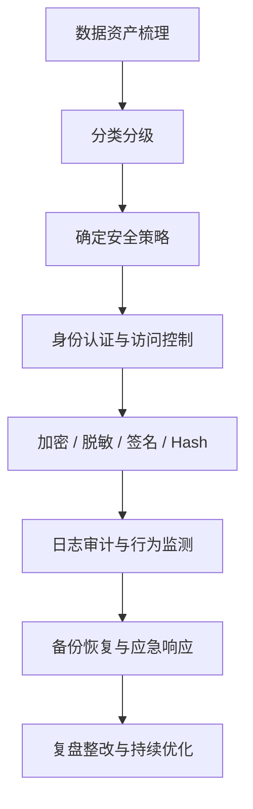

> [!IMPORTANT]
> **注意**：**分类分级是治理起点**；**审计监测和应急响应是闭环关键**；技术措施必须与管理制度配合。

> [!WARNING]
> **易错提醒**：分类分级是数据安全治理的起点，不是可有可无的文档工作。没有分类分级，就很难确定**加密、脱敏、共享、出境、审计**的保护强度。

---

##### 考点6：大数据自身安全保护技术

大数据自身安全是指有关数据本身的安全问题，如数据**真实性、完整性、机密性、准确性、可用性和可追溯性**。数字签名可以验证数据来源的真实性，`Hash` 算法用于确保数据完整性，加密算法用于保护数据机密性。

```latex
数据自身安全 = 真实性 + 完整性 + 机密性 + 可用性 + 可追溯性
```

🔑 **表 6：数据自身安全目标与技术对应**

| 安全目标 | 对应技术 | 答题关键词 |
| --- | --- | --- |
| 真实性 | 数字签名、数据源认证 | 验证来源、防伪造、防抵赖。 |
| 完整性 | `Hash`、消息摘要、校验码 | 防篡改、可校验、可发现异常。 |
| 机密性 | 加密、密钥管理、访问控制 | 防泄露、防未授权读取。 |
| 可用性 | 备份、容灾、冗余、抗 DDoS | 不中断、可恢复、连续运行。 |
| 可追溯性 | 日志、审计、数据血缘、溯源 | 可定位、可追责、可复盘。 |

> [!WARNING]
> **易错提醒**：`Hash` 主要解决**完整性**，不直接解决机密性；加密主要解决**机密性**，不自动证明来源真实；**数字签名**兼具**来源认证和完整性校验**意义。

---

##### 考点7：大数据平台安全保护技术

大数据平台保护对象包括**物理环境、网络通信、操作系统、数据库、应用系统、数据存储**。常用技术包括**安全分区、防火墙、系统安全加固、数据防泄露、数据库防火墙、应用防火墙**等。

🏗️ **表 7：大数据平台分层保护**

| 层面 | 保护重点 | 常用措施 |
| --- | --- | --- |
| 物理环境 | 机房、设备、介质 | 门禁、监控、环境控制、介质管理。 |
| 网络通信 | 分布式节点间通信 | 分区分域、防火墙、`VPN`、加密传输、网络隔离。 |
| 操作系统 | 主机漏洞与权限 | 补丁、基线加固、最小权限、端口管理、防病毒。 |
| 数据库 / 存储 | 数据集中存放风险 | 数据库防火墙、加密存储、备份、数据完整性校验。 |
| 应用系统 | 接口与业务逻辑 | 身份鉴别、输入校验、权限控制、应用防火墙。 |
| 运维管理 | 管理员高权限风险 | 堡垒机、审计、双人复核、操作留痕。 |

> [!TIP]
> **真题对应**：题干出现「`Hadoop`/`Spark` 集群、多租户、节点众多、数据集中存储」，应从**网络隔离、主机加固、身份认证、权限控制、日志审计、数据加密、备份容灾**作答。

---

##### 考点8：大数据业务安全保护技术

大数据业务安全主要包括**业务授权、业务逻辑安全、业务合规性**。业务授权主要基于角色的访问控制技术，按照业务功能执行所需权限进行分配；业务逻辑安全针对业务流程进行安全控制，避免安全缺陷导致业务失控；业务合规性强调业务满足政策法规和安全标准规范要求。

💼 **表 8：大数据业务安全保护**

| 内容 | 含义 | 技术 / 管理措施 |
| --- | --- | --- |
| 业务授权 | 按角色、岗位、业务功能分配权限。 | `RBAC`、最小权限、审批授权、权限复核。 |
| 业务逻辑安全 | 防止流程漏洞导致越权、绕过、滥用。 | 流程校验、风控规则、异常检测、业务闭环控制。 |
| 业务合规性 | 业务处理符合政策法规和标准。 | 合规检查、配置基线、敏感数据检查、审计报告。 |

> [!WARNING]
> **易错提醒**：业务安全不是单纯「系统登录安全」。例如**数据营销、数据交易、数据共享、模型训练、报表导出**等业务行为都可能产生**数据扩散和滥用风险**。

---

##### 考点9：大数据隐私安全保护技术

隐私是指与个体相关的非公开信息。隐私保护成为大数据时代新的安全需求。围绕隐私保护，主要技术有**数据身份匿名、数据差分隐私、数据脱敏、数据加密、数据访问控制**等。

🕵️ **表 9：隐私保护技术对比**

| 技术 | 作用 | 易错点 |
| --- | --- | --- |
| 数据脱敏 | 隐藏、替换或扰动敏感字段。 | 脱敏后仍可能被多源关联重新识别。 |
| 匿名化 | 使个人无法被识别且不能复原。 | 匿名化强度高于一般脱敏，目标是**不可识别、不可复原**。 |
| 去标识化 | 去除直接标识，但可能可复原或关联。 | 去标识化**不等同于匿名化**，仍需控制访问和再识别风险。 |
| 差分隐私 | 在统计结果中加入噪声，降低个体暴露风险。 | 差分隐私保护**统计发布**，不是传统加密。 |
| 数据加密 | 防止未授权读取。 | 解密后仍需访问控制和日志审计。 |
| 访问控制 | 限制主体、权限、范围和操作。 | 要结合审计、最小权限和动态监控。 |

> [!TIP]
> **真题对应**：题干出现「发布统计结果但不希望反推出某个自然人的信息」，优先考虑**差分隐私、匿名化、聚合发布**；题干出现「测试环境需要使用生产数据」，优先考虑**脱敏、最小化、访问控制、审计、回收销毁**。

---

##### 考点10：大数据运营安全保护技术

大数据运营安全是指大数据平台及数据的**运行维护、数据资源经营过程**的安全。大数据平台运维包括**安全维护、安全策略更新、安全设备配置、容灾备份、安全事件监测与应急响应**等；数据资源经营涉及**数据使用、数据交易、数据跨境流动**等安全问题。

🔧 **表 10：大数据运营安全保护**

| 类型 | 风险 | 措施 |
| --- | --- | --- |
| 平台运维安全 | 管理员误操作、漏洞、攻击、故障。 | 安全维护、策略更新、堡垒机、日志审计、权限复核。 |
| 安全监测 | 入侵、异常访问、数据外流。 | 入侵检测、态势感知、威胁情报、取证分析。 |
| 容灾备份 | 硬件故障、勒索、误删、自然灾害。 | 异地备份、恢复演练、应急预案、备份有效性验证。 |
| 数据经营安全 | 数据交易、共享、跨境、滥用。 | 数据脱敏、数据监控、数据安全网关、合规审查。 |

🔁 **流程图 3：大数据运营安全闭环**

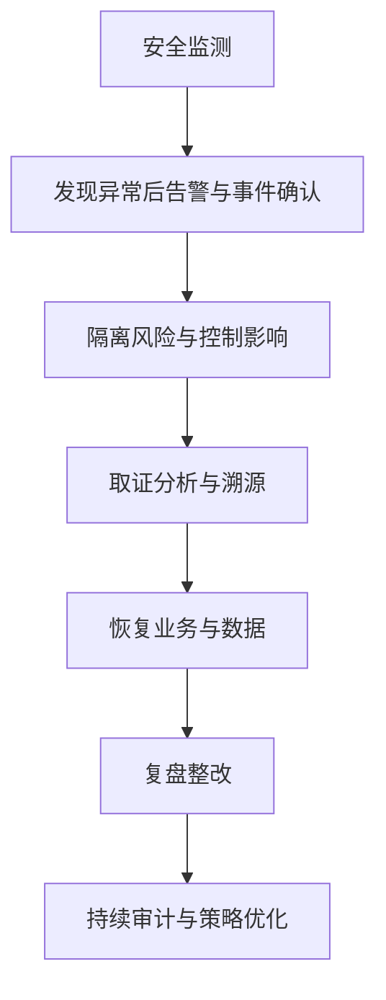

> [!IMPORTANT]
> 若**未发现异常**，则持续审计与策略优化；若**发现异常**，应进入**告警、隔离、取证、恢复、复盘**的闭环。

> [!WARNING]
> **易错提醒**：运营安全不是「系统上线后交给运维」。考试中要写出**监测—告警—处置—恢复—复盘—整改**的闭环。

---

##### 五、大数据安全标准规范

大数据安全标准规范有利于提升数据安全整体保障能力。教材提到**全国信息安全标准化技术委员会设立大数据安全标准特别工作组**，并列举了**个人信息安全规范、大数据服务安全能力要求、大数据安全管理指南、数据交易服务安全要求、个人信息去标识化指南**等标准。2026 备考时应特别关注**数据分类分级、个人信息保护、重要数据识别和数据交易安全**等标准化方向。

> [!TIP]
> **考试答题口诀**：标准化建设 = **分类分级为基础 + 生命周期为主线 + 技术管理并重 + 审计评估闭环**

📐 **表 11：大数据安全标准化答题抓手**

| 标准化方向 | 核心内容 | 考试用法 |
| --- | --- | --- |
| 数据分类分级 | 明确数据类别、敏感程度、影响对象、影响程度和保护等级。 | 用于确定加密、脱敏、共享、出境、审计和应急强度。 |
| 个人信息保护 | 规范个人信息处理原则、授权同意、敏感个人信息和个人权利。 | 用于回答采集、使用、共享、发布、委托处理等题目。 |
| 大数据服务安全能力 | 评价大数据服务提供方的安全能力。 | 用于平台安全、服务外包、云上大数据场景。 |
| 数据交易服务安全 | 规范数据交易中的主体、数据、规则、审计和责任。 | 用于数据市场、数据商品、交易平台场景。 |
| 去标识化与匿名化 | 降低个人信息被直接识别或间接识别风险。 | 用于测试数据、开放数据、统计发布和共享场景。 |

---

##### 六、典型案例考点

##### 案例1：阿里巴巴大数据安全实践

阿里巴巴案例可压缩为「**三层管控**」：**业务安全管控、数据安全管控、生态安全管控**。其大数据平台从业务、数据和生态三个层面保护数据安全与隐私。

🏢 **表 12：阿里巴巴大数据安全三层管控**

| 层面 | 核心做法 |
| --- | --- |
| 业务安全管控 | 明确私域、公域、渠道、价值闭环，强调**授权边界清晰**、处理逻辑基于**可用不可见**原则、应用产出基于数据价值而不是裸数据输出。 |
| 数据安全管控 | 覆盖数据**加工前、加工中、加工后、合规层**，围绕数据业务链路构建全面管控体系。 |
| 生态安全管控 | 数据 `ISV` 准入准出、行业标签体系、数据生态市场管理，在业务和安全之间建立平衡。 |

🔬 **表 13：阿里巴巴数据加工安全措施**

| 阶段 | 重点措施 |
| --- | --- |
| 加工前 | 数据来源合法性评估、数据用途合理性评估、数据相关方权属评估、消费者隐私评估、商业秘密合规性评估、数据标签规范性管理、数据分级分类管理。 |
| 加工中 | 多租户隔离控制、统一元数据管理、数据探索容器、数据建模风控、数据脱敏控制、代码可信审核、数据画像风控、`PII` 防护、身份与鉴权、访问监控与审计。 |
| 加工后 | 数据血缘安全控制、数据营销渠道管控、数据效果回流风控、数据染色取证追溯、数据加密平台服务、数据环境安全容器。 |
| 合规层 | 基于个人隐私保护的监管要求、基于 `ISO 27001` 的管理要求、基于云的安全控制要求。 |

> [!TIP]
> **真题对应**：题干出现「数据加工前、中、后分别如何控制风险」，可直接按**来源合法性与用途合理性、加工中隔离与脱敏、加工后血缘控制与染色取证**的逻辑组织答案。

---

##### 案例2：京东大数据安全实践

京东万象数据服务平台案例核心是**区块链确权溯源**。其逻辑是：数据交易信息上链，买方获得交易凭证，后续可通过凭证查询链上交易信息，实现**数据确权、溯源和取证**。

⛓️ **流程图 4：京东数据交易区块链确权溯源流程**


> [!IMPORTANT]
> 区块链主要解决**不可篡改记录、交易存证、溯源确权、责任追踪**，**不等于能防止所有数据泄露**。

> [!WARNING]
> **易错提醒**：区块链不是用来「防止所有数据泄露」的万能技术。其主要价值在于**不可篡改记录、交易存证、溯源确权、责任追踪**。

---

##### 案例3：上海数据交易中心安全保护

上海数据交易中心案例核心是**规制 + 技术**共同保障数据交易安全。教材强调**个人数据保护原则、流通数据处理准则、禁止清单、交易要素标准体系**等。

📜 **表 14：上海数据交易中心个人数据保护原则**

| 原则 | 考试关键词 |
| --- | --- |
| 告知同意 | 初始收集的数据被再次使用或再处理时，如果目的与初始目的不一致，应告知数据主体并取得同意。 |
| 禁止公开 | 不得擅自公开、向第三人提供带有身份标识的个人数据。 |
| 选择退出 | 使用个人数据进行推销、推介和广告活动时，应给予接受人退出选择。 |
| 数据正确 | 数据应符合处理目的要求，必要时及时更新和更正。 |
| 维护权益 | 建立个人隐私投诉机制，积极响应和解决个人投诉。 |
| 应急补救 | 出现个人数据泄露事故时，应及时通知有关个人并采取补救措施，必要时给予赔偿。 |
| 数据安全 | 保障数据收集、存储、传输和使用各环节安全，防范数据泄露风险。 |

> [!IMPORTANT]
> **流通数据禁止清单**主要针对三类数据：
> 1. **危害国家安全和社会稳定**的数据；
> 2. **涉及特定个人权益**的数据；
> 3. **涉及特定企业权益**的数据。

---

##### 案例4：华为 FusionInsight 大数据安全实践

华为大数据分析平台 `FusionInsight` 基于 `Hadoop` 进行功能增强，提供企业级大数据**存储、查询和分析**的统一平台。其安全措施可按**网络安全、主机安全、用户安全、数据安全**四类记忆。

🧩 **表 15：华为 FusionInsight 安全措施**

| 安全类别 | 措施 |
| --- | --- |
| 网络安全 | 支持通过网络平面隔离的方式保证网络安全。 |
| 主机安全 | 补丁更新、操作系统内核安全加固、操作系统权限控制、端口管理、部署防病毒软件。 |
| 用户安全 | `LDAP` 账户管理、`Kerberos` 身份认证、基于用户和角色的 `RBAC` 权限控制、审计日志记录用户操作。 |
| 数据安全 | 提供集群容灾、备份、数据完整性、数据保密性等安全服务。 |

> [!TIP]
> **真题对应**：题干出现 `LDAP`、`Kerberos`、`RBAC`、审计日志，应定位为**身份认证、权限控制、审计控制**。

---

##### 案例5：科学数据安全管理

科学数据安全管理要特别关注**国家秘密、国家安全、社会公共利益、商业秘密、个人隐私**。涉及上述内容的数据**不得随意开放共享**；确需开放时，应审查**利用目的、用户资质、保密条件**，并严格控制知悉范围。

🔬 **表 16：科学数据安全管理要求**

| 环节 | 安全要求 |
| --- | --- |
| 采集生产 | 涉密科学数据的采集生产、加工整理、管理和使用，应按国家有关保密规定执行。 |
| 加工整理 | 制作、审核、登记、拷贝、传输、销毁等环节严格管理。 |
| 对外提供 | 审批、明确用途、控制范围、签订保密协议。 |
| 下载使用 | 加强认证、授权等防护管理，防止数据被恶意使用。 |
| 开放目录 | 建立相应的安全保密审查制度。 |
| 网络保障 | 采用安全可靠产品和服务，完善数据管控、属性管理、身份识别、行为追溯、黑名单等管理措施。 |
| 安全防护 | 健全防篡改、防泄露、防攻击、防病毒等安全防护体系。 |
| 容灾备份 | 建立应急管理和容灾备份机制，对重要科学数据进行异地备份。 |

> [!WARNING]
> **易错提醒**：科学数据开放共享**不等于无条件开放**。涉密、国家安全、公共利益、商业秘密、个人隐私相关数据必须**先审查、再控制、再开放**。

---

##### 案例6：PCI DSS 支付卡行业数据安全规范

`PCI DSS` 适用于涉及信用卡支付的企业，目标是保护**持卡人数据的处理、存储和传输安全**。教材将其要求概括为六类。

💳 **表 17：PCI DSS 六类要求**

| 要求 | 记忆关键词 |
| --- | --- |
| 构建和维护安全网络 | 防火墙、网络安全、边界保护。 |
| 保护持卡人数据 | 加密、最小化、访问控制、存储保护。 |
| 维护漏洞管理程序 | 补丁、扫描、修复、漏洞闭环。 |
| 实施严格访问控制 | 最小权限、身份认证、权限复核。 |
| 定期监控和测试网络 | 日志、监测、渗透测试、持续验证。 |
| 维护信息安全策略 | 制度、责任、培训、持续改进。 |

---

#### ⚠️ 疑点（原文疑似错误 / 缺失，未做修改，原样保留）

1. **片段起始表格缺表头**：第 165 页首张「云计算安全威胁」表格的第一列表头位于上一片段，本整理按正文行内容还原为「威胁类型 / 典型表现 / 关键词·应对要点」三列，列名为整理补写。
2. **分页导致的重复表头**：原文「表 2 大数据安全威胁七类」「表 4 大数据安全七类需求」「表 10 大数据运营安全保护」「表 14 上海数据交易中心个人数据保护原则」均因分页出现两次表头，已合并为单表，未删内容。
3. **原文图像缺失**：正文中标注了**图 2（Android 系统四层结构）**、**图 5（iOS 安全启动链简图）**、**图 6（App 风险与加固技术对应关系）**、**图 8（移动办公安全防护链路）**，但提取文本中均无图像内容。其中「图 5」已依据正文「从引导 ROM 开始逐级验证组件完整性」的描述绘制示意，并明确标注为「依据正文描述绘制」；其余三图无可还原内容，未臆造。
4. **Android 运行时口径**：原文易错提醒中自述「教材仍使用 `Dalvik` 虚拟机口径描述沙箱机制……实际 Android 版本演进中运行时机制已有变化」，属教材与事实的差异，按原文保留。
5. **`C > I > A` / `A > I > C` 写法**：原文用大于号表示优先级（普通 IT：C > I > A；工控 ICS：A > I > C），系「重要程度排序」而非数值比较，原样保留。
6. **标准版本口径**：原文称「教材中 2014 版标准名称可作为历史教材口径识别，但答『现行标准』时应使用 2023 版」，但正文未给出 `GB/T 31167`、`GB/T 31168` 的完整年代号后缀，保留原文表述。
7. **「9.2 记忆公式」重复标题**：原文在 LaTeX 列表之后又出现一次「记忆公式」作为表格标题，已分别保留为 LaTeX 代码块与表格。
8. **工控安全加固措施为纯列表**：原文该处无列名与分类，仅为一列条目，已完整保留原 8 项顺序（安全配置策略、身份认证增强、强制访问控制、应用程序白名单、关闭高风险服务、禁用不必要端口、恶意代码防护、补丁测试后升级）。
9. **`PCI DSS` 六类划分**：行业通行表述常为「6 大目标 + 12 项要求」，教材概括为六类，按原文保留。
10. **页码标注**：原文每页含「第 XXX 页」页码标记及页眉广告文字，已按任务要求去除，未删除任何知识点。


---

## 📕 四、《信息安全工程师 考点速记 V3》高频考点全录 · 第 1 部分

### 信息安全工程师 · 考点速记 V3（第 1 部分）

> [!NOTE]
> - 原始素材：《考点速记-信安v3.pdf》（共 **105** 页，辅导班内部重点资料，至强老师制作）
> - 本文件覆盖原文 **Page 1 ～ Page 97**（手册说明 + 第一章 ～ 第二十二章第四节）
> - 整理原则：**一条不删、一条不合并**，仅去除页眉页脚广告水印（如"搜淘宝店铺""至强老师""Q 群""VIP"等）
> - 原文疑似错误**一律原样保留**，统一汇总到文末「⚠️ 疑点」小节

---

#### 手册使用说明

> 原文 Page 8

###### 📖 使用说明 1～7

| 项目 | 要点 |
| --- | --- |
| 1 | 本手册内容主要针对基础知识进行考点归纳，达到熟悉程度，可以通过上午基础知识的选择题考试 |
| 2 | 本手册属于考点高度精炼，需要听更详细的讲解，请看我们的基础课程 |
| 3 | 本手册只涉及教材基础考点，案例扩展内容和出题方向请看我们的 VIP 课程 |
| 4 | VIP 学员建议先看基础课程，第二遍复习巩固加强记忆时使用本手册 |
| 5 | 本手册特别适用于有一定基础的学员快速掌握考点，节约大量时间；同时也适合零基础学员死记硬背；也可用于考前冲刺复习，快速回看，快速提分 |
| 6 | 本手册已包括在 VIP 课程包，VIP 学员不需要另外购买 |
| 7 | 标签定义（见下表） |

###### 🏷️ 标签定义

| 项目 | 要点 |
| --- | --- |
| **了解** | 需要知晓的概念，或以前没考后面可能考的 |
| **有时考** | 历年考过的点，但出现的次数少 |
| **常考** | 历年考过的点，出现的次数比较多 |
| **必考** | 历年考过的点，差不多每年都会出现 |

> [!TIP]
> 每一章分为不同的节，本手册没有出现的小节代表没有考点或之前没有考过。

---

#### 第一章 网络信息安全概述【选、案】

##### 第三节 网络信息安全基本属性

###### 🔐 网络信息安全基本属性【必考，每年出选择题，还出过案例默写】

| 项目 | 要点 |
| --- | --- |
| **机密性** `Confidentiality` | 是指网络信息不泄露给非授权的用户、实体或程序，能够防止非授权者获取信息 |
| **完整性** `Integrity` | 是指网络信息或系统未经授权不能进行更改的特性 |
| **可用性** `Availability` | 是指合法许可的用户能够及时获取网络信息或服务的特性 |

##### 第四节 网络信息安全目标与功能

###### 🎯 网络信息安全基本功能【有时考】

| 项目 | 要点 |
| --- | --- |
| 基本功能 | 要实现网络信息安全基本目标，网络应具备 **防御、监测、应急、恢复** 等基本功能 |

##### 第五节 网络信息安全基本技术需求

###### 🧩 网络信息安全基本技术需求【了解】

| 项目 | 要点 |
| --- | --- |
| 主要技术需求 | 网络物理环境安全、网络信息安全认证、访问控制、安全保密、漏洞扫描、恶意代码防护、网络信息内容安全、安全监测与预警、应急响应 |
| **物理安全需求** | 主要包括 **环境安全、设备安全、存储介质安全** |

##### 第六节 网络信息安全管理内容与方法

###### 🛠️ 网络安全管理方法【了解】

| 项目 | 要点 |
| --- | --- |
| 管理方法 | 风险管理、等级保护、纵深防御、层次化保护、应急响应以及 **PDCA**（`Plan-Do-Check-Act`）方法等 |

###### ⚖️ 风险控制方法【有时考】

网络安全管理实际上是对网络系统中网管对象的风险进行控制，其方法如下：

| 项目 | 要点 |
| --- | --- |
| **避免风险** | 通过物理隔离设备将内部网和外部网分开，避免外部网的攻击 |
| **转移风险** | 购买商业保险计划或安全外包 |
| **减少威胁** | 安装防病毒软件包，防止病毒攻击 |
| **消除脆弱点** | 给操作系统打补丁或强化工作人员的安全意识 |
| **减少威胁的影响** | 采取多条通信线路进行备份或制定应急预案 |
| **风险监测** | 定期对网络系统中的状况进行风险分析，监测潜在的威胁行 |

> [!TIP]
> ★至强速记：**后面举的例子要能和前面的名词对应**，经常出题给出后面的描述让你选前面的方法是哪一个。

###### 🔄 生命周期支持【有时考】

| 项目 | 要点 |
| --- | --- |
| 网络信息安全管理系统在生命周期中提供的支持 | （原文此处内容为空/图表缺失，见文末「⚠️ 疑点」） |

##### 第七节 网络信息安全法律与政策文件

###### 📅 法律法规施行时间【必考，每年出选择题】

| 项目 | 要点 |
| --- | --- |
| **网络安全法** | **2017 年 6 月 1 日**；网络安全法修订版 **2026 年 1 月 1 日** |
| **密码法** | **2020 年 1 月 1 日** |
| **数据安全法、关键信息基础设施安全保护条例** | **2021 年 9 月 1 日** |
| **个人信息保护法** | **2021 年 11 月 1 日** |
| **网络安全审查办法** | **2022 年 2 月 15 日** |

> [!TIP]
> ★至强速记：可通过记月日来记，如**儿童节**是网络安全法（6 月 1 日），**元旦节**是密码法（1 月 1 日），**9 月 1 号开学**是数据安全法。

###### 🏛️ 网络安全等级保护主要工作【常考】

| 项目 | 要点 |
| --- | --- |
| 五项工作 | **定级、备案、建设整改、等级测评、运营维护** |
| **定级** | 确认定级对象，确定合适级别，通过专家评审和主管部门审核 |
| **备案** | 按等级保护管理规定准备备案材料，到当地公安机关备案和审核 |
| **建设整改** | 依据相应等级要求对当前保护对象的实际情况进行差距分析，针对不符合项结合行业要求对保护对象进行整改，建设符合等级要求的安全技术和管理体系 |
| **等级测评** | 等级保护测评机构依据相应等级要求，对定级的保护对象进行测评，并出具相应的等级保护测评证书 |
| **运营维护** | 等级保护运营主体按照相应等级要求，对保护对象的安全相关事宜进行监督管理 |

###### 📌 其他数字类考点

| 项目 | 要点 |
| --- | --- |
| 网络安全法规定 | 留存相关的网络日志**不少于六个月**【了解】 |
| 域名系统 | 出现网络与信息安全事件时，应当在 **24 小时内**向电信管理机构报告【有时考】 |
| 国家对密码实行分类管理 | 密码分为 **核心密码、普通密码和商用密码**【常考】 |

---

#### 第二章 网络攻击原理与常用方法【选】

##### 第一节 网络攻击概述

###### 🌳 攻击树方法【有时考】

攻击树方法起源于故障树分析方法，主要用于系统风险分析和系统可靠性分析。

| 项目 | 要点 |
| --- | --- |
| **优点 1** | 能够采取专家头脑风暴法，并且将这些意见融合到攻击树中去 |
| **优点 2** | 能够进行费效分析或者概率分析 |
| **优点 3** | 能够建模非常复杂的攻击场景 |
| **缺点 1** | 由于树结构的内在限制，攻击树不能用来建模多重尝试攻击、时间依赖及访问控制等场景 |
| **缺点 2** | 不能用来建模循环事件 |
| **缺点 3** | 对于现实中的大规模网络，攻击树方法处理起来将会特别复杂 |

> [!TIP]
> ★至强速记：常考综合判断，**优缺点具体描述要看熟**。

###### 🧱 MITRE ATT&CK 攻击矩阵模型

| 项目 | 要点 |
| --- | --- |
| 来源 | MITRE 根据真实观察到的网络攻击数据提炼形成攻击矩阵模型 `MITRE ATT&CK` |
| 应用场景 | 网络红蓝对抗模拟、网络安全渗透测试、网络防御差距评估、网络威胁情报收集 |

###### ⛓️ 网络杀伤链模型（Kill Chain）

| 项目 | 要点 |
| --- | --- |
| 提出方 | 洛克希德·马丁公司 |
| 七个阶段 | **目标侦察、武器构造、载荷投送、漏洞利用、安装植入、指挥和控制、目标行动** |

###### ⚔️ 网络攻击的种类【常考，教材没有，补充内容】

| 项目 | 要点 |
| --- | --- |
| **主动攻击** | 会导致某些数据流的篡改和虚假数据流的产生，这类攻击可分为 **篡改、伪造消息数据和终端、拒绝服务** 等 |
| **被动攻击** | 攻击者不对数据信息做任何修改，截取或窃听是指在未经用户同意和认可的情况下攻击者获得了信息或者相关数据。通常包括 **窃听、流量分析、破解弱加密的数据流** 等攻击方式 |

> [!TIP]
> ★至强速记：**只是悄悄做分析研究的都是被动攻击**。

##### 第二节 网络攻击一般过程

###### 🪜 网络攻击过程八个步骤【有时考】

| 项目 | 要点 |
| --- | --- |
| **(1) 隐藏攻击源** | 利用被侵入的主机作为跳板、免费代理网关、伪造 IP 地址、假冒用户账号 |
| **(2) 收集攻击目标信息** | 包括系统一般信息、配置信息、漏洞信息、安全措施信息、用户信息 |
| **(3) 挖掘漏洞信息** | 包括系统或软件漏洞（如系统提供 `finger` 服务，攻击者就能因此得到系统用户信息）、主机信任关系漏洞（如攻击者可以利 CGI 的漏洞，读取 `/etc/hosts.allow` 文件等，了解主机间的信任关系）、目标网络使用者漏洞（如网络邮件钓鱼、用户弱口令破解、U 盘摆渡攻击、网页恶意代码等）、通信协议漏洞（如 IP 协议中的地址伪造漏洞、`Telnet/Http/Ftp/POP3/SMTP` 等协议的明文传输信息漏洞）、业务系统漏洞（如业务服务申请登记非实名） |
| **(4) 获取目标访问权限** | 包括获得管理员口令、利用管理漏洞、让管理员运行木马、窃听管理员口令 |
| **(5) 隐蔽攻击行为** | 包括连接隐藏（如冒充其他用户、修改 `LOGNAME` 环境变量、修改 `utmp` 日志文件、使用 `IP SPOOF` 技术等）、进程隐藏（如使用重定向技术减少 `ps` 给出的信息量、用特洛伊木马代替 `ps` 程序等）、文件隐藏（如利用字符串相似麻痹系统管理员，或修改文件属性使得普通显示方法无法看到；利用操作系统可加载模块特性，隐瞒攻击时所产生的信息） |
| **(6) 实施攻击** | 包括攻击其他被信任的主机和网络、修改或删除重要数据、窃听敏感数据、停止网络服务、下载敏感数据、删除数据账号、修改数据记录 |
| **(7) 开辟后门** | 包括放宽文件许可权、重新开放不安全的服务、修改系统的配置、替换系统本身的共享库文件、修改系统的源代码安装各种木马、安装嗅探器、建立隐蔽信道 |
| **(8) 清除攻击痕迹** | 包括篡改日志文件中的审计信息、改变系统时间造成日志文件数据紊乱以迷惑系统管理员、删除或停止审计服务进程、干扰入侵检测系统的正常运行、修改完整性检测标签 |

> [!TIP]
> ★至强速记：**每一过程具体的动作看个眼熟，能做出判断即可**。

##### 第三节 网络攻击常见技术方法

###### 🚩 TCP 层 FLAGS 字段标识【熟悉，补充内容】

| 项目 | 要点 |
| --- | --- |
| 六种标识 | `SYN`、`FIN`、`ACK`、`PSH`、`RST`、`URG` |
| **SYN** | 表示建立连接 |
| **FIN** | 表示关闭连接 |
| **ACK** | 表示响应 |
| **PSH** | 表示有 `DATA` 数据传输 |
| **RST** | 表示连接重置 |
| **URG** | 表示紧急位，需要优先处理 |

###### 🔍 端口扫描【必考一个】

端口扫描的目的是**找出目标系统上提供的服务列表**。

| 项目 | 要点 |
| --- | --- |
| **(1) 完全连接扫描** | 利用 TCP/IP 协议的三次握手连接机制，建立一次完整的连接。如果建立成功，则表明该端口开放。否则，表明该端口关闭 |
| **(2) 半连接扫描** | 在源主机和目的主机的三次握手连接过程中，只完成前两次握手，不建立一次完整的连接 |
| **(3) SYN 扫描** | 向目标主机发送连接请求，当目标主机返回响应后，立即切断连接过程，并查看响应情况。如果目标主机返回 `ACK` 信息，表示目标主机的该端口开放。如果目标主机返回 `RESET` 信息，表示该端口没有开放 |
| **(4) ID 头信息扫描** | 需要用一台第三方机器（dumb 哑主机）配合扫描，首先由源主机 A 向 dumb 主机 B 发出连续的 `PING` 数据包，并且查看主机 B 返回的 ID 头信息。一般而言，每个顺序数据包的 ID 头的值会**增加 1**。然后由源主机 A 假冒主机 B 的地址向目的主机 C 的任意端口（**1 ~ 65535**）发送 `SYN` 数据包。如果主机 C 的某个端口是开放的，则主机 B 返回 A 的数据包中，ID 头的值不是递增 1，而是**大于 1**。如果主机 C 的某个端口是非开放的，则主机 B 返回 A 的数据包中，ID 头的值递增 1，非常规律 |
| **(5) 隐蔽扫描** | 是指能够成功地绕过 `IDS`、防火墙和监视系统等安全机制，取得目标主机端口信息的一种扫描方式 |
| **(6) SYN/ACK 扫描** | 由源主机向目标主机的某个端口直接发送 `SYN/ACK` 数据包，而不是先发送 `SYN` 数据包。由于这种方法不发送 `SYN` 数据包，目标主机会认为这是一次错误的连接，从而会报错。如果目标主机的该端口没有开放，则会返回 `RST` 信息。如果目标主机的该端口处于开放状态（`LISTENING`），则不会返回任何信息，而是直接将这个数据包抛弃掉 |
| **(7) FIN 扫描** | 源主机 A 向目标主机 B 发送 `FIN` 数据包，然后查看反馈信息。如果端口返回 `RESET` 信息，则说明该端口关闭。如果端口没有返回任何信息，则说明该端口开放 |
| **(8) ACK 扫描** | 首先由主机 A 向目标主机 B 发送 `FIN` 数据包，然后查看反馈数据包的 `TTL` 值和 `WIN` 值。开放端口所返回的数据包的 `TTL` 值一般**小于 64**，而关闭端口的返回值一般**大于 64**。开放端口所返回的数据包的 `WIN` 值一般**大于 0**，而关闭端口的返回值一般**等于 0** |
| **(9) NULL 扫描** | 将源主机发送的数据包中的 `ACK`、`FIN`、`RST`、`SYN`、`URG`、`PSH` 等标志位全部**置空**。如果目标主机没有返回任何信息，则表明该端口是开放的。如果返回 `RST` 信息，则表明该端口是关闭的 |
| **(10) XMAS 扫描** | 和 NULL 扫描相同，将要发送的数据包中的 `ACK`、`FIN`、`RST`、`SYN`、`URG`、`PSH` 等头标志位全部**置成 1**。如果目标主机没有返回任何信息，则表明该端口是开放的。如果返回 `RST` 信息，则表明该端口是关闭的 |

> [!TIP]
> ★至强速记：分段记忆，**1-3 同类，4、8 单独，5 不管，6、7 同类，9、10 同类**。

###### 🦠 恶意代码（网络攻击常见攻击手段）

| 项目 | 要点 |
| --- | --- |
| 常见类型 | 计算机病毒、网络蠕虫、特洛伊木马、后门、逻辑炸弹、僵尸网络 |
| **1988 年** | 网络蠕虫程序由**小莫里斯**编制，该程序具有复制传播功能，可以感染 `UNIX` 系统主机 |
| **2001 年 8 月** | **红色代码**蠕虫病毒利用微软 Web 服务器 `IIS 4.0` 或 `5.0` 中 `index` 服务的安全缺陷，通过自动扫描感染方式传播蠕虫 |
| **2010 年** | **"震网"** 网络蠕虫是首个专门用于定向攻击真实世界中基础（能源）设施的恶意代码 |

###### 💥 拒绝服务攻击【常考】

拒绝服务攻击是指攻击者利用系统的缺陷，执行一些恶意的操作，使得合法的系统用户不能及时得到应得的服务或系统资源，如 CPU 处理时间、存储器、网络带宽等。

| 项目 | 要点 |
| --- | --- |
| **(1) 同步包风暴 `SYN Flood`** | 发送大量半连接状态的服务请求 |
| **(2) UDP 洪水 `UDP Flood`** | 伪造与某一主机的 `Chargen` 服务之间的一次 UDP 连接，回复地址指向开放 `Echo` 服务的一台主机，生成在两台主机之间的足够多的无用数据流 |
| **(3) Smurf 攻击** | 将回复地址设置成目标网络广播地址的 `ICMP` 应答请求数据包，使该网络的所有主机都对此 ICMP 应答请求作出应答，导致网络阻塞 |
| **(4) 垃圾邮件** | 给受害用户的信箱发送垃圾信息，耗尽用户信箱的磁盘空间，使用户无法应用这个信箱 |
| **(5) 消耗 CPU 和内存资源的拒绝服务攻击** | 利用目标系统的计算算法漏洞，构造恶意输入数据集，导致目标系统的 CPU 或内存资源耗尽 |
| **(6) 死亡之 ping** | 当产生畸形的、尺寸超过 `ICMP` 上限的包（超过 **64KB** 上限），就会出现内存分配错误，导致 `TCP/IP` 堆栈崩溃，使接收方停机 |
| **(7) 泪滴攻击** | 通过加入过多或不必要的偏移量字段，使计算机系统重组错乱，产生不可预期的后果 |
| **(8) 分布式拒绝服务攻击 `DDoS`** | 攻击者从多个已入侵的跳板主机控制数个代理攻击主机，所以攻击者可同时对已控制的代理攻击主机激活干扰命令，对受害主机大量攻击。分布式拒绝服务攻击程序，最著名的有 **`Trinoo`、`TFN`、`TFN2K` 和 `Stacheldraht`** 四种 |

> [!TIP]
> ★至强速记：**1、3、7 容易出题**，根据描述选对应名词。

###### 🎣 其他常见攻击方法（5～12）

| 项目 | 要点 |
| --- | --- |
| **5、网络钓鱼**【有时考】 | 通过假冒可信方提供网上服务，以欺骗手段获取敏感个人信息的攻击方式 |
| **6、网络窃听**【了解】 | 利用网络通信技术缺陷，使攻击者能够获取他人的网络通信信息。常见的网络窃听技术手段主要有**网络嗅探、中间人攻击**。攻击者将主机网络接口方式设成"杂乱（混杂）"模式就可以接收整个网络上的信息包，从而可以获取敏感的口令，甚至将其重组，还原为用户传递的文件 |
| **7、SQL 注入**【了解】 | WEB 服务一般采用三层模式：**浏览器 + WEB 服务器 + 数据库**。由于 WEB 脚本程序的漏洞，对来自浏览器的信息缺少检查，攻击者把 `SQL` 命令插入 WEB 表单输入域，欺骗服务器执行恶意 SQL 命令 |
| **8、社交工程**【了解】 | 通过社交活动获取需要的信息 |
| **9、电子监听**【了解】 | 采用电子设备远距离监视电磁波传送过程 |
| **10、会话劫持**【了解】 | 攻击者在合法用户获得初始授权之后建立一个连接，在会话劫持以后，攻击者具有合法用户的特权权限 |
| **11、代理技术**【了解】 | 攻击者通过代理服务器（跳板）进行攻击，增加追踪难度，有效隐藏自身 |
| **12、APT 攻击**【补充，来源于第一章】 | 威胁活动日益频繁，包括对目标对象采用**鱼叉邮件攻击、水坑攻击、网络流量劫持、中间人攻击**等，综合利用多种技术以实现攻击意图，规避网络安全监测 |

##### 第四节 黑客常用工具

###### 🧰 网络攻击者常用工具【有时考，熟悉举例的工具名，什么工具属于哪一类】

主要包括扫描器、远程监控、密码破解、网络嗅探器、安全渗透工具箱等。

| 项目 | 要点 |
| --- | --- |
| **扫描器** | `NMAP`、`Nessus`、`SuperScan` |
| **远程监控** | 冰河、网络精灵、`Netcat` |
| **密码破解** | `John the Ripper`、`LOphtCrack` |
| **网络嗅探器** | `Tcpdump`、`DSniff`、`WireShark` |
| **安全渗透工具箱** | `Metasploit`、`BackTrack5`（已被 `kali` 替代） |

---

#### 第三章 密码学基本理论【选、案】

##### 第一节 密码学概况

###### 📜 密码学概况【了解】

| 项目 | 要点 |
| --- | --- |
| 组成部分 | 密码学主要由 **密码编码（加密）** 和 **密码分析（解密）** 两部分组成 |
| **1949 年** | **香农**发表了著名的论文《保密系统的通信理论》，提出交替使用换位和置换以抵御统计分析，增加了**混乱和扩散**的密码技术新方法 |

###### 🔓 密码分析攻击类型（五种）【有时考】

| 项目 | 要点 |
| --- | --- |
| **(1) 唯密文攻击** | 密码分析者只拥有一个或多个用同一个密钥加密的密文，没有其他可利用的信息。**对攻击者最为不利** |
| **(2) 已知明文攻击** | 密码分析者仅知道当前密钥下的一些明文及所对应密文 |
| **(3) 选择明文攻击** | 密码分析者能够得到当前密钥下自己选定的明文所对应的密文 |
| **(4) 密文验证攻击** | 密码分析者对于任何选定的密文，能够得到该密文"是否合法"的判断 |
| **(5) 选择密文攻击** | 密码分析者能够得到任何选定的密文所对应的明文。这种方式**对攻击者最有利**，主要攻击公钥密码体制，特别是攻击其数字签名 |

> [!TIP]
> ★至强速记：**能根据后面的描述，选出前面对应的攻击类型**。

##### 第二节 密码体制分类

###### 🔑 密码体制分类【了解】

| 项目 | 要点 |
| --- | --- |
| 体制 | 密码体制分为**私钥（对称）**和**公钥（非对称）**密码体制两种，而介于私钥和公钥之间的密码体制称为**混合密码体制** |

> [!TIP]
> ★至强速记：**加解密密钥一样是私钥体制，加解密密钥不一样是公钥体制**。

###### 🔒 私钥（对称）密码体制【了解】

| 项目 | 要点 |
| --- | --- |
| 别名 | 又称为对称密码体制 |
| 特点 | 加密和解密使用**相同的密钥** |
| 典型算法 | `DES`、`3DES`、`RC4`、`RC5`、`IDEA`、`AES`、`SM1`、`SM4` |
| 密钥数量 | 假设网络中有 **n** 个使用者，使用者之间共享一个密钥，则共有 **n(n-1)/2** 个密钥 |
| 密钥分配 | 私钥密码体制的密钥分配管理极为重要。密钥分配必须使用安全途径 |
| **缺陷（三点）** | ① 密钥分配问题 ② 密钥管理问题 ③ 无法认证源 |
| **优点** | 虽然私钥密码体制有不足之处，但**私钥密码算法处理速度快**，人们常常将其用作数据加密处理 |

###### 🔓 公钥（非对称）密码体制【常考】

| 项目 | 要点 |
| --- | --- |
| 别名 | 又称为非对称密码体制 |
| 基本原理 | 在加密和解密的过程中使用不同的密钥处理方式，其中，**加密密钥可以公开**，而只需要把解密密钥安全存放即可 |
| 典型算法 | `RSA`、**椭圆曲线密码**、`SM2` |
| **优点 (1)** | 密钥分发方便，能以公开方式分配加密密钥 |
| **优点 (2)** | 密钥保管量少 |
| **优点 (3)** | 支持数字签名 |

###### 🔗 混合密码体制【了解】

| 项目 | 要点 |
| --- | --- |
| 原理 | 利用公钥密码体制分配私钥密码体制的密钥，消息的收发双方共用这个密钥，然后按照私钥密码体制方式，进行加密和解密运算 |

##### 第三节 常见密码算法

###### 🧮 DES 算法【常考】

| 项目 | 要点 |
| --- | --- |
| 全称 | 数据加密标准（Data Encryption Standard） |
| 类型 | 是一个**分组加密算法** |
| 明文块 | 能够支持 **64 比特**的明文块加密 |
| 密钥长度 | **56 比特** |
| **关键步骤** | **S 盒代替**是 DES 算法的关键步骤，是将 **48 比特压缩成 32 比特**，S 盒接受特定数量的输入 48 比特，经过 **8 个盒**将其转换为 **32 比特**输出 |
| **s8 盒示例** | 输入 `110011`，第一位和第六位（最高位和最低位）组合为 `11`（二进制），转换为十进制为 **3**，则在 s8 盒中**行号为 3**。接下来计算列，原始数据第二位到第五位为 `1001`（二进制），转换为十进制为 **9**，则在 s8 盒中**列号为 9**。s 盒 8 的 **03 行 09 列**的数字为 **12**，转换为二进制为 `1100` |

###### 🔁 TDEA（3DES）算法【有时考】

| 项目 | 要点 |
| --- | --- |
| 工作机制 | 使用 DES 对明文进行"**加密—解密—加密**"操作，即对 DES 加密后的密文进行解密再加密，而解密则相反 |
| 加密过程 | `I → DES Ek1 → DES Dk2 → DES Ek3 → O` |
| 解密过程 | `I → DES Dk3 → DES Ek2 → DES Dk1 → O` |

> [!WARNING]
> ★至强速记：注意 **TDEA 就是我们常说的 3DES**，并**不是加密三次**，而是**加密—解密—加密**的过程。

###### 🆔 IDEA 算法【有时考】

| 项目 | 要点 |
| --- | --- |
| 全称 | 国际数据加密算法 |
| 类型 | 分组加密处理算法 |
| 明文/密文分组 | 都是 **64 比特** |
| 密钥长度 | **128 比特** |

###### 🅰️ AES 算法【有时考】

| 项目 | 要点 |
| --- | --- |
| 分组长度 | AES 密码系统支持**至少 128 比特**长的分组 |
| 密钥长度 | 密码支持的密钥长度至少为 **128、192 和 256** 比特 |

###### 🆘 RSA 算法【必考】

| 项目 | 要点 |
| --- | --- |
| 类型 | **非对称算法**，公钥和私钥都可以用于加密消息，用于加密消息的密钥与用于解密消息的密钥相反 |
| 应用 | 目前，`SSH`、`OpenPGP`、`S/MIME` 和 `SSL/TLS` 都依赖于 RSA 进行加密和数字签名功能 |
| 数学基础 | RSA 算法基于**大整数因子分解的困难性** |
| **基本字符含义** | `m`：明文；`c`：密文；`e`：公钥指数；`d`：私钥指数；`n`：模数；`p` 和 `q`：生成的两个大素数（质数）；`mod`：模运算，即计算余数的运算，如 `x mod y ≡ z`，表示 x 除以 y 的余数是 z |
| **基本公式 1** | `n = p*q` |
| **基本公式 2** | 欧拉函数 `φ(n) = (p-1)(q-1)` |
| **基本公式 3** | `ed ≡ 1 mod ø(n)`（即 `e*d ≡ 1 mod ø(n)`，d 是 e 的乘法逆元，或者说 `e*d` 和 1 同 `ø(n)` 求模同余） |
| **逆元举例** | 如 `3*5 mod 7 = 1`，则 `*3 mod 7` 的一个逆元是 **5**，反过来 `*5 mod 7` 的逆元是 **3** |

> [!IMPORTANT]
> **RSA 算法步骤如下（六步）：**
> 1. 第一步，生成两个大素数 `p` 和 `q`
> 2. 第二步，计算这两个素数的乘积 `n = p*q`
> 3. 第三步，计算欧拉函数 `φ(n) = (p-1)(q-1)`
> 4. 第四步，选取一个随机数 `e`，且满足 `1 < e < φ(n)`，并且 `e` 和 `φ(n)` 互素，即 `gcd(e, φ(n)) = 1`
> 5. 第五步，计算 `d = e^(-1) mod φ(n)`
> 6. 第六步，保密 `d`、`p` 和 `q`，而公开 `n` 和 `e`，即 **d 为私钥，而 n 和 e 为公钥**

> [!IMPORTANT]
> **RSA 计算实例（p=3, q=17, e=13）**
> - 第一步，计算 n：`n = p*q = 3*17 = 51`，得出公钥 `n=51, e=13`
> - 第二步，计算 φ(n) 和 d：`φ(n) = (p-1)(q-1) = 2 × 16 = 32`。因为 `d = e^(-1) mod φ(n)`，所以 `d = (kφ(n)+1)/e`，其中 k 是 p-1 和 q-1 的最大公约数（在一些实际例子中并不是最大公约数，引入 k 以 k 乘以 φ(n) 再加 1 能够整除 e 为原则，整除出来的数即为 d）。由此算出 `d = (2 × 32 + 1)/13 = 65/13 = 5`，即**解密密钥 d=5**
> - 【除了教材这个方法，还可以用公式 `(e*d) mod φ(n) = 1` 推算或使用欧几里得算法求出】
> - 第三步，加密和解密处理计算（**被加密明文不能大于 n，大于 n 要分组**）
>   - RSA 加密公式：`C = M^e mod n`
>   - RSA 解密公式：`M = C^d mod n`
>   - 假设 Bob 的公开密钥是 `e=13`、`n=51`，Alice 需要将明文"**2**"发送给 Bob，则 Alice 首先用 Bob 的公开密钥加密明文，即：
>     `C = M^e mod n = 2^13 mod 51 = 8192 mod 51 = 32`
>   - 然后，Bob 收到 Alice 发来的密文 C 后，用自己的私钥 d 解密密文 C，即：
>     `M = C^d mod n = 32^5 mod 51 = 33554432 mod 51 = 2`

> [!TIP]
> ★至强速记：**RSA 算法多看一下至强全练里面的例题，自己多去计算几次**。

###### 🇨🇳 国产密码算法【常考】

| 项目 | 要点 |
| --- | --- |
| **SM1** | 分组密码算法 |
| **SM2** | 椭圆曲线公钥密码算法 |
| **SM3** | 密码杂凑算法 |
| **SM4** | 分组算法 |
| **SM9** | 标识密码算法 |

##### 第四节 Hash 函数与数字签名

###### #️⃣ 杂凑函数（Hash）【了解】

| 项目 | 要点 |
| --- | --- |
| 定义 | 杂凑函数简称 Hash 函数，它能够将任意长度的信息转换成**固定长度**的哈希值（又称数字摘要或消息摘要），并且任意不同消息或文件所生成的哈希值是不一样的 |
| 常见算法 | `MD5`、`SHA` 和 `SM3` |

###### 📏 MD5 算法【有时考】

| 项目 | 要点 |
| --- | --- |
| 输入 | 以 **512 位**数据块为单位输入 |
| 输出 | 产生 **128 位**消息摘要 |

###### 📐 SHA 算法【有时考】

| 项目 | 要点 |
| --- | --- |
| 输入 | 以 **512 位**数据块为单位来处理输入 |
| 输出 | 产生 **160 位**的哈希值，具有比 MD5 更强的安全性 |
| 已发布版本 | `SHA-2`、`SHA-3` |
| 哈希值长度 | 有 `SHA-224`、`SHA-256`、`SHA-384`、`SHA-512` 等 |

###### 🧬 SM3 算法【有时考】

| 项目 | 要点 |
| --- | --- |
| 发布 | 国家密码管理局于 **2010 年**公布的商用密码杂凑算法标准 |
| 消息分组长度 | **512 比特** |
| 输出杂凑值长度 | **256 比特** |

###### ✍️ 数字签名【有时考】

| 项目 | 要点 |
| --- | --- |
| 定义 | 数字签名是指签名者使用**私钥**对待签名数据的**杂凑值**做密码运算得到的结果。该结果只能用签名者的**公钥**进行验证 |
| 作用 | 用于确认待签名数据的**完整性**、签名者身份的**真实性**和签名行为的**抗抵赖性** |
| 典型方案 | `RSA` 签名体制、`Rabin` 签名体制、`ElGamal` 签名体制和 `DSS` 标准 |
| **三个条件** | 数字签名至少要满足三个条件：**非否认、真实性、可鉴别性** |
| **签名 vs 加密** | 加密的是保护信息不被非授权用户访问（**机密性**），而签名是使消息接收者确信信息的发送者是谁，信息是否被他人篡改（**完整性**） |

> [!TIP]
> ★至强速记：**数字签名常见实现方式是公钥密码体制和单向安全哈希算法**。

##### 第五节 密码管理与数字证书

###### 📕 密码法【常考】

| 项目 | 要点 |
| --- | --- |
| 施行时间 | 《中华人民共和国密码法》（**2020 年 1 月 1 日**施行） |
| 密码分类 | 明确规定，密码分为**核心密码、普通密码和商用密码** |
| 认证制度 | 商用密码产品与使用网络关键设备和网络安全专用产品的商用密码服务实行**强制检测认证制度** |

###### 📄 数字证书【有时考】

| 项目 | 要点 |
| --- | --- |
| 别名 | 数字证书也称**公钥证书** |
| 定义 | 是证书认证机构（`CA`）签名的包含**公开密钥拥有者信息、公开密钥、签发者信息、有效期及扩展信息**的一种数据结构 |
| **按类别分** | **个人证书、机构证书和设备证书** |
| **按用途分** | **签名证书和加密证书** |
| **管理** | 管理数字证书，一般是基于 `PKI` 技术建立数字证书认证系统（简称为 `CA`）。CA 提供数字证书的**申请、审核、签发、查询、发布以及证书吊销**等全生命周期的管理服务 |
| **系统构成** | 目录服务器、**`OCSP` 服务器（互联网协议，查询数字证书状态）**、注册服务器、签发服务器等 |

##### 第六节 安全协议

###### 🤝 Diffie-Hellman 密钥交换协议【有时考】

| 项目 | 要点 |
| --- | --- |
| 数学基础 | 基于求解**离散对数问题**的困难性，即对于下述等式：`C^d = M mod P` |

###### 🐚 SSH 协议【有时考】

| 项目 | 要点 |
| --- | --- |
| 全称 | `SSH` 是 `Secure Shell` 的缩写，即"安全外壳" |
| 性质 | 它是基于**公钥**的安全应用协议 |
| **子协议 1：SSH 传输层协议** | 算法协商和密钥交换，并实现服务器的认证 |
| **子协议 2：SSH 用户认证协议** | 建立连接，使用口令认证、公钥认证、主机认证等多种机制认证用户 |
| **子协议 3：SSH 连接协议** | 将认证连接分解为多种逻辑通道，提供流控及通道参数协商机制 |
| 安全服务 | 各协议分工合作，实现**加密、认证、完整性检查**等多种安全服务 |
| 支持的服务 | 在实际的应用中，SSH 在端口转发技术的基础上，能够支持远程登录（`Telnet`）、`rsh`、`rlogin`、文件传输（`scp`）等多种安全服务 |
| **端口** | Linux 系统一般提供 SSH 服务，SSH 的服务进程端口通常为 **22** |

###### 🧠 ★关联记忆★（算法参数速查）

```
DES:64 比特块加密，秘钥长度56 比特
3DES：秘钥长度最少112 位最多168 位
AES：支持128 比特分组，秘钥长度为128、192、256 比特
SM1：分组长度128 比特，秘钥长度128 比特
SM4：分组长度和秘钥长度都是128 比特
MD5：以512 位数据块输入，产生128 位消息摘要
SHA：以512 位数据块输入，产生160 位消息摘要
SM3：消息分组长度512 比特，产生256 位消息摘要
```

##### 第七节 密码学网络安全应用

###### ✉️ PGP【偶尔考】

| 项目 | 要点 |
| --- | --- |
| 性质 | `PGP` 是一种加密软件，目前最广泛地用于**电子邮件安全** |
| 功能 1 | 能够防止非授权者阅读邮件 |
| 功能 2 | 能对用户的邮件加上数字签名，从而使收信人可以确信发信人的身份 |
| 应用的密码技术 | 密钥管理算法选用 **`RSA`**、数据加密算法 **`IDEA`**、完整性检测和数字签名算法采用了 **`MD5` 和 `RSA`** 以及**随机数生成器** |

---

#### 第四章 网络安全体系与网络安全模型【选择、案例小题】

##### 第二节 网络安全体系相关安全模型

###### 🛡️ BLP 模型【常考】

BLP 模型用于**防止非授权信息的扩散（机密性）**。BLP 模型有两个特性：**简单安全特性、＊特性**。

| 项目 | 要点 |
| --- | --- |
| **(1) 简单安全特性** | 主体对客体进行读访问的必要条件是**主体的安全级别不小于客体的安全级别**，主体的范畴集合包含客体的全部范畴，即**主体只能向下读，不能向上读** |
| **(2) ＊特性** | 一个主体对客体进行写访问的必要条件是**客体的安全级支配主体的安全级**，即客体的保密级别不小于主体的保密级别，客体的范畴集合包含主体的全部范畴，即**主体只能向上写，不能向下写**（防止写到低级别造成泄密） |

> [!TIP]
> 口诀：**为了保密，小肚上写**（下读上写）

**范畴（可以包含多个）由两部分组成**【例子搞懂，常出选择】：

| 项目 | 要点 |
| --- | --- |
| **安全级** | 对应诸如**公开、秘密、机密和绝密**等名称；安全级的顺序一般规定为：**公开 ＜ 秘密 ＜ 机密 ＜ 绝密** |
| **范畴集** | 指安全级的有效领域或信息所归属的领域，如**人事处、财务处**等。两个范畴集之间的关系是**包含、被包含或无关** |

**举例：**

| 项目 | 要点 |
| --- | --- |
| 文件 F 访问类 | ｛机密：人事处，财务处｝ |
| 用户 A 访问类 | ｛绝密：人事处｝ |
| 用户 B 访问类 | ｛绝密：人事处，财务处，科技处｝ |
| 结论 | **用户 B 可以阅读文件 F**，因为用户 B 的级别高，涵盖了文件的范畴。而**用户 A 的安全级虽然高，但不能读文件 F**，因为用户 A 缺少了"财务处"范畴 |

###### 🧱 BiBa 模型【掌握，常考】【上读下写】

BiBa 模型主要用于**防止非授权修改系统信息，以保护系统的信息完整性**。BiBa 具有**三个安全特性**：**简单安全特性、＊特性、调用特性**。

| 项目 | 要点 |
| --- | --- |
| **(1) 简单安全特性** | 主体对客体进行修改访问的必要条件是**主体的完整性级别不小于客体的完整性级别**，主体的范畴集合包含客体的全部范畴，即**主体不能向下读**（防止污染和产生完整性威胁） |
| **(2) ＊特性** | 主体的完整性级别小于客体的完整性级别，不能修改客体，即**主体不能向上写**（不能修改上级的东西） |
| **(3) 调用特性** | 主体的完整性级别小于另一个主体的完整性级别，不能调用另一个主体 |

> [!TIP]
> 口诀：**吃了 biba，上吐下泻**（上读下写）

###### 🔗 ★关联记忆★

```
BLP 模型（机密性）：下读上写 【口诀：为了保密，小肚上写】
Biba 模型（完整性）：上读下写 【口诀：吃了biba，上吐下泻】
```

###### 🔄 PDRR 模型【熟悉，常考下面对应关系】

`PDRR` 模型是**防护 Protection、检测 Detection、恢复 Recovery、响应 Response** 英文单词的缩写。PDRR 改进了传统的只有保护的单一安全防御思想，强调信息安全保障的四个重要环节。

> [!WARNING]
> 注意和第一章网络应具备的基本功能：**防御 / 监测 / 应急 / 恢复**；区分开。

| 项目 | 要点 |
| --- | --- |
| **防护** | 加密机制、数据签名机制、访问控制机制、认证机制、信息隐藏、防火墙技术等 |
| **检测** | 入侵检测、系统脆弱性检测、数据完整性检测、攻击性检测等 |
| **恢复** | 数据备份、数据修复、系统恢复等 |
| **响应** | 应急策略、应急机制、应急手段、入侵过程分析及安全状态评估等 |

###### 🅿️ P2DR 模型【熟悉】

| 项目 | 要点 |
| --- | --- |
| 要素 | 由**策略（Policy）、防护（Protection）、检测（Detection）、响应（Response）** 构成 |

###### 🆆 WPDRRC 模型【熟悉】

| 项目 | 要点 |
| --- | --- |
| 要素 | 由**预警、保护、检测、响应、恢复和反击**构成 |

###### 📊 能力成熟度模型 CMM【熟悉】

能力成熟度模型（简称 `CMM`）一般分成**五级**：**1 级－非正式执行、2 级－计划跟踪、3 级－充分定义、4 级－量化控制、5 级－持续优化**。其中，**级别越大，表示能力成熟度越高**。

**软件安全能力成熟度模型五级主要过程**【掌握，有时考对应关系】：

| 项目 | 要点 |
| --- | --- |
| **CMM1 级** | 补丁修补 |
| **CMM2 级** | 渗透测试、安全代码评审 |
| **CMM3 级** | 漏洞评估、代码分析、安全编码标准 |
| **CMM4 级** | 软件安全风险识别、`SDLC`（软件开发生命周期）实施不同安全检查点 |
| **CMM5 级** | 改进软件安全风险覆盖率、评估安全差距 |

###### 🏰 纵深防御模型【熟悉】

| 项目 | 要点 |
| --- | --- |
| 基本思路 | 将信息网络安全防护措施有机组合起来，针对保护对象，部署合适的安全措施，形成**多道保护线**，各安全防护措施能够互相支持和补救，尽可能地阻断攻击者的威胁 |
| **第一道防线** | **安全保护**是网络的第一道防线，能够阻止对网络的入侵和危害 |
| **第二道防线** | **安全监测**是网络的第二道防线，可以及时发现入侵和破坏 |
| **第三道防线** | **实时响应**是网络的第三道防线，当攻击发生时维持网络"打不垮" |
| **第四道防线** | **恢复**是网络的第四道防线，使网络在遭受攻击后能以最快的速度"起死回生"，最大限度地降低安全事件带来的损失 |

###### 🧅 分层防护模型【了解】

| 项目 | 要点 |
| --- | --- |
| 思路 | 针对单独保护节点，以 `OSI 7 层模型`为参考，对保护对象进行层次化保护 |
| 典型保护层次 | **物理层、网络层、系统层、应用层、用户层、管理层**，针对每层的安全威胁，部署合适的安全措施，进行分层防护 |

###### 🌐 网络生存性【了解】

| 项目 | 要点 |
| --- | --- |
| 定义 | 是指在网络信息系统遭受入侵的情形下，网络信息系统仍然能够持续提供必要服务的能力 |
| "3R" 建立方法 | **抵抗（Resistance）、识别（Recognition）和恢复（Recovery）** |

###### 🇺🇸 NIST 框架（第二节第 10 条）【了解】

| 项目 | 要点 |
| --- | --- |
| 发布方 | 美国国家标准与技术研究院（`NIST`）发布了《提升关键基础设施网络安全的框架》 |
| 五个核心功能 | **识别、保护、检测、响应和恢复** |
| 结构 | 首先定义了五个核心功能。然后，按照功能进行分类，每个功能的分数对应具体的子类，最后给出参考性文献 |

##### 第三节 网络安全体系建设原则与安全策略

###### 📋 建设原则【了解】

| 项目 | 要点 |
| --- | --- |
| **（1）系统性和动态性原则** | （整体安全性的**木桶原则**） |
| **（9）分权制衡原则** | （原文仅保留第 1 项与第 9 项） |

##### 第四节 网络安全体系框架主要组成和建设内容

###### 🏢 网络安全组织结构【了解】

| 项目 | 要点 |
| --- | --- |
| 层级 | 主要包括**领导层、管理层、执行层以及外部协作层**等（每个层级的职责看一遍就行） |

###### 🗂️ 企业网络资产级别【熟悉】

| 项目 | 要点 |
| --- | --- |
| 四个级别 | 企业网络中的资产分成四个级别：**公开、内部、机密、限制** |

###### 👥 人员安全三原则

| 项目 | 要点 |
| --- | --- |
| 1) | **多人负责原则** |
| 2) | **任期有限原则** |
| 3) | **职责分离原则** |

###### 🏗️ 网络安全基础设施【了解】

| 项目 | 要点 |
| --- | --- |
| 三项 | 网络安全数字认证服务中心、网络安全运营中心、网络安全测评认证中心 |

##### 第五节 网络安全体系建设参考案例

###### 🔢 网络安全等级保护工作阶段【有时考】

| 项目 | 要点 |
| --- | --- |
| 五个阶段 | **定级、备案、建设整改、等级测评、监督检查** |

###### 🏅 安全保护等级（五个）【口诀：自系安结访】【常考】

| 项目 | 要点 |
| --- | --- |
| **第一级** | **用户自主保护级** |
| **第二级** | **系统审计保护级** |
| **第三级** | **安全标记保护级** |
| **第四级** | **结构化保护级** |
| **第五级** | **访问验证保护级** |

> [!TIP]
> 口诀：**自系安结访**

###### 🆕 网络安全等级保护 2.0 主要变化【有时考】

| 项目 | 要点 |
| --- | --- |
| **变化一：扩大对象范围** | 将**云计算、移动互联、物联网、工业控制系统**等列入标准范围，构成了"网络安全通用要求 ＋ 新型应用的网络安全扩展要求"的要求内容 |
| **变化二：三重防护体系架构** | 提出了在"**安全通信网络**""**安全区域边界**""**安全计算环境**"和"**安全管理中心**"支持下的三重防护体系架构 |
| **变化三：强化可信计算** | 等级保护 2.0 新标准强化了可信计算技术使用的要求，各级增加了"**可信验证**"控制点。其中：**一级**要求设备的系统引导程序、系统程序等进行可信验证；**二级**增加重要配置参数和应用程序进行可信验证，并将验证结果形成审计记录送至安全管理中心；**三级**增加应用程序的关键执行环节进行动态可信验证；**四级**增加应用程序的所有执行环节进行动态可信验证 |

###### 🇺🇸 NIST 框架五种核心功能及子类（第五节第 4 条）【有时考】

美国国家标准与技术研究院 `NST`（原文如此）发布了《提升关键基础设施网络安全的框架》，该框架定义了五种核心功能：

| 项目 | 要点 |
| --- | --- |
| **识别** | 资产管理、商业环境、治理、风险评估、风险管理策略 |
| **保护** | 访问控制、意识和培训、数据安全、信息保护流程和规程、维护、保护技术 |
| **检测** | 异常和事件、安全持续监测、检测处理 |
| **响应** | 响应计划、通信、分析、缓解、改进 |
| **恢复** | 恢复计划、改进、通信 |

每个功能对应具体的子类。

---

#### 第五章 物理与环境安全技术【选】

##### 第一节 物理安全概念

###### ⚠️ 常见物理安全威胁【有时考】

| 项目 | 要点 |
| --- | --- |
| （列表） | 原文此处为图示/表格，文本提取为空（见文末「⚠️ 疑点」） |

###### 🔩 硬件木马【偶尔考】

| 项目 | 要点 |
| --- | --- |
| 定义 | 硬件木马，是在集成电路芯片（`IC`）中被植入的恶意电路 |
| 植入环节 | `IC` 整个生命周期内的**研发设计、生产制造、封装测试以及应用**都有可能被植入恶意硬件逻辑，形成硬件木马 |
| **检测方法** | **反向分析法、功耗分析法、侧信道分析法** |

###### 💻 硬件安全漏洞【了解】

| 项目 | 要点 |
| --- | --- |
| 特点 | 硬件安全漏洞对网络信息系统安全的影响更具有**持久性和破坏性** |
| 实例 | **2018 年 1 月**发现的"**熔断**"和"**幽灵**" CPU 漏洞属于硬件安全漏洞 |
| 原理 | 该漏洞可被用于以**侧信道**方式获取指令预取、预执行对 `cache` 的影响等信息，通过 `cache` 与内存的关系，进而获取特定代码、数据在内存中的位置信息，从而利用其他漏洞对该内存进行读取或篡改，实现攻击目的 |

###### 🏗️ 物理安全保护分类

| 项目 | 要点 |
| --- | --- |
| **设备物理安全** | 设备的标志和标记、防止电磁信息泄薛（漏）、抗电磁干扰、电源保护以及设备振动、碰撞、冲击适应性等方面 |
| **环境物理安全** | 机房场地选择、机房屏蔽、防火、防水、防雷、防鼠、防盗、防毁、供配电系统、空调系统、综合布线和区域防护等方面 |
| **系统物理安全** | 存储介质安全、灾难备份与恢复、物理设备访问、设备管理和保护、资源利用等 |

##### 第二节 物理环境安全分析与防护

###### 🌦️ 物理环境安全防护【了解】

| 项目 | 要点 |
| --- | --- |
| 主要内容 | **防火、防水、防震、防盗、防鼠虫害、防雷、防电磁、防静电和安全供电** |

##### 第三节 机房安全分析与防护

###### 🏢 机房功能区域【常考，掌握】

| 项目 | 要点 |
| --- | --- |
| **(1) 主要工作房间** | **主机房、终端室**等【口诀：**主终→祖宗**，主要工作房间像祖宗一样的地位】 |
| **(2) 第一类辅助房间** | **低压配电间、不间断电源室、蓄电池室、空调机室、发电机室、气体钢瓶室、监控室**等【口诀：**电气空监**，有这些关键字的都是第一类辅助房间】 |
| **(3) 第二类辅助房间** | **资料室、维修室、技术人员办公室**【口诀：**料修办**】 |
| **(4) 第三类辅助房间** | **储藏室、缓冲间、技术人员休息室、盥洗室**等 |

###### 🔺 计算机机房安全等级【了解】

| 项目 | 要点 |
| --- | --- |
| **A 级** | 计算机系统运行中断后，会对国家安全、社会秩序、公共利益造成**严重损害**的；对计算机机房的安全有**严格**的要求，有**完善的**计算机机房安全措施 |
| **B 级** | 计算机系统运行中断后，会对国家安全、社会秩序、公共利益造成**较大损害**的；对计算机机房的安全有**较严格**的要求，有**较完善的**计算机机房安全措施 |
| **C 级** | **不属于 A、B 级**的情况；对计算机机房的安全有**基本的**要求，有**基本的**计算机机房安全措施 |

###### 📶 IDC 机房级别（《互联网数据中心工程技术规范》`GB51195-2016`）【有时考】

| 项目 | 要点 |
| --- | --- |
| **R1 级** | 机房基础设施和网络系统的**主要部分**应具备一定的**冗余**能力，机房基础设施和网络系统可支撑的 IDC 业务的可用性**不应小于 99.5%** |
| **R2 级** | 机房基础设施和网络系统应具备**冗余**能力，机房基础设施和网络系统可支撑的 IDC 业务的可用性**不应小于 99.9%** |
| **R3 级** | 机房基础设施和网络系统应具备**容错**能力，机房基础设施和网络系统可支撑的 IDC 业务的可用性**不应小于 99.99%** |

###### 🔌 网络通信线路常见物理安全威胁【了解】

| 项目 | 要点 |
| --- | --- |
| (1) | 网络通信线路被**切断** |
| (2) | 网络通信线路被**电磁干扰** |
| (3) | 网络通信线路**泄露信息** |

###### 💾 存储介质安全防护措施【了解】

| 项目 | 要点 |
| --- | --- |
| 1) | **强化存储安全管理** |
| 2) | **数据存储加密保存** |
| 3) | **容错容灾存储技术** |

###### 📡 机房场地选择要求【了解】

| 项目 | 要点 |
| --- | --- |
| 场地抗电磁干扰性 | 避开或远离**无线电干扰源和微波线路的强电磁场干扰场所**、在频率为 **0.15~1000MHz** 时**不大于 126dBuV**（分贝毫伏）、**磁场干扰场强不大于 800A/m**（安培每米） |
| 强电流冲击和强电磁干扰 | 避开强电流冲击和强电磁干扰的场所（**200 米以上**） |

###### 🏗️ 数据中心建设和设计要求【了解】

| 项目 | 要点 |
| --- | --- |
| 等电位联结 | 数据中心内所有设备的**金属外壳、各类金属管道、金属线槽、建筑物金属结构**必须进行**等电位联结并接地** |
| 耐火等级 | 数据中心的**耐火等级不应低于二级** |
| 防火分隔 | 当数据中心与其他功能用房在同一个建筑内时，数据中心与建筑内其他功能用房之间应采用**耐火极限不低于 2.0h 的防火隔墙**和 **1.5h 的楼板**隔开，隔墙上开门应采用**甲级防火门** |
| 火灾探测 | 采用**管网式气体灭火系统或细水雾灭火系统**的主机房，应同时设置**两组独立的火灾探测器**，火灾报警系统应与灭火系统和视频监控系统联动 |
| 呼吸器 | 设置**气体灭火系统**的主机房，应配置**专用空气呼吸器或氧气呼吸器** |

###### 🔐 CA 机房物理安全控制【了解】

| 项目 | 要点 |
| --- | --- |
| 屏蔽室检测 | **每五年进行一次屏蔽室检测** |

---

#### 第六章 认证技术原理与应用【选，案】

##### 第一节 认证概述

###### 🪪 认证的定义【有时考】

| 项目 | 要点 |
| --- | --- |
| 定义 | 认证是一个实体向另外一个实体证明其所声称的身份的过程 |
| 组成 | 认证一般由**标识（Identification）**和**鉴别（Authentication）**两部分组成 |
| **标识** | 是用来代表实体对象（如人员、设备、数据、服务、应用）的**身份标志**，确保实体的**唯一性和可辨识性**，同时与实体存在强关联。如 **IP 地址、网卡地址、用户名口令**等 |
| **鉴别** | 一般是利用**口令、电子签名、数字证书、令牌、生物特征、行为表现**等相关数字化凭证对实体所声称的属性进行识别验证的过程 |

###### 🧾 常见的认证依据（四类）【有时考，熟悉】

| 项目 | 要点 |
| --- | --- |
| **（1）实体所知道的秘密信息** | 如**用户口令、验证码**等 |
| **（2）实体所拥有的实物凭证** | 不可伪造的物理设备，如**智能卡、U 盾**等 |
| **（3）实体所具有的生物特征** | 如**指纹、声音、虹膜、人脸**等 |
| **（4）实体所表现的行为特征** | 如**鼠标使用习惯、敲键盘力度、地理位置**等 |

###### ⚙️ 认证机制构成【了解】

| 项目 | 要点 |
| --- | --- |
| 三要素 | 认证机制由**验证对象、认证协议、鉴别实体**构成 |

###### 🔀 认证的分类【了解】

| 项目 | 要点 |
| --- | --- |
| 按凭据类型数量 | 认证可以分成**单因素认证、双因素认证、多因素认证** |
| 按依据时间长度 | 认证可分成**一次性口令（`OTP`）、持续认证** |
| 按参与角色及外部条件 | 认证类型可分成**单向认证、双向认证和第三方认证** |

##### 第三节 认证技术方法

###### 🧩 认证技术方法【常考，掌握】

认证技术方法主要有**口令认证技术、智能卡技术、基于生物特征认证技术、`Kerberos` 认证技术**等实现方式。

| 项目 | 要点 |
| --- | --- |
| **口令认证** | 是基于用户**所知道的秘密**而进行的认证技术 |
| **智能卡** | 带有**存储器和微处理器**的集成电路卡能够安全存储认证信息 |
| **基于生物特征认证** | 是利用人类生物特征（**指纹、人脸、视网膜、语音**）来进行身份认证的方式 |
| **Kerberos** | 是由**美国麻省理工学院（`MIT`）**研制实现的一个网络认证协议（目前**第五版**），其目标是**使用密钥加密为客户端／服务器应用程序提供强身份认证**。其技术原理是利用**对称密码技术**，使用**可信的第三方**来为应用服务器提供认证服务，并在用户和服务器之间建立**安全信道** |

**Kerberos 系统四个基本实体：**

| 项目 | 要点 |
| --- | --- |
| **(1) Kerberos 客户机** | 用户用来访问服务器设备 |
| **(2) AS（认证服务器）** | 识别用户身份并提供 `TGS` 会话密钥 |
| **(3) TGS（票据发放服务器）** | 为申请服务的用户授予票据（`Ticket`） |
| **(4) 应用服务器** | 为用户提供服务的设备或系统 |

**Kerberos 优缺点：**

| 项目 | 要点 |
| --- | --- |
| **优点 1** | 减少用户密钥的密文的暴露次数 |
| **优点 2** | 可实现**单点登录** |
| **缺点** | 依赖于**主机节点时间同步**问题，易遭受**拒绝服务攻击** |

###### 🗝️ PKI 公开密钥基础设施【常考，掌握】

| 项目 | 要点 |
| --- | --- |
| 定义 | `Public Key Infrastructure`（`PKI`）公开密钥基础设施是一个包括**硬件、软件、人员、策略和规程**的集合，用来实现基于公钥密码体制的密钥和证书的**产生、管理、存储、分发和撤销**等功能 |
| 标准格式 | **`X.509`** 是公钥基础设施（PKI）的标准格式 |
| 主要安全服务 | 基于 PKI 的主要安全服务有**身份认证、完整性保护、数字签名、会话加密管理、密钥恢复** |

**PKI 各实体的功能：**

| 项目 | 要点 |
| --- | --- |
| **`CA`（Certification Authority）** | **证书授权机构**，主要进行证书的**颁发、废止和更新**；认证机构负责**签发、管理和撤销**一组终端用户的证书 |
| **`RA`（Registration Authority）** | **证书登记权威机构**，将公钥和对应的证书持有者的身份及其他属性联系起来，进行**注册和担保**；RA 可以充当 CA 和它的终端用户之间的**中间实体**，辅助 CA 完成其他绝大部分的证书处理功能 |
| **目录服务器** | CA 通常使用一个目录服务器，提供**证书管理和分发**的服务 |
| **终端实体（End Entity）** | 指需要认证的对象，如**服务器、打印机、E-mail 地址、用户**等 |
| **客户端（Client）** | 需要基于 PKI 安全服务的使用者，包括**用户、服务进程**等 |

###### 🔁 单点登录（SSO）【了解】

| 项目 | 要点 |
| --- | --- |
| 定义 | 单点登录（`Single Sign On`）是指用户访问使用不同的系统时，只需要进行**一次身份认证**，就可以根据这次登录的认证身份访问授权资源 |

###### 🤖 基于人机识别认证【了解】

| 项目 | 要点 |
| --- | --- |
| 原理 | 利用**计算机求解问题的困难性**以区分计算机和人的操作，防止计算机程序恶意操作，如**恶意注册、暴力猜解口令**等 |

###### 📈 基于行为的身份鉴别【了解】

| 项目 | 要点 |
| --- | --- |
| 原理 | 是根据用户行为和风险大小而进行的身份鉴别技术。**基本信息获取用户个体画像**，进而**动态监控用户状态**以判定用户身份 |

###### 🆔 FIDO 快速在线认证【了解】

| 项目 | 要点 |
| --- | --- |
| 全称 | 快速在线认证（`FIDO`）`Fast IDentity Online` |
| 技术 | 使用**标准公钥加密技术**来提供强身份验证 |
| **设计目标** | **保护用户隐私**，**不提供跟踪用户的信息**，**用户生物识别信息不离开用户的设备** |
| 支持的验证方法 | FIDO 支持客户端不同的身份验证方法，如**安全 PIN、生物识别（人脸、语音、虹膜、指纹识别）**以及符合 FIDO 标准要求的认证设备等 |

---

#### 第七章 访问控制技术原理与应用【选】

##### 第一节 访问控制概述

###### 🚪 访问控制定义【了解】

| 项目 | 要点 |
| --- | --- |
| 定义 | 访问控制是指对**资源对象的访问者授权、控制的方法及运行机制** |

###### 👤 主体 / 客体 / 授权 / 控制【有时考】

| 项目 | 要点 |
| --- | --- |
| **访问者（主体）** | 可以是**用户、进程、应用程序**等 |
| **资源对象（客体）** | 即被访问的对象，可以是**文件、应用服务、数据**等 |
| **授权** | 是访问者可以对资源对象进行访问的方式，如文件的**读、写、删除、追加**或电子邮件服务的**接收、发送**等 |
| **控制** | 就是对访问者使用方式的**监测和限制**以及对是否许可用户访问资源对象做出**决策**，如**拒绝访问、授权许可、禁止操作**等 |

###### 🎯 访问控制的目标【了解】

| 项目 | 要点 |
| --- | --- |
| 目标一 | **防止非法用户进入系统** |
| 目标二 | **阻止合法用户对系统资源的非法使用**，即禁止合法用户的越权访问 |

##### 第二节 访问控制模型

###### 🧱 访问控制模型组成要素【有时考】

| 项目 | 要点 |
| --- | --- |
| 五要素 | **主体（`Subject`）、参考监视器（`Reference Monitor`）、客体（`Object`）、访问控制数据库、审计库** |
| **主体** | 是客体的操作实施者。实体通常是**人、进程或设备**等 |
| **客体** | 是被主体操作的对象 |
| **参考监视器** | 是访问控制的**决策单元和执行单元的集合体** |
| **访问控制数据库** | 记录主体访问客体的**权限及其访问方式**的信息，提供访问控制决策判断的依据，也称为**访问控制策略库** |
| **审计库** | 存储主体访问客体的**操作信息** |

##### 第三节 访问控制类型

###### 📚 常用访问控制类型【了解】

| 项目 | 要点 |
| --- | --- |
| 四类 | **自主访问控制、强制访问控制、基于角色的访问控制、基于属性的访问控制** |

###### 🆓 自主访问控制（DAC）【常考】

| 项目 | 要点 |
| --- | --- |
| 定义 | 自主访问控制（`DAC`）是指**客体的所有者**按照自己的安全策略授予系统中的其他用户对其的访问权 |
| 实现方法 | 两大类，即**基于行的自主访问控制**和**基于列的自主访问控制** |
| **基于行** | 是在每个**主体**上都附加一个该主体可访问的客体的明细表，根据表中信息的不同又可分成三种形式，即**能力表（capability list）、前缀表（profiles）和口令（password）** |
| **基于列** | 是在每个**客体**上都附加一个可访问它的主体的明细表，它有两种形式，即**保护位（protection bits）和访问控制表（`ACL`）** |

> [!TIP]
> 口诀：**行主列客，行分能前令，列分护访**
> - 基于行的是在**主体上**配置权限，基于列的是在**客体上**配置权限
> - 基于行的分为：**能力表、前缀表和口令**
> - 基于列的分为：**保护位和访问控制表**

**基于行的三种形式：**

| 项目 | 要点 |
| --- | --- |
| **(1) 能力表** | 决定用户能否对客体访问以及何种访问模式（**读、写、执行**） |
| **(2) 前缀表** | 前缀表包括**受保护客体名**和**主体对它的访问权限** |
| **(3) 口令** | 每个客体都有一个口令。主体对客体访问前提供该客体的口令 |

**基于列的两种形式：**

| 项目 | 要点 |
| --- | --- |
| **(1) 保护位** | 通过对所有主体、主体组以及客体的拥有者指明一个访问模式集合，通常以**比特位**表示访问权限。**`UNIX/Linux` 系统就利用这种访问控制方法** |
| **(2) 访问控制表** | 简称 `ACL`，它是在每个客体上都附加一个主体明细表，表示访问控制矩阵。表中的每一项都包括**主体的身份**和**主体对该客体的访问权限** |

**自主访问控制优缺点：**

| 项目 | 要点 |
| --- | --- |
| **优点** | 访问机制**简单、灵活** |
| **缺点** | 实施依赖于用户的安全意识和技能，**不能满足高安全等级的安全要求** |

###### 🔒 强制访问控制（MAC）【了解】

| 项目 | 要点 |
| --- | --- |
| 定义 | 强制访问控制（`Mandatory Access Control, MAC`）是指系统根据**主体和客体的安全属性**，以**强制方式**控制主体对客体的访问。与自主访问控制相比较，强制访问控制**更加严格** |

###### 👔 基于角色的访问控制（RBAC）【了解】

| 项目 | 要点 |
| --- | --- |
| 定义 | 是根据完成某些职责任务所需要的访问权限来进行授权和管理 |
| 四要素 | RBAC 由**用户、角色、会话和权限**四个基本要素组成 |

###### 🏷️ 基于属性的访问控制（ABAC）【了解】

| 项目 | 要点 |
| --- | --- |
| 简称 | `ABAC` |
| 原理 | 其访问控制方法是根据**主体的属性、客体的属性、环境的条件以及访问策略**对主体的请求操作进行**授权许可或拒绝** |

##### 第四节 访问控制策略设计与实现

###### 📋 访问控制策略组成【熟悉】

| 项目 | 要点 |
| --- | --- |
| 组成 | 访问控制策略由**所要控制的对象、访问控制规则、用户权限或其他访问安全要求**组成 |

###### 📏 主要的访问控制规则（6 条）【常考】

| 项目 | 要点 |
| --- | --- |
| **（1）基于用户身份的访问控制规则** | 利用具体的用户身份来限制访问操作，通常以**账号名和口令**表示用户，当用户输入的"账号名和口令"都正确后，系统才允许用户访问。目前，操作系统或网络设备的使用控制都采用这种控制规则 |
| **（2）基于角色的访问控制规则** | 根据用户**完成某项任务所需要的权限**进行控制 |
| **（3）基于地址的访问控制规则** | 利用访问者所在的**物理位置或逻辑地址空间**来限制访问操作。例如，重要的服务器和网络设备可以禁止远程访问，仅仅允许本地的访问，这样可以增加安全性。基于地址的访问控制规则有 **IP 地址、域名地址以及物理位置** |
| **（4）基于时间的访问控制规则** | 利用**时间**来约束访问操作，在一些系统中为了增加访问控制的适应性，增加了时间因素的控制。例如，下班时间不允许访问服务器 |
| **（5）基于异常事件的访问控制规则** | 利用**异常事件**来触发控制操作，以避免危害系统的行为进一步升级。例如，当系统中的用户登录出现**三次失败**后，系统会在一段时间内**冻结账户** |
| **（6）基于服务数量的访问控制规则** | 利用系统所能**承受的服务数量**来实现控制。例如，为了防范拒绝服务攻击，网站在服务能力接近某个**阈值**时，暂时拒绝新的网络访问请求，以保证系统正常运行 |

##### 第五节 访问控制过程与安全管理

###### ⬇️ 最小特权原则【有时考】

| 项目 | 要点 |
| --- | --- |
| 定义 | 最小特权原则指系统每一个主体**只能拥有完成任务所必要的权限集**。这条原则保证系统不会将权限过多地分配给用户，从而可以限制特权造成的危害 |

##### 第七节 访问控制技术应用

###### 🗺️ 访问控制技术主要应用场景【有时考】

| 项目 | 要点 |
| --- | --- |
| **（1）物理访问控制** | 针对物理环境或设备实体而设置的安全措施，一般包括**门禁系统、警卫、个人证件、门锁、物理安全区域划分** |
| **（2）网络访问控制** | 针对网络资源而采取的访问安全措施，一般包括**网络接入控制、网络通信连接控制、网络区域划分、网络路由控制、网络节点认证** |
| **（3）操作系统访问控制** | 针对计算机系统资源而采取的访问安全措施，例如**文件读写访问控制、进程访问控制、内存访问控制**等 |
| **（4）数据库／数据访问控制** | 针对数据库系统及数据而采取的访问安全措施，例如**数据库表创建、数据生成与分发** |
| **（5）应用系统访问控制** | 针对应用系统资源而采取的访问安全措施，例如**业务执行操作、业务系统文件读取**等 |

###### 🐧 UNIX/Linux 系统访问控制应用参考【必考，选案】

| 项目 | 要点 |
| --- | --- |
| 权限模式 | UNIX、Linux 等系统中，在每个文件上使用"**9 比特位模式**"来标识访问控制权限信息，这些二进制位标识了"**文件的拥有者、与文件拥有者同组的用户、其他用户**"对文件所具有的访问权限和方式 |
| **文件类型** | "**-**"普通文件，"**d**"文件夹，"**l**"软链接，"**b**"块设备文件，"**p**"管道文件，"**c**"字符设备文件，"**s**"套接口文件 |
| **r（读）** | 表示可以读取文件或浏览文件夹；**r = 4** |
| **w（写）** | 具有修改文件内容或删除移动目录内文件的权限；**w = 2** |
| **x（执行）** | 具有执行文件或进入目录的权限；**x = 1** |
| **"-"** | 表示不具有该项权限 |
| **示例** | 原文图示权限用数字表示为 **770** |
| **权限命令** | 改变文件/目录的访问权限命令（数字设定法）：`chmod [mode] filename` |
| **示例** | `chmod 755 test.sh` // **755** 表示"创建者拥有读写可执行权限、同一组用户以及其他用户拥有读和执行权限" |

###### 🪟 Windows 访问控制应用参考【偶尔考】

| 项目 | 要点 |
| --- | --- |
| 流程 | Windows 用户登录到系统时，`WinLogon` 进程为用户创建**访问令牌**，包含用户及所属组的**安全标识符（`SID`）**，作为用户的身份标识。文件等客体则含有**自主访问控制列表（`DACL`）**，标明谁有权访问，还含有**系统访问控制列表（`SACL`）**，标明哪些主体的访问需要被记录。用户进程访问客体对象时，通过 `WIN32` 子系统向核心请求访问服务，核心的**安全参考监视器（`SRM`）**将访问令牌与客体的 `DACL` 进行比较，决定客体是否拥有访问权限，同时检查客体的 `SACL`，确定本次访问是否落在既定的审计范围内，是则送至审计子系统 |

---

#### 第八章 防火墙技术原理与应用【选、案】

##### 第一节 防火墙概述

###### 🌍 常见安全区域【了解】

| 项目 | 要点 |
| --- | --- |
| **公共外部网络** | 如 `Internet` |
| **内联网（`Intranet`）** | 如公司或组织的专用网络，网络访问限制在组织内部 |
| **外联网（`Extranet`）** | 内联网的延伸，常用作组织与合作伙伴之间进行通信 |
| **军事缓冲区域（`DMZ`）** | 简称 `DMZ`，该区域是介于内部网络和外部网络之间的网络段，常放置**公共服务设备**，向外提供信息服务 |

###### 🧱 防火墙定义【了解】

| 项目 | 要点 |
| --- | --- |
| 定义 | 防火墙是由一些**软、硬件组合**而成的**网络访问控制器**，它根据一定的安全规则来控制流过防火墙的网络包，如禁止或转发，能够屏蔽被保护网络内部的**信息、拓扑结构和运行状况**，从而起到网络安全屏障的作用。防火墙一般用来将**内部网与因特网或其他外部网互相隔离，限制互访**，保护内部网的安全 |

###### 📜 防火墙安全策略类型【有时考，掌握】

防火墙的访问控制可以作用于**网络接口层、网络层、传输层、应用层**，首先依据各层所包含的信息判断是否遵循安全规则，然后控制网络通信连接，如禁止、允许。

| 项目 | 要点 |
| --- | --- |
| **(1) 白名单策略** | 只允许**符合安全规则**的包通过防火墙，其他通信包禁止 |
| **(2) 黑名单策略** | 禁止**与安全规则相冲突**的包通过防火墙，其他通信包允许 |

###### ⚙️ 防火墙的功能【有时考，熟悉】

| 项目 | 要点 |
| --- | --- |
| 1 | 过滤非安全网络访问 |
| 2 | 限制网络访问 |
| 3 | 网络访问审计 |
| 4 | 网络带宽控制 |
| 5 | 协同防御 |

###### ⚠️ 采用防火墙仍存在的网络安全风险【有时考，了解】

| 项目 | 要点 |
| --- | --- |
| (1) | 网络安全**旁路** |
| (2) | 防火墙**功能缺陷**，导致一些网络威胁无法阻断 |
| (3) | 防火墙安全机制形成**单点故障和特权威胁** |
| (4) | 防火墙**无法有效防范内部威胁** |
| (5) | 防火墙**效用受限于安全规则** |

##### 第二节 防火墙类型与实现技术

###### 🧩 防火墙实现技术【了解】

| 项目 | 要点 |
| --- | --- |
| 六种 | **包过滤、状态检测、应用服务代理、网络地址转换、协议分析、深度包检查** |

###### 📦 包过滤【了解】

| 项目 | 要点 |
| --- | --- |
| 地位 | 包过滤是防火墙的**基本功能之一**。多数现代的 `IP` 路由软件或设备都支持包过滤功能，并**默认转发所有的包** |
| 控制依据 | 包过滤的控制依据是**规则集**，典型的过滤规则表示格式由"**规则号、匹配条件、匹配操作**"三部分组成 |
| 过滤规则条件 | 一般的包过滤防火墙都用**源 IP 地址、目的 IP 地址、源端口号、目的端口号、协议类型（`UDP`、`TCP`、`ICMP`）、通信方向、规则运算符**来描述过滤规则条件 |
| 匹配操作 | **拒绝、转发、审计**三种 |

###### 🖧 Cisco IOS 访问规则【常考，掌握】

Cisco IOS 有两种访问规则形式，即**标准 IP 访问表**和**扩展 IP 访问表**，它们的区别主要是访问控制的条件不一样。标准 IP 访问表只是根据 IP 包的**源地址**进行，扩展 IP 访问表同时匹配**源地址和目的地址**。

```
标准IP 访问控制规则的格式如下：
access-list  list-number{deny l permit） source[source-wildcard] [log]

扩展IP 访问控制规则的格式是：
access-list list-number{deny | permit}protocol
source source-wildcard source-qualifiers
destination destination-wildcard destination-qualifiers[log|log-input］
```

| 项目 | 要点 |
| --- | --- |
| **list-number** | 标准 IP 访问控制规则的 `list-number` 规定为 **1~99**，而扩展 IP 访问控制规则的 `list-number` 规定为 **100~199** |
| **deny** | 表示若经过 Cisco IOS 过滤器的包条件**不匹配**，则**禁止**该包通过 |
| **permit** | 表示若经过 Cisco IOS 过滤器的包条件**匹配**，则**允许**该包通过 |
| **source** | 表示来源的 `IP` 地址 |
| **source-wildcard** | 表示发送数据包的主机 IP 地址的**通配符掩码**，其中 **1 代表"忽略"，0 代表"需要匹配"，any 代表任何来源的 IP 包** |
| **destination** | 表示目的 `IP` 地址 |
| **destination-wildcard** | 表示接收数据包的主机 IP 地址的**通配符掩码** |
| **protocol** | 表示协议选项，如 `IP`、`ICMP`、`UDP`、`TCP` 等 |
| **log** | 表示记录符合规则条件的网络包 |

###### ✅ 包过滤防火墙技术的优点【了解】

| 项目 | 要点 |
| --- | --- |
| 优点 | **低负载、高通过率、对用户透明** |

###### ❌ 包过滤技术的弱点【了解】

| 项目 | 要点 |
| --- | --- |
| 弱点 | **不能在用户级别进行过滤**，如不能识别不同的用户和防止 **IP 地址的盗用**。如果攻击者把自己主机的 IP 地址设成一个合法主机的 IP 地址，就可以轻易通过包过滤器 |

###### 🔎 状态检查技术【了解】

| 项目 | 要点 |
| --- | --- |
| 原理 | 采用状态检查技术的防火墙首先建立并维护一张**会话表**，当有符合已定义安全策略的 `TCP` 连接或 `UDP` 流时，防火墙会创建**会话项**，然后依据状态表项检查，与这些会话相关联的包才允许通过防火墙 |

###### 🕴️ 应用服务代理防火墙【了解】

| 项目 | 要点 |
| --- | --- |
| 原理 | 应用服务代理防火墙扮演着受保护网络的内部网主机和外部网主机的网络通信连接"**中间人**"的角色，代理防火墙代替受保护网络的主机向外部网发送服务请求，并将外部服务请求响应的结果返回给受保护网络的主机 |

###### 🔄 NAT 网络地址转换【常考，掌握】

| 项目 | 要点 |
| --- | --- |
| 全称 | `NAT` 是 `Network Address Translation` 的英文缩写，即"网络地址转换" |
| 目的 | NAT 技术主要是为了解决**公开地址不足**而出现的，它可以缓解少量因特网 IP 地址和大量主机之间的矛盾 |
| 安全作用 | 但 NAT 技术用在网络安全应用方面，则能**透明地对所有内部地址作转换**，使外部网络**无法了解内部网络的内部结构**，从而提高了内部网络的安全性 |
| **静态 NAT（Static NAT）** | 内部网络中的每个主机都被**永久映射**成外部网络中的某个合法的地址 |
| **NAT 池（pooled NAT）** | 在外部网络中配置**合法地址集**，采用**动态分配**的方法映射到内部网络 |
| **端口 NAT（PAT）** | 把内部地址映射到外部网络的**一个 IP 地址的不同端口**上 |

###### 🌐 Web 应用防火墙【了解】

| 项目 | 要点 |
| --- | --- |
| 定义 | Web 应用防火墙是保护 Web 服务器和 Web 应用的网络安全机制。对所有访问 Web 服务器的 `HTTP` 请求和服务器响应，进行 **HTTP 协议和内容过滤** |

###### 🗄️ 数据库防火墙【了解】

| 项目 | 要点 |
| --- | --- |
| 定义 | 数据库防火墙是一种用于保护数据库服务器的网络安全机制 |

###### 🩹 虚拟补丁技术【了解】

| 项目 | 要点 |
| --- | --- |
| 原理 | 通过在数据库外部创建一个**安全屏障层**，监控所有数据库活动，进而**阻止可疑会话、操作程序或隔离用户**，防止数据库漏洞被利用，从而**不用打数据库厂商的补丁，也不需要停止服务**，可以保护数据库安全 |

###### 🏭 工控防火墙【了解】

| 项目 | 要点 |
| --- | --- |
| 定义 | 工业控制系统专用防火墙简称为**工控防火墙**，是一种用于保护**工业设备及系统**的网络安全机制 |

###### 🚀 下一代防火墙【了解】

| 项目 | 要点 |
| --- | --- |
| 传统功能 | 除了集成传统防火墙的**包过滤、状态检测、地址转换**等功能外 |
| 新功能 | 还具有**应用识别和控制、可应对安全威胁演变、检测隐藏的网络活动、动态快速响应攻击、支持统一安全策略部署、智能化安全管理**等新功能 |

###### 📊 防火墙主要技术指标【偶尔考】

| 项目 | 要点 |
| --- | --- |
| **功能指标** | 网络接口、协议支持、路由支持、设备虚拟化、加密支持、认证支持、流量管理、应用层控制、攻击防护、管理功能、审计和报表等 |
| **性能指标** | 最大吞吐量、最大连接速率、最大规则数、并发连接数 |
| **安全保障指标** | 开发、指导性文档、生命周期支持、测试、脆弱性评定 |
| **环境适应性指标** | 网络环境、物理环境 |
| **防火墙自身安全指标** | 身份识别与鉴别、管理能力、管理审计、管理方式、异常处理机制、防火墙操作系统安全等级、抗攻击能力等 |

##### 第四节 防火墙防御体系结构类型

###### 🏗️ 三种体系结构【掌握】

| 项目 | 要点 |
| --- | --- |
| 三种 | **基于双宿主主机防火墙、基于代理型防火墙、基于屏蔽子网的防火墙** |
| **(2) 双宿主主机结构**【有时考，熟悉】 | 是**最基本**的防火墙结构。这种系统实质上是**至少具有两个网络接口卡**的主机系统 |
| **(3) 代理型结构**【有时考，熟悉】 | 由**一台主机同外部网连接**，该主机代理内部网和外部网的通信。同时，代理型结构中还通过**路由器过滤**，代理服务器和路由器共同构建一个网络安全边界防御架构 |
| **(4) 屏蔽子网结构**【常考，掌握】 | 是在代理型结构中增加一层**周边网络**的安全机制，使内部网络和外部网络有**两层隔离带** |

**基于屏蔽子网的防火墙结构特点：**

| 项目 | 要点 |
| --- | --- |
| **特点 1** | **应用代理**位于被屏蔽子网中，内部网络向外公开的服务器也放在被屏蔽子网中，**外部网络只能访问被屏蔽子网，不能直接进入内部网络** |
| **特点 2** | 两个包过滤路由器的功能和配置是**不同的**。包过滤路由器 **A** 的作用是过滤**外部网络对被屏蔽子网**的访问。包过滤路由器 **B** 的作用是过滤**被屏蔽子网对内部网络**的访问。所有外部网络经由被屏蔽子网对内部网络的访问，都必须经过**应用代理服务器的检查和认证** |
| **优点** | **安全级别最高** |
| **缺点** | **成本高，配置复杂** |

##### 第五节 防火墙应用技术【常考，补充内容】

###### 🐧 IPtables 概述

| 项目 | 要点 |
| --- | --- |
| 性质 | `IPtables` 是 **Linux 系统自带**的防火墙，支持数据包过滤、数据包转发、地址转换、基于 MAC 地址的过滤、基于状态的过滤、包速率限制等安全功能 |

###### 📋 IPtables 四表

| 项目 | 要点 |
| --- | --- |
| **Filter 表**【最常用】 | Filter 是 iptables 的**默认表**，它有以下三种内建链（chains）：**`INPUT` 链** – 处理来自外部的数据。**`OUTPUT` 链** – 处理向外发送的数据。**`FORWARD` 链** – 将数据转发到本机的其他网卡设备上 |
| **NAT 表** | 包含三种链：**`PREROUTING` 链** – 处理刚到达本机并在路由转发前的数据包。它会转换数据包中的**目标 IP 地址**（destination ip address），通常用于 `DNAT`（destination NAT）。**`POSTROUTING` 链** – 处理即将离开本机的数据包。它会转换数据包中的**源 IP 地址**（source ip address），通常用于 `SNAT`（source NAT）。**`OUTPUT` 链** – 处理本机产生的数据包 |
| **Mangle 表** | 用于指定如何处理数据包。它能改变 `TCP` 头中的 **`QoS` 位** |
| **Raw 表** | 用于处理**异常** |

###### ⛓️ IPtables 五链

| 项目 | 要点 |
| --- | --- |
| **`INPUT` 链** | 处理输入数据包 |
| **`OUTPUT` 链** | 处理输出数据包 |
| **`FORWARD` 链** | 处理转发数据包 |
| **`PREROUTING` 链** | 用于**目标地址转换（`DNAT`）** |
| **`POSTOUTING` 链** | 用于**源地址转换（`SNAT`）** |

###### 📏 IPtables 规则（Rules）

| 项目 | 要点 |
| --- | --- |
| 规则关键知识点 | `Rules` 包括**一个条件和一个目标（target）**，如果满足条件，就执行目标（target）中的规则或者特定值；如果不满足条件，就判断下一条 `Rules` |
| 基本语法 | `iptables [-t table] command [match] [-j target/jump]`。其中 `[-t table]` 指定规则表，**默认的是 `filter`** |
| **filter** | 这个规则表是**默认规则表**，拥有 `input`、`forward` 和 `output` 三个规则链，用来进行**数据包过滤**的处理动作（如 `drop`、`accept` 或 `reject` 等），通常的基本规则都建立在此规则表中 |

**(1) command 常用命令列表（同一行的两个命令作用是同等的，写法上有区别）**

| 项目 | 要点 |
| --- | --- |
| **`-P`，`-policy`** | 用于为指定的链设置**默认规则**，要么是 `ACCEPT`，要么是 `DROP` |
| **`-A`，`-append`** | 用于**新增**规则到某个规则链中，该规则将成为规则链中的**最后一条**规则 |
| **`-D`，`-delete`** | 用于从某个规则链中**删除**一条规则，可以输入完整规则，或直接指定规则编号加以删除 |
| **`-R`，`-replace`** | 用于**取代**现行规则，规则被取代后**并不会改变顺序** |
| **`-I`，`-insert`** | 用于**插入**一条规则，原本该位置上的规则将会往后移动一个位置 |
| **`-L`，`-list`** | 用于**列出**某规则链中的所有规则 |
| **`-F`，`-flush`** | 用于删除 `filter` 表中 `input` 链的所有规则 |

**(2) match 常用数据包匹配参数**

| 项目 | 要点 |
| --- | --- |
| **`-p`，`protocol`** | 用于匹配**通信协议类型**是否相符，可以使用"**!**"运算符进行**反向匹配**，如 `-p! tcp` 的意思是指除 TCP 以外的其他类型，如 `udp`、`icmp` 等非 TCP 的其他协议。如果要匹配所有类型，则可以使用 **`all`** 关键词 |
| **`-s`，`-src`，`-source`** | 用来匹配数据包的**来源 IP 地址**（单机或网络），匹配网络时用数字来表示子网掩码，如 `-s 192.168.1.0/24`，也可以使用"!"运算符进行反向匹配 |
| **`-d`，`-dst`，`-destination`** | 用来匹配数据包的**目的 IP 地址** |
| **`-i`，`-in -interface`** | 用来匹配数据包是从**哪块网卡进入**的，可以使用通配字符"**+**"来做大范围匹配，如 `-i eth+` 表示所有的 ethernet 网卡，也可以使用"!"运算符进行反向匹配 |
| **`-o`，`-out -interface`** | 用来匹配数据包要从**哪块网卡送出** |
| **`--sport`，`--source-port`** | 用来匹配数据包的**源端口**，可以匹配单一端口或一个范围，如 `--sport 22:80` 表示端口 **22～80** 之间都算是符合条件，如果要匹配不连续的多个端口，则必须使用 `-multiport` 参数 |
| **`--dport`，`--destination-port`** | 用来匹配数据包的**目的地端口号** |

**(3) `-j target/jump` 常用的处理动作**

`-j` 参数用来指定要进行的处理动作，常用的处理动作包括：`accept`、`reject`、`drop`、`redirect`、`masquerade`、`log`、`snat`、`dnat` 等。

| 项目 | 要点 |
| --- | --- |
| **`ACCEPT`** | 将数据包**放行**，进行完此处理动作后将不再匹配其他规则，直接跳往下一个规则链（`nat postrouting`） |
| **`REJECT`** | **拦阻**该数据包并**传送数据包通知对方**，进行完此处理动作后将不再匹配其他规则，直接中断过滤程序 |
| **`DROP`** | **丢弃**数据包不予处理，进行完此处理动作后将不再匹配其他规则，直接中断过滤程序 |
| **`REDIRECT`** | 将数据包**重新导向**到另一个端口（`pnat`），进行完此动作后**将会继续匹配其他规则** |
| **`MASQUERADE`** | 改写数据包的**源 IP 地址**为自身接口的 IP 地址，可以指定 port 对应的范围，进行完此处理动作后直接跳往下一个规则链（`mangle postrouting`）。这个功能与 `snat` 不同的是，当进行 IP 伪装时**不需指定要伪装成哪个 IP 地址**，这个 IP 地址会自动从网卡读取，尤其是当使用 `DHCP` 方式获得地址时 `masquerade` 特别有用 |
| **`LOG`** | 将数据包相关信息记录在 **`/var/log`** 中，进行完此处理动作后**将继续匹配其他规则** |
| **`SNAT`** | 改写数据包的**源 IP** 为某特定 IP 或 IP 范围，可以指定 port 对应的范围，进行完此处理动作后将直接跳往下一个规则（`mangle postrouting`） |
| **`DNAT`** | 改写数据包**目的 IP 地址**为某特定 IP 或 IP 范围，可以指定 port 对应的范围，进行完此处理动作后将直接跳往下一个规则链（`filter:input` 或 `filter:forward`） |

**示例：**

```bash
iptables -A INPUT -i eth0 -p tcp --dport 21 -j DROP
# 丢弃所有通过 tcp 协议访问本机 21 端口的数据包

iptables -A INPUT -i eth0 -p tcp -s 192.168.1.0/24 --sport 1024:65535 --dport ssh -j DROP
# 丢弃来自 192.168.1.0/24 的 1024:65535 端口的访问本机 ssh 端口的数据包
```

> [!TIP]
> ★至强提示：iptables 这部分如果看不懂，请听对应的案例课程《第三方安全系统配置与管理》。

---

#### 第九章 VPN 技术原理与应用【选】

##### 第一节 VPN 概述

###### 🔐 VPN 定义【了解】

| 项目 | 要点 |
| --- | --- |
| 名称 | VPN"**虚拟专用网**" |
| 原理 | 是把需要经过公共网传递的报文**加密处理**后，再由公共网络发送到目的地。VPN 是通过**密码算法、标识鉴别、安全协议**等相关的技术，在公共的物理网络上通过**逻辑方式**构造出来的安全网络 |

###### 🛡️ VPN 主要安全服务（3 种）【常考，掌握】

| 项目 | 要点 |
| --- | --- |
| **保密性服务** | 防止传输的信息被**监听** |
| **完整性服务** | 防止传输的信息被**修改** |
| **认证服务** | 提供用户和设备的**访问认证**，防止非法接入 |

##### 第二节 VPN 类型和实现技术

###### 🧭 VPN 按 TCP/IP 协议层分类【必考，掌握】

| 项目 | 要点 |
| --- | --- |
| **链路层 VPN** | 实现方式有 **`ATM`、`Frame Relay`、多协议标签交换 `MPLS`** |
| **网络层 VPN** | 实现方式有**受控路由过滤、隧道技术** |
| **传输层 VPN** | 通过 **`SSL`** 来实现 |

###### 🔒 IPSec 规范【常考组合判断，掌握】

| 项目 | 要点 |
| --- | --- |
| 组成 | `IPSec` 规范：**认证头（`AH`）、封装安全有效负荷（`ESP`）以及密钥交换协议** |
| **`IP AH`（认证头协议）** | 是保证 IP 包的**完整性**和提供**数据源认证** |
| **`IP ESP`（封装安全装载）** | 在于保证 IP 包的**保密性** |
| **两种工作模式** | IP AH 和 IP ESP 都有两种工作模式，即**透明模式和隧道模式**。**透明模式**只保护**数据域**，而**隧道模式**则保护**包头和数据域** |
| **密钥管理协议** | IPSec 的相关密钥管理协议主要有**互联网密钥交换协议 `IKE`、互联网安全关联与密钥管理协议 `ISAKMP`、密钥交换协议 `Oakley`** |

###### 🔐 SSL 协议【常考，掌握】

| 项目 | 要点 |
| --- | --- |
| 定位 | `SSL` 是应用于**传输层**的安全协议，用于构建客户端和服务端之间的**安全通道** |
| 包含协议 | **握手协议、密码规格变更协议、报警协议和记录层协议** |
| **握手协议** | 用于**身份鉴别和安全参数协商** |
| **密码规格变更协议** | 用于**通知安全参数的变更** |
| **报警协议** | 用于**关闭通知和对错误进行报警** |
| **记录协议** | 用于传输数据的**分段、压缩及解压缩、加密及解密、完整性校验**等 |

###### 🛡️ SSL 协议提供的三种安全通信服务【了解】

| 项目 | 要点 |
| --- | --- |
| **(1) 保密性通信** | 数据的加、解密使用**对称式密码算法**，例如 `DES`、`AES` 等 |
| **(2) 点对点之间的身份认证** | 采用**非对称式密码算法**，例如 `RSA`、`DSS` 等 |
| **(3) 可靠性通信** | 使用有密钥保护的**消息认证码 `MAC`**。`MAC` 的计算采用**安全杂凑函数**，例如 `SHA`、`MD5` |

##### 第三节 VPN 主要产品与技术指标

###### 🔑 密码算法要求【偶尔考】

| 项目 | 要点 |
| --- | --- |
| **IPSec VPN** | 使用国家密码管理局批准的**非对称密码算法（`RSA`、`SM2`）**、**对称密码算法（`SM1-CBC` 模式）**、**密码杂凑算法（`SHA-1` 或 `SM3`）**和**随机数生成算法** |
| **SSL VPN** | 使用**非对称密码算法（`ECC`、`SM2`、`SM9`、`RSA`）**、**分组密码算法（`SM1-CBC` 模式）**、**密码杂凑算法（`SM3`、`SHA-1`）** |

##### 第四节 VPN 技术应用

###### 🗂️ VPN 按用途的三种应用类型【有时考】

| 项目 | 要点 |
| --- | --- |
| **远程访问虚拟网（`Access VPN`）** | 主要解决**远程用户安全办公**问题 |
| **企业内部虚拟网（`Intranet VPN`）** | 实现**企业内部信息的安全共享和企业办公自动化** |
| **企业扩展虚拟网（`Extranet VPN`）** | 方便**企业与合作伙伴共享信息和服务** |

---

#### 第十章 入侵检测技术原理与应用【选，案】

##### 第一节 入侵检测概述

###### 🕵️ 入侵检测定义【了解】

| 项目 | 要点 |
| --- | --- |
| 定义 | 入侵检测通过收集**操作系统、系统程序、应用程序、网络包**等信息，发现系统中**违背安全策略或危及系统安全**的行为，入侵检测系统简称 **`IDS`** |

###### 🧱 通用入侵检测框架模型 CIDF【必考，掌握】

| 项目 | 要点 |
| --- | --- |
| 组成 | `CIDF` 由**事件产生器、事件分析器、响应单元和事件数据库**组成 |
| **事件产生器** | 从整个计算环境中获得事件，并向系统的其他部分提供事件 |
| **事件分析器** | 分析所得到的数据，并产生分析结果 |
| **响应单元** | 对分析结果做出反应，如**切断网络连接、改变文件属性、简单报警** |
| **事件数据库** | 存放各种中间和最终数据，数据存放形式为**数据库或文本文件** |

##### 第二节 入侵检测技术

###### 🧩 入侵检测实现技术【了解】

| 项目 | 要点 |
| --- | --- |
| 三类 | 主要包括**基于误用的入侵检测技术、基于异常的入侵检测技术和其他技术** |

###### 🎯 误用入侵检测【有时考】

| 项目 | 要点 |
| --- | --- |
| 别名 | 误用入侵检测通常称为**基于特征的入侵检测方法** |
| 原理 | 是指根据**已知的入侵模式**检测入侵行为。误用入侵检测**依赖于攻击模式库**。采用误用入侵检测技术的 IDS 产品的检测能力取决于**攻击模式库的大小以及攻击方法的覆盖面** |
| **（1）基于条件概率的误用检测方法** | 是将入侵方式对应一个**事件序列**，然后观测事件发生序列，应用**贝叶斯定理**进行推理，推测入侵行为 |
| **（2）基于状态迁移的误用检测方法** | 利用**状态图**表示攻击特征，通过检查系统的**状态变化**发现系统中的入侵行为 |
| **（3）基于键盘监控的误用检测方法** | 监测用户的**击键模式**，并将其与入侵模式匹配，从而发现入侵行为 |
| **（4）基于规则的误用检测方法** | 将攻击行为或入侵模式表示成**一种规则**，只要符合规则就认定它是一种入侵行为。**大部分 IDS 采用的是这种方法**。**`Snort` 是典型的基于规则的误用检测方法的应用实例** |

###### 📊 异常检测方法【了解】

| 项目 | 要点 |
| --- | --- |
| 原理 | 异常检测方法是通过计算机或网络资源**统计分析**，建立系统正常行为的"**轨迹**"，定义一组系统正常情况的数值，然后将系统运行时的数值与所定义的"正常情况"相比较，得出是否有被攻击的迹象 |
| **（1）基于统计的异常检测方法** | 利用**数学统计理论**技术，通过构建用户或系统正常行为的**特征轮廓** |
| **（2）基于模式预测的异常检测方法** | 根据观察到的用户行为归纳产生一套**规则集**，构成用户的行为轮廓框架。如果观测到的事件序列匹配规则的左边，而后续的事件**显著地背离**根据规则预测到的事件，那么系统就可以检测出这种偏离，表明用户操作异常 |
| **（3）基于文本分类的异常检测方法** | 将程序的**系统调用**视为某个文档中的"字"，而进程运行所产生的系统调用集合就产生一个"文档"。对于每个进程所产生的"文档"，利用 **K－最近邻聚类文本分类算法**，分析文档的相似性，发现异常的系统调用，从而检测入侵行为 |
| **（4）基于贝叶斯推理的异常检测方法** | （原文仅列名称） |

###### 🧪 其他检测方法【了解】

| 项目 | 要点 |
| --- | --- |
| （1） | 基于**规范**的检测方法 |
| （2） | 基于**生物免疫**的检测方法 |
| （3） | 基于**攻击诱骗**的检测方法 |
| （4） | 基于**入侵报警的关联**检测方法 |
| （5） | 基于**沙箱动态分析**的检测方法 |
| （6） | 基于**大数据分析**的检测方法 |

##### 第三节 入侵检测系统组成与分类

###### 🧱 入侵检测功能模块组成【了解】

| 项目 | 要点 |
| --- | --- |
| 模块 | **数据采集模块、入侵分析引擎模块、应急处理模块、管理配置模块**和相关的**辅助模块** |

###### 🗂️ IDS 三大类【常考】

| 项目 | 要点 |
| --- | --- |
| **第一类：基于主机的入侵检测系统（`HIDS`）** | 即通过**分析主机的信息**来检测入侵行为；如 **`SWATCH`、`Tripwire`、网页防篡改系统** |
| **第二类：基于网络的入侵检测系统（`NIDS`）** | 即通过**获取网络通信中的数据包**，对这些数据包进行**攻击特征扫描或异常建模**来发现入侵行为 |
| **第三类：分布式入侵检测系统（`DIDS`）** | 从**多台主机、多个网段**采集检测数据，或者收集单个 IDS 的报警信息，根据收集到的信息进行综合分析，以发现入侵行为 |

###### 🖥️ HIDS 一般适合检测的入侵行为【有时考，与 NIDS 区分】

| 项目 | 要点 |
| --- | --- |
| 1 | 针对主机的**端口或漏洞扫描** |
| 2 | **重复失败的登入尝试** |
| 3 | **远程口令破解** |
| 4 | 主机系统的**用户账号添加** |
| 5 | **服务启动或停止** |
| 6 | **系统重启动** |
| 7 | **文件的完整性或许可权变化** |
| 8 | **注册表修改** |
| 9 | **重要系统启动文件变更** |
| 10 | **程序的异常调用** |
| 11 | **拒绝服务攻击** |

###### 🌐 NIDS 能够检测到的入侵行为【有时考，与 HIDS 区分】

| 项目 | 要点 |
| --- | --- |
| 1 | **同步风暴（`SYN Flood`）** |
| 2 | **分布式拒绝服务攻击（`DDoS`）** |
| 3 | **网络扫描** |
| 4 | **缓冲区溢出** |
| 5 | **协议攻击** |
| 6 | **流量异常** |
| 7 | **非法网络访问** |

##### 第四节 入侵检测系统主要产品与技术指标

###### 🛍️ 按应用对象的产品类型【有时考】

| 项目 | 要点 |
| --- | --- |
| **Web IDS** | 利用 Web 网络通信流量或 Web 访问日志等信息，检测常见的 Web 攻击，如 **`Webshell`、`SQL` 注入、远程文件包含（`RFI`）、跨站点脚本（`XSS`）** 等攻击行为 |
| **数据库 IDS** | 利用数据库网络通信流量或数据库访问日志等信息，对常见的数据库攻击行为进行检测，如**数据库系统口令攻击、SQL 注入攻击、数据库漏洞利用攻击**等 |
| **工控 IDS** | 通过获取**工控设备、工控协议**相关信息，根据**工控漏洞攻击检测规则、异常报文特征和工控协议安全策略**，检测工控系统的攻击行为 |

##### 第五节 入侵检测系统应用

###### 🔌 网络 IDS 探测器接入【了解】

| 项目 | 要点 |
| --- | --- |
| 接法 | 网络 IDS 探测器接在内部网的**广播式 `Hub`** 或**交换机的镜像端口** |

###### 🐽 开源 IDS 系统 Snort【常考】

| 项目 | 要点 |
| --- | --- |
| 性质 | 开源 IDS 系统 `Snort`：**网络型误用检测系统**，基本技术原理是通过获取网络数据包，基于**安全规则**进行入侵检测，形成报警信息 |
| **规则组成** | Snort 规则由两部分组成，即**规则头和规则选项** |
| **规则头** | 包含**规则操作、协议、源地址和目的 IP 地址及网络掩码、源地址和目的端口号**信息 |
| **规则选项** | 包含**报警消息、被检查网络包的部分信息及规则应采取的动作** |

###### 🎛️ Snort 三种运行模式【有时考】

| 项目 | 要点 |
| --- | --- |
| **嗅探器模式** | 从网络中读取数据包并在控制台（屏幕）上以**连续流形式显示** |
| **数据包记录器模式** | 将数据包**记录到磁盘** |
| **网络入侵检测（NIDS）模式** | 对网络流量进行**检测和分析** |

###### 📝 Snort 规则示例【掌握】

```
alert tcp any any -> $HOME_NET $HTTP_PORTS (msg:"SQL Injection Attack"; content:"' or '1'='1"; nocase; classtype:web-application-attack; sid:100001;)
```

规则头和规则选项通过"（ ）"来区分，规则选项内容用括号括起来。

| 项目 | 要点 |
| --- | --- |
| **(1) 动作** | 有 `alert`、`log`、`pass`、`activate`、`dynamic`，这里是 **`alert`** |
| **`Alert`** | 使用选择的报警方法生成一个**警报**，然后**记录（log）**这个包 |
| **`Log`** | **只记录不告警** |
| **`Pass`** | 匹配的数据包**合法**，不进行进一步处理和告警 |
| **`activate`** | **报警并且激活**另一条 `dynamic` 规则 |
| **`dynamic`** | 保持**空闲**直到被一条 `activate` 规则激活，被激活后就作为一条 `log` 规则执行 |
| **(2) 协议** | `tcp`、`udp`、`icmp` 和 `ip` 等，这里是 **`tcp`** |
| **(3) 地址、端口** | 这里是 **`any any`**，即匹配**任意源 ip 和源端口**的数据包 |
| **(4) `->`** | 规则的**方向**部分，指定数据包的流向，箭头指向右边表示数据包的**目的地**，也可以**双向** |
| **(5) `$HOME_NET`** | 这是一个预定义的 Snort 变量，表示**本地网络**。可以在配置文件中定义和修改这个变量 |
| **(6) `$HTTP_PORTS`** | 这是另一个预定义的 Snort 变量，表示 **HTTP 协议的端口号**。同样可以定义和修改 |
| **(7) `msg:"SQL Injection Attack"`** | 这是**警报消息**部分，表示当规则匹配时生成的警报消息 |
| **(8) `content:"' or '1'='1"`** | 这是规则的**内容匹配**部分，表示匹配数据包中是否包含指定的内容，即 SQL 注入攻击的特定字符串 |
| **(9) `nocase`** | 这是一个选项，表示匹配时**不区分大小写** |
| **(10) `classtype:web-application-attack`** | 这是规则的**类目**，指定规则所属的攻击类型，这里是 **Web 应用程序攻击** |
| **(11) `sid:100001`** | 这是规则的**唯一标识符**部分，用于标识规则的唯一性 |

> [!IMPORTANT]
> **总结**：当 Snort 检测到 TCP 协议的任意源 IP 和源端口的数据包，目的地是本地网络的 HTTP 端口，并且数据包中包含了 SQL 注入攻击的特定字符串时，Snort 将生成一个警报，警报消息为 `"SQL Injection Attack"`，并将该规则分类为 Web 应用程序攻击，唯一标识符为 **100001**。

---

#### 第十一章 网络物理隔离技术原理与应用【选】

##### 第三节 网络物理隔离机制与实现技术

###### 🚧 物理隔离机制实现技术（11 种）【必考】

物理隔离机制的实现技术，主要包括**专用计算机上网、多 PC、外网代理服务、内外网线路切换器、单硬盘内外分区、双硬盘、网闸、协议隔离、单向传输、信息摆渡、物理断开**等技术。

| 项目 | 要点 |
| --- | --- |
| **(1) 专用计算机上网** | 在内部网络中指定一台计算机，这台计算机**只与外部网相连，不与内部网相连**。用户必须到指定的计算机才能上网，并要求用户离开自己的工作环境 |
| **(2) 多 PC** | 内部网络中，在上外网的用户桌面上安放**两台 PC**，分别连接两个分离的物理网络，一台用于连接外部网络，另一台用于连接内部网络 |
| **(3) 外网代理服务** | 在内部网指定一台或多台计算机充当服务器，负责专门**搜集外部网的指定信息**，然后把外网信息**手工导入**内部网，供内部用户使用 |
| **(4) 内外网线路切换器** | 在内部网中，上外网的计算机上连接一个**物理线路 A/B 交换盒**，通过交换盒的开关设置控制计算机的网络物理连接 |
| **(5) 单硬盘内外分区** | 把单一硬盘分隔成不同的区域，在 **`IDE` 总线物理层**上，通过一块 IDE 总线信号控制卡截取 IDE 总线信号，控制磁盘通道的访问，在任一时间内，**仅允许操作系统访问指定的分区** |
| **(6) 双硬盘** | 在一台机器上安装**两个硬盘**，通过**硬盘控制卡**对硬盘进行切换控制，用户在连接外网时，挂接外网硬盘，而当用内网办公时，重新启动系统，挂接内部网办公硬盘 |
| **(7) 网闸** | 网闸通过利用一种 **`GAP` 技术**，使两个或者两个以上的网络在**不连通**的情况下，实现它们之间的**安全数据交换和共享**。其技术原理是使用一个具有控制功能的**开关读写存储安全设备**，通过开关的设置来连接或切断两个独立主机系统的数据交换 |
| **(8) 协议隔离技术** | 协议隔离指处于不同安全域的网络**在物理上是有连线的**，通过**协议转换**的手段保证受保护信息在**逻辑上是隔离**的，只有被系统要求传输的、**内容受限**的信息可以通过 |
| **(9) 单向传输部件** | 一对具有**物理上单向传输特性**的传输部件，该传输部件由一对独立的**发送和接收部件**构成，发送和接收部件只能以**单工方式**工作，发送部件仅具有单一的发送功能，接收部件仅具有单一的接收功能，两者构成**可信的单向信道**，该信道**无任何反馈信息** |
| **(10) 信息摆渡技术** | 是信息交换的一种方式，**物理传输信道只在传输进行时存在**。信息传输时，信息先由信息源所在安全域一端传输至**中间缓存区域**，同时物理断开中间缓存区域与信息目的所在安全域的连接；随后接通中间缓存区域与信息目的所在安全域的传输信道，将信息传输至信息目的所在安全域，同时在信道上物理断开信息源所在安全域与中间缓存区域的连接。**在任何时刻，中间缓存区域只与一端安全域相连** |
| **(11) 物理断开技术** | 处于不同安全域的网络之间**不能以直接或间接的方式相连接** |

##### 第四节 网络物理隔离主要产品与技术指标

###### 🖥️ 终端隔离产品【了解】

| 项目 | 要点 |
| --- | --- |
| 定义 | 用于同时连接**两个不同的安全域**，采用**物理断开技术**在终端上实现安全域物理隔离的**安全隔离卡或安全隔离计算机** |

###### 🌉 网络隔离产品【偶尔考】

| 项目 | 要点 |
| --- | --- |
| 定义 | 用于连接两个不同的安全域，实现两个安全域之间的**应用代理服务、协议转换、信息流访问控制、内容过滤和信息摆渡**等功能 |

###### 📊 技术指标【有时考】

| 项目 | 要点 |
| --- | --- |
| 三类 | 网络和终端隔离产品的技术指标主要有：**安全功能指标、安全保障指标、性能指标** |

###### 🛡️ 安全保障指标【了解】

| 项目 | 要点 |
| --- | --- |
| 内容 | 主要是关于产品的**质量和服务保障**要求，如**配置管理、交付和运行、开发和指导性文档、测试、脆弱性评定**等 |

###### ⚡ 性能要求【了解】

| 项目 | 要点 |
| --- | --- |
| 内容 | 性能要求则是对网络和终端隔离产品应达到的性能指标做出规定，包括**交换速率和硬件切换时间** |

---

#### 第十二章 网络安全审计技术原理与应用【选、案】

##### 第一节 网络安全审计概述

###### 📏 网络安全审计相关标准【有时考】

| 项目 | 要点 |
| --- | --- |
| **美国 `TCSEC`** | 美国《可信计算机系统评估标准》（`TCSEC`）从 **`C2` 级**开始提出**安全审计**要求 |
| **我国 `GB-17859`** | 我国 `GB-17859`《计算机信息系统安全保护等级划分准则》从**第二级**开始要求提供审计安全机制。**第二级为系统审计保护级** |
| **《网络安全法》** | 要求采取**监测、记录网络运行状态、网络安全事件**技术措施，并按照规定留存相关的网络日志**不少于六个月** |

##### 第二节 网络安全审计系统组成与类型

###### 🪟 Windows 操作系统基本审计信息【了解】

| 项目 | 要点 |
| --- | --- |
| 内容 | 注册登录事件、目录服务访问、审计账户管理、对象访问、审计策略变更、特权使用、进程跟踪、系统事件 |

###### 🐧 Linux 操作系统基本审计信息【常考】

| 项目 | 要点 |
| --- | --- |
| **系统开机自检日志** | `boot.log` |
| **用户命令操作日志** | `acct/pacct` |
| **最近登录日志** | `lastlog` |
| **使用 SU 命令日志** | `sulog` |
| **当前用户登录日志** | `utmp` |
| **用户登录和退出日志** | `wtmp` |
| **系统接收和发送邮件日志** | `maillog` |
| **系统消息** | `messages` |

##### 第三节 网络安全审计机制与实现技术

###### 🧰 审计机制实现常用的技术【了解】

| 项目 | 要点 |
| --- | --- |
| **（1）系统日志数据采集技术** | 常见的系统日志数据采集方式有 **`SysLog`、`SNMPTrap`** 等 |
| **（2）网络流量数据获取技术** | 常见的技术方法有**共享网络监听、交换机端口镜像（`Port Mirroring`）、网络分流器（`Network Tap`）**等。常见的**开源网络数据采集软件包**：**`Libpcap`、`Winpcap`、`Windump`、`Tcpdump`、`Wireshark`** |
| **（3）网络审计数据安全分析技术** | 如**字符串匹配、全文搜索、数据关联、统计报表、可视化分析**等 |
| **（4）网络审计数据存储技术** | 分为**系统分散存储和集中采集** |
| **（5）网络审计数据保护技术**【常考】 | 见下表 |

**网络审计数据保护技术 5 项：**

| 项目 | 要点 |
| --- | --- |
| **①系统用户分权管理** | 操作系统、数据库等系统设置**操作员、安全员和审计员**三种类型的用户。**操作员**只负责对系统的操作维护工作，其操作过程被系统进行了详细记录；**安全员**负责系统安全策略配置和维护；**审计员**负责维护审计相关事宜，可以查看操作员、安全员工作过程日志；**操作员不能够修改自己的操作记录，审计员也不能对系统进行操作** |
| **②审计数据强制访问控制** | （原文仅列名称） |
| **③审计数据加密** | （原文仅列名称） |
| **④审计数据隐私保护** | （原文仅列名称） |
| **⑤审计数据完整性保护** | （原文仅列名称） |

##### 第四节 网络安全审计主要产品与技术指标

###### 📒 日志安全审计产品【了解】

| 项目 | 要点 |
| --- | --- |
| 定义 | 日志信息**采集、分析与管理的系统** |

###### 🗄️ 数据库审计产品【了解】

| 项目 | 要点 |
| --- | --- |
| 定义 | 对**数据库系统活动**进行审计的系统 |
| 三种实现方式 | （1）**网络监听审计** （2）**自带审计** （3）**数据库 `Agent`** |

###### 🌐 网络安全审计产品【有时考】

| 项目 | 要点 |
| --- | --- |
| 定义 | 有关**网络通信活动**的审计系统 |
| **（1）网络流量采集** | 获取网上通信流量信息，按照**协议类型及采集规则**保存流量数据 |
| **（2）网络流量数据挖掘分析** | 对采集到的网络流量数据进行挖掘，提取网络流量信息，形成网络审计记录，并可**回放**。主要包括：邮件收发协议（**`SMTP`、`POP3`**）审计、网页浏览（**`HTTP`**）审计、文件共享（**`NetBios`**）审计、文件传输（**`FTP`**）审计、远程访问（**`Telnet`**）审计等 |

###### 🏭 工业控制系统网络审计产品【了解】

| 项目 | 要点 |
| --- | --- |
| 定义 | 对工业控制网络中的**协议、数据和行为**等进行记录、分析，并做出一定的**响应措施**的信息安全专用系统 |

###### 🧑‍💻 运维安全审计产品【了解】

| 项目 | 要点 |
| --- | --- |
| 定义 | 是有关**网络设备及服务器操作**的审计系统。通过**网络流量信息采集或服务代理**等技术方式，记录 **`Telnet`、`FTP`、`SSH`、`tftp`、`HTTP`、`RDP`** 等运维操作服务的活动信息 |
| **主要功能**【偶尔考】 | **字符会话审计**（`SSH`、`Telnet` 等协议）、**图形操作审计**（`RDP`、`VNC` 等远程桌面以及 `HTTP/HTTPS` 协议的图形操作行为）、**数据库运维审计**（`Oracle`、`MS SQL Server`、`IBM DB2`、`PostgreSQL` 等）、**文件传输审计**（`FTP`、`SFTP` 等协议）、**合规审计**等 |

---

#### 第十三章 网络安全漏洞防护技术原理与应用【选】

##### 第一节 网络安全漏洞概述

###### 📅 与漏洞相关的重大安全事件【有时考】

| 项目 | 要点 |
| --- | --- |
| （列表） | 原文此处为表格/图示，文本提取为空（见文末「⚠️ 疑点」） |

##### 第二节 网络安全漏洞分类与管理

###### 🧭 漏洞来源（两个方面）【常考】

| 项目 | 要点 |
| --- | --- |
| **非技术性安全漏洞** | **管理组织结构、管理制度、管理流程、人员管理**等；如网络安全责任主体不明确、网路安全策略不完备、网路安全操作技能不足、网络安全监督缺失，网络安全特权控制不完备 |
| **技术性安全漏洞** | **网络结构、通信协议、设备、软件产品、系统配置、应用系统**等。如**设计错误、输入验证错误、缓冲区溢出、意外情况处置错误、访问验证错误、配置错误、竞争条件、环境错误** |

###### 🗂️ 网络安全漏洞分类【了解】

| 项目 | 要点 |
| --- | --- |
| 国际 | 国际上较为认可的是 **`CVE` 和 `CVSS`** |
| 其他 | 还有我国信息安全漏洞分类及 **`OWASP` 漏洞分类** |
| **`CNNVD`** | （国家信息安全漏洞库）将信息安全漏洞划分为：**配置错误、代码问题、资料不足** |

##### 第三节 网络安全漏洞扫描技术与应用

###### 🔍 漏洞扫描器三种【了解】

| 项目 | 要点 |
| --- | --- |
| **主机漏洞扫描器** | 通过检查本地系统中**关键性文件的内容及安全属性**来发现漏洞，主机漏洞扫描器的运行与目标系统**在同一主机上**，并且**只能进行单机检测**。主机漏洞扫描器有 **`COPS`、`Tiger`、`Microsoft Baseline Security Analyser`（`MBSA`）** 等 |
| **网络漏洞扫描器** | 通过与待扫描的目标机**建立网络连接**后，发送特定网络请求进行漏洞检查。常见的网络漏洞扫描器有 **`Nmap`、`Nessus`、`X-scan`** 等 |
| **专用漏洞扫描器** | 针对**特定系统**的安全漏洞检查工具，如**数据库漏扫、网络设备漏扫、Web 漏扫、工控漏扫** |

##### 第四节 网络安全漏洞处置技术与应用

###### 🛠️ 漏洞处置【了解】

| 项目 | 要点 |
| --- | --- |
| 性质 | 网络安全漏洞处置是**网络安全应急响应**的重要工作 |
| 三类技术 | 主要有**漏洞发现技术、漏洞修补技术、漏洞利用防范技术** |

###### 🔎 漏洞发现方法【有时考】

| 项目 | 要点 |
| --- | --- |
| 方法 | 网络安全漏洞的发现方法主要依赖于**人工安全性分析、工具自动化检测及人工智能辅助分析** |
| 常见工具 | 原文此处为表格/图示，文本提取为空（见文末「⚠️ 疑点」） |

###### 🛡️ 常见的网络安全漏洞利用防范技术【有时考】

| 项目 | 要点 |
| --- | --- |
| **（1）地址空间随机化技术** | 对程序加载到内存的**地址进行随机化**处理，使得攻击者不能事先确定程序的**返回地址值**，从而降低攻击成功的概率 |
| **（2）数据执行阻止** | 通过对特定的内存区域标注为**非执行**，使得代码不能够在指定的内存区域运行 |
| **（3）`SEHOP`** | **结构化异常处理覆盖保护**的缩写。防止攻击者利用**异常保护功能进行重写** |
| **（4）堆栈保护** | 设置**堆栈完整性标记**以检测函数调用**返回地址**是否被篡改，从而阻止攻击者利用缓冲区漏洞 |
| **（5）虚拟补丁** | 在**不修改可执行程序**的前提下，检测进入目标系统的网络流量而**过滤掉漏洞攻击数据包**，从而保护目标系统程序免受攻击 |

---

#### 第十四章 恶意代码防范技术原理【选】

##### 第一节 恶意代码概述

###### 🦠 恶意代码的种类【常考，注意区分主动、被动】

| 项目 | 要点 |
| --- | --- |
| 种类 | 主要包括**计算机病毒（`Computer Virus`）、蠕虫（`Worms`）、特洛伊木马（`Trojan Horse`）、逻辑炸弹（`Logic Bombs`）细菌（`Bacteria`）、恶意脚本（`Malicious Scripts`）和恶意 `ActiveX` 控件、间谍软件（`Spyware`）** 等 |

###### 🕸️ 恶意代码生存技术 —— 通信隐藏技术【有时考】

实现恶意代码的通信隐藏技术一般有**四类**：

| 项目 | 要点 |
| --- | --- |
| **端口定制技术** | **旧木马**几乎都存在**预设固定的监听端口**，但是**新木马**一般都有**定制端口**的功能 |
| **端口复用技术** | 木马 `Executor` 用 **80 端口**传递控制信息和数据；`Blade Runner`、`Doly Trojan`、`Fore`、`FTP Trojan`、`Larva`、`ebEx`、`WinCrash` 等木马复用 **21 端口**；`Shtrilitz Stealth`、`Terminator`、`WinPC`、`WinSpy` 等木马复用 **25 端口** |
| **通信加密技术** | 将恶意代码的通信内容**加密发送** |
| **隐蔽通道技术** | 有效隐藏**通信内容和通信状态**，常见的能提供隐蔽通道方式进行通信的后门有：**`BO2K`、`Code Red II`、`Nimida` 和 `Covert TCP`** 等 |

###### 🔬 恶意代码分析技术 —— 动态分析法【偶尔考】

| 项目 | 要点 |
| --- | --- |
| **文件监测** | 恶意代码执行后，在目标主机上可能读写各文件，修改程序，添加文件，甚至把代码嵌入其他文件，因此对文件系统必须进行监测。**`fileMon`** 是常用的文件监测程序，能够记录与文件相关的动作，例如**打开、读取、写入、关闭、删除和存储时间戳**等。另外还有文件完整性监测工具，如 **`Trip wire`、`AIDE`** 等 |
| **进程监测** | 主机上所有被植入进程的细节都能为分析恶意代码提供重要参考信息。常用的进程监测工具是 **`Process Explorer`**，它将机器上的每一个执行中的程序显示出来，将每一个进程的工作详细展示出来 |
| **网络活动监测** | （原文此处内容为空/图示缺失） |
| **注册表监测** | 恶意代码运行时一般要改变 Windows 操作系统的配置来改变 Windows 操作系统的行为，实现恶意代码自身的目的。常用的监测软件是 **`Regmon`**，它能够实时显示读写注册表项的全部动作 |
| **动态反汇编分析** | 该监测过程从代码的**入口点**处开始，控制权在程序代码与调试工具之间来回传递，直到程序执行完为止。如 **`OllyDbg`、`IDA Rro`、`SoftICE`** |

##### 第二节 计算机病毒分析与防护

###### 🧬 计算机病毒的组成【有时考】

| 项目 | 要点 |
| --- | --- |
| **复制传染部件** | 功能是控制病毒向其他文件的**传染** |
| **隐藏部件** | 功能是**防止病毒被检测到** |
| **破坏部件** | 用在当病毒**符合激活条件**后，执行**破坏操作** |

###### 🔄 计算机病毒的生命周期【了解】

| 项目 | 要点 |
| --- | --- |
| **第一阶段** | 计算机病毒的**复制传播阶段** |
| **第二阶段** | 计算机病毒的**激活阶段** |

###### 🦠 计算机病毒常见类型与技术【有时考】

| 项目 | 要点 |
| --- | --- |
| **（1）引导型病毒** | 通过感染计算机系统的**引导区**而控制系统，病毒将真实的引导区内容**修改或替换**，当病毒程序执行后，才启动操作系统。引导型病毒通常都是**内存驻留**的，典型的有**磁盘杀手病毒、`AntiExe` 病毒**等 |
| **（2）宏病毒（`Macro Viruses`）** | 利用**宏语言**来实现的计算机病毒。宏病毒的出现也实现了病毒的**跨平台传播**，它能够感染任何运行 **`Office`** 的计算机。宏病毒已经出现在 **`Word`、`Excel`、`Access`、`PowerPoint`、`Project`、`Lotus`、`AutoCAD` 和 `Corel Draw`** 当中 |
| **（3）多态病毒（`Polymorphic Viruses`）** | 多态病毒每次感染新的对象后，通过**更换加密算法**，改变其存在形式。多态病毒有三个主要组成部分：**杂乱的病毒体、解密例程（decryption routine）、变化引擎（mutation engine）** |
| **（4）隐蔽病毒（`Stealth Viruses`）** | 将自身的存在形式进行**隐藏**，使得操作系统和反病毒软件不能发现。隐蔽病毒使用的技术主要包括：**隐藏文件的日期、时间的变化；隐藏文件大小的变化；病毒加密** |

##### 第三节 特洛伊木马分析与防护

###### 🐴 特洛伊木马【有时考】

| 项目 | 要点 |
| --- | --- |
| 定义 | 特洛伊木马（`Trojan Horse`，简称木马）是具有**伪装能力、隐蔽执行非法功能**的恶意程序，而受害用户表面上看到的是**合法功能的执行**。它通过**伪装成合法程序或文件**，植入系统，对网络安全构成严重威胁 |
| 关键特性 | 特洛伊木马**不具有自我传播能力**，而是通过**其他的传播机制**来实现 |

###### 🗂️ 特洛伊木马分类【有时考】

| 项目 | 要点 |
| --- | --- |
| **本地木马** | 只运行在本地，**没有远程通信功能** |
| **网络木马** | 具有**网络通信连接及服务功能**，由两部分组成，即**远程木马控制管理和木马代理** |

###### 🎯 木马攻击过程【了解】

| 项目 | 要点 |
| --- | --- |
| 五步 | ① **寻找攻击目标** ② **收集目标系统的信息** ③ **将木马植入目标系统** ④ **木马隐藏** ⑤ **攻击意图实现** |

###### 📥 特洛伊木马植入技术【了解】

| 项目 | 要点 |
| --- | --- |
| 两大类 | 植入方法分两大类，即**被动植入和主动植入** |
| **被动植入常用方法** | **文件捆绑法、邮件附件、Web 网页** |
| **主动植入** | 研究目标系统的**脆弱性**，利用其**漏洞**，通过程序来**自动完成**木马的植入。如"**红色代码**" |

###### 🫥 特洛伊木马隐藏技术【了解】

| 项目 | 要点 |
| --- | --- |
| **（1）本地活动行为隐藏技术** | **`LKM`（可加载内核模块）**：利用操作系统的 LKM 功能，通过**替换或调整系统调用**来实现木马程序的隐藏，常见的技术方法如下：**文件隐藏、进程隐藏、通信连接隐藏** |
| **（2）远程通信过程隐藏技术** | **通信内容加密技术、通信端口复用技术、网络隐蔽通道** |

##### 第四节 网络蠕虫分析与防护

###### 🪱 网络蠕虫【有时考】

| 项目 | 要点 |
| --- | --- |
| 定义 | 网络蠕虫综合**黑客技术和计算机病毒技术**，是一种具有**自我复制和传播能力、可独立自动运行**的恶意程序。利用系统中存在漏洞的主机，将自身在节点中传播 |
| **四个功能模块**【有时考】 | **探测模块、传播模块、蠕虫引擎模块和负载模块** |

###### 🔁 网络蠕虫运行机制三阶段【了解】

| 项目 | 要点 |
| --- | --- |
| **第一阶段** | 已经感染蠕虫的主机在网络上**搜索易感染目标主机**，这些易感机器具有**蠕虫代码执行条件** |
| **第二阶段** | 已经感染蠕虫的主机把**蠕虫代码传送到易感染目标主机**上 |
| **第三阶段** | 易感染目标主机**执行蠕虫代码**，感染目标主机系统。目标主机感染后，又开始重复感染直至蠕虫从主机系统被清除掉 |

###### 📡 网络蠕虫扫描技术【有时考】

可以将网络蠕虫的传播方法分成三类，即**随机扫描、顺序扫描、选择性扫描**。

| 项目 | 要点 |
| --- | --- |
| **①随机扫描** | 基本原理是蠕虫对**整个 IP 地址空间**随机抽取的一个地址进行扫描，如"**`Slammer`**"蠕虫 |
| **②顺序扫描** | 基本原理是蠕虫根据感染主机的地址信息，按照**本地优先原则**，选择它所在网络内的 IP 地址进行传播。顺序扫描又可称为"**子网扫描**"。如"**`W32.Blaster`**"蠕虫 |
| **③选择性扫描** | 基本原理是蠕虫在**事先获知一定信息**的条件下，有选择地搜索下一个感染目标主机。可以进一步细分为 **5 种**：① **选择性随机扫描** ② **基于目标列表的扫描** ③ **基于路由的扫描** ④ **基于 `DNS` 的扫描** ⑤ **分而治之的扫描** |

###### 📊 几种网络蠕虫传播策略统计分析【有时考】

| 项目 | 要点 |
| --- | --- |
| （表格） | 原文此处为表格，文本提取为空（见文末「⚠️ 疑点」） |

##### 第五节 僵尸网络分析与防护

###### 🤖 僵尸网络（`Botnet`）【有时考】

| 项目 | 要点 |
| --- | --- |
| 定义 | 是指攻击者利用**入侵手段**将**僵尸程序**植入目标计算机，进而**操纵受害机执行恶意活动**的网络 |
| **构建方式**【有时考】 | **远程漏洞攻击、弱口令扫描入侵、邮件附件、恶意文档、文件共享**等。早期的 **`IRC` 僵尸网络**以类似蠕虫的**主动扫描结合远程漏洞攻击**的方式进行构建。目前攻击者以**网页挂马**的方式构造僵尸网络 |

---

#### 第十五章 网络安全主动防御技术与应用【选】

##### 第一节 入侵阻断技术与应用

###### 🛑 IPS / SPS【有时考】

`IPS` 通常用**硬件方式**来实现，如基于 **`ASIC`** 来实现，或者基于**旁路阻断（`SPS`）**来实现。

| 项目 | 要点 |
| --- | --- |
| 1 | 屏蔽指定 **IP 地址** |
| 2 | 屏蔽指定**网络端口** |
| 3 | 屏蔽指定**域名** |
| 4 | 封锁指定 **`URL`**、阻断特定攻击类型 |
| 5 | 为**零日漏洞（`Zero-day Vulnerabilities`）** 提供**热补丁** |

##### 第二节 软件白名单技术与应用

###### 📋 软件白名单技术原理【偶尔考】

| 项目 | 要点 |
| --- | --- |
| 原理 | 利用**软件进程名称、文件名称、发行商名称、二进制程序**等相关信息经过**密码技术处理**后，形成软件白名单**身份标识**，如**软件数字签名或软件 `Hash` 值**。然后，在此基础上进行软件白名单**身份检查确认**，依据检查结果来**控制软件的运行** |

##### 第三节 网络流量清洗技术与应用

###### 🧹 网络流量清洗系统主要技术方法【了解】

| 项目 | 要点 |
| --- | --- |
| 三种 | **流量检测、流量牵引与清洗、流量回注** |

###### 🌊 网络流量清洗技术主要应用场景【了解】

| 项目 | 要点 |
| --- | --- |
| 四种 | **畸形数据报文过滤、抗拒绝服务攻击、WEB 应用保护、`DDoS` 高防 IP 服务** |

##### 第四节 可信计算技术与应用

###### 🔐 可信计算【了解】

| 项目 | 要点 |
| --- | --- |
| 地位 | 可信计算是网络信息安全的**核心关键技术**，中国基于**自主密码算法**建立起以 **`TCM`** 为核心的自主可信计算标准体系 |
| 平台 | 可信计算密码支撑平台以**密码技术**为基础，实现平台自身的**完整性、身份可信性和数据安全性**等安全功能。该平台主要由**可信密码模块（`TCM`）和 `TCM` 服务模块（`TSM`）**两大部分组成 |
| **`TCM`** | 是可信计算密码支撑平台**必备的关键基础部件**，提供**独立的密码算法支撑**。`TCM` 是**硬件和固件**的集合，可以采用**独立的封装形式**，也可以采用 **`IP` 核**的方式和其他类型芯片集成在一起，提供 TCM 功能 |

###### 🧩 TCM 各组成部分的功能用途【偶尔考】

| 项目 | 要点 |
| --- | --- |
| **`I/O`** | TCM 的**输入输出硬件接口** |
| **`SMS4` 引擎** | 执行 `SMS4` **对称密码**运算（**这里教材印错了，应该是 `SM4`**） |
| **`SM2` 引擎** | 产生 `SM2` **密钥对**和执行 `SM2` **加／解密、签名**运算 |
| **`SM3` 引擎** | 执行**杂凑运算** |
| **随机数产生器** | 生成**随机数** |
| **`HMAC` 引擎** | 基于 `SM3` 引擎来计算**消息认证码** |
| **执行引擎** | TCM 的**运算执行单元** |
| **非易失性存储器** | 存储**永久数据** |
| **易失性存储器** | 存储 TCM 运行时的**临时数据** |

> [!WARNING]
> 原文自注：`SMS4` 引擎 —— **这里教材印错了，应该是 `SM4`**。

##### 第五节 数字水印技术与应用

###### 💧 数字水印常见应用场景【有时考】

| 项目 | 要点 |
| --- | --- |
| 四种 | **版权保护、信息隐藏、信息溯源、访问控制** |

##### 第六节 网络攻击陷阱技术与应用

###### 🕳️ 网络攻击陷阱技术【了解，注意这是主动防御技术】

| 项目 | 要点 |
| --- | --- |
| 原理 | 通过**改变保护目标对象的信息**欺骗网络攻击者，改变防守方的**被动性**，提升网络安全防护能力 |

###### 🍯 网络攻击诱骗技术【有时考】

| 项目 | 要点 |
| --- | --- |
| **（1）蜜罐主机技术** | 包括**空系统、镜像系统、虚拟系统**等 |
| **（2）陷阱网络技术** | 由**多个蜜罐主机、路由器、防火墙、IDS、审计系统**共同组成，为攻击者制造一个攻击环境，供防御者研究攻击者的攻击行为。陷阱网络的**数据捕获设备是 `IDS`**，它监测和记录网络中的通信连接并报警可疑的网络活动 |

##### 第八节 隐私保护技术与应用

###### 🕵️ 隐私的分类【了解】

| 项目 | 要点 |
| --- | --- |
| 四大类 | 隐私可以分为**身份隐私、属性隐私、社交关系隐私、位置轨迹隐私**等几大类 |

###### 🛡️ 隐私保护的常见技术措施【常考】

| 项目 | 要点 |
| --- | --- |
| **抑制** | 是通过将**数据置空**的方式**限制数据发布** |
| **泛化** | 是通过**降低数据精度**来提供**匿名**的方法 |
| **置换** | 方法**改变数据的属主** |
| **扰动** | 是在数据发布时**添加一定的噪声**，包括**数据增删、变换**等，使攻击者**无法区分真实数据和噪声数据**，从而对攻击者造成干扰 |
| **裁剪** | 是将**敏感数据分开发布** |

| 项目 | 要点 |
| --- | --- |
| 泛化示例 | 原文此处为图示，文本提取为空（见文末「⚠️ 疑点」） |

---

#### 第十六章 网络安全风险评估技术原理与应用【选、案】

##### 第一节 网络安全风险评估概述

###### 📊 风险评估要素【了解】

| 项目 | 要点 |
| --- | --- |
| 定义 | 风险评估是评估**威胁者利用网络资产脆弱性，造成网络资产损失的严重程度** |
| 五要素 | 网络安全风险评估要素：**资产、威胁、脆弱性、安全措施、风险** |

##### 第二节 网络安全风险评估过程

###### 🔄 风险评估工作环节【有时考】

| 项目 | 要点 |
| --- | --- |
| 环节 | 主要包括网络安全风险评估准备、**资产识别、威胁识别、脆弱性识别、已有的网络安全措施分析、网络安全风险分析、网络安全风险处置与管理**等 |
| **风险评估准备** | 确定评估对象和范围，输出**范围界定报告** |
| **资产识别** | 包含"**鉴定**"和"**价值估算**"两个步骤。"鉴定"确认网络资产种类和清单，常见的网络资产主要分为**网络设备、主机、服务器、应用、数据和文档资产**等六个方面。"估算"是针对资产在网络系统中的**重要程度**进行确认 |
| **威胁识别** | 对资产有可能受到的安全危害进行分析，一般从**威胁来源、威胁途径、威胁意图**等几个方面来分析 |
| **脆弱性识别** | 通过各种测试方法，获得资产中存在的**缺陷清单**，又可分为**技术脆弱性评估和管理脆弱性评估** |
| **已有安全措施确认** | 对评估对象已采取的各种**预防性和保护性**安全措施的**有效性**进行确认 |

###### 📈 网络安全风险分析【可能考案例】

| 项目 | 要点 |
| --- | --- |
| 方法 | 利用**定性和定量**的分析方法，选择适当的风险计算方法或工具确定**风险的大小与风险等级**，通过分析所评估的数据，进行**风险值计算** |
| 提示 | 【可能考案例，具体请把教材第二节整个风险评估过程理解或听案例课程】 |

###### ✖️ 风险计算方法【熟悉】

| 项目 | 要点 |
| --- | --- |
| **相乘法** | 是将**安全事件发生的可能性**与**安全事件的损失**进行**相乘**运算得到风险值 |
| **矩阵法** | 通过构造一个**二维矩阵**，形成安全事件发生的可能性与安全事件的损失之间的**二维关系** |

##### 第三节 网络安全风险评估技术方法与工具

###### 🧰 技术方法【有时考】

网络安全风险评估的技术方法：**资产信息收集、网络拓扑发现、漏洞扫描、人工检查、安全渗透测试**等。

| 项目 | 要点 |
| --- | --- |
| **资产信息收集** | 通过**调查表**形式，查询资产登记数据库，对被评估的网络信息系统的资产信息进行收集 |
| **网络拓扑发现** | 获取被评估网络信息系统的**资产关联结构信息**，进而获取资产信息。常见工具有 **`ping`、`traceroute`、网管平台** |
| **网络安全漏洞扫描** | 可以**自动搜集**待评估对象的漏洞信息，以评估其脆弱性。常见工具有端口扫描工具 **`Nmap`**，漏扫工具 **`x-scan`、`nessus`**，数据库扫描工具 **`SQLMap`**，WEB 漏扫 **`AppScan`、`AWVS`** |
| **人工检查** | 通过人直接操作评估对象以获取所需要的评估信息。一般要事先设计好**检查表**，按检查表查找漏洞 |
| **渗透测试** | 在获得**法律授权**后，**模拟黑客攻击**网络系统，以发现**深层次**的安全问题 |
| **问卷调查** | 采用**书面**的形式获得被评估信息系统的相关信息，以掌握信息系统的基本安全状况。一般根据调查对象设计问卷 |
| **安全访谈** | 通过安全专家和网络系统的**使用人员、管理人员**等相关人员进行**直接交谈**，以考查和证实对网络系统安全策略的实施、规章制度的执行和管理与技术等一系列情况 |
| **审计数据分析** | 用于**威胁识别**，作用包括**侵害行为检测、异常事件监测、潜在攻击征兆发觉**等。如分析服务器访问日志 |
| **入侵监测** | **威胁识别**的重要技术手段。将入侵监测系统接入网络中，采集评估对象的**威胁信息和安全状态**。常见工具有网络协议分析器 **`Tcpdump`、`Wireshark`**，入侵检测系统如开源入侵检测系统 **`Snort`、`Bro`**，Windows 系统注册表监测 **`regedit`**，Windows 系统安全状态分析 **`Process Explorer`、`Autoruns`、`Process Monitor`**，恶意代码检测 **`RootkitRevealer`、`ClamAV`**，文件完整性检查 **`Tripwire`、`MD5sum`** |

---

#### 第十七章 网络安全应急响应技术原理与应用【选】

##### 第一节 网络安全应急响应概述

###### 🇨🇳 国家互联网应急中心【偶尔考】

| 项目 | 要点 |
| --- | --- |
| 机构 | 国内已经建立了**国家计算机网络应急技术处理协调中心**，简称"**国家互联网应急中心**"，英文简称为 **`CNCERT`** 或 **`CNCERT/CC`** |

##### 第三节 网络安全应急响应预案内容与类型

###### 📑 网络安全事件分类【有时考】

| 项目 | 要点 |
| --- | --- |
| 文件 | **2017 年中央网信办**发布《**国家网络安全事件应急预案**》 |
| 七个基本分类 | 把网络信息安全事件分为**恶意程序事件、网络攻击事件、信息破坏事件、信息内容安全事件、设备设施故障、灾害性事件和其他信息安全事件**等 **7** 个基本分类 |

##### 第四节 常见网络安全应急事件场景与处理流程

###### 🚨 常见网络安全应急处理场景【有时考】

| 项目 | 要点 |
| --- | --- |
| **恶意程序事件** | 计算机病毒、网络蠕虫、特洛伊木马、僵尸网络 |
| **网络攻击事件** | 安全扫描器攻击、暴力破解攻击、系统漏洞攻击 |
| **网站及 WEB 应用安全事件** | 网页篡改、挂马、非法页面、WEB 漏洞攻击、网站域名服务劫持 |
| **拒绝服务事件** | `DDoS`、`DoS` |

###### 🔁 应急事件处理流程【了解】

| 项目 | 要点 |
| --- | --- |
| 六步 | **安全事件报警、安全事件确认、启动应急预案、安全事件处理、撰写报告、应急工作总结**等步骤 |

###### 🛠️ 安全事件处理工作内容【熟悉】

| 项目 | 要点 |
| --- | --- |
| **准备工作** | 通知相关人员，交换必要的信息 |
| **检测工作** | 对现场做**快照**，保护一切可能作为**证据**的记录 |
| **抑制工作** | 采取**围堵**措施，尽最（量）限制攻击涉及的范围 |
| **根除工作** | 解决问题，根除隐患，分析导致事故发生的**系统脆弱点**，并采取**补救措施** |
| **恢复工作** | 恢复系统，使系统正常运行 |
| **总结工作** | 提交**事故处理报告** |

##### 第五节 网络安全应急响应技术与常见工具

###### 🧯 网络安全应急响应技术【有时考】

网络安全应急响应技术包括**访问控制、网络安全评估、网络安全监测、系统恢复、入侵取证**等。

| 项目 | 要点 |
| --- | --- |
| **访问控制** | 控制网络资源不被非法访问，限制安全事件的影响范围。技术手段主要有**网络访问控制、主机访问控制、数据库访问控制、应用服务访问控制**等 |
| **网络安全评估** | 对受害系统进行分析，获取受害系统的**危害状况** |

**网络安全评估的 7 项内容：**

| 项目 | 要点 |
| --- | --- |
| **（1）恶意代码检测** | 常用工具主要有 **D 盾＿Web 查杀、`chkrootkit`、`rkhunter` 以及 360 杀毒工具**等 |
| **（2）漏洞扫描** | 常用的工具主要有 **`Nmap`、`Nessus`** 等 |
| **（3）文件完整性检查** | `UNIX` 系统可使用 **`cmp` 命令**进行比较，或用 **`MD5` 工具** |
| **（4）系统配置文件检查** | Windows 系统**事件查看器、`PCHunter`、火绒剑**等 |
| **（5）网卡混杂模式检查** | 如 UNIX 平台下的 **`CPM`（Check Promiscuous Mode）、`ifstatus`** 等 |
| **（6）文件系统检查** | （原文仅列名称） |
| **（7）日志文件审查** | UNIX/Linux 系统通过 **`utmp` 日志文件**，确定哪些用户登录受害系统，利用 **`who` 命令**读出其中的信息。常用 UNIX/Linux 的日志分析工具有 **`grep`、`sed`、`awk`、`find`** 等 |

**网络安全监测**（目的是对受害系统的网络活动或内部活动进行分析，获取受害系统的当前状态信息）：

| 项目 | 要点 |
| --- | --- |
| **（1）网络流量监测** | 发现受害系统的网上异常行为，隐蔽的网络攻击，如**远控木马、窃密木马、网络蠕虫、勒索病毒**等。工具有 **`TCPDump`、`TCPView`、`Snort`、`WireShark`、`netstat`** |
| **（2）-① 受害系统的网络通信状态监测** | 用 **`netstat` 命令、`TCPView`、`HTTPNetworkSniffer`** 等显示当前受害机器的**网络监听程序及网络连接** |
| **（2）-② 受害系统的操作系统进程活动状态监测** | Linux/UNIX 系统：**`ps` 命令**；Windows 系统：**`Autoruns`、`Process Explorer`、`ListDLLs`** 工具 |
| **（2）-③ 受害系统的用户活动状况监测** | 用 **`who` 命令**显示受害系统的**在线用户信息** |
| **（2）-④ 受害系统的地址解析状况监测** | 用 **`arp` 命令**查看受害机器的**地址解析缓存表** |
| **（2）-⑤ 受害系统的进程资源使用状况监测** | UNIX/Linux 系统：**`lsof`** 工具；Windows 系统：**`fport`** 工具 |

###### 🏥 灾难恢复等级（《信息安全技术信息系统灾难恢复规范》`GB/T 20988—2007`）【了解】

定义了**六个**灾难恢复等级和技术要求：

| 项目 | 要点 |
| --- | --- |
| **第 1 级** | **基本支持** |
| **第 2 级** | **备用场地支持** |
| **第 3 级** | **电子传输和部分设备支持** |
| **第 4 级** | **电子传输及完整设备支持** |
| **第 5 级** | **实时数据传输及完整设备支持** |
| **第 6 级** | **数据零丢失和远程集群支持** |

###### 🔎 网络安全取证 6 个步骤【有时考】

| 项目 | 要点 |
| --- | --- |
| **第一步** | **取证现场保护**。保护受害系统或设备的完整性，防止证据信息丢失 |
| **第二步** | **识别证据**。识别可获取的证据信息类型，应用适当获取技术与工具 |
| **第三步** | **传输证据**。将获取的信息安全地传送到取证设备 |
| **第四步** | **保存证据**。存储证据，并确保存储的数据与原始数据一致 |
| **第五步** | **分析证据**。将有关证据进行关联分析，构造**证据链**，重现攻击过程 |
| **第六步** | **提交证据**。向管理者、律师或者法院提交证据 |

###### 🧰 相关技术与工具【了解】

| 项目 | 要点 |
| --- | --- |
| **（1）证据获取** | 从受害系统获取原始证据数据，常见证据有**系统时间、系统配置信息、关键系统文件、系统用户信息、系统日志、垃圾箱文件、网络访问记录、恢复已删除的文件、防火墙日志、IDS 日志**等。典型工具有 **`ipconfig`、`ifconfig`、`netstat`、`fport`、`lsof`、`date`、`time`、`who`、`ps`、`TCPDump`** 等 |
| **（2）证据安全保护** | 保护受害系统的证据的**完整性及保密性**，防止证据受到破坏或非法访问，如用 **`md5sum`、`Tripwire`** 保护相关证据数据的完整性，使用 **`PGP`** 加密电子邮件 |
| **（3）证据分析** | 分析受害系统的证据数据，常见的技术方法有**关键词搜索、可疑文件分析、数据挖掘**等。利用 **`grep`、`find`** 可搜索日志文件中与攻击相关的信息；使用 **`OllyDbg`、`GDB`、`strings`** 分析可疑文件；对 **`tracert`、IDS 报警数据和 IP 地址地理数据**进行关联分析，可以**定位攻击源** |

##### 第六节 网络安全应急响应参考案例

###### 🔵 "永恒之蓝"网络蠕虫的紧急处理方式【有时考】

| 项目 | 要点 |
| --- | --- |
| **(1) 主机已被感染** | 则将主机**隔离或断网（拔网线）**。若有该主机备份，则启动**备份恢复程序** |
| **(2)-① 安装免疫工具** | 如果主机未被感染，采取以下合适的方式进行防护，避免主机被感染 |
| **(2)-② 漏洞修补** | 安装 **`MS17-010` 补丁** |
| **(2)-③ 系统安全加固** | 手工关闭 **445 端口**或启动**主机防火墙**封堵 445 端口 |
| **(2)-④ 阻断 445 端口网络通信** | 配置网络设备或安全设备的**访问控制策略（`ACL`）**，封堵 445 端口通信 |

---

#### 第十八章 网络安全测评技术与标准【选】

##### 第二节 网络安全测评类型

###### 🧪 测评实施方式【有时考】

| 项目 | 要点 |
| --- | --- |
| 五类 | 按照网络安全测评的实施方式，测评主要包括**安全功能检测、安全管理检测、代码安全审查、安全渗透、信息系统攻击测试**等 |
| **安全功能符合性检测主要依据** | 《信息安全技术 信息系统等级保护安全设计技术要求》（**`GB/T 25070—2010`**）、《信息安全技术 信息系统通用安全技术要求》（**`GB/T 20271—2006`**）、网络信息安全最佳实践、网络信息系统项目安全需求说明书等 |

##### 第三节 网络安全测评流程与内容

###### 📋 安全等级测评内容【了解】

| 项目 | 要点 |
| --- | --- |
| **技术安全测评** | **安全物理环境、安全通信网络、安全区域边界、安全计算环境、安全管理中心** |
| **管理安全测评** | 主要内容有**安全管理制度、安全管理机构、安全管理人员、安全建设管理、安全运维管理** |

###### 🕵️ 渗透测试五个阶段【有时考】

| 项目 | 要点 |
| --- | --- |
| **（1）委托受理阶段** | **售前**与委托单位就渗透测试项目进行**前期沟通**，签署"**保密协议**"，接收被测单位提交的资料。前期沟通结束后，双方签署"**网络信息系统渗透测试合同**" |
| **（2）准备阶段** | **项目经理**组织人员依据客户提供的文档资料和调查数据，编写制定**网络信息系统渗透测试方案**。项目经理与客户沟通测试方案，确定渗透测试的**具体日期、客户方配合的人员**。项目经理协助被测单位填写"**网络信息系统渗透测试用户授权单**"，并通知客户做好测试前的准备工作。如果项目需在被测单位的办公局域网内进行，测试全过程需有**客户方配合人员在场陪同** |
| **（3）实施阶段** | 项目经理明确项目组测试人员承担的**测试项**。测试完成后，项目组整理渗透测试数据，形成"**网络信息系统渗透测试报告**" |
| **（4）综合评估阶段** | 项目组和客户沟通测试结果，向客户发送"**网络信息系统渗透测试报告**"。必要时，可根据客户需要召开**报告评审会**，对报告进行评审。如被测单位希望**复测**，由被测单位在整改完毕后提交**信息系统整改报告**，项目组依据"**网络信息系统渗透测试整改报告**"开展复测工作。复测结束后，项目组依据复测结果，出具"**网络信息系统渗透测试复测报告**" |
| **（5）结题阶段** | 项目组将测评过程中生成的各类**文档、过程记录**进行整理，并交**档案管理员归档**保存。项目组质量工作人员请客户填写"**客户满意度调查表**"，收集客户反馈意见 |

##### 第四节 网络安全测评技术与工具

###### 🎭 安全渗透测试三种类型【有时考】

| 项目 | 要点 |
| --- | --- |
| **（1）黑盒模型** | 只需要提供**测试目标地址**，授权测试团队从指定的测试点进行测试 |
| **（2）白盒模型** | 需要提供**尽可能详细**的测试对象信息，测试团队根据所获取的信息，制订**特殊的渗透方案**，对系统进行**高级别**的安全测试。该方式适合**高级持续威胁者模拟** |
| **（3）灰盒模型** | 需要提供**部分**测试对象信息，测试团队根据所获取的信息，**模拟不同级别的威胁者**进行渗透。该方式适合**手机银行和代码安全测试** |

###### 🌀 补充知识点：模糊测试

| 项目 | 要点 |
| --- | --- |
| 名称 | 模糊测试：也称 **`Fuzz` 测试**，由 **`Baron Mille`、`Lars Fredriksen`、`Bryan SO`** 首次提出 |
| 定义 | 是一种通过提供**非预期的输入**并监视**异常结果**来发现软件故障的方法 |
| 性质 | 模糊测试**本质上属于黑盒测试**，它不关心被测试目标的内部实现，而是利用构造**畸形的输入数据**引发被测试目标产生异常，从而发现相应的安全漏洞 |
| 地位 | 据资料分析，模糊测试是**目前最有效的漏洞挖掘技术**，已知漏洞**大部分**都是通过这种技术发现的 |

###### 🌐 TCPDump【了解】

| 项目 | 要点 |
| --- | --- |
| 性质 | `TCPDump` 是一个有力的**网络协议分析工具**。支持 **`OpenBSD`、`Linux`、`Solaris`、`Windows`** 环境 |
| **`-a`** | 将网络地址和广播地址**转换成名字** |
| **`-vv`** | 输出**详细报文信息** |
| **`-c`** | 在收到**指定的包数目**后，停止抓包 |
| **`-i`** | 指定**监听的网络接口** |
| **`-w`** | 直接将包**写入文件中**，不分析和打印 |

**TCPDump 表达式中一般有三种类型的关键字：**

| 项目 | 要点 |
| --- | --- |
| **（1）类型关键字** | 主要包括 **`host`、`net`、`port`** |
| **（2）传输方向关键字** | 主要包括 **`src`、`dst`、`dst or src`、`dst and src`**，指明监听的通信内容传输方向 |
| **（3）协议关键字** | 指明监听包的协议内容，主要包括 **`FDDI`、`IP`、`ARP`、`RARP`、`TCP`、`UDP`** 等类型 |

| 项目 | 要点 |
| --- | --- |
| **逻辑运算** | TCPDump 还提供三种逻辑运算功能，包括**非运算 `not` `!`**，**与运算 `and` `&&`**，**或运算 `or` ` \| \| `** |

###### 📈 性能测试工具【偶尔考】

| 项目 | 要点 |
| --- | --- |
| 用途 | 性能测试用于评估测评对象的**性能状况**，检查测评对象的**承载性能压力或安全对性能的影响** |
| 常用工具 | 性能监测工具（**系统自带**）、**`Apache JMeter`（开源）**、**`LoadRunner`（商业产品）**、**`SmartBits`（商业产品，硬件设备）** 等 |

---

#### 第十九章 操作系统安全保护【选、案】

##### 第一节 操作系统安全概述

###### 🛡️ 操作系统的安全机制【有时考】

操作系统的安全机制主要包括**硬件安全、标识与鉴别、访问控制、最小特权管理、安全审计、可信路径、系统安全增强**等。

| 项目 | 要点 |
| --- | --- |
| **（1）硬件安全** | 操作系统安全的**基础保障机制**，包括**硬件安全可靠性、存储保护、I/O 保护、CPU 安全、物理环境保护**等 |
| **（2）标识与鉴别** | 又称为**认证机制**，用于操作系统的用户及相关活动主体的**身份标识**，并给用户和相应的活动主体分配**唯一的标识符**。而鉴别则指**证实用户或活动主体的真实身份**的过程 |
| **（3）访问控制** | 操作系统的**资源管理控制**，防止资源滥用。常见的访问控制有**自主访问控制和强制访问控制** |
| **（4）最小特权管理** | 操作系统**不分配用户超过执行任务所需的权限**，防止权限滥用，减少系统的安全风险 |
| **（5）可信路径** | 操作系统的本地和远程用户进行**初始登录或鉴别**时，系统与用户之间建立的**安全通信路径**。可信路径保护通信数据免遭**修改、泄露**，防止**特洛伊木马模仿登录过程，窃取用户的口令** |
| **（6）安全审计** | 操作系统对系统中有关安全的活动进行**记录、检查及审核**，其主要目的就是核实**系统安全策略执行的合规性**，以追踪违反安全策略的用户及活动主体，确认系统安全故障 |
| **（7）系统安全增强** | 又称**安全加固**，通过**优化操作系统的配置或增加安全组件**，以提升操作系统的抗攻击能力 |

##### 第二节 Windows 操作系统安全分析与防护

###### 🪟 Windows 安全机制【有时考】

| 项目 | 要点 |
| --- | --- |
| **（1）Windows 认证机制** | 提供**本地认证和网络认证**。**本地认证**是根据用户的本地计算机或 `Active Directory` 账户确认用户的身份。**网络认证**根据此用户试图访问的任何网络服务确认用户的身份。为提供这种类型的身份验证，Windows 2000 安全系统集成三种不同的身份验证技术：**`Kerberos V5`、公钥证书和 `NTLM`** |
| **（2）Windows 访问控制机制** | Windows `NT/XP` 的安全性达到了**橘皮书 `C2` 级**，实现了**用户级自主访问控制** |
| **（3）Windows 审计／日志机制** | Windows 日志有三种类型：**系统日志、应用程序日志和安全日志**，它们对应的文件名为 **`SysEvent.evt`、`AppEvent.evt` 和 `SecEvent.evt`**。这些日志文件通常存放在操作系统安装的区域"**`system32\config`**"目录下 |
| **（4）Windows 协议过滤和防火墙** | **包过滤机制**可以限制网络包进入用户计算机。**防火墙**能够监控和限制用户计算机的网络通信 |
| **（5）Windows 文件加密系统** | 加密文件系统 **`EFS`**，文件中的数据利用 EFS 在磁盘上加密 |
| **（6）抗攻击机制** | 主要包括**堆栈保护（`Stack Protection`）、安全结构例外处理 `SafeSEH`、数据执行保护 `DEP`、地址随机化 `ASLR`、补丁保护 `PatchGuard`、驱动程序签名（`Driver Signing`）** 等保护机制 |

###### 🗝️ Windows 注册表安全

| 项目 | 要点 |
| --- | --- |
| 存储位置 | 注册表存储在系统安装目录"**`system32\config`**"下 |
| 缺省权限 | 缺省权限设置是"**所有人**"（`Everyone`）"**完全控制**"（`FullControl`）和"**创建**"（`Create`），这种设置可能会被恶意用户利用来**删除或者替换掉注册表（`Registry`）文件** |

###### 📂 Windows 文件共享安全【熟悉】

| 项目 | 要点 |
| --- | --- |
| 隐患 | Windows `2000`、`XP` 在默认安装后允许任何用户通过**空用户连接（`IPC$`）**得到系统**所有账号和共享列表**，任何一个远程用户都可以利用这个空的连接得到所有用户的共享列表。这就是网上较流行的 **`IPC` 攻击** |

###### 🔧 Windows 系统安全增强基本步骤【了解】

| 项目 | 要点 |
| --- | --- |
| **（1）** | 确认系统安全增强的**目标和系统的业务用途** |
| **（2）安装最小化的操作系统** | 尽量使用**英文版** Windows 操作系统；**不要安装不需要的网络协议**；使用 **`NTFS` 分区**；**删除不必要的服务和组件** |
| **（3）** | 安装**最新系统补丁** |
| **（4）** | 配置安装的**系统服务** |
| **（5）配置安全策略** | 策略包含下列项目：**密码复杂度要求；账户锁定阈值；账户锁定时间；账户锁定记数器** |
| **（6）禁用 NetBIOS** | ① 在防火墙上过滤外部网络访问 **135~139、445 端口**；② 修改注册表，禁用 NetBIOS，具体如下：`HKLM\SYSTEM\CurrentControlSet＼Control\Lsa:restrictanonymouse=2`；③ 禁用 **`NetBIOS over TCP/IP`**；④ 禁用 Microsoft 网络的**文件和打印共享** |
| **（7）账户安全配置** | **禁用默认账号**；**定期检查账户**，尽早发现可疑账户；**锁定 `Guest` 账户** |
| **（8）文件系统安全配置** | 删除不必要的帮助文件和"**`%System%\Driver cache`**"目录下的文件；删除不必要的应用程序，例如 **`cmd.exe`**；**启用加密文件系统**；**设置文件共享口令**；**修改系统默认安装目录名** |
| **（9）** | 配置 **`TCP/IP` 筛选和 `ICF`** |
| **（10）** | 禁用**光盘或软盘启动** |
| **（11）** | 使用**屏幕保护口令** |
| **（12）** | 设置**应用软件安全** |
| **（13）** | 安装**第三方防护软件** |

##### 第三节 UNIX/Linux 操作系统安全分析与防护

###### 📒 UNIX/Linux 审计机制【常考】

| 项目 | 要点 |
| --- | --- |
| 日志目录演变 | 早期 UNIX 审计日志目录放在 **`/usr/adm`**；较新版本在 **`/var/adm`**；**`Solaris`、Linux 和 `BSD`** 在 **`/var/log`** |
| **`lastlog`** | 记录用户**最近成功登录的时间** |
| **`loginlog`** | **不良的登录尝试**记录 |
| **`messages`** | 记录输出到**系统主控台**及由 **`syslog`** 系统服务程序产生的消息 |
| **`utmp`** | 记录**当前登录的每个用户** |
| **`wtmp`** | 记录每一次用户**登录和注销的历史信息** |
| **`vold.log`** | 记录使用**外部介质出现的错误** |
| **`sulog`** | 记录 **`SU` 命令**的使用情况 |
| **`acct`** | 记录每个用户**使用过的命令** |

###### 🔧 UNIX/Linux 系统安全增强技术【有时考】

| 项目 | 要点 |
| --- | --- |
| **（1）** | 安装**系统补丁软件包** |
| **（2）最小化系统网络服务** | `inetd.conf` 的文件权限设置为 **600**；`inetd.conf` 的文件属主为 **root**；`services` 的文件权限设置为 **644**；`services` 的文件属主为 **root**；在 `inetd.conf` 中，**注销不必要的服务**，比如 **`finger`、`echo`、`chargen`、`rsh`、`rlogin`、`tftp` 服务**；**只开放与系统业务运行有关的网络通信端口** |
| **（3）** | 设置**系统开机保护口令** |
| **（4）** | **弱口令检查** |
| **（5）** | **禁用默认账号** |
| **（6）** | 用 **`SSH`** 增强网络服务安全 |
| **（7）** | 利用 **`tcp_ wrapper`** 增强访问控制 |
| **（8）** | 构筑 UNIX/Linux **主机防火墙** |
| **（9）** | 使用 **`Tripwire` 或 `MD5Sum`** 完整性检测工具 |
| **（10）** | 检测 **`LKM` 后门** |
| **（11）** | **系统安全监测** |

###### 🧰 UNIX/Linux 常见的典型安全工具【了解】

| 项目 | 要点 |
| --- | --- |
| **远程安全登录管理** | 开源工具 **`OpenSSH`** |
| **系统身份认证增强** | 开源工具 **`Kerberos`** |
| **系统访问控制增强** | 开源工具 **`SELinux`、`iptables`、`TCP Wrappers`** 等 |
| **恶意代码查杀** | **`ClamAV`、`Chkrootkit`、`Rootkit Hunter`** 等 |
| **系统安全检查** | **`Nmap`、`John the Ripper`、`OpenVAS`** 等 |
| **系统安全监测** | **`lsof`、`Netstat`、`Snort`** 等 |

---

#### 第二十章 数据库系统安全【选、案】

##### 第一节 数据库安全概况

###### ⚠️ 数据库面临的安全威胁【有时考】

| 项目 | 要点 |
| --- | --- |
| **(1) 授权的误用** | 合法用户**越权**获得他们不应该获得的资源，窃取程序或存储介质，修改或破坏数据 |
| **(2) 逻辑推断和汇聚** | 利用**逻辑推理**，把不太敏感的数据结合起来可以**推断出敏感信息** |
| **(3) 伪装** | 攻击者**假冒用户身份**获取数据库系统的访问权限 |
| **(4) 旁路控制** | 在数据库设置**后门**，绕过数据库系统的安全访问控制机制 |
| **(5) 隐蔽信道** | 利用**非正常的通信途径**传输数据以躲避数据库安全机制的控制，如**共享内存、临时文件** |
| **(6) SQL 注入攻击（SQL Injection）** | 攻击者利用数据库应用程序的**输入未进行安全检查**的漏洞，欺骗数据库服务器执行恶意的 SQL 命令 |
| **(7) 数据库口令密码破解** | 利用**口令字典或手动猜测**数据库用户密码，以达到非授权访问数据库系统的目的 |
| **(8) 硬件及介质攻击** | 对数据库系统相关的**设备和存储介质的物理攻击** |

###### 🔑 数据库用户账号和密码隐患（以 Oracle 为例）【有时考】

| 项目 | 要点 |
| --- | --- |
| **Oracle 内部密码** | 储存在 **`strXXX.cmd`** 文件中，其中 XXX 是 Oracle 系统 ID 和 `SID`，默认是"**`ORCL`**"。这个密码用于**数据库启动进程**，提供**完全访问数据库资源**。这个文件在 **Windows NT** 中需要设置权限 |
| **Oracle 监听进程密码** | 保存在文件"**`listener.ora`**"（保存着所有的 Oracle 执行密码）中，用于**启动和停止** Oracle 的监听进程。这就需要设置一个**健壮的密码**来代替默认的，并且必须对访问设置权限。入侵者可以通过这个弱点进行 **`DoS` 攻击** |
| **Oracle 的"orapw"文件权限控制** | Oracle 内部密码和账号密码允许 **`SYSDBA` 角色**保存在"**`orapw`**"文本文件中，该文件的访问权限应该被限制。**即使加密，也能被入侵者暴力破解** |

##### 第二节 数据库安全机制与实现技术

###### 🗄️ 数据库安全机制【有时考】

| 项目 | 要点 |
| --- | --- |
| 八项 | 数据库安全机制主要有**标识和鉴别、访问控制、安全审计、备份与恢复、数据加密、资源限制、安全加固、安全管理**等 |

###### 🎭 数据库脱敏【有时考】

| 项目 | 要点 |
| --- | --- |
| 定义 | 数据库脱敏是指利用数据脱敏技术将数据库中的数据进行**变换处理**，在保持数据**按需使用目标**的同时，又能**避免敏感数据外泄** |
| 常见方法 | 常见的数据脱敏技术方法有**屏蔽、变形、替换、随机、加密** |

##### 第三节 Oracle 数据库安全分析与防护

###### 🛡️ Oracle 数据库安全机制【有时考】

Oracle 数据库提供**认证、访问控制、特权管理、透明加密**等多种安全机制和技术。

| 项目 | 要点 |
| --- | --- |
| **(1) 用户认证** | Oracle 数据库的认证机制多样，除了 Oracle 数据库认证外，还集成支持**操作系统认证、网络认证、多级认证、`SSL` 认证**。Oracle 数据库的认证方式采用"**用户名 ＋ 口令**"，具有**口令加密、账户锁定、口令生命期和过期、口令复杂度验证**等安全功能。对于数据库管理员认证，Oracle 数据库要求进行**特别认证**，支持**强认证、操作系统认证、口令文件认证**。网络认证支持**第三方认证、`PKI` 认证、远程认证**等 |
| **(2) 访问控制** | Oracle 数据库内部集成**网络访问控制和数据对象授权控制**。比如，可以配置 Oracle 的限制访问数据库机器的 **`IP` 地址**。Oracle 数据库提供**细粒度访问控制**，如针对 **`select`、`insert`、`update`、`delete`** 等操作，可以使用不同的策略 |
| **(3) 保险库** | Oracle 数据库建立**数据库保险库机制**，该机制用于保护敏感数据，具有**防止数据系统未授权变更、多因素可信授权、职责隔离、最小化特权**的功能。`DV` 机制通过设置**安全域（`Realm`）和命令规则（`Command Rules`）**对特权进行控制 |
| **(4) 安全审计和数据库防火墙** | Oracle 数据库具有对其内部所有发生的活动进行审计的能力。Oracle 数据库可审计的活动有 **3 种类型：登录尝试、数据库活动和对象存取**。Oracle 数据库防火墙提供了 **`SQL` 语法分析引擎**，检查进入数据库的 SQL 语句，精确地确定是否**允许、记录、警告、替换或阻止** SQL |
| **(5) 高级安全功能** | Oracle 数据库提供**透明数据加密**和**数据屏蔽**机制，以保护数据安全 |

###### 🔌 默认端口号【熟悉】

| 项目 | 要点 |
| --- | --- |
| **Oracle** | 默认端口号 **1521** |
| **SQL Server** | 默认端口号 **1433** |
| **MySQL** | 默认端口号 **3306** |

---

#### 第二十一章 网络设备安全

##### 第一节 网络设备安全概况

###### 🔀 交换机的五代【常考】

交换机分为**第一代交换机、第二代交换机、第三代交换机、第四代交换机、第五代交换机**。

| 项目 | 要点 |
| --- | --- |
| **第一代交换机** | **集线器**是第一代交换机，工作于 `OSI`（开放系统互联参考模型）的**物理层**，主要功能是对接收到的信号进行**再生整形放大**，延长网络通信线路的传输距离，同时，把网络中的节点汇聚到集线器的**一个中心节点**上。集线器会**把收到的报文向所有端口转发** |
| **第二代交换机** | 又称为**以太网交换机**，工作于 `OSI` 的**数据链路层**，称为**二层交换机**。二层交换机识别数据中的 **`MAC` 地址**信息，并根据 MAC 地址选择转发端口 |
| **第三代交换机** | 通俗地称为**三层交换机**，针对 **`ARP/DHCP` 等广播报文**对终端和交换机的影响，三层交换机实现了**虚拟网络（`VLAN`）** 技术来抑制**广播风暴**，将不同用户划分为不同的 VLAN，VLAN 之间的数据包转发通过交换机内置的**硬件路由查找功能**完成。三层交换机工作于 `OSI` 模型的**网络层** |
| **第四代交换机** | 为满足业务的**安全性、可靠性、`QoS`** 等需求，在第二、第三代交换机功能的基础上**新增业务功能**，如**防火墙、负载均衡、`IPS`** 等。这些功能通常由**多核 CPU** 实现 |
| **第五代交换机** | 通常支持**软件定义网络（`SDN`）**，具有强大的 **`QoS` 能力**。目前，交换机设备的国内代表厂商主要有**华为、锐捷、中兴、华三**等，国外代表厂商主要有**思科（`Cisco`）、`Juniper`** 等 |

##### 第二节 网络设备安全机制与实现技术

###### 🔌 访问控制：带外 / 带内【了解】

| 项目 | 要点 |
| --- | --- |
| **带外（`out-of-band`）访问** | 网络设备的访问可以分为带外访问和带内访问。带外访问**不依赖其他网络** |
| **带内（`in-band`）访问** | 带内访问则**要求提供网络支持** |

###### 📡 SNMP 访问控制【有时考】

为避免攻击者利用 **`Read-only SNMP`** 或 **`Read/Write SNMP`** 对网络设备进行危害操作，网络设备提供了 SNMP 访问安全控制措施，具体如下：

| 项目 | 要点 |
| --- | --- |
| **一是 SNMP 访问认证** | 当通过 SNMP 访问网络设备时，网络设备要求访问者提供**社区字符串（community strings）**认证，类似口令密码 |
| **二是限制 SNMP 访问的 IP 地址** | （原文仅列名称） |
| **三是关闭 SNMP 访问** | （原文仅列名称） |

###### 🔐 网络设备和管理工作站之间的安全通信【有时考】

| 项目 | 要点 |
| --- | --- |
| 两种方式 | 一是使用 **`SSH`**；二是使用 **`VPN`** |

##### 第三节 网络设备安全增强技术方法

###### 🔀 交换机安全增强技术方法【偶尔考】

| 项目 | 要点 |
| --- | --- |
| 1) | 配置交换机**访问口令和 `ACL`**，限制安全登录 |
| 2) | 利用**镜像技术**监测网络流量 |
| 3) | **`MAC` 地址控制技术** |
| 4) | **安全增强** |

###### 🛣️ 路由器安全增强技术方法【有时考】

| 项目 | 要点 |
| --- | --- |
| 1) | 及时**升级操作系统和打补丁** |
| 2) | **关闭不需要的网络服务** |
| 3) | 明确**禁止不使用的端口** |
| 4) | 禁止 **`IP` 直接广播和源路由** |
| 5) | 增强路由器 **`VTY` 安全** |
| 6) | **阻断恶意数据包**。常见的恶意数据包有以下类型：**源地址声称来自内部网；`loopback` 数据包；`ICMP` 重定向包；广播包；源地址和目标地址相同** |
| 7) | **路由器口令安全**。在路由器配置时用 **`Enable secret`** 命令保存口（令）密文 |
| 8) | **传输加密** |
| 9) | 增强路由器 **`SNMP` 的安全** |

##### 第四节 网络设备常见漏洞与解决方法

###### 🐛 网络设备常见漏洞（8 类）【有时考】

| 项目 | 要点 |
| --- | --- |
| **(1) 拒绝服务漏洞** | 拒绝服务漏洞将导致网络设备**停止服务**，危害网络服务可用性。例如，思科 `Catalyst` 交换机的 `HTTP` 服务器不当处理 `TCP Socket`，允许远程攻击者通过将恶意数据包发送到 **80 或 443 端口**导致拒绝服务 |
| **(2) 跨站伪造请求 `CSRF`** | 根据 **`CVE-2018-0255`** 信息，思科 **`IE2000` 系列交换机**存在此类漏洞 |
| **(3) 格式化字符串漏洞** | **`CVE-2018-0175`** 信息显示 **`Cisco IOS` 软件、`Cisco IOS XE` 软件、`Cisco IOS XR` 软件**存在此类漏洞 |
| **(4) `XSS`** | **`CVE-2016-6404`** 信息显示思科 **`IOS 15.5(2)T`** 版本和 **`IOS XE`** 中的 **`Cisco IOx Local Manager`** 中的 Web 框架中存在此类漏洞 |
| **(5) 旁路** | 旁路漏洞绕过网络设备的安全机制，使得安全措施没有效果。**`CVE-2015-6366`** 信息显示 **`Cisco IOS 15.2(04)M6`** 版本和 **`15.4(03)S`** 版本中存在此类漏洞可绕过流量限制。**`CVE-2017-3216`** 信息显示**华为基于 `MediaTck SDK`（`libmtk`）的 WiMAX 路由器**存在认证绕过漏洞 |
| **(6) 代码执行** | 该类漏洞使得攻击者可以**控制网络设备**，导致网络系统失去控制，危害性极大。**`CVE-2000-0945`** 信息显示思科 **`Catalyst 3500 XL`** 交换机的 Web 配置接口允许远程攻击者**不需要认证就执行任意命令** |
| **(7) 溢出** | 该类漏洞利用后可以导致**拒绝服务、特权或安全旁路**。**`CVE-2006-4650`** 漏洞信息显示，`Cisco IOS` **12.0、12.1、12.2** 处理 **`GREIP`** 不当，存在**整数溢出**，攻击者可以注入构造特殊包到路由队列，从而引发**路由 `ACL` 被旁路** |
| **(8) 内存破坏** | 内存破坏漏洞利用常会对路由器形成**拒绝服务攻击**。**`CVE-2010-0576`** 漏洞信息显示，`Cisco IOS` **12.4** 对 **`Multi Protocol Label Switching`（`MPLS`）**包处理不当，导致攻击者远程构造恶意包干扰思科相关的网络设备的运行，形成拒绝服务 |

###### 🪞 交换机端口镜像配置【补充】

**1）配置观察端口**

```bash
# 在Switch 上配置接口GE0/0/2 为本地观察端口。
<HUAWEI> system-view
[HUAWEI] sysname Switch
[Switch] observe-port 1 interface gigabitethernet 0/0/2     //配置GE0/0/2 为本地观察端口，观察端口索引为1
```

**2）配置镜像端口**

```bash
# 在Switch 上配置接口GE0/0/1 为镜像端口，将其入方向绑定到本地观察端口，即将镜像端口接收到的报文复制一份到本地观察端口。
[Switch] interface gigabitethernet 0/0/1
[Switch-GigabitEthernet0/0/1] port-mirroring to observe-port 1 inbound     //将接口GE0/0/1的入方向绑定到索引为1 的观察端口上
[Switch-GigabitEthernet0/0/1] return
# 查看观察端口的配置情况。<Switch> display observe-port
# 查看镜像端口的配置情况。<Switch> display port-mirroring
```

---

#### 第二十二章 网站安全需求分析与安全保护工程【选、案】

##### 第二节 Apache Web 安全分析与增强

###### 📄 Apache Httpd 配置文件【有时考】

| 项目 | 要点 |
| --- | --- |
| **（1）`httpd.conf`** | Apache 的**主配置文件**，`httpd` 程序启动时会先读取 `httpd.conf`。该文件设定 Apache 服务器一般的**属性、端口、执行者身份**等 |
| **（2）`conf/srm.conf`** | **数据配置文件**，在这个文件中主要设置 `WWW Server` 读取文件的目录、目录索引时的画面、`CGI` 执行时的目录等。`srm.conf` **不是必需的**，可以完全在 `httpd.conf` 里设定 |
| **（3）`conf/access.conf`** | 负责基本的**读取文件控制**，限制目录所能执行的功能及访问目录的权限，设置 `access.conf` **不是必需的**，可以在 `httpd.conf` 里设定 |
| **（4）`conf/mime.conf`** | 设定 Apache 所能辨别的 **`MIME` 格式**，一般而言，无须动此文件。若要增加 MIME 格式，可参考 `srm.conf` 中 **`AddType`** 的语法说明 |

##### 第三节 IIS 安全分析与增强

###### 🪟 IIS 安全机制【有时考】

IIS 安全机制包括 **IIS 认证机制、IIS 访问控制、IIS 日志审计**。

**（1）IIS 认证机制：**

| 项目 | 要点 |
| --- | --- |
| **匿名认证** | 当其他认证措施都缺失的时候，实施匿名认证 |
| **基本验证** | 提供基本认证服务 |
| **证书认证** | 实施基于**活动目录**的证书认证 |
| **数字签名认证** | 实施数字签名认证 |
| **IIS 证书认证** | 实施按照 IIS 配置开展的证书认证 |
| **Windows 认证** | 集成（**`NTLM`**）身份验证 |

**（2）IIS 访问控制流程：**

| 项目 | 要点 |
| --- | --- |
| **①** | 用户浏览器所在计算机的 **IP 地址是否限制**？如果来自受限 IP，访问将被拒绝；否则进入下一步验证 |
| **②** | **用户身份验证是否通过**？对于非匿名访问的站点，要对用户进行账号验证，如果使用非法账号，访问将被拒绝；否则进入下一步验证 |
| **③** | 在 IIS 中指定的 **Web 权限是否允许用户访问**？如果用户试图进行未授权的访问，访问将被拒绝；否则进入下一步验证 |
| **④** | 用户正在进行的操作请求是否符合相应 Web 文件或文件夹的 **`NTFS` 许可权限**？如果不符合，访问将被拒绝；如果符合，则允许访问 |
| **⑤** | 用户通过上述访问控制措施就可以访问其请求的资源 |

**（3）IIS 日志审计：**

| 项目 | 要点 |
| --- | --- |
| 作用 | 记录 **Web 访问情况** |

##### 第四节 Web 应用漏洞分析与防护

###### 🌐 OWASP Top 10 —— A1 注入漏洞

| 项目 | 要点 |
| --- | --- |
| 定义 | `OWASP Top 10` 是国际开放 Web 应用安全项目组推出的**前 10 个 Web 应用漏洞排名** |
| **（1）A1－注入漏洞（`Injection`）** | 将**不受信任的数据作为命令或查询的一部分**发送到解析器时，导致产生注入漏洞，如 **SQL 注入漏洞、`NoSQL` 注入漏洞、`OS` 注入漏洞和 `LDAP` 注入漏洞**。攻击者构造恶意数据输入诱使解析器在**没有适当授权**的情况下执行非预期命令或访问数据。简单来说，sql 注入就是**服务端没有对客户端的输入信息做过滤，并且信息被带入了数据库查询** |

**场景 1：SQL 注入漏洞**【有时考案例】

```php
<?php
if(isset($_GET['Submit']))
{
    $id = $_GET['id']; // Retrieve data
    // 用$符号定义一个变量，叫id，预定义的$_GET 变量用于收集来自表单‘id’的值，也就是说用户在网页后缀提交的id=1,数字1 最终会赋值给$id
    $getid = "SELECT first_name, last_name FROM users WHERE user_id = '$id'";
    // 执行SQL 语句，在这两句代码中，我们可以看到，用户提交的id 未经任何过滤，直接赋值到SQL 语句中
    $result = mysql_query($getid) or die('<pre>' . mysql_error() . '</pre>' );
    $num = mysql_numrows($result);
    // 以下代码是服务器返回给前端的查询结果，可暂时忽略
```

**场景 3：OS 注入漏洞**

```c
1 int main(int argc, char** argv) {
2 char cmd[CMD_MAX) = " /usr/bin/cat " ;
3 strcat (cmd, argv[1]);
4 system (cmd) ;
5 }
```

| 项目 | 要点 |
| --- | --- |
| 说明 | 这是一段运行在 **root 权限**下的代码，所以 `system()` 也是运行与 root 权限下，如果用户输入标准的文件名，则该程序运行正常。但是，如果用户在命令后面增加 **`;rm -rf /`**，则系统执行 `cat` 命令失败，并紧接着执行 `rm` 命令**删除 root 分区下的所有文件** |

---

#### ⚠️ 疑点（原文疑似错误 / 缺失，**均按原文原样保留**）

| # | 位置 | 原文写法 | 疑点说明（个人判断，仅供参考） |
| --- | --- | --- | --- |
| 1 | 第一章第六节 第 3 条 | "3、网络信息安全管理系统在生命周期中提供的支持【有时考】" 后无内容 | 原文为图表/表格，PDF 文本提取缺失。教材此处应为生命周期各阶段的支持内容 |
| 2 | 第一章第七节 第 1 条 | "网络安全法-2017 年6 月1 日；**网络安全法修订版-2026 年1 月1 日**" | 应为《网络安全法》修正后自 **2026 年 1 月 1 日**施行（2025 年修正），需以官方文本为准 |
| 3 | 第一章第七节 vs 第四章第五节 | 第七节："定级、备案、建设整改、等级测评、**运营维护**"；第五节："定级、备案、建设整改、等级测评、**监督检查**" | 两处表述不一致，一个是"运营维护"，一个是"监督检查"。**按原文分别记忆**，考试以题干所处章节为准 |
| 4 | 第二章第三节 2.(4) | "每个顺序数据包的 ID 头的值会增加 1" | 通常指 IP 报文的 `IPID` 字段，教材表述保留 |
| 5 | 第二章第三节 2.(8) ACK 扫描 | "首先由主机 A 向目标主机 B 发送 **FIN 数据包**，然后查看反馈数据包的 TTL 值和 WIN 值" | 名称是"ACK 扫描"，描述的却是发送 `FIN` 包，疑为笔误，应为发送 **`ACK` 数据包** |
| 6 | 第二章第三节 2.(8) | "开放端口所返回的数据包的 TTL 值一般**小于 64**，而关闭端口的返回值一般**大于 64**" | 与常见教材表述一致，但需注意与 (7) FIN 扫描的"返回 RESET = 关闭"区分 |
| 7 | 第二章第三节 3 | "网络蠕虫程序是 1988 年由**小莫里斯**编制的" | 通常写作"**罗伯特·莫里斯（Robert Morris）**"，原文简称保留 |
| 8 | 第三章第三节 1 | "S 盒接受特定数量的输入 **48 比特**，经过 8 个盒将其转换为 32 比特输出" | 严格说应为**每个 S 盒输入 6 比特、共 8 个盒**（6×8=48 → 4×8=32），原文"输入 48 比特"易产生误解 |
| 9 | 第三章第三节 5 | "逆元，如 3*5mod7=1，则 \*3mod7 的一个逆元是 5，反过来 \*5mod7 的逆元是 3" | 表述缺乘数符号，句式略乱；含义是 3 与 5 在模 7 下互为逆元 |
| 10 | 第三章第三节 5 | "其中 k 是 p-1 和 q-1 的**最大公约数**（在一些实际例子中**并不是最大公约数**，引入 k 以……）" | 括号内自相矛盾；本例中 p-1=2、q-1=16，最大公约数为 2，恰好 k=2，但一般情况 k 是待定整数 |
| 11 | 第三章第六节 ★关联记忆 | "3DES：秘钥长度**最少 112 位最多 168 位**" | 与"密钥长度 168 位、有效强度 112 位"的通行说法一致；注意与正文"TDEA = 加密—解密—加密"配套记忆 |
| 12 | 第四章第三节 1 | "（1）系统性和动态性原则（整体安全性的木桶原则）" 直接跳到 "（9）分权制衡原则" | 中间第 (2)～(8) 条缺失，原文即如此 |
| 13 | 第四章第五节 4 | "美国国家标准与技术研究院 **NST** 发布了……" | 应为 **`NIST`**（第二节第 10 条写作 NIST）。同一内容在第四章出现两次，机构缩写不一致 |
| 14 | 第五章第一节 1 | "1、常见物理安全威胁：【有时考】" 后无内容 | 原文为图示/表格，PDF 文本提取缺失 |
| 15 | 第五章第一节 4 | "防止电磁信息**泄薛**" | 应为"**泄漏**"（OCR/排版错字） |
| 16 | 第六章第一节 | 编号出现两个"**2、**"（认证依据四类、认证机制构成） | 原文编号重复，第二个"2"应为"**3**" |
| 17 | 第十章第五节 | 编号出现两个"**3、**"（Snort 三种运行模式、Snort 规则示例） | 原文编号重复，第二个"3"应为"**4**" |
| 18 | 第十三章第一节 1 | "1、与漏洞相关的重大安全事件：【有时考】" 后无内容 | 原文为表格，PDF 文本提取缺失 |
| 19 | 第十三章第四节 2 | "漏洞发现常见工具：【有时考】" 后无内容 | 原文为表格，PDF 文本提取缺失 |
| 20 | 第十四章第一节 3 | "网络活动监测：" 后无内容 | 原文为图示/表格，PDF 文本提取缺失 |
| 21 | 第十四章第四节 5 | "5、几种网络蠕虫传播策略统计分析【有时考】" 后无内容 | 原文为表格，PDF 文本提取缺失 |
| 22 | 第十五章第四节 2 | "**`SMS4` 引擎**：执行 SMS4 对称密码运算；（**这里教材印错了，应该是 `SM4`**）" | 原文已自注。正确应为 **`SM4`** 引擎 |
| 23 | 第十五章第八节 2 | "泛化示例：" 后无内容 | 原文为图示，PDF 文本提取缺失 |
| 24 | 第十六章第二节 1 | "常见的网络资产主要分为网络设备、主机、服务器、应用、数据和文档资产等**六个方面**" | 列举正好 6 项，但常见教材还有"其他/服务"等分类，记忆时注意 |
| 25 | 第十七章第五节 1 | "**D 盾＿Web 查杀**"、"尽**最**限制攻击涉及的范围" | "D 盾＿Web 查杀"下划线异常（应为 D 盾_Web 查杀）；"尽最"应为"**尽量**" |
| 26 | 第十七章多处 | "曰志"（日志）、"阅值"（阈值）、"所以文件"（所有文件）、"运行与 root 权限下"（运行在） | 均为 OCR/排版错字，已按原文保留 |
| 27 | 第十八章第四节 补充 | "模糊测试……由 **`Baron Mille`、`Lars Fredriksen`、`Bryan SO`** 首次提出" | 通行写法为 **Barton Miller、Lars Fredriksen、Bryan So** |
| 28 | 第十九章第二节 4.(6) | `HKLM\SYSTEM\CurrentControlSet＼Control\Lsa:restrictanonymouse=2` | 注册表值名应为 **`restrictanonymous`**（原文多了一个 e）；路径中的反斜杠为全角字符 |
| 29 | 第十九章第三节 1 | "acct：记录每个用户使用过的命令" | 与第十二章第二节"用户命令操作日志 acct/pacct"一致，无冲突 |
| 30 | 第二十一章第一节 1 | "**栠线器**"、"**支待**软件定义网络" | 应为"**集线器**"、"**支持**"（OCR 错字） |
| 31 | 第二十一章第四节 1.(5) | "华为基于 **`MediaTck SDK`（`libmtk`）** 的 WiMAX 路由器" | 应为 **`MediaTek SDK`** |
| 32 | 第二十二章第四节 | "场景 1: SQL 注入漏洞" 之后直接出现 "**场景 3: OS 注入漏洞**" | 缺少**场景 2**，原文即如此 |
| 33 | 第二十二章第四节 场景 3 | `char cmd[CMD_MAX) = " /usr/bin/cat " ;` | 方括号/圆括号不匹配，应为 `char cmd[CMD_MAX]` |
| 34 | 第十章第三节 3 | HIDS 列举为 11 项，其中含"拒绝服务攻击" | 与 NIDS 的"同步风暴/DDoS"存在交叉，按原文分别记忆 |
| 35 | 第三章第三节 4 | "AES 密码系统支持**至少 128 比特**长的分组" | 通行表述为 AES 分组长度固定 **128 比特**，密钥长度 128/192/256 |
| 36 | 全文 | "秘钥" 与 "密钥" 混用 | 规范术语应为"**密钥**"，原文多写作"秘钥"（如★关联记忆处），已按原文保留 |
| 37 | 全文 | 页眉页脚广告（"搜淘宝店铺至立学院""Q 群 297744872""至强老师信安专用资料及课程咨询 Q2976033"等） | 已按任务要求**全部剔除**，非知识点删除 |


---

## 📕 四、《信息安全工程师 考点速记 V3》高频考点全录 · 第 2 部分

### 信息安全工程师 · 考点速记 V3（片段二）

> 整理说明
>
> - 内容对应原 PDF 第 **97 ~ 104** 页，承接上一片段的「第二十二章 网站安全需求分析与安全保护工程」。
> - 已剔除页眉页脚中的广告性文字（如「加入信安VIP 高效学习」「搜淘宝店铺"至立学院"」「免费获取资料：Q 群297744872」「【考点清晰-专业高效】 王至强老师软考专业培训」「免费资料QQ 群 / 微信公众号 / 加入VIP 课程」等），**未删除任何知识点**。
> - 所有章节编号、条目编号均按原样保留。

---

#### 第二十二章 网站安全需求分析与安全保护工程【选、案】

##### 第五节 网站安全保护机制与技术方案

###### 1、网站攻击防护及安全监测【有时考】

| 项目 | 要点 |
| --- | --- |
| **（1）防火墙** | 防火墙是网站安全的**第一道技术屏障**，主要用于限制来自某些特定 **IP 地址**的网站连接请求，阻止常见的 **Web 应用攻击**及 **Web Services 攻击**。目前可以使用的防火墙技术主要有**包过滤防火墙**、**Web 应用防火墙**。其中，包过滤防火墙只能基于 **IP 层**过滤网站恶意包；Web 应用防火墙针对 **`80`、`443` 端口**、Web Services 攻击 |
| **（2）漏洞扫描** | 漏洞扫描（原文此处仅列条目名，无展开内容） |
| **（3）网站防篡改** | 网站防篡改的实现技术主要有**两类**：① 利用操作系统的**文件调用事件**来检测网页文件的**完整性变化**，以此防止网站被非授权修改；② 利用密码学的**单向函数**检测网站中的文件是否发生了改变。若检测到网页受到非法修改，则启动**网页恢复机制**，自动地用正常的页面文件替换已破坏的页面 |
| **（4）网络流量清洗** | 网络流量清洗是指通过基于**网络流量的异常监测**技术手段，将对目标网络攻击的 **DoS、DDoS** 等恶意网络流量**过滤掉**，同时把**正常的流量转发到目标网络**中 |
| **（5）网站安全监测** | 见下方 7 个细分监测项 |

**（5）网站安全监测的 7 个方面：**

| 项目 | 要点 |
| --- | --- |
| ① 网站安全漏洞监测 | 通过**漏洞数据库**信息查找匹配及**漏洞扫描**，获取网站相关**操作系统、数据库、应用系统、Web 软件**等的安全漏洞情况 |
| ② 网站挂马监测 | 通过**网页爬虫**及**恶意代码检测**技术，对网站的网页进行安全检查，以确认网页是否存在 **Web Shell** 或**恶意链接 URL** |
| ③ 网站 ICP 备案监测 | 通过获取网站的**首页信息**，检查网站的 **ICP 备案号** |
| ④ 网站合规性监测 | 通过获取网站的**页面信息**，利用**关键词匹配**及**敏感词分析**监测网站合规性 |
| ⑤ 网站性能监测 | 通过分析**网页请求信息**及**网站运行日志**数据，获取网站的性能 |
| ⑥ 网站 DNS 监测 | 监测网站的**域名和 IP 地址对应关系**、**DNS 服务软件版本**、**DNS 的安全威胁** |
| ⑦ 网站入侵检测 | 通过 **IDS/IPS** 监测正在进行的网站攻击行为，记录**黑客的来源及攻击方法** |

> [!TIP]
> 记忆线索：**两道"墙" + 三件"事"**
> 网站防护五件套 —— **防火墙、漏洞扫描、网站防篡改、网络流量清洗、网站安全监测**。
> 防火墙的两个类型分工要分清：**包过滤 = IP 层**；**WAF = `80`/`443` 端口 + Web Services**。

###### 2、政务网站安全保护【有时考】

| 项目 | 要点 |
| --- | --- |
| 相关国家文件 | 目前，针对政府网站，国家颁布了《**关于加强政府网站域名管理的通知**》《**政府网站发展指引**》《**关于加强党政机关网站安全管理的通知**》《**信息安全技术 政府门户网站系统安全技术指南**》(**GB/T 31506—2015**) 等。其中，GB/T 31506—2015 提出**政府门户网站系统安全技术措施要求** |
| 等级要求 | 政府网站的信息安全等级**原则上不应低于二级** |
| 测评周期 | **三级**网站**每年**应测评**一次**；**二级**网站**每两年**应测评**一次** |

> [!IMPORTANT]
> 数字考点：**等级 ≥ 二级**；**三级 → 1 年 1 次**，**二级 → 2 年 1 次**。

---

#### 第二十三章 云计算安全需求分析与安全保护工程【选】

##### 第一节 云计算安全概念与威胁分析

###### 1、云计算的四种部署模式【了解】

> [!TIP]
> 四种部署模式：**私有云、社区云、公有云、混合云**。

| 项目 | 要点 |
| --- | --- |
| 部署模式数量 | **四种** |
| 具体模式 | **私有云**、**社区云**、**公有云**、**混合云** |

##### 第三节 云计算安全保护机制与技术方案

###### 1、云计算安全分级保护【有时考】

| 项目 | 要点 |
| --- | --- |
| 分级数量 | 根据**网络安全等级保护 2.0** 的要求，对云计算实施安全分级保护，**共分成五个级别** |
| 首要要求 | 等级保护标准**首先要求保证云计算基础设施位于中国境内**，并从**技术、管理**两方面给出具体规定 |
| 框架原则 | 围绕"**一中心，三重防护**"的原则，构建**云计算安全等级保护框架** |

> [!IMPORTANT]
> 三个必背点：**五个级别**、**基础设施位于中国境内**、**"一中心，三重防护"**。

---

#### 第二十四章 工控安全需求分析与安全保护工程【选】

##### 第一节 工控系统安全威胁与需求分析

###### 1、工业控制系统的定义与组成【了解】

| 项目 | 要点 |
| --- | --- |
| 定义 | 工业控制系统是由各种**控制组件、监测组件、数据处理与展示组件**共同构成的对**工业生产过程**进行**控制和监控**的**业务流程管控系统** |
| 简称 | 工业控制系统通常简称**工控系统（ICS）** |
| 两大分类 | 工控系统通常分为**离散制造类**和**过程控制类**两大类 |
| 控制的系统范围 | 控制系统包括 **SCADA 系统**、**分布式控制系统（DCS）**、**过程控制系统（PCS）**、**可编程逻辑控制器（PLC）**、**远程终端（RTU）**、**数控机床及数控系统**等 |

**（1）~（8）八大组成单元详解：**

| 项目 | 要点 |
| --- | --- |
| **（1）SCADA 系统** | **数据采集与监视控制系统**，作用是以**计算机**为基础对**远程分布运行的设备进行监控**，功能主要包括**数据采集、参数测量和调节**。SCADA 系统由设在控制中心的**主终端控制单元（MTU）**、**通信线路和设备**、**远程终端单位（RTU）**等组成，主要是对**多层级、分散的子过程**进行数据采集和**统一调度管理** |
| **（2）分布式控制系统（DCS）** | 是基于**计算机技术**对生产过程进行**分布控制、集中管理**的系统。DCS 系统一般包括**现场控制级、系统控制级和管理级两／三个层次**；**现场控制级**主要是对**单个子过程**进行控制；**系统控制级**主要是对**多个密切相关的过程**进行数据采集、记录、分析和控制，并通过**统一的人机交互处理**实现过程的**集中控制和展示**；**系统项目管理器**实现**组态的配置和分发**，并有**统一的对外数据接口** |
| **（3）过程控制系统（PCS）** | 是通过**实时采集被控设备状态参数**进行调节，保证被控设备**保持某一特定状态**的控制系统。**状态参数**包括**温度、压力、流量、液位、成分、浓度**等。PCS 系统通常采用**反馈控制（闭环控制）**方式 |
| **（4）可编程逻辑控制器（PLC）** | 主要执行各类**运算、顺序控制、定时**等指令，用于控制**工业生产装备的动作**，是工业控制系统的**基础单元** |
| **（5）主终端设备（MTU）** | 一般部署在**调度中心**，用于生产过程的**信息收集和监测**，通过网络与 **RTU** 保持通信 |
| **（6）远程终端设备（RTU）** | 主要用于生产过程的**信息采集、自动测量记录和传导**，通过网络与 **MTU** 保持通信 |
| **（7）人机界面（HMI）** | 是提供**操作界面和数据通信**的**软硬件平台**。主要采用**终端**进行人机交互工作 |
| **（8）工控通信网络** | 是各种**工业控制设备及组成单元的连接器**，传统工业通信网络一般采取**专用的协议**来构建，形成**封闭网络**。常见的工控专用协议有 **OPC、Modbus、DNP3** 等；工业通信网络类型有 **DCS 主控网络、SCADA 远程网络、现场控制级通信网络**等类型 |

> [!TIP]
> 工控单元速记：
> - **SCADA** = 数据采集与监视控制（计算机 + MTU + RTU + 通信线路，多路远程、统一调度）
> - **DCS** = 分布控制、集中管理（现场级 / 系统级 / 管理级）
> - **PCS** = **反馈（闭环）控制**，盯温度、压力、流量、液位、成分、浓度
> - **PLC** = 工控**基础单元**，干运算、顺序控制、定时
> - **MTU** 在**调度中心**，**RTU** 在现场，二者**通过网络互连**
> - **HMI** = 人机交互软硬件平台
> - 工控协议三兄弟：**OPC、Modbus、DNP3**（专有协议 → 封闭网络）

###### 2、Stuxnet（"震网"病毒）【有时考】

| 项目 | 要点 |
| --- | --- |
| 时间 | **2010 年**首次发现针对工控系统实施破坏的恶意代码 **Stuxnet**（简称"**震网**"病毒） |
| 利用漏洞 | 利用了微软操作系统**至少 4 个 0-day 漏洞** |
| 攻击目标 | 攻击**伊朗核电站**西门子公司的 **SIMATIC WinCC 系统** |
| 主要目的 | 其主要目的是**掩盖发生故障的情况以造成管理部门决策误判**，使伊朗核电站的**离心机运行失控** |

###### 3、工控系统的安全威胁【了解】

> [!TIP]
> 工控系统安全威胁 **5 类**：
> **（1）自然灾害及环境　（2）内部安全威胁　（3）设备功能安全故障　（4）恶意代码　（5）网络攻击**

| 编号 | 安全威胁 |
| --- | --- |
| （1） | 自然灾害及环境 |
| （2） | 内部安全威胁 |
| （3） | 设备功能安全故障 |
| （4） | 恶意代码 |
| （5） | 网络攻击 |

###### 4、工业控制系统安全需求分析【了解】

| 项目 | 要点 |
| --- | --- |
| 安全范围 | 工业控制系统的安全除了**传统 IT 的安全**外，还涉及**控制设备及操作安全** |
| 传统 IT 需求顺序 | 传统 IT 网络信息安全要求侧重于"**保密性 → 完整性 → 可用性**"需求顺序 |
| 工控系统需求顺序 | 工控系统网络信息安全偏重于"**可用性 → 完整性 → 保密性**"需求顺序 |

> [!IMPORTANT]
> 高频对比考点（务必区分先后）：
>
> ```
> 传统 IT ：保密性  →  完整性  →  可用性
> 工控 ICS：可用性  →  完整性  →  保密性
> ```
>
> 口诀：**IT 重保密（保密打头），工控重可用（可用打头）**；中间都是**完整性**，最后一项互换。

---

#### 第二十五章 移动应用安全需求分析与安全保护工程【选，案】

##### 第二节 Android 系统安全与保护机制

###### 1、Android 系统组成概要【有时考】

| 项目 | 要点 |
| --- | --- |
| 系统性质 | Android 是一个**开源的移动终端操作系统** |
| 层次划分 | 其系统结构组成分成 **Linux 内核层**、**系统运行库层**、**应用程序框架层**、**应用程序层** |

> [!TIP]
> Android 四层架构（自底向上）：**Linux 内核层 → 系统运行库层 → 应用程序框架层 → 应用程序层**。

###### 2、Android 各层面采取的安全措施【有时考】

Android 系统在**内核层、系统运行库层、应用程序框架层以及应用程序层**等各个层面采取了相应的安全措施。

| 项目 | 要点 |
| --- | --- |
| **（1）权限声明机制** | 为**操作权限和对象**之间设定了一些限制，**只有把权限和对象进行绑定，才可以有权操作对象**。权限声明机制还制定了**不同级别不同的认证方式**的制度。在**默认情况下 Android 应用程序不会被授予权限**，其权限分配根据 Android 应用 **APK 安装包中的 Manifest 文件**确定。应用程序层的权限包括 **`normal` 权限**、**`dangerous` 权限**、**`signature` 权限**、**`signatureOrSystem` 权限**。<br>- **`normal` 权限**：不会给用户带来**实质性的伤害**；<br>- **`dangerous` 权限**：可能会给用户带来**潜在威胁**，如**读取用户位置信息、读取电话簿**等；对于此类安全威胁，目前大多数手机会在**用户安装应用时提醒用户**；<br>- **`signature` 权限**：表示**具有同一签名的应用**才能访问；<br>- **`signatureOrSystem` 权限**：主要由**设备商**使用 |
| **（2）应用程序签名机制** | Android 将应用程序打包成 **APK 文件**，应用程序签名机制规定对 **APK 文件进行数字签名**，用来标识**相应应用程序的开发者和应用程序之间存在信任关系** |
| **（3）沙箱机制** | 沙箱隔离机制使**应用程序**和其相应运行的 **Dalvik 虚拟机**都运行在**独立的 Linux 进程空间**，**不与其他应用程序交叉**，实现**完全隔离** |
| **（4）网络通信加密** | Android 支持使用 **SSL/TSL 协议**对网络数据进行**传输加密**，以防止**敏感数据泄露** |
| **（5）内核安全机制** | Android 系统的内核层采用**分区**和 **Linux ACL 权限控制机制**。Linux ACL 权限控制机制是指**每个文件的访问控制权限**都由其**拥有者、所属的组、读写执行**三个方面共同控制 |

> [!TIP]
> Android 五大安全机制：**权限声明、应用程序签名、沙箱、网络通信加密、内核安全**。
>
> 权限四级要对应到位：
>
> ```
> normal            —— 无害，无需特别提醒
> dangerous         —— 潜在威胁（位置、电话簿），安装时提醒用户
> signature         —— 同一签名才可访问
> signatureOrSystem —— 设备商使用
> ```

##### 第四节 移动应用安全保护机制与技术方案

###### 1、移动应用 App 的安全保护措施【有时考】

为保护移动应用 App 的安全性，通常采用**防反编译、防调试、防篡改、防窃取**等多种安全保护措施。

| 项目 | 要点 |
| --- | --- |
| **（1）防反编译** | 对移动应用程序文件进行**加密处理**，防止攻击者通过**静态的反编译工具**，获取到应用的**源代码**。除了加密措施之外，还可以进行**代码混淆**，常见的混淆方法有**名字混淆、控制混淆、计算混淆**等。例如，将移动应用 App 程序中有**明确含义的变量替换成无意义变量**，在移动应用 App 程序中**插入无关的代码**，**修改计算等式** |
| **（2）防调试** | 应用程序设置**调试检测功能**，以触发**反调试安全保护措施**，如**清理用户数据、报告程序所在设备的情况、禁止使用某些功能甚至直接退出运行** |
| **（3）防篡改** | 通过**数字签名**和**多重校验**的防护手段，验证移动应用程序的**完整性**，防范移动应用程序 **APK 被二次打包以及盗版** |
| **（4）防窃取** | 对移动应用相关的**本地数据文件、网络通信**等进行**加密**，防止数据被窃取 |

> [!TIP]
> App 防护"**四防**"：**防反编译（加密 + 混淆）、防调试（检测后反制）、防篡改（签名 + 校验）、防窃取（加密）**。
>
> 混淆三法：**名字混淆、控制混淆、计算混淆** —— 对应三种做法：**变量改名、插入无关代码、修改计算等式**。

###### 2、服务类型的最小必要权限参考范围【有时考】

| 序号 | 服务类型 | 最小必要权限 |
| --- | --- | --- |
| （1） | 地图导航 | **位置权限、存储权限** |
| （2） | 网络约车 | **位置权限、拨打电话权限** |
| （3） | 即时通信 | **存储权限** |
| （4） | 博客论坛 | **存储权限** |
| （5） | 网络支付 | **存储权限** |
| （6） | 新闻资讯 | **无** |
| （7） | 网上购物 | **无** |
| （8） | 短视频 | **存储权限** |
| （9） | 快递配送 | **无** |
| （10） | 餐饮外卖 | **位置权限、拨打电话权限** |
| （11） | 交通票务 | **无** |
| （12） | 婚恋相亲 | **存储权限** |
| （13） | 求职招聘 | **存储权限** |
| （14） | 金融借贷 | **存储权限** |
| （15） | 房屋租售 | **存储权限** |
| （16） | 二手车交易 | **存储权限** |
| （17） | 运动健身 | **位置权限、传感器权限** |
| （18） | 问诊挂号 | **存储权限** |
| （19） | 网页浏览器 | **无** |
| （20） | 输入法 | **无** |
| （21） | 安全管理 | **存储权限、获取应用账户、议取电话状态权限、短信权限** |

> [!TIP]
> 归类记忆：
> - **无权限**共 6 类：**新闻资讯（6）、网上购物（7）、快递配送（9）、交通票务（11）、网页浏览器（19）、输入法（20）**
> - **带"位置权限"**的只有 4 类：**地图导航、网络约车、餐饮外卖、运动健身**
> - **带"拨打电话权限"**的 2 类：**网络约车、餐饮外卖**
> - **唯一用"传感器权限"**的：**运动健身**
> - **权限最多（4 项）**的：**安全管理**

---

#### 第二十六章 大数据安全需求分析与安全保护工程

##### 第一节 大数据安全威胁与需求分析

###### 1、大数据的定义与特征【了解】

| 项目 | 要点 |
| --- | --- |
| 定义 | 大数据是指**非传统的数据处理工具**的**数据集** |
| 特征 | 具有**海量的数据规模**、**快速的数据流转**、**多样的数据类型**和**价值密度低**等特征 |
| 种类与来源 | 大数据的种类和来源非常多，包括**结构化、半结构化和非结构化数据** |

> [!TIP]
> 大数据"四特征"：**海量（Volume）、快速（Velocity）、多样（Variety）、低价值密度（Value）** —— 原文表述为"海量的数据规模、快速的数据流转、多样的数据类型、价值密度低"。
>
> 数据形态三分类：**结构化 / 半结构化 / 非结构化**。

---

#### ⚠️ 疑点

> 以下均为**原文疑似错误或存疑之处**，整理时**保持原样未改**，请复习时自行核对教材原文。

| 编号 | 位置 | 疑点描述 |
| --- | --- | --- |
| 1 | 第二十三章 | 原文从「**第一节** 云计算安全概念与威胁分析」直接跳到「**第三节** 云计算安全保护机制与技术方案」，**缺少"第二节"**（通常应为云计算安全需求分析），疑为原书漏排或本片段摘录时遗漏 |
| 2 | 第二十四章 | 整章只出现「**第一节** 工控系统安全威胁与需求分析」，后续各节（如工控安全保护机制与技术方案）未见，疑摘录不全 |
| 3 | 第二十四章 · 1 ·（2） | DCS 表述为"一般包括**现场控制级、系统控制级和管理级**"却又称"**两／三个层次**"，前列了三个层级却写"两／三"，数量表述自相矛盾，原样保留 |
| 4 | 第二十四章 · 1 ·（8） | 常见工控专用协议列举为 **OPC、Modbus、DNP3**，此处"OPC"在部分教材中写作 **OPC（OLE for Process Control）/ OPC UA**，是否指代同一对象需核对 |
| 5 | 第二十四章 · 2 | Stuxnet 年份"**2010 年**首次发现"及"利用了微软操作系统**至少 4 个 0-day 漏洞**"，不同资料有"**4 个 0-day + 1 个已修补漏洞**""**5 个漏洞**"等说法，数字建议以官方教程为准 |
| 6 | 第二十四章 · 4 | 需求顺序原文用字为""**保密性一完整性一可用性**""""**可用性—完整性—保密性**""，其中的"一"疑为破折号"——"的排版/OCR 残留，且两处连接符样式不一致（一处用"一"、一处用"—"），整理时已按序号含义统一理解，文字原样保留 |
| 7 | 第二十五章 | 原文直接出现「**第二节** Android 系统安全与保护机制」，前无"第一节"（通常应为移动应用安全威胁与需求分析）；后又直接跳到「**第四节** 移动应用安全保护机制与技术方案」，**缺"第三节"**（通常应为 iOS 系统安全与保护机制），疑为漏排 |
| 8 | 第二十五章 · 2 ·（4） | 网络通信加密原文写作"**SSL/TSL 协议**"，通用写法应为"**SSL/**TLS** 协议**"，疑为**字母顺序笔误**（原文此处按原样保留为 SSL/TSL） |
| 9 | 第二十五章 · 第四节 · 2 ·（21） | "安全管理"权限中写作"**议取电话状态权限**"，疑为"**获取电话状态权限**"的排版/OCR 识别错误 |
| 10 | 第二十五章 · 第四节 · 2 | 该"最小必要权限参考范围"源自国家标准/规范中的 App 权限清单，实际标准中涉及 **33 类**服务较多，此处仅列 **21 类**，且"即时通信"仅列"存储权限"是否遗漏音频/相机权限，建议核对最新规定原文 |
| 11 | 第二十六章 | 整章仅有「**第一节** 大数据安全威胁与需求分析」的 1 个条目，且文末戛然而止（页面留有空白后接页码 104），后续内容疑被**截断或在其他页/其他片段**中 |
| 12 | 全片段 | 第二十二章前四节（第一节 ~ 第四节）位于本材料的上一片段中，本片段自"**第五节**"起；页码编号自第 **97** 页起，衔接正常 |

---

<div align="center">

[⬅ 上一卷](09_%E4%B8%89%E8%89%B2%E7%AC%94%E8%AE%B0.md)　·　[📚 总目录](README.md)　·　[下一卷 ➡](11_%E8%80%83%E5%89%8DX%E9%A1%B5%C2%B7%E4%B8%93%E9%A2%98%E5%90%88%E9%9B%86.md)

</div>
