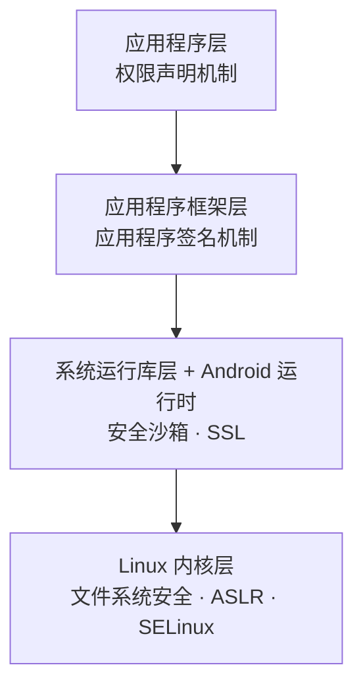

# 🤖 Android 系统安全 · 知识点总结

**系统架构 · 四大组件 · 权限机制 · 应用策略文件**

> [!TIP]
> **案例题抓手**：拿到 `AndroidManifest.xml`，先看四件事：① 哪些组件 `exported="true"`；② `debuggable` 是否为 true；③ `allowBackup` 是否为 true；④ `uses-permission` 是否过度申请。

---

## 🏗️ 1. Android 系统架构

| 层次 | 要点 |
| --- | --- |
| 应用程序层 | 内置短信、日历、地图、浏览器等核心应用；应用用 Java 语言编写 |
| 应用程序框架层 | 开发者可使用与核心应用相同的框架；程序可“暴露”内容供其他程序使用；四大组件在这一层 |
| 系统运行库层 | C/C++ 库，通过框架提供给开发者，**开发者不能直接使用这些库**；含 Android 运行时（核心库、Dalvik 虚拟机） |
| Linux 内核层 | 依赖 Linux 2.6 内核提供安全性、内存管理、进程管理、网络协议栈、驱动模型；是硬件与软件栈之间的抽象层 |

**📌 背景与权限审查**

| 项目 | 要点 |
| --- | --- |
| 系统背景 | Google 主导，基于 Linux 内核，首款手机 2009 年问世；优势是开源性与低限制应用模型，同时带来安全管控挑战 |
| 权限声明要求 | 应用必须在 `AndroidManifest.xml` 中声明所需的全部权限，未声明就无法调用对应系统能力 |
| 用户审查节点 | **安装时**弹窗展示所有声明的权限，是用户唯一集中审查的机会；安装后用户的直接控制只剩卸载 |
| 权限必要性判断 | 要结合应用用途：游戏不需要开发工具权限，儿童教育类不应申请“访问联系人”“获取位置” |
| 自定义权限 | 多用于自家多个应用间的数据通信；必须写清晰易懂的说明 |

---

## 🧩 2. Android 四大组件

| 组件 | 要点 |
| --- | --- |
| Activity | 与用户交互的“活动”，一个 Activity 就是一个屏幕 |
| Service | 后台长时间运行，一般不需要与用户交互，部分没有图形界面 |
| BroadcastReceiver | 广播消息接收器，类似事件监听器；应用没运行也能接收 Intent，用户不会察觉 |
| ContentProvider | 跨应用的数据交换标准，是跨进程处理结构化数据的机制 |
| Intent（意图） | 在组件之间传递消息、进行通信和交互的对象 |

> [!NOTE]
> 四个组件都必须在清单文件中声明。保护组件的第一步，就是在清单文件中声明并设置好 `exported` 与权限。

**🔧 各组件清单关键属性**

| 组件标签 | 关键属性与要点 |
| --- | --- |
| `<activity>` | 有 `intent-filter` 的是公共活动，可被系统中其他活动启动；没有意图过滤器的是私有活动，只能通过确切类名调用；`android:exported` 决定对应用外部是否可见（true 可见，false 不可见） |
| `<service>` | `enabled`（安装时是否自动启用）、`exported`（能否被其他应用组件调用）、`isolatedProcess`（在与系统其他部分隔离的进程中运行）、`permission`（启动或绑定所需权限）、`process`（运行的进程名，未指定则在默认应用进程） |
| `<provider>` | `authorities`（“地址”，通常用包名+类名保证全局唯一）、`exported`、`grantUriPermissions`（是否授予临时 URI 权限）、`permission`（全局访问权限）、`readPermission` / `writePermission`（读 / 写分别控制）、`multiprocess`、`syncable`、`initOrder` |
| `<receiver>` | `exported`（能否接收其他应用的广播）、`permission`（只有拥有该权限的应用才能给它发广播）、`process` |

---

## 🔐 3. Android 权限机制

**🎚️ 四种权限保护级别**

| 级别 | 要点 |
| --- | --- |
| 普通 normal（级别 0） | 危害不大，**自动授予**；例：GET_PACKAGE_SIZE、FLASHLIGHT |
| 危险 dangerous（级别 1） | **总是向用户显示**，可能导致隐私或财务损失；例：ACCESS_FINE_LOCATION、READ_SMS、SEND_SMS |
| 签名 signature（级别 2） | 同一开发者（相同证书）的应用互相访问组件，**自动授予**；部分允许使用系统级功能，如 ACCOUNT_MANAGER 账户验证器 |
| 签名或系统 signatureOrSystem | 与 signature 相同，另包含与系统映像相同证书的应用；用于手机厂商、运营商、系统应用；**第三方不能使用**；例：REBOOT 重启设备、SET_TIME 设置系统时间 |

> [!IMPORTANT]
> 课件强调：所有级别的权限都要在清单文件中声明；**第三方应用只能使用保护级别 0 和 1 的权限**。

**📋 应用程序级别权限（两种）**

| 类型 | 要点 |
| --- | --- |
| 请求权限 | 用 `<uses-permission>`（写在 `<manifest>` 内），表示应用正常运行所需权限，如 `<uses-permission android:name="android.permission.READ_SMS"/>` |
| 施加权限 | 用 `<application>` 的 `android:permission` 属性，声明与本应用任何组件交互的应用都必须具备的权限，如 `android:permission="android.permission.CAMERA"` |
| 优先关系 | 组件自己设置的权限**会覆盖** `<application>` 上设置的权限 |

**🎯 位置类权限示例**

| 权限 | 作用 |
| --- | --- |
| `ACCESS_COARSE_LOCATION` | 粗略位置，通常通过 Wi-Fi 或移动网络 |
| `ACCESS_FINE_LOCATION` | 精确位置，通常通过 GPS |
| `ACCESS_LOCATION_EXTRA_COMMANDS` | 访问额外的位置提供命令 |
| `INTERNET` | 网络访问，通过互联网收发数据 |

**🧱 组件级别权限（所有组件都可以用权限保护）**

| 组件 | 保护方式 |
| --- | --- |
| Activity | 在 `<activity>` 中设置 `android:permission`，启动它的组件都要有该权限；例：OrderActivity 要求自定义权限 `ORDER_BOOK`，并设 `exported="false"` |
| Service | 在 `<service>` 中设置 `android:permission`；例：FindUsefulSMS 要求 READ_SMS |
| ContentProvider | 在 `<provider>` 中设置权限；想与提供者通信的组件都要具备 |
| BroadcastReceiver | 两种方式：① **接收者保护自己**，在 `<receiver>` 设置权限，只接收拥有该权限的广播者的广播；② **广播者限制接收者**，用 `sendBroadcast(intent, 权限)`，只发给拥有该权限的接收者 |

**➕ 自定义权限（`<permission>` 标签）**

| 属性 | 作用 |
| --- | --- |
| `name` | 新权限的名称 |
| `description` | 详细描述该权限 |
| `label` | 安装时向用户显示的标签 |
| `icon` | 权限图标 |
| `permissionGroup` | 把权限分到某个组；不指定则不属于任何组 |
| `protectionLevel` | 保护级别：normal / dangerous / signature / signatureOrSystem |

---

## 📄 4. 应用程序策略文件：AndroidManifest.xml

| 项目 | 要点 |
| --- | --- |
| 文件要求 | 必须命名为 `AndroidManifest.xml`，放在应用根目录；它就是应用的**策略文件** |
| 声明内容 | 组件、可见性、访问规则、库、特性、运行所需的最低安卓版本 |
| 重要性 | 系统用它做组件解析，是整个应用中最重要的文件；它**不可扩展**，应用不能添加自己的属性或标签 |
| 必需标签 | 只有 `<manifest>` 和 `<application>`；声明组件没有固定顺序 |

**🏷️ 重要标签与安全意义**

| 标签 | 安全意义 |
| --- | --- |
| `<uses-permission>` | 遵循**最小权限原则**；不合理申请（如计算器要短信权限）是审计重点 |
| `<permission>` | `protectionLevel` 是核心，signature 级别用于保护同一开发者应用间的通信 |
| `<uses-sdk>` | 指定最低、目标版本；低版本系统有已知漏洞，设置较高的 `minSdkVersion` 更安全 |
| `<application>` | 其 `android:permission` 为所有组件设置默认访问权限，是全局安全门卫 |
| `<activity>` | `exported` 决定能否被其他应用启动，`permission` 设置启动权限 |
| `<service>` | `exported` 与 `permission` 是防止服务被恶意调用的关键 |
| `<provider>` | 数据共享的核心漏洞点；除 `exported` 外，用 `readPermission` / `writePermission` 精细控制 |
| `<receiver>` | `permission` 用于验证广播发送方的权限，防止接收恶意广播 |

**📦 `<manifest>` 常用属性**

| 属性 | 要点 |
| --- | --- |
| `package` | 包名称 |
| `sharedUserId` | 两个或多个应用共享同一个 Linux ID 时使用 |
| `sharedUserLabel` | 共享用户 ID 的用户可读名称 |
| `versionCode` | 内部用来跟踪修订版本的代码（如 10） |
| `versionName` | 向用户展示的版本（如 2.7.0） |
| `installLocation` | APK 安装位置：auto / internalOnly / preferExternal |

**🛡️ `<application>` 常用属性**

| 属性 | 要点 |
| --- | --- |
| `android:name` | 指定自定义的 Application 类，用于全局初始化 |
| `android:icon` / `android:label` | 应用图标 / 名称，显示在桌面和应用管理中（课件标为必需） |
| `android:theme` | 为所有 Activity 设置默认样式主题 |
| `android:permission` | **全局权限门槛**，外部应用与任何组件交互都要有；组件权限可覆盖它 |
| `android:debuggable` | **发布版必须为 false**；设为 true 是严重漏洞 |
| `android:allowBackup` | 默认 true；含敏感数据的应用应设为 **false**，防止数据通过备份泄露 |
| `android:process` | 默认进程名为包名；设为 `:remote` 可让组件运行在独立私有进程，增强隔离 |

---

## 🗂️ 5. 系统重要目录与文件

**✍️ 签名与应用私有数据**

| 路径 | 要点 |
| --- | --- |
| `META-INF/`（APK 内） | 存放 CERT.RSA、CERT.SF、MANIFEST.MF 等签名与清单；验证 APK 完整性和发布者身份，篡改会导致安装失败，是 App 安全的第一道防线 |
| `/data/data/<应用包名>/` | 应用沙箱，每个应用的私有数据根目录；其他应用不能直接访问，除非设备 Root |
| `/data/data/<包名>/databases/` | 存放 SQLite 数据库（.db）；存大量结构化用户数据，是数据安全和隐私泄露的重灾区 |
| `/data/data/<包名>/shared_prefs/` | SharedPreferences 生成的 XML 配置；可能含用户配置、令牌等敏感信息 |
| `/data/data/<包名>/cache/` | 应用缓存目录；系统可自动清理，不应存放敏感数据 |

**💾 外部存储**

| 路径 | 要点 |
| --- | --- |
| `/storage/emulated/0/Android/data/<包名>/` | 外部私有目录；Android 10+ 无需权限访问，卸载时数据自动清除，相对安全 |
| `/storage/emulated/0/Download/`、`/DCIM/` 等 | 公共目录；Android 10+ 通过 MediaStore API 访问，数据可能被其他应用读取，有泄露风险 |

**⚙️ 系统与配置**

| 路径 | 要点 |
| --- | --- |
| `/data/system/packages.xml` | 记录所有已安装应用的信息、**权限授予状态**和签名；权限分析的终极来源，安全审计关键文件 |
| `/system/app/` | 系统预装的核心应用 |
| `/system/priv-app/` | 特权应用，拥有普通应用没有的权限；是系统安全关键，也是恶意软件仿冒的目标 |
| `/system/etc/security/` | 系统级可信 CA 证书；用于 HTTPS 等验证，篡改会导致中间人攻击风险 |
| `/init.rc`、`init.<device>.rc` | 定义系统启动过程、服务和权限；Root 后才能修改 |
| `/proc/` | 以文件形式提供系统和进程实时信息；用于动态分析，如 `/proc/self/maps` 是分析 ASLR 的关键 |

**📱 应用自身结构（APK 内）**

| 文件 | 要点 |
| --- | --- |
| `AndroidManifest.xml` | 声明组件、权限、硬件要求；安全策略源头，用于分析组件导出风险和权限申请是否过度，**案例题必考** |
| `classes.dex` | 编译后的 Java 字节码；代码混淆、加固和反编译的核心目标 |
| `lib/<abi>/` | 原生共享库（.so）；可能存在本地层漏洞（如栈溢出） |

---

## ✅ 6. 案例题检查清单

| 检查项 | 风险与对策 |
| --- | --- |
| 组件 `exported="true"` | 可被其他应用调用；不需要对外的组件设为 false，或加权限保护 |
| `debuggable="true"` | 发布版严重漏洞，必须改为 false |
| `allowBackup="true"` | 敏感数据可经备份泄露，应设为 false |
| 权限申请过多 | 违反最小权限原则，如计算器申请短信权限 |
| Provider 无读写权限控制 | 用 `readPermission` / `writePermission` 精细控制 |
| 自定义权限级别过低 | 应用间通信宜用 signature 级别 |
| `minSdkVersion` 过低 | 低版本系统有已知漏洞，应提高 |
| 敏感数据放 shared_prefs、缓存或公共目录 | 易被读取或泄露，应避免明文存放 |

---

## 🔎 课件内容中建议再核对的地方

> [!WARNING]
> - 课件中写的 **BRIK** 权限（锁定手机），英文拼写应为 **BRICK**，请对照教材。
> - 课件“施加权限”示例代码里 `android:permission` 属性写得不完整，上文已按正确写法补全。
> - 课件的 `sendBroadcast` 示例里，第二个参数应是**权限名**；示例用了 SMS_RECEIVED 这个广播动作名，答题时以“第二个参数是权限”为准。

---

整理自至强老师《案例课程 09 安卓系统安全》课件 · 表格按“项目 → 要点”两列排列，便于背诵 
带“核对”标记的内容请以教材为准

