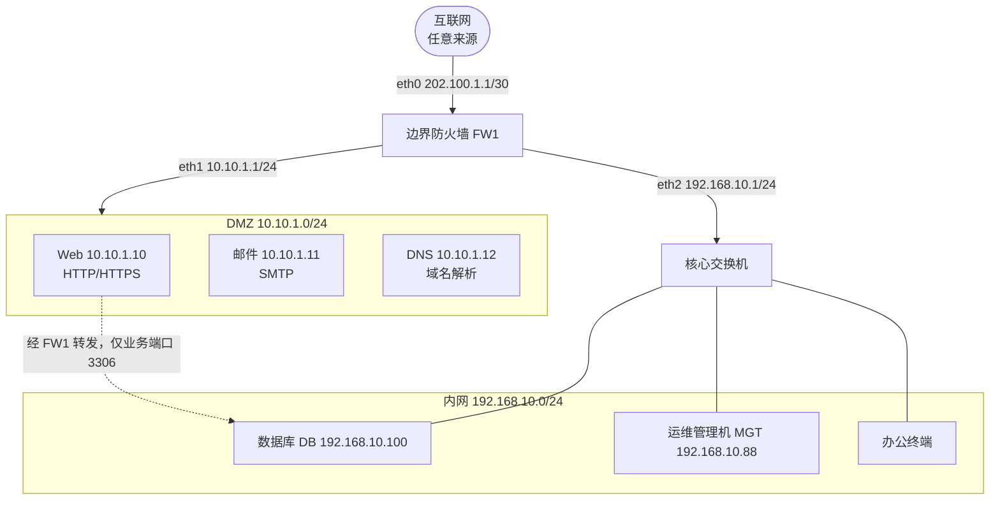
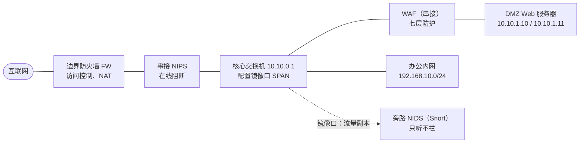
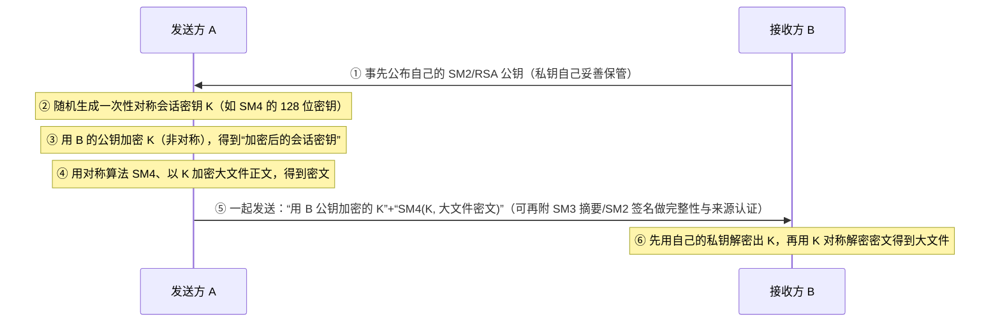

<div align="center">

# 📝 2026 渠道卷 · 案例分析（共 9 题）

**卷一 4 题（75 分）· 卷二 5 题（75 分）· 含参考答案、评分要点与解析**


</div>

> [!NOTE]
> **还原说明**：原卷中的表格、脚本、日志、代码都按原样还原；原卷没有画出的拓扑和流程，我根据题干文字绘制了示意图，标题里带“示意图”。每题的“参考答案与详细解析”默认折叠，先做题再点开核对。

---

# 📘 卷一

## 试题一（20 分）某市政府门户网站网络拓扑与边界防护

### 【背景材料】

某市大数据局信息中心李工负责政务外网与门户网站的安全建设。该网络采用“互联网—边界防火墙—DMZ—核心交换机—办公内网”的结构，边界防火墙具备三个接口（连接互联网、连接 DMZ、连接内网）。网络中主要设备与服务器如下表所示。

| 区域 | 设备/服务器 | 接口/IP 地址 | 说明 |
| --- | --- | --- | --- |
| 互联网 | 外网 | — | 任意来源 |
| 边界防火墙 FW1 | eth0（接互联网） | 202.100.1.1/30 | 外网口 |
| 边界防火墙 FW1 | eth1（接 DMZ） | 10.10.1.1/24 | DMZ 口 |
| 边界防火墙 FW1 | eth2（接内网） | 192.168.10.1/24 | 内网口 |
| DMZ | Web 服务器 | 10.10.1.10 | 对外提供 HTTP/HTTPS |
| DMZ | 邮件服务器 | 10.10.1.11 | 对外提供 SMTP |
| DMZ | DNS 服务器 | 10.10.1.12 | 域名解析 |
| 内网 | 数据库服务器 DB | 192.168.10.100 | 存放业务数据，不对外 |
| 内网 | 运维管理机 MGT | 192.168.10.88 | 唯一允许远程管理的主机 |
| 内网 | 办公终端 | 192.168.10.0/24 | 日常办公 |

连接关系文字描述：互联网只与 FW1 的 eth0 相连；FW1 的 eth1 连接 DMZ 交换机，DMZ 内部署 Web、邮件、DNS 三台服务器；FW1 的 eth2 连接核心交换机，核心交换机下联内网办公终端段（192.168.10.0/24）与数据库服务器 DB（192.168.10.100）。数据库服务器 DB 不允许互联网直接访问，仅允许 DMZ 的 Web 服务器以应用方式访问其业务端口。

**📊 拓扑示意图（根据题干文字绘制）**



李工在边界防火墙 filter 表上配置转发规则，要求采用“默认拒绝 + 白名单放行”，并允许运维管理机 192.168.10.88 通过 SSH（22 端口）对设备进行管理。初始规则脚本如下（部分空缺）：

```bash
# 查看 filter 表规则
iptables -t filter -L -n -v

# 设置默认策略为拒绝
iptables -P FORWARD (1)_______

# 放行互联网到 DMZ Web 服务器的 HTTP(80)/HTTPS(443)
iptables -A FORWARD -p tcp -d 10.10.1.10 --dport 80 -j (2)_______
iptables -A FORWARD -p tcp -d 10.10.1.10 --dport 443 -j ACCEPT

# 放行 DMZ Web 服务器访问内网数据库服务器的业务端口(MySQL 3306)
iptables -A FORWARD -s 10.10.1.10 -d 192.168.10.100 -p tcp --dport 3306 -j ACCEPT

# 仅允许运维管理机访问内网服务器与设备的 SSH(22)
iptables -A FORWARD (3)_______ 192.168.10.88 -p tcp --dport 22 -j ACCEPT
iptables -A FORWARD -p tcp --dport 22 -j DROP

# 放行内网办公终端主动访问互联网的出站及回程流量
iptables -A FORWARD -s 192.168.10.0/24 -j ACCEPT
iptables -A FORWARD -m state --state ESTABLISHED,RELATED -j ACCEPT
```

### 【问题】

- **【问题 1】（3 分）** 根据背景描述，该边界防火墙同时连接互联网、DMZ 和内网三个网络，这种防火墙体系结构属于哪一种（包过滤路由器、双宿主机/双网卡网关、屏蔽主机防火墙、屏蔽子网防火墙）？并说明 DMZ（非军事区）在该结构中的作用。
- **【问题 2】（4 分）** 请指出哪些服务器应当部署在 DMZ 区、哪些应当部署在内网区。并简要说明互联网、DMZ、内网三者之间允许的访问关系（谁可以主动访问谁）。
- **【问题 3】（3 分）** 包过滤防火墙、状态检测防火墙、应用代理（应用网关）防火墙分别工作在 OSI/RM 的哪一层（或哪几层）？三者中哪一种能根据“连接状态/会话”动态判断是否放行，哪一种能对应用层协议内容进行深度检查？
- **【问题 4】（6 分）** 请补全上述 iptables 脚本中空缺的 (1)(2)(3)。并说明：为什么“放行运维管理机 22 端口”的规则必须写在“拒绝其他 22 端口”规则之前？
- **【问题 5】（4 分）** 为落实纵深防御（defense in depth），除边界防火墙外，李工还应在该网络中补充哪些防护措施或安全设备（至少答出 4 点）？

<details>
<summary><b>📖 参考答案与详细解析（点击展开）</b></summary>

<br>

**问题 1（3 分）参考答案**：属于**屏蔽子网防火墙**（屏蔽子网体系结构，Screened Subnet）。DMZ 的作用：在内外网之间构建一个“缓冲子网”，把必须对外提供服务的服务器（Web/邮件/DNS）隔离在其中，即使 DMZ 中的服务器被攻破，攻击者也不能直接进入受保护的内网，从而在互联网与内网之间形成两道防火墙过滤点。

**评分要点**：① 答出“屏蔽子网防火墙/屏蔽子网体系结构”（2 分）；② 说明 DMZ 是隔离对外服务器、保护内网的缓冲子网，被突破后仍有第二道防线（1 分）。

**解析**：典型屏蔽子网结构由“外部路由器—DMZ—内部路由器”组成，本题中一台三接口防火墙 FW1 同时承担外网口、DMZ 口、内网口，等价于屏蔽子网体系。与之区分：双宿主机网关是一块网卡直连内网、一块直连外网、无 DMZ；屏蔽主机防火墙由包过滤路由器 + 堡垒机构成，内网主机在同一网段。

---

**问题 2（4 分）参考答案**：

- 应放在 DMZ：Web 服务器（10.10.1.10）、邮件服务器（10.10.1.11）、DNS 服务器（10.10.1.12）等需要被互联网访问的对外服务。
- 应放在内网：数据库服务器 DB（192.168.10.100）、办公终端（192.168.10.0/24）等不对外暴露的资源。
- 访问关系：互联网可主动访问 DMZ 的公开服务（80/443/25/53）；互联网**不能**主动访问内网；DMZ 的 Web 服务器可按业务需要访问内网数据库（仅开放必要端口）；内网办公终端可主动访问互联网与 DMZ；互联网到内网、以及 DMZ 被入侵后横向到内网的访问应被默认拒绝。

**评分要点**：① DMZ 放 Web/邮件/DNS 对外服务器（1 分）；② 数据库与办公终端放内网、不对外（1 分）；③ 互联网只能进 DMZ、不能直达内网（1 分）；④ 内网可主动出、DMZ 对 DB 最小授权访问（1 分）。

**解析**：把数据库放在内网而非 DMZ 是关键——数据库保存敏感业务数据，一旦放在 DMZ 被攻破即直接泄露；正确做法是 Web（DMZ）→ DB（内网）单向、最小端口授权。

---

**问题 3（3 分）参考答案**：

- 包过滤防火墙：工作在网络层（IP）与传输层（TCP/UDP），依据五元组（源/目的 IP、源/目的端口、协议）静态过滤。
- 状态检测防火墙：工作在网络层/传输层，并维护会话连接状态表，能根据“连接状态/会话”动态判断放行（本题能按连接状态判断的是状态检测防火墙）。
- 应用代理（应用网关）防火墙：工作在应用层，能对 HTTP/FTP 等应用层协议内容做深度检查与代理转发。
- 能按连接状态动态判断的是**状态检测防火墙**；能对应用层内容深度检查的是**应用代理防火墙**。

**评分要点**：① 包过滤 = 网络层/传输层、按五元组（1 分）；② 状态检测 = 维护会话状态表、可动态判断（1 分）；③ 应用代理 = 应用层、可深度检查应用内容（1 分）。

**解析**：三者对比是高频考点：包过滤快但无状态、不理解应用；状态检测兼顾性能与会话感知；应用代理安全性最高但性能差、部署复杂。

---

**问题 4（6 分）参考答案**：

- (1) **DROP**（默认拒绝，白名单思路）
- (2) **ACCEPT**
- (3) **-s**（指定源地址）
- 规则顺序原因：iptables 规则**自上而下逐条匹配，首次匹配成功即停止**。若先写“拒绝所有 22 端口”，则运维管理机 192.168.10.88 的 SSH 流量会先被 DROP 规则命中而丢弃，后面的放行规则永远不会被执行，导致管理员也无法远程管理。因此必须“先精确放行指定源、再拒绝其余”。

**评分要点**：① (1) DROP（1 分）；② (2) ACCEPT（1 分）；③ (3) -s（源地址限定，1 分）；④ 答出“规则自上而下、首次匹配即停止”（2 分）；⑤ 正确解释放行须在前、否则管理流量被先 DROP（1 分）。

**解析**：本题为标准白名单收口：默认策略 DROP + 逐条 ACCEPT 必需服务。DROP 与 REJECT 在软考中通常均认可，DROP 不回显、更隐蔽。`-m state --state ESTABLISHED,RELATED` 用于放行已建立连接的回程流量，避免内网出站会话的响应包被默认 DROP 丢弃。

---

**问题 5（4 分）参考答案**：纵深防御应补充（任答 4 点）：

1. 入侵检测/防御系统 IDS/IPS（旁路检测或串接阻断攻击）；
2. Web 应用防火墙 WAF（保护 DMZ 的 Web 服务，防 SQL 注入/XSS 等）；
3. 上网行为管理/抗 DDoS 设备（清洗流量型攻击）；
4. 漏洞扫描与安全审计（日志审计、数据库审计）；
5. 终端安全（杀毒、主机防火墙、EDR）与内网安全分区/VLAN 隔离；
6. 堡垒机/跳板机集中运维审计；
7. 数据加密、备份与容灾、安全管理制度与人员培训。

**评分要点**：每点 1 分，答满 4 点即给满分；须为“边界之外的补充层次”，重复防火墙本身不得分。

**解析**：纵深防御强调多层、互补：网络层（防火墙/IPS）、应用层（WAF）、主机层（终端防护）、数据层（加密备份）、管理层（制度审计），单点被破仍有后续防线。

</details>

---

## 试题二（20 分）Linux 服务器文件系统与权限安全

### 【背景材料】

李工对一台 Linux 服务器做安全加固，查看了用户账号文件、口令哈希文件以及若干文件的权限信息。相关片段如下。

`/etc/passwd` 片段：

```text
root:x:0:0:root:/root:/bin/bash
daemon:x:1:1:daemon:/usr/sbin:/usr/sbin/nologin
alice:x:1001:1001:Alice:/home/alice:/bin/bash
bob:x:1002:1002:Bob:/home/bob:/bin/bash
```

`/etc/shadow` 片段：

```text
root:$6$abcXYZ$Kx9.../0:19000:0:99999:7:::
alice:$6$defUVW$Pq2.../1:19000:0:99999:7:::
bob:!:19000:0:99999:7:::
```

`ls -l` 查看关键文件/目录的输出：

```text
-rw-------  1 root  root    1240 Oct  1 09:00 /etc/shadow
-rw-r--r--  1 root  root    1654 Oct  1 09:00 /etc/passwd
drwxr-xr-x  2 alice alice   4096 Oct  1 09:01 /home/alice
lrwxrwxrwx  1 root  root      16 Oct  1 09:02 /tmp/mylink -> /etc/passwd
-rwxr-xr-x  1 root  root   12345 Oct  1 09:03 /usr/local/bin/backup.sh
```

### 【问题】

- **【问题 1】（4 分）** `/etc/passwd` 中每行用冒号分隔为 7 个字段。请写出下列字段的含义：第一个字段（用户名）、第二个字段（x）、第三个字段（数字 0/1001）、第六个字段（/home/alice）。`/etc/shadow` 中第二个字段保存的是什么？bob 那一行第二个字段为 `!` 表示什么？
- **【问题 2】（3 分）** 从 `ls -l` 输出可知 `/etc/shadow` 的权限是 `-rw-------`（即数字权限多少？）。为什么该文件必须严格限制为仅 root 可读，而不能像 `/etc/passwd` 那样对所有用户可读？
- **【问题 3】（5 分）** 请判读 `ls -l` 输出中各行第一个字符（`-`、`d`、`l`）分别表示什么文件类型。并指出 `/etc/shadow`、`/home/alice`、`/tmp/mylink` 三行分别属于哪种文件类型。
- **【问题 4】（4 分）** 请完成权限换算：（1）数字权限 750 对应的符号权限（rwx 形式）是什么？（2）符号权限 `-rw-r--r--` 对应的数字权限是多少（即 `/etc/passwd` 的权限）？
- **【问题 5】（4 分）**（1）`/tmp/mylink -> /etc/passwd` 是用什么命令建立的软链接（符号链接）？软链接与硬链接有何区别（答 1 点即可）？（2）李工想在整台系统中查找“最近 7 天内被修改过的文件”以及“已经失效（指向不存在目标）的软链接”，请各写出一条对应的 `find` 命令。

<details>
<summary><b>📖 参考答案与详细解析（点击展开）</b></summary>

<br>

**问题 1（4 分）参考答案**：`/etc/passwd` 字段：

- 第 1 字段：登录用户名；
- 第 2 字段：口令占位符 x（表示真正的口令哈希保存在 `/etc/shadow`，此处不再保存密文）；
- 第 3 字段：UID（用户标识号，root 为 0，alice 为 1001）；
- 第 6 字段：用户的主目录（家目录）路径。

`/etc/shadow` 第 2 字段：保存用户**口令的哈希值**（如 `$6$...` 表示 SHA-512 哈希）。bob 行该字段为 `!`：表示该账号被**锁定/禁用**，无法用口令登录（对应影子口令中的锁定标记）。

**评分要点**：① 字段 x = 口令哈希已移至 shadow 的占位符（1 分）；② UID（1 分）；③ 家目录（1 分）；④ shadow 第 2 字段 = 口令哈希、`!` = 账号锁定（1 分）。

**解析**：passwd 对所有用户可读是因为其他程序需要读取 UID/用户名映射；口令哈希早先存于 passwd 第二字段，后因 passwd 人人可读导致哈希易被窃取破解，故移入仅 root 可读的 shadow，passwd 第二字段只留 x 占位。`$6$` 是哈希算法标识，6 代表 SHA-512。

---

**问题 2（3 分）参考答案**：`-rw-------` 对应的数字权限是 **600**（属主 rw = 4+2 = 6，属组 0，其他 0）。

原因：`/etc/shadow` 保存所有用户口令的哈希值，若普通用户可读，攻击者可直接拷贝哈希文件进行离线暴力破解/彩虹表攻击，一旦破解即可冒充任意用户登录；因此必须仅 root 可读（常见为 600，部分发行版为 root:shadow 组 640）。而 `/etc/passwd` 不保存真实哈希、只保存账号映射信息，故可公开可读。

**评分要点**：① 数字权限 600（1 分）；② shadow 存口令哈希、人人可读会被离线破解（1 分）；③ passwd 不存真实哈希、故可公开（1 分）。

**解析**：这是 shadow 机制存在的根本理由——把“人人可读但敏感”的口令哈希从 passwd 中剥离到“仅 root 可读”的 shadow。教程口径通常记为 600（rw-------）。

---

**问题 3（5 分）参考答案**：

- 第一个字符含义：`-` 表示普通文件；`d` 表示目录（directory）；`l` 表示符号链接/软链接（link）。
- `/etc/shadow`（`-rw-------`）：普通文件；
- `/home/alice`（`drwxr-xr-x`）：目录；
- `/tmp/mylink`（`lrwxrwxrwx`）：符号链接（软链接）。

**评分要点**：① `-` = 普通文件（1 分）；② `d` = 目录（1 分）；③ `l` = 符号链接（1 分）；④ 三行文件类型对应全对给 2 分（答对任意两行即给 2 分）。

**解析**：`ls -l` 输出共 10 个权限字符位：第 1 位是文件类型，后 9 位分三组（属主/属组/其他）各 rwx。软链接固定显示为 `lrwxrwxrwx`，其真正权限由被指向的目标文件决定。

---

**问题 4（4 分）参考答案**：

- （1）750 = 属主 rwx（7 = 4+2+1）、属组 r-x（5 = 4+1）、其他 ---（0），即 **rwxr-x---**。
- （2）`-rw-r--r--` = 属主 rw- = 6、属组 r-- = 4、其他 r-- = 4，即数字权限 **644**。

**评分要点**：① 750 → rwxr-x---（2 分）；② rw-r--r-- → 644（2 分）。r=4、w=2、x=1 换算正确即可。

**解析**：数字权限三位分别对应属主/属组/其他，每位是 r(4) + w(2) + x(1) 的和。常见基准：755 = rwxr-xr-x、644 = rw-r--r--、700 = rwx------、600 = rw-------。

---

**问题 5（4 分）参考答案**：

- （1）用 `ln -s` 命令建立（完整形式 `ln -s /etc/passwd /tmp/mylink`）。软链接与硬链接区别（任答 1 点）：软链接是独立的新文件（有自己的 inode），可跨文件系统、可对目录建链接，原文件删除后软链接失效变成“悬空链接”；硬链接与原文件共享同一 inode，不能跨文件系统、不能对目录建链接，原文件删除后硬链接仍可访问（只要链接计数未归零）。
- （2）查找最近 7 天内被修改的文件：`find / -mtime -7`；查找失效（悬空）软链接：`find / -xtype l`。

**评分要点**：① `ln -s`（1 分）；② 软/硬链接区别 1 点（1 分）；③ `find / -mtime -7`（1 分）；④ `find / -xtype l`（1 分）。

**解析**：`-mtime -7` 指修改时间在 7 天以内；`-xtype l` 匹配“原本是符号链接、但指向的目标已不存在”的失效链接，常用于应急排查被植入的后门链接。

</details>

---

## 试题三（18 分）密码学与 PKI 基础应用

### 【背景材料】

某系统集成商需要为业务系统选择密码算法并理解数字证书机制。工程师列出以下算法：DES、AES、RSA、SM4、SM2、MD5、SHA-256、SM3、3DES、ECC。同时，李工用一个简化的 RSA 例子理解公钥密码的加解密过程：取两个小素数 p=11、q=13，并选取公钥指数 e=7。

### 【问题】

- **【问题 1】（4 分）** 请从上述算法清单中，分别列出属于**对称密码算法、非对称（公钥）密码算法、哈希杂凑算法**的算法（每类至少列出清单中出现的对应算法）。
- **【问题 2】（6 分）** 根据给定的 p=11、q=13、e=7，请完成 RSA 计算：（1）计算模数 n 和欧拉函数 φ(n)；（2）计算私钥指数 d（要求 e·d ≡ 1 mod φ(n)）；（3）若明文 m=9，求密文 C = m^e mod n；（4）由密文 C 解密验证是否恢复出 m=9。请写出每一步可核验的计算过程。
- **【问题 3】（4 分）** 在数字签名中，签名者应使用自己的**私钥还是公钥**对消息摘要进行签名？验证者又使用谁的哪把钥进行验证？数字签名与“公钥加密”在“用哪把钥加/解密”上有何本质区别？数字签名能否提供消息的保密性（加密那样防窃听）？
- **【问题 4】（4 分）** 在 TLS/HTTPS 通信中，数字证书的主要作用是什么？一张 X.509 数字证书通常包含哪些关键要素（至少答 3 项）？证书是由谁签发的、客户端如何沿“信任链”验证服务器证书的合法性？

<details>
<summary><b>📖 参考答案与详细解析（点击展开）</b></summary>

<br>

**问题 1（4 分）参考答案**：

| 类别 | 算法 |
| --- | --- |
| 对称密码算法（单钥、加解密同钥、速度快） | DES、3DES、AES、SM4 |
| 非对称（公钥）密码算法 | RSA、SM2、ECC |
| 哈希杂凑算法（单向、定长摘要） | MD5、SHA-256、SM3 |

**评分要点**：① 对称类答对（DES/3DES/AES/SM4）（1.5 分）；② 非对称类答对（RSA/SM2/ECC）（1.5 分）；③ 哈希类答对（MD5/SHA-256/SM3）（1 分）。分类错误归类到不得分。

**解析**：判断关键看“一把钥还是两把钥、是否可逆”：对称算法一把密钥双向用；公钥算法公私钥成对；哈希不可逆、只出定长摘要。国密对照：SM4 对称、SM2 非对称（椭圆曲线）、SM3 哈希。

---

**问题 2（6 分）参考答案**：已知 p=11、q=13、e=7。

- （1）n = p·q = 11 × 13 = **143**；φ(n) = (p−1)(q−1) = 10 × 12 = **120**。（要求 gcd(e, φ(n)) = gcd(7, 120) = 1，满足条件。）
- （2）求 d：解 e·d ≡ 1 (mod 120)，即 7d ≡ 1 (mod 120)。用扩展欧几里得：120 = 17×7 + 1，回代得 1 = 120 − 17×7，即 (−17)×7 ≡ 1 (mod 120)，故 d ≡ −17 ≡ **103** (mod 120)。校验：7 × 103 = 721，721 mod 120 = 721 − 6×120 = 721 − 720 = 1 ✓。公钥 (e, n) = (7, 143)，私钥 (d, n) = (103, 143)。
- （3）加密 m = 9：C = 9⁷ mod 143。9² = 81；9⁴ = 81² = 6561，6561 mod 143 = 6561 − 45×143 = 6561 − 6435 = 126；9⁷ = 9⁴ × 9² × 9 = 126 × 81 × 9；126 × 81 = 10206，10206 mod 143 = 10206 − 71×143 = 10206 − 10153 = 53；53 × 9 = 477，477 mod 143 = 477 − 3×143 = 477 − 429 = **48**。即 C = 48。
- （4）解密验证：m = C^d mod n = 48¹⁰³ mod 143。用 CRT 验证（143 = 11×13）：mod 11：48 ≡ 4，由费马小定理 4¹⁰ ≡ 1，103 mod 10 = 3，故 4¹⁰³ ≡ 4³ = 64 ≡ 9 (mod 11)；mod 13：48 ≡ 9，9¹² ≡ 1，103 mod 12 = 7，故 9¹⁰³ ≡ 9⁷；9² = 81 ≡ 3，9⁴ ≡ 9，9⁷ = 9⁴ × 9² × 9 = 9 × 3 × 9 = 243 ≡ 243 − 18×13 = 243 − 234 = 9 (mod 13)。两式均为 9，即 m ≡ 9 (mod 143)，解密恢复 m = 9 ✓。

**评分要点**：① n = 143、φ(n) = 120（2 分）；② d = 103 且给出 7×103 ≡ 1 mod 120 的校验（2 分）；③ C = 48 且中间步骤正确（1 分）；④ 解密恢复 m = 9、步骤可核验（1 分）。

**解析**：RSA 正确性由 m^(e·d) ≡ m (mod n) 保证。本题明文 m = 9 必须满足 m < n = 143，否则需先分组；考试中 n、φ(n)、d、C 的每一步都应可被阅卷老师手算复核。

---

**问题 3（4 分）参考答案**：

- 数字签名：签名者用**自己的私钥**对消息摘要进行签名；验证者用**签名者的公钥**进行验证。
- 与公钥加密的区别：公钥加密是“发送方用**接收方公钥**加密、接收方用**自己私钥**解密”（目的是保密）；数字签名是“签名方用**自己私钥**签名、他人用**签名方公钥**验证”（目的是认证来源、保证完整性、抗否认）。两者用钥方向恰好相反。
- 数字签名**不能提供保密性**：签名后的消息通常仍是明文/可被任何人用公钥验证，它解决的是“是谁签的、有没有被改”，而不是“别人看不懂”；要保密需另加密。

**评分要点**：① 签名用自己私钥、验证用签名者公钥（1 分）；② 对比公钥加密用接收方公钥加密、私钥解密（1 分）；③ 方向相反/目的不同（认证完整抗否认 vs 保密）（1 分）；④ 签名不提供保密性（1 分）。

**解析**：口诀“公钥加密私钥解、私钥签名公钥验”。签名的三性质：身份认证、数据完整性、不可否认；不保证机密性。

---

**问题 4（4 分）参考答案**：

- 证书作用：把“公钥”与“持有者身份”绑定，并由可信第三方 CA 签名，使通信方能够确认所拿到的公钥确实属于目标服务器（防中间人冒充、防公钥被替换），从而在 TLS 握手时建立可信的密钥协商。
- 证书关键要素（任答 3 项）：版本号、序列号、签名算法、**持有者主体名称（Subject，即服务器域名）**、**持有者公钥（Subject Public Key）**、颁发者（Issuer，CA 名称）、有效期（生效/过期时间）、CA 的数字签名。
- 签发与验证证书链：证书由**数字证书认证机构 CA** 签发；客户端本地预置受信任根 CA 证书，验证时沿“服务器证书 → 中间 CA → 根 CA”逐级用上级公钥验证签名，直到链顶端是本机信任的根 CA，即认为该服务器证书合法。


**评分要点**：① 证书 = 绑定公钥与身份、由 CA 签名、防中间人（1 分）；② 要素答对 3 项（主体域名/公钥/颁发者/有效期/签名等）（2 分）；③ CA 签发、沿信任链逐级验证到受信根 CA（1 分）。

**解析**：HTTPS 中服务器在 TLS 握手阶段出示证书，客户端验签通过后才用服务器公钥加密协商会话密钥，随后用对称密钥加密业务数据。证书过期、域名不符、自签名未被信任都会触发浏览器告警。

</details>

---

## 试题四（17 分）应急响应、Windows 日志与数据合规综合

### 【背景材料】

某公司员工收到一封伪装成“OA 系统升级通知”的钓鱼邮件，内含恶意附件。员工打开后主机被植入木马，攻击者随后通过暴力破解尝试登录内网一台 Windows 服务器的远程桌面（RDP，TCP 3389）。管理员在该 Windows 服务器上观察到大量登录失败记录，并最终发现服务器上的客户个人信息数据被对外传输泄露。

Windows 安全日志片段（事件查看器截图对应内容）如下：

```text
事件 ID: 4625   登录失败   账户: administrator   来源网络地址: 203.0.113.66
事件 ID: 4625   登录失败   账户: administrator   来源网络地址: 203.0.113.66
事件 ID: 4625   登录失败   账户: administrator   来源网络地址: 203.0.113.66
事件 ID: 4624   登录失败   账户: administrator   来源网络地址: 203.0.113.66   登录类型: 10
```

> [!WARNING]
> 原卷最后一行印刷为“事件 ID: 4624 **登录失败**”。按问题 2 的答案，4624 表示**登录成功**，这里应是原卷的印刷笔误，答题时以“4624 = 登录成功”为准。

管理员还需要在抓包工具 Wireshark 中过滤相关流量用于溯源。

### 【问题】

- **【问题 1】（4 分）** 请按攻击发生的先后顺序，用箭头描述本次事件的完整攻击链（从钓鱼邮件到数据泄露），并指出攻击者主要利用了哪两个薄弱环节（至少答 2 点，如弱口令、暴露 RDP 端口等）。
- **【问题 2】（4 分）** Windows 事件查看器（eventvwr）中的日志主要分为哪三类？事件 ID 4624 和 4625 分别表示什么含义？管理员应使用什么命令打开事件查看器？
- **【问题 3】（3 分）** 请写出满足下列需求的 Wireshark 过滤表达式：（1）只显示 RDP（3389 端口）相关流量；（2）只显示来源 IP 为 203.0.113.66 的流量。
- **【问题 4】（2 分）** 本次事件中“客户个人信息数据被对外泄露”主要破坏了信息安全的哪一个 CIA 属性？“攻击者暴力破解并登录成功、冒充 administrator 操作”又主要破坏了哪一个 CIA 属性（或安全目标）？
- **【问题 5】（4 分）** 本次泄露的是大量客户个人信息。请判断：该事件主要适用《网络安全法》《数据安全法》《个人信息保护法》中的哪一部（或哪几部）？作为数据处理者/运营者，事发后应履行哪些合规义务、并采取哪些防护整改措施（至少答 3 点）？

<details>
<summary><b>📖 参考答案与详细解析（点击展开）</b></summary>

<br>

**问题 1（4 分）参考答案**：


被利用的薄弱环节（任答 2 点）：① 员工安全意识不足、被钓鱼社工诱导打开恶意附件；② administrator 账号弱口令/未限制登录来源，导致 RDP 可被暴破；③ RDP 3389 端口暴露在内网/公网，缺乏访问控制与登录失败锁定；④ 缺乏邮件网关/终端杀毒/EDR 检测，恶意附件未被拦截。

**评分要点**：① 攻击链顺序正确（钓鱼 → 植入 → 暴破 → 外传）（2 分）；② 薄弱环节答对 2 点（2 分）。

**解析**：这是典型“社工钓鱼 + 横向暴破 + 数据外泄”链，对应应急响应 PDCERF 流程中的检测、抑制、根除、恢复环节。

---

**问题 2（4 分）参考答案**：

- 三类日志：**安全日志**（登录/注销、权限使用等安全事件）、**系统日志**（系统组件、驱动、服务启停等）、**应用程序日志**（应用程序产生的事件）。
- 事件 ID 4624：**登录成功**；事件 ID 4625：**登录失败**（日志中连续多条 4625 即暴力破解特征）。
- 打开命令：运行 `eventvwr`（或 `eventvwr.msc`）打开事件查看器。

**评分要点**：① 三类日志（安全/系统/应用程序）（2 分）；② 4624 = 登录成功、4625 = 登录失败（1 分）；③ eventvwr / eventvwr.msc（1 分）。

**解析**：登录类型 10 表示“远程交互登录”，正是 RDP 远程桌面登录。连续大量 4625 后紧跟一条来自同一 IP 的 4624，说明暴破成功、已被攻破。

---

**问题 3（3 分）参考答案**：

- （1）过滤 RDP（3389）流量：`tcp.port == 3389`（或更精确 `tcp.dstport == 3389`）。
- （2）过滤来源 IP 为 203.0.113.66 的流量：`ip.src == 203.0.113.66`。
- （两者组合可写 `ip.src == 203.0.113.66 and tcp.port == 3389`。）

**评分要点**：① `tcp.port == 3389`（1.5 分）；② `ip.src == 203.0.113.66`（1.5 分）。

**解析**：Wireshark 过滤表达式用双等号 `==`，RDP 基于 TCP 3389；`ip.src` 按源 IP 过滤，`ip.dst` 按目的 IP 过滤。

---

**问题 4（2 分）参考答案**：

- 数据被对外泄露：破坏了**机密性**（保密性，Confidentiality）。
- 攻击者暴破成功、冒充 administrator 操作：破坏了**身份认证（真实性）**。需说明，身份认证/真实性并不属于 CIA 三要素（机密性/完整性/可用性），而是独立的安全目标；同时，其未授权访问与后续数据外传也侵害了机密性。

**评分要点**：① 数据泄露 = 机密性（保密性）（1 分）；② 暴破冒充登录 = 破坏身份认证（真实性），其未授权访问与数据外传同时侵害机密性（1 分）。

**解析**：CIA 三要素为机密性 Confidentiality、完整性 Integrity、可用性 Availability，并不包含“身份认证/真实性”；本题数据外传直接命中机密性，而暴破登录命中的是身份认证（真实性）这一独立安全目标。

---

**问题 5（4 分）参考答案**：

- 适用法律：本次泄露的是大量客户个人信息，主要适用《**个人信息保护法**》；同时作为网络运营者的安全事件，还涉及《**网络安全法**》（2025 年修订、2026-01-01 起施行的新口径，要求网络运营者履行安全保护义务、发生事件立即处置并报告）；按数据分类分级管理也与《**数据安全法**》相关。
- 合规义务与整改措施（任答 3 点）：① 立即启动应急响应，采取抑制措施（断开/隔离受感染主机、封禁攻击 IP、重置 administrator 口令）；② 按规定向有关主管部门**报告安全事件/个人信息泄露情况**，并及时告知受影响个人；③ 整改技术措施：关闭/限制 RDP 3389 暴露、改用堡垒机 + 多因素认证（MFA）、强制强口令与登录失败锁定、打补丁、部署邮件网关与终端 EDR；④ 落实个人信息最小必要收集、加密存储与访问控制、开展日志审计与定期安全评估；⑤ 建立健全用户数据安全管理制度与应急预案并演练。

**评分要点**：① 主要适用个保法，并涉及网安法/数安法（1 分）；② 立即应急处置 + 报告主管部门、告知受影响个人（1 分）；③ 技术整改（RDP 收敛、MFA、强口令锁定、EDR/邮件防护）（1 分）；④ 制度/管理与数据最小化、加密审计（1 分）。

**解析**：三法分工：网安法管网络运营者安全保护义务与事件处置报告（2026 新修订口径强化了法律责任）；数安法管数据分类分级与全流程安全；个保法专门规范个人信息处理、泄露通知与个人权利。本题泄露对象为客户个人信息，故个保法为核心适用法。

</details>

# 📗 卷二

## 试题一（15 分）入侵检测/防御系统与 Web 应用防火墙（IDS/IPS/WAF）部署与规则配置

### 【案例背景】

某企业边界网络拓扑如下。企业通过运营商专线接入互联网，边界部署一台下一代防火墙（FW），FW 后接核心交换机；核心交换机划分 DMZ 区与办公内网区。网络管理员李工在核心交换机上配置了一个镜像端口（SPAN），把进出 DMZ 的流量复制给一台旁路部署的 NIDS（开源 Snort）；同时在 FW 与 DMZ 之间串接一台 NIPS，在 DMZ 内 Web 服务区前端串接一台 WAF。

设备/区域清单：

| 设备/区域 | 地址/位置 | 说明 |
| --- | --- | --- |
| 边界防火墙 FW | 互联网出口 | 访问控制、NAT |
| 核心交换机 | 10.10.0.1 | 划分 DMZ 与办公内网，配置镜像口 |
| DMZ 区 Web 服务器 | 10.10.1.10、10.10.1.11 | 对外提供 HTTP(80)/HTTPS(443) |
| DMZ 区 WAF | 串接在 Web 前端 | 七层防护 |
| 办公内网 | 192.168.10.0/24 | 员工办公终端 |
| 旁路 NIDS（Snort） | 接核心交换机镜像口 | 只听不拦 |
| 串接 NIPS | FW 与 DMZ 之间 | 在线阻断 |

连接关系：互联网 ↔ FW ↔ 核心交换机；核心交换机 ↔ DMZ（Web 服务区，前置 WAF）与办公内网；NIDS 通过镜像口收取 DMZ 全部进出流量的副本，NIPS 与 WAF 串接在真实数据通路上。

**📊 拓扑示意图（根据题干文字绘制）**



某日安全运营中心观察到：外部大量请求集中指向 10.10.1.10 的 80 端口，请求中反复出现 `union select`、`' or 1=1#` 等字符串；同时内网某主机向外部 DNS 服务器发起大量小包、域名呈随机子域名特征。李工需要补充 Snort 规则并在边界做应急封禁。

### 【问题】

- **【问题 1】（3 分）** 分别说明 IDS 旁路部署与 IPS 串接部署在“检测/阻断能力、对业务的影响、告警后能否实时拦截”三个方面的区别；并说明 WAF 应该部署在本拓扑的什么位置、它主要工作在哪一层。
- **【问题 2】（2 分）** 本拓扑中 NIDS 是旁路接入的，必须在核心交换机上配置端口镜像（SPAN/流量镜像）NIDS 才能看到 DMZ 的流量。请说明在交换式网络中为什么需要端口镜像，不做镜像 NIDS 将看不到什么。
- **【问题 3】（5 分）** 李工要补全一条 Snort 规则，用于检测“外部任意地址访问 DMZ Web 服务器 10.10.1.10 的 80 端口、载荷中包含 union select 的 SQL 注入尝试”。规则如下，请补全 (1)～(5) 空缺。

  ```text
  ___(1)___ tcp any any -> 10.10.1.10 ___(2)___ ( msg:"___(3)___";
      flow:established,to_server; content:"union"; nocase; content:"select"; nocase;
      sid:___(4)___; rev:1; )
  ```

  注：sid 要求填写一个本地自定义规则号（snort 默认本地规则号段为 1000000 以上）。并回答：由于 NIDS 是旁路镜像口接入，本规则命中后能否直接阻断该攻击？为什么？
- **【问题 4】（3 分）** 运营中心同时观察到两类现象：
  - 现象甲：大量并发 HTTP 请求来自不同源 IP、针对同一 Web 页面，请求报文头部正常但 QPS 极高，导致 Web 服务器 CPU/连接数打满；
  - 现象乙：内网一台主机持续向外发送大量 DNS 查询，查询域名为 a3f9k.example.com、b7d2m.example.com……子域名长度随机、TXT 应答中携带零散数据。

  请分别判断甲、乙最可能是什么攻击/隐蔽通道，并各给一条判断依据。
- **【问题 5】（2 分）** 李工决定在边界 Linux 网关上用 iptables 应急处置。请写出两条命令思路：（1）将已确认的攻击源 IP 203.0.113.45 直接拉黑（黑名单 -j DROP）；（2）用 limit 模块对访问 80 端口的新建连接限速，例如“每分钟放行不超过 30 个新建连接，突发峰值 60”。

<details>
<summary><b>📖 参考答案与详细解析（点击展开）</b></summary>

<br>

**问题 1（3 分）参考答案**：

| 部署方式 | 要点 |
| --- | --- |
| IDS 旁路 | 只检测、告警，不串在数据通路上，**不能实时阻断**，对业务无影响（宕机也不影响网络），主要用于审计、溯源和告警 |
| IPS 串接 | 串在真实数据通路中，检测到攻击可**实时丢弃/阻断**，但自身成为单点，若故障可能影响业务连通性 |
| WAF | 应串接在 DMZ 内 Web 服务器前端（客户端与 Web 服务器之间，本拓扑即 FW/DMZ 与 Web 服务器之间），主要工作在**应用层（第七层/HTTP 层）**，针对 HTTP/HTTPS 协议内容做语义检测 |

**评分要点**：① IDS 旁路“只告警不阻断、不影响业务、可宕机”答对（1 分）；② IPS 串接“在线实时阻断、是单点故障风险”答对（1 分）；③ WAF 位置“Web 前端/客户端与 Web 之间”+“工作在应用层（七层）”答对（1 分）。

**解析**：IDS 与 IPS 的本质区别不在“检测算法”而在“部署位置与动作”：旁路镜像口只能复制流量、发告警，无法干预真实会话；串接设备则可对报文做 drop/reject。WAF 与网络防火墙的区别在于层次——防火墙看五元组/会话，WAF 解析 HTTP 语义（URL、参数、Cookie、上传内容），故必须贴近 Web 服务器串接。

---

**问题 2（2 分）参考答案**：交换式交换机根据 MAC 地址表把单播帧只转发到目标端口，默认不会把 A↔B 之间的流量广播给第三端口 C；旁路 NIDS 接在普通端口上因此收不到别人之间的通信。必须在交换机上配置端口镜像（SPAN），把指定端口/VLAN 的收发流量复制一份到 NIDS 所接的镜像口，NIDS 才能“看见”DMZ 的全部进出流量；否则它只能看到广播/组播和本应到达自己端口的流量，基本无检测意义。

**评分要点**：① 答出“交换机单播只发往目标端口、默认不给第三端口”（1 分）；② 答出“镜像把指定端口/VLAN 流量复制到 NIDS 口，否则 NIDS 看不到别人之间的流量”（1 分）。

**解析**：这是交换式网络与共享式网络的关键差异。共享式 Hub 环境下嗅探天然可见全部流量；交换式环境必须靠端口镜像或在通路上串接（IPS/分光器）才能旁路抓包。

---

**问题 3（5 分）参考答案**：

```text
alert tcp any any -> 10.10.1.10 80 ( msg:"SQL injection attempt against web server";
    flow:established,to_server; content:"union"; nocase; content:"select"; nocase;
    sid:1000201; rev:1; )
```

- (1) = `alert`（旁路 IDS 用 alert 动作，产生告警并记录报文；串接 IPS 才用 drop）。
- (2) = `80`（目标端口，Web 服务 HTTP 端口）。
- (3) = 报警消息，自拟即可，如 `SQL injection attempt against web server`（说明这是针对 Web 的注入检测）。
- (4) = 本地规则号，填 1000000 以上任一未占用值均可，如 `1000201`。
- 旁路 NIDS 命中后**不能直接阻断**：因为它接在镜像口、不在真实数据通路上，只能告警/记录报文；要在线拦截需由 IPS/WAF 执行 drop，或由防火墙/iptables 根据告警联动封禁源 IP。

**评分要点**：(1) alert 正确（1 分）；(2) 80 正确（1 分）；(3) msg 语义合理（1 分）；(4) sid 取 1000000 以上本地号（1 分）；(5) 答出“旁路不能直接阻断、只能告警，阻断靠 IPS/WAF/防火墙联动”（1 分）。

**解析**：Snort 规则 = 规则头（动作 协议 源地址 源端口 方向 目的地址 目的端口）+ 规则选项（括号内 msg/flow/content/sid/rev）。`flow:established,to_server` 限定只看已建立连接中“客户端到服务器”方向，减少误报；`nocase` 忽略大小写；`sid` 是规则唯一标识，本地自定义规则须用 1000000–1000000000 段以免与官方规则冲突；`rev` 为版本号。

---

**问题 4（3 分）参考答案**：

| 现象 | 判断 | 依据 |
| --- | --- | --- |
| 甲 | **CC 攻击**（应用层 DDoS，针对需要消耗服务器资源的动态页面发起大量请求） | 请求头正常、像正常用户，但 QPS 极高、多源、把 Web 服务器 CPU/连接数打满——攻击目标是应用层资源而非带宽 |
| 乙 | **DNS 隐蔽通道/DNS 隧道**（如 dnscat2、iodine） | 大量小包外发、子域名随机、TXT 应答携带零散数据，符合把数据“藏进 DNS 查询名/应答”做 C&C 或数据外传的特征 |

**评分要点**：甲判断为 CC 攻击并给出“应用层高并发打满资源、请求看似正常”依据（1.5 分）；乙判断为 DNS 隐蔽通道/隧道并给出“随机子域名 + TXT 携带数据”依据（1.5 分）。

**解析**：CC（Challenge Collapsar）属于应用层 DDoS，与流量型 DDoS（SYN/UDP flood）区别在于报文合法、靠业务逻辑消耗后端资源；DNS 隧道把数据编码进域名标签或 TXT 记录，利用 53 端口通常不被封的特点做隐蔽通信，检测特征是子域名随机性、查询频率异常、TXT 记录异常。

---

**问题 5（2 分）参考答案**：

```bash
# (1) 黑名单直接封禁攻击源（穿越网关去往 DMZ 的转发流量，作用在 FORWARD 链）
iptables -A FORWARD -s 203.0.113.45 -j DROP

# (2) 对去往 DMZ Web 80 端口的新建转发连接限速：每分钟 30 个、突发 60 个
iptables -A FORWARD -p tcp -d 10.10.1.10 --dport 80 --syn -m limit --limit 30/minute --limit-burst 60 -j ACCEPT
iptables -A FORWARD -p tcp -d 10.10.1.10 --dport 80 --syn -j DROP
```

**评分要点**：① 黑名单 `-s 203.0.113.45 -j DROP` 正确（1 分）；② limit 模块 `--limit 30/minute --limit-burst 60 -j ACCEPT`，并配合超限 DROP（1 分）。链写错（用 INPUT 处理转发流量）本小问不得分。

**解析**：本题处置对象是“穿越边界 Linux 网关、去往 DMZ Web（10.10.1.10）的转发流量”，应作用在 filter 表 **FORWARD 链**；INPUT 链只处理目的地是网关本机的报文，OUTPUT 处理网关本机发出的报文，二者都不经过被转发给 DMZ 的流量。故封禁 IP、限速到 DMZ 的连接都要落在 FORWARD 链上。DROP 不回任何应答（隐蔽性好），REJECT 会回 ICMP/TCP RST（排错友好），评分中通常均认可。`--syn`（等价 `-m state --state NEW`）只对新建 TCP 连接限速，避免误伤已建立会话；limit 是令牌桶，`--limit-burst` 是初始可突发的令牌数。顺序上“先 limit 放行、超限再 DROP”必须保留，否则会一刀切丢弃所有连接。

</details>

---

## 试题二（15 分）Linux 应急响应与 SSH 服务加固、日志排查

### 【案例背景】

某电商平台一台生产主机 web01（CentOS/Rocky Linux，sshd 远程管理）凌晨被发现 CPU 异常升高、对外有大量连接。应急人员登录后查看 `/var/log/secure`（Debian/Ubuntu 对应 `/var/log/auth.log`），截取片段如下：

```text
Oct  3 09:12:01 web01 sshd[1023]: Failed password for root from 203.0.113.45 port 51234 ssh2
Oct  3 09:12:03 web01 sshd[1024]: Failed password for root from 203.0.113.45 port 51235 ssh2
Oct  3 09:12:05 web01 sshd[1025]: Failed password for invalid user admin from 203.0.113.45 port 51236 ssh2
Oct  3 09:12:07 web01 sshd[1026]: Failed password for root from 203.0.113.45 port 51237 ssh2
Oct  3 09:12:09 web01 sshd[1027]: Failed password for oracle from 203.0.113.45 port 51238 ssh2
Oct  3 09:12:11 web01 sshd[1028]: Failed password for root from 203.0.113.45 port 51239 ssh2
…（203.0.113.45 连续失败尝试 root/admin/oracle/mysql 等账户约 200 次）
Oct  3 09:15:42 web01 sshd[1188]: Accepted password for deploy from 45.155.204.8 port 40122 ssh2
Oct  3 09:15:43 web01 sshd[1188]: pam_unix(sshd:session): session opened for user deploy by (uid=0)
Oct  3 09:16:05 web01 sshd[1188]: Failed password for root from 198.51.100.7 port 33001 ssh2
Oct  3 09:17:30 web01 CROND[1300]: (root) CMD (/tmp/.x11/updater >/dev/null 2>&1 &)
```

后续溯源查明：运维人员曾在第三方代码仓库误提交含 deploy 账户口令的配置文件，被攻击者通过代码检索/撞库获取；而 203.0.113.45 对 root/admin/oracle 等账户的暴力全程均告失败，并未成功。

系统当前 `/etc/ssh/sshd_config` 关键项为默认配置：允许 root 直接登录、允许口令登录、监听 22 端口、未限制可登录用户。运维后续计划改为“密钥免密登录 + 关闭口令”。

### 【问题】

- **【问题 1】（4 分）** 为加固 sshd，请至少写出 4 项应修改的 sshd_config 配置项及其取值方向（例如禁止 root 直接登录），并说明修改后需执行什么命令使配置生效。
- **【问题 2】（3 分）** 李工采用公钥免密登录。请说明：（1）免密登录利用的是对称还是非对称密码体系，私钥/公钥分别保存在哪一端；（2）服务端 `~/.ssh/authorized_keys`、用户家目录、`.ssh` 目录分别应满足什么权限要求，为什么权限过松 sshd 会拒绝使用该公钥。
- **【问题 3】（4 分）** 依据上述 `/var/log/secure` 片段回答：（1）谁是 SSH 暴力破解的来源 IP、大致时间区间、它尝试了哪些类型的账户；（2）哪一条记录最可疑、疑似成功入侵？给出其来源 IP、时间和登录账户；（3）如何用一行命令快速统计“失败登录最多的源 IP 排行”（写出思路/命令即可）。
- **【问题 4】（4 分）** 应急响应中需要排查后门、异常账户与异常进程。请分别写出下列排查目的对应的 Linux 命令（每类至少写出 1 条）：（1）查看最近成功登录记录、最近失败登录记录；（2）查看当前进程树/占用 CPU 最高的进程；（3）查看当前对外开放的监听端口与已建立连接；（4）查找最近 24 小时内被改动的可执行文件（重点看 /tmp、/var/tmp）。

<details>
<summary><b>📖 参考答案与详细解析（点击展开）</b></summary>

<br>

**问题 1（4 分）参考答案**：

```text
PermitRootLogin no                      # 禁止 root 直接远程登录
PasswordAuthentication no               # 关闭口令登录，仅允许公钥认证
Port 2222                               # 将默认 22 改为非默认端口（可选、降低扫描噪声）
AllowUsers ops@192.168.10.0/24          # 仅允许指定用户/来源登录（或 AllowGroups sshusers）
PubkeyAuthentication yes                # 确保开启公钥认证
MaxAuthTries 3                          # 限制单次连接认证次数
```

修改后执行 `systemctl restart sshd`（或 `sshd -t` 先校验语法再 `systemctl reload sshd`）使其生效。

**评分要点**：每写出 1 项有效加固项得 1 分，满 4 分为止（必须包含“禁 root”和“禁口令/改密钥”两类；改端口、AllowUsers、MaxAuthTries 任写）；答出 `systemctl restart sshd`（或 reload）生效命令并入相应要点。

**解析**：远程登录面最大的风险是“root + 口令 + 22 端口”被全网扫描暴破。加固思路是：缩窄主体（AllowUsers/AllowGroups）、抬高身份强度（公钥替代口令）、抬高攻击成本（改端口、MaxAuthTries）、收敛特权（PermitRootLogin no，用普通用户登录后再 sudo）。改端口不是安全边界，但能过滤大量自动化扫描噪声。

---

**问题 2（3 分）参考答案**：

- （1）采用**非对称（公钥）密码体系**：用户在自己本地生成密钥对，**私钥保存在客户端**（登录者本机）、绝不离开本机；把**公钥**追加到服务端目标用户的 `~/.ssh/authorized_keys`。登录时服务器用该公钥加密一个随机挑战/要求客户端签名，客户端用私钥应答，证明持有私钥。
- （2）权限要求：`.ssh` 目录 **700**（rwx------）；`authorized_keys` 文件 **600**（rw-------）；用户家目录不能被组或其他用户写（通常 ≤ 755，即不能 group-writable/others-writable），且属主为该用户本人。原因：sshd 的 StrictModes 默认为 yes，一旦家目录/.ssh/authorized_keys 可被他人写，sshd 认为公钥文件可能被篡改，**会拒绝使用该公钥**（防止本地其他用户植入自己的公钥）。

**评分要点**：① 非对称、私钥在客户端/公钥在服务端 authorized_keys 答对（1 分）；② .ssh=700、authorized_keys=600、家目录不可组/他人写答对（1 分）；③ 答出 StrictModes/权限过松会拒绝认证（1 分）。

**解析**：公钥登录“更安全”的根因是：私钥永不出现在网络上、不可被口令暴破或字典攻击；登录依赖“持有私钥”这一所有物（possession），可叠加 passphrase 成为多因素。StrictModes 是从服务端侧防止本地提权植入后门公钥。

---

**问题 3（4 分）参考答案**：

- （1）暴力破解来源 IP = **203.0.113.45**，时间约 **09:12:01 起**连续多次失败，尝试的账户包括 root、admin、oracle、mysql 等常见高权限/服务账户（含无效用户 admin），是典型 SSH 暴破。
- （2）最可疑记录 = `Accepted password for deploy from 45.155.204.8 port 40122`，时间 **09:15:42**，登录账户 **deploy**。它出现在暴破时间窗之后、来自与暴破源不同的 IP 且用“口令”成功登录，极可能是攻击者拿到凭据后正常登录，疑似成功入侵入口。
- （3）统计失败登录源 IP 排行思路：

```bash
grep "Failed password" /var/log/secure | grep -oE "from [0-9.]+" | awk '{print $2}' | sort | uniq -c | sort -rn | head
```

**评分要点**：① 暴破源 203.0.113.45、时间区间、尝试 root/admin/oracle/mysql 答对（1.5 分）；② 可疑成功登录为 45.155.204.8 / 09:15:42 / deploy 答对（1.5 分）；③ 统计命令思路（grep Failed password + 提取 IP + uniq -c 排序）合理（1 分）。

**解析**：日志判读的关键是区分“Failed password”（被挡下的暴破）与“Accepted password”（真正成功）。暴破源 203.0.113.45 多次失败本身未必入侵，且本例中它对 root/admin/oracle 等全程失败、并未得手；真正的入侵入口是紧随其后、来自陌生 IP 45.155.204.8 的 Accepted password for deploy——**入侵入口 IP 不必与暴破源 IP 相同**：攻击者是凭社工/撞库拿到的 deploy 口令正常登录，而非靠 203.0.113.45 的暴破成功。二者一明一暗，归因链为“代码仓库泄露 deploy 口令 → 陌生 IP 正常登录 → 落地 /tmp/.x11/updater 持久化”。另注意 09:17:30 的 CROND … /tmp/.x11/updater 是落地后门/持久化计划任务，与问题 4 呼应。

---

**问题 4（4 分）参考答案**：

| 排查目的 | 命令 |
| --- | --- |
| (1) 登录记录 | 成功：`last`（或 `last -i`）；失败：`lastb`（读取 `/var/log/btmp`） |
| (2) 进程 | `ps -ef` / `ps auxf`（进程树），或 `top` / `htop` 看占用 CPU 最高进程；`pstree -ap` |
| (3) 端口/连接 | `ss -tunlp`（或 `netstat -tunlp`、`netstat -anp`）查看监听端口与已建立连接及对应进程 |
| (4) 近期改动文件 | `find /tmp /var/tmp /dev/shm -type f -mtime -1 -ls`（最近 24 小时改动）；可加 `-perm /u+x` 或查 SUID：`find / -perm -4000 -type f 2>/dev/null` |

**评分要点**：每类写出正确命令得 1 分（last/lastb；ps/top；ss 或 netstat；find -mtime），共 4 分。

**解析**：应急排查“先看谁进来了、再看在干什么、再看开了什么门、最后看落了什么文件”：last/lastb 还原登录轨迹，ps/top 找异常进程（如挖矿、反弹 shell），ss/netstat 找异常监听与外联 C&C，find 按时间/权限找后门与落地马。结合本案例应重点核查 `/tmp/.x11/updater` 这个 CROND 持久化项及 deploy 账户被植入的公钥。

</details>

---

## 试题三（15 分）密码技术综合应用：分组工作模式、国密算法选型、混合加密与密钥协商

### 【案例背景】

某政务与金融业务系统需要在多个环节使用密码技术：链路加密传输批量报文、对电子文件做数字签名、对报文做完整性摘要、以及在两端之间安全协商会话密钥后加密大量业务数据。系统设计要求“不使用 ECB 模式”，并优先采用国产商用密码（SM 系列）。

### 【问题】

- **【问题 1】（4 分）**（1）简述分组密码 ECB 模式的主要安全缺陷（为什么相同明文分组会得到相同密文、不适合加密长报文）。（2）CBC 与 CTR 模式各自如何避免 ECB 的缺陷？CBC 中 IV（初始向量）的作用是什么，IV 是否需要保密。
- **【问题 2】（4 分）** 现有三种国产商用密码算法：SM2、SM3、SM4。请为下列场景各选择最合适的一种，并说明理由：（1）对电子合同做数字签名/验签；（2）对一条报文计算摘要以校验完整性；（3）在两点之间对大批量业务数据做对称加密传输。
- **【问题 3】（4 分）** 实际传输大文件时，直接用非对称算法加密效率太低、直接用对称算法又有密钥分发难题。请设计一个“非对称协商会话密钥 + 对称加密大数据”的混合加密流程（按 A→B 的顺序写出主要步骤），并说明为什么这样兼顾了安全与效率。
- **【问题 4】（3 分）** IPSec（IKE）与 TLS 在建立安全通道时都要先协商出会话密钥。请回答：（1）它们用什么类别的算法在不安全链路上协商出共享会话密钥（写出算法类别，如 DH/ECDH 密钥交换）；（2）什么是前向保密（PFS/Perfect Forward Secrecy）？具备 PFS 时，即使长期私钥将来泄露，为什么历史会话的密文仍然安全。

<details>
<summary><b>📖 参考答案与详细解析（点击展开）</b></summary>

<br>

**问题 1（4 分）参考答案**：

- （1）ECB 把明文按分组长度直接逐组独立加密，**相同明文分组必然得到相同密文分组**，模式规律会在密文中暴露（图像加密后轮廓仍可辨认）；没有依赖关系，重放/替换分组也不易被发现，因此不适合长报文。
- （2）CBC：每组加密前先与前一组密文做异或再加密，使相同明文因前一组不同而产生不同密文；首组用 IV。CTR：把计数器加密生成密钥流再与明文异或（类流密码），相同明文因计数器递增而得到不同密文，且可并行。IV 的作用是**保证相同明文在不同会话/不同报文下加密结果不同、消除确定性**；IV **不需要保密**，只需不可预测/随机、在同一密钥下不重复（可公开随密文一起传输）。

**评分要点**：① ECB“相同明文 → 相同密文、暴露模式、不适合长报文”（1 分）；② CBC 异或前组密文/CTR 用计数器生成密钥流从而消除确定性（1 分）；③ IV 作用 = 随机化、防相同明文得相同密文（1 分）；④ IV 不保密、只需随机不重复（1 分）。

**解析**：ECB 的根本问题是“确定性 + 无链接”。CBC 用链式异或或引入依赖并靠 IV 随机化；CTR 不直接加密明文而是加密计数器得到密钥流，兼具并行性与随机化。IV 公开是密码学常识：保密性由密钥保证，IV 只负责“同一个明文不要每次长得一样”。

---

**问题 2（4 分）参考答案**：

| 场景 | 选择 | 理由 |
| --- | --- | --- |
| (1) 数字签名/验签 | **SM2** | 基于椭圆曲线的公钥（非对称）算法，用于数字签名、密钥交换与公钥加密 |
| (2) 报文摘要/完整性 | **SM3** | 密码杂凑（Hash）算法，输出 256 位摘要，用于完整性校验 |
| (3) 大批量数据对称加密 | **SM4** | 分组对称算法（分组 128 位、密钥 128 位），加解密速度快，适合大数据量 |

**评分要点**：① 签名选 SM2（1.5 分）；② 摘要选 SM3（1.5 分）；③ 对称加密选 SM4（1 分）。

**解析**：选型口诀：非对称（SM2，椭圆曲线）管签名/密钥交换；Hash（SM3，256 位）管摘要；对称（SM4，128 位分组/密钥）管 bulk 加密。三者常组合：用 SM3 对文件求摘要、用 SM2 对摘要签名、用 SM4 加密正文。

---

**问题 3（4 分）参考答案**：混合加密流程（A 要给 B 发大文件）：



为什么兼顾安全与效率：非对称只用来加密很短的会话密钥（解决密钥分发与保密性），大块数据全部由高速对称算法加密，既避免了非对称加密大数据的性能开销，又避免了对称密钥在公网直接传输被窃听的问题。

**评分要点**：① A 随机生成对称会话密钥 K（1 分）；② 用 B 公钥加密 K 传输（1 分）；③ 用 K（SM4）对称加密大数据正文（1 分）；④ B 用私钥解出 K 再对称解密、并说明“非对称解决密钥分发、对称解决 bulk 效率”（1 分）。

**解析**：这就是 TLS/HTTPS、PGP 的核心思想——信封加密（digital envelope）：对称算法赢在速度，公钥算法赢在密钥协商与不可否认，二者互补。

---

**问题 4（3 分）参考答案**：

- （1）用 **DH/ECDH（Diffie-Hellman 椭圆曲线）类密钥交换算法**，在不安全链路上双方协商出相同的共享会话密钥（配合 IKE 阶段 / TLS 密钥交换）。
- （2）前向保密 PFS：每次会话使用**临时的、一次性的**（EC）DH 密钥对协商会话密钥，会话结束后临时私钥即销毁。这样即使 B 的**长期私钥**日后被泄露，攻击者也无法用它反推出历次会话所用的临时会话密钥（因为历史会话用的是早已销毁的临时 DH 私钥），故历史抓包密文不能被事后解密。

**评分要点**：① 答出 DH/ECDH 密钥交换类别（1 分）；② PFS 定义 = 每次会话临时密钥对、用完即毁（1 分）；③ 长期私钥泄露也无法解密历史会话（1 分）。

**解析**：无 PFS 时（如 RSA 密钥交换），会话密钥是用长期公钥加密的，一旦长期私钥泄露，攻击者可解密所有历史抓包。PFS 通过临时 (EC)DH 把“长期身份密钥”与“会话密钥”解耦，实现“一次泄露不波及历史”。

</details>

---

## 试题四（15 分）Web 安全与渗透测试：SQL 注入、文件上传 WebShell、口令存储与 OWASP 整改

### 【案例背景】

某高校选课系统存在如下登录与上传功能代码（PHP 风格，已脱敏）。渗透测试人员对其做安全评估。

登录代码 `login.php`：

```php
<?php
$user = $_POST['username'];
$pass = $_POST['password'];
$sql  = "SELECT * FROM users WHERE username='$user' AND password='$pass'";
$conn = mysql_connect('localhost','db','dbpass');
mysql_select_db('course', $conn);
$res  = mysql_query($sql);
if (mysql_num_rows($res) > 0) { echo "登录成功"; }
else { echo "用户名或密码错误"; }
?>
```

头像上传代码 `upload.php`：

```php
<?php
$upname = $_FILES['avatar']['name'];
$tmp    = $_FILES['avatar']['tmp_name'];
move_uploaded_file($tmp, "/var/www/html/upload/".$upname);
echo "文件已保存到 /upload/".$upname;
?>
```

用户表中口令字段当前以明文形式保存。运维认为“反正数据库在内网，明文存口令问题不大”。

### 【问题】

- **【问题 1】（4 分）**（1）指出 login.php 的 SQL 注入点在哪里、为什么存在注入。（2）攻击者在 username 输入框填入什么字符串可以绕过登录（给出一个具体可闭合的测试语句，说明其闭合方式）。（3）写出该注入可造成的至少两种危害。
- **【问题 2】（4 分）**（1）指出 upload.php 在文件上传上的安全缺陷（至少两点）。（2）攻击者利用它得到 WebShell 需要满足哪些条件（即怎样才能让上传的 PHP 被服务器当代码执行）。（3）写出至少两条针对上传点的整改措施。
- **【问题 3】（3 分）**（1）为什么口令不能明文存储，而要“加盐（salt）后做 Hash”存储。（2）加盐后为什么彩虹表（预先计算的哈希查表）攻击会失效。
- **【问题 4】（4 分）** 请按 OWASP Top 10（2021）为下列问题归类到对应编号，并各给一条整改措施：（a）SQL 注入；（b）口令明文存储；（c）无校验、保留原始文件名的危险文件上传。

<details>
<summary><b>📖 参考答案与详细解析（点击展开）</b></summary>

<br>

**问题 1（4 分）参考答案**：

- （1）注入点在 `$user`、`$pass` 直接拼接进 SQL 字符串：`"... username='$user' AND password='$pass'"`。后端把用户输入当作 SQL 语法的一部分执行，未做参数化/转义，故存在 SQL 注入。
- （2）在 username 填入：`admin' -- `（即 `admin'` 闭合前面的单引号，`-- ` 注释掉后面的 `' AND password='...`），构造出：`SELECT * FROM users WHERE username='admin' -- ' AND password='任意'`，从而免密以 admin 登录。等价写法还有 `' or 1=1 -- `。
- （3）危害：绕过认证登录任意账户；拖库/读取敏感数据（information_schema、表数据）；写入/篡改数据；结合权限高可执行命令、写 WebShell、进一步提权控制服务器。

**评分要点**：① 指出用户输入直接拼接 SQL、未参数化（1 分）；② 给出 `admin' --` 或 `' or 1=1 --` 并说明单引号闭合 + 注释（2 分）；③ 危害答出两点（1 分）。

**解析**：注入根因是“数据被解释成代码”。闭合方式取决于语句的引号包裹：这里 username 用单引号包裹，故用 `'` 闭合、`--` 注释尾段。修复正解是预编译/参数化查询（PreparedStatement），而非依赖 addslashes/转义。

---

**问题 2（4 分）参考答案**：

- （1）缺陷：① 直接使用客户端可控的原始文件名 `$_FILES['avatar']['name']` 拼接保存路径，未做重命名；② 未校验文件扩展名/MIME/文件内容，允许上传 .php 等可执行脚本；③ 保存目录位于 Web 可访问路径 `/var/www/html/upload/` 且解释执行 PHP；④ 未限制大小、未鉴权。
- （2）得到 WebShell 的条件：上传一个内容为 PHP 一句话木马（如 `<?php @eval($_POST['cmd']); ?>`）的文件，且文件名后缀为 .php（或可被解析为 PHP 的后缀），上传后能通过 Web 直接访问 `/upload/shell.php`，并用菜刀/蚁剑类工具连接。
- （3）整改：白名单校验扩展名（仅允许 jpg/png/gif）；对上传文件重命名为随机名并强制改后缀；保存到 Web 根目录之外、关闭该目录脚本执行；校验文件头/MIME；限制大小与访问权限。

**评分要点**：① 缺陷答出“原始文件名可控 + 无扩展/内容校验”（1.5 分）；② WebShell 条件 = 上传 PHP 马 + 可被 Web 解析执行 + 可访问（1.5 分）；③ 整改措施两条（1 分）。

**解析**：文件上传的风险链条是“能传脚本 + 脚本被解析 + 能被访问”。三环节任断其一即不可利用：存到非 Web 目录、关闭解析、白名单 + 重命名都是有效断点。

---

**问题 3（3 分）参考答案**：

- （1）明文存口令一旦数据库泄露，所有用户口令直接暴露，且用户常多站复用口令，风险极大。应存储口令的“随机盐 + 慢速 Hash”结果（如 bcrypt/scrypt/Argon2，或 SM3 加盐迭代），验证时对输入做同样处理后比对，系统不保存明文。
- （2）彩虹表是针对“无盐、常见口令”预先算好的“明文 → Hash”大查表。加盐后每个用户使用**不同的随机盐**，相同口令因盐不同而 Hash 结果完全不同，彩虹表无法预先为“海量盐组合”都算出表，故查表失效；同时盐使相同口令不再有相同摘要，消除了相同口令的可识别性。

**评分要点**：① 明文风险 + 加盐 Hash 存储思路（1.5 分）；② 彩虹表原理与“不同盐 → 相同口令摘要不同、无法预计算查表”（1.5 分）。

**解析**：加盐不替代慢速哈希：盐抗彩虹表/批量预计算，慢速算法（bcrypt 等）抗单口令暴破。盐可与摘要一起存（盐本身不需保密）。

---

**问题 4（4 分）参考答案**：

| 问题 | OWASP Top 10（2021）归类 | 整改措施 |
| --- | --- | --- |
| (a) SQL 注入 | **A03 Injection（注入）** | 使用预编译/参数化查询（PreparedStatement），对输入做类型与白名单校验，数据库账号最小权限 |
| (b) 口令明文存储 | **A02 Cryptographic Failures（加密机制失效）** | 改用随机盐 + 慢速 Hash（bcrypt/Argon2/SM3 加盐迭代）存储，传输全程 HTTPS |
| (c) 无校验、保留原始文件名的危险上传 | 归 **A04 Insecure Design（不安全设计）**（或 A05 Security Misconfiguration 安全配置错误） | 扩展名/内容白名单校验、上传文件随机重命名并改后缀、存储目录移出 Web 根并关闭脚本执行、前置 WAF |

**评分要点**：① SQLi = A03（1 分）；② 明文口令 = A02（1 分）；③ 危险上传 = A04/A05（1 分）；④ 每类整改措施各一条合理（1 分）。

**解析**：OWASP Top10（2021）关键编号：A01 失效访问控制、A02 加密机制失效、A03 注入、A04 不安全设计、A05 安全配置错误、A06 易受攻击组件、A07 身份识别与认证失效、A08 软件与数据完整性失效、A09 日志与监控失效、A10 服务端请求伪造 SSRF。注入归 A03、口令明文归 A02 是固定对应；上传设计缺陷归 A04、若服务器配置允许上传目录执行则叠加 A05。

</details>

---

## 试题五（15 分）等级保护测评、风险评估定量计算与安全建设合规

### 【案例背景】

某单位新建一套面向公众的在线政务服务业务系统，承载市民个人信息与办件数据，业务中断会对社会秩序和公众利益造成严重影响。系统拟按等保 2.0 开展定级、备案与测评，并配套做一次风险评估。评估人员识别到一项主要风险：Web 前置服务器存在已知未修复漏洞，可能被入侵导致办件数据库泄露。评估给定参数如下：

| 参数 | 含义 | 取值 |
| --- | --- | --- |
| 资产价值 AV | 该 Web+数据库系统的重置/损失基数 | 500 000 元 |
| 暴露因子 EF | 漏洞被成功利用一次所造成损失占资产价值的比例 | 40%（即 0.4） |
| 年化发生率 ARO | 该漏洞一年内被成功利用的估计次数 | 0.2 次/年（平均约 5 年发生一次） |

此外，该系统的部分业务数据计划向位于境外的分支机构服务器传输（数据出境）。

### 【问题】

- **【问题 1】（3 分）**（1）依据业务描述，该系统应定为等级保护第几级？说明定级理由。（2）该等级系统多久开展一次等级测评？系统“定级—备案—建设整改—等级测评—监督检查”的基本流程顺序是否正确？
- **【问题 2】（4 分）** 按风险定量公式计算：（1）单次预期损失 SLE（SLE = AV × EF）；（2）年度预期损失 ALE（ALE = SLE × ARO）。要求写出完整演算过程与单位。
- **【问题 3】（3 分）** 风险处置有四种方式：降低（缓解）、转移、规避、接受。针对“该 Web 前置漏洞若不修，年预期损失 ALE = 4 万元；而购买相应防护/修复加固的年成本远低于 ALE”这一情形，应选择哪种处置方式？若某项风险发生概率极低、单次损失也很小、处置成本高于损失，又适合选择哪种方式？各说明理由。
- **【问题 4】（5 分）**（1）等保测评从“技术”和“管理”两方面整改，请各举至少两条具体整改措施。（2）该系统数据向境外分支机构传输（数据出境），按我国现行法规，运营者在合规上应满足哪些要求（至少写出三点）？

<details>
<summary><b>📖 参考答案与详细解析（点击展开）</b></summary>

<br>

**问题 1（3 分）参考答案**：

- （1）应定为**第三级**。理由：系统承载大量市民个人信息、面向公众提供政务服务，一旦被破坏会对社会秩序、公众利益造成严重损害，符合等保 2.0 第三级（信息系统受到破坏后，会对社会秩序和公共利益造成严重损害）的定级情形。
- （2）第三级系统**每年至少开展一次**等级测评。基本流程顺序正确：定级 → 备案 → 建设整改 → 等级测评 → 运行维护/监督检查（三级系统定级后向公安机关备案，建设整改后定期测评，持续监督检查）。

**评分要点**：① 定三级并说明“严重损害社会秩序/公众利益”（1.5 分）；② 三级每年至少测评一次（1 分）；③ 流程顺序正确（0.5 分）。

**解析**：等保五级中，三级是非涉密重要业务系统最常见等级，关键词是“严重损害”；四级为“特别严重损害”。三级系统测评周期为每年至少一次，四级建议每半年，五级专门管理。

---

**问题 2（4 分）参考答案**：已知 AV = 500 000 元，EF = 0.4，ARO = 0.2 次/年。

- （1）单次预期损失：SLE = AV × EF = 500 000 × 0.4 = **200 000 元**（即漏洞成功利用一次，平均损失 20 万元）。
- （2）年度预期损失：ALE = SLE × ARO = 200 000 × 0.2 = **40 000 元/年**（即该风险折算每年期望损失 4 万元）。

**评分要点**：① SLE 公式代入与结果 200 000 元（2 分）；② ALE 公式代入与结果 40 000 元/年（2 分）。单位错误酌情扣分。

**解析**：SLE 是“发生一次损失多少”，ALE 是“把发生概率折算到一年损失多少”。ALE 是风险处置决策的量化依据：当处置/控制成本 < ALE 时，投入防护在经济上划算；反之可考虑接受或转移。

---

**问题 3（3 分）参考答案**：

- 本情形（修漏洞/防护年成本远低于 ALE = 4 万元）应选**风险降低（缓解）**：通过修补漏洞、上 WAF、最小权限等控制措施，把漏洞被成功利用的概率/影响降到可接受水平，因为控制成本显著低于年预期损失，投入划算。
- 若某风险发生概率极低、单次损失很小、处置成本反而高于损失，则适合选**风险接受**：投入控制不经济，主动接受残余风险（可配合购买保险做转移，或记录在案定期复审）。
- （补充：把风险转给保险公司/外包即“转移”；停止使用有风险的业务/系统即“规避”。）

**评分要点**：① 本情形选“降低”并说明成本低于 ALE（1.5 分）；② 低概率小损失选“接受”并说明处置成本高于损失不经济（1.5 分）。

**解析**：四种处置的判别：降低 = 加控制把风险压下去；转移 = 买保险/外包让别人承担；规避 = 停止有风险活动；接受 = 评估后自留残余风险。决策核心是“控制成本 vs ALE”的经济权衡。

---

**问题 4（5 分）参考答案**：

- （1）技术整改（示例）：边界部署防火墙/WAF 并做访问控制；服务器及时打补丁、关闭多余端口与服务；开启主机与网络日志审计；传输与存储加密、口令加盐哈希；数据库最小权限、定期备份。管理整改（示例）：建立安全管理制度与岗位责任；开展人员安全意识培训与背景审查；制定应急预案并演练；实施资产与漏洞管理、变更管理；第三方运维签保密协议并经堡垒机。
- （2）数据出境合规（至少三点）：① 向境外提供个人信息/重要数据前，应依法完成**数据出境安全评估**，或订立**个人信息出境标准合同**、通过**个人信息保护认证**之一（按数据量级/是否含重要数据/敏感个人信息适用对应路径）；② 事先开展**个人信息保护影响评估（PIPIA）**并留存记录；③ 取得个人**单独同意**、履行告知义务（告知境外接收方名称、联系方式、处理目的方式、个人信息种类及行权方式）；④ 与境外接收方约定并监督其达到不低于我国标准的保护水平；⑤ 涉及重要数据/关键信息基础设施运营者的，须通过国家网信部门组织的**数据出境安全评估**，未经评估不得出境。

**评分要点**：① 技术整改两条合理（1 分）；② 管理整改两条合理（1 分）；③ 数据出境：安全评估/标准合同/认证路径之一答对（1 分）；④ 单独同意 + 告知 + PIPIA（1 分）；⑤ 重要数据/CII 须通过国家网信办安全评估（1 分）。

**解析**：等保整改是“技术 + 管理”双线，对应 GB/T 22239-2019 的技术要求与管理要求。数据出境的三条合法路径为“安全评估、标准合同、保护认证”，依据《数据安全法》《个人信息保护法》及《数据出境安全评估办法》《促进和规范数据跨境流动规定》；关键是“单独同意 + 影响评估 + 合同约束 + 重要数据强制安全评估”。

</details>

---

# 🔎 整理时发现的问题

> [!WARNING]
> 下面几处是我核对原卷时发现的，原文已按印刷内容还原，没有擅自改动，答题和复习时请留意：
>
> 1. **卷一试题四的日志**：最后一行印刷为“4624 登录失败”，按答案应是“登录成功”，属原卷笔误。
> 2. **卷二试题一问题 3**：题干写“补全 (1)～(5) 空缺”，但规则里只有 4 个空；第 (5) 项其实是后面的问答（旁路 NIDS 能否直接阻断）。
> 3. **卷二试题一问题 5**：答案用 `-A` 把拉黑规则追加到 FORWARD 链末尾。实际环境中如果链里前面已有放行规则，这条拉黑会排在后面、不生效，真实操作应写成 `iptables -I FORWARD 1 -s 203.0.113.45 -j DROP`（插到最前）。
> 4. **卷一试题一**：题干要求允许运维管理机 SSH“对设备进行管理”，但脚本只配置了 FORWARD 链（转发流量）；管理防火墙本机的 SSH 属于 INPUT 链，本题没有涉及。
> 5. **卷二试题二日志**：除 203.0.113.45 外，还有 198.51.100.7 在 09:16:05 对 root 的失败尝试，原答案没有提到，可作为另一个可疑源留意。
> 6. **卷一试题四问题 5**：答案提到《网络安全法》“2025 年修订、2026-01-01 起施行”，而你之前笔记里记的是 2017-6-1 施行的原始版本，考前请核对最新口径。

---

<div align="center">

整理自《2026 渠道卷 · 案例分析（10 题）》PDF 中的 9 题（卷一 4 题 + 卷二 5 题）<br>
原卷表格、代码、日志均按原样还原；标注“示意图”的拓扑与流程图为根据题干文字绘制

</div>
