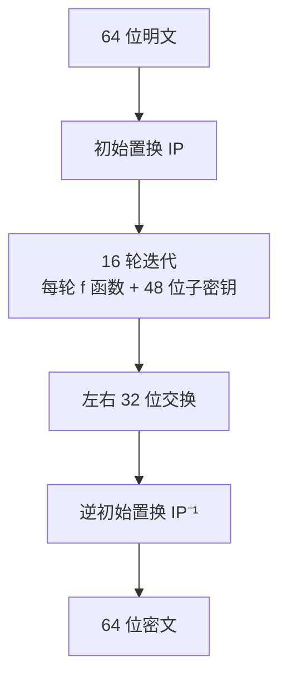

# 🔐 密码学知识点总结

**第 3 章 密码学基本理论 + 密码学扩展（DES · RSA · 工作模式）**

> [!TIP]
> **命题规律**：选择题 5 分左右，案例题 3–5 分或大题。重要度：常见密码算法【必考】· 密码体制分类、Hash 与数字签名【常考】· 概况、密码管理与证书、安全协议【有时考】· 网络安全应用【偶尔考】。
>
> **案例题高频**：DES 的 S 盒查表与补全、RSA 计算（求 d、加密、解密）。

---

## 📖 1. 密码学概况

| 项目 | 要点 |
| --- | --- |
| 组成 | 密码编码 + 密码分析 |
| 目的 | 实现信息的保密性、完整性、可用性、抗抵赖性 |
| 1949 年香农 | 论文《保密系统的通信理论》，提出交替使用换位和置换，增加**混乱（Confusion）与扩散（Diffusion）**，奠定现代密码学理论基础 |
| 20 世纪 70 年代 | Diffie-Hellman、RSA 开辟公钥密码学；美国发布 DES；RSA 与 DH 的发明者均获图灵奖 |
| 我国里程碑 | 2005 年《电子签名法》施行；2006 年公布国产商用密码算法；2020-1-1《密码法》施行 |

**🔤 基本符号**

| 符号 | 含义 |
| --- | --- |
| M | Message，明文 |
| C | Ciphertext，密文 |
| K（Ke / Kd） | Key，密钥（加密密钥 / 解密密钥） |
| E / D | Encryption 加密 / Decryption 解密 |

**🕵️ 五种密码分析攻击**

| 攻击 | 要点 |
| --- | --- |
| 唯密文攻击 | 只有密文，对攻击者最不利 |
| 已知明文攻击 | 知道一些明文及对应密文 |
| 选择明文攻击 | 能得到自己选定明文对应的密文 |
| 密文验证攻击 | 对任何选定密文，能得到“是否合法”的判断 |
| 选择密文攻击 | 能得到任何选定密文对应的明文；对攻击者最有利，常针对公钥体制、攻击数字签名 |

---

## 🗝️ 2. 密码体制分类【常考】

| 体制 | 要点 |
| --- | --- |
| 私钥（对称）体制 | 加解密**同一密钥**（Ke = Kd）；算法简单、速度快，适合大量数据；缺点：密钥分配困难、管理复杂、无法认证来源；n 个用户两两通信需 **n(n-1)/2** 个密钥 |
| 公钥（非对称）体制 | 加解密**不同密钥**（公钥 ≠ 私钥）；优点：密钥分发方便、保管量少、支持数字签名；缺点：速度慢 |
| 混合体制 | 用公钥体制分配对称密钥，收发双方再用对称密钥加解密（即**数字信封**） |
| 对称算法代表 | DES、3DES、AES、RC4、RC5、IDEA、SM1、SM4 |
| 非对称算法代表 | RSA、ECC、SM2 |

**🌊 流密码与分组密码（只有对称密码有此划分）**

| 类型 | 要点 |
| --- | --- |
| 流密码 | 逐比特或逐字节处理；密钥流与明文**异或**；C = P ⊕ K，P = C ⊕ K；代表：RC4、ZUC（祖冲之） |
| 分组密码 | 明文切成固定长度块（64 位、128 位）逐块加密；核心操作：替代 + 置换；需**填充**最后一块；代表：DES、AES、SM4 |
| 分组变流 | 通过 CTR、OFB 等模式，用分组密码生成连续密钥流，实现流加密 |

---

## ➕ 3. 基础运算：ASCII 与异或

| 项目 | 要点 |
| --- | --- |
| ASCII 转二进制 | 字符 → 十进制 → 8 位二进制，不足补 0 |
| 常用值 | a=97（01100001）· A=65（01000001）· 0=48（00110000）· 空格=32（00100000）· !=33（00100001）· ?=63（00111111） |
| 异或 ⊕ | **相同为 0，不同为 1**；0⊕0=0，0⊕1=1，1⊕0=1，1⊕1=0 |
| 可逆性 | 明文 ⊕ 密钥 = 密文；密文 ⊕ 密钥 = 明文（同一密钥异或两次还原） |
| 流密码示例 | 密钥 a（01100001）加密 “abc”：a⊕a=00000000，b⊕a=00000011，c⊕a=00000010 |

---

## 🔄 4. 分组密码工作模式

| 模式 | 要点 | 典型协议 / 场景 |
| --- | --- | --- |
| ECB 电子密码本 | 每块独立用同一密钥加密；简单、可并行；**相同明文块得相同密文块，泄露数据模式（如图片轮廓），极不安全，不推荐** | 极少用于安全协议，仅测试或简单加密 |
| CBC 密码分组链接 | 明文块先与**前一个密文块**异或再加密，第一块与随机 **IV** 异或；相同明文得不同密文；**串行**、不能并行加密；一个比特错误影响当前块和下一块 | TLS 1.0–1.2、IPsec ESP、SSH、旧版 WPA |
| CFB 密码反馈 | 先加密 IV，结果与明文异或得密文，再把**密文**反馈给下一步；分组密码变流密码，可逐字节加密（无需填充）；串行；错误会传播 | SSH、PGP、部分 VPN |
| OFB 输出反馈 | 先加密 IV 得密钥流，与明文异或；下一次加密的是**上一次密钥流**；错误**不传播**（1 比特错只影响 1 比特）；串行；密钥与 IV 相同则密钥流重复，有严重风险 | 卫星通信、旧版无线加密 |
| CTR 计数器 | 计数器 + Nonce 加密得密钥流，再与明文异或；**可并行**、速度快、错误不传播、可随机访问任意块；“计数器 + Nonce”绝不能重复；现代推荐 | TLS 1.2/1.3、IPsec、SSH、磁盘加密 |

---

## 🧱 5. DES 算法【必考】

| 项目 | 要点 |
| --- | --- |
| 简介 | 数据加密标准，IBM 研制；分组密码，**分组 64 位** |
| 密钥 | 64 位，有效 **56 位**（8 位奇偶校验位）；子密钥 **48 位**，共 16 个 |
| 入口参数 | 数据 8 字节（64 位）、密钥 8 字节（64 位，起作用 56 位）、模式（加密 / 解密） |
| 整体流程 | 初始置换 IP → 16 轮迭代 → 左右 32 位交换 → 逆初始置换 IP⁻¹ |
| 迭代公式 | Lᵢ = Rᵢ₋₁；Rᵢ = Lᵢ₋₁ ⊕ f(Rᵢ₋₁, Kᵢ)；**16 轮中前 15 次交换左右，第 16 次不交换**，最后再合并 |
| IP 与 IP⁻¹ | IP 在第一轮前，IP⁻¹ 在第 16 轮后，互为逆运算以保证可解密；例：明文第 20 位经 IP 到第 14 位，再经 IP⁻¹ 回到第 20 位；第 2 位到第 8 位同理 |
| 填充（PKCS#7） | 填充字节的值 = 需填充的字节数；“12345”填 3 字节 `0x03`；“A”填 7 字节 `0x07` |

**⚙️ F 轮函数（三步）**

| 步骤 | 要点 |
| --- | --- |
| 扩展置换 E | 右半部分 Rᵢ₋₁ 由 **32 位扩展到 48 位**，改变次序并重复某些位；目的：得到与子密钥同长的数据做异或，并为 S 盒压缩提供更长输入 |
| 与子密钥异或 | 48 位扩展结果 ⊕ 48 位子密钥 Kᵢ |
| S 盒代替 | 8 个 S 盒，每个 **6 位输入、4 位输出**；48 位分成 8 组 6 位，输出 8 组 4 位，共 32 位 |
| P 盒置换 | 32 位置换；使一个 S 盒的输出影响下一轮多个 S 盒，形成**雪崩效应**；例：第 21 位移到第 4 位，第 4 位移到第 31 位 |
| 之后 | P 盒结果与本轮左半部分异或，成为新的右半部分 |

**🔍 S 盒查表（案例题核心）**

| 项目 | 要点 |
| --- | --- |
| 结构 | 4 行 16 列；**行号 = 输入第 1 位与第 6 位**，**列号 = 中间 4 位** |
| 例：S8 输入 110011 | 行：11 → 3；列：1001 → 9；S8 第 3 行第 9 列 = 12；12 = 1100，所以输出 **1100** |
| 补全 S 盒题 | **每一行都是 0–15 的一个排列，缺哪个数填哪个** |
| 例题答案 | 课件那道补全题的 (1)(2)(3)(4) 依次为 **10、6、1、11** |

**🔑 子密钥生成**

| 步骤 | 要点 |
| --- | --- |
| 置换选择 1（PC-1） | 64 位密钥去掉校验位，变成 56 位 |
| 分组与左移 | 分为 C、D 各 28 位，按每轮的循环左移位数（第 1、2、9、16 轮左移 1 位，其余轮 2 位）左移 |
| 置换选择 2（PC-2） | 两组合并后置换，去掉第 9、18、22、25、35、38、43、54 位，得 **48 位子密钥** |
| 弱密钥 | 16 轮子密钥完全相同的密钥，加密 1 轮与 16 轮效果一致，安全性大幅降低；典型：全 0、全 1 密钥 |

---

## 🔢 6. 其他对称算法

| 算法 | 要点 |
| --- | --- |
| 3DES | 不是加密三次，而是 **加密-解密-加密**；有效密钥长度 **112 位**；1999 年 NIST 作为过渡标准 |
| IDEA | 分组 64 位，密钥 **128 位**；混合使用不同代数群中的运算 |
| AES | Rijndael 算法，NIST 选定；算法公开、无密级、免费；分组至少 128 位；密钥 **128、192、256 位** |

---

## 🧮 7. RSA 算法【必考】

| 项目 | 要点 |
| --- | --- |
| 类型 | 非对称算法，基于**大整数因子分解**困难性；提供机密性、完整性、真实性、不可否认性 |
| 数学基础 | 因数、素数、余数、模运算、逆元、欧拉函数、欧几里得算法（辗转求余） |
| 步骤 1 | 选两个大素数 p、q |
| 步骤 2 | n = p × q |
| 步骤 3 | φ(n) = (p-1)(q-1) |
| 步骤 4 | 选 e，满足 1 < e < φ(n) 且 gcd(e, φ(n)) = 1（实际常用 65537，考题数字较小） |
| 步骤 5 | 算 d，满足 **e × d mod φ(n) = 1**（e 的模逆元，用扩展欧几里得算法） |
| 公钥 / 私钥 | 公钥 (n, e) 公开；私钥 (n, d) 保密，d、p、q、φ(n) 都不能公开 |
| 加密 | **C = Mᵉ mod n**，要求 0 < M < n |
| 解密 | **M = Cᵈ mod n** |
| 明文限制 | 明文须为整数且小于 n；更大的明文用分组加密，或用数字信封（RSA 加密对称密钥） |

**🧪 例 1：p=5，q=11，e=7**

| 步骤 | 结果 |
| --- | --- |
| n、φ(n) | n = 55，φ(n) = 4 × 10 = 40 |
| 求 d | 7 × d ≡ 1 (mod 40)，d = 23（7 × 23 = 161 ≡ 1） |
| 公钥 / 私钥 | (55, 7) / (55, 23) |
| 加密 m=8 | c = 8⁷ mod 55 = 2 |
| 解密 | m = 2²³ mod 55 = 8 |

**🧪 例 2：p=3，q=17，e=13，明文 M=2**

| 步骤 | 结果 |
| --- | --- |
| n、φ(n) | n = 51，φ(n) = 2 × 16 = 32 |
| 求 d | 13 × d ≡ 1 (mod 32)，d = 5（13 × 5 = 65 ≡ 1） |
| 加密 | C = 2¹³ mod 51 = 8192 mod 51 = 32 |
| 解密 | M = 32⁵ mod 51 = 2 |

**❓ 综合问答**

| 问题 | 答案 |
| --- | --- |
| 哪些参数可公开 | 只有公钥 (n, e)；p、q、φ(n)、d 必须保密 |
| 已知公钥 (55, 3) 求私钥 | 55 = 5 × 11，φ = 40；3d ≡ 1 (mod 40)，3d = 81，d = 27；私钥 (55, 27) |
| 用 (55, 3) 加密 18 | 18³ mod 55 = 5832 mod 55 = 2 |
| 公私钥关系 | e × d mod φ(n) = 1 |
| 消息 m 的限制 | 0 < m < n；过长则分组或用数字信封 |
| 能否用 RSA 签名 | **可以**：用私钥对消息（摘要）运算得签名，用公钥验证；实际中结合哈希算法和数字证书，证书用于绑定公钥与身份 |

---

## 🇨🇳 8. 国产密码算法【常考重点】

| 算法 | 要点 |
| --- | --- |
| SM1 | 对称分组密码，分组与密钥均 128 位；**算法未公开**，以硬件形式集成在芯片中，用于金融、政务 |
| SM2 | 非对称，基于**椭圆曲线**；用于公钥加密、密钥交换、数字签名；推荐 256 位素数域椭圆曲线；作为 1024 位 RSA 的替代 |
| SM3 | **杂凑算法**，分组 512 位，杂凑值 **256 位**；用于签名验证、消息认证码、随机数生成等 |
| SM4 | 对称分组密码，分组与密钥均 128 位；无线局域网标准算法，强度与性能与 AES 相当 |
| SM9 | **标识密码**算法，用于身份认证；加密强度相当于 3072 位 RSA，适合大规模分布式身份鉴别 |

---

## #️⃣ 9. Hash 函数与数字签名【常考】

| 项目 | 要点 |
| --- | --- |
| Hash（杂凑）函数 | 把任意长度信息转换成固定长度的哈希值（摘要）；不同消息生成的哈希值不同 |
| MD5 | 512 位分组 → **128 位**摘要；常用于文件完整性检查 |
| SHA | 512 位分组 → **160 位**哈希值，比 MD5 安全；版本有 SHA-2、SHA-3；长度有 SHA-224、256、384、512 |
| SM3 | 2010 年公布；512 位分组 → **256 位**；Merkle-Damgård 结构 |
| 数字签名 | 签名者用**私钥**对待签名数据的杂凑值做密码运算，结果只能用签名者**公钥**验证；确认完整性、签名者身份真实性和抗抵赖性 |
| 三个基本条件 | **非否认性**（签名者事后不能否认）· **真实性**（别人不能伪造）· **可鉴别性**（有争执时第三方能裁决） |
| 方案组成 | 签名算法（密钥秘密）+ 验证算法（公开）；典型：RSA、Rabin、ElGamal、DSS |
| 签名与加密 | 加密侧重**保密性**；签名侧重**真实性和完整性** |

**✍️ 签名与验证流程**

| 阶段 | 步骤 |
| --- | --- |
| 签名（Alice） | ① Hash 函数生成消息摘要 → ② 用 Alice **私钥**加密摘要得签名 → ③ 原文与签名一起发给 Bob |
| 验证（Bob） | ① 用相同 Hash 算法算出收到文件的摘要 → ② 用 Alice **公钥**解密签名，恢复原摘要 → ③ 两个摘要比对：一致则未被篡改，不一致则被篡改或签名伪造 |

---

## 📜 10. 密码管理、数字证书与安全协议

| 项目 | 要点 |
| --- | --- |
| 密码分类（密码法） | 核心密码、普通密码、商用密码 |
| 认证制度 | 商用密码产品、网络关键设备和网络安全专用产品的商用密码服务，实行强制检测认证 |
| 数字证书 | 也称公钥证书，由 **CA 签名**，包含公钥拥有者信息、公开密钥、签发者信息、有效期和扩展信息 |
| 证书分类 | 按类别：个人、机构、设备证书；按用途：签名证书、加密证书 |
| 证书管理 | 基于 PKI，覆盖申请、审核、签发、查询、发布、吊销全生命周期；系统含目录服务器、OCSP 服务器（在线证书状态协议）、注册服务器、签发服务器 |
| 证书基本信息域 | version、serialNumber、signature、issuer、validity、subject、subjectPublicKeyInfo、issuerUniqueID、subjectUniqueID、extensions |
| Diffie-Hellman | 密钥协商方案，安全性基于**离散对数**问题的困难性 |
| SSH | 基于公钥的安全应用协议，替代 Telnet，默认端口 **22**，支持远程登录与文件传输（scp / sftp）；配置不当仍可能遭中间人攻击和拒绝服务 |
| SSH 传输层协议 | 算法协商、密钥交换、服务器认证 |
| SSH 用户认证协议 | 口令、公钥、主机认证等多种方式认证用户 |
| SSH 连接协议 | 把连接分解为多个逻辑通道，提供流控和通道参数协商 |

---

## 🌐 11. 密码学网络安全应用【偶尔考】

| 项目 | 要点 |
| --- | --- |
| 六类应用场景 | 网络用户安全、物理和环境安全、网络和通信安全、设备和计算安全、应用和数据安全、业务应用创新（区块链、数字签名等） |
| 路由器安全 | ① 口令加密存储并定期轮换 ② 用 SSH 替代 Telnet ③ OSPF / BGP 启用报文认证，防路由欺骗 |
| Web 网站 | HTTPS 强制加密传输，敏感数据 POST 提交并后端加密存储 |
| 电子邮件 | 数字签名确认发件人，加密防泄露；典型方案 PGP |
| PGP | 混合加密：密钥管理用 **RSA**，数据加密用 **IDEA**，完整性检测与签名用 **MD5 + RSA**，另含随机数生成器 |

---

## ✅ 12. 课堂练习

<b>Q1：加密密钥与解密密钥不同，且难以由一个推导出另一个，这样的算法称为？</b>

 

**A. 非对称密码**

<b>Q2：MD5 以 512 比特数据块为单位处理输入，产生多长的哈希值？</b>

 

**B. 128 比特**

<b>Q3：DES 的 S 盒输入为 010001，输出是？（用课件中的 S 盒表）</b>

 

行号取第 1、6 位 `01` = 1，列号取中间四位 `1000` = 8；表中第 1 行第 8 列为 4，即 `0100`。答案 **C. 0100**

<b>Q4：下列国产算法中属于分组密码的是？</b>

 

**C. SM4**（SM2 非对称，SM3 杂凑，SM9 标识密码；SM1 也是分组密码，但选项里没有）

<b>Q5：SSH 中负责算法协商和密钥交换的子协议是？</b>

 

**A. SSH 传输层协议**

---

## 🔎 课件内容中建议再核对的地方

> [!WARNING]
> - **RSA 例 1 的笔误**：课件写“明文 m = 8 必须小于 n = 33”，但 n 是 55；“8⁷ = 2097125”应为 2097152（取模结果 2 不变）。上文已按正确值整理。
> - **例 2 的“教材解法”**：课件说 d = (kφ(n)+1)/e，其中 k 是 p-1 和 q-1 的最大公约数，这个说法不严谨；实际是试 k = 1, 2, 3…，找使结果为整数的 k（本例 k = 2，d = 65/13 = 5）。
> - **综合问答 Q6**：课件原文先说“不可以直接使用 RSA 签名”，最后又写“可以，M = C^d mod n”，前后矛盾。上文按通用答案整理为“可以”，签名用私钥、验证用公钥。
> - **“扩散与混乱”**：课件说 DES 初始置换的作用是扩散、P 盒用于混乱；通用说法是 S 盒提供**混乱**、P 盒提供**扩散**（IP 无密码学强度）。考试以教材为准。
> - **弱密钥**：课件里“半 0 半 1”的十六进制写法位数不对，请对照教材。

---

整理自至强老师《第 3 章 密码学基本理论》与《案例课程 08 密码学扩展》课件 
带“核对”标记的内容请以教材和真题为准

