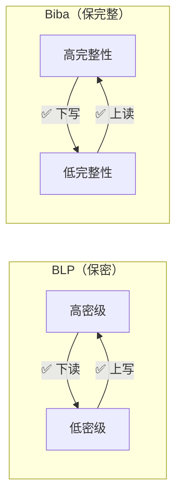
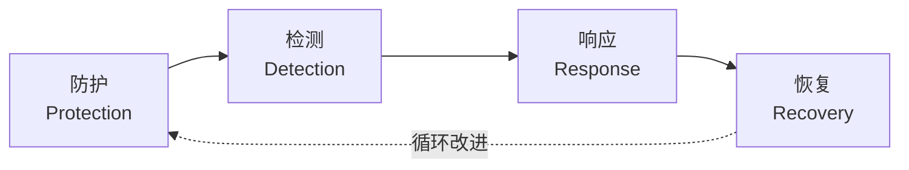

# 🏛️ 网络安全体系与网络安全模型 · 知识点总结

**第 4 章 · 安全模型（BLP / Biba / PDRR）· 体系建设原则 · 等保 2.0**

> [!TIP]
> **命题规律**：上午选择题 3–4 分，下午案例题小概率 2–3 分。
>
> **重要度**：安全模型【必考】· 等保 2.0 参考案例【常考】· 建设原则与安全策略【有时考】· 体系框架与建设内容【偶尔考】· 体系概述【不考，了解】。
>
> **最易混口诀**：BLP **下读上写**（为了保密，小肚上写）· Biba **上读下写**（吃了 Biba，上吐下泻）· 等保五级口诀 **自系安结访**。

---

## 📖 1. 网络安全体系概述【不考·了解】

| 项目 | 要点 |
| --- | --- |
| 概念 | 网络安全体系是网络安全保证系统的**最高层概念抽象**，由各种网络安全单元按一定规则组成，共同实现网络安全目标；要把安全策略、安全技术和安全管理融合在一起，形成有机的整体安全屏障 |
| 组成要素 | 法律法规政策文件、安全策略、组织管理、技术措施、标准规范、安全建设与运营、人员队伍、教育培训、产业生态、安全投入 |
| 主要特征 | 整体性、协同性、过程性、全面性、适应性 |
| 整体性 | 从全局、长远的角度实现安全保障；各安全单元按规则相互依赖、相互约束、相互作用，形成**人机物一体化**的保护方式 |
| 协同性 | 依赖多种安全机制，通过各机制**相互协作**构建系统性的保护方案 |
| 过程性 | 提供**过程式**的安全保护机制，覆盖保护对象的**全生命周期** |
| 全面性 | 基于多个维度、多个层面管控安全威胁，构建防护、检测、响应、恢复等功能 |
| 适应性 | 具有**动态演变机制**，能适应安全威胁的变化和需求 |

**🎯 作用与意义**

| 项目 | 要点 |
| --- | --- |
| 作用 1 | 有利于系统性化解网络安全风险 |
| 作用 2 | 有利于强化工作人员的网络安全意识 |
| 作用 3 | 有利于对组织的网络资产进行全面系统的保护 |
| 作用 4 | 有利于组织的商业合作 |
| 作用 5 | 有利于组织的网络安全管理体系认证 |

---

## 🛡️ 2. 网络安全模型【必考·掌握】

### 2.1 BLP 机密性模型（下读上写）

> 口诀：**为了保密，小肚上写** —— 只能**下读**、只能**上写**。

| 项目 | 要点 |
| --- | --- |
| 全称与目的 | Bell-LaPadula 模型，**机密性模型**，防止非授权信息扩散；可用于实现军事安全策略（Military Security Policy，最早由美国国防部为保护机密信息提出） |
| 保障范围 | 只能保障**机密性**，不能保障完整性 |
| 两个特性 | 简单安全特性（读）、\*特性（写） |
| 简单安全特性（读） | 读访问的必要条件：主体安全级**不小于**客体安全级，且主体范畴集**包含**客体全部范畴；即只能**向下读**，不可向上读 |
| \*特性（写） | 写访问的必要条件：客体安全级**支配**主体安全级（客体保密级不小于主体保密级），且客体范畴集包含主体全部范畴；即只能**向上写**，不可向下写 |
| 合法读取策略 | 用户安全级 **≥** 信息安全级，**并且**用户访问范畴**包含**该信息范畴，才能合法读取 |
| 安全级顺序 | 公开 ＜ 秘密 ＜ 机密 ＜ 绝密 |
| 范畴集 | 安全级的有效领域或信息所属领域（如人事处、财务处）；两个范畴集的关系是包含、被包含或无关 |
| 访问类 | 信息和用户都分配一个访问类；一个访问类中**只有单一安全级，范畴可以有多个** |

**🧪 访问类例子**

| 对象 | 访问类 |
| --- | --- |
| 文件 F | ｛机密：人事处，财务处｝ |
| 用户 A | ｛绝密：人事处｝ |
| 用户 B | ｛绝密：人事处，财务处，科技处｝ |
| 结论 | 用户 B 可以读文件 F（级别高且涵盖文件范畴）；用户 A 级别虽高但**缺少“财务处”范畴**，不能读 F |

### 2.2 Biba 完整性模型（上读下写）

> 口诀：**吃了 Biba，上吐下泻** —— 允许**上读**、**下写**；禁止下读、上写。

| 项目 | 要点 |
| --- | --- |
| 目的 | 防止**非授权修改**系统信息，保护信息**完整性** |
| 三个特性 | 简单安全特性、\*特性、调用特性 |
| 简单安全特性 | 主体对客体修改访问的必要条件：主体完整性级别不小于客体完整性级别，且主体范畴集包含客体全部范畴；即**主体不能向下读** |
| \*特性 | 主体完整性级别**小于**客体完整性级别，**不能修改**客体；即**主体不能向上写** |
| 调用特性 | 主体完整性级别小于另一主体的完整性级别，**不能调用**另一个主体 |

### 2.3 BLP 与 Biba 对照

| 项目 | 要点 |
| --- | --- |
| BLP | 保**机密性**；读：下读（不上读）；写：上写（不下写）；一个“简单安全特性”、一个“\*特性” |
| Biba | 保**完整性**；读：上读（不下读）；写：下写（不上写）；多一个“调用特性” |
| 方向关系 | 两个模型的读写方向**恰好相反**，同属强制访问控制（MAC） |
| 同时实施 | 需要同时满足两个不等式才放行（见文末练习） |

### 2.4 信息流模型【了解】

| 项目 | 要点 |
| --- | --- |
| 定义 | **访问控制模型的一种变形**，简称 FM；不检查主体对客体的存取，而是根据**两个客体的安全属性**控制信息从一个客体到另一个客体的传输 |
| 形式化 | FM = (N, P, SC, ⊕, →)：N 客体集，P 进程集，SC 安全类型集，⊕ 支持结合、交换的二进制运算符，→ 流关系 |
| 安全条件 | 一个 FM 是安全的，当且仅当执行一系列操作后不会导致流与流关系产生冲突 |
| 用途 | 分析系统的**隐蔽通道**，防止敏感信息通过隐蔽通道泄露；隐蔽通道通常表现为**低安全等级主体对高安全等级主体所产生信息的间接读取** |

### 2.5 信息保障模型：PDRR、P2DR、WPDRRC（含 3R）

| 项目 | 要点 |
| --- | --- |
| **PDRR** | 美国国防部提出，改进了只有保护的单一防御思想；**四个环节**：防护（Protection）、检测（Detection）、恢复（Recovery）、响应（Response） **注意左边是书上的，标准的应该是先响应，再恢复**|
| 防护的内容 | 加密机制、数据签名机制、访问控制机制、认证机制、信息隐藏、防火墙技术等 |
| 检测的内容 | 入侵检测、系统脆弱性检测、数据完整性检测、攻击性检测等 |
| 恢复的内容 | **数据备份**、数据修复、系统恢复等 |
| 响应的内容 | 应急策略、应急机制、应急手段、入侵过程分析及安全状态评估等 |
| **P2DR** | 美国 ISS 公司提出，**动态网络安全体系**的代表模型；要素：策略（Policy）、防护（Protection）、检测（Detection）、响应（Response） |
| **WPDRRC** | 要素：预警（Warning）、保护、检测、响应（反应）、恢复、反击（Counterattack）；对应预警、保护、检测、响应、恢复、反击**六种能力** |
| **3R** | **Resistance（抵御）**、**Recognition（识别）**、**Recovery（恢复）**；强调系统抵御攻击、识别入侵与恢复的能力 |
| 易混区分 1 | 第一章“网络应具备的基本功能”是 **防御 / 监测 / 应急 / 恢复**，不要与上述模型混淆 |
| 易混区分 2 | **3R 中的 Recognition 是“识别”，不是 Response“响应”**，这是最容易记混的考点 |

### 2.6 能力成熟度模型 CMM

| 项目 | 要点 |
| --- | --- |
| CMM 定义 | 对**组织机构的能力**进行成熟度评估的模型，分五级，级别越大成熟度越高 |
| 1 级：非正式执行 | 具备随机、无序、被动的过程 |
| 2 级：计划跟踪 | 具备主动、非体系化的过程 |
| 3 级：充分定义 | 具备正式的、规范的过程 |
| 4 级：量化控制 | 具备可量化的过程 |
| 5 级：持续优化 | 具备可持续优化的过程 |
| 常见成熟度模型 | SSE-CMM（系统安全工程能力成熟度模型）、数据安全能力成熟度模型、软件安全能力成熟度模型 |
| SSE-CMM【了解】 | 包括工程过程类、组织过程类、项目过程类 |
| 数据安全能力成熟度【了解】 | 从**组织建设、制度流程、技术工具、人员能力**四个维度评估 |

**🔥 软件安全能力成熟度模型（五级，常考）**

| 级别 | 要点 |
| --- | --- |
| CMM1 级 | **补丁修补** |
| CMM2 级 | **渗透测试、安全代码评审** |
| CMM3 级 | **漏洞评估、代码分析、安全编码标准** |
| CMM4 级 | **软件安全风险识别**、SDLC 实施不同安全检查点 |
| CMM5 级 | **改进软件安全风险覆盖率**、评估安全差距 |

### 2.7 其他安全模型

| 模型 | 要点 |
| --- | --- |
| 纵深防御模型 | 把防护措施有机组合，形成**多道保护线**：①安全保护（第一道）②安全监测（第二道）③实时响应（第三道）④恢复（第四道） |
| 分层防护模型 | 以 **OSI 7 层模型**为参考，对保护对象进行层次化保护 |
| 等级保护模型 | 根据信息系统的重要程度划分不同安全保护等级，采取相应的保护措施 |
| 网络生存模型 | 系统遭受入侵时，仍能**持续提供必要服务**的能力；遵循 **“3R”** 策略：抵抗（Resistance）、识别（Recognition）、恢复（Recovery） |
| 3R 建立方法 | ① 把系统划分成**不可攻破的安全核**和**可恢复部分** → ② 对一定攻击模式给出相应 3R 策略 → ③ 定义系统的正常服务模式和可能被利用的入侵模式，给出需重点保护的基本功能服务和关键信息 |

---

## 📐 3. 网络安全体系建设原则与安全策略【有时考·熟悉】

| 原则 | 要点 |
| --- | --- |
| 1. 系统性和动态性原则 | 强调整体安全性，即**木桶原则**；安全策略根据网络系统安全环境和攻击情况**适时而变** |
| 2. 纵深防护与协作性原则 | 各安全技术之间应互相补充、互相配合；体系应包括**安全评估、安全防护、安全监测、安全应急响应**体制 |
| 3. 网络安全风险和分级保护原则 | 正确处理需求、风险与代价的关系，做到安全性与可用性相容、组织上可执行；分级保护是按网络资产安全级别采取合适防范措施，做到**适度防护** |
| 4. 标准化与一致性原则 | — |
| 5. 技术与管理相结合原则 | — |
| 6. 安全第一，预防为主原则 | — |
| 7. 安全与发展同步，业务与安全等同 | — |
| 8. 人机物融合和产业发展原则 | — |
| 9. 分权制衡原则 | 对所有权限适当划分，每个授权主体只拥有其中一部分，相互制约、相互监督，共同保证系统安全 |
| 网络安全策略 | 规则和要求的概念，**可以不用看** |

---

## 🧱 4. 网络安全体系框架与建设内容【偶尔考】

**🗺️ 体系框架（图 4-12）**

| 项目 | 要点 |
| --- | --- |
| 顶层 | 网络安全法律法规 |
| 左侧 | 网络安全运营与应急响应 |
| 右侧 | 网络安全标准与规范 |
| 中间七项 | 网络安全策略 / 组织 / 管理 / 基础设施及网络安全服务 / 技术 / 科技与产业生态 / 教育与培训 |
| 底层 | 网络安全投入与建设 |

**👥 网络安全组织体系（领导层、管理层、执行层、外部协作层）**

| 层次 | 要点 |
| --- | --- |
| 领导层 | 由各部门领导组成：协调各部门工作；审查与批准安全策略；审查与批准项目实施计划与预算；网络安全工作人员的考察和录用 |
| 管理层 | 由安全负责人和中层管理人员组成：制订安全策略、项目实施计划与预算、工作流程；监督项目实施、日常维护中的安全和安全事件的应急处理 |
| 执行层 | 由业务人员、技术人员、系统管理员、项目工程人员等组成：实现安全策略；执行规章制度；遵循工作流程；负责各系统/设备的安全运行与日常安全维护 |
| 外部协作层 | 由组织外的安全专家或合作伙伴组成：介绍最新发展趋势；安全管理培训；新的技术安全风险分析；系统建设和改造安全建议；安全事件协调 |

**📋 安全管理体系构建内容**

| 项目 | 要点 |
| --- | --- |
| 管理体系五方面 | 管理目标、管理手段、管理主体、管理依据、管理资源 |
| 管理目标 | 大：政治、经济、文化、国防安全等；小：网络系统的保密、可用、可控等 |
| 管理手段 | 安全评估、安全监督、应急响应、安全协调、安全标准和规范、保密检查、认证和访问控制等 |
| 管理主体 | 大：国家网络安全职能部门；小：网络管理员、单位负责人等 |
| 管理依据 | 行政法规、法律、部门规章制度、技术规范等 |
| 管理资源 | 安全设备、管理人员、安全经费、时间等 |
| 其他构建内容 | 网络安全管理策略；第三方安全管理；网络系统资产分类与控制（硬件、软件、介质、信息、业务系统、保障系统） |
| 人员安全 | 目标是降低误操作、偷窃、诈骗或滥用等人为风险 |
| 人员安全三原则 | **多人负责原则、任期有限原则、职责分离原则** |

---

## 🎖️ 5. 网络安全体系建设参考案例：等级保护 2.0【常考】

| 项目 | 要点 |
| --- | --- |
| 法律依据 | 《网络安全法》**第二十一条**：国家实行网络安全等级保护制度；等保 2.0 标准已执行 |
| 体系框架 | 风险管理体系、安全管理体系、安全技术体系、网络信任体系、法律法规体系、政策标准体系等 |
| 定级依据 | 按信息系统的**重要性**和受破坏后的**危害性**定级；**二级和三级居多** |

### 5.1 五个保护等级（口诀：自系安结访）

| 等级 | 受破坏后的危害 |
| --- | --- |
| 第一级 用户自主保护级 | 对公民、法人和其他组织权益造成**损害**，但不损害国家安全、社会秩序和公共利益 |
| 第二级 系统保护审计级 | 对公民、法人和其他组织合法权益产生**严重损害**，或对社会秩序和公共利益造成**损害**，但不损害国家安全 |
| 第三级 安全标记保护级 | 对社会秩序和公共利益造成**严重损害**，或对国家安全造成**损害** |
| 第四级 结构化保护级 | 对社会秩序和公共利益造成**特别严重损害**，或对国家安全造成**严重损害** |
| 第五级 访问验证保护级 | 对国家安全造成**特别严重损害** |

### 5.2 五个工作阶段与服务

| 阶段 | 对应服务内容 |
| --- | --- |
| 定级 | 定级咨询服务：现状梳理、等级确定、定级报告 |
| 备案 | 协助备案服务：专家评审、协助备案 |
| 建设整改 | 风险评估与差距分析服务、安全规划与整改方案设计服务、整改集成实施服务、自测评服务 |
| 等级测评 | 协助测评服务：测评准备、方案编制、现场评估、报告编制 |
| 安全自查与监督检查 | 安全运维保障服务：安全运维、安全巡检、应急响应、安全通告、协助自查 |

### 5.3 等保 2.0 的三大主要变化

| 变化 | 要点 |
| --- | --- |
| ① 扩大对象范围 | 将**云计算、移动互联、物联网、工业控制系统**等列入标准范围，构成“**网络安全通用要求 + 新型应用的网络安全扩展要求**” |
| ② 三重防护体系架构 | 在“**安全通信网络、安全区域边界、安全计算环境、安全管理中心**”支持下的三重防护体系架构 |
| ③ 强化可信计算 | 各级增加“**可信验证**”控制点（见下表） |

| 等级 | 可信验证要求 |
| --- | --- |
| 一级 | 对设备的**系统引导程序、系统程序**等进行可信验证 |
| 二级 | 增加**重要配置参数和应用程序**的可信验证，并将验证结果形成**审计记录**送至安全管理中心 |
| 三级 | 增加对应用程序**关键执行环节**的**动态**可信验证 |
| 四级 | 增加对应用程序**所有执行环节**的动态可信验证 |

**🔄 等保标准变化（1.0 → 2.0 试行稿 → 2.0 最新稿）**

| 版本 | 技术要求 | 管理要求 |
| --- | --- | --- |
| 等保 1.0 | 物理安全、网络安全、主机安全、应用安全、数据安全及备份恢复 | 安全管理制度、安全管理机构、人员安全管理、系统建设管理、系统运维管理 |
| 等保 2.0 试行稿 | 物理和环境安全、网络和通信安全、设备和计算安全、应用和数据安全 | 安全策略和管理制度、安全管理机构和人员、安全建设管理、安全运维管理 |
| 等保 2.0 最新稿 | 安全物理环境、安全通信网络、安全区域边界、安全计算环境、安全管理中心 | 安全管理制度、安全管理机构、安全管理人员、安全建设管理、安全运维管理 |

### 5.4 等保 2.0 新增的对象范围

| 对象 | 范围 |
| --- | --- |
| 云计算 | 云服务商侧的云计算平台（**不应低于云租户保护等级**）；云服务客户（云租户）侧的业务系统；大型云计算平台的运营、运维系统 |
| 移动互联网 | 移动终端、移动应用、无线网络、相关有线网络业务系统 |
| 物联网 | 感知、网络传输和处理应用 |
| 工业控制系统 | 现场采集/执行、现场控制和过程监控系统；生产管理系统 |
| 大数据 | 安全责任主体相同的大数据、大数据平台和应用（**原则上不低于三级**） |

---

## 🏙️ 6. 体系应用参考（了解）

| 案例 | 要点 |
| --- | --- |
| 智慧城市安全体系 | 分层结构：**安全战略保障**（法律法规、政策文件、标准规范）→ **安全管理保障**（决策规划、组织管理、协调监督、评价改进）→ **安全技术保障**（智慧应用层、数据与服务融合层、计算与存储层、网络通信层、物联感知层安全，加上防护/检测/响应/恢复四个技术功能要素）→ **安全建设与运营保障**（工程实施、监测预警、应急处置、灾难恢复）→ **安全基础支撑**（密钥与证书、身份管理等基础设施；认证、评估、检测、审查、设计等基础服务） |
| 智能交通网络安全体系 | 职能整体架构：决策组织（政府机关）、运营组织（运营服务机构）、管理执行（基础设施制造、物联网建设、智能汽车制造等），上下之间协助汇报、监测汇集、互相督促；产业内管理架构由**安全战略规划、安全治理、安全管理**组成，覆盖制度与管理流程、监管合规、供应商安全、资产管理、安全培训、项目全生命周期、个人隐私与重要数据安全、事件处理、应急预案与演练、人员/终端/物理环境/网络安全等 |

---

## ✅ 7. 课堂练习

<b>Q1：BLP 模型中，文件 E｛机密：财务处，科技处｝、文件 F｛机密：人事处，财务处｝、用户 A｛绝密：人事处｝、用户 B｛绝密：人事处，财务处，科技处｝。下列正确的是？</b>

 

A. 用户 A 不能读文件 F　B. 用户 B 不能读文件 F　C. 用户 A 能读文件 E　D. 用户 B 不能读文件 E

**答案 A**。读的条件是“级别不小于 **且** 范畴包含”。用户 B 是绝密且范畴包含人事、财务、科技，所以能读 E 和 F（B、D 错）；用户 A 虽是绝密，但缺少“财务处”（读 F）以及“财务处、科技处”（读 E），所以 A 不能读 F，也不能读 E（C 错）。

<b>Q2：Biba 模型提出的“主体不能向上写”指的是？</b>

 

A. 简单安全特性　B. 保密特性　C. 调用特性　D. \*特性

**答案 D**。“不能向上写”是 **\*特性**；“不能向下读”才是简单安全特性；调用特性是“低完整性主体不能调用高完整性主体”。

<b>Q3：PDRR 模型由防护、检测、恢复、响应四个环节组成。数据备份对应的环节是？</b>

 

A. 防护　B. 检测　C. 恢复　D. 响应

**答案 C**。数据备份、数据修复、系统恢复都属于**恢复**环节。

<b>Q4：应对所有权限适当划分，使每个授权主体只拥有一部分权限，相互制约、相互监督，共同保证信息系统安全，这属于？</b>

 

A. 最小化原则　B. 安全隔离原则　C. 纵深防御原则　D. 分权制衡原则

**答案 D**。关键词是“权限划分、相互制约、相互监督”，即**分权制衡原则**。

<b>Q5：对信息进行均衡、全面的防护，提高整个系统“安全最低点”的性能，这种安全原则称为？</b>

 

A. 最小特权原则　B. 木桶原则　C. 等级化原则　D. 最小泄露原则

**答案 B**。“安全最低点”就是木桶的短板，对应**木桶原则**（系统性和动态性原则中强调的整体安全性）。

---

## 🗂️ 8. 一页纸速记

| 考点 | 速记 |
| --- | --- |
| BLP | 机密性；**下读上写**；简单安全特性（读）+ \*特性（写）；级别 + 范畴集 |
| Biba | 完整性；**上读下写**；简单安全 + \*特性 + **调用特性** |
| 信息流模型 | FM = (N, P, SC, ⊕, →)；分析**隐蔽通道** |
| PDRR | 防护、检测、恢复、响应；美国国防部 |
| P2DR | 策略、防护、检测、响应；美国 ISS 公司，动态体系 |
| WPDRRC | 预警、保护、检测、响应、恢复、反击；六种能力 |
| 软件安全 CMM | 1 补丁 · 2 渗透测试与代码评审 · 3 漏洞评估与安全编码标准 · 4 风险识别与 SDLC 检查点 · 5 改进覆盖率 |
| 纵深防御 | 保护 → 监测 → 响应 → 恢复，四道防线 |
| 网络生存 | 3R：抵抗、识别、恢复 |
| 人员安全三原则 | 多人负责、任期有限、职责分离 |
| 组织四层 | 领导层、管理层、执行层、外部协作层 |
| 等保五级 | 自系安结访；二、三级居多 |
| 等保五阶段 | 定级 → 备案 → 建设整改 → 等级测评 → 监督检查 |
| 等保 2.0 变化 | ① 扩大对象 ② 三重防护（通信网络、区域边界、计算环境 + 管理中心）③ 可信验证 |

---

## 🔎 课件内容中建议再核对的地方

> [!WARNING]
> - **等保二级名称**：至强课件写“系统**保护审计**级”，希赛课件写“系统**审计保护**级”，两种写法都出现过，考试以教材为准。
> - **Biba 简单安全特性的表述**：两份课件都把“修改访问的必要条件是主体完整性级别不小于客体”放在简单安全特性里，同时又得出“不能向下读”。记结论即可：**简单安全特性 = 不能下读，\*特性 = 不能上写**。
> - **BLP 口诀别记反**：BLP 是“下读上写”（允许的方向）。2026 渠道卷·选择题卷一第 1 题的解析里写成了“BLP“下读上写被禁”保机密”，这与本章“只能向下读、只能向上写”的结论相反，应以本章为准（BLP 被禁的是上读、下写）。
> - **原则条数**：希赛课件列 8 条原则，至强课件列 9 条（多出“分权制衡原则”），本文按 9 条整理。

---

整理自至强老师《第 4 章 网络安全体系与网络安全模型》与希赛《第 4 章 网络安全体系与安全模型》课件 
带“核对”标记的内容请以教材和真题为准

