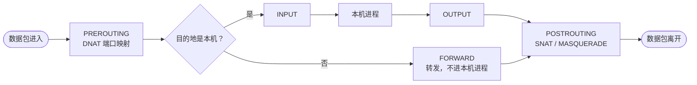
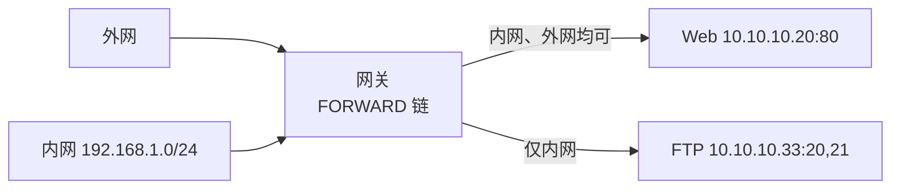

<div align="center">

# 🔥 iptables 知识点总结

**Linux 包过滤防火墙 · 表 → 链 → 规则 → 案例**


</div>

> [!TIP]
> **一句话速记**：规则**自上而下、命中即停**；放行请求还要**放行回程**；最后用 `-P` 设**默认丢弃**兜底。

---

## 🧭 1. 表与链：数据包经过的关卡



> [!NOTE]
> PREROUTING、POSTROUTING 只存在于 **nat 表**：前者做 DNAT，后者做 SNAT。

**📋 四张表**

| 表 | 要点 |
| --- | --- |
| `filter` | 默认表，负责放行或丢弃；含 INPUT、FORWARD、OUTPUT |
| `nat` | 地址转换（DNAT、SNAT、MASQUERADE）；含 PREROUTING、POSTROUTING、OUTPUT |
| `mangle` | 修改包头（TOS、TTL、打标记） |
| `raw` | 设置免连接跟踪（NOTRACK）；优先级最高 |
| 表优先级 | raw → mangle → nat → filter |

**🔗 三条常考链**

| 链 | 要点 |
| --- | --- |
| `INPUT` | 目的地址是本机的包 |
| `OUTPUT` | 本机进程发出的包 |
| `FORWARD` | 穿过本机、不进入本机进程的包（拼写是 FORWARD，不是 FORWARE） |

---

## 🛠️ 2. 命令格式、操作与匹配条件

```text
iptables [-t 表] 操作命令 链名 匹配条件 -j 目标动作
# 不写 -t 时默认操作 filter 表
```

**⚙️ 操作命令**

| 命令 | 要点 |
| --- | --- |
| `-A` | 追加到链尾 |
| `-I [序号]` | 插入；不写序号则插到第 1 条 |
| `-D` | 按序号或完整规则删除 |
| `-R` | 替换指定序号的规则 |
| `-L -n -v` | 列出规则；-n 不解析主机名，-v 显示详细信息（加 `--line-numbers` 显示序号） |
| `-F` | 清空规则（不改默认策略）；不写链名则清空所有链 |
| `-N` / `-X` | 新建 / 删除自定义链（删除前须清空且无引用） |
| `-P` | 设置默认策略，只对内置主链生效 |
| `-Z` | 计数器清零 |

**🎯 匹配条件**

| 参数 | 要点 |
| --- | --- |
| `-p` | 协议：tcp / udp / icmp / all |
| `-s` / `-d` | 源 / 目的地址或网段；`0/0` 表示任意，可省略 |
| `-i` / `-o` | 入 / 出网卡；-i 用于 INPUT、FORWARD、PREROUTING，-o 用于 OUTPUT、FORWARD、POSTROUTING |
| `--sport` / `--dport` | 源 / 目的端口，必须配合 `-p tcp` 或 `-p udp`；区间写法 `20:21` |
| `-m state` | 按连接状态匹配（见第 4 节） |
| `-m multiport` | 多个不连续端口：`--dports 80,443` |
| `-m iprange` | IP 区间：`--src-range 192.168.1.10-20` |
| `-m mac` | 匹配源 MAC：`--mac-source` |

---

## 🚦 3. 目标动作（-j）

| 动作 | 要点 |
| --- | --- |
| ✅ `ACCEPT` | 放行 |
| ⛔ `DROP` | 直接丢弃，不回应，对方只能等超时 |
| 🚫 `REJECT` | 拒绝并返回错误信息 |
| 📝 `LOG` | 记日志；**非终止动作**，继续往下匹配 |
| ↩️ `RETURN` | 结束本链匹配，返回上层链 |
| 🔄 `SNAT` | 改源 IP，用于共享上网（固定公网 IP） |
| 🌐 `MASQUERADE` | 用出口网卡 IP 替换源 IP，适合动态拨号 |
| 📮 `DNAT` | 改目标 IP / 端口，用于端口映射 |
| 自定义链名 | 跳转到该链继续匹配 |

---

## 🔗 4. 连接状态（-m state）

| 状态 | 含义 |
| --- | --- |
| `NEW` | 新建连接的第一个包 |
| `ESTABLISHED` | 已建立连接的后续包（含响应包） |
| `RELATED` | 与已有连接相关的新连接（如 FTP 数据连接、ICMP 差错） |
| `INVALID` | 无法识别或状态异常的包，通常直接丢弃 |

---

## ⚡ 5. 常用规则速记

```bash
# 默认拒绝
iptables -t filter -P INPUT -j DROP
iptables -t filter -P OUTPUT -j DROP
iptables -t filter -P FORWARD -j DROP
# 拒绝IP地址为192.168.0.2的远程主机登录到该服务器SSH
iptables -t filter -A INPUT -p tcp -s 192.168.0.2 --dport 22 -j REJECT
# 允许IP为10.0.0.2的地址访问本机的22端口
iptables -t filter -A INPUT -p tcp -s 10.0.0.2 --dport 22 -j ACCEPT
# 运维规则
iptables -t filter -A FORWARD -p tcp -s 192.168.11.2 -d 192.168.70.0/24 --dport 22 -j ACCEPT
# 服务器允许互联网访问
iptables -t filter -A FORWARD -p tcp -m multiport --dport 80,443 -j ACCEPT  // 允许外部访问80,443
iptables -t filter -A FORWARD -p tcp -m multiport --sport 80,443 -j ACCEPT //放行返回流量
# 放行已建立的连接及相关包
iptables -A INPUT -m state --state ESTABLISHED,RELATED -j ACCEPT
# 允许所有人访问本机 TCP 80
iptables -A INPUT -p tcp --dport 80 -j ACCEPT
# 只允许指定 IP 访问本机 UDP 53
iptables -A INPUT -p udp -s 192.168.1.100 --dport 53 -j ACCEPT
# 禁止本机访问外部 TCP 23
iptables -A OUTPUT -p tcp -d 8.8.8.8 --dport 23 -j DROP
# 默认策略：不匹配则丢弃
iptables -P INPUT DROP
```

---

## 🏗️ 6. FORWARD 链案例：Web 与 FTP 服务器



```bash
# Web：请求方向 + 响应方向
iptables -A FORWARD -s 0/0 -d 10.10.10.20/32 -p tcp --dport 80 -j ACCEPT
iptables -A FORWARD -s 10.10.10.20/32 -d 0/0 -p tcp --sport 80 -j ACCEPT
# FTP：只对内网开放
iptables -A FORWARD -s 192.168.1.0/24 -d 10.10.10.33/32 -p tcp --dport 20:21 -j ACCEPT
iptables -A FORWARD -s 10.10.10.33/32 -d 192.168.1.0/24 -p tcp --sport 20:21 -j ACCEPT
# 兜底：没有命中任何规则的包一律丢弃
iptables -P FORWARD DROP
```

<details>
<summary><b>💡 更简洁的现代写法（点击展开）</b></summary>

<br>

用连接跟踪放行所有响应方向，只写请求方向：

```bash
iptables -P FORWARD DROP
iptables -A FORWARD -m state --state ESTABLISHED,RELATED -j ACCEPT
iptables -A FORWARD -d 10.10.10.20 -p tcp --dport 80 -j ACCEPT
iptables -A FORWARD -s 192.168.1.0/24 -d 10.10.10.33 -p tcp --dport 20:21 -j ACCEPT
```

</details>

| 答题要点 | 说明 |
| --- | --- |
| 一对方向 | iptables 对去、回两个方向分别判断，放行了请求还要单独放行回程 |
| 端口方向 | 请求包用 `--dport`（目的端口），响应包用 `--sport`（源端口） |
| 顺序 | 四条 ACCEPT 都要排在默认策略生效之前；`-P` 是兜底动作，不占链内顺序 |
| 省略写法 | `-s 0/0` 等同于不写 `-s` |

---

## 🌍 7. NAT 地址转换

```bash
# 共享上网（固定公网 IP）
iptables -t nat -A POSTROUTING -s 192.168.1.0/24 -o eth1 -j SNAT --to-source 公网IP
# 共享上网（动态拨号）
iptables -t nat -A POSTROUTING -s 192.168.1.0/24 -o eth1 -j MASQUERADE
# 端口映射：访问本机 80 转到内网 192.168.1.10:8080
iptables -t nat -A PREROUTING -p tcp --dport 80 -j DNAT --to-destination 192.168.1.10:8080
# 作为网关转发，须开启内核转发
echo 1 > /proc/sys/net/ipv4/ip_forward
```

---

## ⚠️ 8. 易错点

> [!WARNING]
> 远程操作时，默认策略是 `DROP` 的情况下执行 `iptables -F` 会把自己的 SSH 连接一起切断。

| 易错点 | 要点 |
| --- | --- |
| 顺序 | 规则自上而下匹配、命中即停；越具体的规则越靠上 |
| `-P` | 只对 INPUT、FORWARD、OUTPUT 等内置主链生效 |
| 端口 | `--sport` / `--dport` 前面必须先有 `-p tcp` 或 `-p udp` |
| 单向放行 | 只放请求不放回程，连接建立不起来 |
| `LOG` | 非终止动作，后面还要写 ACCEPT 或 DROP |
| DROP 与 REJECT | DROP 无回应，REJECT 有错误回应；对外一般用 DROP 减少暴露信息 |
| `-F` | 只清规则，不改默认策略 |
| `-I` 与 `-A` | `-I` 默认插到最前，`-A` 追加到末尾，顺序不同结果不同 |
| 持久化 | 命令行写入重启即失效，用 `iptables-save > /etc/iptables/rules.v4` 保存 |
| 黑名单策略：| 链的默认策略设置为 ACCEPT，在链中配置规则时，对应的动作设置为 DROP 或 REJECT。
| 白名单策略：| 链的默认策略为 DROP，链中的规则对应的动作应该为 ACCEPT，表示只有匹配到规则的报文才会被放行，没有被规则匹配到的报文都会被默认拒绝。

---

## 📝 9. 自测小题

<details>
<summary><b>Q1：放行了外部访问 Web 服务器 80 端口的请求，为什么页面还是打不开？</b></summary>

<br>

只放行了请求方向。iptables 对去、回方向分别判断，还需放行响应方向（源端口 80 → 外部），或用 `-m state --state ESTABLISHED,RELATED -j ACCEPT` 统一放行回程。

</details>

<details>
<summary><b>Q2：FORWARD 链四条 ACCEPT 规则和 <code>-P FORWARD DROP</code>，谁先谁后？</b></summary>

<br>

先写 ACCEPT 规则，`-P` 设的是“所有规则都没匹配上”时的兜底动作，不占链内顺序。

</details>

<details>
<summary><b>Q3：端口映射（把访问 80 的流量转到内网 8080）用哪个表、哪条链、哪个动作？</b></summary>

<br>

nat 表、PREROUTING 链、DNAT 动作：`iptables -t nat -A PREROUTING -p tcp --dport 80 -j DNAT --to-destination 192.168.1.10:8080`

</details>

<details>
<summary><b>Q4：共享上网时，拨号上网和固定公网 IP 分别用什么动作？</b></summary>

<br>

动态拨号用 `MASQUERADE`，固定公网 IP 用 `SNAT --to-source 公网IP`，都放在 nat 表的 POSTROUTING 链。

</details>

---

<div align="center">

整理自 iptables 速查表与 FORWARD 链访问控制规则两份资料。<br>
第 7 节 SNAT / MASQUERADE / 转发开关与第 9 节自测题为补充内容，请以教材为准。

</div>
