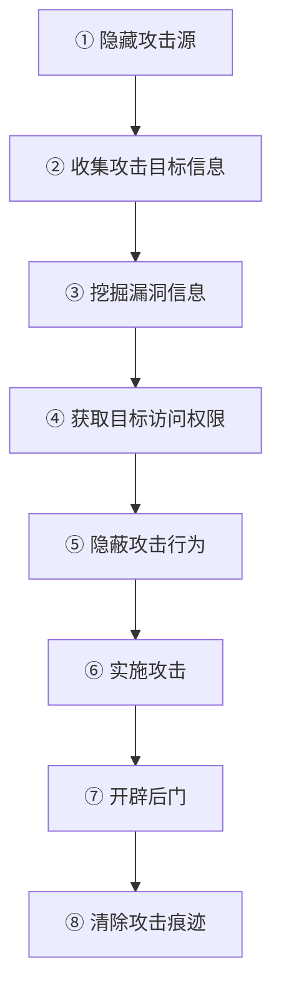
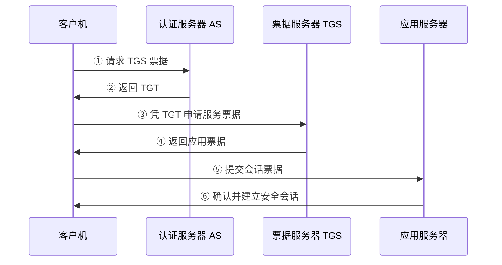
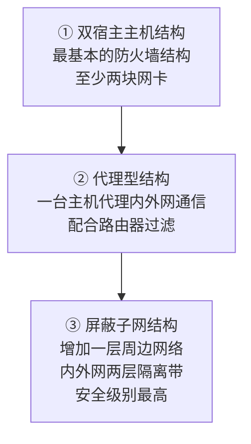
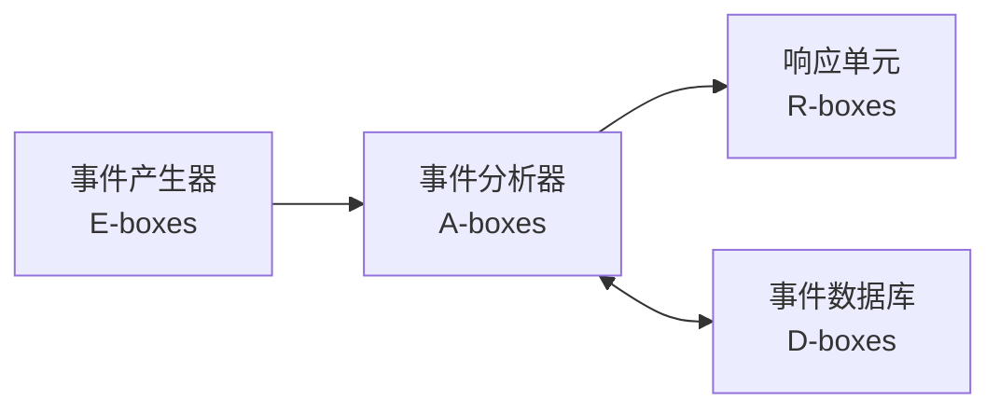
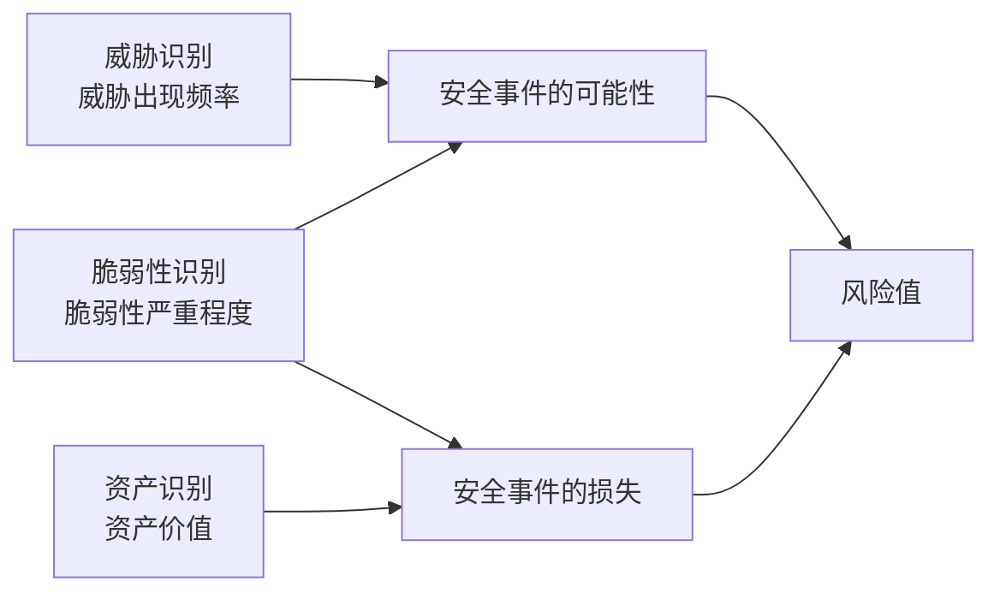
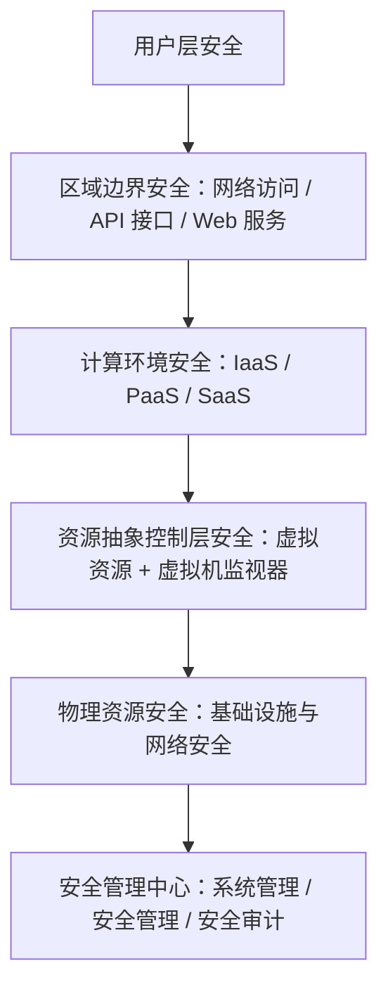
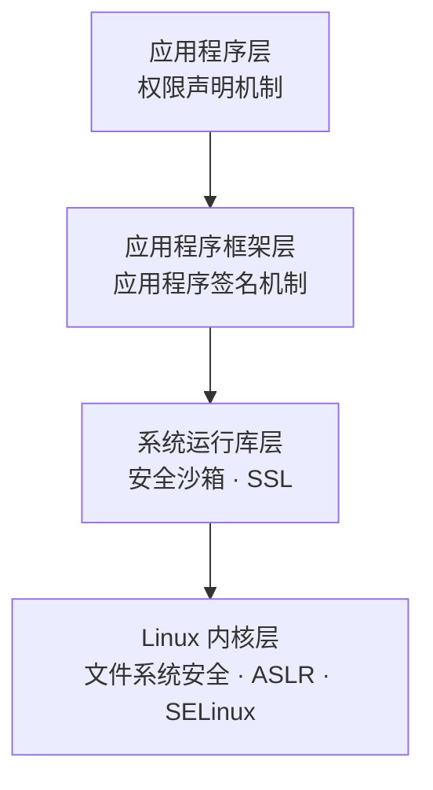

# 🛡️ 信息安全工程师考前冲刺笔记

<p align="center">
  <b>📚 26 章 &nbsp;·&nbsp; 🗂️ 99 个考点小节 &nbsp;·&nbsp; 💬 30 个提示框 &nbsp;·&nbsp; 📈 11 张流程图</b><br/>
  <sub>🏷️ 考点标签　🧠 记忆口诀　⚠️ 易混点　📊 对比表　🐞 漏洞速查　✅ 复习清单</sub>
</p>

> 📖 **基于 PDF 整理，适合 GitHub 阅读与复习**
>
> 🔑 **关键词**：信息安全 · 网络安全 · 密码学 · 风险管理 · 攻防 · 合规

---

> [!NOTE]
> **🏷️ 考点标签说明**
>
> - 🔥 **必考**：历年考过的点，差不多每年都会出现
> - ⭐ **常考**：历年考过的点，出现次数比较多
> - 💧 **有时考**：历年考过的点，但出现次数少
> - 📘 **了解**：需要知晓的概念，或以前没考、后面可能考

> [!TIP]
> **🧭 阅读指南（怎么用这份笔记）**
>
> - 🧠 **记忆口诀 / 记忆 / 总结** → 绿色 `TIP` 提示框，**直接背**
> - ⚠️ **易混点 / 注意** → 黄色 `WARNING` 警告框，**最容易丢分**
> - 🔴 **考点 / 必考** → 红色 `IMPORTANT` 框，**优先级最高**
> - 💡 **目的 / 提示** → 蓝色 `NOTE` 框，**辅助理解**
> - 📊 **对比类**全部表格化；**流程类**配 Mermaid 流程图（GitHub 原生渲染，好看又好记）
> - ✅ **复习清单**见 [附录 B](#附录-b复习清单)，可逐条打勾

---

## 目录

- 🛡️ [一、网络信息安全概述](#一网络信息安全概述)
- ⚔️ [二、网络攻击原理与常用方法](#二网络攻击原理与常用方法)
- 🔐 [三、密码学基本理论](#三密码学基本理论)
- 🏛️ [四、网络安全体系与网络安全模型](#四网络安全体系与网络安全模型)
- 🏢 [五、物理与环境安全技术](#五物理与环境安全技术)
- 🪪 [六、认证技术原理与应用](#六认证技术原理与应用)
- 🚪 [七、访问控制技术原理与应用](#七访问控制技术原理与应用)
- 🧱 [八、防火墙技术原理与应用](#八防火墙技术原理与应用)
- 🌐 [九、VPN 技术原理与应用](#九vpn-技术原理与应用)
- 📡 [十、入侵检测技术原理与应用](#十入侵检测技术原理与应用)
- 🔌 [十一、网络物理隔离技术](#十一网络物理隔离技术)
- 📋 [十二、网络安全审计技术](#十二网络安全审计技术)
- 🐞 [十三、网络安全漏洞防护技术](#十三网络安全漏洞防护技术)
- 🦠 [十四、恶意代码防范技术](#十四恶意代码防范技术)
- 🍯 [十五、网络安全主动防御技术](#十五网络安全主动防御技术)
- 📊 [十六、网络安全风险评估技术](#十六网络安全风险评估技术)
- 🚨 [十七、网络安全应急响应技术](#十七网络安全应急响应技术)
- 🧪 [十八、网络安全测评技术与标准](#十八网络安全测评技术与标准)
- 💻 [十九、操作系统安全保护](#十九操作系统安全保护)
- 🗄️ [二十、数据库系统安全](#二十数据库系统安全)
- 🔀 [二十一、网络设备安全](#二十一网络设备安全)
- 🕸️ [二十二、网站安全](#二十二网站安全)
- ☁️ [二十三、云计算安全](#二十三云计算安全)
- 🏭 [二十四、工控安全](#二十四工控安全)
- 📱 [二十五、移动应用安全](#二十五移动应用安全)
- 📦 [二十六、大数据安全](#二十六大数据安全)
- ⚡ [附录 A：高频考点速记](#附录-a高频考点速记)
- ✅ [附录 B：复习清单](#附录-b复习清单)

---

<a name="一网络信息安全概述"></a>

## 🛡️ 一、网络信息安全概述

### 1.1 基本属性 🔥 【必考】

> 每年出选择题，还出过案例默写。

| 属性 | 英文 | 说明 | 记忆点 |
|------|------|------|--------|
| 机密性 | Confidentiality | 信息不泄露给非授权的用户、实体或程序，能够防止非授权者获取信息 | 不泄露 |
| 完整性 | Integrity | 网络信息或系统未经授权不能进行更改 | 不能改 |
| 可用性 | Availability | 合法许可的用户能够及时获取网络信息或服务 | 用得上 |

> [!IMPORTANT]
> 🔴 **必考提醒**：CIA 三元组是**每年选择题 + 案例默写**的高频点，要做到：
> ① 能**默写**中英文名；② 能**举例**说明（泄露 / 篡改 / 破坏）；③ 能对应到具体安全技术。

### 1.2 安全目标与功能

- **基本功能** 💧 【有时考】：网络应具备**防御、监测、应急和恢复**等基本功能。
- **基本技术需求** 📘 【了解】：网络物理环境安全、网络信息安全认证、访问控制、安全保密、漏洞扫描、恶意代码防护、网络信息内容安全、安全监测与预警、应急响应等。
- **物理安全需求**：环境安全、设备安全、存储介质安全。

> [!WARNING]
> ⚠️ 易混点：本章"基本功能"是 **防御 / 监测 / 应急 / 恢复**；第四章 `PDRR` 是 **防护 / 检测 / 恢复 / 响应**，注意区分。

### 1.3 安全管理内容与方法

- 网络安全管理方法主要有：**风险管理、等级保护、纵深防御、层次化保护、应急响应以及 `PDCA`（Plan-Do-Check-Act）**。【了解】
- 网络安全管理实质是对网络系统中网管对象的**风险进行控制**，方法如下：【有时考】

| 方法 | 典型示例 |
|------|----------|
| 避免风险 | 用物理隔离设备将内部网和外部网分开，避免外部网攻击 |
| 转移风险 | 购买商业保险计划或安全外包 |
| 减少威胁 | 安装防病毒软件包，防止病毒攻击 |
| 消除脆弱点 | 给操作系统打补丁，或强化工作人员安全意识 |
| 减少威胁的影响 | 采取多条通信线路备份，或制定应急预案 |
| 风险监测 | 定期对网络系统状况进行风险分析，监测潜在威胁行为 |

> [!TIP]
> 🧠 记忆：**后面举的例子要能和前面的名词对应**——常出题给你后面的描述，让你选前面的方法。

**网络信息安全管理系统在生命周期中提供的支持** 💧 【有时考】

| 阶段 | 阶段名称 | 主要网络安全管理活动 |
|------|----------|----------------------|
| 阶段 1 | 网络信息系统规划 | 网络安全风险评估；标识安全目标；标识安全需求 |
| 阶段 2 | 网络信息系统设计 | 标识安全风险控制方法；权衡安全解决方案；设计安全体系结构 |
| 阶段 3 | 网络信息系统集成实现 | 购买和部署设备或产品；安全特性被配置、激活；实现效果评价；验证是否满足需求；检查运行环境是否符合设计 |
| 阶段 4 | 网络信息系统运行和维护 | 建立安全管理组织；制定安全规章制度；定期重新评估管理对象；适时调整安全配置或设备；发现并修补漏洞；威胁监测与应急处理 |
| 阶段 5 | 网络信息系统废弃 | 对要替换或废弃的组件进行风险评估；废弃组件安全处理；组件安全更新 |

### 1.4 法律与政策文件 🔥 【必考】

| 法律法规 | 施行日期 | 备注 |
|---------|---------|------|
| 《中华人民共和国国家安全法》 | 2015年7月1日 | 十二届全国人大常委会第十五次会议通过，自公布之日起施行 |
| 《中华人民共和国网络安全法》 | 2017年6月1日 | 网络安全领域基本法 |
| 《中华人民共和国网络安全法（修订版）》 | 2026年1月1日 | 2025年10月28日通过，新增AI安全条款、最高罚款提至1000万元、扩大域外管辖 |
| 《中华人民共和国密码法》 | 2020年1月1日 | 密码领域基础法律 |
| 《中华人民共和国数据安全法》 | 2021年9月1日 | 数据安全领域基本法 |
| 《关键信息基础设施安全保护条例》 | 2021年9月1日 | 国务院令第745号 |
| 《中华人民共和国个人信息保护法》 | 2021年11月1日 | 个人信息保护专门法律 |
| 《网络安全审查办法》 | 2022年2月15日 | 国家网信办等13部门联合发布 |

> [!TIP]
> 🧠 记忆口诀：**儿童节是网络安全法（6.1），元旦节是密码法（1.1），9 月 1 号开学是数据安全法。**

**其他要点**

- 网络安全等级保护主要工作【常考】：**定级、备案、建设整改、等级测评、运营维护**。
  - 定级：确认定级对象、确定合适级别，通过专家评审和主管部门审核。
  - 备案：按等级保护管理规定准备材料，到当地公安机关备案和审核。
  - 建设整改：依据相应等级要求做差距分析，针对不符合项整改，建设符合等级要求的安全技术和管理体系。
  - 等级测评：测评机构依据等级要求测评，并出具等级保护测评证书。
  - 运营维护：运营主体按等级要求对保护对象的安全相关事宜进行监督管理。
- 网络安全法规定：留存相关网络日志**不少于六个月**。【了解】
- 域名系统出现网络与信息安全事件，应当在 **24 小时内**向电信管理机构报告。【有时考】
- 国家对密码实行**分类管理**：分为**核心密码、普通密码和商用密码**。【常考】

---

<a name="二网络攻击原理与常用方法"></a>

## ⚔️ 二、网络攻击原理与常用方法

### 2.1 攻击概述

**攻击树方法** 💧 【有时考】

- 起源于**故障树分析方法**，主要用于系统风险分析和系统可靠性分析。
- 优点：能采取专家头脑风暴法并将意见融合；能进行费效分析或概率分析；能建模非常复杂的攻击场景。
- 缺点：受树结构内在限制，不能建模多重尝试攻击、时间依赖及访问控制等场景；不能建模循环事件；对现实中的大规模网络处理起来特别复杂。

**其他攻击模型**

- `MITRE ATT&CK`：MITRE 根据真实观察到的攻击数据提炼形成的**攻击矩阵模型**。应用场景：网络红蓝对抗模拟、网络安全渗透测试、网络防御差距评估、网络威胁情报收集等。
- **Kill Chain 网络杀伤链模型**（洛克希德·马丁公司提出），把攻击活动分成七个阶段：

> [!TIP]
> 🧠 记忆：**目标侦察 → 武器构造 → 载荷投送 → 漏洞利用 → 安装植入 → 指挥和控制 → 目标行动**

**攻击分类** ⭐ 【常考，教材没有，补充内容】

| 类型 | 特征 | 具体方式 |
|------|------|----------|
| 主动攻击 | 会导致数据流的篡改和虚假数据流的产生 | 篡改、伪造消息数据和终端、拒绝服务 |
| 被动攻击 | 攻击者不对数据信息做任何修改 | 窃听、流量分析、破解弱加密的数据流 |

> [!TIP]
> 🧠 记忆口诀：**只是悄悄做分析研究的，都是被动攻击。**

### 2.2 网络攻击一般过程 💧 【有时考】



1. **隐藏攻击源**：被侵入主机作跳板、免费代理网关、伪造 IP 地址、假冒用户账号。
2. **收集攻击目标信息**：系统一般信息、配置信息、漏洞信息、安全措施信息、用户信息。
3. **挖掘漏洞信息**：系统或软件漏洞（如 `finger` 服务泄露用户信息）、主机信任关系漏洞（如 CGI 漏洞读取 `/etc/hosts.allow`）、目标网络使用者漏洞（邮件钓鱼、弱口令破解、U 盘摆渡、网页恶意代码）、通信协议漏洞（IP 地址伪造、`Telnet`/`HTTP`/`FTP`/`POP3`/`SMTP` 明文传输）、业务系统漏洞。
4. **获取目标访问权限**：获得管理员口令、利用管理漏洞、让管理员运行木马、窃听管理员口令。
5. **隐蔽攻击行为**：连接隐藏（冒充其他用户、修改 `LOGNAME` 环境变量、修改 `utmp` 日志、IP SPOOF）、进程隐藏（重定向减少 `ps` 信息、用木马代替 `ps`）、文件隐藏。
6. **实施攻击**：攻击其他被信任主机和网络、修改或删除重要数据、窃听敏感数据、停止网络服务、下载敏感数据、删除账号、修改数据记录。
7. **开辟后门**：放宽文件许可权、重新开放不安全服务、修改系统配置、替换共享库文件、修改源代码安装木马、安装嗅探器、建立隐蔽信道。
8. **清除攻击痕迹**：篡改日志审计信息、改变系统时间造成日志紊乱、删除或停止审计服务进程、干扰 IDS 正常运行、修改完整性检测标签。

### 2.3 常见技术方法

**TCP 层 FLAGS 字段标识**【熟悉，补充内容】

| 标志 | 含义 |
|------|------|
| SYN | 建立连接 |
| FIN | 关闭连接 |
| ACK | 响应 |
| PSH | 有 DATA 数据传输 |
| RST | 连接重置 |
| URG | 紧急位，需要优先处理 |

**端口扫描** 🔥 【必考一个】

> [!NOTE]
> 💡 目的：找出目标系统上提供的服务列表。

| 方式 | 原理 |
|------|------|
| 完全连接扫描 | 利用三次握手建立完整连接，建立成功则端口开放 |
| 半连接扫描 | 只完成前两次握手，不建立完整连接 |
| SYN 扫描 | 发送连接请求后立即切断；返回 `ACK` 表示端口开放，返回 `RESET` 表示未开放 |
| ID 头信息扫描 | 需第三方"哑主机(dumb)"配合；开放端口会使 ID 头递增不为 1 |
| 隐蔽扫描 | 能绕过 IDS、防火墙和监视系统取得端口信息 |
| SYN/ACK 扫描 | 直接发 `SYN/ACK`；端口未开放返回 `RST`，开放则丢弃不回包 |
| FIN 扫描 | 返回 `RESET` 说明关闭，无任何返回说明开放 |
| ACK 扫描 | 看反馈包的 TTL 值和 WIN 值区分端口状态 |
| NULL 扫描 | 所有标志位全部置空；无返回表示开放，返回 `RST` 表示关闭 |
| XMAS 扫描 | 所有标志位全部置 1；无返回表示开放，返回 `RST` 表示关闭 |

> [!TIP]
> 🧠 记忆口诀：**分段记忆——1~3 同类，4、8 单独，5 不管，6、7 同类，9、10 同类。**

**恶意代码类型**

计算机病毒、网络蠕虫、特洛伊木马、后门、逻辑炸弹、僵尸网络等。关键史实：

- **1988 年**，网络蠕虫程序由**小莫里斯**编制，具有复制传播功能，可感染 UNIX 系统主机。
- **2001 年 8 月**，"红色代码"蠕虫利用微软 Web 服务器 `IIS 4.0 / 5.0` 中 index 服务缺陷，通过自动扫描感染方式传播。
- **2010 年**，"震网"网络蠕虫是**首个专门用于定向攻击真实世界中基础（能源）设施的恶意代码**。

**拒绝服务攻击类型** ⭐ 【常考】

| 类型 | 原理 |
|------|------|
| 同步包风暴 `SYN Flood` | 发送大量半连接状态的服务请求 |
| UDP 洪水 `UDP Flood` | 伪造 Chargen 与 Echo 服务间的 UDP 连接，产生大量无用数据流 |
| Smurf 攻击 | 把回复地址设为目标网络广播地址的 ICMP 应答请求，导致全网应答、网络阻塞 |
| 垃圾邮件 | 耗尽用户信箱磁盘空间 |
| 消耗 CPU 和内存 | 利用算法漏洞构造恶意输入，耗尽 CPU 或内存 |
| 死亡之 ping | 畸形包超过 ICMP 上限（64 KB），导致 TCP/IP 堆栈崩溃、接收方停机 |
| 泪滴攻击 | 加入过多或不必要偏移量字段，使系统重组错乱 |
| 分布式拒绝服务 `DDoS` | 控制多个代理攻击主机同时攻击 |

> [!TIP]
> DDoS 工具中最著名的四种：**Trinoo、TFN、TFN2K、Stacheldraht**。
> 🧠 记忆口诀：**1、3、7 容易出题**，根据描述选对应名词。

**其他常见手段**【多为了解】

- **网络钓鱼** 💧 【有时考】：假冒可信方提供网上服务，以欺骗手段获取敏感个人信息。
- **网络窃听** 📘 【了解】：常见手段有网络嗅探、中间人攻击；主机网卡设为"杂乱（混杂）"模式即可接收全网信息包。
- **SQL 注入** 📘 【了解】：Web 三层模式 = 浏览器 + Web 服务器 + 数据库；脚本程序对浏览器输入缺少检查，攻击者把 SQL 命令插入表单输入域。
- **社交工程**：通过社交活动获取所需信息。
- **电子监听**：用电子设备远距离监视电磁波传送过程。
- **会话劫持**：在合法用户获得初始授权后建立连接，从而具有合法用户的特权权限。
- **代理技术**：通过代理服务器（跳板）攻击，增加追踪难度。
- **APT 攻击**：鱼叉邮件、水坑攻击、网络流量劫持、中间人攻击等，综合利用多种技术并规避监测。

### 2.4 黑客常用工具 💧 【有时考】

> 熟悉举例的工具名，以及什么工具属于哪一类。

| 类别 | 代表工具 |
|------|----------|
| 扫描器 | `NMAP`、`Nessus`、`SuperScan` |
| 远程监控 | 冰河、网络精灵、`Netcat` |
| 密码破解 | `John the Ripper`、`LOphtCrack` |
| 网络嗅探器 | `Tcpdump`、`DSniff`、`WireShark` |
| 安全渗透工具箱 | `Metasploit`、`BackTrack5`（已被 `kali` 替代） |

---

<a name="三密码学基本理论"></a>

## 🔐 三、密码学基本理论

### 3.1 密码学概况

- 密码学主要由**密码编码（加密）**和**密码分析（解密）**两部分组成。【了解】
- **1949 年，香农**发表《保密系统的通信理论》，提出交替使用**换位和置换**以抵御统计分析，增加**混乱和扩散**的密码技术新方法。
- **密码分析攻击类型分为五种** 💧 【有时考】：

| 攻击类型 | 攻击者掌握的信息 | 特点 |
|----------|------------------|------|
| 唯密文攻击 | 只有一个或多个同一密钥加密的密文 | 对攻击者**最不利** |
| 已知明文攻击 | 当前密钥下的一些明文及对应密文 | —— |
| 选择明文攻击 | 能获得自己选定明文对应的密文 | 攻击**数据库**和**文件系统** |
| 密文验证攻击 | 对任何选定密文能得到"是否合法"的判断 | —— |
| 选择密文攻击 | 能得到任何选定密文对应的明文 | 对攻击者**最有利**，主要攻击**公钥密码体制**，特别是**数字签名** |

> [!TIP]
> 🧠 记忆口诀：**能根据后面的描述，选出前面对应的攻击类型。**

**密码评估：安全强度的三种衡量** ⭐ 【常考，上午题高频】

| 评估类型 | 含义 | 关键词 |
|----------|------|--------|
| 无条件安全 | 假设攻击者拥有**无限的计算资源**，仍然无法破解 | 无限资源 |
| 计算安全 | 现有条件下**不具备**解密能力（破解代价大于收益） | 现有条件 |
| 可证明安全 | 安全性**基于数学难题**，可归约为已知的困难问题 | 数学难题 |

> [!TIP]
> 🧠 记忆：**无限资源 → 无条件安全；现有条件 → 计算安全；数学难题 → 可证明安全。**

### 3.2 密码体制分类

- 分为**私钥（对称）**和**公钥（非对称）**密码体制；介于两者之间的称为**混合密码体制**。【了解】

> [!TIP]
> 🧠 记忆口诀：**加解密密钥一样是私钥体制，加解密密钥不一样是公钥体制。**

| 体制 | 特点 | 典型算法 |
|------|------|----------|
| 私钥（对称） | 加解密使用相同密钥；处理速度快，常用于数据加密处理 | `DES`、`3DES`、`RC4`、`RC5`、`IDEA`、`AES`、`SM1`、`SM4` |
| 公钥（非对称） | 加密密钥可公开，只需安全存放解密密钥 | `RSA`、椭圆曲线密码、`SM2` |
| 混合 | 用公钥体制分配私钥体制的密钥，再按私钥体制加解密 | —— |

- 私钥体制密钥分配极为重要，必须使用安全途径。假设网络中有 `n` 个使用者、两两共享一个密钥，则共有 **`n(n-1)/2`** 个密钥。
- 私钥体制的缺陷：**密钥分配问题、密钥管理问题、无法认证源**。
- 公钥体制的优点：**密钥分发方便**（可公开方式分配加密密钥）、**密钥保管量少**、**支持数字签名**。

### 3.3 常见密码算法 ⭐ 【常考】

**DES**

- 分组加密算法，支持 **64 比特**明文块加密，密钥长度 **56 比特**，**子密钥长度 48 比特**。
- **S 盒代替是关键步骤**，将 **48 比特压缩成 32 比特**，经过 8 个盒转换输出。
- S 盒查表方法（以 s8 盒为例）：输入 `110011`，第 1 位和第 6 位（最高位与最低位）组合为 `11`，十进制为 3 → **行号为 3**；第 2~5 位为 `1001`，十进制为 9 → **列号为 9**；查得 `03` 行 `09` 列为 `12`，即二进制 `1100`。

**TDEA（即 3DES）** 💧 【有时考】

- 工作机制：对明文进行"**加密—解密—加密**"操作，并非加密三次。

```text
TDEA 加密过程：I → DES Ek1 → DES Dk2 → DES Ek3 → O
TDEA 解密过程：I → DES Dk3 → DES Ek2 → DES Dk1 → O
```

**其他算法**

| 算法 | 分组/明文 | 密钥长度 |
|------|-----------|----------|
| `IDEA` | 明文与密文分组均为 64 比特 | 128 比特 |
| `AES` | 支持至少 128 比特长的分组 | 128、192、256 比特 |
| `SM1` | 分组长度 128 比特 | 128 比特 |
| `SM4` | 分组长度 128 比特 | 128 比特 |

**无线安全协议与密码算法的对应** 💧 【有时考】

| 无线安全协议 | 使用的密码算法 |
|--------------|----------------|
| `WEP` | `RC4` 流密码（已被破解，不安全） |
| `WPA2` | `AES` |

**RSA 🔥 【必考】**

> [!IMPORTANT]
> 🔴 **必考提醒**：RSA 是**计算题必考**内容，务必能独立完成 `n`、`φ(n)`、`d` 的推导，
> 并完成一次 `C = M^e mod n` 加密与 `M = C^d mod n` 解密。

- 非对称算法，公钥和私钥都可加密消息，用于加密的密钥与用于解密的密钥相反。`SSH`、`OpenPGP`、`S/MIME`、`SSL/TLS` 都依赖 RSA 进行加密和数字签名。
- 基于**大整数因子分解的困难性**。

基本字符含义：`m` 明文，`c` 密文，`e` 公钥指数，`d` 私钥指数，`n` 模数，`p`/`q` 两个大素数（质数），`mod` 模运算。

```text
n = p * q
φ(n) = (p - 1)(q - 1)
e * d ≡ 1 mod φ(n)     // d 是 e 的乘法逆元
```

> 逆元示例：`3 * 5 mod 7 = 1`，则 `3 mod 7` 的一个逆元是 5，反过来 `5 mod 7` 的逆元是 3。

**同余（模运算）判定** ⭐ 【常考】

- `a ≡ b (mod n)` 的含义是：**`n` 能够整除 `b - a` 的绝对值**。
- 例：`3 × 5 = 15`，`15 - 1 = 14`，`14` 能被 `7` 整除 → 所以 `3 × 5 ≡ 1 (mod 7)`。

算法步骤：

1. 生成两个大素数 `p` 和 `q`。
2. 计算乘积 `n = p * q`。
3. 计算欧拉函数 `φ(n) = (p-1)(q-1)`。
4. 选取随机数 `e`，满足 `1 < e < φ(n)` 且 `gcd(e, φ(n)) = 1`。
5. 计算 `d = e⁻¹ mod φ(n)`。
6. 保密 `d`、`p`、`q`，公开 `n` 和 `e`。即 `d` 为私钥，`n` 和 `e` 为公钥。


计算实例（设 `p = 3, q = 17, e = 13`）：

```text
第一步：n = p * q = 3 * 17 = 51          → 公钥 n=51, e=13
第二步：φ(n) = (3-1) * (17-1) = 2 * 16 = 32
        d = (k * φ(n) + 1) / e = (2 * 32 + 1) / 13 = 5   → 私钥 d=5
第三步：加密与解密（被加密明文不能大于 n，大于 n 要分组）
        RSA 加密：C = M^e mod n
        RSA 解密：M = C^d mod n
```

示例演算：

```text
加密：C = M^e mod n = 2^13 mod 51 = 8192 mod 51 = 32
解密：M = C^d mod n = 32^5 mod 51 = 33554432 mod 51 = 2
```

> [!TIP]
> 🧠 记忆口诀：**RSA 算法多看例题，自己多去计算几次。** 除教材方法外，也可用 `(e*d) mod φ(n) = 1` 推算，或使用欧几里得算法求出。

**国产密码算法** ⭐ 【常考】

| 算法 | 类型 | 核心参数/说明 |
|------|------|----------------|
| `SM1` | 分组密码算法 | 分组长度与密钥长度均为 **128 bit**；算法不公开，仅以 IP 核形式存在于芯片中 |
| `SM2` | 椭圆曲线公钥密码算法 | 密钥长度 **256 bit**，安全强度高于 RSA 2048；用于数字签名、密钥交换、公钥加密 |
| `SM3` | 密码杂凑算法 | 消息分组 **512 bit**，输出摘要 **256 bit**；用于数字签名和完整性校验 |
| `SM4` | 分组密码算法 | 分组长度与密钥长度均为 **128 bit**；加密与密钥扩展均采用 **32 轮**非线性迭代 |
| `SM9` | 标识密码算法 | 公钥由用户标识（如邮箱、手机号）唯一确定，无需数字证书；支持签名、加密、密钥交换 |

### 3.4 Hash 函数与数字签名

- **Hash 函数**（杂凑函数）：能把任意长度的信息转换成**固定长度的哈希值**（又称数字摘要或消息摘要），不同消息生成的哈希值不同。【了解】

| 算法 | 输入/分组 | 输出摘要 |
|------|-----------|----------|
| `MD5` | 512 位数据块 | 128 位 |
| `SHA` | 512 位数据块 | 160 位（已发布 `SHA-2`、`SHA-3`；长度有 `SHA-224/256/384/512`） |
| `SM3` | 消息分组 512 比特 | 256 比特（国家密码管理局 2010 年公布的商用密码杂凑算法标准） |

- **数字签名**：签名者使用**私钥**对待签名数据的**杂凑值**做密码运算得到的结果，该结果只能用签名者的**公钥**验证。【有时考】
- 典型签名方案：`RSA` 签名体制、`Rabin` 签名体制、`ElGamal` 签名体制、`DSS` 标准。
- 数字签名至少要满足三个条件：**非否认、真实性、可鉴别性**。
- **签名与加密的区别**：加密保护信息不被非授权用户访问（机密性）；签名使接收者确信发送者身份与信息是否被篡改（完整性）。

## 数字签名、数字信封、数字证书对比

| 名称 | 解决的问题 | 核心手段 | 加密/签名所用密钥 | 一句话记忆 |
|------|------------|----------|-------------------|------------|
| 数字签名 | 身份认证、完整性、不可否认性 | 先哈希，再用私钥加密摘要 | 发送方**私钥签名**，发送方**公钥验签** | **证明“是谁发的，有没有被改”** |
| 数字信封 | 对称密钥的安全分发 | 对称加密数据 + 非对称加密密钥 | 数据用**对称密钥**，对称密钥用**接收方公钥**加密，接收方**私钥**解密 | **用非对称保护对称密钥** |
| 数字证书 | 公钥的真实性与可信绑定 | CA 对“公钥 + 身份信息”签名 | CA **私钥签名**，CA **公钥验签** | **公钥的身份证** |

> [!TIP]
> 🧠 记忆口诀：**私钥签名，公钥验签。** 数字签名常见实现方式是**公钥密码体制 + 单向安全哈希算法**。

### 3.5 密码管理与数字证书

- 《中华人民共和国密码法》（2020 年 1 月 1 日施行）明确：密码分为**核心密码、普通密码和商用密码**。商用密码产品与使用网络关键设备和网络安全专用产品的商用密码服务实行**强制检测认证制度**。【常考】
- **数字证书**（公钥证书）：证书认证机构（CA）签名的、包含公开密钥拥有者信息、公开密钥、签发者信息、有效期及扩展信息的一种数据结构。【有时考】

**表：数字证书基本信息域**

| 序号 | 项名称 | 描述 |
|------|--------|------|
| 1 | `version` | 版本号 |
| 2 | `serialNumber` | 序列号 |
| 3 | `signature` | 签名算法 |
| 4 | `issuer` | 颁发者 |
| 5 | `validity` | 有效期 |
| 6 | `subject` | 主体 |
| 7 | `subjectPublicKeyInfo` | 主体公钥信息 |
| 8 | `issuerUniqueID` | 颁发者唯一标识符 |
| 9 | `subjectUniqueID` | 主体唯一标识符 |
| 10 | `extensions` | 扩展项 |

- 数字证书按类别分为**个人证书、机构证书、设备证书**；按用途分为**签名证书、加密证书**。
- 一般基于 `PKI` 技术建立数字证书认证系统（简称 CA），提供证书的**申请、审核、签发、查询、发布、吊销**等全生命周期管理。系统构成主要有：**目录服务器、OCSP 服务器（查询数字证书状态）、注册服务器、签发服务器**等。

### 3.6 安全协议

- **Diffie-Hellman 密钥交换协议**：基于求解**离散对数问题**的困难性，即 `C^d = M mod P`。【有时考】
- **SSH（Secure Shell，安全外壳）**：基于公钥的安全应用协议，由三个子协议组成【有时考】：

| 子协议 | 作用 |
|--------|------|
| SSH 传输层协议 | 算法协商和密钥交换，并实现服务器的认证 |
| SSH 用户认证协议 | 建立连接，使用口令认证、公钥认证、主机认证等机制认证用户 |
| SSH 连接协议 | 将认证连接分解为多种逻辑通道，提供流控及通道参数协商机制 |

- 实际应用中，SSH 在**端口转发**技术基础上支持远程登录（`Telnet`）、`rsh`、`rlogin`、文件传输（`scp`）等多种服务。
- Linux 系统一般提供 SSH 服务，服务进程端口通常为 **22**。

**关联记忆：常见密码算法参数速查**

```text
DES  : 64 比特块加密，密钥长度 56 比特
3DES : 密钥长度最少 112 位，最多 168 位
AES  : 支持 128 比特分组，密钥长度为 128、192、256 比特
SM1  : 分组长度 128 比特，密钥长度 128 比特
SM4  : 分组长度和密钥长度都是 128 比特
MD5  : 以 512 位数据块输入，产生 128 位消息摘要
SHA  : 以 512 位数据块输入，产生 160 位消息摘要
SM3  : 消息分组长度 512 比特，产生 256 位消息摘要
```

### 3.7 密码学网络安全应用

- **PGP** 是一种加密软件，目前最广泛地用于**电子邮件安全**。能防止非授权者阅读邮件，并能对邮件加数字签名，使收信人确信发信人身份。【偶尔考】
- PGP 应用的密码技术：密钥管理算法选用 `RSA`、数据加密算法 `IDEA`、完整性检测和数字签名算法采用 `MD5` 和 `RSA` 以及随机数生成器。

---

<a name="四网络安全体系与网络安全模型"></a>

## 🏛️ 四、网络安全体系与网络安全模型

### 4.1 经典安全模型

**BLP 模型（机密性）** ⭐ 【常考】

- 用于防止非授权信息的扩散，有两个特性：**简单安全特性、＊特性**。
- 简单安全特性：主体对客体进行**读**访问的必要条件是主体安全级别**不小于**客体安全级别，主体范畴集合包含客体全部范畴，即**只能向下读，不能向上读**。
- ＊特性：主体对客体进行**写**访问的必要条件是客体安全级支配主体安全级，即客体保密级别不小于主体保密级别，**只能向上写，不能向下写**（防止写到低级别造成泄密）。
- 范畴由两部分组成：
  - **安全级**：公开、秘密、机密、绝密；顺序为 **公开 < 秘密 < 机密 < 绝密**。
  - **范畴集**：安全级的有效领域或信息所归属领域，如人事处、财务处等；两个范畴集关系为包含、被包含或无关。

举例（常出选择题）：

```text
文件 F 访问类：｛机密：人事处，财务处｝
用户 A 访问类：｛绝密：人事处｝
用户 B 访问类：｛绝密：人事处，财务处，科技处｝
```

> 用户 B 可以阅读文件 F（级别高且涵盖文件范畴）；用户 A 的安全级虽高，但缺少"财务处"范畴，**不能**读文件 F。

**Biba 模型（完整性）**【掌握，常考】

- 用于防止非授权修改系统信息，保护系统信息完整性，有三个安全特性：**简单安全特性、＊特性、调用特性**。
- 简单安全特性：主体对客体进行**修改**访问的必要条件是主体完整性级别**不小于**客体完整性级别，主体不能向下读（防止污染）。
- ＊特性：主体完整性级别小于客体完整性级别时**不能修改客体**，即主体不能向上写。
- 调用特性：主体的完整性级别小于另一个主体的完整性级别时，**不能调用**另一个主体。

> [!TIP]
> 🧠 关联记忆：
> - **BLP 模型（机密性）：下读上写**【口诀：为了保密，小肚上写】
> - **Biba 模型（完整性）：上读下写**【口诀：吃了 biba，上吐下泻】

### 4.2 其他模型

| 模型 | 构成要素 | 备注 |
|------|----------|------|
| `PDRR` | 防护 Protection、检测 Detection、恢复 Recovery、响应 Response | 改进"只有保护"的单一防御思想，强调四个重要环节 |
| `P2DR` | 策略 Policy、防护 Protection、检测 Detection、响应 Response | 熟悉 |
| `WPDRRC` | 预警、保护、检测、响应、恢复、反击 | 熟悉 |

**PDRR 各环节内容**【熟悉，常考对应关系】

- 防护：加密机制、数据签名机制、访问控制机制、认证机制、信息隐藏、防火墙技术等。
- 检测：入侵检测、系统脆弱性检测、数据完整性检测、攻击性检测等。
- 恢复：数据备份、数据修复、系统恢复等。
- 响应：应急策略、应急机制、应急手段、入侵过程分析及安全状态评估等。

> [!WARNING]
> ⚠️ 注意：与第一章"网络应具备的基本功能：防御/监测/应急/恢复"区分开。

**能力成熟度模型 CMM**【熟悉】

- 五级：1 级－非正式执行、2 级－计划跟踪、3 级－充分定义、4 级－量化控制、5 级－持续优化。级别越大，能力成熟度越高。

**软件安全能力成熟度模型五级主要过程**【掌握，有时考对应关系】

| 级别 | 主要过程 |
|------|----------|
| CMM1 | 补丁修补 |
| CMM2 | 渗透测试、安全代码评审 |
| CMM3 | 漏洞评估、代码分析、安全编码标准 |
| CMM4 | 软件安全风险识别、`SDLC`（软件开发生命周期）实施不同安全检查点 |
| CMM5 | 改进软件安全风险覆盖率、评估安全差距 |

**纵深防御模型**【熟悉】

- 基本思路：将网络防护措施有机组合，针对保护对象部署合适安全措施，形成**多道保护线**，互相支持和补救，尽可能阻断攻击者威胁。
- 四道防线：

> **安全保护**（第一道）→ 阻止入侵和危害 → **安全监测**（第二道）→ 及时发现入侵和破坏 → **实时响应**（第三道）→ 维持网络"打不垮" → **恢复**（第四道）→ 以最快速度"起死回生"


**分层防护模型** 📘 【了解】

- 针对单独保护节点，以 **OSI 7 层模型**为参考做层次化保护。典型保护层次：**物理层、网络层、系统层、应用层、用户层、管理层**。

**网络生存性**

- 指网络信息系统在遭受入侵的情形下仍能持续提供必要服务的能力，遵循 **"3R"** 建立方法：**抵抗 Resistance、识别 Recognition、恢复 Recovery**。

**NIST 网络安全框架**

- 美国国家标准与技术研究院（NIST）发布《提升关键基础设施网络安全的框架》，首先定义五个核心功能：**识别、保护、检测、响应、恢复**。

### 4.3 体系建设原则与安全策略

- 建立过程中主要遵循原则【了解】：**系统性和动态性原则**（整体安全性的**木桶原则**）、**分权制衡原则** 等。
- 网络安全组织结构：**领导层、管理层、执行层、外部协作层**。
- 企业网络中资产分成四个级别：**公开、内部、机密、限制**。【熟悉】
- **人员安全三原则** 📘 【了解】：1）多人负责原则；2）任期有限原则；3）职责分离原则。
- **网络安全基础设施**主要包括：网络安全数字认证服务中心、网络安全运营中心、网络安全测评认证中心。

### 4.4 等级保护与参考案例

- 等级保护工作主要包括：**定级、备案、建设整改、等级测评、监督检查**五个阶段。【有时考】
- 定级对象的安全保护等级分为**五个**：【口诀：**自系安结访**】【常考】

| 级别 | 名称 |
|------|------|
| 第一级 | 用户自主保护级 |
| 第二级 | 系统审计保护级 |
| 第三级 | 安全标记保护级 |
| 第四级 | 结构化保护级 |
| 第五级 | 访问验证保护级 |

> [!IMPORTANT]
> 🔴 **必考提醒**：定级五级口诀 **自系安结访**（用户自主 / 系统审计 / 安全标记 / 结构化保护 / 访问验证），
> 常与「等保工作五阶段」合并出题，注意区分两组"五"。

**网络安全等级保护 2.0 的主要变化** 💧 【有时考】

1. **扩大对象范围**：将云计算、移动互联、物联网、工业控制系统等列入标准范围，构成"网络安全通用要求 + 新型应用的网络安全扩展要求"。
2. 提出在**"安全通信网络""安全区域边界""安全计算环境""安全管理中心"**支持下的**三重防护体系架构**。
3. **强化可信计算技术使用要求**，各级增加"可信验证"控制点：
   - 一级：设备系统引导程序、系统程序等进行可信验证。
   - 二级：增加重要配置参数和应用程序可信验证，并将验证结果形成审计记录送至安全管理中心。
   - 三级：增加应用程序关键执行环节进行动态可信验证。
   - 四级：增加应用程序所有执行环节进行动态可信验证。

**NIST 框架的五种核心功能与子类** 💧 【有时考】

| 功能 | 子类（要点） |
|------|--------------|
| 识别 | 资产管理、商业环境、治理、风险评估、风险管理策略 |
| 保护 | 访问控制、意识和培训、数据安全、信息保护流程和规程、维护、保护技术 |
| 检测 | 异常和事件、安全持续监测、检测处理 |
| 响应 | 响应计划、通信、分析、缓解、改进 |
| 恢复 | 恢复计划、改进、通信 |

---

<a name="五物理与环境安全技术"></a>

## 🏢 五、物理与环境安全技术

### 5.1 物理安全概念

**常见物理安全威胁** 💧 【有时考】

```text
物理安全威胁
├── 自然灾害威胁：地震、洪水、火灾、鼠害、雷电
└── 人为安全威胁：盗窃、爆炸、毁坏、硬件攻击
```

**硬件木马** 🔹 【偶尔考】

- 在集成电路芯片（IC）中被植入的**恶意电路**。IC 整个生命周期内的研发设计、生产制造、封装测试以及应用都有可能被植入恶意硬件逻辑。
- 检测方法：**反向分析法、功耗分析法、侧信道分析法**。

**硬件木马攻击链路（示意）**

```text
IP 中植入硬件木马（IP 设计者）
   ↓
IC 设计中植入硬件木马（不可信 EDA 工具 / IC 设计者）
   ↓
代工厂：逆向工程、IP 盗版/伪造/复制（代工厂中的攻击者）
   ↓
制作测试：含硬件木马的 IC 通过测试、IC 盗窃（不可信测试者）
   ↓
部署：IC 盗窃、物理攻击（逆向工程、旁路攻击、拒绝服务等）
   ↓
应用：PCB/COTS 组件中植入木马、PCB 盗版（抄板、篡改、替换、克隆、过建）
```

**硬件安全漏洞** 📘 【了解】

- 对网络信息系统安全的影响更具有**持久性和破坏性**。
- **2018 年 1 月**发现的 **"熔断"（Meltdown）和"幽灵"（Spectre）CPU 漏洞**属于硬件安全漏洞，可用于以侧信道方式获取指令预取、预执行对 cache 的影响等信息，进而获取特定代码、数据在内存中的位置信息，从而利用其他漏洞读取或篡改内存。

**物理安全保护分类**

| 分类 | 内容 |
|------|------|
| 设备物理安全 | 设备的标志和标记、防止电磁信息泄露、抗电磁干扰、电源保护，以及设备振动、碰撞、冲击适应性等 |
| 环境物理安全 | 机房场地选择、机房屏蔽、防火、防水、防雷、防鼠、防盗、防毁、供配电系统、空调系统、综合布线和区域防护等 |
| 系统物理安全 | 存储介质安全、灾难备份与恢复、物理设备访问、设备管理和保护、资源利用等 |

### 5.2 物理环境安全防护

- 主要包括：**防火、防水、防震、防盗、防鼠虫害、防雷、防电磁、防静电和安全供电**。【了解】

### 5.3 机房安全

**机房功能区域** ⭐ 【常考，掌握】

| 类别 | 内容 | 口诀 |
|------|------|------|
| 主要工作房间 | 主机房、终端室等 | 主终 → 祖宗（主要工作房间像祖宗一样的地位） |
| 第一类辅助房间 | 低压配电间、不间断电源室、蓄电池室、空调机室、发电机室、气体钢瓶室、监控室等 | 电气空监 |
| 第二类辅助房间 | 资料室、维修室、技术人员办公室 | 资修办 |
| 第三类辅助房间 | 储藏室、缓冲间、技术人员休息室、盥洗室等 | —— |

**计算机机房安全等级** 📘 【了解】

| 等级 | 说明 |
|------|------|
| A 级 | 系统运行中断后会对国家安全、社会秩序、公共利益造成**严重**损害；有严格的机房安全要求和**完善**的安全措施 |
| B 级 | 造成**较大**损害；有较严格要求和**较完善**的安全措施 |
| C 级 | 不属于 A、B 级的情况；有基本要求和基本安全措施 |

**IDC 机房分级**（《互联网数据中心工程技术规范 `GB51195-2016`）【有时考】

| 级别 | 冗余/容错能力 | 可用性 |
|------|---------------|--------|
| R1 | 主要部分具备一定的冗余能力 | ≥ 99.5% |
| R2 | 应具备冗余能力 | ≥ 99.9% |
| R3 | 应具备容错能力 | ≥ 99.99% |

**其他要点** 📘 【了解】

- 网络通信线路常见物理安全威胁：1）被切断；2）被电磁干扰；3）泄露信息。
- 常用存储介质安全防护措施：1）强化存储安全管理；2）数据存储加密保存；3）容错容灾存储技术。
- **场地选择要求**：抗电磁干扰性——避开或远离无线电干扰源和微波线路强电磁场干扰场所；在频率 `0.15~1000 MHz` 时不大于 `126 dBuV`，磁场干扰场强不大于 `800 A/m`；避开强电流冲击和强电磁干扰场所（200 米以上）。
- **数据中心建设与设计要求**：
  - 所有设备的金属外壳、各类金属管道、金属线槽、建筑物金属结构必须进行**等电位联结并接地**。
  - 数据中心**耐火等级不应低于二级**。
  - 与其他功能用房同处一个建筑时，应采用耐火极限不低于 **2.0 h 的防火隔墙**和 **1.5 h 的楼板**隔开，隔墙上开门应采用**甲级防火门**。
  - 采用管网式气体灭火系统或细水雾灭火系统的主机房，应同时设置**两组独立的火灾探测器**，火灾报警系统应与灭火系统和视频监控系统**联动**。
  - 设置气体灭火系统的主机房，应配置专用**空气呼吸器或氧气呼吸器**。
- **CA 机房物理安全控制**：每 **五年** 进行一次屏蔽室检测。

---

<a name="六认证技术原理与应用"></a>

## 🪪 六、认证技术原理与应用

### 6.1 认证概述

- 认证是一个实体向另一个实体证明其所声称身份的过程，一般由**标识（Identification）**和**鉴别（Authentication）**两部分组成。【有时考】
  - **标识**：代表实体对象（人员、设备、数据、服务、应用）的身份标志，确保**唯一性和可辨识性**，如 IP 地址、网卡地址、用户名口令等。
  - **鉴别**：利用口令、电子签名、数字证书、令牌、生物特征、行为表现等数字化凭证，对实体所声称属性进行识别验证的过程。

**常见认证依据（四类）** 💧 【有时考，熟悉】

1. 实体**所知道的**秘密信息：用户口令、验证码等。
2. 实体**所拥有的**实物凭证：智能卡、U 盾等不可伪造的物理设备。
3. 实体**所具有的**生物特征：指纹、声音、虹膜、人脸等。
4. 实体**所表现的**行为特征：鼠标使用习惯、敲键力度、地理位置等。

- 认证机制由**验证对象、认证协议、鉴别实体**构成。【了解】
- 认证分类【了解】：
  - 按认证凭据类型数量：**单因素、双因素、多因素**认证。
  - 按认证依据所利用的时间长度：**一次性口令 OTP、持续认证**。
  - 按鉴别双方参与角色及依赖的外部条件：**单向认证、双向认证、第三方认证**。

### 6.2 认证技术方法 ⭐ 【常考，掌握】

| 方法 | 说明 |
|------|------|
| 口令认证 | 基于用户所知道的秘密 |
| 智能卡 | 带有存储器和微处理器的集成电路卡，可安全存储认证信息 |
| 生物特征认证 | 利用指纹、人脸、视网膜、语音等人类生物特征 |
| Kerberos | 由 MIT 研制的网络认证协议（目前第五版），目标是使用密钥加密为客户端/服务器应用提供强身份认证 |

**Kerberos**

- 技术原理：利用**对称密码技术**，使用**可信第三方**为应用服务器提供认证服务，并在用户和服务器之间建立安全信道。
- 四个基本实体：

| 实体 | 作用 |
|------|------|
| Kerberos 客户机 | 用户用来访问服务器设备 |
| AS（认证服务器） | 识别用户身份并提供 TGS 会话密钥 |
| TGS（票据发放服务器） | 为申请服务的用户授予票据 Ticket |
| 应用服务器 | 为用户提供服务的设备或系统 |

- **工作流程（6 步）**：

```text
1. 客户机向 AS 请求 TGS 票据
2. AS 发送 TGT 给客户机
3. 客户机发送 TGT 和应用服务票据申请给 TGS
4. TGS 发送应用票据给客户机
5. 客户机发送会话票据到应用服务器
6. 应用服务器确认请求
```



- 优点：1）减少用户密钥的密文的暴露次数；2）可实现**单点登录**。
- 缺点：依赖**主机节点时间同步**问题，**易遭受拒绝服务攻击**。

### 6.3 PKI 与相关技术

- **PKI（Public Key Infrastructure，公开密钥基础设施）**：包括硬件、软件、人员、策略和规程的集合，用于实现基于公钥密码体制的密钥和证书的**产生、管理、存储、分发和撤销**等功能。**X.509 是 PKI 的标准格式**。
- 基于 PKI 的主要安全服务：**身份认证、完整性保护、数字签名、会话加密管理、密钥恢复**。

**PKI 各实体功能** ⭐ 【常考，掌握】

| 实体 | 功能 |
|------|------|
| CA（Certification Authority） | 证书授权机构，主要进行证书的颁发、废止和更新；负责签发、管理和撤销一组终端用户的证书 |
| RA（Registration Authority） | 证书登记权威机构，将公钥与证书持有者身份及其他属性联系起来，进行注册和担保；可充当 CA 与终端用户之间的中间实体，辅助 CA 完成绝大部分证书处理功能 |
| 目录服务器 | CA 通常使用，提供证书管理和分发的服务 |
| 终端实体 End Entity | 指需要认证的对象，如服务器、打印机、E-mail 地址、用户等 |
| 客户端 Client | 需要基于 PKI 安全服务的使用者，包括用户、服务进程等 |

**其他认证技术** 📘 【了解】

- **单点登录 SSO**：用户访问不同系统时只需进行一次身份认证，即可凭该认证身份访问授权资源。
- **基于人机识别认证**：利用计算机求解问题的困难性区分计算机和人的操作，防止恶意注册、暴力猜解口令等。
- **基于行为的身份鉴别**：根据用户行为和风险大小进行鉴别，动态监控用户状态判定身份。
- **快速在线认证 FIDO（Fast IDentity Online）**：使用标准公钥加密技术提供强身份验证；设计目标是保护用户隐私，不提供跟踪用户的信息，**用户生物识别信息不离开用户设备**；支持安全 PIN、生物识别（人脸、语音、虹膜、指纹）及符合 FIDO 标准要求的认证设备。

---

<a name="七访问控制技术原理与应用"></a>

## 🚪 七、访问控制技术原理与应用

### 7.1 访问控制概述

- 访问控制是指对资源对象的访问者**授权、控制**的方法及运行机制。【了解】
  - **访问者（主体）**：用户、进程、应用程序等。
  - **资源对象（客体）**：文件、应用服务、数据等。
  - **授权**：访问者可以对资源对象进行访问的方式，如文件的读、写、删除、追加，或邮件服务的接收、发送等。
  - **控制**：对访问者使用方式的监测和限制，以及对是否许可用户访问资源对象做出决策。
- 访问控制的目标有两个【了解】：一是**防止非法用户进入系统**；二是**阻止合法用户对系统资源的非法使用**（禁止越权访问）。

### 7.2 访问控制模型

**组成要素** 💧 【有时考】

```text
        访问控制数据库
              ↑
主体 ──→ 参考监视器 ──→ 客体
              ↓
           审计库
```

| 要素 | 说明 |
|------|------|
| 主体 Subject | 客体的操作实施者，通常是人、进程或设备等 |
| 客体 Object | 被主体操作的对象 |
| 参考监视器 Reference Monitor | 访问控制的决策单元和执行单元的集合体 |
| 访问控制数据库 | 记录主体访问客体的权限及访问方式，提供决策判断依据，也称访问控制策略库 |
| 审计库 | 存储主体访问客体的操作信息 |

### 7.3 访问控制类型 📘 【了解】

| 类型 | 说明 |
|------|------|
| 自主访问控制 `DAC` | 客体所有者按自己的安全策略授予系统其他用户访问权 |
| 强制访问控制 `MAC` | 系统根据主体和客体的安全属性，以强制方式控制访问；比 DAC 更严格 |
| 基于角色的访问控制 `RBAC` | 根据完成某些职责任务所需的访问权限进行授权和管理；由**用户、角色、会话、权限**四个基本要素组成 |
| 基于属性的访问控制 `ABAC` | 根据主体属性、客体属性、环境条件以及访问策略，对主体请求操作进行授权许可或拒绝 |

**DAC 的实现方法** ⭐ 【常考】

| 分类 | 实现形式 | 说明 |
|------|----------|------|
| 基于行（在**主体**上配置权限） | 能力表 capability list | 决定用户能否访问客体及何种访问模式（读、写、执行） |
|  | 前缀表 profiles | 包括受保护客体名和主体对它的访问权限 |
|  | 口令 password | 每个客体都有一个口令，主体访问前需提供该客体口令 |
| 基于列（在**客体**上配置权限） | 保护位 protection bits | 对所有主体、主体组及客体拥有者指明访问模式集合，通常以比特位表示；UNIX/Linux 采用 |
|  | 访问控制表 `ACL` | 在每个客体上附加主体明细表，表示访问控制矩阵 |

> [!TIP]
> 🧠 记忆口诀：**行主列客，行分能前令，列分护访。**
> 即：基于行的分**能**力表、**前**缀表、**令**（口令）；基于列的分**护**位、**访**问控制表。

- DAC 优点：访问机制**简单、灵活**。
- DAC 缺点：实施**依赖用户的安全意识和技能**，不能满足高安全等级的要求。

### 7.4 访问控制策略与规则

- 访问控制策略由**所要控制的对象、访问控制规则、用户权限或其他访问安全要求**组成。【熟悉】
- 主要访问控制规则【常考】：

| 规则 | 说明与示例 |
|------|------------|
| 基于用户身份 | 以账号名和口令表示用户，二者都正确才允许访问；操作系统或网络设备常用 |
| 基于角色 | 根据用户完成某项任务所需的权限进行控制 |
| 基于地址 | 利用访问者所在物理位置或逻辑地址空间限制访问；如重要服务器和网络设备禁止远程访问，仅允许本地访问；含 IP 地址、域名地址、物理位置 |
| 基于时间 | 用时间约束访问操作；如**下班时间不允许访问服务器** |
| 基于异常事件 | 用异常事件触发控制操作；如**登录三次失败后冻结账户** |
| 基于服务数量 | 用系统所能承受的服务数量实现控制；如网站服务能力接近阈值时暂时拒绝新请求，防范拒绝服务 |

- **最小特权原则**：系统每一个主体只能拥有完成任务所**必要的权限集**，可限制特权造成的危害。【有时考】

### 7.5 访问控制技术应用

**主要应用场景类型** 💧 【有时考】

1. **物理访问控制**：门禁系统、警卫、个人证件、门锁、物理安全区域划分。
2. **网络访问控制**：网络接入控制、网络通信连接控制、网络区域划分、网络路由控制、网络节点认证。
3. **操作系统访问控制**：文件读写访问控制、进程访问控制、内存访问控制等。
4. **数据库/数据访问控制**：数据库表创建、数据生成与分发。
5. **应用系统访问控制**：业务执行操作、业务系统文件读取等。

**UNIX/Linux 访问控制应用** 🔥 【必考，选案】

> [!IMPORTANT]
> 🔴 **必考提醒**：**9 比特位权限**与 `chmod` 数字设定法要能**双向换算**——
> 看到 `-rwxr-x--x` 能写出 `751`，看到 `640` 能画出权限串。

- 每个文件上使用 **"9 比特位模式"** 标识访问控制权限，标识"文件拥有者、与拥有者同组的用户、其他用户"对文件的访问权限。

```text
-rwxrwx---
│└┬┘└┬┘└┬┘
│ │  │  └── 其他用户权限
│ │  └───── 用户组权限
│ └──────── 用户权限
└────────── 文件类型
上图权限用数字表示为 770
```

- **文件类型**：`-` 普通文件、`d` 文件夹、`l` 软链接、`b` 块设备文件、`p` 管道文件、`c` 字符设备文件、`s` 套接口文件。
- **权限位**：`r` 读（可读取文件或浏览文件夹，`r = 4`）；`w` 写（可修改文件内容或删除、移动目录内文件，`w = 2`）；`x` 执行（可执行文件或进入目录，`x = 1`）；`-` 不具有该项权限。
- 改变文件/目录访问权限命令（数字设定法）：

```bash
chmod [mode] filename

# 示例：755 表示"创建者拥有读写可执行权限、同一组用户以及其他用户拥有读和执行权限"
chmod 755 test.sh
```

**Windows 访问控制应用** 🔹 【偶尔考】

```text
用户登录 → WinLogon 进程创建访问令牌（含用户及所属组的 SID）
客体（文件等）含 DACL（谁有权访问）+ SACL（哪些主体访问需被记录）
用户进程访问客体 → 通过 WIN32 子系统向核心请求访问服务
核心的安全参考监视器（SRM）比较访问令牌与客体 DACL → 决定是否有权限
同时检查 SACL → 确定本次访问是否落在审计范围内 → 是则送至审计子系统
```

---

<a name="八防火墙技术原理与应用"></a>

## 🧱 八、防火墙技术原理与应用

### 8.1 防火墙概述

**常见安全区域** 📘 【了解】

| 区域 | 说明 |
|------|------|
| 公共外部网络 | 如 Internet |
| 内联网 Intranet | 公司或组织的专用网络，访问限制在组织内部 |
| 外联网 Extranet | 内联网的延伸，常用作组织与合作伙伴之间通信 |
| 军事缓冲区域 `DMZ` | 介于内部网络和外部网络之间的网络段，常放置公共服务设备，向外提供信息服务 |

- **防火墙**：由软、硬件组合而成的**网络访问控制器**，根据安全规则控制流过防火墙的网络包（禁止或转发），能够屏蔽被保护网络内部的信息、拓扑结构和运行状况。
- 访问控制可作用于**网络接口层、网络层、传输层、应用层**。
- 安全策略两种类型【有时考，掌握】：
  - **白名单策略**：只允许符合安全规则的包通过，其他禁止。
  - **黑名单策略**：禁止与安全规则相冲突的包通过，其他允许。

**防火墙的功能** 💧 【有时考，熟悉】

> 过滤非安全网络访问、限制网络访问、网络访问审计、网络带宽控制、协同防御。

**采用防火墙后仍存在的风险** 💧 【有时考，了解】

1. 网络安全旁路。
2. 防火墙功能缺陷，导致一些网络威胁无法阻断。
3. 安全机制形成**单点故障和特权威胁**。
4. **无法有效防范内部威胁**。
5. 效用**受限于安全规则**。

### 8.2 防火墙类型与实现技术

- 实现技术主要有：**包过滤、状态检测、应用服务代理、网络地址转换、协议分析、深度包检查**等。【了解】

**包过滤** 📘 【了解】

- 控制依据是**规则集**。典型过滤规则由"**规则号、匹配条件、匹配操作**"三部分组成。
- 匹配条件一般用**源 IP 地址、目的 IP 地址、源端口号、目的端口号、协议类型（UDP/TCP/ICMP）、通信方向、规则运算符**描述。
- 匹配操作有**拒绝、转发、审计**三种。

**表：防火墙过滤规则示例**

| 规则编号 | 通信方向 | 协议类型 | 源 IP | 目标 IP | 源端口 | 目标端口 | 操作 |
|----------|----------|----------|-------|---------|--------|----------|------|
| A | in | TCP | 外部 | 内部 | ≥1024 | 25 | 允许 |
| B | out | TCP | 内部 | 外部 | 25 | ≥1024 | 允许 |
| C | out | TCP | 内部 | 外部 | ≥1024 | 25 | 允许 |
| D | in | TCP | 外部 | 内部 | 25 | ≥1024 | 允许 |
| E | either | any | any | any | any | any | 拒绝 |

**Cisco IOS 访问规则** ⭐ 【常考，掌握】

- 有两种形式：**标准 IP 访问表**（只根据 IP 包的**源地址**进行）、**扩展 IP 访问表**（同时匹配**源地址和目的地址**）。

```text
标准 IP 访问控制规则格式：
access-list list-number {deny | permit} source [source-wildcard] [log]

扩展 IP 访问控制规则格式：
access-list list-number {deny | permit} protocol
            source source-wildcard source-qualifiers
            destination destination-wildcard destination-qualifiers [log | log-input]
```

- `list-number`：标准为 **1~99**，扩展为 **100~199**。
- `deny`：条件**不匹配**则禁止该包通过；`permit`：条件**匹配**则允许该包通过。
- `source` / `destination`：来源 / 目的 IP 地址。
- `source-wildcard` / `destination-wildcard`：通配符掩码，其中 **1 代表"忽略"、0 代表"需要匹配"**；`any` 代表任何来源的 IP 包。
- `protocol`：协议选项，如 `IP`、`ICMP`、`UDP`、`TCP` 等。
- `log`：记录符合规则条件的网络包。

- **包过滤优点** 📘 【了解】：**低负载、高通过率、对用户透明**。
- **包过滤弱点** 📘 【了解】：不能在用户级别过滤（不能识别不同用户、不能防止 IP 地址盗用）。攻击者把主机 IP 设为合法主机 IP 即可轻易通过。

**其他实现技术** 📘 【了解】

- **状态检查技术**：先建立并维护一张**会话表**，符合安全策略的 TCP 连接或 UDP 流会创建会话项，之后依据状态表项检查，与这些会话相关联的包才允许通过。
- **应用服务代理防火墙**：扮演内部网主机和外部网主机通信连接的**"中间人"**角色，代替受保护网络主机向外部网发送服务请求，并返回响应结果。
- **NAT（Network Address Translation）**：主要解决公开地址不足的问题，可缓解少量因特网 IP 地址与大量主机之间的矛盾；用于安全时可透明转换内部地址，使外部网络无法了解内部网络结构。【常考，掌握】

| NAT 方式 | 说明 |
|----------|------|
| 静态 NAT `StaticNAT` | 内部网络中的每个主机都被永久映射成外部网络中的某个合法地址 |
| NAT 池 `pooledNAT` | 在外部网络配置合法地址集，采用**动态分配**方法映射到内部网络 |
| 端口 NAT `PAT` | 把内部地址映射到外部网络**一个 IP 地址的不同端口**上 |

- **Web 应用防火墙（WAF）**：对所有访问 Web 服务器的 HTTP 请求和服务器响应进行 HTTP 协议和内容过滤。
- **数据库防火墙**：用于保护数据库服务器的网络安全机制。
- **虚拟补丁技术**：在数据库外部创建一个安全屏障层，监控所有数据库活动，阻止可疑会话、操作程序或隔离用户，无需打厂商补丁也无需停服务。
- **工控防火墙**：用于保护工业设备及系统的网络安全机制。
- **下一代防火墙**：除集成传统包过滤、状态检测、地址转换外，还具有应用识别和控制、应对安全威胁演变、检测隐藏网络活动、动态快速响应攻击、支持统一安全策略部署、智能化安全管理等新功能。

**防火墙主要技术指标** 🔹 【偶尔考】

| 指标类别 | 内容 |
|----------|------|
| 功能指标 | 网络接口、协议支持、路由支持、设备虚拟化、加密支持、认证支持、流量管理、应用层控制、攻击防护、管理功能、审计和报表等 |
| 性能指标 | 最大吞吐量、最大连接速率、最大规则数、并发连接数 |
| 安全保障指标 | 开发、指导性文档、生命周期支持、测试、脆弱性评定 |
| 环境适应性指标 | 网络环境、物理环境 |
| 自身安全指标 | 身份识别与鉴别、管理能力、管理审计、管理方式、异常处理机制、防火墙操作系统安全等级、抗攻击能力等 |

### 8.3 防火墙防御体系结构类型【掌握】

| 结构 | 说明 |
|------|------|
| 双宿主主机结构 | **最基本的防火墙结构**，实质上是至少具有**两个网络接口卡**的主机系统；**禁止路由功能**，内外网不能直接通信，必须通过代理或登录堡垒主机访问 |
| 屏蔽主机结构 | 由**包过滤路由器**和**堡垒主机**组成；堡垒主机是外部网络**唯一可直接到达**的内部主机，外部访问必须先经过堡垒主机过滤[citation:2] |
| 屏蔽子网结构 | 在屏蔽主机基础上增加**周边网络（DMZ）**，采用**两个包过滤路由器**分置于子网两端，形成**两层隔离**；即使堡垒主机被攻破，内部路由器仍可保护内网 |



**屏蔽子网结构的部署示意**

```text
受保护的网络 ← 过滤路由器 B ← 代理服务器主机 ← 过滤路由器 A ← 外部网
                          （应用代理位于被屏蔽子网中）
```

- 应用代理位于被屏蔽子网中，内部网络向外公开的服务器也放在被屏蔽子网中；**外部网络只能访问被屏蔽子网，不能直接进入内部网络**。
- 两个包过滤路由器的功能和配置不同：**路由器 A** 过滤外部网络对被屏蔽子网的访问；**路由器 B** 过滤被屏蔽子网对内部网络的访问。所有外部网络经由被屏蔽子网对内部网络的访问，都必须经过**应用代理服务器的检查和认证**。
- 优点：**安全级别最高**。缺点：**成本高、配置复杂**。

### 8.4 iptables 应用技术 ⭐ 【常考，补充内容】

- `iptables` 是 Linux 系统自带的防火墙，支持数据包过滤、数据包转发、地址转换、基于 MAC 地址的过滤、基于状态的过滤、包速率限制等。
- **四表**：

| 表 | 说明 |
|----|------|
| `Filter` 表 | **默认表**，含三种内建链：`INPUT`（处理来自外部的数据）、`OUTPUT`（处理向外发送的数据）、`FORWARD`（转发到本机其他网卡设备）【最常用】 |
| `NAT` 表 | 含 `PREROUTING`（处理刚到达本机、路由转发前的数据包，转换目的 IP，通常用于 DNAT）、`POSTROUTING`（处理即将离开本机的数据包，转换源 IP，通常用于 SNAT）、`OUTPUT`（处理本机产生的数据包） |
| `Mangle` 表 | 用于指定如何处理数据包，能改变 TCP 头中的 QoS 位 |
| `Raw` 表 | 用于处理异常 |

- **五链**：`INPUT`（输入）、`OUTPUT`（输出）、`FORWARD`（转发）、`PREROUTING`（目的地址转换 DNAT）、`POSTROUTING`（源地址转换 SNAT）。
- **规则 Rules**：包括一个**条件**和一个**目标 target**；满足条件就执行目标中的规则或特定值，不满足则判断下一条规则。

**基本语法**

```bash
iptables [-t table] command [match] [-j target/jump]
# [-t table] 指定规则表，默认是 filter
```

**常用 command**

| 命令 | 作用 |
|------|------|
| `-P` / `-policy` | 为指定链设置默认规则，要么 ACCEPT，要么 DROP |
| `-A` / `-append` | 新增规则到某个规则链中，成为该链最后一条规则 |
| `-D` / `-delete` | 从某个链中删除一条规则，可输入完整规则或直接指定规则编号 |
| `-R` / `-replace` | 取代现行规则，取代后不改变顺序 |
| `-I` / `-insert` | 插入一条规则，原位置规则往后移动一位 |
| `-L` / `-list` | 列出某规则链中的所有规则 |
| `-F` / `-flush` | 删除 filter 表中 input 链的所有规则 |

**常用 match**

| 参数 | 作用 |
|------|------|
| `-p` / `protocol` | 匹配通信协议类型，可用 `!` 反向匹配，如 `-p ! tcp`；`all` 匹配所有类型 |
| `-s` / `-src` / `-source` | 匹配来源 IP 地址（单机或网络），如 `-s 192.168.1.0/24` |
| `-d` / `-dst` / `-destination` | 匹配目的 IP 地址 |
| `-i` / `-in-interface` | 匹配数据包从哪块网卡进入，可用 `+` 做大范围匹配，如 `-i eth+` |
| `-o` / `-out-interface` | 匹配数据包从哪块网卡送出 |
| `--sport` / `-source-port` | 匹配源端口，可单一端口或范围，如 `--sport 22:80`；不连续多端口需用 `-multiport` |
| `--dport` / `-destination-port` | 匹配目的端口号 |

**常用处理动作 `-j`**

| 动作 | 说明 |
|------|------|
| `ACCEPT` | 放行数据包，之后不再匹配其他规则，直接跳往下一个规则链（nat postrouting） |
| `REJECT` | 拦阻该数据包并传送通知给对方，之后不再匹配其他规则，直接中断过滤程序 |
| `DROP` | 丢弃数据包不予处理，之后不再匹配其他规则，直接中断过滤程序 |
| `REDIRECT` | 将数据包重新导向到另一个端口（pnat），之后继续匹配其他规则 |
| `MASQUERADE` | 改写源 IP 为自身接口 IP，可不指定伪装成哪个 IP（DHCP 场景特别有用） |
| `LOG` | 将数据包相关信息记录在 `/var/log` 中，之后继续匹配其他规则 |
| `SNAT` | 改写源 IP 为某特定 IP 或 IP 范围，之后直接跳往下一个规则（mangle postrouting） |
| `DNAT` | 改写目的 IP 为某特定 IP 或 IP 范围，之后直接跳往下一个规则链（filter:input 或 filter:forward） |

**配置示例**

```bash
# 丢弃所有通过 tcp 协议访问本机 21 端口的数据包
iptables -A INPUT -i eth0 -p tcp --dport 21 -j DROP

# 丢弃来自 192.168.1.0/24 的 1024:65535 端口的访问本机 ssh 端口的数据包
iptables -A INPUT -i eth0 -p tcp -s 192.168.1.0/24 --sport 1024:65535 --dport ssh -j DROP
```

---

<a name="九vpn-技术原理与应用"></a>

## 🌐 九、VPN 技术原理与应用

### 9.1 VPN 概述

- **VPN（虚拟专用网）**：把需要经过公共网传递的报文**加密处理**后，再由公共网络发送到目的地。通过密码算法、标识鉴别、安全协议等技术，在公共物理网络上以**逻辑方式**构造出来的安全网络。【了解】
- VPN 主要安全服务有三种【常考，掌握】：

> - **保密性服务**：防止传输的信息被监听。
> - **完整性服务**：防止传输的信息被修改。
> - **认证服务**：提供用户和设备的访问认证，防止非法接入。

### 9.2 VPN 类型和实现技术 🔥 【必考，掌握】

> [!IMPORTANT]
> 🔴 **必考提醒**：① VPN 三种安全服务（保密性 / 完整性 / 认证）；
> ② 按协议层分三类（链路层 / 网络层 / 传输层）；③ `AH` 管完整性、`ESP` 管保密性。

| 层次 | 实现方式 |
|------|----------|
| 链路层 VPN | `ATM`、`Frame Relay`、多协议标签交换 `MPLS` |
| 网络层 VPN | 受控路由过滤、隧道技术 |
| 传输层 VPN | 通过 `SSL` 实现 |

**IPSec 规范**

- 组成：**认证头 `AH`、封装安全有效负荷 `ESP`、密钥交换协议**。
  - `IP AH`（认证头协议）：保证 IP 包的**完整性和提供数据源认证**。
  - `IP ESP`（封装安全装载）：保证 IP 包的**保密性**。
  - `AH` 和 `ESP` 都有两种工作模式：**透明模式和隧道模式**。透明模式只保护**数据域**，隧道模式保护**包头和数据域**。
- 相关密钥管理协议主要有：**互联网密钥交换协议 `IKE`、互联网安全关联与密钥管理协议 `ISAKMP`、密钥交换协议 `Oakley`**。【常考组合判断，掌握】

**SSL 协议** ⭐ 【常考，掌握】

- 应用于传输层的安全协议，用于构建客户端和服务端之间的安全通道，包含**握手协议、密码规格变更协议、报警协议、记录层协议**。

```text
┌─────────────────────────────────────────────┐
│  Application (HTTP, FTP, SMTP ...)          │
├───────────────┬───────────────┬─────────────┤
│ SSL Handshake │ SSL Change    │ SSL Alert   │
│ Protocol      │ Cipher Spec.  │ Protocol    │
├───────────────┴───────────────┴─────────────┤
│           SSL Record Protocol                │
├─────────────────────────────────────────────┤
│           Transport Layer (TCP/UDP)          │
├─────────────────────────────────────────────┤
│              Network Layer (IP)              │
├─────────────────────────────────────────────┤
│              Data Link Layer                 │
├─────────────────────────────────────────────┤
│              Physical Layer                  │
└─────────────────────────────────────────────┘
```

| 子协议 | 作用 |
|--------|------|
| 握手协议 | 身份鉴别和安全参数协商 |
| 密码规格变更协议 | 通知安全参数的变更 |
| 报警协议 | 关闭通知和对错误进行报警 |
| 记录协议 | 传输数据的分段、压缩及解压缩、加密及解密、完整性校验等 |

- SSL 提供三种安全通信服务【了解】：
  1. **保密性通信**：加解密使用**对称**密码算法，如 `DES`、`AES`。
  2. **点对点之间的身份认证**：采用**非对称**密码算法，如 `RSA`、`DSS`。
  3. **可靠性通信**：使用有密钥保护的**消息认证码 `MAC`**，计算采用安全杂凑函数，如 `SHA`、`MD5`。

### 9.3 VPN 主要产品与技术指标

**密码算法要求** 🔹 【偶尔考】

| 产品 | 算法要求 |
|------|----------|
| IPSec VPN | 非对称密码算法（`RSA`、`SM2`）、对称密码算法（`SM1-CBC` 模式）、密码杂凑算法（`SHA-1` 或 `SM3`）、随机数生成算法 |
| SSL VPN | 非对称密码算法（`ECC`、`SM2`、`SM9`、`RSA`）、分组密码算法（`SM1-CBC` 模式）、密码杂凑算法（`SM3`、`SHA-1`） |

### 9.4 VPN 技术应用 💧 【有时考】

| 类型 | 用途 |
|------|------|
| 远程访问虚拟网 `Access VPN` | 主要解决远程用户安全办公问题 |
| 企业内部虚拟网 `Intranet VPN` | 实现企业内部信息的安全共享和企业办公自动化 |
| 企业扩展虚拟网 `Extranet VPN` | 方便企业与合作伙伴共享信息和服务 |

---

<a name="十入侵检测技术原理与应用"></a>

## 📡 十、入侵检测技术原理与应用

### 10.1 入侵检测概述

- **入侵检测**：通过收集操作系统、系统程序、应用程序、网络包等信息，发现系统中违背安全策略或危及系统安全的行为。入侵检测系统简称 **IDS**。【了解】
- **通用入侵检测框架模型 CIDF** 由**事件产生器、事件分析器、响应单元、事件数据库**组成。【必考，掌握】

> [!IMPORTANT]
> 🔴 **必考提醒**：CIDF **四组件**的名字与职责必背；再重点区分 **HIDS 能检测什么 / NIDS 能检测什么**。



| 组件 | 作用 |
|------|------|
| 事件产生器 | 从整个计算环境中获得事件，并向系统其他部分提供事件 |
| 事件分析器 | 分析所得数据，并产生分析结果 |
| 响应单元 | 对分析结果做出反应，如切断网络连接、改变文件属性、简单报警 |
| 事件数据库 | 存放各种中间和最终数据，形式为数据库或文本文件 |

### 10.2 入侵检测技术

**误用检测**（又称基于特征的检测）

- 根据**已知的入侵模式**检测入侵行为，依赖**攻击模式库**；检测能力取决于攻击模式库的大小及攻击方法覆盖面。【了解】

| 方法 | 说明 |
|------|------|
| 基于条件概率 | 将入侵方式对应一个事件序列，观测事件发生序列，用**贝叶斯定理**推理推测入侵行为 |
| 基于状态迁移 | 利用**状态图**表示攻击特征，通过检查系统状态变化发现入侵行为 |
| 基于键盘监控 | 监测用户击键模式并与入侵模式匹配 |
| 基于规则 | 将攻击行为或入侵模式表示成规则，符合规则即认定入侵；**大部分 IDS 采用**；`Snort` 是典型实例 |

**异常检测**

- 通过统计分析建立系统正常行为的"轨迹"，定义一组正常情况的数值，再将运行时的数值与之比较，得出是否被攻击的迹象。【了解】

| 方法 | 说明 |
|------|------|
| 基于统计 | 利用数学统计理论，构建用户或系统正常行为的特征轮廓 |
| 基于模式预测 | 根据观察到的用户行为归纳规则集构成行为轮廓框架，事件显著偏离预测则判定异常 |
| 基于文本分类 | 将程序的系统调用视为"字"，进程运行产生的调用集合视为"文档"，用 **K-最近邻聚类文本分类算法**分析相似性 |
| 基于贝叶斯推理 | —— |

**其他检测方法** 📘 【了解】

> 基于规范的检测、基于生物免疫的检测、基于攻击诱骗的检测、基于入侵报警的关联检测、基于沙箱动态分析的检测、基于大数据分析的检测。

### 10.3 入侵检测系统组成与分类

- **功能模块组成** 📘 【了解】：数据采集模块、入侵分析引擎模块、应急处理模块、管理配置模块及相关辅助模块。
- **IDS 三大类** ⭐ 【常考】：

| 类型 | 说明 | 典型产品 |
|------|------|----------|
| 基于主机 `HIDS` | 通过分析主机的信息来检测入侵行为 | `SWATCH`、`Tripwire`、网页防篡改系统 |
| 基于网络 `NIDS` | 获取网络通信中的数据包，进行攻击特征扫描或异常建模 | —— |
| 分布式 `DIDS` | 从多台主机、多个网段采集检测数据，或收集单个 IDS 报警信息进行综合分析 | —— |

**HIDS 适合检测的入侵行为** 💧 【有时考，与 NIDS 区分】

> 针对主机的端口或漏洞扫描；重复失败的登入尝试；远程口令破解；主机系统的用户账号添加；服务启动或停止；系统重启动；文件的完整性或许可权变化；注册表修改；重要系统启动文件变更；程序的异常调用；拒绝服务攻击。

**NIDS 能检测的入侵行为** 💧 【有时考，与 HIDS 区分】

> 同步风暴（`SYN Flood`）；分布式拒绝服务攻击（`DDoS`）；网络扫描；缓冲区溢出；协议攻击；流量异常；非法网络访问。

### 10.4 主要产品与技术指标

- 常见产品类型：`Web IDS`、`数据库 IDS`、`工控 IDS` 等。【有时考】

| 产品 | 检测对象 |
|------|----------|
| Web IDS | 利用 Web 网络通信流量或 Web 访问日志，检测 Webshell、SQL 注入、远程文件包含（`RFI`）、跨站点脚本（`XSS`）等 |
| 数据库 IDS | 利用数据库网络通信流量或访问日志，检测数据库系统口令攻击、SQL 注入攻击、数据库漏洞利用攻击等 |
| 工控 IDS | 获取工控设备、工控协议信息，依据工控漏洞攻击检测规则、异常报文特征和工控协议安全策略检测 |

### 10.5 入侵检测系统应用

- 网络 IDS 探测器接在内部网的**广播式 Hub 或交换机的镜像端口**。【了解】

**开源 IDS：Snort** ⭐ 【常考】

- 网络型误用检测系统，通过获取网络数据包、基于安全规则进行入侵检测，形成报警信息。
- **Snort 规则由两部分组成**：**规则头**和**规则选项**。
  - 规则头包含：规则操作、协议、源地址和目的 IP 地址及网络掩码、源地址和目的端口号信息。
  - 规则选项包含：报警消息、被检查网络包的部分信息及规则应采取的动作。
- **Snort 三种运行模式** 💧 【有时考】：**嗅探器模式**（读取数据包并在控制台以连续流显示）、**数据包记录器模式**（记录到磁盘）、**网络入侵检测 NIDS 模式**（对网络流量检测和分析）。

**Snort 规则示例**

```text
alert tcp any any -> $HOME_NET $HTTP_PORTS (msg:"SQL Injection Attack";
      content:"' or '1'='1"; nocase; classtype:web-application-attack; sid:100001;)
```

规则头与规则选项通过 `()` 区分，规则选项内容用括号括起来。

| 字段 | 含义 |
|------|------|
| 动作 `alert` | 可选 alert、log、pass、activate、dynamic。alert 生成警报并记录该包 |
| `log` | 只记录不告警 |
| `pass` | 匹配的数据包合法，不进一步处理和告警 |
| `activate` | 报警并激活另一条 dynamic 规则 |
| `dynamic` | 保持空闲直到被 activate 规则激活，之后作为 log 规则执行 |
| 协议 `tcp` | 可为 tcp、udp、icmp、ip 等 |
| `any any` | 匹配任意源 IP 和源端口的数据包 |
| `->` | 规则方向部分，箭头指向右边表示数据包的目的地，也可以双向 |
| `$HOME_NET` | 预定义变量，表示本地网络，可在配置文件中定义和修改 |
| `$HTTP_PORTS` | 预定义变量，表示 HTTP 协议的端口号 |
| `msg:"..."` | 警报消息部分，规则匹配时生成 |
| `content:"..."` | 内容匹配部分，匹配数据包中是否包含指定内容 |
| `nocase` | 匹配时不区分大小写 |
| `classtype:...` | 规则类目，指定规则所属攻击类型 |
| `sid:100001` | 规则唯一标识符 |

> [!TIP]
> 🧠 总结：当 Snort 检测到 TCP 协议任意源 IP 和源端口的数据包，目的地是本地网络的 HTTP 端口，且数据包包含 SQL 注入攻击特定字符串时，生成警报，消息为 `SQL Injection Attack`，分类为 Web 应用程序攻击，唯一标识符为 100001。

---

<a name="十一网络物理隔离技术"></a>

## 🔌 十一、网络物理隔离技术

### 11.1 物理隔离机制与实现技术 🔥 【必考】

> [!IMPORTANT]
> 🔴 **必考提醒**：11 种实现技术要能**列举 + 区分**，重点辨析
> 「网闸（GAP）」「协议隔离」「单向传输部件（无反馈）」「信息摆渡（任一时刻只连一端）」。

| 技术 | 说明 |
|------|------|
| 专用计算机上网 | 内部网络中指定一台计算机只与外部网相连，不与内部网相连；用户必须到指定计算机才能上网 |
| 多 PC | 用户桌面上安放两台 PC，分别连接两个分离的物理网络 |
| 外网代理服务 | 指定计算机充当服务器专门搜集外部网指定信息，再手工导入内部网 |
| 内外网线路切换器 | 连接物理线路 A/B 交换盒，通过开关设置控制计算机的网络物理连接 |
| 单硬盘内外分区 | 把单一硬盘分隔成不同区域，在 IDE 总线物理层截取信号控制磁盘通道访问；任一时间内仅允许操作系统访问指定分区 |
| 双硬盘 | 安装两个硬盘，通过硬盘控制卡切换控制；连外网时挂接外网硬盘，内网办公时重启挂接内网硬盘 |
| 网闸 | 利用 **GAP 技术**，使两个或多个网络在不连通的情况下实现安全数据交换和共享；用具有控制功能的开关读写存储安全设备，通过开关设置连接或切断两个独立主机系统的数据交换 |
| 协议隔离技术 | 不同安全域的网络在物理上是有连线的，通过协议转换手段保证受保护信息在逻辑上隔离，只有被系统要求传输的、内容受限的信息可以通过 |
| 单向传输部件 | 一对具有物理单向传输特性的传输部件，由独立的发送和接收部件构成，只能以单工方式工作，构成**可信的单向信道**，该信道**无任何反馈信息** |
| 信息摆渡技术 | 物理传输信道只在传输进行时存在；信息先由源安全域传至中间缓存区，同时物理断开中间缓存区与目的安全域连接；随后接通缓存区与目的安全域，同时物理断开源安全域与缓存区连接。**任何时刻中间缓存区域只与一端安全域相连** |
| 物理断开技术 | 处于不同安全域的网络之间不能以直接或间接的方式相连接 |

### 11.2 主要产品与技术指标

- **终端隔离产品**：用于同时连接两个不同安全域，采用物理断开技术在终端上实现安全域物理隔离的安全隔离卡或安全隔离计算机。【了解】
- **网络隔离产品**：用于连接两个不同安全域，实现应用代理服务、协议转换、信息流访问控制、内容过滤和信息摆渡等功能。【偶尔考】
- 技术指标主要有：**安全功能指标、安全保障指标、性能指标**。【有时考】

**产品功能要求**

| 产品名称 | 功能要求 |
|----------|----------|
| 终端隔离产品 | 访问控制、不可旁路和客体重用 |
| 网络隔离产品 | 访问控制、抗攻击、安全管理、标识和鉴别、审计、域隔离、容错、数据完整性和密码支持 |
| 网络单向导入 | 访问控制、抗攻击、安全管理、标识和鉴别、审计、域隔离、配置数据保护和运行状态监测 |

- **安全保障指标**：关于产品的质量和服务保障要求，如配置管理、交付和运行、开发和指导性文档、测试、脆弱性评定等。【了解】
- **性能要求**：包括**交换速率和硬件切换时间**。【了解】

---

<a name="十二网络安全审计技术"></a>

## 📋 十二、网络安全审计技术

### 12.1 审计概述与标准 💧 【有时考】

- 美国《可信计算机系统评估标准》（`TCSEC`）从 **C2 级**开始提出安全审计要求。
- 我国 `GB-17859`《计算机信息系统安全保护等级划分准则》从**第二级**开始要求提供审计安全机制，**第二级为系统审计保护级**。
- 《网络安全法》要求：采取监测、记录网络运行状态、网络安全事件技术措施，并按规定留存相关网络日志**不少于六个月**。

**表：计算机信息系统安全保护能力的五个等级审计要求**

| 级别类型 | 安全审计要求 |
|----------|--------------|
| 用户自主保护级 | 无 |
| 系统审计保护级 | 可信计算基创建和维护受保护客体的访问审计跟踪记录，并能阻止非授权用户对它的访问或破坏。记录事件包括：使用身份鉴别机制；将客体引入用户地址空间（如打开文件、程序初始化）；删除客体；由操作员、系统管理员或（和）系统安全管理员实施的动作，以及其他与系统安全有关的事件。对身份鉴别事件，审计记录包含请求的来源；对客体引入用户地址空间及客体删除事件，审计记录包含客体名。对不能由可信计算基独立分辨的审计事件，审计机制提供审计记录接口，可由授权主体调用 |
| 安全标记保护级 | 在系统审计保护级基础上，要求增强的审计功能：审计记录包含客体名及客体的安全级别。此外，可信计算基具有审计更改可读输出记号的能力 |
| 结构化保护级 | 在安全标记保护级基础上，要求增强的审计功能：可信计算基能够审计利用隐蔽存储信道时可能被使用的事件 |
| 访问验证保护级 | 在结构化保护级基础上，要求增强的审计功能：可信计算基包含能够监控可审计安全事件发生与积累的机制，当超过阈值时能够立即向安全管理员发出报警。并且，如果这些与安全相关的事件继续发生或积累，系统应以最小的代价中止它们 |

### 12.2 审计系统组成与类型

- **Windows 基本审计信息** 📘 【了解】：注册登录事件、目录服务访问、审计账户管理、对象访问、审计策略变更、特权使用、进程跟踪、系统事件等。
- **Linux 基本审计信息** ⭐ 【常考】：

| 日志 | 内容 |
|------|------|
| `boot.log` | 系统开机自检日志 |
| `acct/pacct` | 用户命令操作日志 |
| `lastlog` | 最近登录日志 |
| `sulog` | 使用 SU 命令日志 |
| `utmp` | 当前用户登录日志 |
| `wtmp` | 用户登录和退出日志 |
| `maillog` | 系统接收和发送邮件日志 |
| `messages` | 系统消息 |

### 12.3 审计机制与实现技术 📘 【了解】

1. **系统日志数据采集技术**：常见方式有 `SysLog`、`SNMPTrap` 等。
2. **网络流量数据获取技术**：共享网络监听、交换机端口镜像（`Port Mirroring`）、网络分流器（`Network Tap`）等。常见开源网络数据采集软件包：`Libpcap`、`Winpcap`、`Windump`、`Tcpdump`、`Wireshark`。
3. **网络审计数据安全分析技术**：字符串匹配、全文搜索、数据关联、统计报表、可视化分析等。
4. **网络审计数据存储技术**：分为系统分散存储和集中采集。
5. **网络审计数据保护技术** ⭐ 【常考】：
   - **系统用户分权管理**：设置**操作员、安全员、审计员**三种类型用户。
     > 操作员只负责系统操作维护，其操作过程被详细记录；安全员负责系统安全策略配置和维护；审计员负责维护审计相关事宜，可查看操作员、安全员工作过程日志；**操作员不能修改自己的操作记录，审计员也不能对系统进行操作**。
   - 审计数据强制访问控制。
   - 审计数据加密。
   - 审计数据隐私保护。
   - 审计数据完整性保护。

### 12.4 主要产品与技术指标 📘 【了解】

| 产品 | 说明 |
|------|------|
| 日志安全审计产品 | 日志信息采集、分析与管理的系统 |
| 数据库审计产品 | 对数据库系统活动进行审计；实现方式三种：**网络监听审计、自带审计、数据库 Agent** |
| 网络安全审计产品 | 有关网络通信活动的审计系统【有时考】 |
| 工业控制系统网络审计产品 | 对工控网络中的协议、数据和行为等进行记录、分析并做出响应措施 |
| 运维安全审计产品 | 通过流量采集或服务代理，记录 `Telnet`、`FTP`、`SSH`、`tftp`、`HTTP`、`RDP` 等运维操作活动信息 |

- 网络安全审计常见功能：
  1. **网络流量采集**：按协议类型及采集规则保存流量数据。
  2. **网络流量数据挖掘分析**：包括邮件收发协议（`SMTP`、`POP3`）审计、网页浏览（`HTTP`）审计、文件共享（`NetBios`）审计、文件传输（`FTP`）审计、远程访问（`Telnet`）审计等，并可回放。
- 运维安全审计主要功能【偶尔考】：字符会话审计（`SSH`、`Telnet` 等协议）、图形操作审计（`RDP`、`VNC` 等远程桌面以及 `HTTP/HTTPS` 图形操作行为）、数据库运维审计（`Oracle`、`MS SQL Server`、`IBM DB2`、`PostgreSQL` 等）、文件传输审计（`FTP`、`SFTP` 等协议）、合规审计等。

---

<a name="十三网络安全漏洞防护技术"></a>

## 🐞 十三、网络安全漏洞防护技术

### 13.1 与漏洞相关的重大安全事件 💧 【有时考】

| 时间 | 网络安全事件 | 所利用的漏洞 |
|------|--------------|--------------|
| 1988 年 | Internet 蠕虫 | Sendmail 及 finger 漏洞 |
| 2000 年 | 分布式拒绝服务攻击 | TCP/IP 协议漏洞 |
| 2001 年 | "红色代码"蠕虫 | 微软 Web 服务器 IIS 4.0 或 5.0 中 index 服务的安全漏洞 |
| 2002 年 | Slammer 蠕虫 | 微软 MS SQL 数据库系统漏洞 |
| 2003 年 | 冲击波蠕虫 | 微软操作系统 DCOM RPC 缓冲区溢出漏洞 |
| 2010 年 | 震网病毒 | Windows 操作系统、WinCC 系统漏洞 |
| 2017 年 | Wannacry 勒索病毒 | Windows 系统的 SMB 漏洞 |

### 13.2 漏洞分类与管理

**漏洞来源两个方面** ⭐ 【常考】

| 类别 | 内容 | 举例 |
|------|------|------|
| 非技术性安全漏洞 | 管理组织结构、管理制度、管理流程、人员管理等 | 网络安全责任主体不明确、安全策略不完备、操作技能不足、监督缺失、特权控制不完备 |
| 技术性安全漏洞 | 网络结构、通信协议、设备、软件产品、系统配置、应用系统等 | 设计错误、输入验证错误、缓冲区溢出、意外情况处置错误、访问验证错误、配置错误、竞争条件、环境错误 |

- **漏洞分类** 📘 【了解】：国际上较为认可的是 `CVE` 和 `CVSS`；另有我国信息安全漏洞分类及 `OWASP` 漏洞分类。
- **CNNVD（国家信息安全漏洞库）** 将信息安全漏洞划分为：**配置错误、代码问题、资料不足**。

**CNNVD 信息安全漏洞分类框架**

```text
漏洞类型
├── 配置错误 (CWE-16)
│   ├── 资源管理错误 (CWE-399)
│   ├── 输入验证 (CWE-20)
│   └── 数字错误 (CWE-189)
├── 代码问题 (CWE-17)
│   ├── 缓冲区错误 (CWE-119) → 格式化字符串 (CWE-134)、命令注入 (CWE-77)、跨站脚本 (CWE-79)、代码注入 (CWE-94)、SQL 注入 (CWE-89)
│   ├── 路径遍历 (CWE-22)
│   │   └── 后置链接 (CWE-59)
│   ├── 信息泄露 (CWE-200)
│   │   ├── 授权问题 (CWE-287)
│   │   ├── 未充分验证数据可靠性 (CWE-345) → 跨站请求伪造 (CWE-352)
│   │   ├── 信任管理 (CWE-255)
│   │   ├── 权限许可和访问控制 (CWE-264) → 访问控制错误 (CWE-284)
│   │   └── 加密问题 (CWE-310)
│   └── 安全特征问题 (CWE-254)
├── 资料不足
└── 竞争条件 (CWE-362)
```

### 13.3 漏洞扫描技术与应用

- 漏洞扫描器主要分为三种【了解】：

| 类型 | 说明 | 典型工具 |
|------|------|----------|
| 主机漏洞扫描器 | 通过检查本地系统中关键性文件的内容及安全属性发现漏洞；与目标系统在同一主机上，只能单机检测 | `COPS`、`Tiger`、`MBSA`（Microsoft Baseline Security Analyser） |
| 网络漏洞扫描器 | 与目标机建立网络连接后，发送特定网络请求进行漏洞检查 | `Nmap`、`Nessus`、`X-scan` |
| 专用漏洞扫描器 | 针对特定系统的安全漏洞检查工具 | 数据库漏扫、网络设备漏扫、Web 漏扫、工控漏扫 |

### 13.4 漏洞处置技术与应用

- 网络安全漏洞处置是网络安全应急响应的重要工作，主要有**漏洞发现技术、漏洞修补技术、漏洞利用防范技术**。【了解】
- 漏洞发现方法主要依赖**人工安全性分析、工具自动化检测及人工智能辅助分析**。

**漏洞发现常见工具** 💧 【有时考】

| 工具名称 | 简要描述 |
|----------|----------|
| `Flawfinder` | 利用词法分析技术发现以 C 语言编写的源程序安全漏洞 |
| `Splint` | 检查以 C 语言编写的程序安全漏洞 |
| `ITS4` | 检查以 C 和 C++ 语言编写的源程序安全漏洞 |
| `Grep` | 自定义漏洞模式，检查任意源程序安全漏洞 |
| `MOPS` | 利用状态机技术来分析以 C 语言编写的源程序安全漏洞 |
| `W3AF` | Web 应用程序漏洞验证 |
| `Wireshark` | 网络数据包分析软件 |
| `Metasploit` | 网络安全漏洞验证软件 |
| `OllyDBG` | 分析调试器 |

**常见漏洞利用防范技术** 💧 【有时考】

1. **地址空间随机化技术**：对程序加载到内存的地址进行随机化处理，使攻击者不能事先确定程序返回地址值。
2. **数据执行阻止**：对特定内存区域标注为**非执行**，使代码不能在指定内存区域运行。
3. **SEHOP**：结构化异常处理覆盖保护的缩写，防止攻击者利用异常保护功能进行重写。
4. **堆栈保护**：设置堆栈完整性标记以检测函数调用返回地址是否被篡改。
5. **虚拟补丁**：在不修改可执行程序的前提下，检测进入目标系统的网络流量并过滤漏洞攻击数据包。

---

<a name="十四恶意代码防范技术"></a>

## 🦠 十四、恶意代码防范技术

### 14.1 恶意代码概述

- **种类** ⭐ 【常考，注意区分主动、被动】：计算机病毒（Computer Virus）、蠕虫（Worms）、特洛伊木马（Trojan Horse）、逻辑炸弹（Logic Bombs）、细菌（Bacteria）、恶意脚本（Malicious Scripts）和恶意 ActiveX 控件、间谍软件（Spyware）等。

```text
恶意代码
├── 被动传播：计算机病毒、特洛伊木马、间谍软件、逻辑炸弹
└── 主动传播：网络蠕虫、其他
```

**生存技术** 💧 【有时考】——通信隐藏技术一般有四类

| 技术 | 说明 |
|------|------|
| 端口定制技术 | 旧木马几乎都存在预设固定监听端口，新木马一般有定制端口功能 |
| 端口复用技术 | 木马 `Executor` 用 **80 端口**传递控制信息和数据；`Blade Runner`、`Doly Trojan`、`Fore`、`FTP Trojan`、`Larva`、`ebEx`、`WinCrash` 等复用 **21 端口**；`Shtrilitz Stealth`、`Terminator`、`WinPC`、`WinSpy` 等复用 **25 端口** |
| 通信加密技术 | 将恶意代码的通信内容加密发送 |
| 隐蔽通道技术 | 有效隐藏通信内容和通信状态；常见后门有 `BO2K`、`Code Red II`、`Nimida`、`Covert TCP` 等 |

**恶意代码分析技术 —— 动态分析法** 🔹 【偶尔考】

| 监测对象 | 工具与说明 |
|----------|------------|
| 文件监测 | `fileMon` 记录文件相关动作（打开、读取、写入、关闭、删除、存储时间戳等）；文件完整性监测工具 `Tripwire`、`AIDE` |
| 进程监测 | `Process Explorer` 显示每个执行中程序及进程工作详情 |
| 注册表监测 | `Regmon` 实时显示读写注册表项的全部动作 |
| 动态反汇编分析 | 从代码入口点开始，控制权在程序代码与调试工具间传递；如 `OllyDbg`、`IDA Pro`、`SoftICE` |

**表：网络监测工具**

| 工具 | 平台 | 概述 |
|------|------|------|
| `TCPView` | Linux、Windows | 查看端口和线程 |
| `Fport` | Windows | 查看本机开放端口，以及端口和进程对应关系 |
| `Nmap` | Linux、Windows | 开源扫描工具，用于查看大型网络有哪些主机及运行何种服务，支持多种协议扫描 |
| `Nessus` | Linux、Windows | 经典安全评估软件，功能强大且更新快；采用 C-S 模式，服务端负责安全检查，客户端配置管理服务端 |

### 14.2 计算机病毒分析与防护

- **计算机病毒由三部分组成** 💧 【有时考】：**复制传染部件、隐藏部件、破坏部件**。
  - 复制传染部件：控制病毒向其他文件传染。
  - 隐藏部件：防止病毒被检测到。
  - 破坏部件：当病毒符合激活条件后执行破坏操作。
- **生命周期两个阶段** 📘 【了解】：第一阶段——复制传播阶段；第二阶段——激活阶段。

**常见病毒类型与技术** 💧 【有时考】

| 类型 | 说明 |
|------|------|
| 引导型病毒 | 通过感染计算机系统引导区控制系统，修改或替换真实引导区内容；通常**内存驻留**，典型有磁盘杀手病毒、`AntiExe` 病毒 |
| 宏病毒 `Macro Viruses` | 利用宏语言实现，实现病毒**跨平台传播**，能感染任何运行 Office 的计算机；已出现在 Word、Excel、Access、PowerPoint、Project、Lotus、AutoCAD、Corel Draw 中 |
| 多态病毒 `Polymorphic Viruses` | 每次感染新对象后通过更换加密算法改变存在形式；三个主要组成部分：**杂乱的病毒体、解密例程（decryption routine）、变化引擎（mutation engine）** |
| 隐蔽病毒 `Stealth Viruses` | 将自身存在形式隐藏，使操作系统和反病毒软件不能发现；技术包括隐藏文件日期时间变化、隐藏文件大小变化、病毒加密 |

### 14.3 特洛伊木马分析与防护

- 特洛伊木马（Trojan Horse，简称木马）：具有**伪装能力、隐蔽执行非法功能**的恶意程序，受害用户表面看到的是合法功能的执行。**木马不具有自我传播能力**，通过其他传播机制实现。【有时考】
- 分为**本地木马**（只运行在本地，无远程通信功能）和**网络木马**（具有网络通信连接及服务功能，由**远程木马控制管理**和**木马代理**两部分组成）。【有时考】
- **木马攻击过程** 📘 【了解】：①寻找攻击目标 → ②收集目标系统信息 → ③将木马植入目标系统 → ④木马隐藏 → ⑤攻击意图实现。
- **植入技术** 📘 【了解】：
  - 被动植入：**文件捆绑法、邮件附件、Web 网页**。
  - 主动植入：研究目标系统脆弱性，利用漏洞通过程序自动完成植入，如"红色代码"。
- **隐藏技术** 📘 【了解】：
  - 本地活动行为隐藏技术：`LKM`（可加载内核模块），通过替换或调整系统调用实现隐藏；包括**文件隐藏、进程隐藏、通信连接隐藏**。
  - 远程通信过程隐藏技术：**通信内容加密技术、通信端口复用技术、网络隐蔽通道**。

### 14.4 网络蠕虫分析与防护

- 网络蠕虫综合黑客技术和计算机病毒技术，是具有**自我复制和传播能力、可独立自动运行**的恶意程序，利用系统中存在漏洞的主机在节点中传播。【有时考】
- **由四个功能模块构成** 💧 【有时考】：**探测模块、传播模块、蠕虫引擎模块、负载模块**。
- **运行机制三个阶段** 📘 【了解】：
  1. 已感染蠕虫的主机在网络上**搜索**易感染目标主机。
  2. 已感染主机把蠕虫代码**传送**到易感染目标主机。
  3. 易感染目标主机**执行**蠕虫代码并感染，之后重复感染直至被清除。

**网络蠕虫常用技术** 💧 【有时考】——传播方法三类

| 类型 | 原理 | 示例 |
|------|------|------|
| 随机扫描 | 对 IP 地址空间随机抽取的地址进行扫描 | `Slammer` 蠕虫 |
| 顺序扫描 | 根据感染主机地址信息，按本地优先原则选择所在网络内 IP 传播；又称"子网扫描" | `W32.Blaster` 蠕虫 |
| 选择性扫描 | 在事先获知一定信息的条件下有选择地搜索下一个感染目标 | 细分为：①选择性随机扫描 ②基于目标列表的扫描 ③基于路由的扫描 ④基于 DNS 的扫描 ⑤分而治之的扫描 |

**表：几种网络蠕虫传播策略统计分析**

| 蠕虫实例 | 随机扫描 | 顺序扫描 | 选择性随机扫描 |
|----------|----------|----------|----------------|
| CodeRed I | 有 | — | 有 |
| CodeRed II | 有 | 无 | 有 |
| Nimda | 有 | 无 | 无 |
| Slammer | 有 | 无 | 无 |
| Blaster | 有 | 有 | 无 |
| Lion Worm | 有 | 无 | 无 |
| 震荡波 | 有 | 无 | 有 |

### 14.5 僵尸网络分析与防护

- **僵尸网络（Botnet）**：攻击者利用入侵手段将僵尸程序植入目标计算机，进而操纵受害机执行恶意活动的网络。【有时考】
- 构建方式【有时考】：远程漏洞攻击、弱口令扫描入侵、邮件附件、恶意文档、文件共享等。早期 **IRC 僵尸网络**以类似蠕虫的主动扫描结合远程漏洞攻击方式构建；目前攻击者以**网页挂马**方式构造僵尸网络。

---

<a name="十五网络安全主动防御技术"></a>

## 🍯 十五、网络安全主动防御技术

### 15.1 入侵阻断技术与应用

- `IPS` 通常用硬件方式实现，如基于 `ASIC` 实现，或基于**旁路阻断（SPS）**实现。【有时考】

**IPS/SPS 主要安全功能**

> 屏蔽指定 IP 地址；屏蔽指定网络端口；屏蔽指定域名；封锁指定 URL、阻断特定攻击类型；为**零日漏洞（Zero-day Vulnerabilities）**提供热补丁。

### 15.2 软件白名单技术与应用 🔹 【偶尔考】

- 技术原理：利用软件进程名称、文件名称、发行商名称、二进制程序等相关信息，经密码技术处理后形成**软件白名单身份标识**（如软件数字签名或软件 Hash 值），据此进行白名单身份检查确认，依据检查结果控制软件运行。

### 15.3 网络流量清洗技术与应用 📘 【了解】

- 主要技术方法：**流量检测、流量牵引与清洗、流量回注**。
- 主要应用场景：畸形数据报文过滤、抗拒绝服务攻击、Web 应用保护、DDoS 高防 IP 服务。

### 15.4 可信计算技术与应用

- 可信计算是网络信息安全的核心关键技术。中国基于**自主密码算法**建立起以 **TCM** 为核心的自主可信计算标准体系。
- 可信计算密码支撑平台以密码技术为基础，实现平台自身的**完整性、身份可信性和数据安全性**等安全功能，主要由**可信密码模块（TCM）**和 **TCM 服务模块（TSM）**两大部分组成。
- **TCM** 是平台必备的关键基础部件，提供**独立的密码算法支撑**；是硬件和固件的集合，可采用独立封装形式，也可采用 IP 核方式与其他类型芯片集成。

**TCM 基本组成结构**

```text
                 I/O
   SMS4 引擎            SM2 引擎
   SM3 引擎             随机数产生器
   HMAC 引擎            执行引擎
   非易失性存储器        易失性存储器
```

| 组成部分 | 功能用途 |
|----------|----------|
| `I/O` | TCM 的输入输出硬件接口 |
| `SMS4` 引擎 | 执行 SMS4 对称密码运算（**注意：此处教材印错，应为 SM4**） |
| `SM2` 引擎 | 产生 SM2 密钥对，执行 SM2 加/解密、签名运算 |
| `SM3` 引擎 | 执行杂凑运算 |
| 随机数产生器 | 生成随机数 |
| `HMAC` 引擎 | 基于 SM3 引擎计算消息认证码 |
| 执行引擎 | TCM 的运算执行单元 |
| 非易失性存储器 | 存储永久数据 |
| 易失性存储器 | 存储 TCM 运行时的临时数据 |

### 15.5 数字水印技术与应用 💧 【有时考】

- 常见应用场景：**版权保护、信息隐藏、信息溯源、访问控制**等。

### 15.6 网络攻击陷阱技术与应用

- 通过改变保护目标对象的信息欺骗网络攻击者，改变防守方的被动性，提升网络安全防护能力。【了解，注意这是**主动防御技术**】
- 网络攻击诱骗技术有**蜜罐主机技术**和**陷阱网络技术**。【有时考】
  - **蜜罐主机技术**：包括空系统、镜像系统、虚拟系统等。
  - **陷阱网络技术**：由多个蜜罐主机、路由器、防火墙、IDS、审计系统共同组成，为攻击者制造攻击环境供防御者研究其攻击行为。**数据捕获设备是 IDS**，它监测和记录网络中的通信连接并报警可疑网络活动。

### 15.7 隐私保护技术与应用 ⭐ 【常考】

- 隐私可分为**身份隐私、属性隐私、社交关系隐私、位置轨迹隐私**等几大类。【了解】

| 技术 | 说明 |
|------|------|
| 抑制 | 通过将数据**置空**的方式限制数据发布 |
| 泛化 | 通过**降低数据精度**来提供匿名的方法 |
| 置换 | 改变数据的**属主** |
| 扰动 | 数据发布时添加一定**噪声**（数据增删、变换等），使攻击者无法区分真实数据和噪声数据，造成干扰 |
| 裁剪 | 将敏感数据**分开发布** |

**泛化示例**

| 阶段 | 数据：<邮编，出生日期，性别，疾病> | 特点 |
|------|--------------------------------------|------|
| 原数据 | `<02138, 1945 年 7 月 31 日, 男, 糖尿病>` | 对应州长一人 |
| 泛化后 | `<021**, 1940—1950 年生, 男, 糖尿病>` | 可以对应多人 |

---

<a name="十六网络安全风险评估技术"></a>

## 📊 十六、网络安全风险评估技术

### 16.1 风险评估概述

- **风险评估**：评估威胁者利用网络资产脆弱性，造成网络资产损失的严重程度。【了解】
- **网络安全风险评估要素**：**资产、威胁、脆弱性、安全措施、风险**。

### 16.2 风险评估过程 💧 【有时考】

| 环节 | 说明 |
|------|------|
| 风险评估准备 | 确定评估对象和范围，输出**范围界定报告** |
| 资产识别 | 包含"鉴定"和"价值估算"两步。鉴定确认资产种类和清单，常见网络资产分为**网络设备、主机、服务器、应用、数据和文档资产**六个方面；估算确认资产在网络系统中的重要程度 |
| 威胁识别 | 分析资产可能受到的安全危害，一般从**威胁来源、威胁途径、威胁意图**等方面分析 |
| 脆弱性识别 | 通过各种测试方法获得资产中存在的缺陷清单，可分为**技术脆弱性评估**和**管理脆弱性评估** |
| 已有安全措施确认 | 对评估对象已采取的各种预防性和保护性安全措施的有效性进行确认 |
| 风险分析 | 利用定性和定量的分析方法，选择适当的风险计算方法或工具确定风险大小与等级 |
| 风险处置与管理 | —— |

**风险值计算关系**

```text
威胁识别 → 威胁出现的频率 ┐
脆弱性识别 → 脆弱性的严重程度 ┼→ 安全事件的可能性 ┐
资产识别 → 资产价值 ┘                          ├→ 风险值
                    安全事件的损失 ────────────┘
```

**风险值计算公式** ⭐ 【常考】

```text
风险值 = √(威胁 × 脆弱性) × (脆弱性 × 资产)
```



- 风险计算一般有**相乘法**或**矩阵法**【熟悉】：
  - **相乘法**：将安全事件发生的可能性与安全事件的损失相乘得到风险值。
  - **矩阵法**：构造一个二维矩阵，形成安全事件发生可能性与损失之间的二维关系。

### 16.3 风险评估技术方法与工具 💧 【有时考】

| 方法 | 说明与常见工具 |
|------|----------------|
| 资产信息收集 | 通过调查表形式查询资产登记数据库 |
| 网络拓扑发现 | 获取资产关联结构信息；常见工具 `ping`、`traceroute`、网管平台 |
| 漏洞扫描 | 端口扫描 `Nmap`；漏扫 `x-scan`、`nessus`；数据库扫描 `SQLMap`；Web 漏扫 `AppScan`、`AWVS` |
| 人工检查 | 人直接操作评估对象，一般事先设计好检查表 |
| 安全渗透测试 | 在获得**法律授权**后，模拟黑客攻击以发现深层次安全问题 |
| 问卷调查 | 以书面形式获得被评估信息系统相关信息 |
| 安全访谈 | 安全专家与使用人员、管理人员等直接交谈 |
| 审计数据分析 | 用于威胁识别，包括侵害行为检测、异常事件监测、潜在攻击征兆发觉等 |
| 入侵监测 | 威胁识别的重要技术手段。工具：`Tcpdump`、`Wireshark`；IDS 如 `Snort`、`Bro`；注册表监测 `regedit`；安全状态分析 `Process Explorer`、`Autoruns`、`Process Monitor`；恶意代码检测 `RootkitRevealer`、`ClamAV`；文件完整性检查 `Tripwire`、`MD5sum` |

---

<a name="十七网络安全应急响应技术"></a>

## 🚨 十七、网络安全应急响应技术

### 17.1 应急响应概述

- 国内已建立国家计算机网络应急技术处理协调中心，简称"国家互联网应急中心"，英文简称 **CNCERT 或 CNCERT/CC**。【偶尔考】

### 17.2 应急响应预案内容与类型

- 2017 年中央网信办发布《国家网络安全事件应急预案》，把网络信息安全事件分为 **7 个基本分类** 💧 【有时考】：

> 恶意程序事件、网络攻击事件、信息破坏事件、信息内容安全事件、设备设施故障、灾害性事件和其他信息安全事件。

### 17.3 常见应急事件场景与处理流程

**常见场景** 💧 【有时考】

| 场景 | 具体事件 |
|------|----------|
| 恶意程序事件 | 计算机病毒、网络蠕虫、特洛伊木马、僵尸网络 |
| 网络攻击事件 | 安全扫描器攻击、暴力破解攻击、系统漏洞攻击 |
| 网站及 Web 应用安全事件 | 网页篡改、挂马、非法页面、Web 漏洞攻击、网站域名服务劫持 |
| 拒绝服务事件 | DDoS、DoS |

- **应急事件处理流程** 📘 【了解】：安全事件报警 → 安全事件确认 → 启动应急预案 → 安全事件处理 → 撰写报告 → 应急工作总结。
- **安全事件处理工作主要内容**【熟悉】：

| 工作 | 内容 |
|------|------|
| 准备工作 | 通知相关人员，交换必要的信息 |
| 检测工作 | 对现场做快照，保护一切可能作为证据的记录 |
| 抑制工作 | 采取围堵措施，尽量限制攻击涉及的范围 |
| 根除工作 | 解决问题、根除隐患，分析导致事故发生的系统脆弱点并采取补救措施 |
| 恢复工作 | 恢复系统，使系统正常运行 |
| 总结工作 | 提交事故处理报告 |

> [!TIP]
> 🧠 记忆：**准备、检测、抑制、根除、恢复、总结。**


### 17.4 应急响应技术与常见工具 💧 【有时考】

- 应急响应技术包括：**访问控制、网络安全评估、网络安全监测、系统恢复、入侵取证**。

**网络安全评估**（对受害系统分析，获取危害状况）

| 检查项 | 常用工具 |
|--------|----------|
| 恶意代码检测 | `D 盾_Web 查杀`、`chkrootkit`、`rkhunter`、360 杀毒工具等 |
| 漏洞扫描 | `Nmap`、`Nessus` 等 |
| 文件完整性检查 | UNIX 系统可用 `cmp` 命令比较，或用 `MD5` 工具 |
| 系统配置文件检查 | Windows 事件查看器、`PCHunter`、火绒剑等 |
| 网卡混杂模式检查 | UNIX 平台下 `CPM`（Check Promiscuous Mode）、`ifstatus` 等 |
| 日志文件审查 | UNIX/Linux 通过 `utmp` 日志确定登录用户，用 `who` 命令读出信息；常用日志分析工具有 `grep`、`sed`、`awk`、`find` |

**网络安全监测**（分析网络活动或内部活动，获取当前状态信息）

- 网络流量监测：发现网上异常行为、隐蔽网络攻击（远控木马、窃密木马、网络蠕虫、勒索病毒等）。工具：`TCPDump`、`TCPView`、`Snort`、`WireShark`、`netstat`。
- 系统自身监测：
  1. 网络通信状态监测：`netstat` 命令、`TCPView`、`HTTPNetworkSniffer` 等。
  2. 操作系统进程活动状态监测：Linux/UNIX 用 `ps`；Windows 用 `Autoruns`、`Process Explorer`、`ListDLLs`。
  3. 用户活动状况监测：用 `who` 命令显示在线用户信息。
  4. 地址解析状况监测：用 `arp` 命令查看地址解析缓存表。
  5. 进程资源使用状况监测：UNIX/Linux 用 `lsof`；Windows 用 `fport`。

**灾难恢复规范** 📘 【了解】——《信息安全技术 信息系统灾难恢复规范（`GB/T 20988—2007`）》定义六个灾难恢复等级：

| 等级 | 名称 |
|------|------|
| 第 1 级 | 基本支持 |
| 第 2 级 | 备用场地支持 |
| 第 3 级 | 电子传输和部分设备支持 |
| 第 4 级 | 电子传输及完整设备支持 |
| 第 5 级 | 实时数据传输及完整设备支持 |
| 第 6 级 | 数据零丢失和远程集群支持 |

**网络安全取证 6 个步骤** 💧 【有时考】

1. **取证现场保护**：保护受害系统或设备的完整性，防止证据信息丢失。
2. **识别证据**：识别可获取的证据信息类型，应用适当获取技术与工具。
3. **传输证据**：将获取的信息安全地传送到取证设备。
4. **保存证据**：存储证据，并确保存储的数据与原始数据一致。
5. **分析证据**：进行关联分析，构造证据链，重现攻击过程。
6. **提交证据**：向管理者、律师或者法院提交证据。

> [!TIP]
> 🧠 记忆：**现场保护、识别、传输、保存、分析、提交。**


**相关技术与工具** 📘 【了解】

- **证据获取**：常见证据有系统时间、系统配置信息、关键系统文件、系统用户信息、系统日志、垃圾箱文件、网络访问记录、恢复已删除的文件、防火墙日志、IDS 日志等。典型工具有 `ipconfig`、`ifconfig`、`netstat`、`fport`、`lsof`、`date`、`time`、`who`、`ps`、`TCPDump` 等。
- **证据安全保护**：如用 `md5sum`、`Tripwire` 保护证据数据完整性，使用 `PGP` 加密电子邮件。
- **证据分析**：关键词搜索、可疑文件分析、数据挖掘等。用 `grep`、`find` 搜索日志中与攻击相关的信息；用 `OllyDbg`、`GDB`、`strings` 分析可疑文件；对 `tracert`、IDS 报警数据和 IP 地址地理数据进行关联分析，可定位攻击源。

### 17.5 参考案例：永恒之蓝

**"永恒之蓝"网络蠕虫的紧急处理方式** 💧 【有时考】

1. 如果主机**已被感染**：将主机隔离或断网（拔网线）；若有备份，则启动备份恢复程序。
2. 如果主机**未被感染**，采取以下方式防护：
   - 安装免疫工具。
   - 漏洞修补：安装 `MS17-010` 补丁。
   - 系统安全加固：手工关闭 **445 端口**，或启动主机防火墙封堵 445 端口。
   - 阻断 445 端口网络通信：配置网络设备或安全设备的访问控制策略（`ACL`），封堵 445 端口通信。

---

<a name="十八网络安全测评技术与标准"></a>

## 🧪 十八、网络安全测评技术与标准

### 18.1 测评类型

- 按实施方式，测评主要包括：**安全功能检测、安全管理检测、代码安全审查、安全渗透、信息系统攻击测试**等。
- **安全功能符合性检测主要依据** 💧 【有时考】：

> 《信息安全技术 信息系统等级保护安全设计技术要求》（`GB/T 25070—2010`）、《信息安全技术 信息系统通用安全技术要求》（`GB/T 20271—2006`）、网络信息安全最佳实践、网络信息系统项目安全需求说明书等。

### 18.2 测评流程与内容

- 网络信息系统安全等级测评主要包括**技术安全测评、管理安全测评**。【了解】

| 类别 | 内容 |
|------|------|
| 技术安全测评 | 安全物理环境、安全通信网络、安全区域边界、安全计算环境、安全管理中心 |
| 管理安全测评 | 安全管理制度、安全管理机构、安全管理人员、安全建设管理、安全运维管理 |

**渗透测试五个阶段** 💧 【有时考】

1. **委托受理阶段**：售前与委托单位沟通，签署"保密协议"，接收资料；之后双方签署"网络信息系统渗透测试合同"。
2. **准备阶段**：依据客户文档资料和调查数据编写渗透测试方案；确定具体日期、客户方配合人员；协助填写"网络信息系统渗透测试用户授权单"。若在办公局域网内进行，测试全过程需有客户方配合人员在场陪同。
3. **实施阶段**：明确项目组测试人员承担的测试项；测试完成后整理数据，形成"网络信息系统渗透测试报告"。
4. **综合评估阶段**：沟通测试结果并发送报告；必要时召开报告评审会；如需复测，被测单位整改完毕后提交整改报告，项目组开展复测并出具复测报告。
5. **结题阶段**：整理各类文档、过程记录，交档案管理员归档保存；请客户填写"客户满意度调查表"，收集反馈意见。

### 18.3 测评技术与工具

**安全渗透测试三种类型** 💧 【有时考】

| 模型 | 说明 |
|------|------|
| 黑盒模型 | 只需提供测试目标地址，授权测试团队从指定测试点测试 |
| 白盒模型 | 需提供尽可能详细的测试对象信息，制订特殊渗透方案进行高级别测试；适合**高级持续威胁者模拟** |
| 灰盒模型 | 需提供部分测试对象信息，模拟不同级别威胁者渗透；适合**手机银行和代码安全测试** |

**模糊测试（Fuzz 测试）**

- 最早由 Baron Miller、Lars Fredriksen、Bryan So 提出，是一种通过提供**非预期的输入**并监视异常结果来发现软件故障的方法。
- 本质上属于**黑盒测试**，不关心被测试目标的内部实现，而是构造畸形输入数据引发异常。
- 据资料分析，模糊测试是目前**最有效的漏洞挖掘技术**，已知漏洞大部分都是通过这种技术发现的。

**TCPDump** 📘 【了解，偶尔考】

- 有力的网络协议分析工具，支持 OpenBSD、Linux、Solaris、Windows 环境。

| 参数 | 作用 |
|------|------|
| `-a` | 将网络地址和广播地址转换成名字 |
| `-vv` | 输出详细报文信息 |
| `-c` | 在收到指定的包数目后停止抓包 |
| `-i` | 指定监听的网络接口 |
| `-w` | 直接将包写入文件中，不分析和打印 |

- 表达式三种类型关键字：
  - **类型关键字**：`host`、`net`、`port`。
  - **传输方向关键字**：`src`、`dst`、`dst or src`、`dst and src`。
  - **协议关键字**：`FDDI`、`IP`、`ARP`、`RARP`、`TCP`、`UDP` 等。
- 三种逻辑运算：非运算 `not` / `!`，与运算 `and` / `&&`，或运算 `or` / `||`。

**性能测试** 🔹 【偶尔考】

- 用于评估测评对象的性能状况，检查测评对象的承载性能压力或安全对性能的影响。
- 常用工具：性能监测工具（系统自带）、`Apache JMeter`（开源）、`LoadRunner`（商业产品）、`SmartBits`（商业产品，硬件设备）等。

---

<a name="十九操作系统安全保护"></a>

## 💻 十九、操作系统安全保护

### 19.1 操作系统安全概述 💧 【有时考】

- 安全机制主要包括：**硬件安全、标识与鉴别、访问控制、最小特权管理、安全审计、可信路径、系统安全增强**。

| 机制 | 说明 |
|------|------|
| 硬件安全 | 操作系统安全的基础保障机制，包括硬件安全可靠性、存储保护、I/O 保护、CPU 安全、物理环境保护等 |
| 标识与鉴别 | 又称认证机制，用于用户及相关活动主体的身份标识，并分配唯一标识符；鉴别指证实真实身份的过程 |
| 访问控制 | 操作系统的资源管理控制，防止资源滥用；常见有自主访问控制和强制访问控制 |
| 最小特权管理 | 不分配用户超过执行任务所需的权限，防止权限滥用 |
| 可信路径 | 本地和远程用户初始登录或鉴别时，系统与用户之间建立的安全通信路径；防止特洛伊木马模仿登录过程窃取口令 |
| 安全审计 | 对系统中有关安全的活动进行记录、检查及审核，核实系统安全策略执行的合规性 |
| 系统安全增强 | 又称安全加固，通过优化配置或增加安全组件提升抗攻击能力 |

### 19.2 Windows 操作系统安全

**Windows 安全机制** 💧 【有时考】

| 机制 | 说明 |
|------|------|
| 认证机制 | 提供本地认证和网络认证。为提供网络身份验证，Windows 2000 安全系统集成三种技术：`Kerberos V5`、公钥证书、`NTLM` |
| 访问控制机制 | Windows NT/XP 的安全性达到橘皮书 **C2 级**，实现了用户级自主访问控制 |
| 审计/日志机制 | 三种日志：系统日志、应用程序日志、安全日志，对应文件名 `SysEvent.evt`、`AppEvent.evt`、`SecEvent.evt`；通常存放在安装区 `system32\config` 目录下 |
| 协议过滤和防火墙 | 包过滤限制网络包进入用户计算机；防火墙监控和限制网络通信 |
| 文件加密系统 | `EFS`（加密文件系统），文件数据利用 EFS 在磁盘上加密 |
| 抗攻击机制 | 堆栈保护（Stack Protection）、安全结构例外处理 `SafeSEH`、数据执行保护 `DEP`、地址随机化 `ASLR`、补丁保护 `PatchGuard`、驱动程序签名（Driver Signing）等 |

> [!WARNING]
> ⚠️ 注意：Windows NT/XP、Windows 2000 相关内容可能已过时，作为历史考点了解即可。

- **Windows 注册表安全**：注册表存储在系统安装目录 `system32\config` 下。缺省权限设置是"所有人"（Everyone）"完全控制"（FullControl）和"创建"（Create），可能被恶意用户利用来删除或替换注册表文件。
- **Windows 文件共享安全**【熟悉】：Windows 2000、XP 默认安装后允许任何用户通过**空用户连接（`IPC$`）**得到系统所有账号和共享列表，即网上较流行的 **IPC 攻击**。

**Windows 系统安全增强基本步骤** 📘 【了解】

1. 确认系统安全增强的目标和系统的业务用途。
2. 安装最小化的操作系统：
   - 尽量使用英文版 Windows 操作系统；
   - 不要安装不需要的网络协议；
   - 使用 `NTFS` 分区；
   - 删除不必要的服务和组件。
3. 安装最新系统补丁。
4. 配置安装的系统服务。
5. 配置安全策略：密码复杂度要求、账户锁定阈值、账户锁定时间、账户锁定记数器。
6. 禁用 `NetBIOS`：
   - 在防火墙上过滤外部网络访问 135~139、445 端口；
   - 修改注册表，禁用 NetBIOS：`HKLM\SYSTEM\CurrentControlSet\Control\Lsa:restrictanonymous=2`；
   - 禁用 NetBIOS over TCP/IP；
   - 禁用 Microsoft 网络的文件和打印共享。
7. 账户安全配置：禁用默认账号；定期检查账户，尽早发现可疑账户；锁定 Guest 账户。
8. 文件系统安全配置：删除不必要的帮助文件和 `%System%\Driver cache` 目录下的文件；删除不必要的应用程序，例如 `cmd.exe`；启用加密文件系统；设置文件共享口令；修改系统默认安装目录名。
9. 配置 TCP/IP 筛选和 ICF。
10. 禁用光盘或软盘启动。
11. 使用屏幕保护口令。
12. 设置应用软件安全。
13. 安装第三方防护软件。

**Windows 信息安全相关命令速查**

| 命令 | 对应功能 | 记忆点 |
|------|----------|--------|
| `wf.msc` | Windows Defender 防火墙高级安全 | **W**indows **F**irewall |
| `firewall.cpl` | 防火墙基础设置 | Firewall |
| `ncpa.cpl` | 网络连接 | **N**etwork **C**onnections |
| `inetcpl.cpl` | Internet 选项（代理、安全区域） | Internet 设置 |
| `netstat -ano` | 查看端口连接与进程 PID | 排查异常连接 |
| `netsh advfirewall` | 命令行配置防火墙 | 高级防火墙脚本 |
| `secpol.msc` | 本地安全策略 | **Sec**urity **Pol**icy |
| `gpedit.msc` | 本地组策略编辑器 | **G**roup **P**olicy **Edit** |
| `lusrmgr.msc` | 本地用户和组 | **L**ocal **Us**e**r** **M**ana**g**e**r** |
| `compmgmt.msc` | 计算机管理 | 含用户、服务、磁盘 |
| `rsop.msc` | 策略结果集 | 查看生效策略 |
| `certmgr.msc` | 当前用户证书管理器 | **Cert**ificate **M**ana**g**e**r** |
| `certlm.msc` | 本地计算机证书管理器 | Local Machine 证书 |
| `cipher` | 文件/文件夹加密（EFS） | 命令行加密 |
| `manage-bde` | BitLocker 磁盘加密管理 | **B**it**L**ocker **D**rive **E**ncryption |
| `eventvwr.msc` | 事件查看器 | **Event** **V**ie**w**e**r** |
| `wevtutil` | 命令行事件日志管理 | 日志查询与导出 |
| `perfmon.msc` | 性能监视器 | **Perf**ormance **Mon**itor |
| `resmon` | 资源监视器 | **Res**ource **Mon**itor |
| `taskmgr` | 任务管理器 | 进程与性能 |
| `auditpol` | 审核策略管理 | 命令行审计配置 |
| `services.msc` | 服务管理 | 启停服务、看启动类型 |
| `taskschd.msc` | 任务计划程序 | 排查持久化后门 |
| `msconfig` | 系统配置 | 启动项与服务 |
| `sc` | 命令行服务管理 | 创建/删除/配置服务 |
| `wmic startup` | 查看启动项 | 排查自启动程序 |
| `msinfo32` | 系统信息 | 软硬件全貌 |
| `dxdiag` | DirectX 诊断 | 系统与驱动 |
| `systeminfo` | 命令行系统信息 | 补丁与版本 |
| `whoami` | 当前用户与权限 | 身份确认 |
| `tasklist` | 进程列表 | 命令行查进程 |
| `regedit` | 注册表编辑器 | 排查恶意配置 |
| `cmd` | 命令提示符 | 基础运维 |
| `powershell` | PowerShell | 自动化与安全脚本 |

---

> 🧠 **口诀**：`netstat` 看连接，`findstr` 筛可疑，`PID` 找进程

| 🔧 命令 | 📖 说明 | 💡 示例 |
|------|------|------|
| `netstat -ano` | 查看所有连接及对应 PID | `netstat -ano \| findstr ESTABLISHED` |
| `curl -I URL` | HTTP 头探测 | `curl -I https://example.com` |
| `arp -a` | 查看 ARP 缓存（找中间人） | `arp -a` |
| `route print` | 查看路由表（找异常路由） | `route print` |
| `tracert -d IP` | 路由追踪（不解析 DNS） | `tracert -d 8.8.8.8` |

🔍 **排查可疑外联**：

    :: 列出所有 ESTABLISHED 连接及 PID
    netstat -ano | findstr ESTABLISHED

    :: 根据 PID 找进程名
    tasklist /FI "PID eq 1234"

#### 👤 账号与权限审计

> 🧠 **口诀**：`net user` 查账号，`localgroup` 看权限，`whoami` 验身份

| 🔧 命令 | 📖 说明 | 💡 示例 |
|------|------|------|
| `net user` | 列出本机用户 | `net user` |
| `net user 用户名` | 查看用户详情 | `net user administrator` |
| `net localgroup administrators` | 管理员组成员 | 排查提权账号 |
| `whoami /all` | 当前用户全部权限 | `whoami /all` |
| `whoami /priv` | 当前令牌权限 | 查 SeDebugPrivilege |
| `query user` | 在线用户会话 | `query user` |

🔍 **排查异常账号**：

    :: 查看所有用户
    net user

    :: 查看管理员组（重点）
    net localgroup administrators

    :: 查看隐藏账号（$ 结尾）
    wmic useraccount get name,disabled,lockout,passwordrequired

#### 📜 日志与事件审计

> 🧠 **口诀**：`wevtutil` 查日志，`Get-WinEvent` 更强大，事件 ID 要记牢

| 🔧 命令 | 📖 说明 | 💡 示例 |
|------|------|------|
| `wevtutil qe` | 查询事件日志 | `wevtutil qe Security /c:20 /rd:true /f:text` |
| `wevtutil el` | 列出所有日志 | `wevtutil el` |
| `Get-WinEvent` | PowerShell 查事件 | 见下方示例 |
| `auditpol /get /category:*` | 查看审计策略 | `auditpol /get /category:*` |

📌 **常见安全事件 ID**：

| 🆔 Event ID | 📖 含义 |
|----------|------|
| 4624 | 登录成功 |
| 4625 | 登录失败（爆破排查） |
| 4648 | 显式凭据登录 |
| 4672 | 授予特殊权限 |
| 4688 | 进程创建（需开启） |
| 4720 | 创建用户 |
| 4728 | 加入全局组 |
| 4732 | 加入本地组 |
| 1102 | 审计日志被清空 |
| 7045 | 安装新服务（重点） |
| 5156 | WFP 允许连接 |

#### 📂 共享与 SMB 安全

> 🧠 **口诀**：`net share` 看共享，SMBv1 必须关，永恒之蓝不再来

| 🔧 命令 | 📖 说明 | 💡 示例 |
|------|------|------|
| `net share` | 查看共享 | `net share` |
| `net share 名称 /delete` | 删除共享 | `net share temp$ /delete` |
| `net session` | 当前会话 | `net session` |
| `net use` | 已映射连接 | `net use` |

#### 🔑 凭据与密码安全

> 🧠 **口诀**：`cmdkey` 查凭据，`net accounts` 管策略，防爆破要锁定

| 🔧 命令 | 📖 说明 | 💡 示例 |
|------|------|------|
| `cmdkey /list` | 查看保存的凭据 | 排查明文凭据 |
| `cmdkey /delete:目标` | 删除凭据 | `cmdkey /delete:192.168.1.1` |
| `net accounts` | 密码策略 | `net accounts` |

#### #️⃣ 哈希与文件校验

> 🧠 **口诀**：`certutil` 算哈希，`Get-FileHash` 更现代，签名验证靠 `sigcheck`

| 🔧 命令 | 📖 说明 | 💡 示例 |
|------|------|------|
| `certutil -hashfile 文件 MD5` | MD5 | `certutil -hashfile evil.exe MD5` |
| `certutil -hashfile 文件 SHA256` | SHA256 | 推荐 |
| `Get-FileHash 文件 -Algorithm SHA256` | PowerShell | `Get-FileHash .\a.exe` |
| `sigcheck -a 文件` | 签名验证（Sysinternals） | 查数字签名 |
| `Get-AuthenticodeSignature` | 签名验证 | `Get-AuthenticodeSignature .\a.exe` |

#### ⚡ 速查 Top 20

> 🧠 **口诀**：连、进、服、账、权、日、防、共、凭、任、启、哈

    netstat -ano                     连接与 PID
    tasklist /svc                    进程与服务
    tasklist /m                      加载的 DLL
    wmic process get name,executablepath   进程路径
    sc query                         服务状态
    sc qc 服务名                     服务路径
    net user                         用户列表
    net localgroup administrators    管理员组
    whoami /all                      当前权限
    query user                       在线会话
    wevtutil qe Security /c:20 /rd:true /f:text   安全日志
    Get-WinEvent -FilterHashtable @{LogName='Security';Id=4625}   登录失败
    netsh advfirewall show allprofiles    防火墙状态
    net share                        共享
    net use                          映射连接
    cmdkey /list                     保存凭据
    schtasks /query /fo LIST /v      计划任务
    reg query HKLM\...\Run           启动项
    certutil -hashfile 文件 SHA256   文件哈希
    Get-FileHash 文件                文件哈希

#### ✅ 加固清单

> 🧠 **口诀**：防火墙开、SMB 关、共享删、Guest 禁、密码强、审核启、补丁打、端口封

- [ ] 🧱 开启防火墙三配置文件：`netsh advfirewall set allprofiles state on`
- [ ] 🚫 关闭 SMBv1：`Set-SmbServerConfiguration -EnableSMB1Protocol $false`
- [ ] 📂 关闭不必要共享：`net share xxx /delete`
- [ ] 👤 禁用 Guest：`net user guest /active:no`
- [ ] 🔑 设置密码策略：`net accounts /minpwlen:12 /lockoutthreshold:5`
- [ ] 🛡️ 限制管理员组：`net localgroup administrators`
- [ ] 📜 开启审核策略：`auditpol /set /category:* /success:enable /failure:enable`
- [ ] 🧰 部署 Sysmon + 日志集中
- [ ] 🔄 定期 `Get-HotFix` 检查补丁
- [ ] 🔒 关闭高危端口入站（445/135/139/3389）
- [ ] 📝 开启 PowerShell 日志（ScriptBlock Logging）
- [ ] 🔍 定期检查计划任务与启动项

<a name="二十数据库系统安全"></a>

## 🗄️ 二十、数据库系统安全

### 20.1 数据库安全概况

**数据库面临的安全威胁** 💧 【有时考】

| 威胁 | 说明 |
|------|------|
| 授权的误用 | 合法用户越权获得不应获得的资源，窃取程序或存储介质，修改或破坏数据 |
| 逻辑推断和汇聚 | 利用逻辑推理，把不太敏感的数据结合起来推断出敏感信息 |
| 伪装 | 攻击者假冒用户身份获取数据库系统访问权限 |
| 旁路控制 | 在数据库设置后门，绕过安全访问控制机制 |
| 隐蔽信道 | 利用非正常通信途径传输数据以躲避安全机制，如共享内存、临时文件 |
| SQL 注入攻击 | 利用输入未做安全检查的漏洞，欺骗数据库服务器执行恶意 SQL 命令 |
| 数据库口令密码破解 | 利用口令字典或手动猜测用户密码，达到非授权访问目的 |
| 硬件及介质攻击 | 对数据库系统相关设备和存储介质的物理攻击 |

**Oracle 用户账号和密码隐患** 💧 【有时考】

- **Oracle 内部密码**：储存在 `strXXX.cmd` 文件中（`XXX` 是 Oracle 系统 ID 和 SID，默认是 `ORCL`），用于数据库启动进程，提供完全访问数据库资源；在 Windows NT 中需要设置权限。
- **Oracle 监听进程密码**：保存在文件 `listener.ora`（保存着所有 Oracle 执行密码）中，用于启动和停止监听进程；需设置健壮密码代替默认值并设置访问权限，入侵者可通过该弱点进行 DoS 攻击。
- **`orapw` 文件权限控制**：Oracle 内部密码和账号密码允许 `SYSDBA` 角色保存在 `orapw` 文本文件中，该文件访问权限应被限制；即使加密也能被入侵者暴力破解。

### 20.2 数据库安全机制与实现技术 💧 【有时考】

| 安全机制 | 安全功能 |
|----------|----------|
| 标识与鉴别 | 用户属性定义、用户-主体绑定、鉴别失败处理、秘密的验证、鉴别的时机、多重鉴别机制等 |
| 访问控制 | 会话建立控制、系统权限设置、数据资源访问权限设置 |
| 安全审计 | 审计数据产生、用户身份关联、安全审计查阅、限制审计查阅、可选审计查阅、选择审计事件 |
| 备份与恢复 | 备份和恢复策略设置、备份数据的导入和导出 |
| 数据加密 | 加密算法参数设置、密钥生成和管理、数据库加密和解密操作 |
| 资源限制 | 持久存储空间分配最高配额、临时存储空间分配最高配额、特定事务持续使用时间或未使用时间限制 |
| 安全加固 | 漏洞修补、弱口令限制 |
| 安全管理 | 安全角色配置、安全功能管理 |

- **数据库脱敏**：利用数据脱敏技术将数据库中的数据进行变换处理，在保持数据按需使用目标的同时避免敏感数据外泄。常见方法有**屏蔽、变形、替换、随机、加密**。【有时考】

### 20.3 Oracle 数据库安全分析与防护 💧 【有时考】

| 机制 | 说明 |
|------|------|
| 用户认证 | 除 Oracle 数据库认证外，还集成支持操作系统认证、网络认证、多级认证、SSL 认证。认证方式采用"用户名 + 口令"，具有口令加密、账户锁定、口令生命期和过期、口令复杂度验证等功能。对数据库管理员认证要求特别认证，支持强认证、操作系统认证、口令文件认证。网络认证支持第三方认证、PKI 认证、远程认证等 |
| 访问控制 | 内部集成网络访问控制和数据对象授权控制，可配置 Oracle 限制访问数据库机器的 IP 地址；提供细粒度访问控制，针对 `select`、`insert`、`update`、`delete` 等操作可使用不同策略 |
| 保险库 | 建立数据库保险库机制保护敏感数据，具有防止数据系统未授权变更、多因素可信授权、职责隔离、最小化特权功能。**DV 机制**通过设置**安全域（Realm）**和**命令规则（Command Rules）**对特权进行控制 |
| 安全审计和数据库防火墙 | 可审计活动有 3 种类型：**登录尝试、数据库活动和对象存取**。数据库防火墙提供 SQL 语法分析引擎，检查进入数据库的 SQL 语句，确定是否允许、记录、警告、替换或阻止 SQL |
| 高级安全功能 | 提供透明数据加密和数据屏蔽机制 |

**常见数据库默认端口**【熟悉】

| 数据库 | 默认端口 | 协议 / 说明 |
|--------|----------|-------------|
| Oracle | 1521 | TNS 监听端口 |
| SQL Server | 1433 | TCP；UDP 1434 为浏览器服务 |
| MySQL / MariaDB | 3306 | 客户端连接端口 |
| PostgreSQL | 5432 | 客户端连接端口 |
| MongoDB | 27017 | 默认无认证，需加固 |
| Redis | 6379 | 默认无认证，高危 |
| Memcached | 11211 | 默认无认证，易被反射攻击 |
| Elasticsearch | 9200 | HTTP API；9300 为节点通信 |
| DB2 | 50000 | 客户端连接端口 |

---

<a name="二十一网络设备安全"></a>

## 🔀 二十一、网络设备安全

### 21.1 网络设备安全概况 ⭐ 【常考】

**交换机五代**

| 代际 | 名称 | 工作层次 | 说明 |
|------|------|----------|------|
| 第一代 | 集线器 | OSI **物理层** | 对接收信号进行再生整形放大，延长传输距离，把节点汇聚到中心节点；会把收到的报文向**所有端口转发** |
| 第二代 | 以太网交换机（二层交换机） | OSI **数据链路层** | 识别数据中的 MAC 地址信息，并根据 MAC 地址选择转发端口 |
| 第三代 | 三层交换机 | OSI **网络层** | 实现虚拟网络（`VLAN`）技术抑制广播风暴，将不同用户划分为不同 VLAN；VLAN 间数据包转发通过内置硬件路由查找功能完成 |
| 第四代 | —— | —— | 在第二、第三代功能基础上新增业务功能，如防火墙、负载均衡、IPS 等；通常由多核 CPU 实现 |
| 第五代 | —— | —— | 支持软件定义网络（`SDN`），具有强大的 QoS 能力 |

> 国内代表厂商：华为、锐捷、中兴、华三等；国外代表厂商：思科（Cisco）、Juniper 等。

> [!IMPORTANT]
> 🔴 **必考提醒**：记住每一代交换机**工作在 OSI 哪一层**（物理层 / 数据链路层 / 网络层）与**核心能力**
> （集线器广播 → MAC 转发 → VLAN → 安全业务 → SDN）。

### 21.2 网络设备安全机制与实现技术 📘 【了解】

- **访问控制**：网络设备访问分为**带外（out-of-band）访问**和**带内（in-band）访问**。带外访问不依赖其他网络；带内访问要求提供网络支持。
- **SNMP 访问控制** 💧 【有时考】：
  1. **SNMP 访问认证**：要求访问者提供**社区字符串（community strings）**认证，类似口令密码。
  2. 限制 SNMP 访问的 IP 地址。
  3. 关闭 SNMP 访问。
- 网络设备和管理工作站之间的安全通信有两种方式：一是使用 `SSH`；二是使用 `VPN`。【有时考】

### 21.3 网络设备安全增强技术方法

**交换机安全增强技术方法** 🔹 【偶尔考】

> 1）配置交换机访问口令和 ACL，限制安全登录；2）利用镜像技术监测网络流量；3）MAC 地址控制技术；4）安全增强。

**路由器安全增强技术方法** 💧 【有时考】

1. 及时升级操作系统和打补丁。
2. 关闭不需要的网络服务。
3. 明确禁止不使用的端口。
4. 禁止 IP 直接广播和源路由。
5. 增强路由器 VTY 安全。
6. 阻断恶意数据包。常见恶意数据包类型：源地址声称来自内部网；`loopback` 数据包；`ICMP` 重定向包；广播包；源地址和目标地址相同。
7. 路由器口令安全：配置时用 `Enable secret` 命令保存口令密文。
8. 传输加密。
9. 增强路由器 SNMP 的安全。

### 21.4 常见漏洞与解决方法 💧 【有时考】

| 漏洞类型 | 说明与案例 |
|----------|------------|
| 拒绝服务漏洞 | 导致网络设备停止服务，危害可用性。如思科 Catalyst 交换机 HTTP 服务器不当处理 TCP Socket，允许远程攻击者发送恶意数据包到 80 或 443 端口导致拒绝服务 |
| 跨站伪造请求 `CSRF` | 根据 `CVE-2018-0255`，思科 IE2000 系列交换机存在此类漏洞 |
| 格式化字符串漏洞 | `CVE-2018-0175`，Cisco IOS / IOS XE / IOS XR 软件存在此类漏洞 |
| `XSS` | `CVE-2016-6404`，思科 IOS 15.5(2)T 版本和 IOS XE 中的 Cisco IOx Local Manager Web 框架存在此类漏洞 |
| 旁路 | 绕过安全机制使安全措施失效。`CVE-2015-6366`（Cisco IOS 15.2(04)M6、15.4(03)S 可绕过流量限制）；`CVE-2017-3216`（华为基于 MediaTek SDK 的 WiMAX 路由器认证绕过漏洞） |
| 代码执行 | 攻击者可控制网络设备，危害性极大。`CVE-2000-0945`，思科 Catalyst 3500 XL 交换机 Web 配置接口允许远程攻击者不需认证执行任意命令 |
| 溢出 | 利用后可导致拒绝服务、特权或安全旁路。`CVE-2006-4650`，Cisco IOS 12.0/12.1/12.2 处理 GRE IP 不当，存在整数溢出，可引发路由 ACL 被旁路 |
| 内存破坏 | 常对路由器形成拒绝服务攻击。`CVE-2010-0576`，Cisco IOS 12.4 对 MPLS 包处理不当，攻击者可远程构造恶意包干扰设备运行 |

**交换机端口镜像配置（补充）**

```bash
# 1) 配置观察端口
# 在 Switch 上配置接口 GE0/0/2 为本地观察端口
<HUAWEI> system-view
[HUAWEI] sysname Switch
[Switch] observe-port 1 interface gigabitethernet 0/0/2
# 配置 GE0/0/2 为本地观察端口，观察端口索引为 1

# 2) 配置镜像端口
# 将 GE0/0/1 的入方向绑定到本地观察端口，即把镜像端口接收到的报文复制一份到本地观察端口
[Switch] interface gigabitethernet 0/0/1
[Switch-GigabitEthernet0/0/1] port-mirroring to observe-port 1 inbound
[Switch-GigabitEthernet0/0/1] return

# 查看观察端口配置
<Switch> display observe-port
# 查看镜像端口配置
<Switch> display port-mirroring
```

---

<a name="二十二网站安全"></a>

## 🕸️ 二十二、网站安全

### 22.1 Apache Web 安全分析与增强 💧 【有时考】

| 配置文件 | 作用 |
|----------|------|
| `httpd.conf` | Apache 的**主配置文件**，httpd 启动时先读取；设定服务器一般属性、端口、执行者身份等 |
| `conf/srm.conf` | 数据配置文件，主要设置 WWWServer 读取文件的目录、目录索引时的画面、CGI 执行时的目录等；不是必需的，可完全在 `httpd.conf` 里设定 |
| `conf/access.conf` | 负责基本的读取文件控制，限制目录所能执行的功能及访问目录的权限；不是必需的，可在 `httpd.conf` 里设定 |
| `conf/mime.conf` | 设定 Apache 所能辨别的 MIME 格式，一般无须改动；若要增加 MIME 格式，可参考 `srm.conf` 中 `AddType` 的语法说明 |

### 22.2 IIS 安全分析与增强 💧 【有时考】

- IIS 安全机制包括 **IIS 认证机制、IIS 访问控制、IIS 日志审计**。

**IIS 认证机制**：匿名认证（其他认证措施都缺失时实施）、基本验证、证书认证（基于活动目录）、数字签名认证、IIS 证书认证、Windows 认证（集成 NTLM 身份验证）。

**IIS 访问控制流程**

```text
① 用户浏览器所在计算机的 IP 地址是否限制？
   → 受限则拒绝，否则进入下一步
② 用户身份验证是否通过？
   → 非匿名站点需账号验证，非法账号则拒绝，否则进入下一步
③ 在 IIS 中指定的 Web 权限是否允许用户访问？
   → 未授权访问则拒绝，否则进入下一步
④ 操作请求是否符合相应 Web 文件或文件夹的 NTFS 许可权限？
   → 不符合则拒绝，符合则允许访问
⑤ 用户通过上述访问控制措施即可访问其请求的资源
```

- **IIS 日志审计**：记录 Web 访问情况。

### 22.3 Web 应用漏洞分析与防护

**OWASP Top 10**

- 是国际开放 Web 应用安全项目组推出的前 10 个 Web 应用漏洞排名。

**A1 — 注入漏洞（Injection）**

- 将不受信任的数据作为命令或查询的一部分发送到解析器时，导致注入漏洞，如 SQL 注入、NoSQL 注入、OS 注入和 LDAP 注入漏洞。攻击者构造恶意数据输入诱使解析器在没有适当授权的情况下执行非预期命令或访问数据。

**场景 1：SQL 注入漏洞** 💧 【有时考案例】

```php
<?php
if(isset($_GET['Submit']))
{
    $id = $_GET['id'];   // 用 $ 定义一个变量 id，$_GET 收集来自表单 'id' 的值
    $getid = "SELECT first_name, last_name FROM users WHERE user_id = '$id'";
    // 用户提交的 id 未经任何过滤，直接赋值到 SQL 语句中
    $result = mysql_query($getid) or die('<pre>' . mysql_error() . '</pre>' );
    $num = mysql_numrows($result);
}
```

**场景 3：OS 注入漏洞**

```c
int main(int argc, char** argv) {
    char cmd[CMD_MAX] = " /usr/bin/cat " ;
    strcat(cmd, argv[1]);
    system(cmd);
}
```

> 这是一段运行在 root 权限下的代码，因此 `system()` 也运行在 root 权限下。如果输入标准文件名则正常；但如果用户在命令后增加 `;rm -rf /`，则系统执行 cat 命令失败，紧接着执行 `rm` 命令删除 root 分区下的所有文件。

### 22.4 网站安全保护机制与技术方案 💧 【有时考】

| 机制 | 说明 |
|------|------|
| 防火墙 | 网站安全的**第一道技术屏障**，主要用于限制来自某些特定 IP 地址的网站连接请求，阻止常见 Web 应用攻击及 Web Services 攻击。主要技术有**包过滤防火墙**（只能基于 IP 层过滤恶意包）和 **Web 应用防火墙**（针对 80、443 端口、Web Services 攻击） |
| 漏洞扫描 | —— |
| 网站防篡改 | 两类实现技术：一是利用操作系统的文件调用事件检测网页文件完整性变化；二是利用密码学的**单向函数**检测文件是否发生改变。若检测到非法修改，则启动网页恢复机制，自动用正常页面文件替换已破坏页面 |
| 网络流量清洗 | 通过基于网络流量的异常监测手段，把针对目标网络的 DoS、DDoS 等恶意流量过滤掉，同时把正常流量转发到目标网络 |
| 网站安全监测 | 见下 |

**网站安全监测内容**

| 类型 | 说明 |
|------|------|
| 网站安全漏洞监测 | 通过漏洞数据库信息查找匹配及漏洞扫描，获取操作系统、数据库、应用系统、Web 软件等漏洞情况 |
| 网站挂马监测 | 通过网页爬虫及恶意代码检测技术检查网页，确认是否存在 `Web Shell` 或恶意链接 URL |
| 网站 ICP 备案监测 | 通过获取网站首页信息，检查网站的 ICP 备案号 |
| 网站合规性监测 | 通过页面信息，利用关键词匹配及敏感词分析监测合规性 |
| 网站性能监测 | 通过分析网页请求信息及网站运行日志数据获取性能 |
| 网站 DNS 监测 | 监测网站域名和 IP 地址对应关系、DNS 服务软件版本、DNS 的安全威胁 |
| 网站入侵检测 | 通过 IDS/IPS 监测正在进行的网站攻击行为，记录黑客来源及攻击方法 |

**政务网站安全保护** 💧 【有时考】

- 相关文件：《关于加强政府网站域名管理的通知》《政府网站发展指引》《关于加强党政机关网站安全管理的通知》《信息安全技术政府门户网站系统安全技术指南》（`GB/T 31506—2015`）等，其中 `GB/T 31506—2015` 提出政府门户网站系统安全技术措施要求。
- **政府网站的信息安全等级原则上不应低于二级**。**三级网站每年应测评一次，二级网站每两年应测评一次**。

---

<a name="二十三云计算安全"></a>

## ☁️ 二十三、云计算安全

### 23.1 云计算安全概念与威胁分析 📘 【了解】

- 云计算有四种部署模式：**私有云、社区云、公有云和混合云**。

### 23.2 云计算安全保护机制与技术方案 💧 【有时考】

- 根据网络安全等级保护 2.0 的要求，对云计算实施安全分级保护，共分成**五个级别**。
- 等级保护标准首先要求保证**云计算基础设施位于中国境内**，并从技术、管理两方面给出具体规定。
- 围绕**"一中心，三重防护"**原则，构建云计算安全等级保护框架。

**云计算安全等级保护设计框架（结构要点）**

```text
用户层安全
├── 区域边界安全：网络访问、API 接口、Web 服务
├── 计算环境安全
│   ├── IaaS：租户1…租户n（数据安全、应用安全、软件平台安全、网络和主机安全）
│   ├── PaaS：租户1…租户n（数据安全、应用安全、软件平台安全、网络和主机安全）
│   └── SaaS：租户1…租户n（数据安全、应用安全、软件平台安全、网络和主机安全）
│   └── 资源抽象控制层安全：虚拟资源安全（计算资源、网络资源、存储资源）+ 分布式操作系统/虚拟机监视器
│       └── 物理资源安全：基础设施与网络安全 + 物理与环境安全
└── 安全管理中心：系统管理、安全管理、安全审计
```



---

<a name="二十四工控安全"></a>

## 🏭 二十四、工控安全

### 24.1 工控系统安全威胁与需求分析 📘 【了解】

- **工业控制系统（ICS）**：由各种控制组件、监测组件、数据处理与展示组件共同构成的对工业生产过程进行控制和监控的业务流程管控系统。
- 通常分为**离散制造类**和**过程控制类**两大类。

**主要控制系统组件**

| 组件 | 说明 |
|------|------|
| `SCADA` 系统 | 数据采集与监视控制系统，以计算机为基础对远程分布运行的设备进行监控；功能主要包括数据采集、参数测量和调节。由设在控制中心的主终端控制单元（`MTU`）、通信线路和设备、远程终端单位（`RTU`）等组成，主要对多层级、分散的子过程进行数据采集和统一调度管理 |
| 分布式控制系统 `DCS` | 基于计算机技术对生产过程进行分布控制、集中管理的系统；一般包括现场控制级、系统控制级和管理级两/三个层次。现场控制级对单个子过程控制；系统控制级对多个密切相关过程进行数据采集、记录、分析和控制，通过统一人机交互实现集中控制和展示；系统项目管理器实现组态配置和分发，并有统一对外数据接口 |
| 过程控制系统 `PCS` | 通过实时采集被控设备状态参数进行调节，保证被控设备保持某一特定状态；状态参数包括温度、压力、流量、液位、成分、浓度等；通常采用**反馈控制（闭环控制）**方式 |
| 可编程逻辑控制器 `PLC` | 主要执行各类运算、顺序控制、定时等指令，用于控制工业生产装备的动作，是工业控制系统的**基础单元** |
| 主终端设备 `MTU` | 一般部署在调度中心，用于生产过程的信息收集和监测，通过网络与 RTU 保持通信 |
| 远程终端设备 `RTU` | 主要用于生产过程的信息采集、自动测量记录和传导，通过网络与 MTU 保持通信 |
| 人机界面 `HMI` | 提供操作界面和数据通信的软硬件平台，主要采用终端进行人机交互工作 |
| 工控通信网络 | 各种工业控制设备及组成单元的连接器；传统工业通信网络一般采取专用协议构建，形成封闭网络。常见工控专用协议有 `OPC`、`Modbus`、`DNP3` 等；网络类型有 DCS 主控网络、SCADA 远程网络、现场控制级通信网络等 |

**震网病毒（Stuxnet）** 💧 【有时考】

- **2010 年**首次发现针对工控系统实施破坏的恶意代码。利用了微软操作系统至少 **4 个 0-day 漏洞**，攻击伊朗核电站西门子公司的 `SIMATIC WinCC` 系统，主要目的是掩盖发生故障的情况以造成管理部门决策误判，使离心机运行失控。

**工控系统的安全威胁** 📘 【了解】

> （1）自然灾害及环境；（2）内部安全威胁；（3）设备功能安全故障；（4）恶意代码；（5）网络攻击。

**安全需求顺序差异** 📘 【了解】

| 场景 | 需求顺序 |
|------|----------|
| 传统 IT 网络信息安全 | **保密性 → 完整性 → 可用性** |
| 工控系统网络信息安全 | **可用性 → 完整性 → 保密性** |

---

<a name="二十五移动应用安全"></a>

## 📱 二十五、移动应用安全

### 25.1 Android 系统安全与保护机制

**系统组成** 💧 【有时考】

- Android 是开源的移动终端操作系统，系统结构分为四层：**Linux 内核层、系统运行库层、应用程序框架层、应用程序层**。

```text
应用：主屏、浏览器、联系人、电话、…
应用框架：Activity 管理器、内容提供器、位置管理器、通知管理器、
          包管理器、资源管理器、电话管理器、视图系统、窗口管理器
库：FreeType、libc、LibWebCore、媒体框架、OpenGL|ES、SQL、SQLite、SSL、外观管理器
Android 运行时：核心库、Dalvik 虚拟机
Linux 内核：音频驱动、Binder(IPC)驱动、摄像头驱动、显示驱动、
           闪存驱动、键盘驱动、电源管理、Wi-Fi 驱动
```

**各层面安全措施** 💧 【有时考】

```text
应用程序层     ：权限声明机制
应用程序框架层 ：应用程序签名机制
系统运行库层   ：安全沙箱、SSL
内核层         ：文件系统安全、地址空间布局随机化、SELinux
```



| 机制 | 说明 |
|------|------|
| 权限声明机制 | 为操作权限和对象之间设定限制，只有绑定权限和对象才有权操作。默认情况下 Android 应用不被授予权限，权限分配根据 APK 安装包中的 `Manifest` 文件确定。权限包括 `normal`、`dangerous`、`signature`、`signatureOrSystem` 四类 |
| 应用程序签名机制 | 将应用打包成 APK 文件，规定对 APK 文件进行**数字签名**，标识开发者与应用之间的信任关系 |
| 沙箱机制 | 使应用程序和其运行的 `Dalvik` 虚拟机都运行在独立的 Linux 进程空间，不与其他应用交叉，实现完全隔离 |
| 网络通信加密 | 支持使用 `SSL/TSL` 协议对网络数据进行传输加密，防止敏感数据泄露 |
| 内核安全机制 | 内核层采用分区和 **Linux ACL 权限控制机制**（由拥有者、所属组、读写执行三方面共同控制） |

**Android 四类权限对比**

| 权限 | 特点 |
|------|------|
| `normal` | 不会给用户带来实质性伤害 |
| `dangerous` | 可能带来潜在威胁，如读取位置信息、读取电话簿；大多数手机会在安装时提醒用户 |
| `signature` | 具有**同一签名**的应用才能访问 |
| `signatureOrSystem` | 主要由**设备商**使用 |

### 25.2 移动应用安全保护机制与技术方案 💧 【有时考】

| 措施 | 说明 |
|------|------|
| 防反编译 | 对移动应用程序文件进行加密处理，防止攻击者通过静态反编译工具获取源代码；还可进行**代码混淆**，常见方法有名字混淆、控制混淆、计算混淆等（如有明确含义的变量替换成无意义变量、插入无关代码、修改计算等式） |
| 防调试 | 设置调试检测功能，触发反调试保护措施，如清理用户数据、报告程序所在设备情况、禁止使用某些功能甚至直接退出运行 |
| 防篡改 | 通过**数字签名和多重校验**验证应用完整性，防范 APK 被二次打包以及盗版 |
| 防窃取 | 对本地数据文件、网络通信等进行加密，防止数据被窃取 |

**服务类型的最小必要权限参考** 💧 【有时考】

| 服务类型 | 最小必要权限 | 服务类型 | 最小必要权限 |
|----------|--------------|----------|--------------|
| 地图导航 | 位置权限、存储权限 | 网络约车 | 位置权限、拨打电话权限 |
| 即时通信 | 存储权限 | 博客论坛 | 存储权限 |
| 网络支付 | 存储权限 | 新闻资讯 | 无 |
| 网上购物 | 无 | 短视频 | 存储权限 |
| 快递配送 | 无 | 餐饮外卖 | 位置权限、拨打电话权限 |
| 交通票务 | 无 | 婚恋相亲 | 存储权限 |
| 求职招聘 | 存储权限 | 金融借贷 | 存储权限 |
| 房屋租售 | 存储权限 | 二手车交易 | 存储权限 |
| 运动健身 | 位置权限、传感器权限 | 问诊挂号 | 存储权限 |
| 网页浏览器 | 无 | 输入法 | 无 |
| 安全管理 | 存储权限、获取应用账户、读取电话状态权限、短信权限 | | |

---

<a name="二十六大数据安全"></a>

## 📦 二十六、大数据安全

- 大数据是指非传统的数据处理工具的数据集，具有**海量的数据规模、快速的数据流转、多样的数据类型和价值密度低**等特征。【了解】
- 大数据的种类和来源非常多，包括**结构化、半结构化和非结构化数据**。

---

<a name="附录-a高频考点速记"></a>

## ⚡ 附录 A：高频考点速记

### A.1 一句话记忆

- **CIA**：机密性、完整性、可用性 —— 安全三大目标。
- 基本功能：**防御、监测、应急、恢复**。
- 密码学：**对称快，非对称安全**；**私钥签名，公钥验签**。
- **DES**：64 比特分组、56 比特密钥；S 盒 48 → 32 比特。
- **3DES（TDEA）**：加密-解密-加密，不是加密三次。
- **RSA**：基于大整数因子分解困难性；`n = p*q`，`φ(n) = (p-1)(q-1)`，`e*d ≡ 1 mod φ(n)`。
- 数字签名三条件：**非否认、真实性、可鉴别性**。
- **BLP（机密性）下读上写；Biba（完整性）上读下写**。
- **IDS 检测（看），IPS 阻断（拦）**；**WAF 护 Web，VPN 加密，堡垒机审计**。
- 应急响应六步：**准备、检测、抑制、根除、恢复、总结**。
- 风险 = **资产 × 威胁 × 脆弱性**。
- 访问控制 DAC 实现：**行主列客，行分能前令，列分护访**。
- 等保五级：**自系安结访**（用户自主、系统审计、安全标记、结构化保护、访问验证）。
- 机房功能区域：**主终（祖宗）、电气空监、料修办**。
- 防火墙三层架构：**双宿主主机 < 代理型 < 屏蔽子网（安全级别最高）**。
- 对称 vs 非对称：**对称密钥 n(n-1)/2 个，分发难但速度快**。

### A.2 对比表

| 项目 | A | B |
|------|---|---|
| 对称加密 | 速度快 | 密钥分发难、无法认证源 |
| 非对称加密 | 密钥管理方便、支持数字签名 | 速度慢 |
| 私钥体制 | 加解密密钥相同 | `n(n-1)/2` 个密钥 |
| 公钥体制 | 加解密密钥不同 | 加密密钥可公开 |
| IDS | 检测 | 不阻断 |
| IPS | 检测 + 阻断 | 可能误杀 |
| HIDS | 分析主机信息 | 适合主机端口/漏洞扫描、注册表修改等 |
| NIDS | 获取网络数据包 | 适合 SYN Flood、DDoS、网络扫描等 |
| 包过滤防火墙 | 低负载、高通过率、对用户透明 | 不能在用户级别过滤，不能防 IP 盗用 |
| 状态检测防火墙 | 建立并维护会话表 | 依据状态表项放行关联包 |
| DAC | 简单、灵活 | 依赖用户安全意识，不能满足高安全等级 |
| MAC | 更严格，基于安全属性强制控制 | 灵活性较低 |
| 传统 IT 安全需求 | 保密性 → 完整性 → 可用性 | —— |
| 工控安全需求 | 可用性 → 完整性 → 保密性 | —— |

### A.3 时间线速记

| 时间 | 事件 |
|------|------|
| 1949 年 | 香农发表《保密系统的通信理论》 |
| 1988 年 | 小莫里斯编制网络蠕虫；Internet 蠕虫事件（Sendmail、finger 漏洞） |
| 2001 年 | "红色代码"蠕虫利用 IIS 4.0/5.0 index 服务缺陷 |
| 2010 年 | "震网"（Stuxnet）首个定向攻击基础（能源）设施的恶意代码；SM3 公布 |
| 2017 年 | "永恒之蓝"/Wannacry 利用 Windows SMB 漏洞 |
| 2018 年 1 月 | "熔断"（Meltdown）与"幽灵"（Spectre）CPU 硬件漏洞 |

### A.4 常用默认端口速记

| 服务/协议 | 端口 | 说明 |
|-----------|------|------|
| FTP | 20/21 | 20 数据、21 控制 |
| SSH | 22 | 安全远程登录 |
| Telnet | 23 | 明文远程登录，不安全 |
| SMTP | 25 | 邮件发送 |
| DNS | 53 | 域名解析（UDP/TCP） |
| DHCP | 67/68 | 服务端/客户端 |
| TFTP | 69 | 简单文件传输 |
| HTTP | 80 | 明文 Web |
| POP3 | 110 | 邮件接收 |
| RPC | 135 | Windows 远程过程调用 |
| NetBIOS | 135~139 | 名称/会话/数据报服务 |
| IMAP | 143 | 邮件接收 |
| SNMP | 161/162 | 161 查询、162 Trap |
| LDAP | 389 | 目录服务 |
| HTTPS | 443 | 加密 Web |
| SMB | 445 | 文件共享，勒索病毒重灾区 |
| RDP | 3389 | 远程桌面 |
| SQL Server | 1433 | 数据库 |
| Oracle | 1521 | 数据库 |
| MySQL | 3306 | 数据库 |
| Redis | 6379 | 缓存，默认无认证 |
| MongoDB | 27017 | 数据库，默认无认证 |
| Elasticsearch | 9200 | 搜索服务，易未授权访问 |
| Memcached | 11211 | 缓存，易被反射攻击 |

### A.5 TCP/IP 五层模型与常见协议端口

| 层级 | 名称 | 数据单元 | 核心功能 | 常见协议（端口） |
|------|------|---------|---------|----------------|
| 5 | 应用层 | 报文/数据 | 为用户提供网络服务 | HTTP(80)、HTTPS(443)、FTP(21)、SMTP(25)、POP3(110)、IMAP(143)、DNS(53)、Telnet(23)、DHCP(67)、TFTP(69)、SNMP(161)、SLP、NTP、RADIUS、BOOTP |
| 4 | 传输层 | 段（TCP）/ 数据报（UDP） | 端到端通信、可靠或不可靠传输 | TCP(6)、UDP(17)、TALI、DVMRP、Mobile IP、SSL/TLS |
| 3 | 网络层 | 包（Packet） | 逻辑寻址与路由选择 | IP、ICMP(1)、IGMP(2)、RSVP(46)、ESP(50)、AH(51)、X.25(93)、BGP(179)、HSRP(1985)、RIP/RIPng(520/521)、OSPF(89)、IS-IS(124)、EGP(8)、VRRP(112)、IGRP(9)、EIGRP(88) |
| 2 | 数据链路层 | 帧（Frame） | 物理寻址、差错检测 | MPLS、HDLC、SDLC、PPP、PPPOE、L2F、L2TP、PPTP、LACP(802.3ad)、ISL、ARP、RARP、ATM、IEEE 802.1 / 802.11 / 802.3 |
| 1 | 物理层 | 比特（Bit） | 传输原始比特流 | 专线 E1/E3、T1/T3、PSTN、ISDN、X.25、宽带 Ether、ADSL、EPON、SDH、RPR、MSTP、GPRS、3G、4G、IEEE 802.11b/g/n/a/ac、IEEE 802.3ab/ae/an/ba、IEEE 802.3z/u、IEEE 802.15、IEEE 802.16 |


### A.6 ASCII对照表


---

<a name="附录-b复习清单"></a>

## ✅ 附录 B：复习清单

- [ ] 能解释 CIA 三元组，并区分"基本功能"与 PDRR 的差异
- [ ] 能背出网络安全管理六种方法与对应示例
- [ ] 能默写网络安全法、密码法、数据安全法、个人信息保护法的施行时间
- [ ] 能说出等级保护五个工作阶段与五个安全保护级别
- [ ] 能描述网络攻击的一般过程（8 步）与 Kill Chain 七阶段
- [ ] 能区分主动攻击与被动攻击
- [ ] 能说出常见端口扫描方式及其判定逻辑
- [ ] 能列举报文拒绝服务攻击类型（含 DDoS 四大工具）
- [ ] 能解释私钥/公钥密码体制的优缺点与密钥数量计算
- [ ] 能背出 DES、3DES、AES、IDEA、SM1、SM4 的分组与密钥长度
- [ ] 能手算 RSA 的 `n`、`φ(n)`、`d`，并完成一次加解密
- [ ] 能说出 MD5、SHA、SM3 的输入分组与输出摘要长度
- [ ] 能描述数字签名流程与三要素，并区分签名与加密
- [ ] 能画出 Kerberos 工作流程六步，说出其优缺点
- [ ] 能区分 BLP 与 Biba 模型的读写下方向
- [ ] 能说出 PDRR、P2DR、WPDRRC 的组成要素
- [ ] 能背诵机房功能区域四类及对应口诀
- [ ] 能对比 DAC、MAC、RBAC、ABAC
- [ ] 能说出 DAC 基于行/基于列的四种实现形式
- [ ] 能默写 UNIX/Linux 权限 9 比特位含义与 `chmod` 数字设定法
- [ ] 能区分防火墙白名单与黑名单策略
- [ ] 能说出防火墙三种防御体系结构及其安全级别
- [ ] 能说出 iptables 四表五链与常用动作
- [ ] 能区分 IPSec 的 AH 与 ESP 的作用，以及两种工作模式
- [ ] 能说出 SSL 四个子协议及其作用
- [ ] 能说出 VPN 三种安全服务与三种应用类型
- [ ] 能画出 CIDF 模型四组件
- [ ] 能区分 HIDS 与 NIDS 的检测范围
- [ ] 能默写 Snort 规则的组成部分与三种运行模式
- [ ] 能说出 11 种网络物理隔离实现技术
- [ ] 能说出网络审计"操作员、安全员、审计员"三类用户的分工
- [ ] 能说出漏洞的两个来源与 CNNVD 三类划分
- [ ] 能区分主动传播与被动传播的恶意代码
- [ ] 能说出计算机病毒三部件、蠕虫四模块与三类扫描技术
- [ ] 能说出隐私保护五种技术措施
- [ ] 能写出风险评估要素与风险计算两种方法
- [ ] 能默写应急响应处理流程与安全事件处理六项工作
- [ ] 能说出灾难恢复六个等级
- [ ] 能默写取证 6 个步骤
- [ ] 能区分黑盒/白盒/灰盒渗透测试的适用场景
- [ ] 能说出操作系统七项安全机制
- [ ] 能区分 UNIX/Linux 各类审计日志文件的作用
- [ ] 能说出数据库脱敏五种技术方法
- [ ] 能背出 Oracle、SQL Server、MySQL 的默认端口
- [ ] 能说出交换机五代的工作层次与特征
- [ ] 能说出 SNMP 访问控制三种措施
- [ ] 能描述 IIS 访问控制流程
- [ ] 能说出网站防篡改的两类实现技术
- [ ] 能说出政务网站的安全等级与测评周期
- [ ] 能说出工控系统与传统 IT 的安全需求顺序差异
- [ ] 能说出 Android 四类权限的区别

---

> 如果这份笔记对你有帮助，欢迎 Star ⭐
