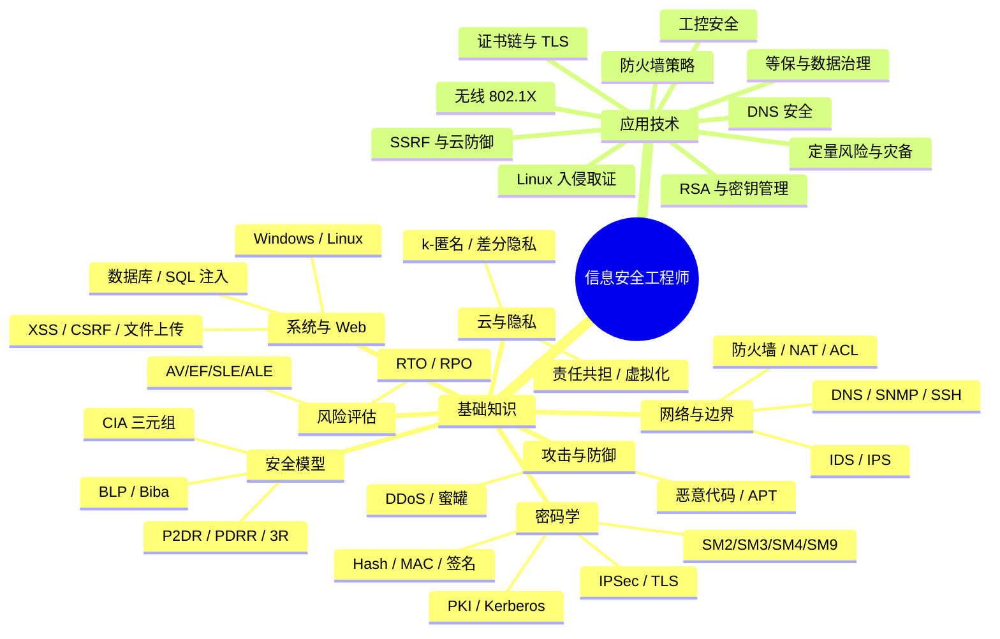

<div align="center">

# 🛡️ 2026 年下半年软考中级《信息安全工程师》<br>考前冲刺考点笔记

**基础知识 70 考点 · 应用技术 42 考点 · 通用答题模板 5 类 · 高频易错速记 60+ 条**


> 📚 **整理说明**：本笔记由《2026 年下半年软考中级〈信息安全工程师〉考前冲刺考点笔记》PDF 重排优化而成，
> 采用「**定义 → 常考场景 → 答题技巧 → 速记口诀**」四段式结构，表格化呈现，适配 GitHub 在线渲染。

</div>

---

## 📑 目录

<details>
<summary><b>点击展开完整目录</b></summary>

- **[总览](#-总览)**
- **[第一部分 · 基础知识](#part1)**
  - [第一章 🏛️ 网络信息安全基础与安全模型](#ch1)（考点 1–7）
  - [第二章 🔐 密码学基础与密码安全技术](#ch2)（考点 8–20）
  - [第三章 🌐 网络访问控制、网络边界与通信安全](#ch3)（考点 21–32）
  - [第四章 ⚔️ 网络攻击、恶意代码及安全防御](#ch4)（考点 33–38）
  - [第五章 🖥️ 操作系统、数据库与 Web 应用安全](#ch5)（考点 39–50）
  - [第六章 ☁️ 云计算、大数据与隐私保护](#ch6)（考点 51–58）
  - [第七章 🏢 物理环境、风险评估与安全管理](#ch7)（考点 59–68）
  - [第八章 🔤 计算机安全英文专业知识](#ch8)（考点 69–70）
- **[第二部分 · 应用技术](#part2)**
  - [第一章 🧮 密码应用、文件保护与密钥管理](#cch1)（案例考点 1–4）
  - [第二章 🐧 Linux 入侵分析、应急响应与数字取证](#cch2)（案例考点 5–8）
  - [第三章 🕸️ Web 安全、SSRF 与云应用纵深防御](#cch3)（案例考点 9–12）
  - [第四章 📋 网络安全等级保护与数据安全治理](#cch4)（案例考点 13–18）
  - [第五章 🏭 工业控制系统与远程运维安全](#cch5)（案例考点 19–23）
  - [第六章 📜 PKI 证书链、双向 TLS 与证书状态验证](#cch6)（案例考点 24–27）
  - [第七章 🔥 防火墙策略设计与安全配置纠错](#cch7)（案例考点 28–30）
  - [第八章 📶 无线网络认证与动态 VLAN 安全](#cch8)（案例考点 31–34）
  - [第九章 📊 定量风险评估与灾难恢复方案选择](#cch9)（案例考点 35–38）
  - [第十章 🌍 DNS 安全、缓存投毒与 DNS 异常行为检测](#cch10)（案例考点 39–42）
- **[第三部分 · 应用技术通用答题模板汇总](#part3)**
- **[第四部分 · 考前高频易错知识速记](#part4)**
- **[🎯 考前最终答题方法](#final)**
- **[🏁 2026 年下半年复习重点](#focus)**

</details>

---

<a id="-总览"></a>

## 🗺️ 总览

### 📊 考点分布

| 部分 | 章节数 | 考点数 | 主要题型 | 重要程度 |
|------|:---:|:---:|------|:---:|
| 第一部分 · 基础知识 | 8 | 70 | 上午选择题 | ⭐⭐⭐ |
| 第二部分 · 应用技术 | 10 | 42 | 下午案例题 | ⭐⭐⭐ |
| 第三部分 · 通用答题模板 | — | 5 类 | 案例通用 | ⭐⭐⭐ |
| 第四部分 · 高频易错速记 | — | 60+ 条 | 选择题抢分 | ⭐⭐ |

### 🧭 知识地图



### 🧠 全篇总口诀

> **泄露看保密，篡改看完整，中断看可用，否认看签名，冒充看认证。**
> **BLP 保密不上读、不下写；Biba 完整下不读、上不写。**
> **AS 发 TGT，TGS 发服务票；CA 管证书，RA 管注册。**
> **RTO 看多久恢复，RPO 看最多丢多久数据。**

---

<a id="part1"></a>

# 📘 第一部分 · 基础知识

> 📌 **考查形式**：上午综合知识选择题。重点使用「**识别题干核心词 → 确定技术目标 → 区分相近概念 → 排除不符选项**」四步法。

---

<a id="ch1"></a>

## 🏛️ 第一章 网络信息安全基础与安全模型

> 🎯 **本章权重**：⭐⭐⭐ ｜ **考点 1–7**

---

#### 考点 1 · 信息安全基本属性 🛡️

> [!NOTE]
> **定义**：信息安全以 **保密性（Confidentiality）**、**完整性（Integrity）**、**可用性（Availability）** 为核心，通常称为 **CIA 三元组**；同时还包括真实性、不可否认性、可控性等属性。

**🎯 常考场景**：数据被非法读取、交易金额遭篡改、业务服务器拒绝服务、签名方否认操作、系统越权访问等。

**✍️ 答题技巧**

| 属性 | 关注点 | 典型措施 |
|------|--------|---------|
| 🔒 **保密性** | 未经授权的读取、泄露和窃听 | 加密、访问控制 |
| 🧩 **完整性** | 数据被修改、删除、插入、伪造与篡改 | 杂凑校验、消息认证码、数字签名 |
| ⚡ **可用性** | 服务中断、资源耗尽和系统故障 | 冗余、容灾、负载均衡、抗 DDoS |
| ✍️ **不可否认性** | 行为参与方事后否认操作 | 数字签名、可信证据 |
| 🪪 **真实性** | 通信对象或数据来源是否真实 | 身份认证、数字证书 |

> [!TIP]
> **速记口诀**：**泄露看保密，篡改看完整，中断看可用，否认看签名，冒充看认证。**

---

#### 考点 2 · P2DR、PDRR 与 3R 安全模型 🔄

> [!NOTE]
> **定义**：三类动态安全模型，分别强调「策略驱动」「防护—检测—响应—恢复闭环」「抵御—识别—恢复能力」。

| 模型 | 核心组成 | 主要特征 |
|------|---------|---------|
| **P2DR** | Policy、Protection、Detection、Response | 以安全策略为核心，组织防护、检测和响应 |
| **PDRR** | Protection、Detection、Response、Recovery | 突出防护、检测、响应和恢复 |
| **3R** | Resistance、Recognition、Recovery | 强调抵御攻击、识别入侵与恢复能力 |

**🎯 常考场景**：构建动态安全保障体系、确定统一安全策略、设计入侵检测与响应机制、建设具有抗毁能力的业务系统。

**✍️ 答题技巧**

- 出现「**安全策略作为核心**」「统一策略驱动各机制」→ 优先识别 **P2DR**
- 出现「**防护—检测—响应—恢复**」完整循环 → 识别 **PDRR**
- 出现「**抵御、识别、恢复**」三种能力 → 识别 **3R**

> [!WARNING]
> **高频易错**：3R 中的 **Recognition 是「识别」，不是 Response「响应」**。

---

#### 考点 3 · Bell-LaPadula 与 Biba 安全模型 📐

> [!NOTE]
> **定义**：**Bell-LaPadula 模型**以保护信息**保密性**为目标；**Biba 模型**以保护信息**完整性**为目标。

| 模型 | 读取规则 | 写入规则 |
|------|---------|---------|
| **Bell-LaPadula** | 不可向上读 | 不可向下写 |
| **Biba** | 不可向下读 | 不可向上写 |

**🎯 常考场景**：涉密信息系统的多级安全访问、高低安全级别的数据流动、不同完整性级别主体对客体的读写授权。

**✍️ 答题技巧**：首先确定**保护目标**，再比较**主体与客体级别**，最后分别判断读和写。不要将两个模型的规则混淆。

> [!TIP]
> **速记口诀**：**BLP 保密「不上读、不下写」；Biba 完整「下不读、上不写」。**

---

#### 考点 4 · DAC、MAC、RBAC 与 ABAC 🔑

> [!NOTE]
> **定义**：
> - **DAC**（自主访问控制）由资源所有者决定客体的访问权限；
> - **MAC**（强制访问控制）依据统一安全标记和安全策略实施控制；
> - **RBAC**（基于角色的访问控制）通过用户、角色和权限的关联完成授权；
> - **ABAC**（基于属性的访问控制）根据主体、资源、操作和环境属性综合决策。

**🎯 常考场景**：文件所有者自主共享权限、涉密文件强制分级管理、部门岗位授权、基于访问时间和终端状态进行动态授权。

**✍️ 答题技巧**

| 场景关键词 | 选型 |
|-----------|------|
| 所有者自主授权 | **DAC** |
| 统一安全标签及强制策略 | **MAC** |
| 按岗位职责赋予角色 | **RBAC** |
| 同时考虑身份、部门、资源等级、时间、设备状态等多类属性 | **ABAC** |

> [!IMPORTANT]
> **RBAC 两种职责分离**（必考）：
> - **静态职责分离**：同一用户**不能同时获得**相互冲突的角色；
> - **动态职责分离**：**允许拥有**相关角色，但限制在同一会话或特定业务过程中**同时激活**冲突角色。

---

#### 考点 5 · 访问控制参考模型与三权分立 ⚖️

> [!NOTE]
> **定义**：访问控制参考模型通常包括**访问控制执行功能**、**决策功能**及保存授权关系的**授权信息**。主体、客体、访问操作构成访问控制关系，**访问控制矩阵**用于描述主体对客体的权限。
> **三权分立**的安全管理机制强调**系统管理员、安全管理员和审计管理员**之间相互制约。

**🎯 常考场景**：动态授权决策、访问矩阵查询、系统管理员尝试删除自身操作记录、关键权限集中于单一管理账户。

**✍️ 答题技巧**

- 判断访问权限时区分「**授权信息保存**」「**访问决策**」「**执行拦截**」三种功能；
- 判断三权分立时，检查管理员是否能够**同时**修改安全策略、配置业务系统并删除自己的审计记录。

> [!TIP]
> **答题模板**：应按照**职责分离**和**最小权限**原则设置独立的管理角色，分别授予系统运行维护、安全策略管理及审计查看权限，**禁止单一账户控制全部关键环节**。

---

#### 考点 6 · MITRE ATT&CK、Kill Chain 与攻击树 🌳

> [!NOTE]
> **定义**：
> - **MITRE ATT&CK**：以实际攻击行为为基础建立的攻击战术和技术知识框架；
> - **Kill Chain**：用于描述网络攻击的阶段性过程；
> - **攻击树**：以攻击目标为根节点，通过 AND、OR 关系描述实现目标所需的攻击条件。

**🎯 常考场景**：钓鱼攻击、凭据窃取、权限提升、持久化、横向移动、数据外泄、恶意载荷制作及复杂攻击条件分析。

**✍️ 答题技巧**

- ATT&CK 重点识别战术：**初始访问 → 执行 → 持久化 → 特权提升 → 防御规避 → 凭据访问 → 发现 → 横向移动 → 命令与控制 → 数据外泄**
- Kill Chain 典型阶段：
  > **侦察 → 武器化 → 投递 → 漏洞利用 → 安装 → 命令与控制 → 达成目标**
- 「漏洞利用代码 + 恶意程序 + 诱饵文件形成攻击载荷」属于**武器化**；将攻击载荷发送给受害者属于**投递**。
- 攻击树中：**AND 节点**要求多个子条件**全部成立**；**OR 节点**只要求**至少一个**子条件成立。

---

#### 考点 7 · 网络安全生命周期与 PDCA 管理 ♻️

> [!NOTE]
> **定义**：信息系统安全生命周期覆盖**需求分析、规划设计、实施部署、运行维护及退役处置**。PDCA 循环包括**计划（Plan）、实施（Do）、检查（Check）、改进（Act）**。

**🎯 常考场景**：安全需求形成、安全架构设计、设备部署、安全检测、运行审计、整改优化和系统退役。

**✍️ 答题技巧**

| 阶段 | 回答的核心问题 |
|------|--------------|
| 需求分析 | 需要保护什么、达到什么安全目标 |
| 设计 | 采用哪些控制措施及安全架构 |
| 实施 | 怎样部署和验证 |
| 运行 | 如何监测、审计、维护和响应 |
| 退役 | 如何清除数据、密钥和残留信息 |

> [!TIP]
> **PDCA 速记**：发现问题属于 **Check**，采取纠正和持续改进措施属于 **Act**。

---

<a id="ch2"></a>

## 🔐 第二章 密码学基础与密码安全技术

> 🎯 **本章权重**：⭐⭐⭐（**必考、分值最高**）｜ **考点 8–20**

---

#### 考点 8 · 对称密码、非对称密码与国产商用密码算法 🧬

> [!NOTE]
> **定义**：**对称密码**使用相同的秘密密钥进行加解密，处理效率较高；**非对称密码**使用公钥与私钥构成密钥对，可用于密钥保护、签名及身份认证等应用。

**🎯 常考场景**：大文件加密、数字证书、数字信封、电子签名、报文摘要及商用密码系统设计。

| 算法 | 分类 | 核心用途 |
|------|------|---------|
| **SM2** | 椭圆曲线公钥密码 | 公钥加密、数字签名、密钥交换 |
| **SM3** | 密码杂凑算法 | 生成 **256 位**摘要 |
| **SM4** | 对称分组密码 | 数据加密，**128 位**密钥和 **128 位**分组 |
| **SM9** | 标识密码 | 基于身份标识的密码应用 |
| **RSA** | 公钥密码 | 加密、密钥封装及签名等 |
| **DES** | 对称分组密码 | **64 位**分组、**56 位**有效密钥 |

**✍️ 答题技巧**

- 涉及「**128 位分组和密钥**」→ 优先识别 **SM4**
- 涉及「**256 位国产密码摘要**」→ 识别 **SM3**
- 涉及「**身份标识生成公钥、密钥生成中心产生私钥**」→ 识别 **SM9**

> [!WARNING]
> **高频易错**：DES 的 64 位密钥数据中包含 **8 位奇偶校验位**，实际有效密钥长度为 **56 位**；**DES 不适合新建安全系统使用**。

---

#### 考点 9 · 密码杂凑、MAC 与数字签名 ✍️

> [!NOTE]
> **定义**：
> - **密码杂凑函数**将任意长度输入映射为固定长度摘要；
> - **消息认证码（MAC）**使用共享秘密密钥产生认证标签；
> - **数字签名**通常由签名者使用**私钥**生成，并由验证方通过**公钥**验证。

**🎯 常考场景**：文件完整性校验、双方共享密钥的报文认证、合同签署及可验证的电子证据。

**✍️ 答题技巧**

| 技术 | 能提供 | **不能**提供 |
|------|-------|-------------|
| 普通 Hash | 重新计算的摘要与给定值是否一致 | 单独证明摘要来自合法发送者 |
| MAC | 基于共享密钥的**完整性**和**消息来源认证** | 面向共享密钥参与方的**不可否认性** |
| 数字签名 | 消息来源、完整性、**不可否认性** | 需私钥保护、身份绑定和证据可信才成立 |

> [!TIP]
> **速记口诀**：**Hash 看摘要；MAC 看共享密钥认证；签名看私钥生成、公钥验证。**

---

#### 考点 10 · 密码杂凑函数的三种基本安全性质 🧪

> [!NOTE]
> **定义**：
> - **原像抗性**：已知摘要时难以找到对应输入；
> - **第二原像抗性**：已知某一输入时难以找到另一个摘要相同的输入；
> - **抗碰撞性**：难以任意找到两个不同输入具有相同摘要。

**🎯 常考场景**：文件替换攻击、数字签名保护、杂凑值碰撞、证据完整性校验。

**✍️ 答题技巧**

- 题目**已给定某个文件**，要求寻找另一个内容不同但摘要相同的文件 → **第二原像抗性**
- **未预先指定任何文件**，要求构造任意两个不同输入具有相同摘要 → **抗碰撞性**

---

#### 考点 11 · Diffie-Hellman 密钥交换与中间人攻击 🤝

> [!NOTE]
> **定义**：Diffie-Hellman 密钥交换允许双方通过公开通信协商共享秘密，但**基本 DH 协议本身不提供对参与方身份及交换参数来源的认证**。

**🎯 常考场景**：不可信网络中的密钥协商、攻击者替换双方公开参数、建立两条伪造的共享密钥通道。

**✍️ 答题技巧**：看到「**能够协商密钥，但无法确认对端身份**」，应判断存在**中间人攻击**风险。

> [!TIP]
> **答题模板**：应使用**数字证书、数字签名或其他经过认证的密钥交换机制**，将参与方身份与协商参数进行可信绑定，避免攻击者替换交换参数。

---

#### 考点 12 · RSA 密码原理与密钥计算 🧮

> [!NOTE]
> **定义**：RSA 基于**大整数分解问题**构建公钥密码体制。选取两个不同素数 `p、q`，计算模数 `n` 和欧拉函数 `φ(n)`，选取满足条件的公钥指数 `e`，再求解私钥指数 `d`。

**🧮 核心公式**

```
n   = p × q
φ(n) = (p − 1)(q − 1)
e · d ≡ 1 (mod φ(n))
公钥 = (n, e)      私钥 = (n, d)
```

**🎯 常考场景**：已知素数及公钥指数，计算私钥指数；判断公私钥用途；理解数字信封或数字签名。

**✍️ 答题技巧**：首先求 `n` → 再求 `φ(n)` → 验证 `e` 与 `φ(n)` 互素 → 最后使用**扩展欧几里得算法或模逆运算**求 `d`。

> [!WARNING]
> 考试中的**小整数 RSA 计算仅用于理解算法**，实际密码系统应使用符合现行安全要求的密钥长度和经过验证的填充机制。

---

#### 考点 13 · 数字信封与混合加密 📨

> [!NOTE]
> **定义**：数字信封结合**对称密码的高效率**和**公钥密码便于密钥分发**的优势。通常使用随机生成的对称会话密钥加密数据，再使用接收方公钥保护该会话密钥。

**🎯 常考场景**：机密文件交换、大文件安全传输、跨组织密钥分发。

**🔁 处理流程**

| 角色 | 步骤 |
|------|------|
| **发送方** | 随机生成会话密钥 → 对称加密文件 → 使用**接收方公钥**保护会话密钥 → 发送密文与受保护的会话密钥 |
| **接收方** | 使用**自身私钥**恢复会话密钥 → 使用会话密钥解密文件 |

> [!TIP]
> **速记口诀**：**加密给谁看，就用谁的公钥保护密钥；签名由谁产生，就用谁的私钥签名。**

---

#### 考点 14 · 门限密码与共享密钥数量 🔑

> [!NOTE]
> **定义**：门限密码将秘密或密码操作能力分散给多个参与节点，**达到规定门限后**才能完成指定操作。

**🎯 常考场景**：CA 核心密钥分散保护、多个管理员共同授权、密钥容错存储及分布式签名。

**✍️ 答题技巧**：对于标准的 `(t, n)` 门限秘密共享机制，**至少需要 t 个有效份额**才能恢复秘密；**少于 t 个份额不足以恢复秘密**。

> [!IMPORTANT]
> **注意**：具体**门限签名方案不一定需要重构完整私钥**。

**🧮 共享密钥数量计算**

```
原有 n 个节点两两共享密钥总数：N = C(n,2) = n(n − 1) / 2
新增 m 个节点需要新增：Δ = C(n+m,2) − C(n,2) = m(m − 1) / 2 + m · n
（其中 n 为原有节点数）
```

---

#### 考点 15 · 身份认证机制、挑战应答与双因素认证 🪪

> [!NOTE]
> **定义**：身份认证通过**知识因素、持有因素及生物特征**等验证主体身份。**挑战应答机制**利用每次变化的随机数或其他新鲜性参数抵御简单重放攻击。

**🎯 常考场景**：动态令牌登录、账户口令与 OTP 组合、远程登录挑战应答、生物识别认证。

**✍️ 答题技巧**

- **双因素认证必须来自不同的因素类别**：口令属于**知识因素**，独立令牌属于**持有因素**；**两组口令通常仍属同一类别**，不能仅凭数量判断构成双因素。
- 挑战应答的核心是**挑战值具有随机性和新鲜性**，响应与合法主体持有的秘密相关，避免重用旧认证结果。
- 生物识别采用「**匹配分值越高越相似**」的阈值判定时，**提高阈值会降低误接受率 FAR，同时提高误拒绝率 FRR**。

---

#### 考点 16 · Kerberos 统一身份认证 🎫

> [!NOTE]
> **定义**：Kerberos 是**基于票据**的网络身份认证协议，核心组件包括认证服务器 **AS**、票据授予服务器 **TGS** 及业务服务端。

**🎯 常考场景**：企业统一身份认证、用户访问多个内部业务服务器、身份认证过程中的票据获取和使用。

**🔁 典型流程**

```
客户端向 AS 认证并获取 TGT
   → 携带 TGT 向 TGS 申请目标服务票据
   → 向目标业务服务器提交服务票据和必要的认证信息
   → 建立授权服务访问
```

> [!TIP]
> **速记口诀**：**AS 发 TGT，TGS 发服务票据，业务服务器校验服务票据。**
> **TGT 不能直接当作所有业务服务的访问票据使用。**

---

#### 考点 17 · PKI、数字证书与证书撤销机制 📜

> [!NOTE]
> **定义**：PKI 通过 **CA、数字证书、信任锚、证书链和撤销状态服务**建立可信公钥体系。

**🎯 常考场景**：TLS 网站认证、客户端证书认证、中间 CA 签发证书、证书过期与吊销验证。

**✍️ 答题技巧**：验证证书时重点检查 —— **签名与证书链、信任锚、有效期、证书主体名称、KeyUsage、EKU 及撤销状态**。

| 机制 | 说明 |
|------|------|
| **CRL** | 证书**撤销列表** |
| **OCSP** | 用于**查询指定证书的状态**，可提供较及时的撤销状态信息（具体及时性仍取决于服务端及缓存策略） |

> [!WARNING]
> **证书链完整 ≠ 证书一定有效**，还必须满足**名称、用途、有效期和撤销**要求。

---

#### 考点 18 · TLS 握手与身份验证 🔗

> [!NOTE]
> **定义**：TLS 为网络通信提供**机密性、完整性及对端认证**能力。TLS 1.2 采用经协商的密码套件完成密钥交换与安全连接建立。

**🎯 常考场景**：HTTPS 通信、临时密钥协商参数签名、服务器身份认证和客户端证书验证。

**✍️ 答题技巧**：TLS 1.2 中采用**临时密钥交换**时，`ServerKeyExchange` 可携带协商参数及服务器对相关参数的**签名**，用于帮助客户端验证这些参数的**来源真实性**。

> [!WARNING]
> **高频易错**：不能将「**服务器对临时参数签名**」误认为「**向客户端传输服务器私钥**」。

---

#### 考点 19 · IPSec、AH、ESP 与 NAT 穿越 🛰️

> [!NOTE]
> **定义**：IPSec 在**网络层**提供安全保护。**AH** 主要提供**完整性与来源认证**；**ESP** 可提供**数据加密和完整性保护**。IPSec 支持**传输模式**与**隧道模式**。

**🎯 常考场景**：总部与分支站点 VPN、经过 NAT 设备的加密通信、ESP 隧道报文封装结构分析。

**✍️ 答题技巧**

- ESP **隧道模式**下，**原始 IP 报文**作为受保护的**内部负载**，**新 IP 首部**用于隧道端点之间的路由转发。
- 经过 NAT 设备时，常结合 **NAT-T**，通过 **UDP 封装 ESP 报文**实现穿越。

> [!TIP]
> **速记口诀**：**原始 IP 报文受 ESP 隧道保护，新 IP 首部承担外层路由；需要加密和 NAT 穿越时重点考虑 ESP 与 NAT-T。**

---

#### 考点 20 · 密码密钥全生命周期安全 🗝️

> [!NOTE]
> **定义**：密钥管理包括**生成、分发、存储、使用、轮换、撤销、备份、恢复、销毁及审计**。

**🎯 常考场景**：多租户长期共用密钥、私钥明文存储、固定初始化向量、密钥到期后备份副本未清除。

**✍️ 答题技巧**

- 随机密钥应具有**足够熵和不可预测性**；
- 密钥存储应受**加密及权限保护**；
- 密钥分发应防止**泄露和替换**；
- 应按照**风险和策略定期轮换**；
- 撤销或到期后应处理**所有授权副本**。

> [!WARNING]
> **CBC 模式**使用的初始化向量应符合**随机性和不可预测性**等安全要求，**不能在相同密钥下长期重复使用固定 IV**。

> [!TIP]
> **答题模板**：根据密钥的敏感性和使用范围实行**分级管理**，对不同租户或用途使用**隔离密钥**，使用受保护的 **KMS/HSM** 等密钥管理设施，实施授权访问、轮换、撤销、备份副本清理及全流程审计。

---

<a id="ch3"></a>

## 🌐 第三章 网络访问控制、网络边界与通信安全

> 🎯 **本章权重**：⭐⭐⭐ ｜ **考点 21–32**

---

#### 考点 21 · 防火墙基本类型及其工作机制 🧱

> [!NOTE]
> **定义**：防火墙通过访问控制规则限制不同网络之间的通信。常见技术包括**静态包过滤、状态检测、应用代理及下一代防火墙**等。

**🎯 常考场景**：企业互联网边界、DMZ 安全区、数据库隔离、HTTP 及 FTP 应用协议审计。

| 类型 | 工作机制 |
|------|---------|
| **静态包过滤** | 主要依据**地址、协议、端口**等报文头信息判断 |
| **状态检测** | 能够**维护连接状态**并识别合法会话的返回报文 |
| **应用代理** | **终止客户端连接**并重新建立到服务端的连接，分析**应用层协议和命令** |

**✍️ 答题技巧**

- 「外部客户端**不能与内部服务器直接建立端到端连接**，且需要**应用层命令审计**」→ 优先 **应用代理**
- 「**自动识别已建立连接的返回流量**」→ 优先 **状态检测防火墙**

---

#### 考点 22 · 安全区域划分与最小权限原则 🗺️

> [!NOTE]
> **定义**：按**资产重要性、业务功能和安全需求**划分不同安全区域，在边界上采用访问控制策略，只允许经过授权的必要业务通信。

**🎯 常考场景**：Internet、DMZ、办公区、业务区、数据库区、生产区及运维管理区之间的通信控制。

**✍️ 答题技巧**：策略应同时明确 —— **源区域、源地址、目的区域、目的地址、协议、端口、动作**。

- 外部网络**原则上不应直接进入核心业务区**；
- **DMZ 不能默认访问内部全部服务器**；
- 管理区应对**运维目标、协议、账户和操作时间**实施限制。

> [!TIP]
> **答题模板**：对不同安全区域实施逻辑或物理隔离，仅开放业务必需的源地址、目的地址及服务端口；对其他未明确授权的新建连接实行**默认拒绝**，并记录关键访问行为。

---

#### 考点 23 · 防火墙策略匹配、顺序及旁路阻断 🚦

> [!NOTE]
> **定义**：按顺序匹配的防火墙策略通常执行**首条命中**的规则。旁路部署的检测设备**不直接串联**在转发链路中，可通过发送 **TCP RST** 等方式尝试中断恶意连接。

**🎯 常考场景**：访问规则冲突、临时宽泛放行策略、入侵防御设备的串联与旁路部署比较。

**✍️ 答题技巧**

1. 先看**策略顺序**，再看**源与目的方向**，最后检查**服务范围**；
2. 过宽的放行规则可能使后续细粒度规则**失去实际作用**。

> [!WARNING]
> **旁路阻断 ≠ 串联 IPS**，通常**不能保证阻断所有攻击流量**；其优点是降低对原有转发路径的直接影响。

---

#### 考点 24 · NAT、PAT 和源/目的地址转换 🔀

> [!NOTE]
> **定义**：**SNAT** 修改报文**源地址**，常用于内网访问外网；**DNAT** 修改**目的地址**，常用于公网服务发布；**PAT** 通过端口映射使多个内部连接共享公网地址。

**🎯 常考场景**：公网 HTTPS 服务映射到内网服务器、私网主机访问互联网、单公网 IP 承载多个内部连接。

**✍️ 答题技巧**

| 场景 | 技术 |
|------|------|
| 外部访问公网地址，实际到达内部服务器 | **DNAT** |
| 内部主机访问互联网时将源地址转换为公网地址 | **SNAT** |
| 多个内部连接共享一个公网 IP，通过端口区分 | **PAT** |

> [!WARNING]
> 策略匹配发生在 NAT 之前还是之后**取决于设备与配置**，必须以具体场景为准，**不能机械套用统一顺序**。

---

#### 考点 25 · IPv4 子网、通配符掩码与 ACL 计算 🧮

> [!NOTE]
> **定义**：子网掩码用于划分**网络位与主机位**；ACL **通配符掩码**中的 **0 表示对应位必须匹配，1 表示对应位可以变化**。

**🎯 常考场景**：安全区域地址范围识别、ACL 规则编写、广播地址及可用地址范围计算。

**🧮 核心公式**

```
主机地址总数   = 2^(32 − p)        其中 p 为 IPv4 前缀长度
普通子网可用主机地址数 = 2^(32 − p) − 2
通配符掩码 = 子网掩码按位取反
```

> 📌 **示例**：`/27` 对应子网掩码 `255.255.255.224`，通配符掩码 `0.0.0.31`，每个子网包含 **32** 个 IPv4 地址，常规可用主机地址数为 **30**。

**🧭 计算模板**：确定前缀 → 计算地址块大小 → 找到网络地址 → 计算广播地址 → 确定可用主机范围 → 求通配符掩码。

---

#### 考点 26 · ARP 欺骗、MAC 泛洪及二层交换安全 🔌

> [!NOTE]
> **定义**：**ARP 欺骗**通过伪造 IP 与 MAC 地址的对应关系误导主机；**MAC 泛洪**通过大量伪造源 MAC 占满交换机的地址学习表，可能导致**未知单播泛洪**。

**🎯 常考场景**：网关 ARP 映射遭篡改、局域网中间人攻击、接入端口持续学习大量 MAC 地址。

**✍️ 答题技巧**

- 少量固定关键设备之间的 ARP 关系保护 → 采用**静态 ARP 绑定**
- 大规模二层网络 → 综合使用 **DHCP Snooping、动态 ARP 检测**等机制
- MAC 泛洪的针对性措施 → **端口安全**（限制端口学习 MAC 地址的数量及允许的地址范围，设置违规处置策略）

---

#### 考点 27 · 网络设备及路由协议安全 🛰️

> [!NOTE]
> **定义**：路由与交换设备的**管理协议、路由控制协议及可选转发功能**可能形成攻击入口。

**🎯 常考场景**：IP 源路由绕过正常选路、伪造路由更新、网络设备日志遭删除、非法管理访问。

**✍️ 答题技巧**

- **IP 源路由**允许发送方影响路由路径，**不需要时应关闭**；
- 路由协议支持认证时，应启用**路由邻居及更新报文认证**；
- 管理接口应限制可信来源，优先使用 **SSH** 等安全管理协议。

> [!IMPORTANT]
> **重要操作日志应集中发送至独立的远程日志服务器**，避免本地设备失陷后全部记录被清除。

---

#### 考点 28 · DNS 安全与 DNSSEC 🌍

> [!NOTE]
> **定义**：DNS 负责域名解析，其安全风险包括**缓存投毒、响应伪造、开放递归及反射放大攻击**。**DNSSEC** 使用数字签名等机制验证 DNS 资源记录的**来源真实性和完整性**。

**🎯 常考场景**：域名解析被重定向到恶意地址、攻击者伪造 DNS 响应、递归服务器缓存被污染。

**✍️ 答题技巧**

- **区分 DNSSEC 与传输加密**：DNSSEC 重点解决 **DNS 数据真实性和完整性**问题，**本身不提供 DNS 查询内容的保密性**。
- 判断缓存投毒时重点检查：**事务 ID、源 IP、源端口、目的端口、查询名称及类型、响应来源、DNSSEC 验证**等信息。

---

#### 考点 29 · SNMPv3、TACACS+ 与安全网络管理 📡

> [!NOTE]
> **定义**：**SNMPv3** 支持认证和加密；**TACACS+ 及 RADIUS** 用于集中认证、授权及计费或审计相关管理。

**🎯 常考场景**：交换机远程管理、网络设备集中 AAA、管理通信保密与完整性保护。

| SNMPv3 安全级别 | 说明 |
|----------------|------|
| **authPriv** | 同时提供**认证、完整性及隐私保护** |
| **authNoPriv** | 有认证但**不加密**管理数据 |
| **noAuthNoPriv** | **不提供**认证或隐私保护 |

**✍️ 答题技巧**

- **TACACS+** 强调**认证、授权、审计功能的分离管理**，并对主要协议载荷提供**加密保护**；
- **RADIUS** 广泛用于**网络接入认证**，典型场景包括 **802.1X 与无线认证**。

---

#### 考点 30 · SSH 服务器身份验证 🖥️

> [!NOTE]
> **定义**：SSH 通过**加密通道与主机密钥认证**保护远程管理通信。客户端通常保存**已验证的服务器主机密钥信息**。

**🎯 常考场景**：SSH 重新连接时出现主机密钥变更告警、服务器被冒充、中间人攻击。

> [!IMPORTANT]
> **答题技巧**：主机密钥意外变化时，应通过**独立可信渠道**核验是否发生合法更换。**在未完成核验前，不应直接忽略告警并接受新密钥。**

---

#### 考点 31 · 网络入侵检测与入侵防御 🚨

> [!NOTE]
> **定义**：**IDS** 负责发现并报告可疑行为；**IPS** 具备**主动阻断**攻击的能力。按监测位置可划分为 **NIDS** 和 **HIDS**，按检测方法可划分为**特征检测**与**异常检测**。

**🎯 常考场景**：检测服务器账户新增、异常进程、未知攻击、恶意网络连接和加密通信下的入侵行为。

| 维度 | 类型 | 适用 |
|------|------|------|
| 监测位置 | **HIDS** | 主机文件、进程、系统调用、账户和本地日志 |
| 监测位置 | **NIDS** | 网络流量分析 |
| 检测方法 | **特征检测** | 已知攻击 |
| 检测方法 | **异常检测** | 偏离正常行为基线的可疑活动（需关注误报） |

> [!TIP]
> 网络流量被加密且设备无法解密时，若主要目标是**识别主机内部异常**，应优先考虑**主机侧检测（HIDS）**。

---

#### 考点 32 · Snort 规则与网络流量分析 🔍

> [!NOTE]
> **定义**：Snort 通过规则匹配网络报文。规则通常包含**动作、协议、地址、端口及可选的检测条件**。

**🎯 常考场景**：TCP SYN 探测检测、恶意连接识别、TCP 标志位判断、网络报文分析。

**✍️ 答题技巧**

- 判断 TCP **首次连接请求**时，重点关注 **SYN 标志位**；在 Snort 规则中可以使用 `flags` 选项匹配指定 TCP 标志。
- 使用抓包结果分析通信时，依次判断：**源与目的地址 → 协议 → 端口 → TCP 标志 → 应用层请求及响应 → 还原通信方向和连接状态**。

> [!WARNING]
> **NetFlow 类流记录**通常只提供通信双方、端口、协议、流量、时间等**元数据**，**不能直接替代完整报文载荷分析**。

---

<a id="ch4"></a>

## ⚔️ 第四章 网络攻击、恶意代码及安全防御

> 🎯 **本章权重**：⭐⭐⭐ ｜ **考点 33–38**

---

#### 考点 33 · 恶意代码分类与传播特征 🦠

> [!NOTE]
> **定义**：恶意代码包括**病毒、蠕虫、木马、Rootkit、逻辑炸弹、僵尸网络控制程序**等。

**🎯 常考场景**：自动网络传播、伪装合法软件、隐藏恶意进程、设置定时触发条件、集中控制感染终端。

| 类型 | 识别关键词 |
|------|-----------|
| **病毒** | 感染宿主文件或其他对象，**依附传播** |
| **蠕虫** | **自我复制**，能够通过网络**自主传播** |
| **木马** | **伪装合法用途**，诱导执行恶意功能 |
| **Rootkit** | **隐藏**进程、文件、连接并维持权限 |
| **逻辑炸弹** | 满足**预设时间或条件**后触发恶意操作 |
| **僵尸网络** | 多台受控主机接受**统一指令** |
| **多态恶意代码** | 自动**改变代码表现形式**以规避固定特征匹配 |

> [!TIP]
> **速记口诀**：**自传播看蠕虫；感染文件看病毒；伪装诱导看木马；隐藏痕迹看 Rootkit；条件触发看逻辑炸弹；批量远控看僵尸网络。**

---

#### 考点 34 · APT 攻击与安全运营防御 🎯

> [!NOTE]
> **定义**：APT 是具有较强**持续性、针对性和隐蔽性**的复杂攻击活动，通常包含**初始访问、权限获取、持久化、横向移动及数据窃取**等多个阶段。

**🎯 常考场景**：定向钓鱼邮件、长期潜伏、恶意回连、异常账户创建和跨服务器入侵。

**✍️ 答题技巧**：识别 APT 时，**不应仅根据一种恶意程序判断**，而要结合**攻击目标、持续时间、技术链条及多种证据**。

> [!TIP]
> **答题模板**：从**初始访问 → 恶意执行 → 权限提升 → 持续驻留 → 横向移动 → 命令与控制 → 目标达成**等阶段建立**攻击时间线**，结合终端日志、流量、进程及主机完整性信息实施**关联分析**。

---

#### 考点 35 · DDoS、Smurf 及流量放大攻击 🌊

> [!NOTE]
> **定义**：**DDoS** 通过大量分布式请求或流量消耗目标网络、系统及应用资源。**Smurf 攻击**利用**源 IP 伪造和 ICMP 定向广播**产生反射放大流量。

**🎯 常考场景**：带宽耗尽、业务不可访问、伪造源地址引发大量应答、DNS 反射放大。

**✍️ 答题技巧**：区分攻击目标是**本地计算资源**还是**互联网接入链路**。

> [!IMPORTANT]
> 当攻击流量**超过企业接入带宽**时，仅在本地防火墙丢弃报文**无法消除上游链路拥塞**，应采用**运营商侧流量清洗或其他上游抗 DDoS 措施**。

Smurf 攻击的防护重点：**禁止不必要的 IP 定向广播、源地址反欺骗（uRPF）、流量异常监测**。

---

#### 考点 36 · 蜜罐、可信计算与主动防御 🍯

> [!NOTE]
> **定义**：**蜜罐**通过伪装服务吸引攻击者并收集攻击行为。**可信计算**利用**可信根、度量及验证机制**建立和判断系统的可信状态。

**🎯 常考场景**：主动收集恶意代码和攻击特征、关键服务器可信启动、远程可信状态验证。

**✍️ 答题技巧**

- 「**伪造业务环境吸引攻击者并记录行为**」→ **蜜罐**
- 「**启动链关键组件度量并验证可信状态**」→ **可信启动或远程证明**

> [!WARNING]
> **远程证明**可用于验证关键组件度量值是否符合预期，但**不能将其简单等同于对系统不存在任何漏洞的保证**。

---

#### 考点 37 · 应用程序白名单与虚拟补丁 🩹

> [!NOTE]
> **定义**：**应用白名单**依据允许执行的程序清单控制软件运行；**虚拟补丁**利用 WAF、IPS 等安全设备识别和阻断特定漏洞利用行为，以降低正式修复前的暴露风险。

**🎯 常考场景**：工控终端固定程序执行、已知漏洞暂时无法升级、安全设备临时阻断利用流量。

| 场景 | 措施 |
|------|------|
| 固定用途终端需要**默认拒绝未知程序执行** | **应用白名单** |
| 应用代码**短期无法修复**但需要阻断已知漏洞攻击 | **虚拟补丁** |

> [!WARNING]
> 虚拟补丁属于**临时或补充性措施**，**不能替代最终的代码修复和组件升级**。

---

#### 考点 38 · 网络嗅探与混杂模式 👃

> [!NOTE]
> **定义**：网络嗅探工具捕获并分析网络数据帧。网卡的**混杂模式**使其能够向协议栈交付更多非本机目的 MAC 的数据帧，具体可见流量仍受**交换网络及镜像配置**等因素限制。

**🎯 常考场景**：UNIX 主机疑似运行嗅探程序、被控主机网卡配置异常。

> [!IMPORTANT]
> **答题技巧**：混杂模式是发现嗅探风险的**可疑线索**，但**并不是认定系统被入侵的充分证据**，应结合**进程、套接字、抓包工具及主机日志**共同判断。

---

<a id="ch5"></a>

## 🖥️ 第五章 操作系统、数据库与 Web 应用安全

> 🎯 **本章权重**：⭐⭐⭐ ｜ **考点 39–50**

---

#### 考点 39 · Windows 安全机制 🪟

> [!NOTE]
> **定义**：Windows 利用**访问令牌、安全描述符、访问控制列表及审计策略**实施访问控制。**EFS** 可为 NTFS 文件提供**文件级加密**保护。

**🎯 常考场景**：用户进程访问文件、目录操作审计、敏感文件加密及账户权限管理。

| 概念 | 作用 |
|------|------|
| **访问令牌** | 包含用户及其安全组标识、权限和特权等信息 |
| **DACL** | 用于决定**是否允许访问** |
| **SACL** | 用于规定**需要审计**的访问操作及结果 |
| **EFS** | NTFS **文件级加密** |

**✍️ 答题技巧**

- 场景强调记录「**成功或失败的删除操作**」→ 重点考虑 **SACL** 及相应审计策略
- 场景强调「**不对整个磁盘加密，仅保护部分 NTFS 文件**」→ 优先识别 **EFS**

---

#### 考点 40 · Linux 文件权限、PAM 与 SELinux 🐧

> [!NOTE]
> **定义**：Linux 传统权限以**属主、属组、其他用户**三类主体及**读、写、执行**权限控制文件访问。**PAM** 提供可插拔认证框架；**SELinux** 通过**安全上下文和策略**实施强制访问控制。

**🎯 常考场景**：权限数字计算、用户所属组判断、登录认证扩展及文件已具备 rwx 权限仍被拒绝访问。

**✍️ 答题技巧**

- **读 r = 4，写 w = 2，执行 x = 1**，每一组权限值分别计算后组合。例如 `750` 表示属主 `rwx`、属组 `r-x`、其他用户无权限。
- **目录**的读取权限主要涉及**列出目录项**；执行权限涉及**目录遍历和访问已知名称的目录项**。
- 删除目录内文件通常由**父目录的相关权限**控制，不能仅看被删除文件自身的写权限。
- PAM 对应**统一认证模块接入**；传统 DAC 权限允许但**安全上下文不满足而拒绝访问**时，重点考虑 **SELinux** 等 MAC 机制。

---

#### 考点 41 · 账户安全、特权管理与可信路径 👤

> [!NOTE]
> **定义**：**最小权限**限制账户仅执行必要操作；**特权管理**要求高权限操作受到严格控制；**可信路径**提供不易被普通应用伪造的安全交互通道。

**🎯 常考场景**：服务账户获得交互式登录能力、免密 sudo 权限、伪造登录界面、管理员操作无法追溯。

**✍️ 答题技巧**

- 特权服务账户**不应默认具有远程交互式登录权限**；sudoers 中的高风险授权应**限制命令和使用范围**。
- 出现「**普通程序不能伪造的安全登录入口**」→ 识别**可信路径**机制。

---

#### 考点 42 · 数据库最小权限与危险功能 🗄️

> [!NOTE]
> **定义**：数据库应按照业务需要授予账户**最小的对象权限与操作权限**，**禁止不必要的系统级危险能力**。

**🎯 常考场景**：应用账户只需读取和插入数据、SQL Server 执行操作系统命令、MySQL 客户端本地文件读取风险。

**✍️ 答题技巧**

| 场景 | 正确做法 |
|------|---------|
| 业务账户只需查询和新增 | 授予指定表的 **SELECT** 和 **INSERT**，不授予管理员角色或 `ALL PRIVILEGES` |
| SQL Server 不需要调用操作系统命令 | 禁用非必要的 **xp_cmdshell** 等高风险功能 |
| MySQL 不需要客户端本地文件加载 | 限制 **LOAD DATA LOCAL INFILE** 相关能力，并控制客户端和服务器配置 |

---

#### 考点 43 · 数据库审计方式 📊

> [!NOTE]
> **定义**：数据库审计可采用**网络流量采集、主机代理及数据库自身审计**等方式。

**🎯 常考场景**：远程 SQL 访问记录、本地管理员操作审计、加密数据库流量分析。

| 方式 | 优势 | 局限 |
|------|------|------|
| **网络旁路审计** | 对业务无侵入 | 对**服务器本地操作**及**无法解密的通信**存在可见性限制 |
| **主机代理审计** | 覆盖更多**主机侧行为** | 可能增加**性能和稳定性**负担 |

**✍️ 答题技巧**：选择审计方式时应同时考虑**审计范围、加密通信、部署位置、性能开销及证据完整性**。

---

#### 考点 44 · SQL 注入漏洞 💉

> [!NOTE]
> **定义**：SQL 注入是应用程序将**未经恰当处理的不可信输入**作为 SQL 语句结构的一部分，导致攻击者能够**改变原定数据库查询或操作逻辑**。

**🎯 常考场景**：用户参数直接拼接 SQL、动态查询条件构造、应用账户权限过大。

**✍️ 答题技巧**

- **根本修复措施**：使用**参数化查询或预编译语句**，使数据与 SQL 代码结构分离；同时配合输入约束、数据库最小权限、安全审计等措施。

> [!WARNING]
> **仅修改数据库监听端口、隐藏错误信息或过滤几个特殊字符，不能从根本上解决 SQL 注入问题。**

---

#### 考点 45 · 跨站脚本与跨站请求伪造 🕷️

> [!NOTE]
> **定义**：
> - **XSS** 通过将恶意脚本引入受信任网站的页面，使脚本在**用户浏览器中执行**；
> - **CSRF** 利用用户**已有的认证状态**诱导浏览器发出未经用户真实意愿授权的操作请求。

**🎯 常考场景**：评论内容保存后触发脚本、恶意网页诱导已登录用户修改账户信息。

| 漏洞 | 重要特征 | 重点防护 |
|------|---------|---------|
| **存储型 XSS** | 恶意输入被**保存**并在其他用户访问页面时执行 | 上下文相关**输出编码**、可信 HTML 净化、**内容安全策略（CSP）** |
| **CSRF** | **借用已登录用户的有效会话**发送请求，未必需要向受害网站注入脚本 | **防伪令牌（Token）**、**SameSite Cookie**、**Origin/Referer 校验**、高风险操作重新验证身份 |

---

#### 考点 46 · 文件上传与目录遍历漏洞 📁

> [!NOTE]
> **定义**：不安全文件上传可能导致恶意脚本被服务器**解析执行**；目录遍历通过构造特殊路径**绕过预期目录限制**，访问未授权文件。

**🎯 常考场景**：图片上传绕过扩展名限制、上传目录允许执行脚本、路径拼接后访问配置文件。

| 漏洞 | 防护措施 |
|------|---------|
| **文件上传** | 允许列表、**实际内容校验**、随机化文件名、**上传目录与执行目录隔离**、禁用脚本执行、必要的内容扫描 |
| **目录遍历** | **路径规范化**、**固定根目录**、解析最终路径后**校验目录边界**、文件授权检查 |

---

#### 考点 47 · 身份验证与业务参数绑定漏洞 🔗

> [!NOTE]
> **定义**：安全凭据、短信验证码、重置令牌及授权结果必须与相应用户、操作对象、业务类型和有效期建立**可靠绑定**。

**🎯 常考场景**：密码重置、短信验证、一次性令牌复用、未经授权修改目标账户参数。

**✍️ 答题技巧**：重点检查服务器是否将**验证码与目标账户、具体操作、有效期限及使用次数**绑定。

> [!TIP]
> **答题模板**：应在**服务器端**建立验证凭据与目标账户及业务操作的绑定关系，校验凭据的**有效期、一次性使用状态和请求主体**，**禁止仅依据「验证码本身有效」完成跨账户敏感操作**。

---

#### 考点 48 · 静态代码分析、漏洞扫描与渗透测试 🔬

> [!NOTE]
> **定义**：
> - **静态分析**不运行程序，直接分析代码或中间表示；
> - **漏洞扫描**识别潜在漏洞及配置弱点；
> - **渗透测试**在授权范围内模拟攻击行为，以验证实际风险。

**🎯 常考场景**：开发阶段检测危险函数、服务器批量漏洞检查、模拟外部攻击者评估业务系统。

**✍️ 答题技巧**

- 仅知道**目标地址和测试范围**，不提供内部源代码及资料的测试 → **黑盒测试**
- 静态代码分析重点发现**潜在编码缺陷**；**漏洞扫描 ≠ 漏洞利用成功**；渗透测试**可能产生业务影响，必须事先明确授权范围和测试条件**

> [!WARNING]
> **CVE** 用于标识**具体公开漏洞**；**CWE** 用于归类**软件弱点类型**；**二者不能混用**。

---

#### 考点 49 · 安全功能、安全保障与过程能力评价 📋

> [!NOTE]
> **定义**：
> - **安全功能**：描述产品提供什么安全能力；
> - **安全保障**：关注安全功能是否以可信的方法设计、实现、测试和交付；
> - **安全工程过程能力评价**：关注组织安全工程活动是否规范、可管理和可持续改进。

**🎯 常考场景**：产品安全评估、开发过程文档检查、配置管理与漏洞分析、组织安全工程能力成熟度评价。

| 评价对象 | 归属 |
|---------|------|
| 测试身份鉴别、访问控制和审计能力 | **安全功能评价** |
| 关注开发过程、配置管理、交付和漏洞分析证据 | **安全保障评价** |
| 关注组织工程过程标准化、量化管理与持续改进 | **SSE-CMM 等过程能力思想** |

---

#### 考点 50 · 移动终端与移动应用安全 📱

> [!NOTE]
> **定义**：Android 通过 **UID 隔离、进程隔离、权限机制及应用签名**等保障应用安全；移动系统**安全启动**通过逐级验证启动组件完整性防止未经授权的底层代码加载。

**🎯 常考场景**：APK 被重新打包、Android 组件暴露、不同应用访问私有文件、移动设备启动链遭篡改。

**✍️ 答题技巧**

| 场景 | 措施 |
|------|------|
| APK 来源真实性与篡改识别 | **应用数字签名** |
| 限制应用之间访问私有数据 | **应用沙箱** |
| 内部 Service 等组件遭其他应用非法调用 | 检查**组件暴露状态和调用权限** |

> [!WARNING]
> **安全启动强调启动链签名验证**，**代码混淆不能替代数字签名认证**。

---

<a id="ch6"></a>

## ☁️ 第六章 云计算、大数据与隐私保护

> 🎯 **本章权重**：⭐⭐ ｜ **考点 51–58**

---

#### 考点 51 · 云计算安全责任共担 🤝

> [!NOTE]
> **定义**：云服务商与云服务客户按照**服务模式和合同约定**承担不同安全责任。**IaaS** 通常由服务商承担底层物理基础设施与基础平台相关安全责任，租户对所管理的**虚拟机、操作系统、应用、数据及账户权限**承担相应责任。

**🎯 常考场景**：云主机加固、租户身份管理、业务数据加密、云管理 API 权限控制。

> [!IMPORTANT]
> **云服务商负责底层基础设施 ≠ 租户无需实施主机安全、应用加固、数据保护和权限控制。**

> [!TIP]
> **速记口诀**：**云平台负责其服务范围内的底层安全；租户负责自身可控制和管理的业务、身份、数据及配置安全。**

---

#### 考点 52 · 虚拟机逃逸、多租户隔离与资源争用 🧱

> [!NOTE]
> **定义**：
> - **虚拟机逃逸**：攻击者突破虚拟化隔离边界，威胁宿主机或其他虚拟机；
> - **资源争用**：不同租户竞争共享的 CPU、内存、存储和网络资源，导致性能与可用性风险。

**🎯 常考场景**：恶意租户攻击 Hypervisor、租户间性能干扰、云存储回收后历史数据泄露。

| 现象 | 判定 |
|------|------|
| 突破虚拟机边界并控制虚拟化层 | **虚拟机逃逸** |
| 未突破隔离但大量占用共享资源 | **资源争用** |
| 已释放资源重新分配后能够恢复旧数据 | **剩余信息保护失效** |

---

#### 考点 53 · 云管理 API 安全 🔌

> [!NOTE]
> **定义**：云管理 API 用于**资源创建、删除、配置修改、快照恢复和权限管理**，通常具有较高管理敏感性。

**🎯 常考场景**：长期固定 API 令牌泄露、云资源被非法删除、快照被窃取、安全组被修改。

**✍️ 答题技巧**：优先检查 **API 身份认证、访问授权、令牌生命周期、最小权限、敏感操作验证及日志审计**。

> [!TIP]
> **答题模板**：对云管理接口实行**强身份认证和细粒度授权**，使用**短期凭据或轮换机制**，**限制高风险权限**，**审计敏感 API 操作**并对异常调用进行告警。

---

#### 考点 54 · 匿名化、去标识化与 k-匿名 🎭

> [!NOTE]
> **定义**：
> - **去标识化**：在不借助额外信息时**难以识别**特定个人的处理；
> - **匿名化**：个人信息经过处理后**无法识别特定自然人且不能复原**；
> - **k-匿名**：每条记录在准标识符组合上与**至少 k−1 条记录不可区分**；
> - **l-多样性**：等价类中的敏感属性具有一定**多样性**。

**🎯 常考场景**：医疗数据公开、年龄与地区组合识别、同一匿名分组内敏感疾病信息完全一致。

**✍️ 答题技巧**

- **删除姓名和证件号码不必然实现匿名化**；
- **k-匿名不能充分抵御敏感属性同质性推断**；
- 针对等价类敏感属性过于单一的问题，可采用 **l-多样性**等改进方法。

---

#### 考点 55 · 差分隐私、同态加密与隐私计算 🔏

> [!NOTE]
> **定义**：
> - **差分隐私**：通过**受控随机化**降低单个个体是否参与数据集对查询结果的影响；
> - **同态加密**：允许对**密文执行特定运算**，解密结果与对应明文运算结果一致。

**🎯 常考场景**：人口统计数据多次查询、聚合结果发布、外部计算平台处理加密数据。

| 现象 | 判定 |
|------|------|
| 查询结果中引入经过设计的**随机扰动** | **差分隐私** |
| 允许计算方**直接处理密文且不获得明文** | **同态加密** |

> [!WARNING]
> **不能认为数据使用了加密或差分隐私就自动满足全部数据合规要求。**

---

#### 考点 56 · 数据分类分级与数据血缘 🩸

> [!NOTE]
> **定义**：**数据分类分级**根据业务属性、数据重要性、敏感程度和受到破坏后的影响确定保护要求；**数据血缘**记录数据来源、加工过程及数据之间的衍生关系。

**🎯 常考场景**：大数据平台保护级别差异化、客户敏感信息管理、分析结果追溯。

| 场景 | 判定 |
|------|------|
| 不同数据实施不同强度的加密、访问控制和审计 | **数据分类分级** |
| 追踪分析结果来自何处、经过哪些加工步骤 | **数据血缘** |

---

#### 考点 57 · DLP、数字水印与数据泄露保护 💧

> [!NOTE]
> **定义**：**DLP** 通过内容、标签、规则和通信渠道识别**敏感数据外传**行为；**数字水印**通过在数字作品中嵌入可识别信息支持**版权证明或泄露溯源**。

**🎯 常考场景**：邮件发送机密资料、移动存储介质拷贝敏感文件、合作方分发设计图纸后发生泄露。

| 场景 | 判定 |
|------|------|
| 跨邮件、Web、即时通信及移动介质识别敏感内容外传 | **DLP** |
| 文件正常浏览或转换后仍需追踪权属和分发来源 | **数字水印**（具有适当鲁棒性） |

---

#### 考点 58 · 云环境与等级保护扩展要求 ✅

> [!NOTE]
> **定义**：**等级保护 2.0** 采用**通用安全要求**与**特定技术场景的安全扩展要求**相结合的方式，云计算安全需要同时满足相应级别的通用控制及适用的云计算扩展控制。

**🎯 常考场景**：云迁移后的等保建设、虚拟化安全隔离、云平台与租户职责划分。

> [!WARNING]
> **云计算安全扩展要求不能完全替代通用安全要求**，也**不能只采用云服务商自行制定的安全标准而忽略法定保护义务**。

---

<a id="ch7"></a>

## 🏢 第七章 物理环境、风险评估与安全管理

> 🎯 **本章权重**：⭐⭐ ｜ **考点 59–68**

---

#### 考点 59 · 机房供电、防雷与电磁泄漏防护 ⚡

> [!NOTE]
> **定义**：物理环境安全覆盖**供电连续性、防雷、防火、防水、防电磁泄漏及环境监控**。

**🎯 常考场景**：数据中心瞬时停电、长时间市电中断、雷击浪涌、电磁辐射泄密。

| 风险 | 措施 |
|------|------|
| 瞬时中断、电压暂降、短时供电 | **UPS** |
| 较长时间停电下的持续供电 | **备用发电机** |
| 雷电及浪涌 | **接地、等电位连接、浪涌保护** |
| 电磁泄漏 | **屏蔽和物理隔离** |

> [!WARNING]
> **RAID 用于存储冗余，不具备替代 UPS 供电的功能。**

---

#### 考点 60 · 数据中心可用性与冗余等级 🏗️

> [!NOTE]
> **定义**：数据中心可用性通过**冗余、容错、故障恢复及运维保障**等能力衡量。不同等级体系具有各自的技术和可用性要求。

**🎯 常考场景**：单点故障下持续服务、高可用基础设施、机房可靠性等级识别。

**✍️ 答题技巧**：判断等级时必须**同时关注可用性目标和故障容错能力**。

> [!IMPORTANT]
> 教材中 **IDC 机房 R3 级**强调**容错**及**不低于 99.99%** 的可用性要求；**不要将不同标准体系下的 A 级、Tier 等级和 R 等级直接等同**。

---

#### 考点 61 · RTO 与 RPO ⏱️

> [!NOTE]
> **定义**：**RTO** 是业务中断后**允许的最长恢复时间**；**RPO** 是恢复过程中**允许丢失的数据对应的最大时间跨度**。

**🎯 常考场景**：业务连续性规划、数据库备份、异步复制、热备与冷备方案选择。

**✍️ 答题技巧**：判断恢复方案必须**同时满足两个条件**：

```
实际恢复时间   ≤ RTO
最大数据丢失时间 ≤ RPO
```

> [!TIP]
> **速记口诀**：**RTO 看多久恢复；RPO 看最多丢多久的数据。**
> **不能仅凭备份存在或从库正常运行判断已满足灾备目标。**

---

#### 考点 62 · 信息安全风险评估 📈

> [!NOTE]
> **定义**：风险评估通过识别**资产、威胁、脆弱性和潜在影响**，分析风险水平，为风险处置提供依据。

**🎯 常考场景**：新系统风险评估、同类漏洞对应不同业务资产、确定评估范围和工作计划。

**🔁 标准流程**：明确目标、对象、范围、准则和工作方法 → 资产识别 → 威胁识别 → 脆弱性识别 → 风险分析评价 → 形成风险处置依据。

> [!IMPORTANT]
> **同一漏洞在不同系统中的实际风险可能不同**，因为**资产价值、威胁发生可能性、已有控制和影响程度**不同。

---

#### 考点 63 · 风险定量计算 🧮

> [!NOTE]
> **定义**：简化定量风险分析使用**资产价值 AV、暴露系数 EF、单次预期损失 SLE、年发生率 ARO 和年度预期损失 ALE**。

**🎯 常考场景**：信息资产损失测算、安全投入经济性判断。

**🧮 核心公式**

```
SLE = AV × EF        （单次预期损失 = 资产价值 × 暴露系数）
ALE = SLE × ARO      （年度预期损失 = 单次预期损失 × 年发生率）
```

**✍️ 答题技巧**：先计算**单次损失**，再乘**事件年发生率**。平均每 N 年发生一次时，在简化模型中 **ARO 可取 1/N**。

> [!WARNING]
> **百分比必须转换为小数**，SLE 与 ALE 单位应一致，ALE 通常按「**金额/年**」表述。

---

#### 考点 64 · 风险处置方式 🛠️

> [!NOTE]
> **定义**：风险处置包括**降低风险、规避风险、转移或分担风险、接受风险**等。

**🎯 常考场景**：购买网络安全保险、部署安全控制、终止高风险业务、接受低影响残余风险。

| 处置方式 | 判定 |
|---------|------|
| **风险降低** | 部署安全技术减少事件发生概率或损失影响 |
| **风险规避** | 停止高风险活动 |
| **风险转移/分担** | 通过保险或合同分担经济损失 |
| **风险接受** | 在授权和充分知情前提下保留残余风险 |

---

#### 考点 65 · 安全测评、应急演练与事件响应 🚒

> [!NOTE]
> **定义**：
> - **安全测评**验证控制措施是否满足安全要求；
> - **应急演练**用于检验处置能力、验证预案或研究新方案；
> - **事件响应**通过**发现、分析、遏制、根除、恢复及总结改进**控制损失。

**🎯 常考场景**：账户锁定策略验证、研究新型攻击处置方案、失陷终端持续外传数据。

**✍️ 答题技巧**

- 按既定要求输入错误口令并检查锁定行为 → 属于对**安全功能实现情况**的测试
- 以比较新处置方案、验证新技术效果为重点的演练 → 体现**研究探索**目的

> [!IMPORTANT]
> 事件正在持续造成损失时，应及时**隔离受控主机或阻断恶意通信**，同时**妥善保存证据**；**不应以立即格式化磁盘或清空日志作为首要措施**。

---

#### 考点 66 · 数字取证与证据保管链 ⛓️

> [!NOTE]
> **定义**：数字取证通过合法、规范的**识别、采集、保全、分析和报告**过程提取电子证据。**证据保管链（Chain of Custody）** 记录证据在采集、转移、保存和分析期间的接触与流转情况。

**🎯 常考场景**：入侵调查、主机镜像采集、日志关联、电子证据提交。

**✍️ 答题技巧**

- 取证**优先关注易失性信息**；
- 对原始介质和镜像**计算密码杂凑值并校验**；
- 记录**操作人员、时间、地点、设备、操作和交接过程**。

> [!WARNING]
> 证据的可靠性**不仅取决于是否提取成功**，还取决于是否能够证明其**完整性、来源和处理过程**。

---

#### 考点 67 · 安全岗位轮换与第三方人员管理 👥

> [!NOTE]
> **定义**：关键岗位人员安全管理强调**职责分离、最小权限、岗位轮换、离岗权限收回、强制休假及安全培训**。第三方管理强调**外部接入的审批和责任可追溯**。

**🎯 常考场景**：管理员长期独占核心密码设备、供应商远程运维、临时授权未及时清理。

**✍️ 答题技巧**

- 对长期固定负责关键权限和敏感介质的岗位，可通过**岗位轮换、强制休假及交叉培训**降低内部风险。
- 第三方运维通常需要：**独立身份、专用账户、规定时间窗口、限定访问目标和协议、操作审计、访问结束后的权限回收**。

---

#### 考点 68 · 剩余信息保护与安全退役 ♻️

> [!NOTE]
> **定义**：**剩余信息**是资源释放、回收或系统退役后仍可能保留的**历史敏感数据、配置、密钥及副本**。

**🎯 常考场景**：云磁盘复用、服务器退役、备份介质销毁、密钥历史镜像清理。

**✍️ 答题技巧**：应制定**数据和密钥销毁方案**，识别生产环境、备份、测试、快照及历史镜像中的**所有副本**，根据介质特性采用**安全擦除、密码擦除或物理销毁**，并留下**可审计的处置记录**。

---

<a id="ch8"></a>

## 🔤 第八章 计算机安全英文专业知识

> 🎯 **本章权重**：⭐⭐ ｜ **考点 69–70**
> 💡 **通用技巧**：先判断**技术流程阶段**，再看**语法结构及固定搭配**，最后排除与**安全目标明显矛盾**的词语。

---

#### 考点 69 · 数字取证相关英文 🔍

> [!NOTE]
> **定义**：数字取证关注证据的**获取、完整性、关联分析、保管和提交**。

| 英文术语 | 中文含义 | 答题识别关键词 |
|---------|---------|--------------|
| **Digital Forensics** | 数字取证 | Evidence、Investigation |
| **Preserve** | 保存、保全 | Evidence、Integrity |
| **Consistent with** | 与……一致 | 原始证据与副本一致 |
| **Correlate** | 关联分析 | Logs、Events |
| **Chain of Custody** | 证据保管链 | Transfer、Preservation |
| **Submit** | 提交 | Findings、Evidence |

**🎯 常考场景**：取证流程英文说明、电子证据关联、调查报告形成。

**✍️ 答题技巧**：先确定段落描述的是**采集、保全、分析还是提交**，再利用**固定搭配和上下文逻辑**选择词语。

> [!IMPORTANT]
> 取证强调**保持证据一致性和可追溯性**，而不是随意修改或丢弃证据。

---

#### 考点 70 · 密钥管理相关英文 🔑

> [!NOTE]
> **定义**：密钥生命周期包括**密钥生成、保护、分发、使用、轮换与销毁**。

| 英文术语 | 中文含义 | 答题识别关键词 |
|---------|---------|--------------|
| **Entropy** | 熵、随机性 | Unpredictable key |
| **Key Generation** | 密钥生成 | Random、Generate |
| **Protected** | 受到保护 | Unauthorized Disclosure |
| **Secure Distribution** | 安全分发 | Deliver、Intended Party |
| **Key Rotation** | 密钥轮换 | Replace、Update |
| **Revocation** | 撤销 | Invalid、Compromised |
| **Destruction** | 销毁 | Irreversibly、No Longer Required |

**✍️ 答题技巧**

| 题干线索 | 对应术语 |
|---------|---------|
| 攻击者不能预测密钥 | **Entropy** |
| 防止未授权泄露或修改 | **Protected** |
| 将密钥安全发送给预期主体 | **Secure Distribution** |
| 密钥到期更换 | **Key Rotation** |
| 无法恢复或再次使用 | **Destruction** |

---

<a id="part2"></a>

# 📗 第二部分 · 应用技术

> 📌 **考查形式**：下午案例分析题。常见形式包括**技术方案设计、参数计算、日志分析、攻击路径还原、安全配置纠错、风险识别和整改措施制定**。
>
> 🧭 **案例题总答题原则**：**先明确安全目标 → 再根据事实识别问题和技术原因 → 分析风险影响 → 最后提出与问题一一对应、能够落地验证的安全措施**。
> 涉及计算和配置的题目，应**写出公式、条件、过程及最终结果**，避免只给出结论。

---

<a id="cch1"></a>

## 🧮 第一章 密码应用、文件保护与密钥管理

> 🎯 **案例考点 1–4**

---

#### 案例考点 1 · RSA 密钥生成与模逆运算 🧮

> [!NOTE]
> **定义**：RSA 通过选取两个素数生成模数和公私钥指数，实现公钥密码运算。计算重点是**欧拉函数**和**私钥指数**的求解。

**🎯 常考场景**：根据给定的 RSA 参数完成密钥对计算、判断密钥生成是否满足数学条件。

**📝 答题模板**

```
第一步，计算模数：        n = p × q
第二步，计算欧拉函数：    φ(n) = (p − 1)(q − 1)
第三步，验证：            gcd(e, φ(n)) = 1
第四步，计算私钥指数：    d = e^(−1) mod φ(n)
第五步，写出完整密钥对：  公钥为 (n, e)，私钥为 (n, d)
```

**✍️ 答题技巧**：计算 `d` 时可采用**扩展欧几里得算法**。计算结束后应**代入验证：`e · d mod φ(n) = 1`**。

> [!WARNING]
> **模逆运算的结果应取正整数表示。**

---

#### 案例考点 2 · 分组密码填充与 PKCS#7 计算 🧩

> [!NOTE]
> **定义**：CBC 等分组密码工作模式需要处理非分组长度整数倍的输入。**PKCS#7 填充**使用**填充长度值**作为每个填充字节的内容。

**🎯 常考场景**：计算数据加密前的填充字节数、填充后总长度及分组数量。

**📝 答题模板**（设原始数据长度为 `L` 字节，分组长度为 `B` 字节）

```
填充字节数：   P = B − (L mod B)
填充后总长度： L′ = L + P
分组数量：     N = L′ / B
```

> [!IMPORTANT]
> **必须注意**：当原始长度**已经是分组长度的整数倍**时，PKCS#7 **仍需增加完整的一个填充分组**。
> 例如采用 16 字节分组时，填充后数据总长度必须是 16 的整数倍。
> **不能误认为「原始数据已对齐就不需要填充」。**

---

#### 案例考点 3 · 文件加密、数字签名与身份验证流程 📨

> [!NOTE]
> **定义**：安全文件交换通常结合**对称加密、数字信封、杂凑算法和数字签名**，实现**保密性、完整性、身份真实性和不可否认性**。

**🎯 常考场景**：两个机构之间交换敏感业务文件，需要同时满足文件保密和签名验证要求。

**📝 答题模板**

<details>
<summary><b>① 发送方处理</b></summary>

1. 生成**随机对称会话密钥**；
2. 使用会话密钥和安全的加密模式**加密文件**；
3. 使用**接收方公钥**保护会话密钥；
4. 对规定的**签名数据计算密码摘要**；
5. 使用**发送方签名私钥**生成数字签名；
6. 按协议发送文件密文、受保护的会话密钥、签名及必要的算法参数和证书信息。

</details>

<details>
<summary><b>② 接收方处理</b></summary>

1. **验证发送方证书及其信任关系**；
2. 使用**自身私钥**恢复对称会话密钥；
3. 按协议**验证发送方数字签名及数据完整性**；
4. 使用对称会话密钥**解密文件**；
5. 按安全协议要求完成**完整性校验与内容处理**。

</details>

> [!WARNING]
> 具体的**验签、解密和完整性验证顺序**还需符合所采用的签名与加密封装协议，**不应默认所有协议流程完全相同**。

**✍️ 答题技巧**：首先区分**加密目标**与**签名目标**。文件保密由**对称加密和密钥保护**实现；发送者身份及签名验证由**签名私钥与对应公钥**完成。

---

#### 案例考点 4 · 密钥管理风险与整改措施 🗝️

> [!NOTE]
> **定义**：密钥安全管理不仅要求**密码算法安全**，还要求密钥在**整个生命周期**中得到保护。

**🎯 常考场景**：长期共用密钥、私钥明文存储、固定 IV、密钥撤销后副本残留。

| 安全问题 | 主要风险 | 整改措施 |
|---------|---------|---------|
| 不同用户长期共用同一密钥 | 隔离不足，单点泄露影响范围扩大 | 使用**独立密钥**，按策略实施**轮换** |
| 签名私钥明文保存在共享目录 | 私钥泄露、签名伪造、不可否认性受损 | 采用 **HSM/KMS** 等受保护的密钥设施，严格授权 |
| CBC 模式使用固定 IV | 破坏模式所需的安全条件，可能泄露数据模式信息 | 按安全要求生成**不可预测的 IV**，避免固定重复使用 |
| 密钥到期后仍存在历史副本 | 密钥可能再次被恢复和滥用 | 建立**密钥副本清单**，安全销毁并验证 |
| 密钥缺少操作审计 | 非授权操作难以追溯 | 记录**生成、访问、轮换、撤销及销毁**行为 |

> [!TIP]
> **得分技巧**：此类问题采用「**问题 — 风险 — 措施**」**逐项对应**的写法最稳妥。每个问题**至少写出一个直接风险和一个针对性措施**。

---

<a id="cch2"></a>

## 🐧 第二章 Linux 入侵分析、应急响应与数字取证

> 🎯 **案例考点 5–8**

---

#### 案例考点 5 · Linux 服务器攻击时间线还原 🕰️

> [!NOTE]
> **定义**：攻击时间线通过**认证日志、系统审计、进程信息、网络连接及文件完整性记录**恢复攻击活动顺序。

**🎯 常考场景**：SSH 暴力破解、弱口令登录、sudo 权限提升、创建恶意账户、计划任务持久化及对外控制连接。

**📝 答题模板（五阶段）**

| 阶段 | 分析要点 |
|------|---------|
| **① 初始访问** | 通过**登录失败与成功记录**判断攻击者尝试的账户、来源地址、登录时间和认证方式 |
| **② 权限提升** | 分析 **sudo 日志**、特殊权限账户及权限配置，判断是否获得高权限 |
| **③ 持久化** | 检查**新增系统账户、计划任务、启动服务、异常模块和持久运行进程** |
| **④ 建立控制** | 关联**异常进程、外部 IP、端口和连接状态**，判断是否存在命令与控制通信 |
| **⑤ 防御规避** | 检查**日志清空、日志服务异常、可疑文件隐藏及系统配置修改** |

> [!TIP]
> **得分技巧**：每个阶段采用「**时间 ＋ 行为 ＋ 证据 ＋ 判断**」的结构，**不能仅罗列攻击名称而不说明证据依据**。

---

#### 案例考点 6 · Linux 特权提升与持久化识别 ⬆️

> [!NOTE]
> **定义**：
> - **特权提升**：攻击者获取超出初始账户授权范围的权限；
> - **持久化**：在会话结束、进程终止或系统重启后仍具备再次访问或执行能力。

**🎯 常考场景**：sudo 免密执行 Shell、创建 UID 为 0 的账户、利用 cron 反复启动恶意程序。

**✍️ 答题技巧**

- **NOPASSWD 结合不受限制的高权限 Shell** 属于高风险权限配置；
- Linux 中 **UID 为 0 的账户**通常具有超级用户身份，应重点调查异常新增账户；
- **cron 任务**能够周期性执行指定程序，可用于恶意程序持久化。

> [!IMPORTANT]
> **必查清单**：`/etc/passwd`、`/etc/sudoers` 及其包含目录、`/etc/cron.d/`、systemd 服务和相关启动项。
> **根除动作应安排在必要的证据保全和遏制之后实施。**

---

#### 案例考点 7 · 数字取证中的易失性信息采集 💾

> [!NOTE]
> **定义**：**易失性信息**指随着系统状态变化、进程退出或设备断电而容易消失的信息。

**🎯 常考场景**：失陷服务器**不能立即停机或重启**，需要先保存攻击活动相关证据。

**📝 优先采集四类信息**

| 类别 | 内容 |
|------|------|
| **① 内存信息** | 内存镜像、内存中的进程与恶意代码痕迹 |
| **② 进程信息** | 进程列表、父子进程关系、加载模块、命令行参数和服务状态 |
| **③ 网络状态** | 活跃连接、监听端口、路由、ARP 缓存及连接与进程的对应关系 |
| **④ 用户活动** | 当前登录会话、打开文件、用户操作及其他运行状态 |

> [!TIP]
> **证据保全模板**：对采集镜像或证据文件计算 **SHA-256 等密码杂凑值**，记录**采集工具、操作人员、时间、来源及存储位置**；**保存原始证据，对工作副本进行分析**；每次复制或交接时**验证完整性并记录证据保管链**。

---

#### 案例考点 8 · 安全事件遏制、根除、恢复和验证 🚑

> [!NOTE]
> **定义**：应急响应在控制当前风险的同时，应尽量**维持业务连续性**并**保护调查所需证据**。

**🎯 常考场景**：服务器已遭入侵但仍提供重要业务，存在备用服务器或容灾环境。

**📝 答题模板（四阶段）**

| 阶段 | 动作 |
|------|------|
| **遏制** | 保存必要的易失性证据；隔离受控主机或限制其网络通信；封禁恶意来源和外联目标；必要时将业务切换至可信备用系统 |
| **根除** | 在充分取证后清除恶意程序、持久化配置和异常账户；修复安全漏洞；收回不当权限；更换可能泄露的凭据 |
| **恢复** | 从可信镜像或备份恢复业务；确认软件、配置及数据完整性；逐步恢复网络连接和业务服务 |
| **验证** | 持续监测异常进程、外联通信、账户行为和文件完整性；复查漏洞及权限；更新监测规则与应急预案 |

> [!WARNING]
> **不能简单回答「删除恶意文件并重启服务器」**。高分答案应体现**证据保全、业务切换、风险控制和后续验证**。

---

<a id="cch3"></a>

## 🕸️ 第三章 Web 安全、SSRF 与云应用纵深防御

> 🎯 **案例考点 9–12**

---

#### 案例考点 9 · SSRF 服务器端请求伪造 🎣

> [!NOTE]
> **定义**：SSRF 是攻击者通过**可控参数**诱导服务器向**非预期目标**发起网络请求的漏洞。

**🎯 常考场景**：网站提供 URL 资源获取功能，服务器能够访问内部业务接口或云实例元数据服务。

**📝 答题模板**

- **漏洞原因**：服务端**直接使用不可信 URL** 请求目标资源，未有效限制**协议、目标域名、IP 地址、端口、重定向及解析结果**。
- **攻击路径**：
  ```
  攻击者提交目标 URL → Web 服务器发起请求 → 内部或云环境敏感接口返回数据 → Web 服务器向攻击者返回结果
  ```
- **安全影响**：内部接口被未授权访问、内部网络信息泄露、**云实例临时凭据暴露**，以及进一步利用实例身份访问云服务资源。
- **整改措施**：
  1. 建立明确**允许的目标域名、IP 及端口清单**；
  2. **限制允许的 URL 协议类型**；
  3. **禁止**未经授权访问**环回、私有、链路本地**等地址范围；
  4. 对 **DNS 解析结果**执行安全检查；
  5. **禁止或严格控制自动重定向**，并对每次重定向目标重新校验；
  6. 在应用之外**实施出站网络限制**。

> [!WARNING]
> **仅验证 URL 以 HTTP 或 HTTPS 开头，不能防止 SSRF**；**仅验证原始域名而不检查最终解析 IP**，也无法充分抵御 **DNS 重绑定**等攻击。

---

#### 案例考点 10 · 云实例元数据接口保护 ☁️

> [!NOTE]
> **定义**：云实例元数据服务向实例提供运行环境、身份或临时凭据等信息。若存在 SSRF 或网络访问控制缺陷，元数据服务可能成为**敏感信息泄露入口**。

**🎯 常考场景**：云主机应用服务器能够访问链路本地元数据地址（如 `169.254.169.254`），实例配置了具有云资源访问权限的角色。

**📝 答题模板**：应**禁用非必要元数据访问**，使用云平台支持的**更安全的元数据访问机制及令牌认证**，合理配置元数据服务访问条件，**限制实例角色权限**，并在网络和应用层阻断来自不可信请求的元数据访问。

> [!TIP]
> **不要仅回答「隐藏元数据地址」**。应从**元数据接口保护、实例身份权限和 Web 出站访问控制**三个层面同时分析。

---

#### 案例考点 11 · 目录遍历与文件下载接口安全 📂

> [!NOTE]
> **定义**：目录遍历利用**路径解析不当**访问预期目录以外的文件。

**🎯 常考场景**：文件下载接口将用户输入的文件名直接拼接到服务器目录，随后调用文件读取函数。

**📝 答题模板**

1. 首先对路径进行**规范化处理**，消除相对路径等带来的歧义；
2. 使用**固定可信根目录**；
3. 对解析后的**最终目标路径**执行**目录边界检查**；
4. 采用**授权文件标识或允许列表**，避免直接接受任意路径；
5. **限制运行账户的文件读取权限**。

> [!WARNING]
> **仅过滤 `../` 等字符串并不可靠**，还需考虑**不同编码、分隔符、路径解析及符号链接**等情况。

---

#### 案例考点 12 · 云 Web 应用纵深防御 🛡️

> [!NOTE]
> **定义**：纵深防御要求即使**应用层存在缺陷**，也能够通过**网络、身份、权限和监测**等其他控制降低实际损失。

**🎯 常考场景**：Web 服务器受到攻击后能够访问内部系统、云 API 或敏感存储资源。

**📝 分层答题模板**

| 层次 | 措施 |
|------|------|
| **云网络层** | 安全组、网络 ACL 和出站规则实行**默认拒绝、按需放行** |
| **实例身份层** | 为云主机分配**业务最低必要权限**，避免使用**长期高权限访问凭据** |
| **应用层** | 采用**输入校验、路径限制、目标访问白名单和错误处理** |
| **审计层** | 记录**敏感 URL 调用、异常出站连接、云 API 访问及敏感文件读取**操作，并设置告警 |

> [!TIP]
> **得分技巧**：**每一种措施都应对应一种具体风险**，避免仅写「加强安全管理、提高防护能力」等空泛表述。

---

<a id="cch4"></a>

## 📋 第四章 网络安全等级保护与数据安全治理

> 🎯 **案例考点 13–18**

---

#### 案例考点 13 · 网络安全等级保护工作流程 ✅

> [!NOTE]
> **定义**：网络安全等级保护按照网络及信息系统**受到破坏后的影响**确定安全保护等级，并按照相应要求开展**建设、测评和持续管理**。

**🎯 常考场景**：政务平台、新建业务系统、涉及大量个人信息的公共服务系统。

**📝 答题模板**

```
确定保护对象与安全等级
  → 履行适用的审核及备案程序
  → 按相应等级要求实施安全设计和建设整改
  → 开展等级测评
  → 根据测评结果落实整改
  → 投入或持续安全运行、复评和接受监督检查
```

> [!WARNING]
> **等保建设不能理解为「系统上线后再补办全部安全工作」**。安全要求应在**规划设计和建设阶段**落实。
> 涉及**第二级及以上系统备案**时，应依据现行规定及当地备案实施要求办理；新建系统的**备案时限、材料要求和测评安排不能混为一谈**。

---

#### 案例考点 14 · 等级保护安全控制整改 🔧

> [!NOTE]
> **定义**：等级保护安全控制涉及**身份鉴别、访问控制、安全审计、入侵防范、数据完整性和保密性、备份恢复及安全管理**等方面。

**🎯 常考场景**：共用管理员账户、离职人员账户未注销、审计日志保存不当、管理员可删除自身操作记录。

| 控制领域 | 典型问题 | 规范化整改措施 |
|---------|---------|--------------|
| **身份鉴别** | 共用高权限账户 | 设置**实名独立账户**，采用适当强度的认证 |
| **权限管理** | 开发人员直接访问生产数据 | **最小授权、岗位隔离、定期权限复核** |
| **职责分离** | 管理员能够删除自身审计记录 | 独立设置**系统、安全及审计**管理职责 |
| **安全审计** | 日志仅在本机保存 | 建立**集中日志平台**，控制删除与修改权限 |
| **时间同步** | 不同主机日志时间不一致 | 使用**可信统一时间源** |
| **账户生命周期** | 离职账户仍有效 | 离岗**及时停用账户并收回全部权限** |

> [!IMPORTANT]
> 根据现行《网络安全法》相关要求，**网络日志应按照规定留存不少于六个月**；具体系统还应满足其他适用法规及标准要求。

---

#### 案例考点 15 · 敏感数据分类分级、脱敏与密钥隔离 🎭

> [!NOTE]
> **定义**：数据安全保护应依据数据的**重要性、敏感程度及风险**实施差异化控制；**测试数据应避免直接暴露生产环境中的敏感信息**。

**🎯 常考场景**：公民个人信息、医疗信息、申报材料、开发测试环境与生产数据库之间的数据复制。

**📝 答题模板**

- **分类分级**：建立**数据资产目录**，识别个人信息、敏感个人信息及其他重要数据类别，形成**差异化保护策略**。
- **测试数据**：原则上使用**模拟数据**；确需使用真实数据时，按照**合法性、必要性和风险要求**进行**脱敏或去标识化**，并控制访问。
- **密钥管理**：**密钥与加密数据、数据库连接凭据分离存储**，使用专门的密钥管理设施实施**权限控制和轮换**。

> [!WARNING]
> **数据库敏感字段已经加密 ≠ 系统没有数据泄露风险**。如果**解密密钥与应用访问凭据同时暴露**，攻击者仍可能获得明文。

---

#### 案例考点 16 · 数据备份、恢复及复制的区别 💾

> [!NOTE]
> **定义**：**数据备份**用于保存**可恢复的历史数据副本**；**数据库复制**用于同步数据或提高可用性。**复制并不能完全替代独立备份**。

**🎯 常考场景**：生产库与备份文件位于同一存储系统、同一管理员账户控制多个副本、长期没有恢复测试。

**📝 答题模板**：应建立**独立备份策略**，对生产环境和备份环境实施**存储与权限隔离**；根据业务要求建立**全量、增量或其他备份机制**；保护备份副本，防止未经授权修改或删除；**定期执行完整恢复测试**，并验证**恢复时间和数据完整性**。

> [!IMPORTANT]
> **数据库从库可能同步主库中的错误删除或逻辑破坏**，因此**从库存在 ≠ 具备可靠的独立历史恢复能力**。

---

#### 案例考点 17 · 第三方数据处理安全管理 🤝

> [!NOTE]
> **定义**：第三方数据处理管理覆盖**委托前、数据提供、处理过程、服务终止及安全事件处置**全过程。

**🎯 常考场景**：外部数据分析公司、云服务供应商、合作机构获取业务数据库副本。

**📝 答题模板（闭环）**

| 阶段 | 要点 |
|------|------|
| **合作前** | 明确**处理目的、数据范围、期限、保密责任、授权边界、事件责任及转委托限制** |
| **数据提供** | 遵循**最小必要**原则，对敏感数据采取**脱敏、去标识化**或其他适当保护；使用**独立账户和限定权限** |
| **过程监督** | 记录访问与下载行为，建立**异常告警**，定期复核第三方权限与数据处理活动 |
| **服务终止** | 停用账户、收回权限，按合同和法律要求**归还或删除数据及其副本**，并形成**验证记录** |
| **安全事件** | 及时发现和遏制事件，开展调查、影响评估、**依法通知与报告**，并完成恢复和整改 |

> [!WARNING]
> **不能只写「签署保密协议」**。完整答案应形成「**事前约束 — 事中监督 — 事后处置**」的闭环。

---

#### 案例考点 18 · 数据安全事件响应 🚨

> [!NOTE]
> **定义**：数据安全事件响应是针对**数据泄露、篡改、非法访问或丢失**采取的发现、分析、处置、恢复及整改过程。

**🎯 常考场景**：敏感数据遭异常批量查询、第三方账户访问异常、数据库发生可疑导出行为。

**📝 答题模板**

```
识别异常事件
  → 控制异常账户与访问通道
  → 保全日志和数据操作证据
  → 确定数据类型、数量和影响范围
  → 按适用法规履行报告或通知义务
  → 修复缺陷并恢复业务
  → 完成复盘及持续改进
```

> [!IMPORTANT]
> **数据安全事件与普通 IT 故障不同**，不能仅把「恢复业务正常运行」作为全部响应目标，还应覆盖**影响评估、数据保护和法定处置义务**。

---

<a id="cch5"></a>

## 🏭 第五章 工业控制系统与远程运维安全

> 🎯 **案例考点 19–23**

---

#### 案例考点 19 · 工控系统分区分域与纵深防御 🗺️

> [!NOTE]
> **定义**：工业控制系统通常包括**办公信息系统、生产管理系统、监控操作设备及现场控制设备**，各区域需要按业务安全要求实施**边界保护**。

**🎯 常考场景**：MES、历史数据库、工程师站、操作员站、PLC 和 SIS 之间的网络访问。

**📝 答题模板**：应按**办公区、生产管理区、监控操作区及现场控制区**划分安全域，在不同区域边界部署适当的**隔离、访问控制和安全监测**措施，限定跨域通信。

> [!WARNING]
> **工控安全需要优先考虑生产连续性、实时性和现场安全**。不能照搬普通办公网络的补丁升级、扫描及隔离操作。

---

#### 案例考点 20 · 工控远程维护安全 🔧

> [!NOTE]
> **定义**：工控远程维护应确保**供应商身份可信、访问经过审批、权限和时间受限、操作可审计**。

**🎯 常考场景**：供应商直接通过公网远程桌面访问工程师站、临时端口映射长期保留、运维绕过审计设施。

**📝 答题模板**

```
供应商身份审核 → 审批维护任务 → 通过受控 VPN 接入 → 经运维审计设备（堡垒机）访问
  → 使用临时专用账户 → 限定维护时间及目标 → 全程审计 → 结束后回收权限
```

**✍️ 答题技巧**：直接暴露工程师站远程管理端口，通常**同时涉及**网络边界失控、身份认证不足、审计缺失和临时授权管理不当，**应分别说明风险**。

---

#### 案例考点 21 · 工程师站双网卡与非法旁路问题 🔀

> [!NOTE]
> **定义**：当工程师站**同时连接不同安全区域**时，可能形成**绕过原有边界控制的通信路径**。

**🎯 常考场景**：工程师站一块网卡连接生产网络，另一块网卡连接办公网络，两个连接长期同时存在。

**📝 答题模板**：应**清理非必要跨区连接**，禁止通过工程师站形成未经批准的**网络桥接或转发路径**；文件传输应采用经过审批的**安全交换方式**；强化工程师站**访问控制及操作审计**。

> [!IMPORTANT]
> **「安装了防火墙」并不能消除通过双网卡形成的旁路风险**，必须检查**实际物理连接和转发路径**。

---

#### 案例考点 22 · Modbus/TCP 功能码与工业指令白名单 🎛️

> [!NOTE]
> **定义**：Modbus/TCP 用于工业设备数据访问和控制。安全防护应按照**允许的主机、通信方向、功能码、寄存器范围及业务条件**进行细粒度控制。

**🎯 常考场景**：操作员站读取 PLC 数据、工程师站维护控制器、限制异常写指令。

| 功能码 | 操作类型 | 安全控制要点 |
|:---:|---------|------------|
| **03** | 读取保持寄存器 | 限制允许读取的寄存器范围 |
| **04** | 读取输入寄存器 | 限制读取目标及范围 |
| **06** | 写单个保持寄存器 | 严格限制写权限 |
| **16** | 写多个保持寄存器 | 限制维护账户、时段及寄存器范围 |

**📝 放行规则模板**

```
源 IP → 目标 IP → 目标服务 → Modbus 功能码 → 允许的寄存器范围 → 执行条件 → 允许动作
```

> [!WARNING]
> **单纯限制 TCP 502 端口并不能满足指令级安全防护**，应进一步检查**功能码和寄存器范围**。
> 对于未匹配允许规则的控制指令，采用**默认拒绝**策略并记录异常。

---

#### 案例考点 23 · 工控异常写指令应急处置 ⚠️

> [!NOTE]
> **定义**：工控安全事件处置应同时考虑**网络安全、生产设备运行安全和证据保全**。

**🎯 常考场景**：工程师站被入侵后向 PLC 发送未经批准的写操作，生产线暂时不能全部停机。

**📝 答题模板**

| 层面 | 措施 |
|------|------|
| **网络遏制** | 阻断未授权远程接入和异常控制路径，限制工程师站向现场设备发送危险写指令 |
| **现场安全** | 由生产及自动化专业人员核查 **PLC 状态、控制参数和工艺运行情况**，必要时执行经批准的安全控制措施 |
| **证据保全** | 保存工程师站日志、工业网络流量、控制指令记录、设备配置和相关程序副本 |

> [!IMPORTANT]
> 应明确强调「**确保生产现场安全与连续性**」，**不得未经工艺风险评估直接关闭全部现场控制和安全仪表设备**。

---

<a id="cch6"></a>

## 📜 第六章 PKI 证书链、双向 TLS 与证书状态验证

> 🎯 **案例考点 24–27**

---

#### 案例考点 24 · 证书信任路径构建 🔗

> [!NOTE]
> **定义**：PKI 证书链从**终端实体证书**逐级关联到**受信任的根 CA**，由验证方按照证书路径验证规则建立信任关系。

**🎯 常考场景**：集团根 CA 签发多个中间 CA，不同中间 CA 分别签发服务器证书及客户端证书。

**📝 答题模板**

```
服务器身份验证：服务器实体证书 → 对应中间 CA 证书 → 根 CA 证书
客户端身份验证：客户端实体证书 → 对应中间 CA 证书 → 根 CA 证书
（根 CA 为预置信任锚）
```

> [!IMPORTANT]
> **证书签名正确只是必要条件之一**。验证方还应能够构建**完整的有效证书链**，且**终点必须是可信任的信任锚**。

---

#### 案例考点 25 · 证书名称、有效期、KU 和 EKU 验证 🔍

> [!NOTE]
> **定义**：数字证书使用限制包括**证书主体及 SAN 信息、有效期限、KeyUsage 和 ExtendedKeyUsage**。

**🎯 常考场景**：HTTPS 服务器证书、客户端身份认证证书及证书用途不匹配。

**📝 六项检查清单**

| # | 检查项 |
|:---:|------|
| 1 | 验证时点是否在证书**有效期**内 |
| 2 | 访问域名是否与服务器证书的 **SAN** 信息匹配 |
| 3 | **证书链签名及信任锚**是否可信 |
| 4 | **KeyUsage** 是否允许当前密码操作 |
| 5 | **EKU** 是否适合相应身份用途（如 `serverAuth` / `clientAuth`） |
| 6 | 证书是否已被**吊销** |

> [!WARNING]
> **域名不匹配、用途不匹配、证书过期以及证书链缺失是相互独立的故障原因**，需分别判断。

---

#### 案例考点 26 · 证书链故障分析 🩺

> [!NOTE]
> **定义**：TLS 认证失败可能由**中间证书缺失、系统时间异常、名称不一致或证书用途错误**引起。

**🎯 常考场景**：部分终端连接成功，部分终端提示无法构建证书链、证书过期或名称不匹配。

| 故障现象 | 重点排查 | 处理措施 |
|---------|---------|---------|
| 无法建立可信证书链 | 缺少**中间 CA 证书** | 补齐正确中间证书及证书链配置 |
| 证书有效期错误 | 证书日期、**本机系统时间** | 校准可信时间，必要时更新证书 |
| 服务器名称不匹配 | 访问域名与 **SAN** | 使用正确域名或申请匹配的证书 |
| 证书用途错误 | **KU、EKU** | 使用用途正确的证书 |
| 证书已被吊销 | **CRL、OCSP** | 拒绝使用被吊销证书并更新凭据 |

> [!TIP]
> 若**只在某一客户端**出现有效期错误，应同时排查其**本地系统时间**，不能不经核验就认定 CA 签发错误。

---

#### 案例考点 27 · CRL 缓存、OCSP 与撤销一致性 🔄

> [!NOTE]
> **定义**：**CRL** 提供证书撤销列表，**OCSP** 用于查询指定证书的状态。**缓存与刷新周期**可能造成各验证节点的撤销状态不一致。

**🎯 常考场景**：某一验证节点使用较旧的 CRL，另一节点实时查询 OCSP，导致同一证书得到不同验证结果。

**📝 答题模板**

1. 首先确定**证书撤销发生时间、CRL 生成时间、CRL 下次更新时间及 OCSP 状态时间**；
2. 随后比较不同验证节点使用的**证书状态数据是否一致**；
3. **整改**：
   - ① 缩短或优化 **CRL 更新与缓存策略**；
   - ② 按业务安全要求使用 **OCSP** 等更及时的状态查询；
   - ③ 对证书状态查询失败采取**与业务风险相匹配**的处理策略，**高风险身份认证不应无条件放行**；
   - ④ 确保集群节点采用**一致的证书撤销验证策略**；
   - ⑤ 监控证书状态服务可用性与验证日志。

> [!WARNING]
> **CRL 仍处于其标示的有效更新周期内 ≠ 它已经反映之后发生的所有吊销事件。**

---

<a id="cch7"></a>

## 🔥 第七章 防火墙策略设计与安全配置纠错

> 🎯 **案例考点 28–30**

---

#### 案例考点 28 · 状态检测防火墙最小化规则设计 📏

> [!NOTE]
> **定义**：基于状态的防火墙允许符合策略的**新建连接**，并对**已建立会话及相关流量**进行状态跟踪。

**🎯 常考场景**：Web、应用、数据库和运维网络之间存在固定业务访问关系。

| 访问类型 | 源端 | 目标端 | 典型控制 |
|---------|------|-------|---------|
| 外部 HTTPS 访问 | 外部授权来源 | 指定 Web 服务 | TCP 443，允许 |
| Web 调用应用 | 指定 Web 服务器 | 指定应用服务器 | 指定业务端口，允许 |
| 应用访问数据库 | 指定应用服务器 | 指定数据库服务器 | 指定数据库端口，允许 |
| 运维管理 | 授权运维主机 | 指定服务器 | SSH / HTTPS 等授权管理服务 |
| 外部更新 | 指定应用服务器 | 指定可信更新源 | TCP 443 或业务指定端口 |
| **其他流量** | 任意 | 任意 | **默认拒绝** |

> [!IMPORTANT]
> **必须明确流量方向**，不能将「Web 访问应用」写成「应用访问 Web」。
> 状态检测允许的**正常会话返回报文**通常由会话状态处理，**无需为每条返回流量另建完全对称的新连接放行规则**。

---

#### 案例考点 29 · 防火墙策略风险排查 🔎

> [!NOTE]
> **定义**：错误策略通常表现为**源/目的配置颠倒、地址过宽、服务过宽、临时放行未撤销或规则顺序不合理**。

**🎯 常考场景**：系统联调时使用任意地址、任意端口临时放行，联调结束后未及时收回。

**📝 六维排查模板**

| # | 检查维度 |
|:---:|---------|
| 1 | **源区域**是否正确 |
| 2 | **源地址**是否最小化 |
| 3 | **目的区域**是否正确 |
| 4 | **目的地址**是否精确 |
| 5 | **协议与端口**是否满足最小授权 |
| 6 | **策略顺序及默认拒绝**是否合理 |

**✍️ 答题技巧**：发现错误后，将宽泛规则调整为**必要的主机到主机、端口到端口**访问，并**删除不再需要的临时规则**。

> [!WARNING]
> **不要只写「策略存在安全隐患」**，应说明它**具体扩大了哪种访问范围、可能造成何种横向扩散或非法访问**，并写出**可替换的规则条件**。

---

#### 案例考点 30 · NAT 与安全策略协同分析 🔀

> [!NOTE]
> **定义**：**NAT 地址转换**与**访问控制**属于不同功能，二者共同决定报文是否能够访问目标服务。

**🎯 常考场景**：公网 HTTPS 映射、内网应用访问外部更新源、策略与转换执行顺序相关。

**📝 答题模板**

| 方向 | 处理 |
|------|------|
| **入站公网服务发布** | 公网地址与端口经 **DNAT** 映射至指定内网服务地址与端口 |
| **出站访问** | 内部主机源地址经 **SNAT** 转换为允许使用的公网地址 |

> [!IMPORTANT]
> 题目给出 NAT 和策略的**执行顺序**时，必须按照该顺序确定安全策略匹配的是**转换前地址还是转换后地址**。

---

<a id="cch8"></a>

## 📶 第八章 无线网络认证与动态 VLAN 安全

> 🎯 **案例考点 31–34**

---

#### 案例考点 31 · 802.1X 与 EAP-TLS 认证机制 📡

> [!NOTE]
> **定义**：**802.1X** 通过受控网络接入点实施**端口访问控制**。**EAP-TLS** 采用**基于证书的 TLS 认证机制**。

**🎯 常考场景**：企业员工无线认证、AP 和无线控制器转发认证消息、RADIUS 服务器进行身份验证。

**🧩 核心角色**

| 角色 | 说明 |
|------|------|
| **Supplicant** | 请求接入的终端 |
| **Authenticator** | AP、交换机或无线接入控制设备 |
| **Authentication Server** | 负责认证判断的服务器，常见为 **RADIUS 服务器** |

**📝 答题模板**

```
终端发起 EAP 认证 → AP 或无线控制器转发认证信息 → 将 EAP 消息封装传送至 RADIUS 服务器
  → 服务器验证身份和证书 → 返回认证结果及授权属性 → 无线系统根据结果执行网络接入授权
```

> [!WARNING]
> **802.1X 认证者负责接入控制，并不等于其自行完成全部证书验证。**

---

#### 案例考点 32 · 无线伪造接入点与服务器证书验证 ⚠️

> [!NOTE]
> **定义**：攻击者可搭建与合法无线网络使用**相同 SSID** 的恶意接入点，诱导终端自动连接。

**🎯 常考场景**：企业无线终端未验证 RADIUS 服务器证书，自动连接未授权同名 SSID。

**📝 攻击路径**

```
攻击者搭建伪造 AP → 广播合法网络名称 → 终端尝试接入
  → 因未验证认证服务器身份而接受非预期认证环境 → 可能暴露认证信息或面临后续通信劫持风险
```

**🛠️ 整改措施**：**强制验证认证服务器证书链、有效期及预期名称**，限制可信 CA 和认证服务器，开展**无线非法 AP 检测**，必要时部署**无线入侵检测与防御（WIDS/WIPS）**。

> [!IMPORTANT]
> **SSID 相同 ≠ 接入点可信**；**BSSID** 可以辅助识别接入点，但**不能单独作为不可伪造的身份认证凭据**。

---

#### 案例考点 33 · RADIUS 动态 VLAN 与安全域授权 🗂️

> [!NOTE]
> **定义**：RADIUS 可以在认证结果中返回 **VLAN 等授权属性**，由无线接入设备执行**动态网络分配**。

**🎯 常考场景**：员工、访客和物联网终端进入不同的业务网络。

| 终端类型 | 认证结果 | 网络授权 |
|---------|---------|---------|
| **员工终端** | 认证成功 | 进入**员工业务 VLAN**，只允许访问指定业务服务 |
| **访客终端** | 访客认证成功 | 进入**访客 VLAN**，允许必要的互联网访问，**拒绝访问内部业务网络** |
| **物联网终端** | 认证成功 | 进入专用 **IoT VLAN**，只允许访问指定采集服务 |
| **认证失败/超时/身份不明** | — | **拒绝**进入受保护业务区，或按明确批准的**隔离策略**处理 |

> [!WARNING]
> **身份认证结果必须与网络授权保持一致**。**认证失败却进入员工业务 VLAN，属于严重的失败放行配置问题。**

---

#### 案例考点 34 · VLAN 分配错误与授权优先级 🔧

> [!NOTE]
> **定义**：无线控制器可能同时存在**静态 VLAN、默认 VLAN 和 RADIUS 动态授权**配置，不同优先级会影响最终分配结果。

**🎯 常考场景**：认证成功返回正确 VLAN，但实际被分配至错误网络。

**📝 答题模板**

1. 首先确认**认证是否成功**及服务器返回的**授权属性**；
2. 然后检查控制器**静态 VLAN、默认 VLAN 与动态 VLAN 的优先级**；
3. 修正**不符合业务要求的静态覆盖配置**；
4. 最后重新测试**认证成功、失败及超时**状态下的网络分配。

> [!TIP]
> **不能只检查 RADIUS 返回值**，应同时确认终端**实际进入的 VLAN 及其最终网络访问权限**。

---

<a id="cch9"></a>

## 📊 第九章 定量风险评估与灾难恢复方案选择

> 🎯 **案例考点 35–38**

---

#### 案例考点 35 · 单次损失与年度预期损失计算 🧮

> [!NOTE]
> **定义**：定量风险评价通过**资产价值、暴露系数和年发生率**估算风险造成的损失。

**🎯 常考场景**：企业在有限安全预算内比较多个业务系统的风险水平。

**📝 答题模板**

```
第一步：SLE = AV × EF                       （单次预期损失）
第二步：ALE = SLE × ARO                     （年度预期损失）
第三步：实施控制措施后重新计算剩余 ALE
第四步：风险降低收益 = 原 ALE − 剩余 ALE
第五步：年度净收益 = 风险降低收益 − 年均控制成本
```

> [!WARNING]
> **控制前后的 EF 与 ARO 应分别使用对应数值**，不能只改变其中一个参数。应清楚列出**原 ALE、剩余 ALE、降低收益和年度净收益**。

---

#### 案例考点 36 · 安全控制经济可行性及预算决策 💰

> [!NOTE]
> **定义**：安全控制经济性需要综合比较**风险降低收益、实施成本和预算约束**。

**🎯 常考场景**：多项安全措施均具有经济价值，但年度预算不足以全部实施。

**📝 答题模板**

1. 计算每项措施的**年度净收益**，判断是否**大于零**；
2. 再计算可选措施组合的**总成本**；
3. **剔除超出预算**的组合；
4. 在题设规定的决策准则下，选择**收益或净收益最优**的可行方案。

> [!IMPORTANT]
> **经济可行 ≠ 预算允许**。若题设明确要求按年度净收益高低排序，就应按该规则选择；若需要**组合优化**，应比较**全部可行组合**，**不能未经判断直接选择单项收益最高的措施**。

---

#### 案例考点 37 · RTO、RPO 与现有恢复能力判断 ⏱️

> [!NOTE]
> **定义**：**RTO** 限制业务恢复所需时间，**RPO** 限制允许的数据丢失时间。

**🎯 常考场景**：复制间隔长于 RPO、恢复操作时间长于 RTO、某系统仅满足其中一项要求。

**📝 答题模板**

1. 先列出**目标 RTO 与实际恢复时间**，判断实际恢复时间是否 **≤ 目标**；
2. 再列出**目标 RPO 与最大数据丢失时间**，判断后者是否 **≤ 目标**；
3. **只有两个指标同时满足**，方案才能判定为满足全部业务连续性目标。

> [!TIP]
> 对不满足的指标应写出**实际值、目标值及差额**，**不应仅回答「不满足」**。

---

#### 案例考点 38 · 热备、温备与冷备方案选择 🔥

> [!NOTE]
> **定义**
> - **热备**：通常保持较高的运行就绪程度，具有**较短恢复时间**；
> - **温备**：保留部分运行环境或备份资源，恢复速度通常**居中**；
> - **冷备**：需要进行较多资源和系统重建工作，恢复时间通常**较长**。

**🎯 常考场景**：交易系统要求极短 RTO/RPO，分析系统允许较长恢复时间，企业需要同时考虑预算。

**📝 答题模板**：列出每种方案的 **RTO、RPO 及成本** → 逐一**排除不能满足业务目标的方案** → 在满足预算的可行组合中，选择符合题设要求的**最低成本组合**。

> [!IMPORTANT]
> 判断方案应使用题目提供的**经过验证的恢复能力参数**，而不是仅依据「热备、温备、冷备」的**名称**推断时间。

---

<a id="cch10"></a>

## 🌍 第十章 DNS 安全、缓存投毒与 DNS 异常行为检测

> 🎯 **案例考点 39–42**

---

#### 案例考点 39 · DNS 开放递归与反射放大攻击 📢

> [!NOTE]
> **定义**：**开放递归 DNS 服务器**允许未经授权的外部客户端使用递归服务，可能被用于**信息探测及 DNS 反射放大攻击**。

**🎯 常考场景**：内部递归服务器因临时公网端口映射对外开放，外部地址可以直接进行大量 DNS 查询。

**📝 答题模板**

1. 将**递归查询和缓存查询权限**限制在授权客户端范围；
2. **取消非必要公网映射**；
3. 按需配置**访问控制**；
4. 实施**查询速率限制（RRL）**；
5. 对**递归 DNS 与对外权威 DNS** 进行**服务职责分离**。

> [!IMPORTANT]
> **DNS 权威服务器**负责提供所管理域名的权威记录，**不需要为所有互联网客户端提供递归解析**。
> 反射放大攻击应关注**请求报文与响应报文的大小差异、源地址伪造条件以及递归查询暴露范围**。

---

#### 案例考点 40 · DNS 缓存投毒与伪造响应识别 ☠️

> [!NOTE]
> **定义**：DNS 缓存投毒通过**伪造解析响应**，使递归服务器缓存错误的资源记录，从而将用户引导至攻击者控制的地址。

**🎯 常考场景**：伪造 DNS 响应比合法响应更早到达，递归服务器未充分验证响应来源。

**📝 答题模板**

1. 首先识别**实际发起查询的上游服务器**；
2. 其次检查**响应来源地址与端口**，以及 **DNS 事务 ID、查询名称、记录类型和关联的本地端口**等信息；
3. 然后验证 **DNSSEC 签名**等适用安全信息；
4. 最后根据认证结果**决定是否接受响应与更新缓存**。

> [!WARNING]
> **事务 ID 匹配并不代表响应一定真实**。若未验证响应来自**实际查询的上游服务器**，攻击者仍可能利用伪造响应完成缓存污染。

---

#### 案例考点 41 · DNS 安全配置加固 🛠️

> [!NOTE]
> **定义**：递归 DNS 安全需要综合控制**服务暴露范围、查询不可预测性、响应真实性及缓存行为**。

**🎯 常考场景**：固定查询源端口、DNSSEC 验证关闭、缓存 TTL 过长、非授权递归访问。

**📝 加固清单**

1. 限制**递归查询和缓存访问**的客户端范围；
2. 关闭非必要的**公网 DNS 服务映射**；
3. 使用**随机化查询源端口和事务 ID**；
4. 严格验证**响应来源及查询关联信息**；
5. 对已部署 DNSSEC 的区域进行**有效签名验证**；
6. 合理设置**缓存 TTL 及缓存管理策略**；
7. 对**异常查询频率和响应行为**进行监测。

> [!WARNING]
> **随机化可以提升伪造响应的难度，但不能替代来源校验和 DNSSEC 验证。**

---

#### 案例考点 42 · DNS 隧道与数据外泄检测 🕳️

> [!NOTE]
> **定义**：DNS 隧道通过**域名查询及响应传输编码数据**，可被用于隐蔽数据外泄或命令与控制通信。

**🎯 常考场景**：终端短时间内产生大量 DNS 查询，频繁使用 TXT 记录，子域名很长且随机性较高，NXDOMAIN 比例异常。

| 检测维度 | 可疑特征 |
|---------|---------|
| **查询频率** | 明显高于终端正常业务基线 |
| **记录类型** | **TXT** 等类型出现异常集中使用 |
| **子域名长度** | 长标签、**高熵**、随机字符较多 |
| **失败响应** | **NXDOMAIN** 比例明显升高 |
| **目标域名** | 未授权域名、低信誉域名或异常新域名 |
| **通信模式** | 高频、周期性、重复率低的查询行为 |

**🛠️ 处置模板**

| 层面 | 动作 |
|------|------|
| **网络侧** | 限制或阻断未经授权的 DNS 目标，分析递归 DNS 日志及异常流量 |
| **终端侧** | 检查进程、计划任务、恶意代码、DNS 调用来源及异常外联 |
| **取证侧** | 保存 DNS 查询记录、网络流量、终端运行状态、可疑文件和相关证据杂凑值 |

> [!WARNING]
> **DNS 隧道检测不能只凭「查询 TXT 记录」得出结论**，应结合**频率、长度、随机性、失败比例和正常业务基线**综合判断。

---

<a id="part3"></a>

# 📙 第三部分 · 应用技术通用答题模板汇总

---

## 一、安全问题分析类 🧐

> **适用于**：账户安全、访问控制、数据库保护、工业网络及云平台安全等综合分析。

**📝 标准答题结构**

| 步骤 | 写法 |
|------|------|
| **存在问题** | 当前系统在……方面存在……缺陷，未能满足……安全要求 |
| **风险影响** | 攻击者可能利用该缺陷实施……，导致……安全属性受损 |
| **整改措施** | 应采用……技术或管理控制，限定……范围，实施……验证及审计 |
| **后续验证** | 通过配置复核、安全测试或持续监测，确认措施已经有效落实 |

---

## 二、安全配置设计类 ⚙️

> **适用于**：防火墙、ACL、无线网络和工业协议控制。

**📝 标准答题结构**

```
确认业务通信需求 → 识别源和目标 → 确定允许的服务或操作 → 设置必要认证与授权
  → 默认拒绝其他访问 → 启用日志审计 → 验证配置效果
```

> [!TIP]
> **得分技巧**：网络策略必须具体到**地址、方向、协议、端口**；工业协议还应包含**功能码、寄存器范围**等条件。**不要仅写「实施访问控制」。**

---

## 三、日志取证和攻击路径分析类 🔍

> **适用于**：Linux 入侵、网络安全事件、DNS 异常及数据泄露调查。

**📝 标准答题结构**

```
时间 → 证据来源 → 可观察行为 → 攻击阶段 → 权限变化或安全影响 → 对应处置
```

> [!IMPORTANT]
> **得分技巧**：**判断和证据要一一对应**。例如，「发现异常账户」**不自动证明账户已经登录**，必须结合**认证记录、进程及操作日志**建立证据链。

---

## 四、方案选型和计算类 🧮

> **适用于**：RSA、分组填充、风险评估、ACL 地址计算和灾难恢复方案。

**📝 标准答题结构**

```
已知条件 → 公式 → 代入计算 → 结果 → 判断
```

> [!TIP]
> **得分技巧**：**单位换算、整数边界、方案约束与条件比较**往往是关键。计算结果必须有对应的**风险或业务判断**。

---

## 五、整改措施类 🛠️

> **适用于**：等保建设、数据治理、第三方管理、密钥安全和应急响应。

**📝 标准答题结构**

```
技术控制 ＋ 管理制度 ＋ 身份权限 ＋ 审计监测 ＋ 应急恢复 ＋ 持续验证
```

> [!IMPORTANT]
> **得分技巧**：根据题目实际存在的问题选择措施，**不必机械地把六项全部写入**。最重要的是**措施具体、可执行，并且能够直接解决已识别的风险**。

---

<a id="part4"></a>

# 📕 第四部分 · 考前高频易错知识速记

> 💡 **使用方法**：考前 1 小时快速过一遍，重点看「**易错点 → 正确判断**」的对应关系。

---

## 🧩 基础概念易错点

| 高频易错点 | ✅ 正确判断 |
|-----------|-----------|
| 数据被篡改 | **完整性**受损 |
| 未授权读取 | **保密性**受损 |
| 服务被攻击导致中断 | **可用性**受损 |
| Bell-LaPadula | **不向上读，不向下写** |
| Biba | **不向下读，不向上写** |
| 静态职责分离 | **不允许同时拥有**冲突角色 |
| 动态职责分离 | **限制冲突角色同时激活** |
| SM2 | **椭圆曲线公钥密码** |
| SM3 | **密码杂凑**（256 位摘要） |
| SM4 | **对称分组密码**（128 位） |
| SM9 | **标识密码** |
| Hash 与 MAC | **MAC 具有共享密钥认证能力** |
| 数字签名 | **私钥签名，公钥验证** |
| 数字信封 | 对称密钥加密数据，**接收方公钥保护会话密钥** |
| DH 密钥交换 | **基本协议本身不提供身份认证** |
| IPSec ESP 隧道模式 | 保护**内部原始 IP 报文** |

---

## 🌐 网络与系统安全易错点

| 高频易错点 | ✅ 正确判断 |
|-----------|-----------|
| XSS | 恶意脚本在**浏览器**执行 |
| CSRF | 利用**已认证会话**发起非预期请求 |
| SSRF | 诱导**服务器**访问非预期目标 |
| 目录遍历 | 访问**预期目录之外**的文件 |
| 数据库网络审计 | 对**本地操作及加密流量**存在局限 |
| EFS | Windows **文件级加密** |
| SACL | Windows **对象访问审计条件** |
| SELinux | **强制访问控制（MAC）** |
| 应用签名 | 验证 **APK 签名与完整性** |
| 虚拟机逃逸 | 突破**虚拟化隔离边界** |
| 云剩余信息 | 资源回收后**敏感数据未清除** |
| k-匿名 | **准标识符等价类**规模约束 |
| l-多样性 | 增加等价类**敏感属性多样性** |
| 差分隐私 | 利用**受控随机化**降低个体信息泄露风险 |
| 同态加密 | 支持对**密文执行特定运算** |
| 数据血缘 | 追踪数据**来源及加工路径** |

---

## 🔧 网络地址转换与检测易错点

| 高频易错点 | ✅ 正确判断 |
|-----------|-----------|
| DNAT | 转换**目的**地址 |
| SNAT | 转换**源**地址 |
| PAT | 利用**端口映射**共享地址 |
| DNSSEC | 验证 DNS 数据**真实性与完整性**（不提供保密性） |
| HIDS | 侧重**主机内部行为** |
| NIDS | 侧重**网络流量** |
| IDS 与 IPS | **检测告警** 与 **主动阻断** |
| 异常检测 | 根据**正常行为基线**识别偏离 |
| 漏洞扫描 | 发现**潜在弱点**，**不等于成功利用** |
| CVE | **具体漏洞**标识 |
| CWE | **软件弱点**分类 |
| DNS 隧道 | **异常频率、长随机子域名及记录类型**组合分析 |

---

## 📊 灾备与接入认证易错点

| 高频易错点 | ✅ 正确判断 |
|-----------|-----------|
| RTO | 允许的**最长恢复时间** |
| RPO | 允许的**最大数据丢失时间跨度** |
| SLE | 资产价值 × 暴露系数 |
| ALE | 单次预期损失 × 年发生率 |
| EAP-TLS | 基于证书的**网络接入认证** |
| RADIUS 动态 VLAN | **认证结果驱动网络授权** |
| Modbus 功能码 03 | 读取**保持寄存器** |
| Modbus 功能码 04 | 读取**输入寄存器** |
| Modbus 功能码 16 | 写**多个保持寄存器** |

---

<a id="final"></a>

# 🎯 考前最终答题方法

---

## 📝 基础知识选择题

> 重点使用「**识别题干核心词 → 确定技术目标 → 区分相近概念 → 排除不符合条件的选项**」的方法。

**⚠️ 尤其注意以下概念的区分**

| 易混对 | 区分要点 |
|-------|---------|
| **保密性 vs 完整性** | 泄露 vs 篡改 |
| **BLP vs Biba** | 不上读不下写 vs 下不读上不写 |
| **MAC vs 数字签名** | 共享密钥认证 vs 私钥签名公钥验证 |
| **IDS vs IPS** | 检测告警 vs 主动阻断 |
| **XSS vs CSRF** | 浏览器执行脚本 vs 借用会话发请求 |
| **SSRF vs 目录遍历** | 诱导服务器访问网络 vs 访问目录外文件 |
| **RTO vs RPO** | 多久恢复 vs 最多丢多久数据 |

---

## 📝 应用技术案例分析题

> 重点掌握「**攻击路径还原、证书链验证、网络访问规则编写、配置缺陷定位、安全风险计算、分层整改方案**」六类答题能力。

- 对**综合题**采用「**现象 — 原因 — 影响 — 措施 — 验证**」的结构作答；
- **计算题**完整列式；
- **配置题**逐项写明参数；
- **安全整改题**做到**问题与措施严格对应**。

---

<a id="focus"></a>

# 🏁 2026 年下半年复习重点

在掌握**密码学、系统安全、网络边界防护**等传统基础内容的同时，重点熟悉以下综合应用方向：

| # | 方向 | 关键词 |
|:---:|------|-------|
| 1 | 网络安全等级保护 2.0 | 定级、备案、建设整改、等级测评 |
| 2 | 现行网络与数据安全法律 | 网络安全法、数据安全法、个人信息保护法 |
| 3 | 云服务责任共担 | IaaS/PaaS/SaaS、租户责任边界 |
| 4 | 个人信息保护 | 分类分级、脱敏、去标识化、匿名化 |
| 5 | 工控网络安全 | 分区分域、Modbus 功能码、生产连续性 |
| 6 | 供应链和第三方安全 | 事前约束、事中监督、事后处置 |
| 7 | 攻击取证 | 易失性信息、证据保管链、时间线还原 |
| 8 | 应急响应 | 遏制、根除、恢复、验证 |

---

<div align="center">

## 🗺️ 一图流总览

```text
信息安全工程师
│
├─ 基础：CIA 三元组 ── P2DR/PDRR/3R ── BLP/Biba ── DAC/MAC/RBAC/ABAC
│
├─ 密码：SM2/SM3/SM4/SM9 ── Hash/MAC/签名 ── 数字信封 ── PKI/Kerberos ── IPSec/TLS
│
├─ 网络：防火墙/NAT/ACL ── DNS/SNMP/SSH ── IDS/IPS ── 802.1X/RADIUS
│
├─ 攻击：恶意代码/APT ── DDoS/Smurf ── XSS/CSRF/SSRF/目录遍历 ── SQL 注入
│
├─ 系统：Windows(EFS/DACL/SACL) ── Linux(PAM/SELinux/sudo) ── 数据库最小权限
│
├─ 新兴：云责任共担 ── 虚拟化安全 ── 差分隐私/同态加密 ── 数据血缘/DLP
│
├─ 管理：风险评估(AV/EF/SLE/ALE) ── RTO/RPO ── 等保 2.0 ── 取证/应急
│
└─ 答题：现象—原因—影响—措施—验证 ／ 已知—公式—代入—结果—判断
```

---

**📌 祝考试顺利，一次上岸！** 🎉

<sub>本笔记由 PDF 考点笔记重排优化 · 适配 GitHub Markdown 渲染 · 2026 年下半年版</sub>

</div>
